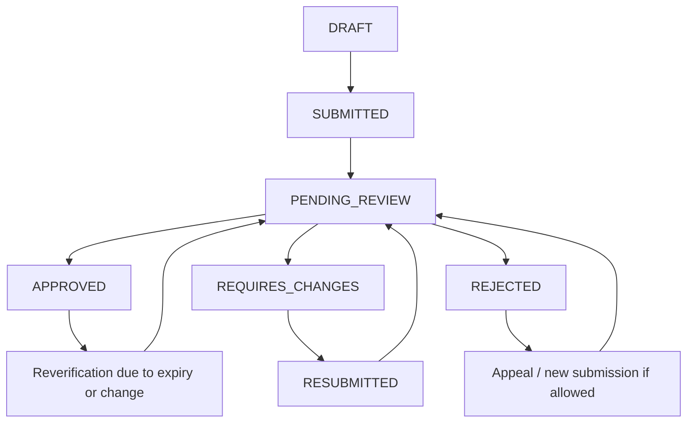

# KYC/KYB State Machine · DealGo

## Tách ba lớp trạng thái

- **Case state**: tình trạng hồ sơ KYB/KYC (`DRAFT`, `SUBMITTED`, `PENDING_REVIEW`, `REQUIRES_CHANGES`, `RESUBMITTED`, `APPROVED`, `REJECTED`).
- **Document state**: từng tài liệu (`MISSING`, `UPLOADED`, `REVIEWING`, `VERIFIED`, `INVALID`, `EXPIRED`, `REVOKED`).
- **Capability state**: quyền vận hành theo sản phẩm (`RIDE_PASSENGER`, `FOOD_DELIVERY`, `MERCHANT_ACCEPT_ORDERS`) → `ENABLED`/`DISABLED`, có reason code và evaluatedAt riêng.

Không dùng `caseState == APPROVED` một mình để bật nhận chuyến; phải kiểm tra license, vehicle, review, ban/suspension, chính sách vùng/loại dịch vụ và thời điểm hiện tại.

## Chuyển trạng thái hồ sơ



`EXPIRED` và `SUSPENDED` nên thuộc compliance/capability projection (và có thể là trạng thái một tài liệu). Không nhất thiết tạo một case mới chỉ để biểu diễn tài liệu hết hạn.

## Response contract minh họa

```json
{
  "caseId": "KYC-DRV-DEMO-01",
  "caseType": "DRIVER_KYC",
  "submissionVersion": 2,
  "caseState": "REQUIRES_CHANGES",
  "documents": [
    {"type": "IDENTITY_FRONT", "state": "INVALID", "reasonCodes": ["KYC-ID-BLUR"]},
    {"type": "DRIVING_LICENSE", "state": "EXPIRED", "reasonCodes": ["KYC-LICENSE-EXPIRED"]}
  ],
  "capabilities": {
    "RIDE_PASSENGER": {"enabled": false, "reasonCodes": ["KYC-LICENSE-EXPIRED"]},
    "FOOD_DELIVERY": {"enabled": true, "reasonCodes": []}
  },
  "canResubmit": true,
  "reviewedAt": null
}
```

**Quan trọng:** `FOOD_DELIVERY.enabled=true` là giả lập cho một chính sách mà dịch vụ này vẫn đủ điều kiện; không dùng làm luật cố định. Backend phải tính lại theo loại xe, bằng lái, hợp đồng và pháp luật hiện hành.

## Những test P0 cần triển khai tại backend

1. `document.uploaded` không tự sinh `case.approved`.
2. Khi ảnh OCR thất bại, user có thể chụp/sửa và re-submit, log không chứa số giấy tờ hoặc ảnh gốc.
3. Case bị `REQUIRES_CHANGES` không kích hoạt tính năng chưa được duyệt.
4. Cập nhật GPLX mới nhưng chưa duyệt không mở ngay `RIDE_PASSENGER`.
5. Khi document bị `EXPIRED`/`REVOKED`, dispatcher từ chối một yêu cầu ghép cuốc mới liên quan cho dù client Online.
6. Thay xe không thay thông tin xe của chuyến đã chốt; cần snapshot theo assignment.
7. Re-submit cùng idempotency key không tạo hai phiên duyệt.
8. Approve đến trễ không được ghi đè suspension/revocation mới hơn; dùng version/updatedAt và quy tắc thứ tự sự kiện.
9. Deep link của hồ sơ bị từ chối chỉ hiển thị thông tin đúng chủ tài khoản/cửa hàng.
10. Vẫn cho truy cập hỗ trợ/lịch sử và các hoạt động hợp pháp khác khi một capability bị hạn chế.

## Flutter integration

- Repository trả về `VerificationCase`, `DocumentStatus`, `ServiceCapability` tách biệt.
- Một nguồn quyết định `DriverCapabilities`/`MerchantCapabilities`, fetch lại tại app resume / trước CTA quan trọng / sau push.
- Flutter hiển thị skeleton/error/offline và trạng thái trung gian; không ẩn thông báo quan trọng sau animation.
- Các bản ngoại lệ là state của D015, M011, M012, không thêm route mới.
- OTP, CCCD/ảnh selfie, ngân hàng là dữ liệu nhạy cảm: file cần mã hóa/phân quyền, lưu tối thiểu theo chính sách, không đưa vào asset, crash analytics hoặc log.
