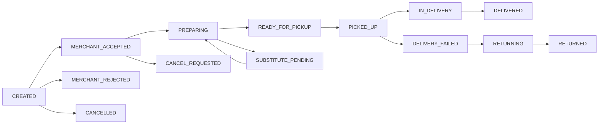

# DealGo – Order/Delivery/Payment state machines

Cần tách **Order**, **Merchant fulfillment**, **Driver assignment**, **Payment**, **Settlement**: chúng không cùng một trạng thái và không được cập nhật bởi UI tùy ý.

## Order (rút gọn)

`DRAFT -> SUBMITTED -> MERCHANT_ACCEPTED -> PREPARING -> READY_FOR_PICKUP -> PICKED_UP -> IN_DELIVERY -> DELIVERED`, hoặc rẽ nhánh `MERCHANT_REJECTED`, `CANCEL_REQUESTED -> CANCELLED / CANCELLATION_DENIED`, `DELIVERY_FAILED -> RETURN_*`.

## Price offer và snapshot

`OFFER_OPEN -> DRIVER_QUOTED -> CUSTOMER_ACCEPTED -> COMMITTED`. Snapshot gồm quote ID, version, customer ID, merchant ID, danh sách món, subtotal, delivery fee, discount, payable, pickup, dropoff. Mỗi counteroffer tạo quote version mới; **không cập nhật các màn khác trước khi khách chấp nhận**. Quote expiry không làm thay đổi order đã commit.

## Merchant

`AWAITING_ACCEPTANCE -> ACCEPTED -> PREPARING -> READY -> HANDED_OVER`; hoặc `REJECTED`. Shop gửi substitute proposal sang customer và chờ quyết định, không âm thầm sửa món.

## Driver

`AVAILABLE -> OFFERED -> ASSIGNED -> EN_ROUTE_TO_SHOP -> AT_SHOP -> PICKED_UP -> IN_DELIVERY -> DELIVERED`; ngoại lệ `DELIVERY_FAILED -> RETURN_*`. Không assign hai công việc hoạt động cùng lúc cho cùng tài xế.

## Payment và settlement

- COD `UNPAID -> COD_COLLECTED` chỉ khi bằng chứng giao hợp lệ được xác minh bởi backend; có trường hợp thu tiền trước thất bại phải xử lý riêng, không giả định mặc định.
- `COD_COLLECTED -> RECONCILIATION_PENDING -> RECONCILED` là bước tài chính riêng.
- Shop `PAYOUT_PENDING -> PAYOUT_INITIATED -> PAID / FAILED`; trả hàng/hoàn tiền tạo nghiệp vụ độc lập.
- Mọi event cập nhật entity có expected version, actor/role, audit log và idempotency key; không thể chạy lại để nhân đôi công nợ hoặc payout.

## Gợi ý API và dữ liệu thời gian thực

- `POST /orders` chứa `idempotencyKey` và snapshot; trả `orderId`, `version`, `state`.
- `POST /orders/:id/merchant-accept` kiểm tra Shop owner/staff, version.
- `POST /orders/:id/substitution-proposals`; `POST /orders/:id/substitution-proposals/:proposalId/approve` chỉ dành cho khách sở hữu đơn.
- `POST /delivery/:id/handoff` và `POST /delivery/:id/pickup-confirm` cùng mã/bằng chứng và chống lặp.
- `POST /delivery/:id/complete` yêu cầu POD/OTP; backend thực hiện mutation giao hàng + ledger trong transaction/outbox phù hợp.
- `GET /orders/:id/timeline` trả event logs có server sequence, timestamps, không dựng trạng thái cuối từ máy khách.
- `GET /wallet/ledger` và `GET /settlements` là dữ liệu sổ cái, không lấy số dư từ cộng các text trên giao diện.

API chỉ là đề xuất, chưa đối chiếu với backend thật.
