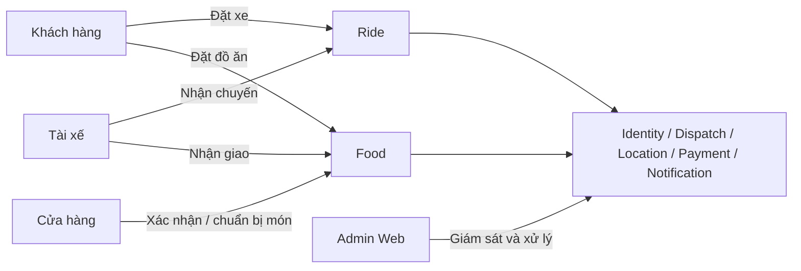
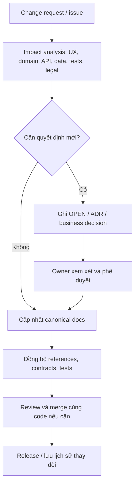

# DealGo — Hướng dẫn bộ tài liệu dự án

> **Mục đích:** Đây là điểm bắt đầu (entry point) và nguồn hướng dẫn quản trị tài liệu cho dự án DealGo. Tài liệu này quy định cách đọc, viết, kiểm duyệt, liên kết và cập nhật toàn bộ hồ sơ sản phẩm/kỹ thuật để con người và AI coding agent triển khai cùng một cách hiểu.
>
> **Lưu ý trạng thái:** Các tên tệp trong *Danh mục tài liệu* là kế hoạch cấu trúc; tại thời điểm khởi tạo, chưa mặc định chúng đã được viết hoặc phê duyệt. Mọi chính sách kinh doanh, giá, SLA và điều kiện pháp lý chưa có quyết định phải được đánh dấu `TBD`, không được tự coi là yêu cầu chính thức.

## 1. Tổng quan dự án

**DealGo** là nền tảng phục vụ nhu cầu di chuyển và đặt đồ ăn, với hai dịch vụ được đưa vào phạm vi MVP:

1. **Ride:** khách xem giá tham khảo, gửi giá đề xuất; tài xế chấp nhận hoặc đưa giá khác; khách chọn một đề nghị/tài xế trước khi hệ thống phân công và theo dõi chuyến.
2. **Food:** khách chọn cửa hàng/nhà hàng và món ăn, đặt đơn, cửa hàng xử lý, tài xế nhận giao và khách theo dõi đến khi hoàn tất.
3. **Account & communication:** hỗ trợ passkey, xác minh phone qua SMS, email đã xác minh; chat và gọi thoại trong ứng dụng gắn với Ride/Food.

### 1.1. Kênh và vai trò

| Kênh | Vai trò chính | Mục tiêu |
|---|---|---|
| **Một ứng dụng mobile Flutter** | **Khách hàng (Customer)** | Tìm dịch vụ, đặt xe, đặt đồ ăn, theo dõi, thanh toán và hỗ trợ. |
| **Cùng ứng dụng mobile Flutter** | **Cửa hàng (Merchant)** | Đăng ký/xác minh, quản lý cửa hàng và thực đơn, nhận/xử lý đơn, theo dõi đối soát. |
| **Cùng ứng dụng mobile Flutter** | **Tài xế/shipper (Driver)** | Đăng ký/xác minh, bật/tắt hoạt động, nhận chuyến/đơn, điều hướng, cập nhật tiến trình, theo dõi thu nhập. |
| **Admin Web** | **Nhân sự vận hành được phân quyền** | Kiểm duyệt, giám sát đơn/chuyến, xử lý sự cố, cấu hình và báo cáo. |

**Nguyên tắc đã thống nhất:** một sản phẩm mobile hỗ trợ ba vai trò, không mặc định tách thành ba ứng dụng độc lập. Thiết kế vai trò, chuyển vai trò, phân quyền và điều kiện kích hoạt phải được đặc tả trước khi code trong `02-domain/roles-and-permissions.md` và `03-workflows/account-onboarding-role-switching.md`.

### 1.2. Mô hình nghiệp vụ mức cao



Sơ đồ **chỉ thể hiện trách nhiệm nghiệp vụ**, không phải thiết kế deployment hay quyết định bắt buộc dùng microservices. Ranh giới module và kiến trúc triển khai sẽ được quyết định trong nhóm `05-architecture`.

## 2. Phạm vi, cam kết và điều chưa chốt

### 2.1. Các quyết định sản phẩm đã có

| ID | Quyết định | Trạng thái | Nguồn quyết định |
|---|---|---|---|
| `DEC-PROD-001` | MVP bao gồm **Ride** (xe máy và ô tô, `DG-DEC-VEH-001`) và **Food**. | `CONFIRMED` | Trao đổi sản phẩm với chủ dự án. |
| `DEC-PROD-002` | **Một ứng dụng mobile** hỗ trợ Customer, Merchant và Driver. | `CONFIRMED` | Trao đổi sản phẩm với chủ dự án. |
| `DEC-PROD-003` | Tham khảo Grab/GrabFood/ShopeeFood cho luồng Ride/Food, không sao chép giao diện hay logic nội bộ. | `CONFIRMED` | Định hướng nghiên cứu. |
| `DEC-PROD-005` | Ride có thương lượng giá: khách đề xuất, tài xế chấp nhận/đưa giá khác, khách chọn trước khi assignment. | `CONFIRMED` | Yêu cầu chủ dự án; mức sàn/trần, vòng, timeout, phí thuộc `OPEN-003/019`. |
| `DEC-PROD-006` | Email chỉ là thông tin liên hệ, không dùng đăng nhập. | `SUPERSEDED` (2026-10-18) | Thay bằng `DEC-PROD-008`: đăng nhập bằng SĐT + OTP, email + mật khẩu, passkey; Admin bật/tắt từng phương thức. |
| `DEC-PROD-007` | Chat và gọi thoại trong app theo giao dịch Ride/Food. | `CONFIRMED` | Không lộ số cá nhân; no-recording/no-video baseline; policy/provider `OPEN-021`. |
| `DEC-PROD-008` | Đăng ký email bắt buộc OTP qua email trước khi tạo tài khoản; tài khoản email cũ chưa xác thực kích hoạt bằng OTP khi đăng nhập. | `CONFIRMED` | Yêu cầu chủ dự án 2026-10-18; thông số chi tiết trong [decisions-and-assumptions.md](./decisions-and-assumptions.md). |
| `DEC-PROD-004` | Cần tài liệu đủ để triển khai thực tế, gồm UI/UX, domain, backend, mobile, kiểm thử, bảo mật, vận hành. | `CONFIRMED` | Định hướng bộ hồ sơ DealGo. |

### 2.2. Các quyết định cần xác nhận trước khi khóa đặc tả liên quan

| ID | Chủ đề | Trạng thái |
|---|---|---|
| `OPEN-001` | Thành phố/khu vực khai trương và phạm vi địa lý phục vụ. | `TBD` |
| `OPEN-002` | Phương thức thanh toán khả dụng ở bản phát hành đầu (COD, chuyển khoản, cổng thanh toán, ví...). | `TBD` |
| `OPEN-003` | Cấu trúc giá Ride/Food, phí nền tảng, phí hủy, ưu đãi và phân chia doanh thu. | `TBD` |
| `OPEN-004` | Thời gian chờ, bán kính điều phối, quy tắc nhận chuyến đồng thời, điều kiện phân công lại. | `TBD` |
| `OPEN-005` | Trường hợp Merchant/Driver được phép kiêm nhiệm vai trò và giới hạn hoạt động đồng thời. | `TBD` |
| `OPEN-006` | Phạm vi pháp nhân, đối tác vận tải, điều kiện hợp tác cửa hàng và quy trình xét duyệt thực tế. | `TBD` |
| `OPEN-007` | Chỉ tiêu tải, SLO, chi phí hạ tầng và ưu tiên triển khai theo từng đợt. | `TBD` |
| `OPEN-008` | Phương án xác minh danh tính, giấy phép và các nhà cung cấp dịch vụ bên thứ ba. | `TBD` |

**Quy tắc:** `TBD` không có nghĩa là agent được tự chọn chính sách. Agent được quyền đưa ra **đề xuất ghi rõ là proposal** kèm tác động, nhưng không được chuyển proposal thành quy tắc tính tiền, phân quyền hay tính hợp pháp mà không có phê duyệt.

### 2.3. Phạm vi đề xuất cho release đầu tiên

- **In scope đã xác nhận:** luồng Ride có thương lượng giá, luồng Food, ba vai trò mobile.
- **Năng lực hỗ trợ cần được đặc tả:** đăng ký/đăng nhập, onboarding & xác minh đối tác, bản đồ/địa chỉ, tính giá, điều phối, trạng thái chuyến/đơn, cập nhật realtime, thông báo, lịch sử, hỗ trợ, vận hành admin, xử lý lỗi và kiểm thử.
- **Chưa tự đưa vào MVP nếu chưa có quyết định:** gọi xe ô tô, giao kiện hàng độc lập, đi chợ, livestream, chương trình membership phức tạp, ví lưu trữ tiền, gom nhiều đơn của nhiều khách, liên tỉnh và mô hình nhượng quyền.

Các hạng mục trong danh sách “năng lực hỗ trợ” là **điểm cần phân tích**, không mặc nhiên là cam kết phạm vi hoặc nhà cung cấp tích hợp. Chi tiết cuối cùng nằm ở `00-governance/scope-release-plan.md`.

## 3. Mục tiêu của hệ thống tài liệu

Bộ hồ sơ DealGo phải giúp trả lời được sáu câu hỏi:

1. **Why:** vì sao tính năng cần tồn tại; mục tiêu, giá trị và giới hạn là gì?
2. **What:** người dùng được làm gì; các business rule, acceptance criteria và ngoại lệ là gì?
3. **How:** hệ thống nào xử lý; dữ liệu nào thay đổi; API/event, trạng thái, bảo mật và đồng bộ thế nào?
4. **Where:** thao tác diễn ra trên màn hình nào, vai trò nào; điều kiện hiển thị và khả năng truy cập ra sao?
5. **How to verify:** bằng test nào; điều kiện pass/fail; đo tải, tính đúng đắn, tiền và recovery thế nào?
6. **How to operate:** cấu hình, deploy, quan sát, đối soát, cảnh báo, rollback và xử lý sự cố thế nào?

**Definition of success:** một tính năng P0 chỉ được coi là đủ đặc tả khi người viết backend, mobile, QA và AI agent độc lập có thể xác định **cùng một** hành vi chính và các trường hợp lỗi quan trọng mà không phải đoán chính sách.

## 4. Bản đồ tài liệu (69 tệp / 11 nhóm)

> **Quy ước:** đường dẫn tính từ thư mục `docs/`. Danh mục là **planned inventory**; sự xuất hiện của đường dẫn không chứng minh file đã tồn tại. Mỗi nhóm có một nguồn trách nhiệm, tránh viết lặp quy tắc.

### 00 — Governance (5 tệp)

| Tệp | Nhiệm vụ |
|---|---|
| `00-governance/README.md` | Điểm bắt đầu, nguyên tắc quản trị và điều hướng (tài liệu này). |
| `00-governance/project-charter.md` | Tầm nhìn, mục tiêu, stakeholders và ràng buộc dự án. |
| `00-governance/scope-release-plan.md` | MVP, phạm vi theo release, in/out scope và mốc quyết định. |
| `00-governance/glossary.md` | Từ điển thuật ngữ Ride/Food và tên miền nghiệp vụ. |
| `00-governance/decisions-and-assumptions.md` | Decision log, giả định, rủi ro và câu hỏi mở. |

### 01 — Product (6 tệp)

| Tệp | Nhiệm vụ |
|---|---|
| `01-product/product-requirements.md` | PRD, bài toán, chỉ số thành công và yêu cầu ưu tiên. |
| `01-product/competitor-benchmark.md` | Đối chiếu Grab/GrabFood/ShopeeFood cho Ride/Food và inDrive cho pattern thương lượng giá, theo nguồn/ngày/mức xác thực. |
| `01-product/personas-and-stakeholders.md` | Persona và nhu cầu của Customer, Merchant, Driver, Ops. |
| `01-product/use-case-catalog.md` | Danh mục use case với ID, vai trò và precondition. |
| `01-product/functional-requirements.md` | Functional requirements có mã, điều kiện và tiêu chí nghiệm thu. |
| `01-product/non-functional-requirements.md` | Performance, reliability, security, availability, accessibility. |

### 02 — Domain (8 tệp)

| Tệp | Nhiệm vụ |
|---|---|
| `02-domain/domain-model.md` | Bounded contexts, thực thể, aggregate, invariant. |
| `02-domain/roles-and-permissions.md` | RBAC/ABAC, active role, kiểm tra quyền theo đối tượng. |
| `02-domain/identity-kyc-kyb.md` | Vòng đời tài khoản, KYC tài xế, KYB cửa hàng. |
| `02-domain/merchant-and-catalog-rules.md` | Cửa hàng, giờ mở, menu, availability, giá và tồn món. |
| `02-domain/pricing-fees-and-promotions.md` | Công thức giá, phí, khuyến mại và nguyên tắc làm tròn. |
| `02-domain/payments-ledger-settlement.md` | Charge/COD/refund/ledger/payout/reconciliation. |
| `02-domain/cancellation-refund-disputes.md` | Hủy chuyến/đơn, hoàn tiền, tranh chấp và trách nhiệm chi phí. |
| `02-domain/trust-safety-and-fraud.md` | Chống gian lận, sự cố an toàn, giới hạn và can thiệp. |

### 03 — Workflows (10 tệp)

| Tệp | Nhiệm vụ |
|---|---|
| `03-workflows/account-onboarding-role-switching.md` | Tạo tài khoản, mở quyền và chuyển vai trò. |
| `03-workflows/ride-booking-e2e.md` | Khách tìm xe đến khi kết thúc luồng đặt chuyến. |
| `03-workflows/ride-lifecycle.md` | State machine chuyến Ride, hủy và thay đổi trạng thái. |
| `03-workflows/food-ordering-e2e.md` | Giỏ hàng, checkout, đặt đơn, thanh toán và theo dõi. |
| `03-workflows/food-fulfillment.md` | Merchant xác nhận/chế biến và Driver nhận/giao món. |
| `03-workflows/dispatch-and-assignment.md` | Matching, offer, accept, reassign, concurrency, timeout. |
| `03-workflows/maps-tracking-and-eta.md` | Geocoding, vị trí, route/ETA, GPS background và privacy. |
| `03-workflows/payment-and-payout-flow.md` | Luồng thanh toán, webhook, hoàn tiền, settlement. |
| `03-workflows/notifications-chat-support.md` | Thông báo, chat/hỗ trợ, điều kiện phát và quyền truy cập. |
| `03-workflows/exceptions-and-recovery.md` | Các kịch bản mất mạng, không có tài xế, app kill, retry. |

### 04 — Experience (6 tệp)

| Tệp | Nhiệm vụ |
|---|---|
| `04-experience/information-architecture.md` | Site map, navigation, cấu trúc theo role. |
| `04-experience/screen-inventory.md` | Danh mục màn hình duy nhất và trạng thái triển khai. |
| `04-experience/screen-specifications.md` | Hành vi chi tiết màn hình, action, điều kiện, validation. |
| `04-experience/design-system.md` | Token, typography, color, components, responsive. |
| `04-experience/interactions-and-motion.md` | Interaction, animation, haptics, motion safety. |
| `04-experience/ui-states-and-accessibility.md` | Loading, empty, error, offline, a11y, i18n. |

### 05 — Architecture (8 tệp)

| Tệp | Nhiệm vụ |
|---|---|
| `05-architecture/system-overview.md` | Context, boundaries, constraints và sơ đồ toàn hệ thống. |
| `05-architecture/c4-system-diagrams.md` | C4 context/container/component có chú giải. |
| `05-architecture/modules-and-boundaries.md` | Module contracts, ownership, dependency rules. |
| `05-architecture/backend-architecture.md` | API/backend internals, transactions, jobs và queues. |
| `05-architecture/flutter-architecture.md` | Multi-role navigation, state management, data/offline. |
| `05-architecture/realtime-and-event-architecture.md` | WebSocket/push/events, delivery semantics, ordering. |
| `05-architecture/concurrency-and-consistency.md` | Race condition, atomicity, idempotency, outbox và retry. |
| `05-architecture/external-integrations.md` | Maps, OTP, payment, push, KYC và fallback. |

### 06 — Data & API (6 tệp)

| Tệp | Nhiệm vụ |
|---|---|
| `06-data-api/er-diagram.md` | ERD và quan hệ nghiệp vụ quan trọng. |
| `06-data-api/data-dictionary.md` | Bảng/cột, kiểu, constraints, indexes, ownership. |
| `06-data-api/rest-api.openapi.yaml` | OpenAPI là contract có thể validate cho HTTP. |
| `06-data-api/realtime-api-contract.md` | Contract subscribe/emit/permissions/ack/reconnect. |
| `06-data-api/events.asyncapi.yaml` | AsyncAPI là contract sự kiện (nếu dùng event transport). |
| `06-data-api/data-lifecycle-and-migrations.md` | Migration, retention, deletion, audit và backfill. |

### 07 — Security & Legal (5 tệp)

| Tệp | Nhiệm vụ |
|---|---|
| `07-security-legal/threat-model.md` | Assets, trust boundaries, abuse cases và mitigations. |
| `07-security-legal/authentication-and-authorization.md` | OTP/session/token, policy, object-level authorization. |
| `07-security-legal/privacy-and-data-protection.md` | Dữ liệu cá nhân, vị trí, retention, quyền chủ thể dữ liệu. |
| `07-security-legal/partner-document-security.md` | Bảo vệ hồ sơ KYC/KYB và hạn chế truy cập giấy tờ. |
| `07-security-legal/legal-and-platform-compliance.md` | Checklist đánh giá pháp lý tại khu vực triển khai/App Store/Play. |

### 08 — Quality (5 tệp)

| Tệp | Nhiệm vụ |
|---|---|
| `08-quality/test-strategy.md` | Test pyramid, fixture, môi trường, trách nhiệm và coverage. |
| `08-quality/acceptance-criteria.md` | Ma trận tiêu chí nghiệm thu tính năng P0/P1. |
| `08-quality/critical-e2e-test-matrix.md` | Scenario end-to-end theo role và luồng tiền. |
| `08-quality/contract-and-load-testing.md` | API/event contract, latency, load/soak/spike testing. |
| `08-quality/failure-and-recovery-tests.md` | Chaos/failure, retry, restore, GPS/network/app restart. |

### 09 — Operations (5 tệp)

| Tệp | Nhiệm vụ |
|---|---|
| `09-operations/environments-and-cicd.md` | Env, secret, CI/CD, migration, canary/rollback. |
| `09-operations/runbooks-and-observability.md` | Metrics/logs/traces/runbook/incident response. |
| `09-operations/slos-and-alerting.md` | SLI/SLO, threshold, on-call và alert quality. |
| `09-operations/backup-and-disaster-recovery.md` | Backup, restore test, RPO/RTO và DR. |
| `09-operations/financial-operations.md` | Đối soát định kỳ, lệch sổ, chargeback, audit vận hành. |

### 10 — AI Execution (5 tệp)

| Tệp | Nhiệm vụ |
|---|---|
| `10-ai-execution/implementation-roadmap.md` | Các phase/vertical slices, release gates, dependency. |
| `10-ai-execution/task-breakdown-and-dependencies.md` | Work packages có entry/exit criteria và owner. |
| `10-ai-execution/agent-execution-contract.md` | Luật đọc docs, phạm vi sửa code, bằng chứng và escalation. |
| `10-ai-execution/requirement-traceability.md` | Liên kết requirement → workflow → API → UI → test. |
| `10-ai-execution/definition-of-ready-done.md` | Điều kiện Ready/Done cấp feature và release. |

**Tổng kiểm kê: 69 tệp (67 Markdown + 2 YAML), 11 nhóm.** Số file không phải KPI chất lượng; được phép tách/gộp sau khi có ADR, miễn không tạo nhiều nguồn sự thật xung đột.

## 5. Thứ tự đọc theo trách nhiệm

| Người đọc | Điểm bắt đầu | Tài liệu cần xem tiếp |
|---|---|---|
| Product Owner / BA | `00` → `01` | `02`, `03`, `08-quality/acceptance-criteria.md` |
| UI/UX / Flutter | `01` → `03` | `04`, `02/roles-and-permissions.md`, `05/flutter-architecture.md`, `06` |
| Backend | `01` → `02` → `03` | `05`, `06`, `07`, `08` |
| QA | `01` → `02` → `03` | `06` → `08` |
| DevOps / SRE | `01/non-functional-requirements.md` | `05`, `07`, `09` |
| AI coding agent | `00` → `10/agent-execution-contract.md` | Chỉ đọc sâu các tài liệu có liên quan đến task, theo dependency. |

**Nguyên tắc thực thi theo vertical slice:** triển khai một luồng người dùng hoàn chỉnh, ví dụ đặt Ride → dispatch → nhận chuyến → theo dõi → kết thúc → kiểm thử; không xây hàng loạt màn hình/API rời rạc rồi mới nối sau.

## 6. Nguồn sự thật và xử lý mâu thuẫn

Một thông tin nghiệp vụ chỉ có **một vị trí chuẩn**; các tài liệu khác tham chiếu đến nó bằng ID/đường dẫn.

| Loại thông tin | Nguồn chuẩn (canonical owner) |
|---|---|
| Mục tiêu, phạm vi, release | `00-governance/scope-release-plan.md`; `01-product/product-requirements.md` |
| Quy tắc nghiệp vụ, vai trò, tiền | `02-domain/*` |
| Trình tự, trạng thái và nhánh lỗi | `03-workflows/*` |
| Tên màn hình, hành vi UI, token | `04-experience/*` |
| Quyết định và ràng buộc kiến trúc | `05-architecture/*`; ADR trong `00-governance/decisions-and-assumptions.md` |
| Schema, endpoints, event payloads | `06-data-api/*` (contract phải khớp triển khai) |
| Bảo mật, tuân thủ, dữ liệu cá nhân | `07-security-legal/*` |
| Expected outcomes và bằng chứng kiểm thử | `08-quality/*` |
| Vận hành và đảm bảo độ tin cậy | `09-operations/*` |
| Thứ tự task, các gate của coding agent | `10-ai-execution/*` |

Khi có hai tài liệu mâu thuẫn:

1. **Không âm thầm chọn nội dung mới hơn hoặc thuận tiện hơn.** Ghi `DOC-CONFLICT` với vị trí và tác động.
2. Xác định `canonical owner` theo bảng trên; hỏi chủ quyết định nghiệp vụ/kỹ thuật nếu cần.
3. Cập nhật nguồn chuẩn, rồi cập nhật các tài liệu dẫn chiếu, test và code liên quan trong cùng change set nếu phù hợp.
4. Không đưa thay đổi rủi ro cao vào release nếu business rule hoặc approval chưa rõ.

**Thứ tự ưu tiên khi thực thi:** yêu cầu pháp lý/bảo mật đã xác minh và quyết định sản phẩm được phê duyệt → đặc tả nghiệp vụ đã phê duyệt → API/data contracts phù hợp → implementation. ADR mô tả **lý do chọn giải pháp**, không được thay thế quy tắc nghiệp vụ.

## 7. Tiêu chuẩn viết một tài liệu

### 7.1. Metadata bắt buộc

Mỗi file Markdown đặc tả chính cần front matter:

```yaml
doc_id: DG-<AREA>-<NNN>
title: "Tên tài liệu"
version: "0.1.0"
status: "DRAFT" # DRAFT | IN_REVIEW | APPROVED | ACTIVE | DEPRECATED
owner: "Role chịu trách nhiệm"
last_updated: "YYYY-MM-DD"
related_requirements: []
related_decisions: []
```

- `DRAFT`: đang soạn; chưa phải cơ sở bắt buộc để code chính sách quan trọng.
- `IN_REVIEW`: đang chờ rà soát nghiệp vụ/kỹ thuật/tuân thủ.
- `APPROVED`: nội dung đã được người chịu trách nhiệm xác nhận.
- `ACTIVE`: đang áp dụng cho release/triển khai hiện hành.
- `DEPRECATED`: không còn hiệu lực, phải nêu đường dẫn thay thế.

Không tự chuyển `DRAFT` thành `APPROVED` chỉ vì một AI agent đã tạo hoặc kiểm tra file.

### 7.2. Khung nội dung cho tài liệu có hành vi hệ thống

Với docs về nghiệp vụ hoặc workflow, ưu tiên khung:

1. **Purpose / Scope / Out of scope** và yêu cầu liên quan.
2. **Actors / Permissions / Preconditions**.
3. **Business rules** (ID rõ ràng, chủ sở hữu quy tắc).
4. **Happy path** theo thứ tự tác nhân và hệ thống.
5. **Alternative / Failure / Recovery paths**.
6. **State machine** với transition, guard, side effect và terminal states.
7. **Sequence / BPMN** nếu luồng xuyên hệ thống.
8. **Data/API/event contracts** với tham chiếu đến canonical owner.
9. **Concurrency / Idempotency / Timeout / Retry** nếu phát sinh tranh chấp trạng thái.
10. **Security / Privacy / Observability**.
11. **Acceptance criteria / Test cases**.
12. **Open questions / Decision references / Change history**.

Không cần ép tài liệu từ điển hoặc README theo đủ 12 phần. Nội dung phải tương xứng với chức năng file và rủi ro nghiệp vụ.

### 7.3. Quy tắc viết nội dung

- **Phân biệt sự thật và đề xuất:** dùng nhãn `CONFIRMED`, `PROPOSED`, `TBD`, `OUT_OF_SCOPE`; nêu nguồn và ngày kiểm tra với thông tin từ đối thủ/nhà cung cấp.
- **Viết đủ để test:** tránh “nhanh”, “bảo mật cao”, “hợp lý”; cần tiêu chí đo được khi có số liệu được phê duyệt.
- **Không bịa giá trị:** thời gian timeout, phí hủy, tỉ lệ chiết khấu, ETA, SLA, phiên bản SDK, luật và quyền truy cập đều phải có căn cứ/approval.
- **Một quy tắc — một nguồn chuẩn:** dùng tham chiếu thay vì copy.
- **Mọi biểu đồ cần chú giải:** ghi diễn giải trạng thái, trigger, trách nhiệm và giới hạn áp dụng.
- **Không đưa secrets, API keys, dữ liệu cá nhân thật vào docs hoặc test fixture.**
- **Thiết kế cho sự cố:** mọi flow critical có trường hợp retry/replay, mất mạng, mất GPS, app bị kill, timeout hoặc rollback thích hợp.

## 8. Quy ước ID và truy vết

| Loại | Mẫu ID | Ví dụ |
|---|---|---|
| Functional requirement | `FR-<DOMAIN>-NNN` | `FR-RIDE-001` |
| Non-functional requirement | `NFR-<AREA>-NNN` | `NFR-API-001` |
| Business rule | `BR-<DOMAIN>-NNN` | `BR-DISPATCH-001` |
| Workflow | `WF-<DOMAIN>-NNN` | `WF-FOOD-001` |
| Screen | `SCR-<ROLE>-NNN` | `SCR-DRIVER-001` |
| API operation | `API-<DOMAIN>-NNN` | `API-RIDE-001` |
| Event | `EVT-<DOMAIN>-NNN` | `EVT-RIDE-001` |
| Test case | `TC-<DOMAIN>-NNN` | `TC-RIDE-001` |
| Architecture/business decision | `ADR-NNN` / `DEC-<AREA>-NNN` | `ADR-001` |
| Unresolved decision | `OPEN-NNN` | `OPEN-004` |

**Một ví dụ traceability (minh họa, chưa phải requirement đã duyệt):**

`FR-RIDE-001` (khách gửi yêu cầu đặt xe) → `WF-RIDE-001` (đặt xe) → `BR-DISPATCH-001` (chỉ một tài xế nhận hợp lệ) → `API-RIDE-001` (tạo yêu cầu) → `SCR-CUSTOMER-001` (màn hình đặt xe) → `TC-RIDE-001` (kiểm thử phân công đồng thời).

Các liên kết thực tế được quản lý trong `10-ai-execution/requirement-traceability.md`. **Không coi ví dụ trên là xác nhận endpoint, tên màn hình hoặc bảng dữ liệu.**

## 9. Definition of Ready cho một tính năng P0

Một task triển khai nghiệp vụ trọng yếu chỉ chuyển sang `READY` khi:

- [ ] Có requirement ID, mục tiêu, phạm vi và mức ưu tiên.
- [ ] Actor/role, precondition, permissions và ownership rõ ràng.
- [ ] Happy path, các nhánh lỗi quan trọng, trạng thái và hành vi timeout xác định.
- [ ] Quy tắc tính tiền/tranh chấp dữ liệu đã được duyệt nếu feature có tác động tài chính.
- [ ] Dependencies, contract request/response/event và dữ liệu liên quan đủ để implement; nếu contract chưa sẵn, task đầu tiên phải thiết kế/duyệt contract.
- [ ] Có acceptance criteria và test cases cho ít nhất các rủi ro P0.
- [ ] Những câu hỏi mở có nguy cơ thay đổi schema/authorization/tiền phải được chốt hoặc chặn phần code phụ thuộc.

## 10. Definition of Done cho một tính năng P0

- [ ] Code và docs đúng cùng một business rule; không còn giả định âm thầm.
- [ ] UI trạng thái loading/empty/error/offline và quyền truy cập được xử lý nếu liên quan.
- [ ] Backend validation/authorization và concurrency/idempotency được kiểm tra khi cần.
- [ ] Test unit/integration/contract/E2E phù hợp chạy thành công; kết quả có bằng chứng.
- [ ] Dữ liệu/schema/migration có kế hoạch triển khai và rollback/forward fix khi cần.
- [ ] Logging, metrics, alerts hoặc audit trail áp dụng cho luồng critical.
- [ ] Không lộ secrets, PII hoặc thông tin nhạy cảm trong logs/test.
- [ ] Requirement traceability và tài liệu liên quan được cập nhật.
- [ ] Người có thẩm quyền chấp thuận release gate tương ứng.

Chi tiết tiêu chuẩn áp dụng theo loại task ở `10-ai-execution/definition-of-ready-done.md`.

## 11. Quy trình thay đổi và phê duyệt



**Tối thiểu trong một thay đổi tài liệu:** mô tả tại sao thay đổi, file nguồn chuẩn, danh sách docs bị ảnh hưởng, migration/API compatibility nếu có, tác động test, người review và ngày quyết định. Các thay đổi nhạy cảm về quyền, tài chính, xác minh hoặc dữ liệu cá nhân phải có review chuyên trách phù hợp.

## 12. Quy tắc cho AI coding agents

1. Đọc `README.md` này và `10-ai-execution/agent-execution-contract.md` trước khi nhận implementation task (sau khi file thứ hai được tạo).
2. Xác định `requirement_id`, đường dẫn canonical, assumptions và acceptance criteria của task.
3. Không suy diễn chính sách từ cách Grab/ShopeeFood hoạt động; nghiên cứu đối thủ chỉ là **tham khảo**, không phải đặc tả DealGo.
4. Chỉ sửa phạm vi được giao; nếu phát hiện lệch API/schema/domain rule, báo conflict trước khi mở rộng thay đổi.
5. Không tự ý kích hoạt payment thật, gửi thông báo hàng loạt, xóa dữ liệu, triển khai production hoặc thay đổi quyền mà thiếu cho phép.
6. Mỗi PR/task output phải có: **thay đổi**, **docs liên quan**, **test đã chạy/chưa chạy**, **rủi ro còn lại**, **bằng chứng kiểm chứng**.
7. Không báo “hoàn thành” khi chỉ có code nhưng thiếu test nghiệm thu hoặc bỏ qua nhánh lỗi trọng yếu.
8. Ưu tiên tái sử dụng thư viện/công cụ đã được đánh giá phiên bản, giấy phép, bảo trì và mức tương thích; không tự dựng lại chức năng hạ tầng phổ biến nếu có giải pháp phù hợp.
9. Cấu trúc repository có thể dùng `mobile/`, `backend/`, `website/` để tổ chức triển khai, nhưng phải được quyết định trong tài liệu kiến trúc chứ không coi là hệ quả tất yếu của README.

## 13. Thứ tự xây dựng tài liệu khuyến nghị

Không cần viết hết 69 file trước khi code. Nên hoàn thiện theo **phần cắt dọc (vertical slice)**, với các mốc:

**A. Foundation nghiệp vụ:** `project-charter` → `scope-release-plan` → `product-requirements` → `roles-and-permissions` → `ride-booking-e2e` → `food-ordering-e2e` → `cancellation-refund-disputes`.

**B. Contract và kiến trúc:** `domain-model` → `dispatch-and-assignment` → `payments-ledger-settlement` → `system-overview` → `backend-architecture` → `flutter-architecture` → ERD/OpenAPI/realtime contracts.

**C. UX và delivery:** `screen-inventory` → `screen-specifications` → `design-system` → `implementation-roadmap` → `task-breakdown-and-dependencies` → `agent-execution-contract`.

**D. Release readiness:** acceptance/E2E/failure tests → privacy/security → CI/CD/observability/financial operations → release gate.

Các bước trên có thể diễn ra song song có kiểm soát, miễn không vi phạm dependency và không code vượt qua các `TBD` có ảnh hưởng cao.

## 14. Tài liệu kế tiếp

**Tệp tiếp theo cần viết:** `docs/00-governance/project-charter.md` — xác lập rõ hơn mục tiêu, vấn đề, giá trị người dùng, stakeholder, ràng buộc và tiêu chí thành công của DealGo.

### Lịch sử thay đổi

| Ngày | Phiên bản | Nội dung |
|---|---|---|
| 2026-10-12 | 0.2.0 | Đồng bộ scope/auth passkey + phone SMS + email, chat/call P0, decision links và P1 boundary. |
| 2026-10-11 | 0.1.0 | Khởi tạo entry point, kiểm kê 69 tài liệu, quy tắc source of truth, ID, review, DoR/DoD và hướng dẫn AI agent. |
