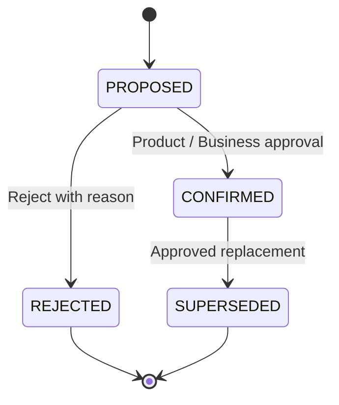
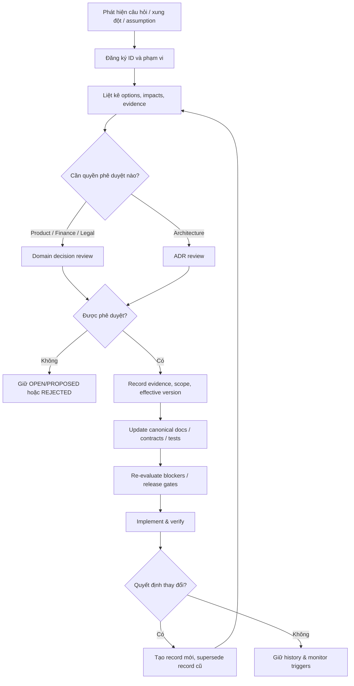

# DealGo — Decisions, Assumptions & Open Issues

> **Tình trạng tài liệu: `DRAFT`.** Đây là sổ ghi nhận bối cảnh, các quyết định **đã được người dùng xác nhận ở mức định hướng**, giả định **chưa kiểm chứng**, vấn đề **chưa chốt** và các ràng buộc có thể chặn công việc hoặc release. Việc tài liệu được AI soạn không đồng nghĩa với việc mọi đề xuất bên trong được phê duyệt.
>
> **Phạm vi bất biến đã xác nhận:** DealGo có **Ride hai bánh + Food cùng nằm trong MVP**, trên **một ứng dụng Flutter hỗ trợ Customer, Merchant, Driver**. Admin Web thuộc baseline vận hành đang được hoạch định. Không chuyển những điều đã xác nhận này thành “giả định”.
>
> **Tài liệu liên quan:** [README](./README.md) · [Project Charter](./project-charter.md) · [Scope & Release Plan](./scope-release-plan.md) · [Glossary](./glossary.md).

## 1. Mục đích và kết quả mong đợi

Quản trị quyết định nhằm bảo đảm:

1. Người triển khai trả lời được **vì sao** chọn một phương án và **ai có quyền** xác nhận phương án đó.
2. Một đề xuất, giả định hoặc nội dung đối thủ đang làm **không bị hiểu nhầm** thành chính sách của DealGo.
3. Các câu hỏi chưa giải quyết được đánh dấu bằng ID, ảnh hưởng, owner dự kiến, cách tạm thời tiếp tục phát triển và **điểm bắt buộc phải chốt**.
4. Khi thay đổi một quyết định, lịch sử không bị mất; điều chỉnh PRD, business rules, workflow, API, test, security và release gate có thể truy vết.
5. AI Agent biết khi nào **được tiếp tục**, khi nào **chỉ được mock/stub** và khi nào **phải dừng việc triển khai phần phụ thuộc**.

**Không thuộc mục đích:** tài liệu này không tính giá, không thiết kế chi tiết dispatch, không xác nhận loại giấy phép hay trách nhiệm pháp lý, không thay thế bản ERD hoặc hợp đồng API. Các file trong nhóm `02-domain/*`, `03-workflows/*`, `06-data-api/*`, `07-security-legal/*` là nguồn chuẩn cho nội dung chuyên môn tương ứng.

## 2. Phân biệt sáu loại thông tin

| Loại | Định nghĩa | Được dùng làm yêu cầu bắt buộc? | Hành động |
|---|---|---|---|
| **Decision (`DEC-*`, `ADR-*`)** | Kết luận đã chọn một hướng và có bằng chứng người có thẩm quyền đã chấp thuận. | **Có**, nếu `CONFIRMED`/`ACCEPTED`, đúng phạm vi và chưa bị supersede. | Dẫn chiếu sang docs chuyên trách. |
| **Open decision (`OPEN-*`)** | Câu hỏi cần lựa chọn; chưa có quyết định hợp lệ. | **Không**. | Phân tích options, blocking scope, đề xuất owner. |
| **Assumption (`ASM-*`)** | Giả thiết có thể đúng nhưng thiếu chứng cứ, dùng để lập kế hoạch/thử nghiệm. | **Không**, kể cả khi độ tin cậy cao. | Đặt cách kiểm chứng, hạn rà soát theo gate. |
| **Constraint (`CON-*`)** | Giới hạn đã được chứng minh hoặc phê duyệt, từ sản phẩm, kỹ thuật, hợp đồng hay pháp luật. | Chỉ khi nguồn và thẩm quyền hợp lệ. | Gắn bằng chứng và phạm vi áp dụng. |
| **Risk (`RISK-*`)** | Sự kiện có thể xảy ra và gây hậu quả. | Không phải một quyết định; có thể sinh release blocker. | Dùng risk register tại Charter + đánh giá chuyên môn. |
| **Issue / Conflict (`ISS-*`, `DOC-CONFLICT-*`)** | Vấn đề đã xảy ra hoặc mâu thuẫn tài liệu hiện hữu. | Không. | Triage, sửa nguồn chuẩn, kiểm chứng lại. |

**Ví dụ:** “Khách có thể chọn thanh toán COD” là `OPEN-002`, **không** là `DEC` cho đến khi được duyệt; “COD sẽ chiếm phần lớn giao dịch” là `ASM`, cần số liệu; “không ghi nhận hoàn tiền hai lần” là yêu cầu integrity phải có test và hợp đồng nghiệp vụ, không phải một con số có thể tự bịa.

### 2.1. Nguồn bằng chứng và mức độ tin cậy

| Nguồn | Được xem là gì? | Điều không được suy diễn |
|---|---|---|
| Yêu cầu người dùng/chủ dự án đã nêu rõ | Bằng chứng cho định hướng `CONFIRMED` theo đúng nội dung phát biểu | Không tự thêm chi tiết pricing, SLA hoặc công nghệ. |
| Văn bản chấp thuận có dấu vết (PR, ticket, biên bản) | Bằng chứng phê duyệt có phạm vi cụ thể | Không mặc nhiên bao phủ tình huống ngoài phạm vi đó. |
| Trang công khai Grab, GrabFood, ShopeeFood | Nguồn tham khảo để benchmark | Không chứng minh quy tắc hay thuật toán nội bộ, không thành quyết định DealGo. |
| API docs/vendor docs | Mô tả khả năng và giới hạn kỹ thuật của provider | Không chứng minh chi phí, hợp đồng, mức phục vụ hay pháp lý đã được chấp thuận. |
| AI Agent gợi ý | `PROPOSAL` cần đánh giá | Không được tự duyệt hoặc tự đặt owner đã đồng ý. |
| Code cũ / mock / màn hình prototype | Evidence cho implementation đang tồn tại | Không chứng minh business rule đã được quyết định hay behavior production đúng. |

### 2.2. Độ tin cậy không thay thế việc phê duyệt

- `HIGH`: có dữ liệu/nguồn đáng tin, còn cần quyết định phạm vi và người duyệt.
- `MEDIUM`: có dấu hiệu hợp lý, chưa đủ bằng chứng hoặc chưa đánh giá tất cả ngoại lệ.
- `LOW`: giả thuyết ban đầu, cần nghiên cứu/thử nghiệm sớm.
- `UNKNOWN`: chưa đủ thông tin để xếp.

**Tất cả `ASM-*` trong phiên bản này vẫn là `UNVERIFIED`, bất kể confidence.**

## 3. Quy ước ID, vòng đời và tính toàn vẹn

| Registry | ID | Trạng thái chuẩn | Ghi chú |
|---|---|---|---|
| Product/Business decision | `DEC-<AREA>-NNN` | `PROPOSED`, `CONFIRMED`, `REJECTED`, `SUPERSEDED` | Giữ tương thích `DEC-PROD-001..007`. |
| Architecture Decision Record | `ADR-NNN` | `PROPOSED`, `ACCEPTED`, `REJECTED`, `SUPERSEDED`, `DEPRECATED` | Dành cho thay đổi quan trọng/khó đảo ngược. |
| Open question | `OPEN-NNN` | `OPEN`, `ANALYZING`, `AWAITING_APPROVAL`, `RESOLVED`, `CANCELLED` | Một ID chỉ cho một câu hỏi có scope rõ. |
| Assumption | `ASM-NNN` | `UNVERIFIED`, `TESTING`, `VALIDATED`, `INVALIDATED`, `EXPIRED` | `VALIDATED` vẫn không tự sinh business decision. |
| Constraint | `CON-NNN` | `PROPOSED`, `VERIFIED`, `RETIRED` | Bằng chứng và thời hạn phải kiểm tra lại. |
| Decision review / conflict | `ISS-NNN` / `DOC-CONFLICT-NNN` | `OPEN`, `IN_PROGRESS`, `RESOLVED` | Không sử dụng để thay thế decision record. |

**Không tái sử dụng ID**, kể cả bị từ chối; không xóa lịch sử. Mã được quản lý thủ công trong file này khi dự án còn nhỏ, sau này có thể sinh registry máy đọc từ chính file/metadata, nhưng chỉ sau quyết định và migration có kiểm thử.

### 3.1. Chuyển trạng thái hợp lệ



- Với `ADR-*`, dùng `ACCEPTED` thay cho `CONFIRMED`.
- `OPEN-*` chỉ sang `RESOLVED` sau khi có liên kết **đến decision được phê duyệt**, hoặc `CANCELLED` với lý do rõ ràng; không đóng chỉ vì có implementation.
- `ASM-*` chỉ chuyển `VALIDATED`/`INVALIDATED` khi ghi rõ phương pháp, ngày, mẫu chứng cứ và người rà soát.
- `CONFIRMED`/`ACCEPTED` có thể bị **thay thế**, không xóa, không lén sửa nội dung lịch sử của quyết định. Sửa lỗi chính tả/URL không đổi ý nghĩa có thể chỉnh metadata và ghi changelog.

### 3.2. Schema tối thiểu cho mỗi quyết định

| Trường | Bắt buộc | Mô tả |
|---|---|---|
| `id`, `title`, `area`, `status` | Có | Định danh và phạm vi. |
| `context`, `problem`, `options` | Có | Tình huống, ràng buộc, các phương án xem xét. |
| `decision`, `rationale` | Khi chốt | Phương án được chọn và lý do, gồm tradeoffs. |
| `owner_role`, `approver_role` | Có | Vai trò đề xuất/duyệt, không tự đặt tên người chưa đồng ý. |
| `approval_evidence`, `approved_at` | Khi chốt | Đường dẫn chứng cứ kiểm được; không giả định approved date. |
| `scope`, `effective_from`, `supersedes` | Khi áp dụng | Giới hạn hiệu lực và quan hệ thay thế. |
| `impacts`, `references`, `tests` | Có | Các docs/module/test chịu tác động. |
| `risks`, `rollback_or_migration` | Khi có rủi ro | Cách khôi phục hoặc xử lý thay đổi. |

## 4. Ma trận quyền quyết định (proposed responsibility model)

> Các role dưới đây là **vai trò chịu trách nhiệm được đề xuất**, không khẳng định DealGo đã tuyển đủ nhân sự hoặc ủy quyền chính thức. Một người có thể đảm nhận nhiều vai trò ở giai đoạn solo; quyền phê duyệt vẫn phải được ghi nhận rõ.

| Loại quyết định | Người đề xuất/đánh giá | Người phê duyệt cuối đề xuất | Điều kiện bắt buộc |
|---|---|---|---|
| Phạm vi sản phẩm, hành trình người dùng | PO / BA / UX | **Product Owner** | Không trái phạm vi Ride+Food và multi-role đã xác nhận. |
| Chính sách giá, khuyến mại, hủy, bồi hoàn | PO / Finance / Ops | **Product Owner + Finance owner** | Có ví dụ tính toán, accounting impact, tư vấn pháp lý khi cần. |
| Logic điều phối và giới hạn workload | Backend / Dispatch / Ops | **Tech Lead + Product Owner** | Concurrency, fairness, safety và test đầy đủ. |
| KYC/KYB, dữ liệu nhạy cảm, điều kiện đối tác | Ops / Security / Legal | **Product Owner**, có **Legal/Compliance sign-off** cho phạm vi pháp lý | Không thay thế tư vấn pháp lý/giấy phép bằng quyết định kỹ thuật. |
| Công nghệ, module boundaries, ADR | Tech Lead / Engineer | **Tech Lead** | So sánh options, NFR, khả năng vận hành/migration. |
| Bảo mật, quyền truy cập, privacy | Security / Tech / Legal | **Tech Lead + người có thẩm quyền về compliance** | Không miễn trừ nghĩa vụ bắt buộc bằng waiver nội bộ. |
| Triển khai thương mại, kích hoạt tiền thật | Ops / Finance / Tech / QA | **Product Owner/Business Owner** sau các sign-off bắt buộc | G5 và bằng chứng pháp lý, financial, security, ops. |
| Đổi scope P0/P1/P2, release gate | Product / Tech / QA | **Product Owner + Tech Lead** | Impact review và update release plan. |

**Separation of duties theo mức rủi ro:** Người viết code có thể đề xuất, nhưng AI Agent không có quyền phê duyệt. Các thao tác hoàn tiền thủ công/thu hồi quyền có thể cần dual control trong production; thiết kế cụ thể là `TBD`, không mặc định đã có cơ chế đó.

## 5. Decision Register — những điều đã được xác nhận

Đây là **bản ghi tái hiện** từ [README §2](./README.md) và [Project Charter](./project-charter.md), không tự tạo quyết định mới.

| ID | Nội dung chính xác | Trạng thái | Phạm vi & điều KHÔNG suy ra | Bằng chứng hiện có |
|---|---|---|---|---|
| `DEC-PROD-001` | MVP gồm **Ride hai bánh + Food**. | `CONFIRMED` | Không mặc nhiên có ô tô, giao kiện hàng độc lập hoặc tất cả tính năng của đối thủ. | Yêu cầu chủ dự án được README/Charter ghi lại. |
| `DEC-PROD-002` | **Một mobile app Flutter** cho Customer / Merchant / Driver. | `CONFIRMED` | Không tự định nghĩa cách chuyển role, quyền và concurrency. | Yêu cầu chủ dự án được README/Charter ghi lại. |
| `DEC-PROD-003` | Tham khảo Grab, GrabFood, ShopeeFood để học flow. | `CONFIRMED` | Không sao chép UI, logic nội bộ; benchmark là evidence ngoài. | Định hướng nghiên cứu trong README/Charter. |
| `DEC-PROD-004` | Cần docs đủ hỗ trợ xây dựng phần mềm thực tế, vận hành/QA/bảo mật. | `CONFIRMED` | Không chứng minh rằng 69 file đã được viết/duyệt. | Định hướng bộ hồ sơ trong README. |
| `DEC-PROD-005` | Ride theo mô hình thương lượng giá: khách đưa giá đề xuất; tài xế có thể chấp nhận hoặc gửi giá khác; khách chọn một đề nghị/tài xế trước khi phân công. | `CONFIRMED` | Chỉ áp dụng Ride hai bánh. Không áp dụng mặc định cho giá món/Food; không chốt mức sàn/trần, số vòng, timeout, phí hay thanh toán. | Yêu cầu chủ dự án: DealGo là hệ thống kiểu inDrive, đặt xe có trả giá; chi tiết công khai inDrive dùng để đối chiếu quy trình. |
| `DEC-PROD-006` | Đăng ký/xác thực hỗ trợ passkey, xác minh số điện thoại qua SMS và email đã xác minh; Admin được phân quyền quản lý bật/tắt phương thức theo chính sách an toàn. | `CONFIRMED` | SMS là phương thức hạn chế/fallback; email là contact và login identifier, không là email OTP đăng nhập độc lập. Không được khóa người dùng khỏi mọi đường khôi phục ngoài quy trình security. | Yêu cầu chủ dự án ngày 2026-10-12. Chi tiết enrollment/recovery/provider thuộc `OPEN-020`. |
| `DEC-PROD-007` | MVP có chat trong ứng dụng và gọi thoại trong ứng dụng cho các bên liên quan đến Ride/Food. | `CONFIRMED` | Không lộ số điện thoại; chat/call có scope theo giao dịch; mặc định không ghi âm, không video, không chat/call tự do giữa người lạ. Provider, cửa sổ liên lạc và retention thuộc `OPEN-021`. | Yêu cầu chủ dự án ngày 2026-10-12. **Reaffirmed 2026-10-14 (1A):** giữ chat + voice; không xóa DEC. |


**Phân biệt baseline:** `Admin Web` đã thuộc kế hoạch và cần được phân tích để vận hành; số **37 trang admin** và khoảng **165 màn mobile** trước đây là *inventory tham chiếu*, **không** là 37/165 cam kết P0. Mọi nâng baseline thành cam kết release phải qua `scope-release-plan.md` và phê duyệt.

### 5.1. ADR kiến trúc

Các bản ghi dưới đây là `PROPOSED` ngày 2026-10-13 theo yêu cầu chủ dự án: chọn baseline để code, secret điền sau. Chúng **chưa** `ACCEPTED`. Placeholder `ADR-TBD-*` không còn dùng.

| Mã | Trạng thái | Quyết định đề xuất |
|---|---|---|
| `ADR-001` | `PROPOSED` | Modular monolith NestJS. |
| `ADR-002` | `PROPOSED` | PostgreSQL 16 + Prisma; tiền là số nguyên VND. |
| `ADR-003` | `PROPOSED` | Redis 7, BullMQ, Socket.IO; PostgreSQL vẫn là nguồn trạng thái. |
| `ADR-004` | `PROPOSED` | Flutter: `go_router` + `flutter_bloc`. |
| `ADR-005` | `PROPOSED` | Admin Web Next.js là BFF, cookie `HttpOnly`. |
| `ADR-006` | `PROPOSED` | Adapter mock/sandbox cho maps, SMS, email, FCM, thanh toán, thoại, KYC storage. |

Nguồn: `docs/05-architecture/adr/`. Vendor thương mại và chính sách giá vẫn là `OPEN-*`.

## 6. Open Decision Register — `OPEN-001..008` (kế thừa)

> Đây là danh mục **chưa chốt**, giữ đúng mã và ý nghĩa trong bốn tài liệu Governance hiện có. `Owner` là vai trò được đề xuất nhận quyết định, chưa phải người đã cam kết.

| ID | Câu hỏi cần chốt | Decision owner đề xuất | Chặn nội dung / gate | Có thể tiếp tục an toàn khi chưa chốt? |
|---|---|---|---|---|
| `OPEN-001` | Thành phố/vùng pilot, ranh giới vùng phục vụ, tiêu chí mở rộng? | Business/Ops | Địa bàn production, geofence, G5 | Map giả, địa bàn cấu hình, validation interface; **không public service coverage**. |
| `OPEN-002` | Kênh thu tiền đầu tiên, ai là đơn vị nhận tiền, COD/online/refund? | PO/Finance/Legal | Payment production, R5/G5 | Payment provider interface, sandbox transactions; **không nhận tiền thật**. |
| `OPEN-003` | Công thức giá tham chiếu Ride, giá Food, phụ phí, phí nền tảng, hủy, khuyến mại, chiết khấu, settlement? | PO/Finance | RuleSet tiền thật, ledger, refund, G5 | Tách giá tham chiếu khỏi giá hai bên thương lượng; fixtures `TEST_ONLY`. |
| `OPEN-004` | Bán kính, offer timeout, chiến lược dispatch/reassign, job race? | PO/Tech/Ops | Khóa dispatch behavior ở G2/G3 và pilot | Atomicity, offer model, load tests theo config giả; không chốt ngưỡng. |
| `OPEN-005` | Kiêm nhiệm Customer/Merchant/Driver và số job đồng thời được phép? | PO/Tech/Ops | Role guard, capacity, G4/G5 | Role authorization + job ownership; chặn các trường hợp không có policy thay vì suy diễn. |
| `OPEN-006` | Pháp nhân, mô hình vận tải/TMĐT, đối tác/hợp đồng và điều kiện hoạt động? | Business/Legal | KYC/KYB activation, commercial G5 | Form mẫu không dữ liệu thật, trình tự review, checklist; **không kích hoạt đối tác thật**. |
| `OPEN-007` | Load mục tiêu, SLO/RTO/RPO, giới hạn ngân sách, staffing hỗ trợ? | PO/Tech/Ops | Chốt performance gate/capacity, G4/G5 | Benchmark/instrumentation/alert pipeline không gán target tự tạo. |
| `OPEN-008` | Provider OTP, KYC/KYB, maps, payment, notification và điều kiện tích hợp? | PO/Tech/Legal | Vendor production integration, G5 | Adapters + mocks, bảo vệ secrets, review quota và data processing terms. |

### 6.1. Dossier quyết định phải tạo trước khi `RESOLVED`

| ID | Các phương án tối thiểu phải đánh giá | Evidence / kiểm thử cần có |
|---|---|---|
| `OPEN-001` | Một khu vực pilot vs đa khu vực; geofence polygon vs zone rules | Nhu cầu, supply, vận hành, chi phí địa bàn và safety coverage. |
| `OPEN-002` | COD; PSP online; kết hợp theo dịch vụ; luồng thu hộ đối tác | Pháp lý thu hộ, webhook/idempotency, refund, settlement, chargeback. |
| `OPEN-003` | Cấu phần giá tham chiếu Ride và giá Food; phí/thuế/khuyến mại và snapshot giá cuối | Ví dụ Ride có giá khách đề xuất, tài xế chấp nhận/đề xuất lại, khách chọn; Food checkout và đối soát. |
| `OPEN-004` | Sequential offer; batched offer; rank by ETA; reassign policy | Test race 2+ tài xế, timeout, duplicate accept, reconnect và bias kiểm soát được. |
| `OPEN-005` | Một active job toàn hệ thống; giới hạn theo loại job; khả năng chuyển role trong job | State invariants, back navigation, role switch, concurrent sessions, UX recovery. |
| `OPEN-006` | Mô hình tổ chức/vai trò cung cấp dịch vụ hợp pháp cho địa bàn đã chọn | Legal memo/chứng cứ pháp lý cập nhật, danh mục giấy tờ, điều kiện đối tác. |
| `OPEN-007` | Giả định concurrency/traffic thấp-cơ sở-cao và chiến lược scale | Benchmark đo được, cost simulation, capacity plan, SLO approvals. |
| `OPEN-008` | Ít nhất lựa chọn tự xây vs provider phù hợp theo từng nhóm năng lực | Official SDK/API capability, terms, cost, privacy, SLA, fallback, key/secret handling. |

### 6.2. Thứ tự giải quyết đề xuất

1. **Trước khi khóa domain/PRD:** `OPEN-002`, `OPEN-003`, `OPEN-004`, `OPEN-005` ở mức business decision có thể test.
2. **Trước khi khóa các contract bị ảnh hưởng:** chi tiết auth/KYC/maps/payment `OPEN-008`, proof/food payment ở §7.
3. **Trước integrated MVP gate G4:** load/SLO baseline phù hợp phạm vi thử nghiệm `OPEN-007`, các rule làm gián đoạn Ride/Food.
4. **Trước thương mại/pilot người thật G5:** `OPEN-001`, `OPEN-002`, `OPEN-003`, `OPEN-006`, `OPEN-008` và mọi safety/financial/legal issue liên quan phải có bằng chứng và phê duyệt; `OPEN-004/005/007` cũng phải chốt phần ảnh hưởng vận hành thật.

Đây là **thứ tự phụ thuộc logic**, không phải thời hạn ngày/giờ hay lời xác nhận đã đặt lịch review.

## 7. Open Decision Register — chi tiết mới phát hiện từ Charter

Các câu hỏi dưới đây đã được nêu như **chủ đề chưa chốt trong Charter §17.1** hoặc là rủi ro trực tiếp của Ride/Food. Chúng được tách thành ID độc lập để không thất lạc khi đặc tả. **Tất cả vẫn `OPEN` và chưa được người dùng phê duyệt.**

| ID | Decision cần có | Phụ thuộc / tác động | Owner đề xuất | Gate liên quan |
|---|---|---|---|---|
| `OPEN-009` | Food cho phép 1 cửa hàng/đơn hay giỏ nhiều cửa hàng? | Cart, checkout, delivery tasks, refund/settlement | PO + Tech | G3 |
| `OPEN-010` | Thời điểm Food authorize/capture/collect so với merchant accept và driver assignment? | Payment status, hủy/hoàn, order consistency | PO + Finance | G3/G5 |
| `OPEN-011` | Bằng chứng pickup/delivery: xác nhận app, mã OTP, ảnh, chữ ký hay kết hợp? | Fraud, privacy, driver/merchant workflow | PO + Ops + Security | G2/G3/G5 |
| `OPEN-012` | Driver tracking nền được xin quyền khi nào, lưu dữ liệu đến đâu, degrade ra sao? | iOS/Android permissions, tracking/ETA, privacy | Tech + Privacy/Ops | G4/G5 |
| `OPEN-013` | Merchant có nhiều cửa hàng và nhân viên quản lý riêng ở release đầu không? | Tenancy, permissions, menu/order isolation | PO + Tech | G3/G4 |
| `OPEN-014` | Participant pairs nào được liên hệ trong từng trạng thái Ride/Food, và khi nào cửa sổ chat/call mở/đóng? | Privacy, safety, quyền truy cập trong/sau giao dịch | PO + Ride/Food Ops + Security + Privacy | G2/G3/G4; transaction-scoped chat/call đã confirmed, mapping/window cần chốt |
| `OPEN-015` | Mức độ và thời gian trực hỗ trợ, an toàn chuyến xe, escalation khẩn cấp? | Safety runbook, incident staffing, legal | Ops + PO | G5 |
| `OPEN-016` | Food đã bắt đầu làm món nhưng không có driver/hủy: ai chịu phí, hoàn/bồi hoàn? | Merchant loss, user refund, reconciliation | PO + Finance + Ops | G3/G5 |
| `OPEN-017` | Ride xác nhận bắt đầu/kết thúc bằng thao tác nào, xử lý tranh chấp điểm đón/trả? | Trip evidence, anti-fraud, driver/customer dispute | PO + Ops | G2/G5 |
| `OPEN-018` | Driver được phép thu hộ COD thế nào, hạn mức, ghi nợ và đối soát? | Ledger, payouts, fraud controls, safety | PO + Finance + Ops | G3/G5 nếu COD được chọn |
| `OPEN-019` | Quy tắc thương lượng giá Ride: số vòng, thời hạn, giới hạn/khuyến nghị giá, cách xử lý không có đề nghị hoặc khách không chọn, thay đổi tuyến và phí ngoài giá đã thỏa thuận? | UX, pricing, matching fairness, abuse và tranh chấp | PO + Ride Ops + Finance + Tech | G2/G5; các tham số chưa duyệt phải cấu hình/test-only |
| `OPEN-020` | Chi tiết enrollment/recovery/passkey lifecycle, SMS fallback, email verification/login identifier, bước xác thực tăng cường, chính sách admin disable toàn hệ thống/theo account và vendor? | Account security, lockout/recovery, abuse, deliverability, support | PO + Security + Tech + Privacy | G1/G4/G5; giữ alternative/recovery path, không bật provider thật khi chưa review |
| `OPEN-021` | Chat/call provider và quality; unread/read; block/report; hỗ trợ, escalation, retention/xóa, privacy workflow và native mobile call handling? | UX, an toàn, chi phí, data retention, support | PO + Ride/Food Ops + Security + Privacy + Tech | G2/G3/G4/G5; text/audio-only và no-recording là baseline design |


**Giới hạn phạm vi:** `OPEN-009` không có nghĩa multi-merchant thuộc MVP; `OPEN-018` không có nghĩa COD được chọn. Các nhóm chỉ xác định **quyết định bắt buộc nếu feature tương ứng được triển khai**. `DEC-PROD-005` chốt có thương lượng giá ở Ride; `OPEN-019` chỉ để chốt các giới hạn vận hành và điều khoản chi tiết, không được dùng để bỏ qua vòng thương lượng đã xác nhận.

### 7.1. Mẫu hồ sơ phân tích cho mỗi `OPEN-*`

Khi phân tích từng câu hỏi, điền: (a) bối cảnh + mục tiêu, (b) option A/B/C, (c) luồng tác động, (d) tradeoffs UX/chi phí/bảo mật/pháp lý, (e) khuyến nghị có gắn nhãn `PROPOSED`, (f) người chấp thuận, (g) evidence, (h) GATE bị chặn, (i) hợp đồng và test phải cập nhật. Không sử dụng câu “đã chốt theo best practice” nếu không có chứng cứ.

## 8. Assumption Register — giả định cần kiểm chứng

> **Quan trọng:** Các mục này là giả thuyết để thiết kế **kế hoạch kiểm chứng**, không phải tuyên bố sự thật về thị trường hay quyết định về sản phẩm. Trạng thái khởi tạo đều là `UNVERIFIED`.

| ID | Giả định (chưa xác thực) | Confidence | Cách kiểm chứng | Rà soát chậm nhất |
|---|---|---|---|---|
| `ASM-001` | Một app đa vai trò có thể duy trì UX rõ ràng cho cả 3 nhóm mà không gây nhầm quyền. | MEDIUM | Prototype đổi role; usability test; authz test theo role. | Trước G4 |
| `ASM-002` | Customer chấp nhận một trải nghiệm Ride + Food thống nhất về account/address/payment. | UNKNOWN | Interviews/usability pilot với người dùng mục tiêu. | Trước G4 |
| `ASM-003` | Merchant thực hiện đủ tác vụ P0 trong mobile mà chưa cần Merchant Web độc lập. | LOW | Merchant workflow demo, đo thao tác/thiếu khả năng dùng. | Trước G3 |
| `ASM-004` | Driver chấp nhận chuyển giữa nhận chuyến Ride và đơn Food trong một giao diện. | LOW | Prototyping driver mode + test các trạng thái bận/rảnh. | Trước G2/G4 |
| `ASM-005` | Bản đồ/định vị từ provider dự kiến đáp ứng được nhu cầu ở khu vực pilot. | UNKNOWN | Vendor evaluation, địa chỉ/route accuracy, GPS field tests. | Trước G5 |
| `ASM-006` | Nguồn cung tài xế đủ để thử nghiệm Ride và Food trong khu vực chọn. | UNKNOWN | Nghiên cứu supply và simulation/no-driver tests. | Trước G5 |
| `ASM-007` | Nhà hàng sẵn sàng nhận/quản lý đơn theo workflow và thời gian chuẩn bị dự kiến. | UNKNOWN | Interviews, process walkthrough, pilot với quán. | Trước G3/G5 |
| `ASM-008` | Chính sách thanh toán sau khi được duyệt có thể đối soát đầy đủ bằng provider và dữ liệu ledger. | UNKNOWN | Sandbox webhook tests, finance dry-run, dispute scenarios. | Trước G5 |
| `ASM-009` | Luồng định danh và giấy tờ đối tác có thể đạt mức bảo đảm cần thiết với quy trình/provider được chọn. | UNKNOWN | Legal/security vendor assessment; mẫu hợp lệ/giả/đã hết hạn. | Trước G5 |
| `ASM-010` | Hệ thống có thể phục hồi Ride/Food đúng sau mất mạng, app kill và sự cố push. | MEDIUM | Mobile+backend E2E failure matrix. | Trước G4 |
| `ASM-011` | Hạ tầng và ngân sách dự kiến chịu được concurrency/traffic pilot. | UNKNOWN | Capacity model/load benchmark sau `OPEN-007`. | Trước G4/G5 |
| `ASM-012` | Luồng UX giá/hủy/tranh chấp đủ rõ, giảm khiếu nại so với bản prototype. | UNKNOWN | Usability scenarios, support simulation, review transparency. | Trước G5 |
| `ASM-013` | Chính sách quyền vị trí nền có thể đáp ứng nhu cầu theo dõi driver trên cả hai store. | UNKNOWN | Store policy assessment, device tests, approval feedback. | Trước G5 |
| `ASM-014` | Nhân sự/qui trình vận hành đủ để xử lý sự cố khi pilot thật. | UNKNOWN | Staffing review, live-ops drills, on-call escalation tests. | Trước G5 |

### 8.1. Mẫu trường bắt buộc khi một assumption được kiểm chứng

| Trường | Ý nghĩa |
|---|---|
| `assumption_id`, `owner_role`, `review_gate` | Ai tổ chức kiểm chứng, khi nào. |
| `hypothesis`, `scope`, `confidence_before` | Điều đang suy đoán, giới hạn áp dụng. |
| `method`, `sample`, `environment` | Cách đo; không biến số liệu mẫu thành số liệu thị trường. |
| `evidence_link`, `verified_at`, `reviewer` | Bằng chứng tái kiểm chứng được; ngày và reviewer thật. |
| `result` | `VALIDATED` / `INVALIDATED` / `INCONCLUSIVE`. |
| `consequence`, `created_open_or_decision` | Công việc/ADR/đổi scope tiếp theo nếu cần. |

**Nếu chưa có kết quả:** để `UNVERIFIED`, `evidence_link: TBD`; không tự đặt accuracy %, conversion, sample size, mức đáp ứng tải hoặc tỉ lệ thành công giả.

## 9. Constraints Register — giới hạn xác thực và giới hạn còn chờ

| ID | Constraint | Trạng thái | Nguồn và điều kiện áp dụng |
|---|---|---|---|
| `CON-001` | MVP phải bao gồm **cả Ride hai bánh và Food**. | `VERIFIED` (product scope) | `DEC-PROD-001`; chỉ được đổi bằng quyết định chủ dự án. |
| `CON-002` | Một mobile Flutter hỗ trợ cả ba vai trò. | `VERIFIED` (product scope) | `DEC-PROD-002`; không tự tách app. |
| `CON-003` | Các thay đổi trạng thái/tiền/assignment cần backend authoritative và bảo vệ khỏi duplicate/replay/race. | `PROPOSED` (engineering invariant) | Sẽ đặc tả/test trong domain/workflows/architecture; không tự thay thế rule của PO. |
| `CON-004` | Chỉ go-live thật khi đủ điều kiện pháp lý, privacy, safety, finance và operational sign-off. | `PROPOSED` (release control) | Charter §14 và G5; yêu cầu chuyên môn cụ thể chưa được xác minh. |
| `CON-005` | Provider/SDK/quyền truy cập phải tuân theo giấy phép và chính sách nền tảng hiện hành. | `PROPOSED` (review obligation) | Kiểm tra provider và chính sách tại thời điểm tích hợp; không suy diễn điều khoản. |

Không đăng ký “Việt Nam/Đà Nẵng là thị trường launch chính thức”, “NestJS là backend”, “phải có Kafka”, “mặc định OTP Zalo”, “chỉ COD” thành `VERIFIED` khi chưa có quyết định tương ứng.

## 10. Decision-to-Delivery Impact Matrix

| Decision | Domain/rule | Workflow | Screen | Backend/API & data | QA / Ops |
|---|---|---|---|---|---|
| `DEC-PROD-001` | Ride, Food bounded contexts | Ride & Food E2E | Entry, booking, ordering | Separate lifecycles and contracts | 2 critical E2E slices |
| `DEC-PROD-002` | Identity, eligibility, permissions | Onboarding/role switching | Multi-role navigation | Actor-scoped authz, active role | Role isolation, object authorization |
| `OPEN-002/003/010/018` | Pricing, ledger, payment policies | Checkout, cancel, payouts | Quote, wallet/receipt if approved | PSP adapters, ledger, refund/reconciliation | Finance dry-run, replay/duplicate tests |
| `OPEN-004/005` | Dispatch capacity/invariant | Offer, accept, reassign | Driver offer, searching states | Atomic assignment, expiration, recovery | Race tests, load, stale-state UX |
| `OPEN-006/008/009/013` | Partner eligibility, merchant model | Onboarding, merchant food ops | Merchant/Driver setup and catalog | KYC/KYB documents, merchant/tenancy APIs | Privacy, store isolation, partner approval |
| `OPEN-011/012/014/015/017` | Safety, data retention, evidence | Tracking, incident & proof | Location permission, proof, support | Location/events/audit and privacy controls | Safety drill, store compliance checks |
| `OPEN-007` | NFR/load/cost envelope | Failure recovery | Offline/error states | Infra, scaling, observability | SLO/load gate, restore drills |

**Lưu ý:** Các tên tài liệu trong ma trận là **đích cần cập nhật**, không khẳng định docs chuyên trách đã tồn tại hoặc đã approved.

## 11. Blocker policy cho AI Agent và nhóm phát triển

| Mức | Điều kiện | Được làm | Không được làm |
|---|---|---|---|
| `STOP` | Chưa có quyết định ảnh hưởng trực tiếp tiền thật, pháp lý, quyền nhạy cảm, an toàn chuyến, tenant isolation hoặc thu hồi quyền | Viết spec, test plan, prototype, secure adapter mock | Tự chọn mặc định rồi deploy live; bypass gate |
| `NEEDS_DECISION` | Có >=2 lựa chọn nghiệp vụ làm thay đổi state/schema/UX của vertical slice | Nêu options, impact, recommend `PROPOSED`; implement phần độc lập | Chốt enum/DB migration khó đảo ngược dựa trên đoán mò |
| `SAFE_TO_EXPLORE` | Chi tiết kỹ thuật cục bộ đảo ngược dễ, không tạo chính sách và đã có test | Spike/benchmark/prototype có flag và giới hạn | Biến spike thành production requirement không review |
| `CAN_IMPLEMENT` | Requirement, rule/contract, scope và acceptance đã đủ rõ; decision liên quan approved | Code, tests, telemetry theo task | Sửa quyết định đã duyệt mà không có change request |

### 11.1. Cách tiếp tục khi chưa chốt mà vẫn không ngừng cả dự án

- Tách **work-independent** khỏi **work-dependent** trong task. Ví dụ implement `QuoteCalculator` interface và test idempotency được; **không** chọn phần trăm phí, rounding hoặc fare formula thật khi `OPEN-003` còn mở.
- Dùng `FakePaymentProvider` chỉ trong development/test, có enforcement ở runtime/config để môi trường production không thể vô tình dùng fake provider. Chưa chọn PSP **không** cản thiết kế record trạng thái/payment intent abstraction.
- Dùng dispatch adapter với tham số **test fixture**, kiểm thử atomic acceptance trước; số giây timeout và radius thật chờ `OPEN-004`.
- Dùng route capability/active role abstraction, nhưng không cho nhận job chồng hoặc tự đóng phiên active job dựa trên giả thuyết `OPEN-005`.
- Dùng sample data/anonymized fixtures. Không đưa CCCD, GPS thật, hợp đồng, key/API token hay thông tin thanh toán thật vào docs hoặc repo.

### 11.2. Quy tắc fail-closed dành cho nhánh rủi ro cao

Nếu một chức năng liên quan đến **mở quyền Driver/Merchant, đối soát/thu tiền, dispatch assignment hoặc hoàn tiền** phụ thuộc quyết định còn thiếu, backend không được ngầm dùng default “cho phép”. Thiết kế phải có kết quả rõ (`NOT_CONFIGURED`, `POLICY_UNAVAILABLE`, `REQUIRES_REVIEW` hoặc code tương đương sẽ do API contract quy định), UX giải thích phù hợp, và telemetry/case cho Ops. Những mã lỗi ở đây **chỉ là ví dụ khái niệm**, không phải API contract chính thức.

## 12. Quy trình ghi nhận → phê duyệt → thực thi → thay thế



### 12.1. Các bước bắt buộc

1. **Register:** người phát hiện tạo `OPEN-*`, `ASM-*` hoặc proposal `DEC/ADR` với bối cảnh, ràng buộc và tài liệu liên quan.
2. **Triage:** đánh dấu criticality, các module/gates bị chặn, mức có thể tiếp tục an toàn, owner đề xuất.
3. **Analyze:** ít nhất hai phương án thực tế nếu có lựa chọn; bằng chứng; chi phí, UX, tài chính, compliance, technical debt; lý do bác bỏ.
4. **Approve:** người có thẩm quyền xác nhận phạm vi, điều kiện áp dụng; lưu review link/PR/decision record. Nếu chưa có bằng chứng thì trạng thái **vẫn chưa approved**.
5. **Propagate:** cập nhật canonical file trước, sau đó docs dẫn chiếu, event/API/schema, test fixtures, release plan và traceability.
6. **Verify:** chạy lint/schema, acceptance và regression; nếu phá contract cần migration/versioning/rollback plan.
7. **Record:** changelog, commit/PR link, reviewer và ngày áp dụng; đóng `OPEN` chỉ khi có decision ID liên kết.

### 12.2. Sơ đồ quan hệ thay thế

`DEC/ADR old (SUPERSEDED) --> DEC/ADR new (CONFIRMED/ACCEPTED)`.

Nếu một quyết định đang áp dụng bị thay đổi, **tạo bản ghi mới** và liên kết `supersedes`; giữ nguyên phần bối cảnh/decision/consequences của bản cũ cho khả năng audit. Được bổ sung ghi chú "Superseded by ..." nhưng không viết lại lịch sử như thể hướng cũ chưa từng tồn tại.

### 12.3. Tín hiệu bắt buộc mở decision review

- Thêm/bớt vertical Ride/Food hoặc định chuyển thành nhiều app mobile độc lập.
- Sửa phí hủy, hoàn tiền, giá, split payout hoặc thời điểm capture tiền.
- Thay trạng thái `RideTrip`, `FoodOrder`, `DeliveryTask`, `DispatchOffer` hay điều kiện chuyển trạng thái.
- Thay đổi ranh giới tenant/role/permissions/KYC, thông tin định vị, thời hạn lưu dữ liệu.
- Thay vendor quan trọng, license/terms, kiến trúc event/DB, guarantee at-least-once/exactly-once.
- Đổi SLO, geofence, phương thức pilot, bất kỳ gate hoặc điều kiện go-live nào.
- Có sự cố production khiến giả định hoặc decision hiện hành không còn đúng.

## 13. Mẫu Decision Record (Product / Business)

> Template bên dưới chỉ là ví dụ schema, **không phải một quyết định đã tạo**. Thay `<...>` trước khi đăng ký.

```yaml
id: DEC-<AREA>-<NNN>
title: <short-decision>
status: PROPOSED # PROPOSED | CONFIRMED | REJECTED | SUPERSEDED
owner_role: Product Owner
approver_roles: [Product Owner, Finance] # tùy tác động
context: <problem_and_constraints>
options:
  - id: A
    summary: <option_a>
    tradeoffs: <benefits_and_costs>
  - id: B
    summary: <option_b>
    tradeoffs: <benefits_and_costs>
recommendation: <PROPOSED_option_and_why>
final_decision: TBD
scope: <ride|food|both|region|release>
impacts: [domain, workflows, api, tests, release]
blocking_open_ids: []
approval_evidence: TBD
approved_at: TBD
effective_from: TBD
supersedes: null
migration_or_rollback: TBD
```

### 13.1. Ví dụ *chưa chốt* — `OPEN-010`

**Bài toán:** Customer gửi đơn Food, Merchant có thể từ chối/hết món, Driver có thể không tìm được. Khi nào tiền của khách được giữ/thu/hoàn?

| Phương án để nghiên cứu | Ưu điểm có thể có | Rủi ro / câu hỏi |
|---|---|---|
| Thu/ghi nhận ngay khi checkout | UX checkout đơn giản nếu provider hỗ trợ | Hoàn tiền thường xuyên; cần bù trừ khi merchant từ chối/no-driver. |
| Chỉ authorize trước, capture khi đạt milestone | Có khả năng giảm refund trong một số trường hợp | PSP hỗ trợ hay không? thời hạn authorization? cash flow? |
| COD hoặc luồng thanh toán sau milestone (nếu được duyệt) | Khác yêu cầu PSP online | Thu hộ/công nợ/không nhận hàng, trách nhiệm tài xế, rủi ro pháp lý. |

**Kết luận hiện tại:** `OPEN-010` và `OPEN-002` vẫn `OPEN`. Không chọn mặc định. Cần đối chiếu với `02-domain/payments-ledger-settlement.md` và `03-workflows/food-ordering-e2e.md` khi các file này được viết.

## 14. Mẫu Architecture Decision Record (ADR)

Sử dụng khuôn theo **Context → Options → Decision → Consequences** kèm evidence/approval, phù hợp cách quản lý ADR của Microsoft Well-Architected và cộng đồng ADR. ADR lưu nguyên nhân lựa chọn kiến trúc; không dùng để thay PO quyết định tiền/giá/điều kiện pháp lý.

```markdown
# ADR-XXX — [Tiêu đề kết quả quyết định]

- Status: PROPOSED
- Date proposed: YYYY-MM-DD
- Owner role: Tech Lead
- Approver role: Tech Lead
- Related: OPEN-XXX, NFR-XXX, docs links
- Supersedes: None

## Context and problem
Bối cảnh, forces, quality attributes, ràng buộc đã xác minh.

## Decision drivers
Tiêu chí: correctness, latency, ops burden, cost, team capability,
reversibility, compliance...

## Considered options
A. ... (pros / cons / evidence)
B. ... (pros / cons / evidence)
C. ... (nếu áp dụng)

## Decision outcome
Chosen: TBD until approval.
Rationale/tradeoffs: TBD.

## Consequences
Positive / negative / residual risks / monitoring.

## Validation and migration
Benchmark, tests, compatibility, rollout/rollback.

## Approval record
Approver: TBD
Evidence: TBD
Approved date: TBD
```

**Đường dẫn ADR:** trong bộ 69 file ban đầu, file **này** giữ sổ quyết định và liên kết đến ADR. Khi số lượng ADR tăng, có thể lưu từng bản ở `docs/05-architecture/adr/ADR-001-*.md` (artifact mở rộng, **không tính vào 69 file chuẩn ban đầu**). Việc thêm thư mục ADR phải cập nhật README inventory; không tạo hai nguồn sự thật cho cùng quyết định.

## 15. Mẫu Assumption Record

```yaml
id: ASM-XXX
hypothesis: <claim_that_may_be_false>
status: UNVERIFIED
confidence: UNKNOWN
owner_role: TBD
impact_if_false: <changed_scope_or_risk>
linked_open_decisions: []
validation_method: <test_or_research>
acceptance_of_evidence: <what_counts_as_validated>
review_gate: G4
result: INCONCLUSIVE
evidence_link: TBD
reviewed_at: TBD
follow_up_decision: TBD
```

**Minh họa:** `ASM-003` (Merchant dùng mobile cho P0) có thể kiểm chứng bằng demo có kịch bản thao tác nhận đơn, sửa trạng thái món, tạm dừng quán, xử lý lỗi mạng; chọn mẫu người bán thực tế khi có điều kiện. Nếu thất bại, tạo `OPEN-*` về bổ sung Merchant Web/Tablet hay thay UX; **không** tự làm app thứ tư.

## 16. Impact review & traceability khi chốt một vấn đề

### 16.1. Checklist change impact tối thiểu

- [ ] Quyết định thuộc phạm vi **Ride**, **Food**, **shared** hay **Ops** và áp dụng từ release nào?
- [ ] Có thay đổi scope P0/P1/P2, persona hay workflow không?
- [ ] Có thay đổi price, payout, refund, tax, COD, invoice, consumer transparency không?
- [ ] Có thay đổi state machine, transaction boundary, event ordering, concurrency, retry/idempotency không?
- [ ] Có thay đổi schema, migration, API, mobile backward compatibility không?
- [ ] Có thay đổi role permissions, KYC/KYB, PII/GPS retention, policy hoặc audit không?
- [ ] Có thay đổi UI copy/states, offline experience, store permissions hoặc accessibility không?
- [ ] Có thêm negative test, failure/recovery case, load/security regression không?
- [ ] Có ảnh hưởng vendor cost/SLO, runbook, rollout/rollback, monitoring không?
- [ ] Đã cập nhật `scope-release-plan.md`, `10-ai-execution/requirement-traceability.md` (khi có) và decision metadata chưa?

### 16.2. Trace example (minh họa, không phải implementation được duyệt)

```text
OPEN-004 (dispatch choice pending)
  -> DEC-DISPATCH-XXX (PROPOSED until approval)
  -> BR-DISPATCH-001 / WF-RIDE-001 (planned)
  -> API-RIDE-001 / EVT-RIDE-001 (planned)
  -> SCR-DRIVER-001 (planned)
  -> TC-RIDE-001 + concurrency stress test (planned)
  -> G2 / G3 evidence
```

**Chỉ sau approval** mới thay `XXX` bằng ID đăng ký chính thức và ghi relations 2 chiều vào các file đã tồn tại; không đưa ID minh họa vào schema production.

## 17. Escalation, blocker và SLA của việc ra quyết định

Không tự ấn định số giờ/ngày xử lý khi chưa có lịch/nhân sự. Dùng **mốc phụ thuộc** và trigger rõ ràng:

| Tình huống | Kích hoạt | Xử lý |
|---|---|---|
| Task mới phụ thuộc `OPEN-*` | Trong DoR/task grooming | Gắn `BLOCKED_BY_OPEN_ID`, tách task độc lập có thể làm. |
| Pull request ảnh hưởng tiền/đối tác/permission | Trước merge/enable feature | Reviewer xác minh decision approval và tests. |
| Release G2/G3 sắp review | Trước đánh giá Ride/Food slice | Chốt trạng thái, policy, acceptance liên quan hoặc `BLOCKED`. |
| Release G4 sắp review | Trước integrated MVP sign-off | Kiểm chứng NFR, role switching, failure/recovery và pending critical decisions. |
| G5 sắp review | Trước pilot/commercial activation | Legal/Finance/Security/Ops sign-off và quyết định production configuration. |
| Quyết định gây xung đột | Khi phát hiện, không chờ release | Mở `DOC-CONFLICT-*`, không tự chọn docs mới hơn. |
| Assumption bị bác bỏ | Ngay lúc có evidence | Impact review, cập nhật risk và tạo/đổi decision cần thiết. |

- **L0:** tiền, lộ dữ liệu, IDOR, an toàn, điều kiện pháp lý → **không** chấp nhận go-live thiếu chứng cứ và approval.
- **L1:** E2E Ride/Food sai, race/duplicate/recovery mất hiệu lực → **không** pass integrated MVP gate.
- **L2:** polish UX, nội dung P1 với đường thay thế hợp lệ → có thể đề xuất defer sau review.

Phân cấp này **tương thích** `BLOCKER-L0..L2` trong `scope-release-plan.md`; không tự thêm quyền waive để vượt L0.

## 18. Quality checklist cho file này

- [x] Không đổi năm quyết định `DEC-PROD-001..007` đã xác nhận.
- [x] Giữ nguyên ý nghĩa các vấn đề `OPEN-001..008`; bổ sung `OPEN-020/021` cho chi tiết authentication và communications.
- [x] Gắn `OPEN-009..018` là câu hỏi mới **chưa chốt**, không phải tính năng đã cam kết.
- [x] Gắn trạng thái `UNVERIFIED` cho mọi `ASM-*` thay vì tạo số liệu giả.
- [x] Phân biệt `DEC-*` Product, `ADR-*` Architecture, `OPEN-*`, `ASM-*`, `CON-*`.
- [x] Tách source-of-truth của decision với business rules, workflow, API/schema và release plan.
- [x] Có policy tránh AI Agent tự quyết pricing, vendor, legal, role/job limits, scope.
- [x] Có mẫu record, approval trail, supersession và tác động đến test/release.
- [ ] Chủ dự án xác nhận/điều chỉnh ma trận thẩm quyền và danh sách OPEN mới.
- [ ] Các owner cụ thể tiếp nhận nội dung và cung cấp bằng chứng giải quyết.
- [ ] Liên kết đầy đủ đến các file Product/Domain/Workflow/API/Quality khi những file đó được tạo.

## 19. Sources & reference (phương pháp, không phải bằng chứng chính sách DealGo)

### 19.1. Nguồn nội bộ đã tồn tại

- [README — Decision và unresolved registry ban đầu](./README.md)
- [Project Charter — baseline, risk và câu hỏi còn mở](./project-charter.md)
- [Scope & Release Plan — gating G0–G5, CAP và blocker](./scope-release-plan.md)
- [Glossary — chuẩn thuật ngữ/domain](./glossary.md)

### 19.2. Tài liệu sẽ phát triển (planned)

- `01-product/product-requirements.md` — requirements, personas và acceptance cấp sản phẩm.
- `02-domain/roles-and-permissions.md`, `02-domain/pricing-fees-and-promotions.md`, `02-domain/payments-ledger-settlement.md` — canonical business rules.
- `03-workflows/dispatch-and-assignment.md`, `03-workflows/ride-booking-e2e.md`, `03-workflows/food-ordering-e2e.md` — approved end-to-end business behavior.
- `05-architecture/system-overview.md`, `05-architecture/realtime-and-event-architecture.md` — architecture tradeoffs.
- `06-data-api/rest-api.openapi.yaml`, `06-data-api/events.asyncapi.yaml` — contracts có version.
- `07-security-legal/*`, `08-quality/*`, `10-ai-execution/requirement-traceability.md` — legal/safety, test evidence và traceability.

### 19.3. External references (kiểm tra 2026-10-11)

- [Microsoft Learn — Maintain an architecture decision record (ADR)](https://learn.microsoft.com/en-us/azure/well-architected/architect-role/architecture-decision-record): ADR, bối cảnh, phương án, consequences và append-only/supersession.
- [ADR community — Templates](https://adr.github.io/adr-templates/): tham khảo Nygard/MADR, sử dụng format nhất quán và vừa đủ.
- [Michael Nygard ADR template — ADR community GitHub](https://github.com/architecture-decision-record/architecture-decision-record/blob/main/architecture-decision-record.github.io/src/content/templates/decision-record-template-by-michael-nygard.md): Status / Context / Decision / Consequences.

## 20. Version, approval và next step

### 20.1. Changelog

| Date | Version | Status | Changes |
|---|---|---|---|
| 2026-10-12 | 0.3.0 | `DRAFT` | Bổ sung `DEC-PROD-006/007` cho passkey/SMS/email, admin controls, in-app chat/voice call; thêm `OPEN-020/021` cho recovery, provider, contact window và retention. |
| 2026-10-12 | 0.2.0 | `DRAFT` | Bổ sung quyết định `DEC-PROD-005` về thương lượng giá Ride và `OPEN-019` cho các tham số/policy chưa chốt; ghi nhận ảnh hưởng tới pricing, Ride flow và tests. |
| 2026-10-11 | 0.1.0 | `DRAFT` | Khởi tạo Decision Register `DEC-PROD-001..007`, Open Register `OPEN-001..021`, Assumptions `ASM-001..014`, Constraints `CON-001..005`, ma trận quyền, impact/gates, AI guardrails và templates ADR. |

### 20.2. Approval record

| Role | Approver | Evidence/Link | Status |
|---|---|---|---|
| Product Owner | `TBD` | `TBD` | `PENDING` |
| Tech Lead | `TBD` | `TBD` | `PENDING` |
| Operations | `TBD` | `TBD` | `PENDING` |
| Finance (phạm vi tiền) | `TBD` | `TBD` | `PENDING` |
| Legal/Compliance (trước vận hành thật) | `TBD` | `TBD` | `PENDING` |

### 20.3. Tài liệu tiếp theo trong bộ 69 docs

**`docs/01-product/product-requirements.md`** — PRD chi tiết: mục tiêu, persona, phạm vi, luồng Ride/Food, functional requirements, acceptance criteria và các quyết định `OPEN-*` vẫn đang chặn behavior production.
