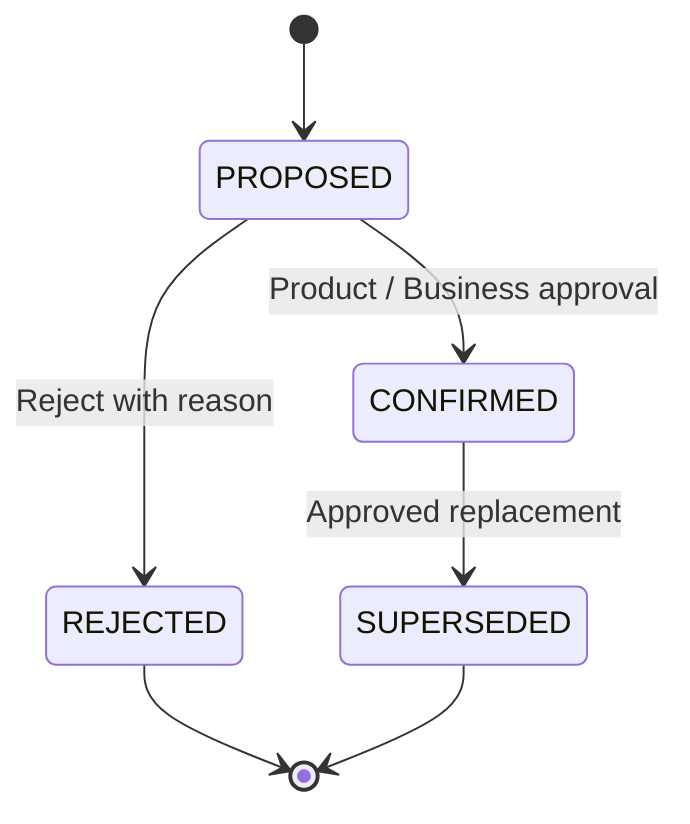
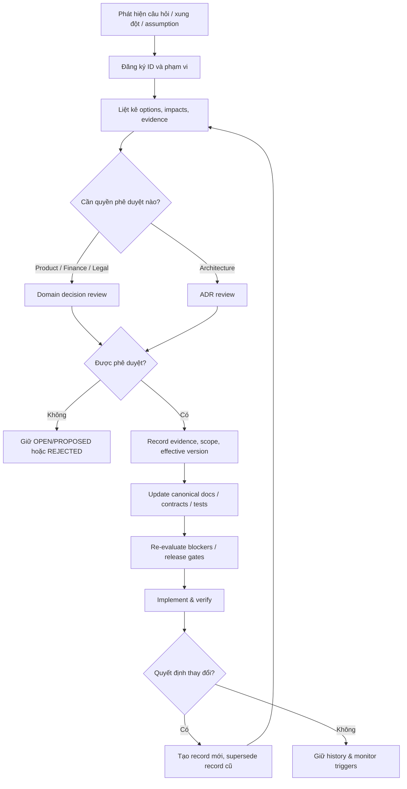

# DealGo — Decisions, Assumptions & Open Issues

> **Tình trạng tài liệu: `DRAFT`.** Đây là sổ ghi nhận bối cảnh, các quyết định **đã được người dùng xác nhận ở mức định hướng**, giả định **chưa kiểm chứng**, vấn đề **chưa chốt** và các ràng buộc có thể chặn công việc hoặc release. Việc tài liệu được AI soạn không đồng nghĩa với việc mọi đề xuất bên trong được phê duyệt.
>
> **Phạm vi bất biến đã xác nhận:** DealGo có **Ride hai bánh + Food cùng nằm trong MVP**, trên **một ứng dụng Flutter hỗ trợ Customer, Merchant, Driver**. Admin Web thuộc baseline vận hành đang được hoạch định. Không chuyển những điều đã xác nhận này thành “giả định”.
>
> **Tài liệu liên quan:** [README](./README.md) · [Project Charter](./project-charter.md) · [Scope & Release Plan](./scope-release-plan.md) · [Glossary](./glossary.md).

## 1. Mục đích và kết quả mong đợi

Quản trị quyết định nhằm bảo đảm:

1. Người triển khai trả lời được **vì sao** chọn một phương án và **ai có quyền** xác nhận phương án đó.
2. Một đề xuất, giả định hoặc nội dung đối thủ đang làm **không bị hiểu nhầm** thành chính sách của DealGo.
3. Các câu hỏi chưa giải quyết được đánh dấu bằng ID, ảnh hưởng, owner dự kiến, cách tạm thời tiếp tục phát triển và **điểm bắt buộc phải chốt**.
4. Khi thay đổi một quyết định, lịch sử không bị mất; điều chỉnh PRD, business rules, workflow, API, test, security và release gate có thể truy vết.
5. AI Agent biết khi nào **được tiếp tục**, khi nào **chỉ được mock/stub** và khi nào **phải dừng việc triển khai phần phụ thuộc**.

**Không thuộc mục đích:** tài liệu này không tính giá, không thiết kế chi tiết dispatch, không xác nhận loại giấy phép hay trách nhiệm pháp lý, không thay thế bản ERD hoặc hợp đồng API. Các file trong nhóm `02-domain/*`, `03-workflows/*`, `06-data-api/*`, `07-security-legal/*` là nguồn chuẩn cho nội dung chuyên môn tương ứng.

## 2. Phân biệt sáu loại thông tin

| Loại | Định nghĩa | Được dùng làm yêu cầu bắt buộc? | Hành động |
|---|---|---|---|
| **Decision (`DEC-*`, `ADR-*`)** | Kết luận đã chọn một hướng và có bằng chứng người có thẩm quyền đã chấp thuận. | **Có**, nếu `CONFIRMED`/`ACCEPTED`, đúng phạm vi và chưa bị supersede. | Dẫn chiếu sang docs chuyên trách. |
| **Open decision (`OPEN-*`)** | Câu hỏi cần lựa chọn; chưa có quyết định hợp lệ. | **Không**. | Phân tích options, blocking scope, đề xuất owner. |
| **Assumption (`ASM-*`)** | Giả thiết có thể đúng nhưng thiếu chứng cứ, dùng để lập kế hoạch/thử nghiệm. | **Không**, kể cả khi độ tin cậy cao. | Đặt cách kiểm chứng, hạn rà soát theo gate. |
| **Constraint (`CON-*`)** | Giới hạn đã được chứng minh hoặc phê duyệt, từ sản phẩm, kỹ thuật, hợp đồng hay pháp luật. | Chỉ khi nguồn và thẩm quyền hợp lệ. | Gắn bằng chứng và phạm vi áp dụng. |
| **Risk (`RISK-*`)** | Sự kiện có thể xảy ra và gây hậu quả. | Không phải một quyết định; có thể sinh release blocker. | Dùng risk register tại Charter + đánh giá chuyên môn. |
| **Issue / Conflict (`ISS-*`, `DOC-CONFLICT-*`)** | Vấn đề đã xảy ra hoặc mâu thuẫn tài liệu hiện hữu. | Không. | Triage, sửa nguồn chuẩn, kiểm chứng lại. |

**Ví dụ:** “Khách có thể chọn thanh toán COD” là `OPEN-002`, **không** là `DEC` cho đến khi được duyệt; “COD sẽ chiếm phần lớn giao dịch” là `ASM`, cần số liệu; “không ghi nhận hoàn tiền hai lần” là yêu cầu integrity phải có test và hợp đồng nghiệp vụ, không phải một con số có thể tự bịa.

### 2.1. Nguồn bằng chứng và mức độ tin cậy

| Nguồn | Được xem là gì? | Điều không được suy diễn |
|---|---|---|
| Yêu cầu người dùng/chủ dự án đã nêu rõ | Bằng chứng cho định hướng `CONFIRMED` theo đúng nội dung phát biểu | Không tự thêm chi tiết pricing, SLA hoặc công nghệ. |
| Văn bản chấp thuận có dấu vết (PR, ticket, biên bản) | Bằng chứng phê duyệt có phạm vi cụ thể | Không mặc nhiên bao phủ tình huống ngoài phạm vi đó. |
| Trang công khai Grab, GrabFood, ShopeeFood | Nguồn tham khảo để benchmark | Không chứng minh quy tắc hay thuật toán nội bộ, không thành quyết định DealGo. |
| API docs/vendor docs | Mô tả khả năng và giới hạn kỹ thuật của provider | Không chứng minh chi phí, hợp đồng, mức phục vụ hay pháp lý đã được chấp thuận. |
| AI Agent gợi ý | `PROPOSAL` cần đánh giá | Không được tự duyệt hoặc tự đặt owner đã đồng ý. |
| Code cũ / mock / màn hình prototype | Evidence cho implementation đang tồn tại | Không chứng minh business rule đã được quyết định hay behavior production đúng. |

### 2.2. Độ tin cậy không thay thế việc phê duyệt

- `HIGH`: có dữ liệu/nguồn đáng tin, còn cần quyết định phạm vi và người duyệt.
- `MEDIUM`: có dấu hiệu hợp lý, chưa đủ bằng chứng hoặc chưa đánh giá tất cả ngoại lệ.
- `LOW`: giả thuyết ban đầu, cần nghiên cứu/thử nghiệm sớm.
- `UNKNOWN`: chưa đủ thông tin để xếp.

**Tất cả `ASM-*` trong phiên bản này vẫn là `UNVERIFIED`, bất kể confidence.**

## 3. Quy ước ID, vòng đời và tính toàn vẹn

| Registry | ID | Trạng thái chuẩn | Ghi chú |
|---|---|---|---|
| Product/Business decision | `DEC-<AREA>-NNN` | `PROPOSED`, `CONFIRMED`, `REJECTED`, `SUPERSEDED` | Giữ tương thích `DEC-PROD-001..007`. |
| Architecture Decision Record | `ADR-NNN` | `PROPOSED`, `ACCEPTED`, `REJECTED`, `SUPERSEDED`, `DEPRECATED` | Dành cho thay đổi quan trọng/khó đảo ngược. |
| Open question | `OPEN-NNN` | `OPEN`, `ANALYZING`, `AWAITING_APPROVAL`, `RESOLVED`, `CANCELLED` | Một ID chỉ cho một câu hỏi có scope rõ. |
| Assumption | `ASM-NNN` | `UNVERIFIED`, `TESTING`, `VALIDATED`, `INVALIDATED`, `EXPIRED` | `VALIDATED` vẫn không tự sinh business decision. |
| Constraint | `CON-NNN` | `PROPOSED`, `VERIFIED`, `RETIRED` | Bằng chứng và thời hạn phải kiểm tra lại. |
| Decision review / conflict | `ISS-NNN` / `DOC-CONFLICT-NNN` | `OPEN`, `IN_PROGRESS`, `RESOLVED` | Không sử dụng để thay thế decision record. |

**Không tái sử dụng ID**, kể cả bị từ chối; không xóa lịch sử. Mã được quản lý thủ công trong file này khi dự án còn nhỏ, sau này có thể sinh registry máy đọc từ chính file/metadata, nhưng chỉ sau quyết định và migration có kiểm thử.

### 3.1. Chuyển trạng thái hợp lệ



- Với `ADR-*`, dùng `ACCEPTED` thay cho `CONFIRMED`.
- `OPEN-*` chỉ sang `RESOLVED` sau khi có liên kết **đến decision được phê duyệt**, hoặc `CANCELLED` với lý do rõ ràng; không đóng chỉ vì có implementation.
- `ASM-*` chỉ chuyển `VALIDATED`/`INVALIDATED` khi ghi rõ phương pháp, ngày, mẫu chứng cứ và người rà soát.
- `CONFIRMED`/`ACCEPTED` có thể bị **thay thế**, không xóa, không lén sửa nội dung lịch sử của quyết định. Sửa lỗi chính tả/URL không đổi ý nghĩa có thể chỉnh metadata và ghi changelog.

### 3.2. Schema tối thiểu cho mỗi quyết định

| Trường | Bắt buộc | Mô tả |
|---|---|---|
| `id`, `title`, `area`, `status` | Có | Định danh và phạm vi. |
| `context`, `problem`, `options` | Có | Tình huống, ràng buộc, các phương án xem xét. |
| `decision`, `rationale` | Khi chốt | Phương án được chọn và lý do, gồm tradeoffs. |
| `owner_role`, `approver_role` | Có | Vai trò đề xuất/duyệt, không tự đặt tên người chưa đồng ý. |
| `approval_evidence`, `approved_at` | Khi chốt | Đường dẫn chứng cứ kiểm được; không giả định approved date. |
| `scope`, `effective_from`, `supersedes` | Khi áp dụng | Giới hạn hiệu lực và quan hệ thay thế. |
| `impacts`, `references`, `tests` | Có | Các docs/module/test chịu tác động. |
| `risks`, `rollback_or_migration` | Khi có rủi ro | Cách khôi phục hoặc xử lý thay đổi. |

## 4. Ma trận quyền quyết định (proposed responsibility model)

> Các role dưới đây là **vai trò chịu trách nhiệm được đề xuất**, không khẳng định DealGo đã tuyển đủ nhân sự hoặc ủy quyền chính thức. Một người có thể đảm nhận nhiều vai trò ở giai đoạn solo; quyền phê duyệt vẫn phải được ghi nhận rõ.

| Loại quyết định | Người đề xuất/đánh giá | Người phê duyệt cuối đề xuất | Điều kiện bắt buộc |
|---|---|---|---|
| Phạm vi sản phẩm, hành trình người dùng | PO / BA / UX | **Product Owner** | Không trái phạm vi Ride+Food và multi-role đã xác nhận. |
| Chính sách giá, khuyến mại, hủy, bồi hoàn | PO / Finance / Ops | **Product Owner + Finance owner** | Có ví dụ tính toán, accounting impact, tư vấn pháp lý khi cần. |
| Logic điều phối và giới hạn workload | Backend / Dispatch / Ops | **Tech Lead + Product Owner** | Concurrency, fairness, safety và test đầy đủ. |
| KYC/KYB, dữ liệu nhạy cảm, điều kiện đối tác | Ops / Security / Legal | **Product Owner**, có **Legal/Compliance sign-off** cho phạm vi pháp lý | Không thay thế tư vấn pháp lý/giấy phép bằng quyết định kỹ thuật. |
| Công nghệ, module boundaries, ADR | Tech Lead / Engineer | **Tech Lead** | So sánh options, NFR, khả năng vận hành/migration. |
| Bảo mật, quyền truy cập, privacy | Security / Tech / Legal | **Tech Lead + người có thẩm quyền về compliance** | Không miễn trừ nghĩa vụ bắt buộc bằng waiver nội bộ. |
| Triển khai thương mại, kích hoạt tiền thật | Ops / Finance / Tech / QA | **Product Owner/Business Owner** sau các sign-off bắt buộc | G5 và bằng chứng pháp lý, financial, security, ops. |
| Đổi scope P0/P1/P2, release gate | Product / Tech / QA | **Product Owner + Tech Lead** | Impact review và update release plan. |

**Separation of duties theo mức rủi ro:** Người viết code có thể đề xuất, nhưng AI Agent không có quyền phê duyệt. Các thao tác hoàn tiền thủ công/thu hồi quyền có thể cần dual control trong production; thiết kế cụ thể là `TBD`, không mặc định đã có cơ chế đó.

## 5. Decision Register — những điều đã được xác nhận

Đây là **bản ghi tái hiện** từ [README §2](./README.md) và [Project Charter](./project-charter.md), không tự tạo quyết định mới.

| ID | Nội dung chính xác | Trạng thái | Phạm vi & điều KHÔNG suy ra | Bằng chứng hiện có |
|---|---|---|---|---|
| `DEC-PROD-001` | MVP gồm **Ride hai bánh + Food**. | `CONFIRMED` | Không mặc nhiên có ô tô, giao kiện hàng độc lập hoặc tất cả tính năng của đối thủ. | Yêu cầu chủ dự án được README/Charter ghi lại. |
| `DEC-PROD-002` | **Một mobile app Flutter** cho Customer / Merchant / Driver. | `CONFIRMED` | Không tự định nghĩa cách chuyển role, quyền và concurrency. | Yêu cầu chủ dự án được README/Charter ghi lại. |
| `DEC-PROD-003` | Tham khảo Grab, GrabFood, ShopeeFood để học flow. | `CONFIRMED` | Không sao chép UI, logic nội bộ; benchmark là evidence ngoài. | Định hướng nghiên cứu trong README/Charter. |
| `DEC-PROD-004` | Cần docs đủ hỗ trợ xây dựng phần mềm thực tế, vận hành/QA/bảo mật. | `CONFIRMED` | Không chứng minh rằng 69 file đã được viết/duyệt. | Định hướng bộ hồ sơ trong README. |
| `DEC-PROD-005` | Ride theo mô hình thương lượng giá: khách đưa giá đề xuất; tài xế có thể chấp nhận hoặc gửi giá khác; khách chọn một đề nghị/tài xế trước khi phân công. | `CONFIRMED` | Chỉ áp dụng Ride hai bánh. Không áp dụng mặc định cho giá món/Food; không chốt mức sàn/trần, số vòng, timeout, phí hay thanh toán. | Yêu cầu chủ dự án: DealGo là hệ thống kiểu inDrive, đặt xe có trả giá; chi tiết công khai inDrive dùng để đối chiếu quy trình. |
| `DEC-PROD-006` | **SUPERSEDED 2026-10-18** — quyết định cũ (email chỉ là contact/identifier, không đăng nhập độc lập) đã bị thu hồi theo yêu cầu chủ dự án. Auth hiện tại: phone SMS, **email+password đăng ký/đăng nhập bình thường**, và passkey; Admin vẫn quản lý bật/tắt method. | `SUPERSEDED` | Không còn chặn email/password login. Chi tiết recovery/provider vẫn có thể thuộc `OPEN-020`. | Yêu cầu chủ dự án 2026-10-18: email đăng nhập/đăng ký như bình thường; xóa ràng buộc DEC cũ. |
| `DEC-PROD-046` | **Passkey-first không cần identifier.** Người dùng có thể (a) đăng nhập bằng discoverable passkey mà không nhập phone/email và (b) tạo Account CUSTOMER mới chỉ bằng passkey; phone/email là contact hoặc fallback có thể liên kết sau onboarding, không phải tiền điều kiện. Hệ thống không tuyên bố passkey đọc được số điện thoại. | `CONFIRMED` | Thiết bị/RP phải hỗ trợ resident credential; cần fallback SMS/email và recovery khi mất toàn bộ passkey. Account passkey-first bắt đầu với contact null và phải hoàn thiện profile/contact khi workflow theo role yêu cầu. | Yêu cầu chủ dự án 2026-10-20; backend là nguồn ánh xạ credential → Account. |
| `DEC-PROD-007` | MVP có chat trong ứng dụng và gọi thoại trong ứng dụng cho các bên liên quan đến Ride/Food. | `CONFIRMED` | Không lộ số điện thoại; chat/call có scope theo giao dịch; mặc định không ghi âm, không video, không chat/call tự do giữa người lạ. Provider, cửa sổ liên lạc và retention thuộc `OPEN-021`. | Yêu cầu chủ dự án ngày 2026-10-12. **Reaffirmed 2026-10-14 (1A):** giữ chat + voice; không xóa DEC. |
| `DEC-PROD-008` | **Đăng ký email bắt buộc OTP qua email trước khi tạo tài khoản** (ghi nhận 2026-10-18). `POST /v1/auth/email/register` chỉ tạo challenge chờ (mật khẩu đã hash, chưa có Account); Account + credential + `CUSTOMER` `ACTIVE` + session chỉ tạo khi nhập đúng OTP. Thông số: OTP 6 số (lưu hash), TTL 10 phút; tối đa 5 lần nhập sai **tính trên cả challenge** (gửi lại không reset; đạt ngưỡng → khóa `AUTH_CODE_LOCKED`, không gửi lại được, phải bắt đầu challenge mới); gửi lại sau 60 giây, tối đa 5 lần gửi/challenge; tối đa 5 challenge/email/giờ (gồm cả mã kích hoạt). Không lộ email đã tồn tại (cùng phản hồi; chủ email nhận thư báo, không có mã dùng được). Đăng nhập email chỉ cho email đã xác thực; tài khoản cũ chưa xác thực: đăng nhập đúng mật khẩu → 403 `AUTH_EMAIL_NOT_VERIFIED` kèm challenge và OTP kích hoạt qua email (sai mật khẩu không gửi gì); quên mật khẩu vẫn là cách khác. | `CONFIRMED` | Chỉ phương thức email+password. Không thay đổi `DEC-PROD-006` (vẫn `SUPERSEDED`; quyết định này chi tiết hóa luồng email+password được mở sau khi thu hồi nó). Không chốt provider email, recovery/lockout tài khoản khác hay step-up — vẫn thuộc `OPEN-020`. | Yêu cầu chủ dự án 2026-10-18 (chat với AI agent DealGo Dev): đăng ký email phải xác thực OTP; chốt thông số và cách kích hoạt tài khoản cũ. Code: migration `20261018220000_email_signup_challenges`, `20261018230000_email_challenge_activation`; test `email-password-auth.service.spec.ts`, `identity.http.spec.ts`. |

### 5.1. Quyết định voucher, đánh giá, phí nền tảng (ghi nhận 2026-10-19, `CONFIRMED`)

`DEC-PROD-009/010/011` do AI agent DealGo Dev đề xuất ở đợt 3 và được chủ dự án **xác nhận ngày 2026-10-19**; `DEC-PROD-012/013/014` do chủ dự án chốt cùng ngày.

| ID | Nội dung | Trạng thái | Phạm vi & điều KHÔNG suy ra | Bằng chứng hiện có |
|---|---|---|---|---|
| `DEC-PROD-009` | **DealGo chịu tiền giảm giá của voucher Food.** Khách trả COD theo tổng sau giảm; quán vẫn được tính đủ tạm tính. Khi giao thành công, ghi thêm bút toán sandbox `PROMOTION_DISCOUNT_FUNDED`: Nợ `sandbox.promo.discount_expense` (loại `EXPENSE`), Có `sandbox.promo.merchant_payable` (phải trả quán), mỗi đơn một lần. | `CONFIRMED` | Chỉ là sổ sandbox, không phải đối soát/chi trả thật cho quán (vẫn chặn bởi gate tiền thật). Không áp cho Ride (Ride chưa nhận voucher). Trường `sponsor` của chiến dịch chưa đổi cách hạch toán; mọi voucher đang coi là DealGo tài trợ. | Migration `20261019100000_voucher_release_promo_ledger`, `20261019100100_promo_ledger_accounts`; `FoodService.deliver`; test `promotion-discount-journal.spec.ts`. |
| `DEC-PROD-010` | **Hủy đơn Food thì hoàn lượt voucher.** Khách hủy hoặc Ops hủy → bản ghi dùng voucher được đánh dấu `releasedAt`, trả lại `usedCount`/`usedBudget` cho chiến dịch, không còn tính vào `userLimit`. Idempotent: hủy lại/chạy lại không hoàn hai lần. | `CONFIRMED` | Đơn giao thất bại (`FAILED`) cũng hoàn lượt — xem `DEC-PROD-012`. Không hoàn tiền cho khách (COD chưa thu). | `releaseVoucherInTx`; test `food-voucher.spec.ts`, `test/concurrency/food-voucher.race.spec.ts` (Postgres). |
| `DEC-PROD-011` | **Thông báo chiến dịch vào hộp thư của mọi user thuộc đối tượng**, quét theo lô (500 user/lô, keyset), không giới hạn số người nhận. Push FCM vẫn chỉ gửi cho user có token. | `CONFIRMED` | Không đổi cách chọn đối tượng (theo vai trò `ACTIVE`; `ALL` = mọi user). Không có lịch gửi/giới hạn tần suất. | `OutboxRelayService.pushCampaign`; test `inbox.service.spec.ts`. |
| `DEC-PROD-012` | **Đơn Food giao thất bại (`FAILED`) cũng hoàn lượt voucher**, cùng cơ chế với hủy đơn (`releasedAt`, trả `usedCount`/`usedBudget`, idempotent; hai lệnh `fail` đồng thời chỉ hoàn một lần). | `CONFIRMED` | Không hoàn tiền cho khách (COD chưa thu). Không đổi điều kiện được báo `FAILED`. | `FoodRepository.fail` (memory + Prisma, cùng transaction); test `food-voucher.spec.ts`, `food-voucher.race.spec.ts` (Postgres). |
| `DEC-PROD-013` | **Đánh giá chỉ gửi được trong `RATING_WINDOW_DAYS` ngày sau khi chuyến/đơn hoàn thành** (setting Admin chỉnh được, seed mặc định 7). Quá hạn → 422 `RATING_WINDOW_EXPIRED`; `GET /v1/ratings/...` trả `canRate=false` và `rateableUntil`. | `CONFIRMED` | Mốc hoàn thành = thời điểm chuyến `COMPLETED`/đơn `DELIVERED` (updatedAt). Đổi setting áp dụng ngay cho mọi chuyến/đơn chưa đánh giá. | Setting `RATING_WINDOW_DAYS` (migration `20261019140000_platform_fee_rating_window`); `RatingService`; test `rating.service.spec.ts`. |
| `DEC-PROD-014` | **Phí nền tảng theo %** do Admin chỉnh tại Admin Web › Cấu hình: `PLATFORM_FEE_RIDE_PERCENT` (trên cước chuyến) và `PLATFORM_FEE_FOOD_PERCENT` (trên phí giao của tài xế); 0–100, tối đa 2 số lẻ, có audit (`reason`, giá trị cũ, người sửa). Thu nhập thực nhận = cước − phí; % và số tiền phí được **chốt lúc hoàn thành** vào bảng `job_earnings` (1:1 với chuyến/đơn), đổi setting không làm sai lịch sử. Phí > 0 ghi bút toán sandbox `DRIVER_PLATFORM_FEE_ACCRUED`: Nợ `sandbox.fee.driver_receivable`, Có `sandbox.fee.platform_revenue` (loại `REVENUE`). | `CONFIRMED` | **Mức % chưa được chốt** (`OPEN-003` vẫn mở): seed mặc định 0 %, Admin tự nhập. Không phải hoa hồng quán (merchant commission), không thuế, không chi trả thật. Phí làm tròn đến đồng (half-up). **Cập nhật 0.3.5:** dòng `job_earnings`, bút toán phí, bút toán COD và bút toán voucher được ghi **trong cùng giao dịch DB** với việc chuyển chuyến sang `COMPLETED`/đơn sang `DELIVERED`; ghi sổ lỗi thì chuyến/đơn giữ trạng thái cũ (không còn ghi "best-effort" sau commit). Chế độ in-memory (dev/test không DB) không có rollback. | Migration `20261019140000_platform_fee_rating_window`, `20261019140100_platform_fee_accounts`; `EarningsService.recordWithin`, `LedgerService.postWithin`; test `earnings.service.spec.ts`, `driver-history.pg.spec.ts` (rollback khi thiếu tài khoản phí), `ops-platform-settings.http.spec.ts`. |
| `DEC-PROD-015` | **Voucher ghi sổ theo nhà tài trợ chiến dịch.** Lúc đặt đơn, `sponsor` của chiến dịch được chụp vào `food_orders.voucher_sponsor`. Khi giao thành công, phần DealGo chịu được ghi `PROMOTION_DISCOUNT_FUNDED`: `PLATFORM` → toàn bộ giảm giá; `MERCHANT` → 0 (quán tự chịu, không ghi bút toán nền tảng); `SHARED` → giảm giá × `VOUCHER_SHARED_PLATFORM_PERCENT` % (setting Admin chỉnh, 0–100, tối đa 2 số lẻ, seed **100** để giữ đúng hành vi `DEC-PROD-009` cho tới khi có tỉ lệ thật). Làm tròn đến đồng. | `CONFIRMED` (cách ghi sổ) | **Tỉ lệ chia `SHARED` chưa chốt** — mặc định 100 % nghĩa là DealGo chịu hết như trước. Tỉ lệ là một setting toàn cục (chưa theo từng chiến dịch). Không đối soát/chi trả thật với quán (`OPEN-003`). | Migration `20261019150000_voucher_sponsor_snapshot` (cột + backfill + setting); `voucher-funding.ts`; test `voucher-funding.spec.ts`, `food.http.spec.ts` (“books only DealGo's share…”). |
| `DEC-PROD-016` | **Địa điểm và giá luôn lấy từ máy chủ.** App tìm địa điểm qua `GET /v1/places/search` và đặt tên vị trí GPS qua `GET /v1/places/reverse` (cùng `MapsPort`: Goong/Google khi có khóa, mock = danh sách địa danh thật ở Đà Nẵng khi chạy dev; không có provider → `available=false`, app vẫn dùng vị trí hiện tại/địa chỉ đã lưu/chuyến gần đây). Toạ độ điểm đón/đến là toạ độ thật (GPS, địa chỉ đã lưu có ghim, kết quả tìm kiếm) — bỏ toạ độ mẫu. Trước khi đặt, app gọi `POST /v1/rides/quote` (quãng đường, giá tham khảo, khoảng giá `RIDE_MIN/MAX_FARE_VND`) và `POST /v1/food/quote` (phí giao); app không còn hằng số giá/khoảng giá và không cho khách tự tăng/giảm phí giao. | `CONFIRMED` | Chỉ có **xe máy** (backend chưa có loại xe) nên màn chọn xe chỉ hiện xe máy. Nút gợi ý giá = giá tham khảo ×0,9 / ×1 / ×1,15 làm tròn 1.000đ và kẹp trong khoảng Admin — chỉ là phím tắt nhập, không phải quy tắc giá. **Chọn điểm trên bản đồ (S016) hoãn** vì `MapPort` chưa hỗ trợ kéo/chạm. Thời gian di chuyển chưa hiển thị (chưa có nguồn ETA thật). | `PlacesModule`, `RideService.quote`, `FoodService.quoteDelivery`; test `places.http.spec.ts`, `ride.http.spec.ts`, `food.http.spec.ts`; mobile `ride_flow_test.dart`, `account_page_test.dart`. |
| `DEC-PROD-017` | **Mã đón khách do máy chủ cấp.** Mỗi chuyến có một mã 4 số ngẫu nhiên (`crypto.randomInt`) sinh lần đầu khi khách xem chuyến ở trạng thái `ASSIGNED`/`DRIVER_EN_ROUTE`/`DRIVER_ARRIVED` (bảng `ride_pickup_codes`, 1:1 với chuyến). Mã chỉ có trong `GET /v1/rides/:id` của **chính khách**; không có trong phản hồi của tài xế, ops, danh sách hay realtime. Tài xế bắt đầu chuyến bằng `POST /v1/rides/:id/start {pickupCode}`; so sánh thời gian hằng; sai → `422 RIDE_PICKUP_CODE_INVALID`; quá `RIDE_PICKUP_CODE_MAX_ATTEMPTS` lần (mặc định 5, Admin chỉnh) → `423 RIDE_PICKUP_CODE_LOCKED`. Lượt thử được giữ chỗ bằng `UPDATE … WHERE failedAttempts < max` nên đoán song song không vượt giới hạn. App bỏ mã tự suy từ id chuyến và mã cứng `7294`. Kèm theo: thẻ tài xế thật (`GET /v1/rides/:id/driver`, `/v1/rides/:id/offers/:offerId/driver`, `/v1/food/orders/:id/courier` — tên hồ sơ, xe/biển số khai trong hồ sơ KYC **đã duyệt**, điểm đánh giá thật) thay cho tên/biển số/"⭐ 4,9" mẫu; bỏ ETA giả vì chưa có vị trí tài xế trực tiếp. | `CONFIRMED` | Mã lưu dạng rõ: băm mã 4 số không tăng bảo mật (chỉ 10⁴ khả năng), giới hạn lượt thử mới là lớp bảo vệ. Khóa mã thì ops huỷ/điều phối lại chuyến. Chưa áp dụng mã giao hàng cho đơn đồ ăn (cần quyết định riêng). | Migration `20261019160000_ride_pickup_code`; `ride-pickup-code.ts`, `DriverCardModule`; test `ride.http.spec.ts` (cấp/ẩn/khóa mã), `driver-card.http.spec.ts`, mobile `tracking_flow_test.dart`. |
| `DEC-PROD-018` | **Yêu cầu hỗ trợ là ticket thật trên máy chủ.** App (khách/tài xế/quán) tạo ticket qua `POST /v1/support/tickets` (loại vấn đề, tiêu đề, mô tả; khách có thể gắn chuyến/đơn của chính mình — máy chủ kiểm tra người dùng là bên tham gia, nếu không → `404`). Mô tả là tin nhắn đầu tiên; khách xem tiến độ và trao đổi trong app (`GET /v1/support/tickets[/:id]`, `POST …/messages`; ticket `RESOLVED` mở lại khi khách nhắn thêm, `CLOSED` không nhận tin). Website gửi form qua `POST /v1/public/support/tickets` (không đăng nhập, chỉ trả mã). Admin xem hàng đợi, trả lời, đổi trạng thái/độ ưu tiên kèm lý do (ghi `OpsAuditLog SUPPORT_TICKET_UPDATE`); trả lời/giải quyết gửi thông báo vào hộp thư trong app. Giới hạn là setting Admin: `SUPPORT_TICKET_MAX_OPEN_PER_USER` (5, khoá theo hàng người dùng), `SUPPORT_PUBLIC_TICKETS_PER_CONTACT_PER_DAY` (3, khoá advisory theo liên hệ), `SUPPORT_TICKET_TEXT_MAX_CHARS` (2000). Loại `SAFETY` bắt đầu ở độ ưu tiên `HIGH`. Mã ticket `DG-YYMMDD-NNNN` theo ngày giờ Việt Nam. App bỏ "Bản nháp này chưa được gửi" và website bỏ mã `INQ` giả. | `CONFIRMED` (luồng) | **Ticket từ website không có luồng trao đổi** — người gửi chỉ nhận mã, nhân viên liên hệ trực tiếp qua email/điện thoại đã nhập. **Chưa hỗ trợ đính kèm ảnh/tệp** (chưa có kho lưu tệp). Chỉ khách chọn được chuyến/đơn liên quan (tài xế/quán chưa có bộ chọn). Câu hỏi thường gặp trong app vẫn là nội dung cục bộ (FAQ CMS hiện có dành cho câu hỏi nội bộ OPEN-xxx, không phải nội dung trợ giúp khách). Chưa có SLA/phân công nhân viên. | Migration `20261019170000_support_tickets`; `SupportTicketModule`; test `support-ticket.http.spec.ts`, `support-ticket.pg.spec.ts`; website `features/support-tickets`, `app/api/public/support/route.test.ts`; mobile `support_tickets_test.dart`. |
| `DEC-PROD-019` | **Không còn dữ liệu mẫu trên màn hình thật.** (1) **Điểm quán** lấy từ đánh giá đơn đồ ăn thật: `GET /v1/ratings/stores?ids=` (tối đa 50) và `GET /v1/ratings/stores/:storeId/reviews` (20 đánh giá gần nhất, không kèm danh tính người chấm). Điểm trung bình chỉ hiện khi quán có ≥ `RATING_STORE_MIN_COUNT` đánh giá (setting Admin, mặc định 3) để không lộ đánh giá của từng khách; dưới ngưỡng app hiện "N đánh giá"/"Quán mới". (2) **Khoảng cách** là khoảng cách thật từ GPS (`GET /v1/food/stores?lat&lng&sort_by=distance`); không có GPS thì không hiện. Bỏ thời gian giao, "Freeship", giá, "Đã bán", "Deal ngon (minh họa)", "50%" vì chưa có nguồn thật. (3) **Quán từ chối đơn** là thao tác thật: `POST /v1/food/orders/:id/reject` (PLACED → CANCELLED, chỉ chủ quán, nhả voucher, gửi trạng thái qua outbox; đua với nhận đơn/khách hủy chỉ một bên thắng). (4) Mã đơn/chuyến hiển thị dạng ngắn `#XXXXXX` (6 ký tự cuối id). (5) Tài xế: thông báo dùng hộp thư thật; chi tiết việc đã xong lấy từ lịch sử thật (giá, phí nền tảng đã chốt, thực nhận). (6) Quán: bỏ tên khách/tài xế mẫu, giờ bếp, trạng thái từng món, số túi và mã bàn giao suy từ id. (7) KYC/KYB: bỏ họ tên/biển số/tên quán mẫu và danh sách lý do từ chối mẫu; trường thông tin nhập thật (họ tên lấy từ hồ sơ nếu có). (8) Liên hệ khẩn cấp lưu trên thiết bị (tối đa 3), không có liên hệ mẫu. | `CONFIRMED` | **Chưa có**: danh sách khuyến mãi cho khách (banner chỉ hướng dẫn nhập mã), ETA, tên khách/tài xế trên màn quán (API hàng đợi không trả), thống kê quán (màn thống kê còn mẫu), tải ảnh giấy tờ KYC thật (vẫn là ô đính kèm mô phỏng), lý do từ chối KYC hiển thị từ máy chủ, liên kết chia sẻ chuyến thật, mã giao hàng đồ ăn (hoãn). Quán từ chối chưa có lý do. | Migration `20261019180000_rating_store_min_count`; `RatingService.storeSummaries/storeReviews`, `FoodService.reject`; test `rating.service.spec.ts`, `ratings.http.spec.ts`, `food.http.spec.ts`, `food-reject.race.spec.ts`; mobile `food_real_data_test.dart`, `merchant_flow_test.dart`, `driver_history_test.dart`, `kyc_defaults_test.dart`, `ride_safety_contacts_test.dart`. |
| `DEC-PROD-020` | **Giấy tờ KYC/KYB thật, lý do từ chối từ máy chủ, thống kê quán.** (1) **Lưu trữ tệp** qua cổng `ObjectStorage`: `OBJECT_STORAGE_PROVIDER=local` (thư mục `OBJECT_STORAGE_LOCAL_DIR`, dev), `memory` (test), `s3` (S3/R2/MinIO, ký SigV4; cần `S3_*`). Production không cấu hình đủ → không lưu được tệp (không âm thầm dùng ổ đĩa). Giới hạn là setting Admin: `UPLOAD_MAX_FILE_KB` (100–5120, mặc định 4096) và `UPLOAD_ALLOWED_TYPES` (JSON, mặc định jpeg/png/webp/pdf); máy chủ kiểm chữ ký byte, không tin content-type khai báo. (2) **Giấy tờ bắt buộc**: tài xế ID_FRONT, ID_BACK, SELFIE, LICENSE, VEHICLE_REG; quán BUSINESS_LICENSE, REP_ID_FRONT, REP_ID_BACK (ảnh mặt tiền STOREFRONT tùy chọn). Thiếu → `PARTNER_DOCUMENTS_REQUIRED`. Ops xem/tải từng tệp (`GET /v1/ops/partner-applications/:id/documents/:index`, `no-store`). (3) **Từ chối** gồm `reason` + `issues[{section, note}]` (≤10); app hiện đúng các mục ops đánh dấu, khách chỉ chụp lại giấy tờ bị đánh dấu, máy chủ giữ tệp cũ cho phần còn lại. Nút "Yêu cầu bổ sung" trên Admin dùng cùng luồng từ chối (chưa có trạng thái riêng). (4) Duyệt/từ chối đồng thời chỉ một bên thắng (cập nhật có điều kiện theo trạng thái). (5) **Tệp đính kèm yêu cầu hỗ trợ**: tối đa 3 tệp/tin nhắn, cùng giới hạn; tải qua đường dẫn có kiểm quyền. (6) **Thống kê quán** `GET /v1/food/merchant/stats?days=1..30` theo ngày lịch Việt Nam; doanh thu = tạm tính đơn DELIVERED; top món theo số lượng. Màn Quán/Trang chủ và Thống kê dùng số thật, bỏ "số dư khả dụng" suy diễn. (7) **Hàng đợi quán** trả `customerName`/`driverName` rút gọn (tên + chữ cái đầu họ, ví dụ "Tiến T."). (8) KYB lưu **mã** loại hình (FOOD_RESTAURANT, CAFE_TEA, GROCERY, CONVENIENCE, OTHER) và chủ thể (HOUSEHOLD, COMPANY, OTHER); Admin hiển thị nhãn. | `CONFIRMED` | **Chưa có**: trạng thái NEEDS_MORE_INFO riêng; dọn tệp mồ côi khi tạo ticket lỗi giữa chừng; ảnh đại diện vẫn lưu mô phỏng; adapter S3 chưa chạy thử với bucket thật; khách chưa đính kèm tệp từ app (API sẵn sàng); quán từ chối chưa có lý do; mã giao đồ ăn (hoãn). | Migration `20261019190000_uploads_review_issues`; `DocumentStoreService`, `PartnerService`, `SupportTicketService`, `FoodService.merchantStats`; test backend `document-store.service.spec.ts`, partner/support/food http spec, race spec; website `partner-review.test.ts`, `reject/route.test.ts`, `mappers.test.ts`; mobile `partner_kyc_documents_test.dart`, `merchant_stats_test.dart`, `merchant_flow_test.dart`. |
| `DEC-PROD-021` | **Lý do quán từ chối, ưu đãi cho khách, FAQ trợ giúp, chia sẻ chuyến, ảnh đại diện thật, dọn tệp mồ côi.** (1) **Quán từ chối** bắt buộc `reasonCode` ∈ OUT_OF_STOCK, STORE_BUSY, STORE_CLOSING, ITEM_PRICE_CHANGED, OTHER; `note` ≤200 ký tự, bắt buộc khi OTHER (`FOOD_REJECT_NOTE_REQUIRED`). Đơn lưu `cancelReasonCode`/`cancelNote`; khách (màn theo dõi đơn) và Admin (chi tiết đơn) thấy `cancelReason`. Không giữ tương thích body rỗng. (2) **Ưu đãi**: `GET /v1/promotions/available` trả tối đa 20 chiến dịch ACTIVE đang chạy cho ALL/CUSTOMER còn ngân sách/lượt và còn lượt cho người dùng; không trả trường ngân sách/nhà tài trợ. App chỉ xin FOOD (chỉ checkout đồ ăn nhận mã); "Dùng khi đặt món" gắn mã vào giỏ, mã vẫn được kiểm lại ở checkout. (3) **FAQ trợ giúp** dùng chung bảng `ops_faq_entries` với cột `audience` (INTERNAL mặc định, CUSTOMER, DRIVER, MERCHANT); chỉ mục PUBLISHED khác INTERNAL ra `GET /v1/public/help/faqs`. Seed HELP-C01..C05 chỉ mô tả hành vi đã có. App bỏ 3 câu FAQ viết cứng (có câu hoàn tiền tự suy diễn); trống/lỗi thì hiện trạng thái tương ứng. (4) **Chia sẻ chuyến**: token ngẫu nhiên 24 byte (base64url), chỉ lưu SHA-256; tối đa 5 link đang hiệu lực/chuyến; hết hạn sau 12 giờ hoặc 30 phút sau khi chuyến kết thúc; chỉ chia sẻ khi đã có tài xế (ASSIGNED…IN_TRIP). Trang công khai `/chia-se-chuyen/{token}` (website, noindex, no-referrer) chỉ hiện trạng thái, nhãn điểm đón/đến, tên tài xế đã che, biển số, loại xe, điểm đánh giá; không có dữ liệu khách hay toạ độ trực tiếp. Gốc URL lấy từ `PUBLIC_WEB_BASE_URL`. (5) **Ảnh đại diện** lưu qua `ObjectStorage` (JPEG/PNG/WebP, cùng giới hạn upload); `avatarUrl` là đường dẫn tương đối `/v1/public/avatars/{userId}/{file}`, chỉ phục vụ ảnh hiện tại; ảnh cũ bị xoá khi thay. App ghép với API base. (6) **Dọn tệp**: cổng storage có `delete`; tạo/trả lời ticket hoặc nộp hồ sơ đối tác lỗi sau khi đã lưu tệp → xoá tệp vừa lưu (best-effort, ghi log); nộp lại hồ sơ xoá tệp bị thay. (7) App: khách đính kèm tối đa 3 ảnh khi tạo/trả lời yêu cầu hỗ trợ và mở ảnh đính kèm; bỏ chữ kỹ thuật lộ ra UI ("v1 · Dữ liệu đồng bộ", "quoteId + version", "ACCEPT/COUNTER", trạng thái thô). | `CONFIRMED` | **Chưa có**: chuyển phần lớn chuỗi tiếng Việt viết cứng ở màn ride/driver/merchant sang l10n (để vòng sau); ưu đãi cho chuyến xe trong app (checkout ride chưa nhận mã); trang chia sẻ tự làm mới và dọn tệp mồ côi theo lịch → xem DEC-PROD-022; mã giao đồ ăn (hoãn). | Migration `20261019200000_reject_reason_faq_share`; module `ride-share`, `avatar`; test backend `ride-share.http.spec.ts`, `ride-share.service.spec.ts`, `avatar.http.spec.ts`, `help-faq.service.spec.ts`, `document-store.service.spec.ts`, `promotion.service.spec.ts`, `food.http.spec.ts`; website `share-view.test.ts`, `faq-audience.test.ts`, `cancel-reason.test.ts`; mobile `round10_features_test.dart`, `merchant_flow_test.dart`. |
| `DEC-PROD-022` | **Trang chia sẻ tự cập nhật; dọn tệp mồ côi theo lịch.** (1) Trang `/chia-se-chuyen/{token}` tự làm mới mỗi 15 giây khi tab đang mở (tạm dừng khi ẩn tab, làm mới ngay khi quay lại); dừng khi chuyến COMPLETED/CANCELLED/EXPIRED, link hết hạn hoặc không tồn tại; máy chủ lỗi thì thử lại sau 30 giây. API công khai giới hạn **30 lượt xem/phút theo token** (không theo IP, vì website server gọi API thay cho mọi người xem; trước đây dùng chung giới hạn OTP 10/phút/IP nên vài người xem là bị chặn). (2) Worker (BullMQ, hoặc setInterval khi không có Redis ở non-prod) chạy job `upload-orphan-cleanup` mỗi `UPLOAD_ORPHAN_CLEANUP_INTERVAL_MS` (mặc định 6 giờ). Job đọc mọi key đang được tham chiếu (`partner_applications.documents`, `support_ticket_messages.attachments`, `users.avatarUrl`) **trước** khi liệt kê storage, rồi chỉ xoá tệp trong các prefix `partner-applications/`, `support-attachments/`, `avatars/` không còn tham chiếu và cũ hơn cài đặt admin `UPLOAD_ORPHAN_MAX_AGE_HOURS` (mặc định 72, 24–2160; sàn cứng 24 giờ). Tối đa 500 lần xoá/lượt; không có DB hoặc không đọc được tham chiếu thì không xoá gì. Storage có thêm `list(prefix)` (memory, local disk, S3 ListObjectsV2). | `CONFIRMED` | Bảng mới lưu tệp tải lên phải thêm vào `PrismaUploadReferences`. Tập key tham chiếu được nạp vào bộ nhớ mỗi lượt (đủ cho quy mô hiện tại). | Migration `20261019210000_upload_orphan_cleanup`; `src/workers/orphan-upload-cleanup.service.ts`, `upload-references.ts`, `ride-share/share-view-throttler.guard.ts`; test `orphan-upload-cleanup.service.spec.ts`, `upload-orphan-cleanup.pg.spec.ts`, `s3-object-storage.spec.ts`, `ride-share.http.spec.ts`; website `share-view.test.ts`, `share-auto-refresh.tsx`. |
| `DEC-PROD-023` | **Tài xế tự chọn dịch vụ nhận việc; bỏ dữ liệu giả ở màn tài xế.** (1) `driver_presence` có `rideEnabled`, `foodEnabled` (mặc định `true`). `POST /v1/me/presence` nhận hai cờ tuỳ chọn (bỏ trống giữ giá trị cũ); `GET` trả lại. Khi tắt một dịch vụ, `GET /v1/rides/open` hoặc `GET /v1/food/orders/ready` của tài xế đó trả rỗng (cùng cơ chế như offline). Công việc đang làm không bị ảnh hưởng. (2) App: công tắc ở Tổng quan lưu ngay; màn Dịch vụ (D017) lưu khi bấm Lưu; danh sách việc tự tải lại khi cờ đổi. Màn Dịch vụ lấy phương tiện/biển số và dịch vụ đã đăng ký từ hồ sơ KYC. (3) Bỏ dữ liệu giả: khu vực "Hải Châu, Đà Nẵng", nhãn bản đồ, "Đã bật · Hồ sơ hợp lệ", "Đã đồng bộ", câu "fixture". Mở chuyến đang chạy khi không có dữ liệu (deep link, khởi động lại) thì tải `GET /v1/rides/:id` thay vì dựng chuyến mẫu (địa chỉ/giá giả). Sau khi chào giá, app hỏi lại chuyến mỗi 5 giây; chỉ mở điều hướng đón khi khách đã chọn tài xế này (bỏ nút "demo" mở trước). Màn "không đủ điều kiện" (ROLE_NOT_ACTIVE) không còn khẳng định giấy phép hết hạn; dẫn tới hồ sơ tài xế và hỗ trợ. | `CONFIRMED` | Khu vực hoạt động chưa có dữ liệu thật (chưa có vùng phục vụ) nên không hiển thị. Hỏi lại 5 giây thay cho realtime vì tài xế chưa nhận sự kiện "được chọn" qua socket. | Migration `20261019220000_driver_service_toggles`; `driver-presence.service.ts`; test `ride.http.spec.ts`, `driver-presence-toggles.pg.spec.ts`; mobile `driver_services_test.dart`, `driver_flow_test.dart`. |
| `DEC-PROD-024` | **Voucher cho chuyến xe: giữ mã khi khách chọn tài xế, khách trả tiền mặt = giá chốt − giảm giá.** (1) `POST /v1/rides/:id/selection` nhận `voucherCode` tuỳ chọn. Mã được kiểm tra trên giá chốt (giá của offer được chọn) và ghi nhận (khoá dòng khuyến mãi, kiểm tra usageLimit/userLimit/ngân sách) **trong cùng giao dịch** với việc gán tài xế; mã bị từ chối thì không gán gì (422 `VOUCHER_*`, chuyến vẫn NEGOTIATING). Gửi lại cùng Idempotency-Key không ghi nhận lần hai. Chuyến lưu `discountVnd`, `voucherCode`, `voucherSponsor`; API trả thêm `cashDueVnd`. (2) Trả lượt khi khách huỷ, ops huỷ hoặc ops gán lại (gán lại xoá mã trên chuyến; lần chọn sau có thể áp lại, cùng một dòng `promotion_redemptions`). Chuyến hết hạn khi còn NEGOTIATING nên chưa giữ mã nào. (3) Khi hoàn thành: `COD_OBLIGATION_POSTED` = giá chốt − giảm giá (bỏ qua nếu bằng 0); `PROMOTION_DISCOUNT_FUNDED` = phần DealGo tài trợ, ghi Nợ chi phí khuyến mãi / Có `sandbox.promo.driver_payable` (DealGo nợ tài xế). Thu nhập tài xế (`job_earnings.fareVnd`) vẫn là giá chốt đầy đủ, như đồ ăn giữ nguyên tiền món cho quán. (4) Nhà tài trợ: chuyến xe không có quán để đồng tài trợ, nên chỉ chiến dịch `PLATFORM` áp cho chuyến xe; chiến dịch ALL do MERCHANT/SHARED tài trợ và loại `DELIVERY_DISCOUNT` trả `VOUCHER_WRONG_SERVICE` cho chuyến xe và không xuất hiện trong danh sách voucher xe. Admin không tạo được chiến dịch RIDE với nhà tài trợ khác PLATFORM hoặc loại giảm phí giao. (5) Sửa kèm: đơn đồ ăn giảm 100% không còn làm hỏng bước giao (không ghi COD 0đ). | `CONFIRMED` | Mức tài trợ thật và đối soát trả tài xế thuộc `OPEN-003`/settlement; sandbox chỉ ghi sổ. | Migration `20261019230000_ride_vouchers`; `ride-prisma.repository.ts` (select/cancel/opsIntervene), `ride.service.ts` complete; `promotion-redemption.ts`; test `ride-voucher.http.spec.ts`, `ride-voucher.race.spec.ts`, `ride-voucher-rules.spec.ts`; mobile `ride_flow_test.dart`, `driver_services_test.dart`. |
| `DEC-PROD-025` | **Tài xế biết "được chọn" qua socket thay vì hỏi lại 5 giây.** Sau khi chào giá, app tài xế vào phòng `ride:<id>` của Snapshot gateway (tài xế có quyền GET chuyến khi còn NEGOTIATING nên được vào phòng; vẫn ở trong phòng khi chuyến chuyển ASSIGNED). Outbox đã phát `ASSIGNED`/`CANCELLED`/`EXPIRED` cho phòng này, nên backend không cần thay đổi. Mỗi gợi ý (và mỗi lần nối lại socket) khiến app gọi `GET /v1/rides/:id` ngay: 200 + ASSIGNED là được chọn, 404 là không được chọn. Vẫn giữ hỏi lại REST mỗi 15 giây làm lưới an toàn khi socket mất. Rời phòng khi đã biết kết quả. Thay phần "hỏi lại 5 giây" của `DEC-PROD-023`. | `CONFIRMED` | Gợi ý socket chỉ là tín hiệu; REST vẫn là nguồn đúng. Nếu ops gán lại rồi chuyến được chọn lần hai, outbox bỏ qua `ASSIGNED` trùng khoá sự kiện, nên lần đó dựa vào lưới 15 giây. | Mobile `driver_ride_page.dart` (`SnapshotBinding`), test `driver_services_test.dart`. |
| `DEC-PROD-026` | **Chế độ bận / tạm ngưng của quán (M024) lưu ở backend.** `food_stores.serviceMode` (OPEN/BUSY/PAUSED) + `serviceModeUntil`. `PATCH /v1/food/merchant/store/status {mode, resumeAfterMinutes?: 30/60/120}`. PAUSED: đặt đơn mới trả 409 `FOOD_STORE_PAUSED` (kiểm tra trong cùng giao dịch đặt đơn); đơn đã nhận vẫn xử lý bình thường. BUSY: vẫn nhận đơn, khách thấy thông báo bếp đông (chưa tự giới hạn số đơn). Hết giờ hẹn thì đọc là OPEN ngay, không cần job. | `CONFIRMED` | BUSY chưa kéo dài ETA / giới hạn đơn tự động; quán chưa bị ẩn khỏi danh sách khi PAUSED (vẫn hiện, có nhãn). | Backend `store-service-mode.ts`, `food*.repository.ts`; mobile `merchant_busy_page.dart`, `food_store_page.dart`; test `food.http.spec.ts`, `store-service-mode.pg.spec.ts`, `merchant_flow_test.dart`. |
| `DEC-PROD-027` | **Giờ hoạt động (M023) lưu ở backend và chặn đặt đơn ngoài giờ.** Bảng `food_store_hours` (thứ 1–7, phút mở/đóng theo giờ Việt Nam; ca qua đêm xem DEC-PROD-029) + `food_store_closures` (ngày nghỉ đặc biệt) + `food_stores.lastOrderMinutes` (ngừng nhận trước giờ đóng 0/15/30/45/60). Quán chưa lưu lịch (`hoursConfigured = false`) vẫn mở cả ngày để không làm đóng các quán hiện có. Đặt đơn ngoài lịch → 409 `FOOD_STORE_CLOSED`. Danh sách quán của khách: **vẫn hiện quán đóng/tạm ngưng nhưng xếp cuối, có nhãn** (sắp xếp trong SQL nên phân trang đúng). Admin hiện trạng thái bán thật (Đang mở / Bếp bận / Tạm ngưng / Ngoài giờ) và giờ tự mở lại. | `CONFIRMED` | Ngày nghỉ tính theo lịch Việt Nam. | Backend `store-schedule.ts`, `food*.repository.ts` (`openNowSql`); web `features/stores`; mobile `merchant_hours_page.dart`, `store_meta.dart`, `food_store_page.dart`; test `store-schedule.spec.ts`, `food.http.spec.ts`, `store-service-mode.pg.spec.ts`, `merchant_flow_test.dart`, `features/stores/mappers.test.ts`. |
| `DEC-PROD-028` | **Cấu hình nhận đơn (M022) lưu ở backend và áp dụng khi đặt đơn.** `food_stores.acceptMode` MANUAL/AUTO: AUTO đưa đơn mới thẳng sang `PREPARING` (cùng sự kiện outbox như khi quán bấm nhận). `maxActiveOrders` (1–50, null = không giới hạn) đếm đơn `PLACED`+`PREPARING`; kiểm tra trong cùng transaction đặt đơn sau khi khóa dòng quán (`SELECT … FOR UPDATE`), vượt → 409 `FOOD_STORE_AT_CAPACITY`. `defaultPrepMinutes` (5–90) + `busyExtraMinutes` (M024, 10–60, chỉ khi BUSY) → `prepMinutes` chụp vào đơn và `estimatedReadyAt` = giờ đặt + prepMinutes; khách thấy thời gian chuẩn bị ở trang quán và giờ dự kiến xong món khi theo dõi đơn. Mốc ngừng nhận trước giờ đóng dùng chung với M023. API khách không trả `acceptSettings`; Admin thấy đủ. | `CONFIRMED` | Giới hạn đếm theo bếp (đơn đã READY không tính). Khóa dòng chỉ khi quán đặt giới hạn. | Backend `store-accept.ts`, `food*.repository.ts`, `PUT /v1/food/merchant/store/accept-settings`; web `features/stores`; mobile `merchant_accept_settings_page.dart`, `merchant_busy_page.dart`, `food_store_page.dart`, `food_tracking_page.dart`; test `food.http.spec.ts`, `store-accept-capacity.race.spec.ts`, `ops-directory.http.spec.ts`, `merchant_flow_test.dart`. |
| `DEC-PROD-029` | **Ca qua đêm (M023).** Giờ đóng sớm hơn giờ mở (vd. 18:00–02:00) = ca kéo sang sáng hôm sau; ca thuộc về ngày bắt đầu. Đóng lúc 00:00 được lưu là 24:00 (nửa đêm cùng ngày, không phải qua đêm); giờ đóng = giờ mở bị từ chối. Mốc ngừng nhận trước giờ đóng tính theo giờ đóng thật (02:00 − 30 phút = 01:30). Ngày nghỉ đặc biệt huỷ cả ca bắt đầu ngày đó (kể cả phần sau nửa đêm); phần sáng sớm của ca hôm trước vẫn chạy trong ngày nghỉ. TS (`withinSchedule`) và SQL (`openNowSql`) dùng cùng quy tắc. | `CONFIRMED` | Tối đa một ca mỗi ngày. | Backend `store-schedule.ts`, `food-prisma.repository.ts`, migration `20261020120000_store_hours_overnight`; mobile `merchant_hours_page.dart`, `food_store_page.dart`; test `store-schedule.spec.ts`, `store-service-mode.pg.spec.ts`, `merchant_flow_test.dart`. |
| `DEC-PROD-030` | **Bản đồ thật + ô tìm kiếm trang chủ (C001).** App dùng bản đồ tile raster (flutter_map) khi build có `MAP_TILE_URL` hợp lệ (https, có `{z}/{x}/{y}`; `{key}` thay bằng `MAPS_API_KEY`) và `MAP_ATTRIBUTION`; thiếu/không hợp lệ → bản đồ minh hoạ (fail soft). Không hard-code tile OSM công cộng (chính sách sử dụng không cho lưu lượng production) — nhà vận hành chọn nhà cung cấp. Ô tìm kiếm trang chủ: Enter → hỏi “Cửa hàng, món ăn” (mở C023 với từ khoá) hay “Điểm đến để đặt xe” (S015 tìm sẵn từ khoá → chọn → luồng đặt xe). Nút quét mã trong mockup bị bỏ vì chưa có tính năng QR ở backend. | `CONFIRMED` | Tile raster đủ cho theo dõi; vector/Goong SDK là bước sau. | Mobile `core/maps/tile_map_port.dart`, `create_map_port.dart`, `app_env.dart`, `home_hero.dart`, `place_picker_page.dart`; test `maps_search_test.dart`. |
| `DEC-PROD-031` | **Vị trí tài xế trực tiếp.** App tài xế gửi vị trí GPS tiền cảnh mỗi 15 giây khi đang trực tuyến (`POST /v1/me/presence/location`, chỉ đổi lat/lng/`locationAt`, không đổi trực tuyến/dịch vụ). Khách xem vị trí tài xế được giao qua `GET /v1/rides/:id/driver-location` (ASSIGNED → IN_TRIP) và `GET /v1/food/orders/:id/driver-location` (ASSIGNED, PICKED_UP); vị trí cũ hơn 2 phút → `null`. Chỉ khách của đơn được xem (người khác 404). App khách hỏi lại mỗi 10 giây, vẽ tài xế trên bản đồ và ghi “Vị trí tài xế lúc HH:mm”; không suy ra ETA. Sửa kèm: đơn đồ ăn PICKED_UP hiện “Đơn đang được giao” (trước là “Chưa rõ trạng thái”), DELIVERED/FAILED có tiêu đề riêng. | `CONFIRMED` | Không theo dõi nền (background) khi app tắt; tài xế tắt trực tuyến giữa chuyến thì ngừng gửi. | Backend `driver-presence*.ts`, `ride.service.ts`, `food.service.ts`, migration `20261020130000_driver_location_at`; mobile `features/live_location/*`, `tile_map_port.dart`, `food_tracking_page.dart`, `ride_tracking_page.dart`; test `ride.http.spec.ts`, `food.http.spec.ts`, `driver-location.pg.spec.ts`, `live_location_test.dart`. |
| `DEC-PROD-032` | **Admin hiển thị người thật + tuyến thật.** Danh sách/chi tiết chuyến, phiên trả giá, đơn đồ ăn, giao hàng và tài xế lấy tên thật, SĐT đã che (`0901***678`), biển số/loại xe đã duyệt và điểm đánh giá từ `GET /v1/ops/people?ids=…` (chỉ OPS, tối đa 100 id, không trả SĐT gốc); BFF gộp một lần gọi mỗi trang, lỗi tra cứu vẫn trả danh sách. Không biết thì hiện mã rút gọn (`KH · xxxxxxxx`) hoặc “—”, không dùng nhãn giả “Khách hàng”. Ops ride trả thêm `customerId`; đơn đồ ăn có `pickup` (toạ độ quán). Sơ đồ tuyến vẽ theo toạ độ thật của đơn; thiếu toạ độ thì báo “Chưa có toạ độ để vẽ tuyến”, không vẽ tuyến mẫu Đà Nẵng. Dịch vụ tài xế lấy từ cờ trực tuyến Xe/Đồ ăn; số chuyến hiện “—” tới khi có số liệu. Mapbox chỉ bật khi có `NEXT_PUBLIC_MAPBOX_TOKEN` (không còn token trong mã); không có thì dùng OSM/Carto + OSRM kèm ghi nguồn. | `CONFIRMED` | Chưa có số chuyến hoàn thành/tỷ lệ hoàn thành cho tài xế. `pickup` của Prisma lấy theo vị trí quán hiện tại (bộ nhớ thì chụp lúc đặt). | Backend `driver-card.service.ts`, `ops-people.controller.ts`, `ride.service.ts`, `food*.repository.ts`, `ops-users.service.ts`; website `lib/api/ops-people.ts`, BFF `app/api/ops/{rides,drivers,food-orders,deliveries}`, `admin-detail-ui.tsx`, `real-map-view.tsx`, mappers; test `driver-card.http.spec.ts`, `food.http.spec.ts`, `ride.http.spec.ts`, `app/api/ops/rides/route.test.ts`, `features/rides/people-mappers.test.ts`. |
| `DEC-PROD-033` | **Tuỳ chọn món thật (size / biến thể / topping).** Mỗi món có tối đa 10 nhóm (`food_option_groups`: tên, `minSelect`, `maxSelect`, thứ tự), mỗi nhóm tối đa 20 lựa chọn (`food_options`: tên, `priceDeltaVnd` 0..1.000.000 — không giảm giá âm, `available`). Chủ quán lưu cả bố cục bằng `PUT /v1/food/merchant/items/:id/options` (thay toàn bộ, giữ id cũ nếu thuộc món, bỏ id lạ); máy chủ chặn trùng tên, `min ≤ max ≤ số lựa chọn`, nhóm bắt buộc phải đủ lựa chọn còn bán. Khách gửi `optionIds` theo từng dòng; máy chủ kiểm tra lại và tính giá **trong giao dịch đặt đơn** (`unitPriceVnd = giá gốc + tổng phụ thu`), sai thì `409 FOOD_OPTION_INVALID`, và chụp lựa chọn vào `food_order_lines.options` (JSON `{optionId, groupName, name, priceDeltaVnd}`) để đơn cũ không đổi khi chủ quán sửa menu. Cùng món khác lựa chọn là dòng riêng. Giỏ hàng tính lại theo menu mới, bỏ dòng có lựa chọn không còn hợp lệ hoặc món nay bắt buộc chọn. Phiếu bếp, hoá đơn khách, chi tiết đơn Admin hiện lựa chọn. | `CONFIRMED` | Đơn lịch sử/seed trước đó có `options = []`. Chưa có ảnh cho từng lựa chọn, chưa có giới hạn số lượng theo lựa chọn (ví dụ “tối đa 2 phần trân châu”). | Backend `food-options.ts`, `food*.repository.ts`, `merchant-catalog.controller.ts`, migration `20261021090000_food_item_options`, seed `DEMO_ITEM_OPTIONS`; mobile `food_options.dart`, `food_item_options_page.dart`, `food_cart_cubit.dart`, `merchant_item_variants_page.dart` (M028), `merchant_item_options_cubit.dart`, kitchen/receipt; website `features/food-orders/mappers.ts`, `food-order-detail.tsx`; test `food-options.spec.ts`, `food.http.spec.ts`, `test/concurrency/food-options.pg.spec.ts`, `mobile/test/item_options_test.dart`, `features/food-orders/line-options.test.ts`. |
| `DEC-PROD-034` | **Số liệu tài xế thật + điểm lấy món chụp lúc đặt + timeout test Postgres.** `GET /v1/ops/people` trả thêm `completedJobs` (chuyến `COMPLETED` + đơn `DELIVERED` khi đang là tài xế được gán), `finishedJobs` (cộng thêm chuyến `CANCELLED`, đơn `CANCELLED`/`FAILED` vẫn gán cho tài xế đó) và `completionRate = completed / finished` (null khi chưa có việc kết thúc); đếm gộp bằng `groupBy` theo lô id. Ops gán lại thì việc tính cho tài xế mới. Admin hiện số chuyến/đơn và tỷ lệ hoàn thành thật. Đơn đồ ăn lưu `pickupLat/pickupLng/pickupLabel` từ quán **lúc đặt**; quán đổi vị trí sau đó không làm đổi điểm lấy của đơn cũ; dòng cũ được backfill một lần từ vị trí quán và vẫn rơi về vị trí quán nếu thiếu. Danh sách đơn sẵn sàng trả `pickup` (bán kính điều phối dùng điểm này); app tài xế vẽ bản đồ quán → khách và ghi địa chỉ lấy món thật, quán không có toạ độ thì báo đi theo địa chỉ. Bộ test Postgres (`test/concurrency`) chạy trong project vitest riêng với `testTimeout` 20 s / `hookTimeout` 60 s; test bộ nhớ giữ 5 s. | `CONFIRMED` | Khách huỷ sau khi đã gán tài xế hiện vẫn tính là việc không hoàn thành của tài xế (chuyến chưa lưu ai huỷ) — cần quyết định. Seed quy mô lớn (`seed-scale*.ts`, SQL thô) không ghi điểm lấy, dùng fallback. | Backend `shared/driver-job-counts.ts`, `ride*.repository.ts`, `ride-ledger.ts`, `food*.repository.ts`, `driver-card.service.ts`, migration `20261022090000_food_order_pickup_snapshot`, `vitest.config.ts`, `prisma/seed.ts`; website `lib/api/ops-people.ts`, `features/drivers/*`; mobile `driver_food_page.dart`, `dio_food_remote_datasource.dart`; test `driver-job-counts.spec.ts`, `driver-card.http.spec.ts`, `food.http.spec.ts`, `test/concurrency/driver-stats.pg.spec.ts`, `features/rides/people-mappers.test.ts`, `mobile/test/driver_flow_test.dart`. |
| `DEC-PROD-035` | **Quyết định vòng 13 (các mục (c) của danh sách gap 12d).** (1) Chuyến xe và đơn đồ ăn lưu `cancelledBy` (`CUSTOMER`/`DRIVER`/`MERCHANT`/`OPS`/`SYSTEM`): khách huỷ → `CUSTOMER`, quán từ chối → `MERCHANT`, Ops huỷ → `OPS`; dữ liệu cũ được backfill (có audit Ops huỷ → `OPS`; đơn có `cancelReasonCode` → `MERCHANT`; còn lại → `CUSTOMER`). Tỷ lệ hoàn thành của tài xế chỉ tính việc huỷ do **tài xế**; huỷ bởi khách/quán/Ops/hệ thống bị loại khỏi cả tử và mẫu; `FAILED` (tài xế báo giao thất bại) vẫn tính. Admin hiện "Khách hàng huỷ / Quán huỷ / Ops huỷ…" ở chi tiết chuyến/đơn. (2) App tài xế có nút **Google Maps / Waze** cho điểm đang tới (đón khách / quán / khách nhận món): mở app gốc nếu có (`google.navigation:`/`comgooglemaps://`/`waze://`), không có thì mở link web; không mở được gì thì báo snackbar. Màn chuyến đang chạy dùng bản đồ thật (MapPort) thay khung minh hoạ. (3) **Tip (C018) bỏ khỏi phạm vi**: code chưa từng có UI tip — chỉ ghi nhận, không thêm. (4) Thẻ "Số dư khả dụng" ở chi tiết tài xế Admin **ẩn** cho tới khi có ví. (5) **Hoãn** ảnh cho tuỳ chọn món và giới hạn số lượng mỗi tuỳ chọn (C026/M028): chưa có nhu cầu vận hành, tuỳ chọn hiện chỉ có tên + chênh giá + min/max số lựa chọn của nhóm. | `CONFIRMED` | iOS: chỉ dùng `launchUrl` (không `canLaunchUrl`) nên không cần `LSApplicationQueriesSchemes`; Android khai báo `<queries>` cho `google.navigation`, `waze`, `https`. Chưa có luồng tài xế tự huỷ nên `DRIVER` hiện chưa được ghi ở đâu. | Backend `shared/cancel-actor.ts`, `ride-ledger.ts`, `ride-prisma.repository.ts`, `ride.service.ts`, `food*.repository.ts`, migration `20261023090000_cancelled_by`; website `lib/cancel-actor.ts`, `features/{rides,food-orders}/*`, `features/drivers/components/driver-detail.tsx`; mobile `core/navigation/external_navigator.dart`, `driver_navigate_buttons.dart`, `driver_active_ride_page.dart`, `driver_food_page.dart`, `AndroidManifest.xml`; test `driver-card.http.spec.ts`, `food.http.spec.ts`, `ride.http.spec.ts`, `driver-stats.pg.spec.ts`, `lib/cancel-actor.test.ts`, `external_navigator_test.dart`, `driver_flow_test.dart`, `driver_merchant_fidelity_test.dart`. |
| `DEC-PROD-036` | **Quyết định vòng 13b: khôi phục mật khẩu Admin, mã giao hàng, mã bàn giao.** (1) **Quên mật khẩu Admin**: không còn form demo; trang `/login/forgot` hướng dẫn liên hệ quản trị viên. Mô hình quyền ops hiện tại phẳng (một role `OPS`, "Quản trị" = có mật khẩu Admin), nên thêm cờ **`superAdmin`** trên `ops_credentials`: tài khoản bootstrap (`OPS_BOOTSTRAP_EMAIL`, khi API khởi động) và tài khoản seed là super-admin. Chỉ super-admin được đặt lại mật khẩu cho **ops khác** (`POST /v1/ops/staff/:id/password-reset`, mật khẩu 12–128 ký tự, lý do 3–500): trong một transaction thay hash, **thu hồi mọi phiên Admin** của người đó (bắt đăng nhập lại ngay vì guard kiểm tra phiên mỗi request) và ghi `ops_audit_logs` (`OPS_PASSWORD_RESET`/`OPS_STAFF`, không lưu hash). Không tự reset chính mình (đổi mật khẩu thuộc S024); không reset người không có OPS grant / không có mật khẩu Admin. (2) **Mã giao hàng Food**: máy chủ cấp mã 4 số (như mã đón chuyến DEC-PROD-017), chỉ khách thấy (GET đơn khi `ASSIGNED`/`PICKED_UP`); tài xế phải nhập ở `deliver` khi `FOOD_DELIVERY_CODE_REQUIRED` (mặc định `true`); sai quá `FOOD_DELIVERY_CODE_MAX_ATTEMPTS` (mặc định 5) thì khoá, ops xử lý. (3) **Mã bàn giao quán ↔ tài xế (M019)**: cùng cơ chế, chỉ chủ quán thấy (khi `ASSIGNED`), tài xế nhập ở `pickup` khi `FOOD_HANDOVER_CODE_REQUIRED` (mặc định `false`); dùng chung giới hạn số lần sai nhưng đếm riêng từng mã. App tài xế chỉ hỏi mã khi máy chủ trả `*_CODE_REQUIRED`, nên tắt/bật setting có hiệu lực ngay, không cần cập nhật app. | `CONFIRMED` | Super-admin chỉ đặt qua DB/bootstrap — chưa có UI cấp/thu hồi cờ này (thuộc ma trận quyền ops sau này). Merchant thấy mã bàn giao khi mở đơn; nếu đang mở màn lúc tài xế vừa nhận đơn thì cần mở lại để tải mã. | Backend `ops-staff-security.service.ts`, `ops-staff.controller.ts`, `identity*.repository.ts`, `ops-auth.service.ts`, `food-order-code.ts`, `food.service.ts`, `platform-settings.*`, migrations `20261024090000_ops_super_admin`, `20261025090000_food_order_codes`; website `app/login/forgot/page.tsx`, `app/api/ops/staff/{me,[id]/password-reset}`, `features/staff/*`, `lib/api/ops-password-reset-body.ts`, `features/platform-settings/*`; mobile `driver_food_code_sheet.dart`, `driver_food_page.dart`, `food_tracking_page.dart`, `merchant_order_page.dart`; test `ops-password-reset.{http,pg}.spec.ts`, `food.http.spec.ts`, `food-order-code.pg.spec.ts`, `driver_flow_test.dart`, `merchant_flow_test.dart`, `tracking_flow_test.dart`. |
| `DEC-PROD-037` | **Quyết định vòng 13c: xoá tài khoản (S027), super-admin UI, merchant tự cập nhật ASSIGNED.** (1) **Luồng xoá**: `GET /v1/me/account-deletion` (trạng thái, cách xác minh, danh sách chặn) → `POST /v1/me/account-deletion` tạo yêu cầu và gửi OTP SMS nếu có số điện thoại đã xác minh (mã băm có pepper, 5 lần sai thì khoá, hết hạn theo TTL OTP đăng nhập), nếu không thì xác minh bằng mật khẩu khách; không có cả hai → 409 `ACCOUNT_DELETION_REAUTH_UNAVAILABLE` (liên hệ hỗ trợ) → `POST /v1/me/account-deletion/:id/confirm`. (2) **Chặn** (409 `ACCOUNT_DELETION_BLOCKED`, `details.blockers`): chuyến xe đang chạy, đơn Food chưa xong, việc tài xế đang nhận (kể cả báo giá đang chờ), quán còn đơn mở, **phí COD chưa đối soát**, tài khoản ops. Kiểm tra lại trong transaction xác nhận với khoá hàng user. Vì chưa có mô hình đối soát, thêm `driver_fee_settlements`: dư nợ = tổng phí nền tảng (job_earnings.feeVnd) kể từ lần đối soát cuối; Admin bấm "Xác nhận đã thu" (audit `DRIVER_FEE_SETTLE`). (3) **Xác nhận** = xoá mềm (`users.deletedAt`, `purgeAfter = now + ACCOUNT_DELETION_GRACE_DAYS`, mặc định 7, 0–90, setting Admin), thu hồi mọi phiên, xoá push token + presence, tạm dừng quán sở hữu. Đăng nhập/refresh bị từ chối 403 `ACCOUNT_DELETED`; người dùng không tự khôi phục — trong thời gian chờ chỉ Ops khôi phục (lý do, audit `ACCOUNT_DELETION_CANCEL`). (4) **Purge** (worker `account-purge`, mặc định mỗi giờ `ACCOUNT_PURGE_INTERVAL_MS`): ẩn danh PII (tên "Người dùng đã xoá", phone/email/avatar/ngày sinh/giới tính = null), xoá phiên, passkey, challenge, mật khẩu, địa chỉ, thông báo, tài liệu hồ sơ đối tác, liên hệ ticket; grant → SUSPENDED. **Giữ** chuyến/đơn/sổ cái (nghĩa vụ kế toán) gắn với user đã ẩn danh. Admin thấy trạng thái "Đang chờ xoá"/"Đã xoá tài khoản" ở danh sách và chi tiết khách/tài xế. (5) **Super-admin UI**: `POST /v1/ops/staff/:id/super-admin` {superAdmin, reason}, chỉ super-admin; không thu hồi super-admin cuối cùng (409 `OPS_LAST_SUPER_ADMIN`, khoá hàng chống race), cấp chỉ cho ops ACTIVE có mật khẩu Admin; audit `OPS_SUPER_ADMIN_GRANT/REVOKE`. (6) **Merchant M019**: màn đơn tự tải lại mỗi 10 giây khi đơn còn ở PLACED/PREPARING/READY (merchant chưa có kênh realtime), dừng khi ASSIGNED trở đi; khi chuyển ASSIGNED thì hiện tài xế + mã bàn giao và cập nhật luôn danh sách đơn. | `CONFIRMED` | Một chuyến tạo đúng lúc đang xác nhận xoá có thể lọt (phiên bị thu hồi ngay sau đó, Ops xử lý). Merchant dùng poll thay socket — đổi sang realtime khi có kênh merchant. | Backend `modules/account-deletion/*`, `identity*.repository.ts`, `session.service.ts`, `ops-staff-security.service.ts`, `ops-staff.controller.ts`, `ops-users.service.ts`, `workers.*`, `platform-settings.*`, migration `20261026090000_account_deletion`; website `features/account-deletion/*`, `features/staff/*`, `components/ui/reason-dialog.tsx`, `lib/account-deletion.ts`, `lib/api/ops-reason-body.ts`, `app/api/ops/{staff/[id]/super-admin,users/[id]/{account-deletion/cancel,fee-balance,fee-settlements}}`; mobile `features/account_deletion/*`, `account_page.dart`, `merchant_order_cubit.dart`; test `account-deletion.{http,pg}.spec.ts`, `ops-password-reset.http.spec.ts`, `account_deletion_test.dart`, `merchant_flow_test.dart`. |
| `DEC-PROD-038` | **Quyết định vòng 13d: cài đặt tài khoản (S012/S024/S025/S028).** (1) **Sửa hồ sơ (S012)**: `PATCH /v1/me` + avatar đã có; app mở màn chỉnh tên/email/ảnh từ Tài khoản. (2) **Thông báo (S024)**: bảng `user_notification_preferences` (mặc định ride/food/chat bật; promotion/news tắt); `GET/PUT /v1/me/notification-prefs`; OutboxRelay lọc người nhận theo prefs; SYSTEM luôn gửi. (3) **Bảo mật (S025)**: `POST /v1/me/password` đổi mật khẩu email, thu hồi mọi phiên khác. (4) **Phiên (S028)**: session lưu deviceLabel/userAgent/ip/lastSeenAt; `GET /v1/me/sessions`, revoke một / revoke others; chạm lastSeen khi dùng phiên hiện tại. | `CONFIRMED` | Push OS-level vẫn do thiết bị; prefs chỉ lọc outbox DealGo. | Backend `modules/account-settings/*`, identity SessionRecord, outbox-relay; mobile `features/account_settings/*`, account menu; test `account_settings_test.dart`. |
| `DEC-PROD-039` | **Quyết định vòng 13e: menu quán + lịch sử đơn (M027/M025/A030/M020).** (1) **Sửa món (M027)**: `PATCH /v1/food/merchant/items/:id` (name/price/description/prepMinutes/imageUrl/menuCategoryId/available); app màn sửa + tiếp tục size/topping. (2) **Danh mục menu quán (M025)**: `FoodMenuCategory` CRUD + reorder trên store. (3) **Danh mục Ops (A030)**: `PATCH /v1/ops/catalog/categories/:code` đổi tên; Admin nút "Đổi tên". (4) **Lịch sử đơn quán (M020)**: `GET /v1/food/merchant/orders/history` (tab ALL/DELIVERED/CANCELLED, q, phân trang, doanh thu hoàn tất). | `CONFIRMED` | Ảnh món / kéo-thả danh mục: đóng ở `DEC-PROD-040`. | Backend food menu category + history + catalog rename; website catalog-board; mobile edit/categories/history pages; test `merchant_menu_settings_test.dart`. |
| `DEC-PROD-040` | **Quyết định vòng 13f: ảnh món (M027) + kéo-thả danh mục (M025).** (1) **Upload ảnh món**: `POST/DELETE /v1/food/merchant/items/:itemId/image` qua `MenuItemImageService` (DocumentStore, prefix `menu-items`, validate MIME/size theo `UPLOAD_MAX_FILE_KB` + `UPLOAD_ALLOWED_TYPES`, GET công khai `/v1/public/menu-items/...`); orphan cleanup ghi nhận prefix trong `upload-references`. App M027: chọn ảnh (`DocumentImageSource`), loading/error, xoá ảnh. (2) **Reorder danh mục**: `PUT /v1/food/merchant/menu-categories/reorder` transactional (`$transaction` cập nhật `position`); app `ReorderableListView` + `ReorderableDragStartListener`. | `CONFIRMED` | Ảnh chỉ JPEG/PNG/WebP base64/data-URL (cùng pipeline avatar). Chưa có CDN riêng — phục vụ qua API public. | Backend `menu-item-image.*`, `merchant-catalog.controller` image routes, `upload-references`, food reorder; mobile edit photo UI + categories DnD; test `menu-item-image.service.spec.ts`, `merchant_menu_settings_test.dart`. |
| `DEC-PROD-043` | **Quyết định vòng 14c.** (1) Snapshot `imageUrl` trên `FoodOrderLine` lúc place; invoice/app dùng ảnh snapshot. (2) Merchant subscribe `store:{id}` từ catalog ngay cả khi queue trống. (3) Promo/voucher ledger: đã ghi `PROMOTION_DISCOUNT_FUNDED` trong transaction deliver/complete (food+ride) — xác nhận đủ, không thêm bút toán trùng. (4) Ops RBAC: `OpsStaffRole` ADMIN/SUPPORT/OPERATIONS/FINANCE + permission matrix; `superAdmin` bypass; gán role (super-admin) có audit `OPS_STAFF_ROLE_ASSIGN`; Admin UI gán role + ma trận. | `CONFIRMED` | Scope địa lý (CITY/ZONE) vẫn placeholder NATIONAL. | Migration line imageUrl + staffRole; snapshotFoodLines; merchant home bind; ops-rbac module; staff API/UI. |
| `DEC-PROD-045` | **Quyết định vòng 16 (lấp các khoảng trống còn lại).** (1) **Quên mật khẩu khách hàng (email) bằng mã OTP 6 số**, nhất quán với `DEC-PROD-008`: `POST /v1/auth/email/password-resets` luôn trả 200 `{challengeId, expiresAt, resendAvailableAt}` cho mọi địa chỉ (email không tồn tại nhận challenge giả, không gửi mail) → `POST …/:id/resend` (cooldown + số lần gửi dùng chung thông số OTP đăng ký) → `POST …/:id/confirm {code, password}` (đặt mật khẩu mới, thu hồi mọi phiên, đánh dấu email đã xác thực). Thông số trong cài đặt nền tảng: `AUTH_PASSWORD_RESET_CODE_TTL_MINUTES`=10 (5–60), `AUTH_PASSWORD_RESET_MAX_ATTEMPTS`=5 (3–10, vượt → khoá mã), `AUTH_PASSWORD_RESET_MAX_PER_HOUR`=5 yêu cầu/email/giờ (1–20), cộng throttle theo IP. **Luồng link-token cũ bị gỡ**: migration tiêu huỷ mọi token còn hạn; body `{token}` bị từ chối 400. Mobile: nút "Quên mật khẩu?" ở tab đăng nhập email → màn `/login/email/forgot` (email → mã + mật khẩu mới → xong). (2) **Passkey ở S025**: dòng "Passkey" gọi `passkey/registration/options` → nền tảng → `…/verify`; thiết bị không hỗ trợ, huỷ, đã có passkey, phương thức bị tắt, chưa có số điện thoại đều hiện thông báo nhẹ nhàng. (3) **RBAC**: thêm quyền `customers.write` (ADMIN, SUPPORT); khôi phục tài khoản chờ xoá dùng `customers.write` thay `settings.write`; danh sách/chi tiết khách cần `customers.read`, tài xế cần `drivers.read`. Admin tab "Ma trận quyền" đọc `GET /v1/ops/staff/rbac-matrix` (BFF `/api/ops/staff/rbac-matrix`), không còn bản sao tĩnh. (4) **M030 Hồ sơ quán**: merchant đổi tên quán (`PATCH /v1/food/merchant/store/profile`, 2–120 ký tự) và logo (`POST/DELETE /v1/food/merchant/store/logo`, cùng pipeline upload JPEG/PNG/WebP, `UPLOAD_MAX_FILE_KB`; phục vụ tại `/v1/public/store-logos/:storeId/:file`, dọn tệp mồ côi bao gồm `store-logos/`). `FoodStore.logoUrl` trả trong chi tiết quán và danh sách duyệt quán. (5) **Định tuyến bản đồ Admin qua backend**: trình duyệt không gọi `router.project-osrm.org`/Mapbox Directions nữa; `GET /v1/ops/routing/route` (BFF `/api/ops/routing/route`) dùng nhà cung cấp cấu hình bằng env `ROUTING_PROVIDER` = `none` (mặc định) \| `osrm` (`ROUTING_OSRM_URL`, OSRM tự host) \| `mapbox` (`MAPBOX_DIRECTIONS_TOKEN`, chỉ phía server), timeout `ROUTING_TIMEOUT_MS`, cache 10 phút. Chưa cấu hình hoặc lỗi → vẽ **đường thẳng** với khoảng cách chim bay; bỏ đồ thị Dijkstra mẫu Đà Nẵng và đường cong nội suy. | `CONFIRMED` | Phạm vi nhân sự theo thành phố **hoãn** (chưa làm). Passkey native cần cấu hình `WEBAUTHN_RP_ID`/`WEBAUTHN_ORIGIN` và liên kết app (Android: origin `android:apk-key-hash`, iOS: associated domains) mới đăng ký được trên máy thật. Tile bản đồ Admin vẫn tải trực tiếp từ OSM/Carto (hoặc Mapbox khi có `NEXT_PUBLIC_MAPBOX_TOKEN`). FINANCE không còn xem danh sách khách/tài xế (theo ma trận). Logo chưa hiển thị trên giao diện khách (API đã trả `logoUrl`). | Backend `password-reset.service.ts`, `auth.controller.ts`, `auth.dto.ts`, `identity*.repository.ts`, `mail-sender.ts`, `smtp-mail-sender.ts`, migration `20261030090000_password_reset_email_code`, `20261030100000_food_store_logo`, `platform-settings.{catalog,seed,service}`, `ops-permissions.ts`, `account-deletion.controller.ts`, `ops-customers.controller.ts`, `ops-drivers.controller.ts`, `catalog/store-logo.{service,controller}.ts`, `merchant-catalog.controller.ts`, `food*.repository.ts`, `food.service.ts`, `upload-references.ts`, `modules/routing/*`, `env.ts`; website `app/api/ops/staff/rbac-matrix`, `app/api/ops/routing/route`, `features/staff/*`, `features/platform-settings/mappers.ts`, `components/ui/real-map-view.tsx`; mobile `forgot_password_page.dart`, `email_login_page.dart`, `security_page.dart`, `device_passkey_platform.dart`, `passkey_platform.dart`, `merchant_profile_page.dart`, account settings / identity / food / merchant data layers, router, ARB; tests `password-reset.service.spec.ts`, `identity.http.spec.ts`, `ops-password-reset.http.spec.ts`, `food.http.spec.ts`, `routing.service.spec.ts`, `rbac-matrix.test.ts`, routing/rbac BFF tests, `real-map-view.test.ts`, `email_login_page_test.dart`, `account_settings_test.dart`, `merchant_flow_test.dart`. |
| `DEC-PROD-044` | **Quyết định vòng 15 (rà soát toàn hệ thống).** (1) **RBAC được thực thi**: mọi controller `v1/ops/*` dùng `OpsPermissionGuard` (vẫn kiểm tra phiên Admin như `OpsSessionGuard`); thao tác ghi gắn quyền: huỷ/điều phối chuyến `rides.intervene`, đơn Food `orders.intervene`, duyệt hồ sơ đối tác + xem giấy tờ `kyc.review`, kiểm duyệt món/danh mục `catalog.write`, tranh chấp `disputes.write`, ticket `tickets.write`, chiến dịch/CMS/FAQ `notifications.write`, khuyến mãi `promotions.write`, khu vực `zones.write`, cài đặt nền tảng + bật/tắt phương thức đăng nhập + khôi phục tài khoản chờ xoá `settings.write`, đối soát phí tài xế `settlements.write`, duyệt role grant `staff.write`; đọc giao dịch `transactions.read`, nhật ký audit `staff.read`. Route không gắn quyền chỉ cần phiên Admin. Thiếu quyền → 403 `OPS_PERMISSION_DENIED` (Admin hiển thị thông báo tiếng Việt). super-admin luôn qua. (2) **Chống dò mật khẩu Admin**: `POST /v1/ops/sessions` giới hạn 5 lần / 5 phút **theo email** (không theo IP vì mọi Admin đi qua máy chủ website); 429 hiển thị "thử lại sau 5 phút". `POST /v1/auth/email/verifications/:id/confirm` thêm throttle. **Chống SMS bombing**: `POST /v1/auth/phone/challenges` ngoài giới hạn theo IP còn giới hạn theo số điện thoại (đã chuẩn hoá) `OTP_PHONE_LIMIT`=5 / `OTP_PHONE_WINDOW_MS`=15 phút. (3) **BFF thiếu route**: thêm `/api/ops/staff/[id]/staff-role` (gán vai trò 14c trước đó 404) và `/api/ops/notifications/[code]/{submit,cancel}`; màn chiến dịch có Gửi duyệt (DRAFT), Duyệt/Từ chối/Huỷ (PENDING_APPROVAL), Huỷ (RUNNING); thêm trạng thái `CANCELLED`. (4) **Vị trí quán (M030 phần)**: merchant đặt điểm lấy hàng qua `PATCH /v1/food/merchant/store/location` từ màn `/merchant/settings/location` (S015 picker trong shell merchant); cảnh báo khi chưa đặt. (5) **Gỡ dữ liệu mẫu trong Admin**: tab "Phạm vi truy cập" (số tài khoản giả theo thành phố) → số nhân sự thật + ghi rõ chưa hỗ trợ phạm vi địa lý; bản đồ xem trước ở danh sách chuyến (mã/tài xế/địa chỉ giả) → chuyến thật đầu tiên có toạ độ; tuyến dự phòng Dijkstra Đà Nẵng chỉ dùng khi điểm nằm trên đồ thị (≤1,5 km), còn lại vẽ nội suy. | `CONFIRMED` | Quyền khôi phục tài khoản dùng `settings.write` (chỉ ADMIN mặc định) vì ma trận chưa có `customers.write`. Throttle Admin dùng storage chung (Redis khi có `REDIS_URL`). Quên mật khẩu khách (email) vẫn chưa có UI — xem danh sách còn lại vòng 15. | Backend `ops-login-throttler.guard.ts`, `phone-otp-throttler.guard.ts`, `env.ts`, `ops-sessions.controller.ts`, `auth.controller.ts`, 16 controller ops; website `app/api/ops/staff/[id]/staff-role`, `app/api/ops/notifications/[code]/{submit,cancel}`, `features/notifications/*`, `lib/api/ops-bff-response.ts`, `lib/api/ops-reason-body.ts`, `app/api/ops/session/route.ts`; mobile `merchant_location_page.dart`, `update_store_location.dart`, food/merchant datasources, `food_models.dart`, router, ARB; test `identity.http.spec.ts`, `ops-password-reset.http.spec.ts`, `staff-role/route.test.ts`, `notifications/[code]/workflow.test.ts`, `session/route.test.ts`, `merchant_flow_test.dart`. |
| `DEC-PROD-042` | **Quyết định vòng 14b: giới hạn SL option + fidelity M025/M026/M027.** (1) **maxQuantity** trên `FoodOption` (1–20, mặc định 1): merchant cấu hình; server validate khi tạo đơn (đếm trùng optionId = qty); app khách stepper khi maxQuantity>1. (2) **Gallery**: `FoodItem.imageUrls` Json + `MENU_ITEM_MAX_IMAGES` (1–8, mặc định 4); upload append tới hạn; clear xoá hết. (3) **soldCount** tăng khi đơn DELIVERED. (4) **M026**: tìm kiếm + filter tab Tất cả/Đang bán/Ẩn; hiện soldCount. (5) **M025**: tìm danh mục. (6) **M027**: gallery ngang + badge ẩn/nháp. | `CONFIRMED` | Wallet/CDN/KYC-deep ngoài phạm vi. Draft/hidden = `available=false` (không enum status riêng). | Backend migration maxQuantity/imageUrls/soldCount; food-options qty; MenuItemImageService gallery; platform setting; mobile options stepper + merchant maxQty + products filter/search + categories search + edit gallery; tests food-options + merchant matrix. |
| `DEC-PROD-041` | **Quyết định vòng 14a: ảnh list + realtime quán.** (1) **Ảnh trên list**: `FoodStoreSummary.imageUrl` = ảnh món đầu tiên có hình; discovery/search/category/`FoodThumb`; giỏ/`FoodLineSummary` mang `imageUrl` từ món. (2) **Realtime merchant**: room `store:{storeId}` qua Socket.IO outbox; `FoodOrder` fan-out thêm store room (payload `storeId`); outbox gồm `PLACED`; app subscribe store room, poll 10s chỉ khi socket mất kết nối. | `CONFIRMED` | Invoice/order line chưa snapshot imageUrl. Queue trống thì chưa biết storeId để subscribe đến khi có đơn hoặc catalogue. | Backend realtime.constants/fanout/outbox/food-prisma; mobile FoodThumb lists + cart + SnapshotBinding store + merchant order/queue cubits; test merchant_flow store socket. |


**Phân biệt baseline:** `Admin Web` đã thuộc kế hoạch và cần được phân tích để vận hành; số **37 trang admin** và khoảng **165 màn mobile** trước đây là *inventory tham chiếu*, **không** là 37/165 cam kết P0. Mọi nâng baseline thành cam kết release phải qua `scope-release-plan.md` và phê duyệt.

### 5.1. ADR kiến trúc

Các bản ghi dưới đây là `PROPOSED` ngày 2026-10-13 theo yêu cầu chủ dự án: chọn baseline để code, secret điền sau. Chúng **chưa** `ACCEPTED`. Placeholder `ADR-TBD-*` không còn dùng.

| Mã | Trạng thái | Quyết định đề xuất |
|---|---|---|
| `ADR-001` | `PROPOSED` | Modular monolith NestJS. |
| `ADR-002` | `PROPOSED` | PostgreSQL 16 + Prisma; tiền là số nguyên VND. |
| `ADR-003` | `PROPOSED` | Redis 7, BullMQ, Socket.IO; PostgreSQL vẫn là nguồn trạng thái. |
| `ADR-004` | `PROPOSED` | Flutter: `go_router` + `flutter_bloc`. |
| `ADR-005` | `PROPOSED` | Admin Web Next.js là BFF, cookie `HttpOnly`. |
| `ADR-006` | `PROPOSED` | Adapter mock/sandbox cho maps, SMS, email, FCM, thanh toán, thoại, KYC storage. |

Nguồn: `docs/05-architecture/adr/`. Vendor thương mại và chính sách giá vẫn là `OPEN-*`.

## 6. Open Decision Register — `OPEN-001..008` (kế thừa)

> Đây là danh mục **chưa chốt**, giữ đúng mã và ý nghĩa trong bốn tài liệu Governance hiện có. `Owner` là vai trò được đề xuất nhận quyết định, chưa phải người đã cam kết.

| ID | Câu hỏi cần chốt | Decision owner đề xuất | Chặn nội dung / gate | Có thể tiếp tục an toàn khi chưa chốt? |
|---|---|---|---|---|
| `OPEN-001` | Thành phố/vùng pilot, ranh giới vùng phục vụ, tiêu chí mở rộng? | Business/Ops | Địa bàn production, geofence, G5 | Map giả, địa bàn cấu hình, validation interface; **không public service coverage**. |
| `OPEN-002` | Kênh thu tiền đầu tiên, ai là đơn vị nhận tiền, COD/online/refund? | PO/Finance/Legal | Payment production, R5/G5 | Payment provider interface, sandbox transactions; **không nhận tiền thật**. |
| `OPEN-003` | Công thức giá tham chiếu Ride, giá Food, phụ phí, phí nền tảng, hủy, khuyến mại, chiết khấu, settlement? | PO/Finance | RuleSet tiền thật, ledger, refund, G5 | Tách giá tham chiếu khỏi giá hai bên thương lượng; fixtures `TEST_ONLY`. |
| `OPEN-004` | Bán kính, offer timeout, chiến lược dispatch/reassign, job race? | PO/Tech/Ops | Khóa dispatch behavior ở G2/G3 và pilot | Atomicity, offer model, load tests theo config giả; không chốt ngưỡng. |
| `OPEN-005` | Kiêm nhiệm Customer/Merchant/Driver và số job đồng thời được phép? | PO/Tech/Ops | Role guard, capacity, G4/G5 | Role authorization + job ownership; chặn các trường hợp không có policy thay vì suy diễn. |
| `OPEN-006` | Pháp nhân, mô hình vận tải/TMĐT, đối tác/hợp đồng và điều kiện hoạt động? | Business/Legal | KYC/KYB activation, commercial G5 | Form mẫu không dữ liệu thật, trình tự review, checklist; **không kích hoạt đối tác thật**. |
| `OPEN-007` | Load mục tiêu, SLO/RTO/RPO, giới hạn ngân sách, staffing hỗ trợ? | PO/Tech/Ops | Chốt performance gate/capacity, G4/G5 | Benchmark/instrumentation/alert pipeline không gán target tự tạo. |
| `OPEN-008` | Provider OTP, KYC/KYB, maps, payment, notification và điều kiện tích hợp? | PO/Tech/Legal | Vendor production integration, G5 | Adapters + mocks, bảo vệ secrets, review quota và data processing terms. |

### 6.1. Dossier quyết định phải tạo trước khi `RESOLVED`

| ID | Các phương án tối thiểu phải đánh giá | Evidence / kiểm thử cần có |
|---|---|---|
| `OPEN-001` | Một khu vực pilot vs đa khu vực; geofence polygon vs zone rules | Nhu cầu, supply, vận hành, chi phí địa bàn và safety coverage. |
| `OPEN-002` | COD; PSP online; kết hợp theo dịch vụ; luồng thu hộ đối tác | Pháp lý thu hộ, webhook/idempotency, refund, settlement, chargeback. |
| `OPEN-003` | Cấu phần giá tham chiếu Ride và giá Food; phí/thuế/khuyến mại và snapshot giá cuối | Ví dụ Ride có giá khách đề xuất, tài xế chấp nhận/đề xuất lại, khách chọn; Food checkout và đối soát. |
| `OPEN-004` | Sequential offer; batched offer; rank by ETA; reassign policy | Test race 2+ tài xế, timeout, duplicate accept, reconnect và bias kiểm soát được. |
| `OPEN-005` | Một active job toàn hệ thống; giới hạn theo loại job; khả năng chuyển role trong job | State invariants, back navigation, role switch, concurrent sessions, UX recovery. |
| `OPEN-006` | Mô hình tổ chức/vai trò cung cấp dịch vụ hợp pháp cho địa bàn đã chọn | Legal memo/chứng cứ pháp lý cập nhật, danh mục giấy tờ, điều kiện đối tác. |
| `OPEN-007` | Giả định concurrency/traffic thấp-cơ sở-cao và chiến lược scale | Benchmark đo được, cost simulation, capacity plan, SLO approvals. |
| `OPEN-008` | Ít nhất lựa chọn tự xây vs provider phù hợp theo từng nhóm năng lực | Official SDK/API capability, terms, cost, privacy, SLA, fallback, key/secret handling. |

### 6.2. Thứ tự giải quyết đề xuất

1. **Trước khi khóa domain/PRD:** `OPEN-002`, `OPEN-003`, `OPEN-004`, `OPEN-005` ở mức business decision có thể test.
2. **Trước khi khóa các contract bị ảnh hưởng:** chi tiết auth/KYC/maps/payment `OPEN-008`, proof/food payment ở §7.
3. **Trước integrated MVP gate G4:** load/SLO baseline phù hợp phạm vi thử nghiệm `OPEN-007`, các rule làm gián đoạn Ride/Food.
4. **Trước thương mại/pilot người thật G5:** `OPEN-001`, `OPEN-002`, `OPEN-003`, `OPEN-006`, `OPEN-008` và mọi safety/financial/legal issue liên quan phải có bằng chứng và phê duyệt; `OPEN-004/005/007` cũng phải chốt phần ảnh hưởng vận hành thật.

Đây là **thứ tự phụ thuộc logic**, không phải thời hạn ngày/giờ hay lời xác nhận đã đặt lịch review.

## 7. Open Decision Register — chi tiết mới phát hiện từ Charter

Các câu hỏi dưới đây đã được nêu như **chủ đề chưa chốt trong Charter §17.1** hoặc là rủi ro trực tiếp của Ride/Food. Chúng được tách thành ID độc lập để không thất lạc khi đặc tả. **Tất cả vẫn `OPEN` và chưa được người dùng phê duyệt.**

| ID | Decision cần có | Phụ thuộc / tác động | Owner đề xuất | Gate liên quan |
|---|---|---|---|---|
| `OPEN-009` | Food cho phép 1 cửa hàng/đơn hay giỏ nhiều cửa hàng? | Cart, checkout, delivery tasks, refund/settlement | PO + Tech | G3 |
| `OPEN-010` | Thời điểm Food authorize/capture/collect so với merchant accept và driver assignment? | Payment status, hủy/hoàn, order consistency | PO + Finance | G3/G5 |
| `OPEN-011` | Bằng chứng pickup/delivery: xác nhận app, mã OTP, ảnh, chữ ký hay kết hợp? | Fraud, privacy, driver/merchant workflow | PO + Ops + Security | G2/G3/G5 |
| `OPEN-012` | Driver tracking nền được xin quyền khi nào, lưu dữ liệu đến đâu, degrade ra sao? | iOS/Android permissions, tracking/ETA, privacy | Tech + Privacy/Ops | G4/G5 |
| `OPEN-013` | Merchant có nhiều cửa hàng và nhân viên quản lý riêng ở release đầu không? | Tenancy, permissions, menu/order isolation | PO + Tech | G3/G4 |
| `OPEN-014` | Participant pairs nào được liên hệ trong từng trạng thái Ride/Food, và khi nào cửa sổ chat/call mở/đóng? | Privacy, safety, quyền truy cập trong/sau giao dịch | PO + Ride/Food Ops + Security + Privacy | G2/G3/G4; transaction-scoped chat/call đã confirmed, mapping/window cần chốt |
| `OPEN-015` | Mức độ và thời gian trực hỗ trợ, an toàn chuyến xe, escalation khẩn cấp? | Safety runbook, incident staffing, legal | Ops + PO | G5 |
| `OPEN-016` | Food đã bắt đầu làm món nhưng không có driver/hủy: ai chịu phí, hoàn/bồi hoàn? | Merchant loss, user refund, reconciliation | PO + Finance + Ops | G3/G5 |
| `OPEN-017` | Ride xác nhận bắt đầu/kết thúc bằng thao tác nào, xử lý tranh chấp điểm đón/trả? | Trip evidence, anti-fraud, driver/customer dispute | PO + Ops | G2/G5 |
| `OPEN-018` | Driver được phép thu hộ COD thế nào, hạn mức, ghi nợ và đối soát? | Ledger, payouts, fraud controls, safety | PO + Finance + Ops | G3/G5 nếu COD được chọn |
| `OPEN-019` | Quy tắc thương lượng giá Ride: số vòng, thời hạn, giới hạn/khuyến nghị giá, cách xử lý không có đề nghị hoặc khách không chọn, thay đổi tuyến và phí ngoài giá đã thỏa thuận? | UX, pricing, matching fairness, abuse và tranh chấp | PO + Ride Ops + Finance + Tech | G2/G5; các tham số chưa duyệt phải cấu hình/test-only |
| `OPEN-020` | Chi tiết enrollment/recovery/passkey lifecycle, SMS fallback, email+password recovery (quên mật khẩu), bước xác thực tăng cường, chính sách admin disable toàn hệ thống/theo account và vendor? | Account security, lockout/recovery, abuse, deliverability, support | PO + Security + Tech + Privacy | G1/G4/G5; email+password login đã mở (2026-10-18); giữ alternative/recovery path. Liên quan: `DEC-PROD-008` (2026-10-18) chốt OTP email cho đăng ký và kích hoạt tài khoản email chưa xác thực; `DEC-PROD-045` (2026-10-20) chốt quên mật khẩu email bằng mã OTP 6 số và đăng ký passkey từ S025; các phần còn lại của câu hỏi này vẫn mở. |
| `OPEN-021` | Chat/call provider và quality; unread/read; block/report; hỗ trợ, escalation, retention/xóa, privacy workflow và native mobile call handling? | UX, an toàn, chi phí, data retention, support | PO + Ride/Food Ops + Security + Privacy + Tech | G2/G3/G4/G5; text/audio-only và no-recording là baseline design |


**Giới hạn phạm vi:** `OPEN-009` không có nghĩa multi-merchant thuộc MVP; `OPEN-018` không có nghĩa COD được chọn. Các nhóm chỉ xác định **quyết định bắt buộc nếu feature tương ứng được triển khai**. `DEC-PROD-005` chốt có thương lượng giá ở Ride; `OPEN-019` chỉ để chốt các giới hạn vận hành và điều khoản chi tiết, không được dùng để bỏ qua vòng thương lượng đã xác nhận.

### 7.1. Mẫu hồ sơ phân tích cho mỗi `OPEN-*`

Khi phân tích từng câu hỏi, điền: (a) bối cảnh + mục tiêu, (b) option A/B/C, (c) luồng tác động, (d) tradeoffs UX/chi phí/bảo mật/pháp lý, (e) khuyến nghị có gắn nhãn `PROPOSED`, (f) người chấp thuận, (g) evidence, (h) GATE bị chặn, (i) hợp đồng và test phải cập nhật. Không sử dụng câu “đã chốt theo best practice” nếu không có chứng cứ.

## 8. Assumption Register — giả định cần kiểm chứng

> **Quan trọng:** Các mục này là giả thuyết để thiết kế **kế hoạch kiểm chứng**, không phải tuyên bố sự thật về thị trường hay quyết định về sản phẩm. Trạng thái khởi tạo đều là `UNVERIFIED`.

| ID | Giả định (chưa xác thực) | Confidence | Cách kiểm chứng | Rà soát chậm nhất |
|---|---|---|---|---|
| `ASM-001` | Một app đa vai trò có thể duy trì UX rõ ràng cho cả 3 nhóm mà không gây nhầm quyền. | MEDIUM | Prototype đổi role; usability test; authz test theo role. | Trước G4 |
| `ASM-002` | Customer chấp nhận một trải nghiệm Ride + Food thống nhất về account/address/payment. | UNKNOWN | Interviews/usability pilot với người dùng mục tiêu. | Trước G4 |
| `ASM-003` | Merchant thực hiện đủ tác vụ P0 trong mobile mà chưa cần Merchant Web độc lập. | LOW | Merchant workflow demo, đo thao tác/thiếu khả năng dùng. | Trước G3 |
| `ASM-004` | Driver chấp nhận chuyển giữa nhận chuyến Ride và đơn Food trong một giao diện. | LOW | Prototyping driver mode + test các trạng thái bận/rảnh. | Trước G2/G4 |
| `ASM-005` | Bản đồ/định vị từ provider dự kiến đáp ứng được nhu cầu ở khu vực pilot. | UNKNOWN | Vendor evaluation, địa chỉ/route accuracy, GPS field tests. | Trước G5 |
| `ASM-006` | Nguồn cung tài xế đủ để thử nghiệm Ride và Food trong khu vực chọn. | UNKNOWN | Nghiên cứu supply và simulation/no-driver tests. | Trước G5 |
| `ASM-007` | Nhà hàng sẵn sàng nhận/quản lý đơn theo workflow và thời gian chuẩn bị dự kiến. | UNKNOWN | Interviews, process walkthrough, pilot với quán. | Trước G3/G5 |
| `ASM-008` | Chính sách thanh toán sau khi được duyệt có thể đối soát đầy đủ bằng provider và dữ liệu ledger. | UNKNOWN | Sandbox webhook tests, finance dry-run, dispute scenarios. | Trước G5 |
| `ASM-009` | Luồng định danh và giấy tờ đối tác có thể đạt mức bảo đảm cần thiết với quy trình/provider được chọn. | UNKNOWN | Legal/security vendor assessment; mẫu hợp lệ/giả/đã hết hạn. | Trước G5 |
| `ASM-010` | Hệ thống có thể phục hồi Ride/Food đúng sau mất mạng, app kill và sự cố push. | MEDIUM | Mobile+backend E2E failure matrix. | Trước G4 |
| `ASM-011` | Hạ tầng và ngân sách dự kiến chịu được concurrency/traffic pilot. | UNKNOWN | Capacity model/load benchmark sau `OPEN-007`. | Trước G4/G5 |
| `ASM-012` | Luồng UX giá/hủy/tranh chấp đủ rõ, giảm khiếu nại so với bản prototype. | UNKNOWN | Usability scenarios, support simulation, review transparency. | Trước G5 |
| `ASM-013` | Chính sách quyền vị trí nền có thể đáp ứng nhu cầu theo dõi driver trên cả hai store. | UNKNOWN | Store policy assessment, device tests, approval feedback. | Trước G5 |
| `ASM-014` | Nhân sự/qui trình vận hành đủ để xử lý sự cố khi pilot thật. | UNKNOWN | Staffing review, live-ops drills, on-call escalation tests. | Trước G5 |

### 8.1. Mẫu trường bắt buộc khi một assumption được kiểm chứng

| Trường | Ý nghĩa |
|---|---|
| `assumption_id`, `owner_role`, `review_gate` | Ai tổ chức kiểm chứng, khi nào. |
| `hypothesis`, `scope`, `confidence_before` | Điều đang suy đoán, giới hạn áp dụng. |
| `method`, `sample`, `environment` | Cách đo; không biến số liệu mẫu thành số liệu thị trường. |
| `evidence_link`, `verified_at`, `reviewer` | Bằng chứng tái kiểm chứng được; ngày và reviewer thật. |
| `result` | `VALIDATED` / `INVALIDATED` / `INCONCLUSIVE`. |
| `consequence`, `created_open_or_decision` | Công việc/ADR/đổi scope tiếp theo nếu cần. |

**Nếu chưa có kết quả:** để `UNVERIFIED`, `evidence_link: TBD`; không tự đặt accuracy %, conversion, sample size, mức đáp ứng tải hoặc tỉ lệ thành công giả.

## 9. Constraints Register — giới hạn xác thực và giới hạn còn chờ

| ID | Constraint | Trạng thái | Nguồn và điều kiện áp dụng |
|---|---|---|---|
| `CON-001` | MVP phải bao gồm **cả Ride hai bánh và Food**. | `VERIFIED` (product scope) | `DEC-PROD-001`; chỉ được đổi bằng quyết định chủ dự án. |
| `CON-002` | Một mobile Flutter hỗ trợ cả ba vai trò. | `VERIFIED` (product scope) | `DEC-PROD-002`; không tự tách app. |
| `CON-003` | Các thay đổi trạng thái/tiền/assignment cần backend authoritative và bảo vệ khỏi duplicate/replay/race. | `PROPOSED` (engineering invariant) | Sẽ đặc tả/test trong domain/workflows/architecture; không tự thay thế rule của PO. |
| `CON-004` | Chỉ go-live thật khi đủ điều kiện pháp lý, privacy, safety, finance và operational sign-off. | `PROPOSED` (release control) | Charter §14 và G5; yêu cầu chuyên môn cụ thể chưa được xác minh. |
| `CON-005` | Provider/SDK/quyền truy cập phải tuân theo giấy phép và chính sách nền tảng hiện hành. | `PROPOSED` (review obligation) | Kiểm tra provider và chính sách tại thời điểm tích hợp; không suy diễn điều khoản. |

Không đăng ký “Việt Nam/Đà Nẵng là thị trường launch chính thức”, “NestJS là backend”, “phải có Kafka”, “mặc định OTP Zalo”, “chỉ COD” thành `VERIFIED` khi chưa có quyết định tương ứng.

## 10. Decision-to-Delivery Impact Matrix

| Decision | Domain/rule | Workflow | Screen | Backend/API & data | QA / Ops |
|---|---|---|---|---|---|
| `DEC-PROD-001` | Ride, Food bounded contexts | Ride & Food E2E | Entry, booking, ordering | Separate lifecycles and contracts | 2 critical E2E slices |
| `DEC-PROD-002` | Identity, eligibility, permissions | Onboarding/role switching | Multi-role navigation | Actor-scoped authz, active role | Role isolation, object authorization |
| `OPEN-002/003/010/018` | Pricing, ledger, payment policies | Checkout, cancel, payouts | Quote, wallet/receipt if approved | PSP adapters, ledger, refund/reconciliation | Finance dry-run, replay/duplicate tests |
| `OPEN-004/005` | Dispatch capacity/invariant | Offer, accept, reassign | Driver offer, searching states | Atomic assignment, expiration, recovery | Race tests, load, stale-state UX |
| `OPEN-006/008/009/013` | Partner eligibility, merchant model | Onboarding, merchant food ops | Merchant/Driver setup and catalog | KYC/KYB documents, merchant/tenancy APIs | Privacy, store isolation, partner approval |
| `OPEN-011/012/014/015/017` | Safety, data retention, evidence | Tracking, incident & proof | Location permission, proof, support | Location/events/audit and privacy controls | Safety drill, store compliance checks |
| `OPEN-007` | NFR/load/cost envelope | Failure recovery | Offline/error states | Infra, scaling, observability | SLO/load gate, restore drills |

**Lưu ý:** Các tên tài liệu trong ma trận là **đích cần cập nhật**, không khẳng định docs chuyên trách đã tồn tại hoặc đã approved.

## 11. Blocker policy cho AI Agent và nhóm phát triển

| Mức | Điều kiện | Được làm | Không được làm |
|---|---|---|---|
| `STOP` | Chưa có quyết định ảnh hưởng trực tiếp tiền thật, pháp lý, quyền nhạy cảm, an toàn chuyến, tenant isolation hoặc thu hồi quyền | Viết spec, test plan, prototype, secure adapter mock | Tự chọn mặc định rồi deploy live; bypass gate |
| `NEEDS_DECISION` | Có >=2 lựa chọn nghiệp vụ làm thay đổi state/schema/UX của vertical slice | Nêu options, impact, recommend `PROPOSED`; implement phần độc lập | Chốt enum/DB migration khó đảo ngược dựa trên đoán mò |
| `SAFE_TO_EXPLORE` | Chi tiết kỹ thuật cục bộ đảo ngược dễ, không tạo chính sách và đã có test | Spike/benchmark/prototype có flag và giới hạn | Biến spike thành production requirement không review |
| `CAN_IMPLEMENT` | Requirement, rule/contract, scope và acceptance đã đủ rõ; decision liên quan approved | Code, tests, telemetry theo task | Sửa quyết định đã duyệt mà không có change request |

### 11.1. Cách tiếp tục khi chưa chốt mà vẫn không ngừng cả dự án

- Tách **work-independent** khỏi **work-dependent** trong task. Ví dụ implement `QuoteCalculator` interface và test idempotency được; **không** chọn phần trăm phí, rounding hoặc fare formula thật khi `OPEN-003` còn mở.
- Dùng `FakePaymentProvider` chỉ trong development/test, có enforcement ở runtime/config để môi trường production không thể vô tình dùng fake provider. Chưa chọn PSP **không** cản thiết kế record trạng thái/payment intent abstraction.
- Dùng dispatch adapter với tham số **test fixture**, kiểm thử atomic acceptance trước; số giây timeout và radius thật chờ `OPEN-004`.
- Dùng route capability/active role abstraction, nhưng không cho nhận job chồng hoặc tự đóng phiên active job dựa trên giả thuyết `OPEN-005`.
- Dùng sample data/anonymized fixtures. Không đưa CCCD, GPS thật, hợp đồng, key/API token hay thông tin thanh toán thật vào docs hoặc repo.

### 11.2. Quy tắc fail-closed dành cho nhánh rủi ro cao

Nếu một chức năng liên quan đến **mở quyền Driver/Merchant, đối soát/thu tiền, dispatch assignment hoặc hoàn tiền** phụ thuộc quyết định còn thiếu, backend không được ngầm dùng default “cho phép”. Thiết kế phải có kết quả rõ (`NOT_CONFIGURED`, `POLICY_UNAVAILABLE`, `REQUIRES_REVIEW` hoặc code tương đương sẽ do API contract quy định), UX giải thích phù hợp, và telemetry/case cho Ops. Những mã lỗi ở đây **chỉ là ví dụ khái niệm**, không phải API contract chính thức.

## 12. Quy trình ghi nhận → phê duyệt → thực thi → thay thế



### 12.1. Các bước bắt buộc

1. **Register:** người phát hiện tạo `OPEN-*`, `ASM-*` hoặc proposal `DEC/ADR` với bối cảnh, ràng buộc và tài liệu liên quan.
2. **Triage:** đánh dấu criticality, các module/gates bị chặn, mức có thể tiếp tục an toàn, owner đề xuất.
3. **Analyze:** ít nhất hai phương án thực tế nếu có lựa chọn; bằng chứng; chi phí, UX, tài chính, compliance, technical debt; lý do bác bỏ.
4. **Approve:** người có thẩm quyền xác nhận phạm vi, điều kiện áp dụng; lưu review link/PR/decision record. Nếu chưa có bằng chứng thì trạng thái **vẫn chưa approved**.
5. **Propagate:** cập nhật canonical file trước, sau đó docs dẫn chiếu, event/API/schema, test fixtures, release plan và traceability.
6. **Verify:** chạy lint/schema, acceptance và regression; nếu phá contract cần migration/versioning/rollback plan.
7. **Record:** changelog, commit/PR link, reviewer và ngày áp dụng; đóng `OPEN` chỉ khi có decision ID liên kết.

### 12.2. Sơ đồ quan hệ thay thế

`DEC/ADR old (SUPERSEDED) --> DEC/ADR new (CONFIRMED/ACCEPTED)`.

Nếu một quyết định đang áp dụng bị thay đổi, **tạo bản ghi mới** và liên kết `supersedes`; giữ nguyên phần bối cảnh/decision/consequences của bản cũ cho khả năng audit. Được bổ sung ghi chú "Superseded by ..." nhưng không viết lại lịch sử như thể hướng cũ chưa từng tồn tại.

### 12.3. Tín hiệu bắt buộc mở decision review

- Thêm/bớt vertical Ride/Food hoặc định chuyển thành nhiều app mobile độc lập.
- Sửa phí hủy, hoàn tiền, giá, split payout hoặc thời điểm capture tiền.
- Thay trạng thái `RideTrip`, `FoodOrder`, `DeliveryTask`, `DispatchOffer` hay điều kiện chuyển trạng thái.
- Thay đổi ranh giới tenant/role/permissions/KYC, thông tin định vị, thời hạn lưu dữ liệu.
- Thay vendor quan trọng, license/terms, kiến trúc event/DB, guarantee at-least-once/exactly-once.
- Đổi SLO, geofence, phương thức pilot, bất kỳ gate hoặc điều kiện go-live nào.
- Có sự cố production khiến giả định hoặc decision hiện hành không còn đúng.

## 13. Mẫu Decision Record (Product / Business)

> Template bên dưới chỉ là ví dụ schema, **không phải một quyết định đã tạo**. Thay `<...>` trước khi đăng ký.

```yaml
id: DEC-<AREA>-<NNN>
title: <short-decision>
status: PROPOSED # PROPOSED | CONFIRMED | REJECTED | SUPERSEDED
owner_role: Product Owner
approver_roles: [Product Owner, Finance] # tùy tác động
context: <problem_and_constraints>
options:
  - id: A
    summary: <option_a>
    tradeoffs: <benefits_and_costs>
  - id: B
    summary: <option_b>
    tradeoffs: <benefits_and_costs>
recommendation: <PROPOSED_option_and_why>
final_decision: TBD
scope: <ride|food|both|region|release>
impacts: [domain, workflows, api, tests, release]
blocking_open_ids: []
approval_evidence: TBD
approved_at: TBD
effective_from: TBD
supersedes: null
migration_or_rollback: TBD
```

### 13.1. Ví dụ *chưa chốt* — `OPEN-010`

**Bài toán:** Customer gửi đơn Food, Merchant có thể từ chối/hết món, Driver có thể không tìm được. Khi nào tiền của khách được giữ/thu/hoàn?

| Phương án để nghiên cứu | Ưu điểm có thể có | Rủi ro / câu hỏi |
|---|---|---|
| Thu/ghi nhận ngay khi checkout | UX checkout đơn giản nếu provider hỗ trợ | Hoàn tiền thường xuyên; cần bù trừ khi merchant từ chối/no-driver. |
| Chỉ authorize trước, capture khi đạt milestone | Có khả năng giảm refund trong một số trường hợp | PSP hỗ trợ hay không? thời hạn authorization? cash flow? |
| COD hoặc luồng thanh toán sau milestone (nếu được duyệt) | Khác yêu cầu PSP online | Thu hộ/công nợ/không nhận hàng, trách nhiệm tài xế, rủi ro pháp lý. |

**Kết luận hiện tại:** `OPEN-010` và `OPEN-002` vẫn `OPEN`. Không chọn mặc định. Cần đối chiếu với `02-domain/payments-ledger-settlement.md` và `03-workflows/food-ordering-e2e.md` khi các file này được viết.

## 14. Mẫu Architecture Decision Record (ADR)

Sử dụng khuôn theo **Context → Options → Decision → Consequences** kèm evidence/approval, phù hợp cách quản lý ADR của Microsoft Well-Architected và cộng đồng ADR. ADR lưu nguyên nhân lựa chọn kiến trúc; không dùng để thay PO quyết định tiền/giá/điều kiện pháp lý.

```markdown
# ADR-XXX — [Tiêu đề kết quả quyết định]

- Status: PROPOSED
- Date proposed: YYYY-MM-DD
- Owner role: Tech Lead
- Approver role: Tech Lead
- Related: OPEN-XXX, NFR-XXX, docs links
- Supersedes: None

## Context and problem
Bối cảnh, forces, quality attributes, ràng buộc đã xác minh.

## Decision drivers
Tiêu chí: correctness, latency, ops burden, cost, team capability,
reversibility, compliance...

## Considered options
A. ... (pros / cons / evidence)
B. ... (pros / cons / evidence)
C. ... (nếu áp dụng)

## Decision outcome
Chosen: TBD until approval.
Rationale/tradeoffs: TBD.

## Consequences
Positive / negative / residual risks / monitoring.

## Validation and migration
Benchmark, tests, compatibility, rollout/rollback.

## Approval record
Approver: TBD
Evidence: TBD
Approved date: TBD
```

**Đường dẫn ADR:** trong bộ 69 file ban đầu, file **này** giữ sổ quyết định và liên kết đến ADR. Khi số lượng ADR tăng, có thể lưu từng bản ở `docs/05-architecture/adr/ADR-001-*.md` (artifact mở rộng, **không tính vào 69 file chuẩn ban đầu**). Việc thêm thư mục ADR phải cập nhật README inventory; không tạo hai nguồn sự thật cho cùng quyết định.

## 15. Mẫu Assumption Record

```yaml
id: ASM-XXX
hypothesis: <claim_that_may_be_false>
status: UNVERIFIED
confidence: UNKNOWN
owner_role: TBD
impact_if_false: <changed_scope_or_risk>
linked_open_decisions: []
validation_method: <test_or_research>
acceptance_of_evidence: <what_counts_as_validated>
review_gate: G4
result: INCONCLUSIVE
evidence_link: TBD
reviewed_at: TBD
follow_up_decision: TBD
```

**Minh họa:** `ASM-003` (Merchant dùng mobile cho P0) có thể kiểm chứng bằng demo có kịch bản thao tác nhận đơn, sửa trạng thái món, tạm dừng quán, xử lý lỗi mạng; chọn mẫu người bán thực tế khi có điều kiện. Nếu thất bại, tạo `OPEN-*` về bổ sung Merchant Web/Tablet hay thay UX; **không** tự làm app thứ tư.

## 16. Impact review & traceability khi chốt một vấn đề

### 16.1. Checklist change impact tối thiểu

- [ ] Quyết định thuộc phạm vi **Ride**, **Food**, **shared** hay **Ops** và áp dụng từ release nào?
- [ ] Có thay đổi scope P0/P1/P2, persona hay workflow không?
- [ ] Có thay đổi price, payout, refund, tax, COD, invoice, consumer transparency không?
- [ ] Có thay đổi state machine, transaction boundary, event ordering, concurrency, retry/idempotency không?
- [ ] Có thay đổi schema, migration, API, mobile backward compatibility không?
- [ ] Có thay đổi role permissions, KYC/KYB, PII/GPS retention, policy hoặc audit không?
- [ ] Có thay đổi UI copy/states, offline experience, store permissions hoặc accessibility không?
- [ ] Có thêm negative test, failure/recovery case, load/security regression không?
- [ ] Có ảnh hưởng vendor cost/SLO, runbook, rollout/rollback, monitoring không?
- [ ] Đã cập nhật `scope-release-plan.md`, `10-ai-execution/requirement-traceability.md` (khi có) và decision metadata chưa?

### 16.2. Trace example (minh họa, không phải implementation được duyệt)

```text
OPEN-004 (dispatch choice pending)
  -> DEC-DISPATCH-XXX (PROPOSED until approval)
  -> BR-DISPATCH-001 / WF-RIDE-001 (planned)
  -> API-RIDE-001 / EVT-RIDE-001 (planned)
  -> SCR-DRIVER-001 (planned)
  -> TC-RIDE-001 + concurrency stress test (planned)
  -> G2 / G3 evidence
```

**Chỉ sau approval** mới thay `XXX` bằng ID đăng ký chính thức và ghi relations 2 chiều vào các file đã tồn tại; không đưa ID minh họa vào schema production.

## 17. Escalation, blocker và SLA của việc ra quyết định

Không tự ấn định số giờ/ngày xử lý khi chưa có lịch/nhân sự. Dùng **mốc phụ thuộc** và trigger rõ ràng:

| Tình huống | Kích hoạt | Xử lý |
|---|---|---|
| Task mới phụ thuộc `OPEN-*` | Trong DoR/task grooming | Gắn `BLOCKED_BY_OPEN_ID`, tách task độc lập có thể làm. |
| Pull request ảnh hưởng tiền/đối tác/permission | Trước merge/enable feature | Reviewer xác minh decision approval và tests. |
| Release G2/G3 sắp review | Trước đánh giá Ride/Food slice | Chốt trạng thái, policy, acceptance liên quan hoặc `BLOCKED`. |
| Release G4 sắp review | Trước integrated MVP sign-off | Kiểm chứng NFR, role switching, failure/recovery và pending critical decisions. |
| G5 sắp review | Trước pilot/commercial activation | Legal/Finance/Security/Ops sign-off và quyết định production configuration. |
| Quyết định gây xung đột | Khi phát hiện, không chờ release | Mở `DOC-CONFLICT-*`, không tự chọn docs mới hơn. |
| Assumption bị bác bỏ | Ngay lúc có evidence | Impact review, cập nhật risk và tạo/đổi decision cần thiết. |

- **L0:** tiền, lộ dữ liệu, IDOR, an toàn, điều kiện pháp lý → **không** chấp nhận go-live thiếu chứng cứ và approval.
- **L1:** E2E Ride/Food sai, race/duplicate/recovery mất hiệu lực → **không** pass integrated MVP gate.
- **L2:** polish UX, nội dung P1 với đường thay thế hợp lệ → có thể đề xuất defer sau review.

Phân cấp này **tương thích** `BLOCKER-L0..L2` trong `scope-release-plan.md`; không tự thêm quyền waive để vượt L0.

## 18. Quality checklist cho file này

- [x] Không đổi năm quyết định `DEC-PROD-001..007` đã xác nhận.
- [x] Giữ nguyên ý nghĩa các vấn đề `OPEN-001..008`; bổ sung `OPEN-020/021` cho chi tiết authentication và communications.
- [x] Gắn `OPEN-009..018` là câu hỏi mới **chưa chốt**, không phải tính năng đã cam kết.
- [x] Gắn trạng thái `UNVERIFIED` cho mọi `ASM-*` thay vì tạo số liệu giả.
- [x] Phân biệt `DEC-*` Product, `ADR-*` Architecture, `OPEN-*`, `ASM-*`, `CON-*`.
- [x] Tách source-of-truth của decision với business rules, workflow, API/schema và release plan.
- [x] Có policy tránh AI Agent tự quyết pricing, vendor, legal, role/job limits, scope.
- [x] Có mẫu record, approval trail, supersession và tác động đến test/release.
- [ ] Chủ dự án xác nhận/điều chỉnh ma trận thẩm quyền và danh sách OPEN mới.
- [ ] Các owner cụ thể tiếp nhận nội dung và cung cấp bằng chứng giải quyết.
- [ ] Liên kết đầy đủ đến các file Product/Domain/Workflow/API/Quality khi những file đó được tạo.

## 19. Sources & reference (phương pháp, không phải bằng chứng chính sách DealGo)

### 19.1. Nguồn nội bộ đã tồn tại

- [README — Decision và unresolved registry ban đầu](./README.md)
- [Project Charter — baseline, risk và câu hỏi còn mở](./project-charter.md)
- [Scope & Release Plan — gating G0–G5, CAP và blocker](./scope-release-plan.md)
- [Glossary — chuẩn thuật ngữ/domain](./glossary.md)

### 19.2. Tài liệu sẽ phát triển (planned)

- `01-product/product-requirements.md` — requirements, personas và acceptance cấp sản phẩm.
- `02-domain/roles-and-permissions.md`, `02-domain/pricing-fees-and-promotions.md`, `02-domain/payments-ledger-settlement.md` — canonical business rules.
- `03-workflows/dispatch-and-assignment.md`, `03-workflows/ride-booking-e2e.md`, `03-workflows/food-ordering-e2e.md` — approved end-to-end business behavior.
- `05-architecture/system-overview.md`, `05-architecture/realtime-and-event-architecture.md` — architecture tradeoffs.
- `06-data-api/rest-api.openapi.yaml`, `06-data-api/events.asyncapi.yaml` — contracts có version.
- `07-security-legal/*`, `08-quality/*`, `10-ai-execution/requirement-traceability.md` — legal/safety, test evidence và traceability.

### 19.3. External references (kiểm tra 2026-10-11)

- [Microsoft Learn — Maintain an architecture decision record (ADR)](https://learn.microsoft.com/en-us/azure/well-architected/architect-role/architecture-decision-record): ADR, bối cảnh, phương án, consequences và append-only/supersession.
- [ADR community — Templates](https://adr.github.io/adr-templates/): tham khảo Nygard/MADR, sử dụng format nhất quán và vừa đủ.
- [Michael Nygard ADR template — ADR community GitHub](https://github.com/architecture-decision-record/architecture-decision-record/blob/main/architecture-decision-record.github.io/src/content/templates/decision-record-template-by-michael-nygard.md): Status / Context / Decision / Consequences.

## 20. Version, approval và next step

### 20.1. Changelog

| Date | Version | Status | Changes |
|---|---|---|---|
| 2026-10-20 | 0.3.13 | `DRAFT` | Thêm `DEC-PROD-032` (Admin dùng tên/SĐT che/biển số thật qua `/v1/ops/people`, sơ đồ tuyến theo toạ độ thật, bỏ token Mapbox trong mã). |
| 2026-10-21 | 0.3.14 | `DRAFT` | Thêm `DEC-PROD-033` (tuỳ chọn món: nhóm/lựa chọn có min/max và phụ thu, chủ quán sửa trong app, máy chủ kiểm tra + tính giá khi đặt và chụp vào dòng đơn). |
| 2026-10-22 | 0.3.15 | `DRAFT` | Thêm `DEC-PROD-034` (số chuyến/tỷ lệ hoàn thành thật cho tài xế, chụp điểm lấy món lúc đặt, app tài xế dùng điểm lấy, timeout 20 s cho test Postgres). |
| 2026-10-23 | 0.3.16 | `DRAFT` | Thêm `DEC-PROD-035` (cancelledBy + tỷ lệ hoàn thành chỉ tính tài xế huỷ, nút Google Maps/Waze, bỏ tip, ẩn số dư, hoãn ảnh/giới hạn tuỳ chọn). |
| 2026-10-25 | 0.3.17 | `DRAFT` | Thêm `DEC-PROD-036` (super-admin đặt lại mật khẩu ops + audit + thu hồi phiên, bỏ form quên mật khẩu demo, mã giao hàng Food mặc định bật, mã bàn giao quán↔tài xế mặc định tắt). |
| 2026-10-19 | 0.3.19 | `DRAFT` | Thêm `DEC-PROD-038` (S012/S024/S025/S028 account settings) và `DEC-PROD-039` (M027/M025/A030/M020 merchant menu + history).
| 2026-10-26 | 0.3.18 | `DRAFT` | Thêm `DEC-PROD-037` (xoá tài khoản S027 với xác minh lại, chặn khi còn việc/COD, thời gian chờ + purge ẩn danh; đối soát phí tài xế; UI cấp/thu hồi super-admin; merchant tự cập nhật khi ASSIGNED). |
| 2026-10-19 | 0.3.4 | `DRAFT` | `DEC-PROD-009/010/011` → `CONFIRMED` (chủ dự án xác nhận). Thêm `DEC-PROD-012` (giao thất bại hoàn lượt voucher), `DEC-PROD-013` (thời hạn đánh giá, setting mặc định 7 ngày), `DEC-PROD-014` (phí nền tảng % do Admin chỉnh, chốt theo chuyến/đơn; mức % vẫn thuộc `OPEN-003`). Không sửa `DEC-PROD-006`. |
| 2026-10-19 | 0.3.7 | `DRAFT` | Thêm `DEC-PROD-018` (ticket hỗ trợ thật: app, website, Admin; giới hạn là setting; ticket web chưa có luồng trao đổi; chưa có đính kèm). |
| 2026-10-19 | 0.3.6 | `DRAFT` | Thêm `DEC-PROD-017` (mã đón khách do máy chủ cấp, giới hạn lượt thử; thẻ tài xế thật; bỏ ETA/biển số/điểm mẫu). |
| 2026-10-19 | 0.3.5 | `DRAFT` | `DEC-PROD-014` cập nhật: ghi thu nhập/phí/COD/voucher trong cùng giao dịch hoàn thành. Thêm `DEC-PROD-015` (voucher ghi sổ theo nhà tài trợ, setting `VOUCHER_SHARED_PLATFORM_PERCENT` mặc định 100) và `DEC-PROD-016` (tìm địa điểm + báo giá chuyến/phí giao từ máy chủ, bỏ toạ độ/giá mẫu trong app). Không sửa `DEC-PROD-006`. |
| 2026-10-19 | 0.3.3 | `DRAFT` | Thêm mục 5.1 với `DEC-PROD-009/010/011` (`PROPOSED`): DealGo chịu tiền giảm giá voucher Food (bút toán sandbox riêng), hủy đơn hoàn lượt voucher, thông báo chiến dịch vào hộp thư mọi user đối tượng. Không sửa `DEC-PROD-006`. |
| 2026-10-18 | 0.3.2 | `DRAFT` | Thêm `DEC-PROD-008` (`CONFIRMED`): đăng ký email bắt buộc OTP qua email, thông số OTP/giới hạn, không lộ email tồn tại, kích hoạt tài khoản cũ bằng OTP khi đăng nhập; ghi chú liên kết ở `OPEN-020` (vẫn mở). Không sửa `DEC-PROD-006`. |
| 2026-10-18 | 0.3.1 | `DRAFT` | `DEC-PROD-006` → `SUPERSEDED`: cho phép email+password đăng ký/đăng nhập bình thường; cập nhật charter/SCOPE-005/FR-CORE-016/identity docs. |
| 2026-10-12 | 0.3.0 | `DRAFT` | Bổ sung `DEC-PROD-006/007` cho passkey/SMS/email, admin controls, in-app chat/voice call; thêm `OPEN-020/021` cho recovery, provider, contact window và retention. |
| 2026-10-20 | 0.3.25 | `DRAFT` | Thêm `DEC-PROD-045` (vòng 16: quên mật khẩu email bằng OTP 6 số, passkey ở S025, quyền `customers.write` + ma trận RBAC từ API, M030 tên/logo quán, định tuyến bản đồ Admin qua backend); cập nhật ghi chú `OPEN-020`.
| 2026-10-20 | 0.3.24 | `DRAFT` | Thêm `DEC-PROD-044` (vòng 15: thực thi RBAC ops, throttle đăng nhập Admin theo email, BFF staff-role + workflow chiến dịch, vị trí quán merchant).
| 2026-10-19 | 0.3.23 | `DRAFT` | Thêm `DEC-PROD-043` (line imageUrl + store subscribe trống + ops RBAC).
| 2026-10-19 | 0.3.22 | `DRAFT` | Thêm `DEC-PROD-042` (option maxQuantity + gallery/soldCount + M025/M026/M027 fidelity).
| 2026-10-19 | 0.3.21 | `DRAFT` | Thêm `DEC-PROD-041` (ảnh list Food + realtime store room merchant).
| 2026-10-19 | 0.3.20 | `DRAFT` | Thêm `DEC-PROD-040` (upload ảnh món M027 + kéo-thả reorder danh mục M025). |
| 2026-10-12 | 0.2.0 | `DRAFT` | Bổ sung quyết định `DEC-PROD-005` về thương lượng giá Ride và `OPEN-019` cho các tham số/policy chưa chốt; ghi nhận ảnh hưởng tới pricing, Ride flow và tests. |
| 2026-10-11 | 0.1.0 | `DRAFT` | Khởi tạo Decision Register `DEC-PROD-001..007`, Open Register `OPEN-001..021`, Assumptions `ASM-001..014`, Constraints `CON-001..005`, ma trận quyền, impact/gates, AI guardrails và templates ADR. |

### 20.2. Approval record

| Role | Approver | Evidence/Link | Status |
|---|---|---|---|
| Product Owner | `TBD` | `TBD` | `PENDING` |
| Tech Lead | `TBD` | `TBD` | `PENDING` |
| Operations | `TBD` | `TBD` | `PENDING` |
| Finance (phạm vi tiền) | `TBD` | `TBD` | `PENDING` |
| Legal/Compliance (trước vận hành thật) | `TBD` | `TBD` | `PENDING` |

### 20.3. Tài liệu tiếp theo trong bộ 69 docs

**`docs/01-product/product-requirements.md`** — PRD chi tiết: mục tiêu, persona, phạm vi, luồng Ride/Food, functional requirements, acceptance criteria và các quyết định `OPEN-*` vẫn đang chặn behavior production.
