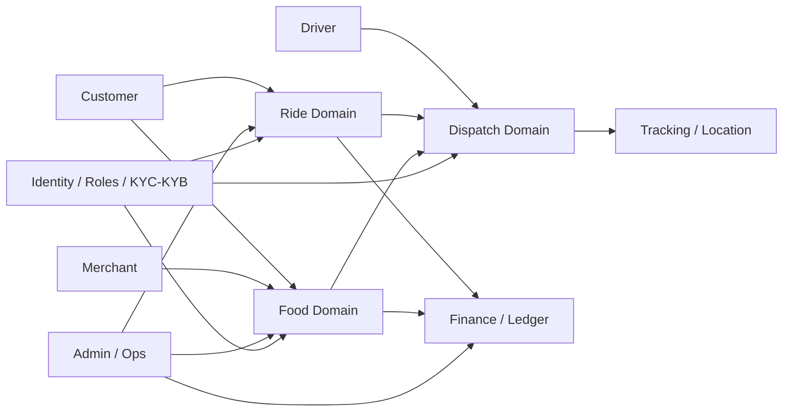
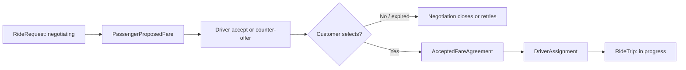
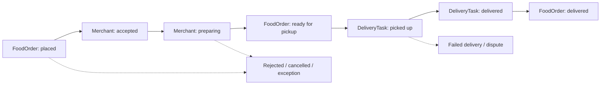
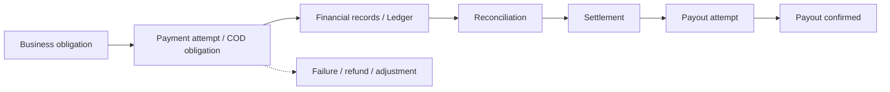

# DealGo — Glossary / Từ điển thuật ngữ nghiệp vụ

> **Mục đích:** Thống nhất một ngôn ngữ giữa Product, UI/UX, Flutter, Backend, QA, Data, Ops và AI coding agent để triển khai **Ride hai bánh + Food** trên **một app Flutter có ba vai trò Customer / Merchant / Driver** và một kênh Admin Web.
>
> **Trạng thái:** `DRAFT`. Các tên domain, type, bảng dữ liệu và enum nêu tại đây là **quy ước ngôn ngữ đề xuất**, **không** tự động trở thành schema, endpoint hay chính sách đã duyệt. Tài liệu này định nghĩa *ý nghĩa từ*; business rule ở `02-domain/*`, state machine và workflow ở `03-workflows/*`, giao diện ở `04-experience/*`, API/schema ở `06-data-api/*`.

## 1. Cách sử dụng Glossary

### 1.1. Mức độ quyết định

| Nhãn | Ý nghĩa | Cách sử dụng |
|---|---|---|
| `CONFIRMED` | Đã thống nhất cấp dự án | Có thể làm tiền đề cho mọi docs, trừ khi thay đổi qua decision record. |
| `PROPOSED` | Tên gọi, mô hình hoặc phân định ý nghĩa được đề xuất tại tài liệu này | Có thể dùng trong bản nháp; phải duyệt cùng domain/API contract trước khi coi là ràng buộc triển khai. |
| `TBD` | Chưa chốt hành vi, giá trị, chính sách hoặc nhà cung cấp | Không tự suy ra con số, trạng thái chính thức hoặc điều kiện áp dụng. |
| `OUT_OF_SCOPE` | Không nằm trong release tương ứng | Không tự đưa vào MVP vì đối thủ có chức năng đó. |

**Đã xác nhận:** `Ride` và `Food` thuộc MVP (`DEC-PROD-001`); một ứng dụng Flutter cho ba role (`DEC-PROD-002`); tham khảo Grab/GrabFood/ShopeeFood và inDrive theo từng pattern (`DEC-PROD-003`); Ride thương lượng giá, khách chọn offer trước assignment (`DEC-PROD-005`). Mức giá/timeout/vòng thương lượng chưa được chốt. Các thuật ngữ khác mặc định là `PROPOSED` trừ khi ghi rõ.

### 1.2. Nguyên tắc sử dụng từ

1. **Một khái niệm — một tên chuẩn.** Trong code/domain/API chỉ dùng tên chuẩn tiếng Anh; nội dung UI có thể dùng tiếng Việt thân thiện.
2. **Không nhập nhằng namespace.** `RideRequest` khác `Trip`; `FoodOrder` khác `DeliveryTask`; `FareCounterOffer` khác `DispatchOffer` và `DriverAssignment`.
3. **Vai trò ≠ tài khoản ≠ hồ sơ xác minh.** Một người có thể có nhiều role, nhưng không có nghĩa mọi role đều được hoạt động.
4. **Trạng thái business ≠ trạng thái hiển thị.** UI có thể gom bước, backend vẫn lưu chuyển trạng thái theo contract.
5. **Kết thúc nghiệp vụ ≠ kết thúc dòng tiền.** `TripCompleted` hoặc `FoodOrderDelivered` không có nghĩa đã đối soát hoặc chi trả.
6. **Một ID có miền duy nhất.** `foodOrderId`, `tripId`, `assignmentId`, `paymentId` không thể hoán đổi.
7. **Không áp dụng máy móc thuật ngữ của nhà cung cấp.** `GrabMerchant`, `GrabDriver`, `ShopeeFood` là tên sản phẩm của bên khác; DealGo chỉ tham khảo các luồng công khai.
8. **Giá trị kỹ thuật mô tả ở đây không phải default production.** Timeout, phí, bán kính, chu kỳ GPS, tỷ lệ hoa hồng, logic refund đều còn tùy decision.

### 1.3. Bản đồ ngữ cảnh



**Không suy ra kiến trúc microservices từ sơ đồ.** Đây là domain context map; có thể triển khai trong modular monolith nếu thiết kế sau này phê duyệt.

## 2. Nền tảng sản phẩm, tài khoản và vai trò

| Thuật ngữ chuẩn | Giải nghĩa trong DealGo | Phân biệt / ghi chú |
|---|---|---|
| **DealGo** | Tên sản phẩm/nền tảng. | Không đồng nghĩa một dịch vụ Ride riêng lẻ. |
| **Ride** | Dịch vụ kết nối khách với tài xế chở khách bằng xe hai bánh. | Không gọi là `Delivery`. `CONFIRMED`. |
| **Food** | Dịch vụ khách đặt món từ Merchant và được Driver giao. | Không mở rộng mặc định thành GrabMart/giao bưu kiện. `CONFIRMED`. |
| **Customer** | Vai trò người đặt Ride hoặc Food. | Một `User` có thể sở hữu Customer role. `CONFIRMED`. |
| **Merchant** | Vai trò đối tác kinh doanh thực phẩm/món ăn. | Không nhầm người giữ vai trò Merchant với một `Store` cụ thể. `CONFIRMED`. |
| **Driver** | Vai trò đối tác thực hiện Ride hoặc giao đơn Food khi đủ điều kiện. | `Driver` là role chung; `Courier` mô tả nhiệm vụ giao hàng. `CONFIRMED`. |
| **Admin** | Người dùng kênh quản trị web theo quyền. | Không mặc định là role thứ tư trong app Flutter; có thể có nhiều nhóm quyền vận hành. |
| **User** | Định danh chủ thể người dùng trong Identity domain. | Không đồng nhất `User` với `Customer` hay với một hồ sơ Driver. |
| **Account** | Tài khoản dùng để đăng nhập và quản lý phiên. | Không tự cho phép mọi role. |
| **Passkey** | Public-key credential gắn với relying party, được tạo/xác thực qua authenticator của OS/browser. | Private key không nằm trên server; khác SMS/email OTP. |
| **AuthMethodPolicy** | Cấu hình versioned enable/disable theo method và scope. | Permission grant hoặc xóa lịch sử credential. |
| **VerifiedContact** | Phone/email đã chứng minh quyền kiểm soát cho mục đích contact/identifier. | Danh tính pháp lý hoặc mặc định là authenticator mạnh. |
| **UserProfile** | Dữ liệu hiển thị/cá nhân hóa của người dùng. | Khác `KYCRecord` và hồ sơ đối tác. |
| **Role** | Vai trò nghiệp vụ đã được hệ thống gán/cho phép. | Role không nhất thiết đang kích hoạt. |
| **RoleEligibility** | Điều kiện một người được sử dụng một vai trò/dịch vụ. | Khác `ActiveRole`; có thể bị từ chối/tạm ngưng. |
| **ActiveRole** | Ngữ cảnh vai trò đang được chọn trong một phiên sử dụng app. | Chuyển màn hình không thay quyền server. |
| **RoleSwitching** | Hành động chuyển UI/ngữ cảnh sang vai trò được cấp phép. | Quy tắc khi đang có job thuộc `OPEN-005`. |
| **Permission** | Quyền thực thi thao tác trên tài nguyên cụ thể. | Vai trò có quyền không đồng nghĩa truy cập được bất kỳ record nào. |
| **RBAC** | Role-Based Access Control: phân quyền theo vai trò. | Cần kiểm tra ownership/object-level authorization. |
| **ResourceOwnership** | Quan hệ sở hữu/được quản lý đối với một đối tượng dữ liệu. | Quan trọng khi một Merchant có nhiều Store hoặc Driver có nhiều hồ sơ. |
| **Store** | Địa điểm/cơ sở nhận và chế biến đơn Food. | Không đồng nhất `Merchant` với `Store`; một Merchant nhiều Store là vấn đề thiết kế cần chốt. |
| **StoreStaff** | Người được Merchant/Store ủy quyền thao tác trên một cửa hàng. | Là năng lực/nhóm quyền dự kiến, không mặc định đã có role mobile riêng. |
| **Partner** | Thuật ngữ tổng quát chỉ đối tác tham gia nền tảng. | Trong docs chuyên biệt phải viết `Driver` hoặc `Merchant`. |
| **Onboarding** | Quy trình đăng ký, cung cấp hồ sơ, kiểm duyệt và kích hoạt. | Không đồng nghĩa chỉ với tạo tài khoản. |
| **KYC** | Know Your Customer: quy trình nhận biết/xác minh danh tính cá nhân. | Không đồng nghĩa tất cả giấy tờ đã hợp lệ để nhận Ride. |
| **KYB** | Know Your Business: quy trình xác minh chủ thể kinh doanh. | Khác KYC của người đại diện. |
| **VerificationStatus** | Kết quả xét duyệt một loại hồ sơ/xác minh. | Có thể hết hiệu lực dù role từng được duyệt. |
| **PartnerActivation** | Cho phép đối tác hoạt động sau khi đủ mọi điều kiện áp dụng. | Không suy ra chỉ từ `KYC approved`. |
| **ServiceEligibility** | Quyền thực hiện **Ride**, **Food delivery** hoặc cả hai theo điều kiện. | Driver được duyệt giao món không mặc định được chở khách. |
| **Suspension** | Biện pháp tạm ngưng tài khoản/role/Store theo phạm vi chỉ định. | Khác `Deactivation` hoặc xóa tài khoản. |
| **ServiceArea** | Vùng địa lý mà dịch vụ cho phép phát sinh/giao dịch. | Khu vực pilot `OPEN-001`; không phải bán kính tìm tài xế. |
| **Pilot** | Giai đoạn thử nghiệm giới hạn về địa lý, người dùng, giao dịch hoặc đối tác. | Không đồng nghĩa launch thương mại đại trà. |
| **MVP** | Phiên bản tối thiểu đạt chức năng/độ an toàn để kiểm chứng giả thuyết sản phẩm. | DealGo MVP gồm **cả** Ride và Food; không đồng nghĩa đủ điều kiện go-live thật. |
| **P0 / P1 / P2** | Nhóm mức độ ưu tiên năng lực theo `scope-release-plan.md`. | `P0` không có nghĩa triển khai mọi màn hình đã từng liệt kê. |

## 3. Ride — yêu cầu đặt xe và chuyến đi

> Các tên entity sau là **đề xuất khái niệm**, tránh khẳng định schema trước khi chốt `02-domain/domain-model.md` và `06-data-api/er-diagram.md`.

| Thuật ngữ chuẩn | Giải nghĩa trong DealGo | Phân biệt / ghi chú |
|---|---|---|
| **RideBooking** | Quá trình đặt xe nhìn từ trải nghiệm của Customer. | Tên tính năng/flow; không mặc định entity hoặc bảng dữ liệu. |
| **RideRequest** | Yêu cầu tìm tài xế được Customer gửi đến hệ thống. | Có thể thất bại mà **không** tạo chuyến đã nhận. |
| **Trip** | Chuyến xe gắn với thực thi chở khách theo lifecycle được duyệt. | Không thay thế `RideRequest`. Thời điểm tạo `Trip` chính thức còn quyết định trong domain docs. |
| **PickupPoint** | Điểm đón Customer đã chọn/được xác nhận. | Không nhất thiết trùng GPS tức thời của Customer. |
| **DropoffPoint** | Điểm đến của chuyến Ride. | Khác `DeliveryAddress` của Food. |
| **Waypoint** | Điểm trung gian trên lộ trình. | Có hỗ trợ nhiều điểm trong MVP hay không phải xét scope. |
| **Vehicle** | Phương tiện thực hiện nhiệm vụ Ride/Delivery. | Không đồng nghĩa Driver; tài xế có thể thay xe theo chính sách. |
| **VehicleEligibility** | Điều kiện phương tiện hợp lệ đối với dịch vụ cụ thể. | Tùy điều kiện pháp lý và kiểm duyệt hồ sơ. |
| **RideReferenceFare** | Giá tham khảo backend tính từ route/service/policy version. | Không phải giá thỏa thuận cuối. |
| **Fare** | Giá cước chuyến Ride theo cấu trúc giá được duyệt. | Khác phí nền tảng hay khoản bồi hoàn. |
| **FareEstimate** | Giá cước dự kiến tại thời điểm báo giá. | Phải có thông tin hiệu lực/phiên bản và chính sách khi giá thay đổi. |
| **RideCancellation** | Kết thúc yêu cầu/chuyến do hành động hủy hợp lệ. | Khác hết thời gian tìm tài xế hoặc thất bại hệ thống. |
| **NoDriverAvailable** | Kết quả không thể phân công tài xế hợp lệ. | Không phải Customer chủ động hủy. |
| **DriverArrival** | Việc hệ thống xác nhận Driver đã đến vị trí đón theo điều kiện. | Khác việc Driver tự nhấn trạng thái nếu chưa kiểm tra guard. |
| **PickupConfirmation** | Hành vi xác nhận đón khách. | OTP / thao tác thủ công / vị trí còn `TBD`. |
| **TripStart** | Mốc nghiệp vụ chuyển sang thực hiện hành trình chở khách. | Không đồng nghĩa tài xế đã nhận offer. |
| **TripCompletion** | Hoàn thành thực hiện chuyến theo nghiệp vụ Ride. | Không đồng nghĩa payout đã thành công. |
| **TripReceipt** | Biên nhận/tóm tắt chi phí chuyến. | Không tự khẳng định là hóa đơn thuế điện tử. |
| **TripHistory** | Lịch sử chuyến được phép xem bởi từng role. | Customer và Driver có tập trường/permission khác nhau. |
| **TripIncident** | Sự cố liên quan đến chuyến, người hoặc an toàn. | Không phải mọi lỗi kỹ thuật đều là safety incident. |
| **RouteDeviation** | Lệch so với tuyến tham chiếu được hệ thống tính toán. | Không mặc định là gian lận; có thể do đường cấm/ùn tắc. |
| **EstimatedArrival** | Thời điểm dự kiến Driver đến đón hoặc chuyến hoàn tất, phải ghi rõ đích. | Không dùng từ `ETA` một mình nếu có nhiều mục tiêu. |
| **RideTerminalState** | Trạng thái nghiệp vụ kết thúc một yêu cầu/chuyến. | Có nhiều loại terminal; không được nhập hủy/thất bại/hoàn thành làm một. |

## 4. Food — nhà hàng, giỏ hàng, đơn và giao đồ ăn

| Thuật ngữ chuẩn | Giải nghĩa trong DealGo | Phân biệt / ghi chú |
|---|---|---|
| **FoodOrder** | Đơn đặt món của Customer đối với một giao dịch Food. | Không dùng `Order` trần trong API/domain khi có nhiều loại giao dịch. |
| **OrderLine** | Một dòng món/SKU và số lượng cùng lựa chọn bổ sung trong đơn. | Khác `MenuItem` gốc, giá được chụp tại thời điểm order. |
| **Menu** | Danh mục món mà Store công bố. | Khác `Category` cấp nền tảng hoặc `Cart`. |
| **MenuCategory** | Nhóm các món của một cửa hàng. | Không đồng nghĩa service category. |
| **MenuItem** | Một món/sản phẩm Food được bán. | Cần snapshot ở đơn khi giá/tên món thay đổi. |
| **ItemOption** | Lựa chọn cho món, ví dụ kích cỡ hoặc mức cay. | Không nhất thiết thay đổi giá. |
| **ModifierGroup** | Nhóm lựa chọn như topping, size hoặc chế biến. | Min/max chọn và giá cần business rules. |
| **ItemAvailability** | Món có thể đặt tại thời điểm kiểm tra hay không. | Khác việc Store đang mở. |
| **SoldOut** | Tình trạng món hết hàng/tạm ngưng bán. | Không đồng nghĩa xóa món khỏi menu. |
| **StoreAvailability** | Cửa hàng có thể nhận đơn hiện tại theo giờ/điều kiện hoạt động. | `Open` không bảo đảm món cụ thể còn hàng. |
| **StoreOperatingHours** | Khung giờ cửa hàng công bố hoạt động. | Khác trạng thái online tức thời. |
| **StorePause** | Tạm ngưng nhận đơn trong một khoảng thời gian. | Không phải khóa Merchant role. |
| **Cart** | Giỏ hàng đang soạn, chưa tạo giao dịch FoodOrder. | Không được tạo Financial obligation chỉ vì có cart. |
| **CartLine** | Dòng sản phẩm trong giỏ của Customer. | Có thể bị revalidate ở checkout. |
| **Checkout** | Quá trình kiểm tra lại giỏ, địa chỉ, phương thức trả tiền và xác nhận gửi đơn. | Không đồng nghĩa thanh toán thành công. |
| **PriceSnapshot** | Giá, số lượng, lựa chọn, thuế/phí đã ghi cố định cho giao dịch tại mốc xác định. | Không lấy lại giá hiện tại khi xem đơn cũ. |
| **MerchantAcceptance** | Store/nhân sự có quyền chấp nhận đơn Food. | Không đồng nghĩa tài xế đã nhận giao. |
| **MerchantRejection** | Từ chối đơn bởi Merchant theo quy tắc và reason. | Khác Customer cancellation. |
| **FoodPreparation** | Quá trình Merchant chế biến/đóng gói món. | Không đồng nghĩa dispatch đã hoàn tất. |
| **ReadyForPickup** | Merchant thông báo món sẵn sàng để tài xế đến nhận. | Khác `DriverArrivedAtStore` và `DriverPickedUp`. |
| **DriverArrivedAtStore** | Driver đã tới địa điểm cửa hàng theo quy tắc. | Không có nghĩa món đã được nhận. |
| **FoodPickup** | Hành động bàn giao món từ Merchant cho Driver. | Không đồng nghĩa Customer nhận món. |
| **DeliveryTask** | Nhiệm vụ vận chuyển một đơn Food do Driver thực hiện. | Khác FoodOrder: đơn có thể tồn tại trước khi có task/assignment. |
| **DeliveryAddress** | Địa chỉ giao món đã xác nhận cho FoodOrder. | Khác PickupPoint của Ride. |
| **Recipient** | Người nhận món, có thể không phải Customer đặt. | Quyền liên hệ/lưu số điện thoại cần quy tắc riêng. |
| **ProofOfDelivery** | Bằng chứng giao nhận theo cơ chế được duyệt. | Ảnh, OTP, chữ ký... hiện `TBD`; không tự lưu ảnh nhạy cảm. |
| **FoodDeliveryCompletion** | Kết quả giao món hoàn tất theo điều kiện nghiệp vụ. | Không suy ra toàn bộ tiền đã được settlement. |
| **FailedDelivery** | Giao Food không thành công sau khi đã có bước giao vận. | Khác merchant từ chối trước chế biến. |
| **UnavailableItemResolution** | Cách giải quyết món hết hoặc không còn hợp lệ sau đặt. | Thay món/xóa món/hoàn tiền cần quyền khách và rule. |
| **OrderAmendment** | Thay đổi đơn hợp lệ sau khi tạo và ghi nhận lịch sử chỉnh sửa. | Không tự sửa trực tiếp snapshot quá khứ. |
| **SingleStoreCheckout** | Một checkout gắn với một cửa hàng. | Là phương án `PROPOSED`, chưa phải cam kết tất cả đơn một Store. |
| **ScheduledOrder** | Đơn Food đặt lịch nhận/chế biến/giao về sau. | Chưa mặc định thuộc P0. |
| **PickupOrder** | Đơn khách tự đến quán lấy. | Khác Food delivery; không mặc định P0. |
| **FoodIncident** | Sự cố về món, thực phẩm, đóng gói hoặc phục vụ đơn. | Phân loại khác sự cố an toàn Ride. |

**Nguồn tham khảo thực hành bên ngoài:** Tài liệu công khai GrabMerchant phân biệt các bước `đang chuẩn bị`, `sẵn sàng` và các thao tác thay/xóa sản phẩm; DealGo **không kế thừa nguyên trạng** quy tắc status hoặc bồi hoàn từ Grab.

## 5. Dispatch, phân công, định vị và thời gian thực

| Thuật ngữ chuẩn | Giải nghĩa trong DealGo | Phân biệt / ghi chú |
|---|---|---|
| **Dispatch** | Hoạt động tìm, chào mời, lựa chọn và phân công Driver phù hợp cho Ride/Delivery. | Không đồng nghĩa phát một push notification. |
| **DispatchJob** | Nhu cầu cần phân công được hệ thống điều phối theo dõi. | Có thể tham chiếu RideRequest/DeliveryTask; schema còn TBD. |
| **Candidate** | Driver được hệ thống đánh giá sơ bộ là có thể nhận việc. | Không có nghĩa đã nhận offer. |
| **EligibilityFilter** | Bộ quy tắc xác định Driver đủ điều kiện. | Kết hợp license, dịch vụ, online, vị trí, workload... theo policy. |
| **DispatchRadius** | Bán kính tìm candidate theo tọa độ mốc quy định. | Mốc tính/bán kính `OPEN-004`; không phải ServiceArea. |
| **DriverAvailability** | Khả năng Driver nhận việc ở thời điểm hiện tại. | `ONLINE` không bảo đảm `AVAILABLE`. |
| **DriverOnlineStatus** | Chỉ báo Driver đang bật/tắt sẵn sàng kết nối hệ thống. | Không tự cấp quyền đủ điều kiện Ride/Delivery. |
| **DispatchOffer** | Lời mời tài xế nhận một job đã có điều kiện/giá, có hạn hiệu lực. | Không phải đề nghị giá; không đồng nghĩa đã được phân công. |
| **FareCounterOffer** | Mức giá tài xế phản hồi khi thương lượng Ride. | Không phải DispatchOffer hoặc assignment. |
| **PassengerProposedFare** | Giá khách đề xuất khi tạo Ride request. | Không phải giá tham khảo hoặc giá cuối đã thỏa thuận. |
| **AcceptedFareAgreement** | Snapshot giá cuối được khóa sau khi khách chọn một đề nghị hợp lệ và backend commit. | Không phải payment success/settlement. |
| **ReferenceFare** | Giá tham khảo backend tính theo route/service/policy version để khách cân nhắc. | Không phải giá cam kết thu nếu chưa có agreement. |
| **OfferAcceptance** | Hành động Driver chấp nhận một offer. | Server vẫn phải xác nhận chấp nhận thành công/atomic. |
| **OfferRejection** | Driver từ chối một offer. | Không đồng nghĩa hủy Trip hoặc FoodOrder. |
| **OfferExpiry** | Offer quá thời hạn hợp lệ. | Timeout cụ thể là `OPEN-004`. |
| **DriverAssignment** | Kết quả hệ thống chốt **một** Driver hợp lệ cho một công việc theo rule. | Phân biệt `offer sent`, `accepted` và `assigned`. |
| **Reassignment** | Gỡ/thu hồi assignment hợp lệ rồi phân công lại theo chính sách. | Cần audit, chống hai Driver cùng claim một task. |
| **DispatchAttempt** | Một lần/chặng hệ thống thử tìm/gửi offer. | Không đồng nhất với toàn bộ RideRequest. |
| **ConcurrentAcceptance** | Nhiều Driver cạnh tranh nhận cùng một việc. | Server authoritative, bảo vệ bằng transaction/atomic guard. |
| **CapacityConstraint** | Giới hạn công việc Driver có thể xử lý đồng thời. | `OPEN-005`; không tự đặt giá trị bằng 1 nếu chưa duyệt. |
| **LocationFix** | Mẫu vị trí có tọa độ, thời điểm, độ chính xác và nguồn. | Không được mặc định vị trí luôn chính xác hoặc mới. |
| **LocationAccuracy** | Độ chính xác ước lượng của điểm GPS/vị trí. | Không đồng nghĩa quãng đường tuyến đường. |
| **StaleLocation** | Vị trí quá cũ so với ngưỡng được duyệt. | Ngưỡng thời gian `TBD`. |
| **Geocoding** | Đổi địa chỉ sang tọa độ. | Khác `ReverseGeocoding`. |
| **ReverseGeocoding** | Đổi tọa độ thành địa chỉ mô tả. | Kết quả chỉ là suy luận từ provider, không luôn chính xác. |
| **Route** | Tuyến đường đề xuất từ các điểm. | Không phải quãng đường đường thẳng. |
| **RouteMatrix** | Kết quả ước lượng lộ trình/thời gian nhiều cặp nguồn-đích. | Dùng để hỗ trợ xếp hạng, không tự xác định policy phân công. |
| **ETA** | Estimated Time of Arrival — thời gian/thời điểm dự kiến đến một mốc cụ thể. | Bắt buộc gắn đích như `pickupETA`, `deliveryETA`. |
| **ETD** | Estimated Time of Departure — thời điểm dự kiến xuất phát, nếu thực sự cần. | Tránh nhầm với ETA. |
| **TrackingSession** | Khoảng thời gian có quyền gửi/xem cập nhật vị trí cho một công việc. | Bắt buộc scope quyền và ngừng theo dõi đúng lúc. |
| **Heartbeat** | Tín hiệu định kỳ phản ánh kết nối/hoạt động. | Không thay thế GPS hoặc bảo đảm app đang foreground. |
| **RealtimeEvent** | Thông tin cập nhật qua WebSocket, push hoặc cơ chế tương tự. | UI không mặc định có dữ liệu chính xác nếu mất sự kiện. |
| **Reconnect** | Thiết lập lại kết nối realtime sau gián đoạn. | Phải lấy snapshot/state server để đồng bộ. |
| **FallbackPolling** | Hỏi server theo chu kỳ khi realtime không hoạt động. | Tần suất phụ thuộc tải/cost/SLO `OPEN-007`. |

## 6. Giá, tiền, thu/chi, kế toán đối soát

> **Cảnh báo:** Đây là từ vựng khái niệm, **không phải** quy tắc DealGo đã duyệt về phương thức thanh toán, thuế, tỷ lệ chia tiền, phí hủy hoặc thời điểm capture/settlement (`OPEN-002`, `OPEN-003`, `OPEN-006`).

| Thuật ngữ chuẩn | Giải nghĩa trong DealGo | Phân biệt / ghi chú |
|---|---|---|
| **Money** | Giá trị tiền kèm đơn vị tiền tệ và quy tắc làm tròn. | Không tính tài chính bằng float thiếu kiểm soát. |
| **Currency** | Đồng tiền áp dụng cho một giao dịch, ví dụ `VND`. | Không bỏ trường currency khỏi contract chỉ vì pilot tại Việt Nam. |
| **Quote** | Tập thông tin giá được dự tính trước khi giao dịch được xác nhận. | Khác số tiền phát sinh cuối cùng. |
| **QuoteExpiry** | Thời điểm một quote hết hiệu lực. | Chưa có timeout cụ thể. |
| **PricingRule** | Quy tắc tính giá dựa trên dữ liệu đầu vào và phiên bản cấu hình. | Không đồng nghĩa `Promotion`. |
| **BaseFare** | Thành phần giá cơ sở nếu công thức Ride sử dụng. | Chưa cam kết tồn tại trong sản phẩm. |
| **DistanceFare** | Thành phần tính theo quãng đường nếu chính sách yêu cầu. | Không lấy khoảng cách Haversine thay route distance một cách mặc định. |
| **DeliveryFee** | Phí vận chuyển Food hiển thị/ghi nhận cho giao dịch. | Không đồng nhất thu nhập Driver. |
| **PlatformFee** | Khoản thu nền tảng, tùy mô hình/đối tượng chịu phí. | Không tự gắn tỷ lệ hoặc tax treatment. |
| **MerchantCommission** | Khoản nền tảng hưởng từ giao dịch Merchant theo hợp đồng. | Khác phí vận chuyển. |
| **Promotion** | Quy tắc khuyến mại/ưu đãi có điều kiện. | Khác voucher là công cụ hoặc mã thực hiện. |
| **Voucher** | Mã/quyền hưởng khuyến mại theo điều kiện. | Khác refund hay credit hoàn tiền. |
| **Discount** | Giá trị giảm trừ khi tính tiền hợp lệ. | Phải xác định bên tài trợ khoản giảm. |
| **FeeBreakdown** | Phân rã tổng tiền thành các thành phần có ý nghĩa. | Không dùng một trường `total` cho mọi mục đích. |
| **OrderTotal** | Tổng tiền khách phải trả cho FoodOrder theo điều kiện. | Khác `MerchantNet` và `DriverEarnings`. |
| **PaymentMethod** | Cách Customer thanh toán, ví dụ COD hoặc phương thức điện tử nếu triển khai. | Danh sách production `OPEN-002`. |
| **COD** | Cash on Delivery — thu tiền mặt khi giao theo quy trình được duyệt. | Người giữ/đối soát tiền mặt phải được xác định. |
| **PaymentIntent** | Ý định thực hiện thanh toán, tách khỏi trạng thái domain Order/Trip. | Là khái niệm; không mặc định dùng Stripe. |
| **PaymentAuthorization** | Sự chấp thuận/giữ hạn mức để có thể thu tiền trong một số mô hình PSP. | Khác `AuthN` đăng nhập và `AuthZ` phân quyền. |
| **PaymentCapture** | Thao tác thu khoản tiền đã được authorize khi provider hỗ trợ. | Không áp dụng cho mọi loại thanh toán; luồng còn `TBD`. |
| **PaymentSuccess** | Kết quả provider/hệ thống xác nhận việc thanh toán theo contract. | Không đồng nghĩa webhook vừa được nhận chưa xác thực. |
| **PaymentFailure** | Thanh toán không hoàn tất hợp lệ. | Có thể tách failed/cancelled/expired/unknown. |
| **PaymentWebhook** | Callback của nhà cung cấp thông báo sự kiện thanh toán. | Phải xác thực nguồn, chống replay, xử lý lặp và out-of-order. |
| **Refund** | Hoàn lại tiền đã thực sự thu khi điều kiện thỏa. | Không phải hủy authorization chưa capture. |
| **Void** | Hủy hiệu lực authorization/giữ tiền chưa capture, tùy PSP. | Không được gộp với refund đã thu tiền. |
| **Chargeback** | Khiếu nại/hoàn trả do mạng thanh toán/chủ thẻ theo cơ chế provider. | Khác refund tự nguyện của nền tảng. |
| **CancellationFee** | Khoản thu do hủy nếu chính sách cho phép. | Điều kiện/pháp lý/giá trị `OPEN-003`. |
| **DriverEarnings** | Thu nhập phát sinh được ghi nhận cho Driver. | Có thể ước tính/chờ đối soát/chờ chi trả. |
| **MerchantGross** | Doanh thu gộp có liên quan đến Merchant theo định nghĩa báo cáo. | Không tự đồng nghĩa doanh thu kế toán cuối cùng. |
| **MerchantNet** | Giá trị Merchant được hưởng sau các khoản điều chỉnh theo hợp đồng. | Không đồng nghĩa số tiền đã chuyển ngân hàng. |
| **Ledger** | Sổ ghi nhận các bút toán tài chính có khả năng đối soát. | Không thay bằng cập nhật mỗi `balance` đơn lẻ. |
| **LedgerEntry** | Một bút toán/đơn vị ghi nhận thay đổi kinh tế trong ledger. | Cần immutability/correction theo quy tắc. |
| **Balance** | Số dư tính từ tập bút toán theo định nghĩa tài khoản. | Không đồng nghĩa `Payout`. |
| **Payable** | Khoản hệ thống có nghĩa vụ phải trả cho đối tác. | Khác tiền đang giữ hoặc mới ước lượng. |
| **Receivable** | Khoản hệ thống có quyền/đang cần thu. | Đặc biệt liên quan COD/đối soát. |
| **Settlement** | Quá trình xác định/chốt nghĩa vụ phải thu-phải trả kỳ giao dịch. | Khác `Payout` là chuyển tiền. |
| **Payout** | Khoản chi trả cho Merchant/Driver theo kênh đã duyệt. | Payout có thể pending/failed sau settlement. |
| **Reconciliation** | Đối chiếu record nội bộ với nhà cung cấp, ngân hàng, tiền mặt và ledger. | Không chỉ so sánh `payment.status`. |
| **FinancialAdjustment** | Điều chỉnh sổ sách do khiếu nại, hủy, thiếu/ thừa tiền. | Bắt buộc có lý do, nguồn và audit trail. |
| **FinancialLiability** | Nghĩa vụ tài chính gắn với một bên/ngữ cảnh. | Khác việc ghi nhận thực tế đã thanh toán. |
| **FinancialDispute** | Khiếu nại về số tiền, thu/chi, khoản khấu trừ hoặc chi trả. | Khác sự cố hành trình thuần túy. |

## 7. Kỹ thuật, dữ liệu, API, event và độ tin cậy

| Thuật ngữ chuẩn | Giải nghĩa trong DealGo | Phân biệt / ghi chú |
|---|---|---|
| **Domain** | Phạm vi tri thức/nghiệp vụ có quy tắc và ngôn ngữ riêng. | Không nhất thiết là một microservice. |
| **BoundedContext** | Ranh giới mà domain model và tên gọi có nghĩa nhất quán. | `FoodOrder` không nên bị ép tái sử dụng bảng `Trip`. |
| **Aggregate** | Nhóm đối tượng và invariants được bảo vệ nhất quán qua một root. | Không đồng nghĩa mọi bảng có foreign key với nhau. |
| **Invariant** | Điều kiện luôn phải đúng trước/sau các chuyển trạng thái hợp lệ. | Ví dụ: không có hai assignment đang có hiệu lực cho cùng một dispatch job. |
| **StateMachine** | Mô hình tập trạng thái và điều kiện chuyển giữa chúng. | Flow UI không thay state machine server. |
| **Transition** | Một chuyển đổi trạng thái có actor, trigger, guard và side effects. | Không cho phép sửa status tùy ý. |
| **Guard** | Điều kiện phải thỏa để thực hiện transition. | Khác validation cú pháp request. |
| **TerminalState** | Trạng thái không còn tiếp tục lifecycle chính. | Không đồng nghĩa record bị xóa hoặc tiền đã chốt. |
| **ReasonCode** | Mã lý do máy đọc được cho hủy/từ chối/lỗi/ngắt quãng. | Không chỉ lưu một ghi chú text không cấu trúc. |
| **IdempotencyKey** | Mã giúp cùng một intent gửi lặp không tạo hậu quả kinh doanh lặp. | Không dùng một key cho các intent khác nhau. |
| **OptimisticConcurrency** | Kiểm soát cập nhật tranh chấp bằng version/điều kiện cập nhật. | Không bảo đảm idempotency toàn bộ transaction nếu đứng một mình. |
| **AtomicAssignment** | Thao tác chốt assignment theo nguyên tắc tất cả hoặc không có gì. | Không được chốt ở thiết bị Driver trước backend. |
| **DatabaseTransaction** | Tập cập nhật dữ liệu có tính nhất quán theo DB transaction. | Không tự bảo đảm side effect bên ngoài như gửi push. |
| **OutboxPattern** | Ghi event phát sinh cùng giao dịch nghiệp vụ rồi phát bất đồng bộ. | Giảm rủi ro DB commit nhưng event bị mất. |
| **InboxDeduplication** | Ghi nhận event đã xử lý để tránh áp dụng lại tác động. | Quan trọng khi broker giao lại event. |
| **EventualConsistency** | Các projection/hệ thống con đồng bộ sau một khoảng trễ. | Invariant quan trọng như 1 assignment phải bảo vệ mạnh ở nơi nguồn. |
| **SourceOfTruth** | Nguồn dữ liệu có thẩm quyền quyết định trạng thái thực tế. | UI cache, push, provider callback chưa xác thực không là SoT. |
| **ReadModel** | Dữ liệu/projection tối ưu để đọc hoặc hiển thị. | Có thể chậm hơn write model. |
| **DomainEvent** | Sự kiện một sự thật nghiệp vụ đã xảy ra. | Đặt tên ở thì quá khứ, ví dụ `RideRequestCreated`. |
| **Command** | Yêu cầu thực hiện hành động có thể bị từ chối. | Khác Event là chuyện đã xảy ra. |
| **IntegrationEvent** | Event chia sẻ giữa context/hệ thống theo contract công khai. | Không mặc định chứa mọi trường của entity nội bộ. |
| **EventVersion** | Phiên bản schema của payload event. | Không phải version của Order/Trip. |
| **CorrelationId** | Mã nối các thao tác chung trong một hành trình business. | Khác RequestId cho một lần HTTP. |
| **CausationId** | Mã tham chiếu sự kiện/lệnh dẫn tới một sự kiện mới. | Hữu ích trong workflow async. |
| **TraceId** | Mã theo dõi một distributed trace qua các span. | Không tự dùng làm business ID. |
| **RequestId** | Mã nhận diện một request kỹ thuật riêng lẻ. | Retry thường sinh RequestId mới. |
| **Retry** | Thử thực hiện lại sau lỗi transient theo chính sách. | Không retry vô hạn, đặc biệt lệnh tài chính. |
| **Timeout** | Giới hạn thời gian chờ một thao tác/offer/integration. | Timeout không tự chứng minh kết quả phía provider đã thất bại. |
| **DeadLetterQueue** | Nơi giữ message không xử lý thành công để điều tra/reprocess. | Không được bỏ qua hậu quả tiền/trạng thái. |
| **Snapshot** | Ảnh chụp trạng thái/giá/dữ liệu tại mốc nhất định. | Không thay thế log audit mọi thay đổi. |
| **AuditTrail** | Bản ghi ai/lúc nào/thao tác gì và kết quả, chống sửa trái phép. | Không log PII/secret đầy đủ vào audit. |
| **PII** | Personally Identifiable Information — dữ liệu nhận diện cá nhân. | Bao gồm nhiều dữ liệu nhạy cảm trong hồ sơ, liên hệ và định vị. |
| **DataRetention** | Quy định thời gian lưu và xóa/ẩn dữ liệu theo loại và nghĩa vụ. | Thời hạn cụ thể thuộc docs pháp lý, chưa xác định. |
| **SLO** | Service Level Objective — mục tiêu nội bộ đo độ tin cậy. | Số liệu cụ thể thuộc `OPEN-007`. |
| **SLI** | Service Level Indicator — phép đo phục vụ đánh giá SLO. | Ví dụ success rate, latency percentile. |
| **SLA** | Service Level Agreement — cam kết dịch vụ nếu được quy định trong thỏa thuận. | Không tự lấy SLO làm SLA pháp lý. |
| **RTO** | Recovery Time Objective — mục tiêu thời gian phục hồi sau sự cố. | Chưa có chỉ tiêu sản phẩm cụ thể. |
| **RPO** | Recovery Point Objective — lượng mất mát dữ liệu tối đa chấp nhận theo thời gian. | Chưa có chỉ tiêu sản phẩm cụ thể. |
| **FeatureFlag** | Cơ chế bật/tắt khả năng theo môi trường/nhóm đối tượng. | Không phải lớp phân quyền thay backend. |
| **Rollback** | Quay về phiên bản/cấu hình trước khi phát hành khi an toàn. | DB migration không luôn rollback được; có thể cần forward fix. |
| **ContractTest** | Kiểm tra client/provider tuân theo API/event contract. | Không thay thế E2E business test. |
| **SyntheticTest** | Kiểm thử mô phỏng dùng dữ liệu không phải người dùng thật. | Phải tách sandbox/production rõ. |

## 8. UI/UX, bản đồ trạng thái và ngôn từ hiển thị

| Thuật ngữ chuẩn | Giải nghĩa | Lưu ý |
|---|---|---|
| **InformationArchitecture (IA)** | Cấu trúc thông tin và điều hướng cho từng role. | Một app có role-specific navigation. |
| **ScreenInventory** | Danh mục các màn hình theo role/feature/release. | Baseline lịch sử ~165 mobile + ~37 admin chỉ là tham chiếu, cần xác thực. |
| **UserFlow** | Trình tự hành động và trải nghiệm nhìn từ actor. | Khác StateMachine xử lý business server. |
| **ScreenState** | Trạng thái hiển thị loading/success/error/empty/offline/permission. | Không đồng nghĩa OrderStatus. |
| **EmptyState** | UI khi chưa có nội dung phù hợp. | Khác error và no-network. |
| **OfflineState** | UI khi kết nối không sẵn sàng hoặc mất liên lạc. | Cần hỗ trợ trạng thái mới nhất còn được xác nhận. |
| **OptimisticUI** | Hiển thị trước khi server xác nhận kết quả. | Không dùng như bằng chứng hoàn tất nhận chuyến/thu tiền. |
| **DeepLink** | Liên kết mở trực tiếp nội dung/route của app. | Phải tái kiểm tra auth/role và resource ownership. |
| **PushNotification** | Tin gửi qua hệ thống thông báo thiết bị. | Không bảo đảm đến đúng giờ hoặc được mở. |
| **InAppNotification** | Thông báo trong ứng dụng có thể đọc lại. | Khác push transport. |
| **ChatConversation** | Kênh tin nhắn gắn với Ride/Food transaction và participant được xác thực. | Inbox tự do giữa mọi account. |
| **ChatMessage** | Nội dung text có author/time/context, được lưu theo retention policy. | Bằng chứng thanh toán hoặc bằng chứng đã đọc nếu chưa xác nhận. |
| **CallSession** | Phiên gọi thoại VoIP được backend cấp quyền theo transaction participant. | Cuộc gọi PSTN hoặc bản ghi âm. |
| **ContactWindow** | Khoảng thời gian/điều kiện user còn quyền chat/call liên quan một giao dịch. | Quyền liên lạc vô thời hạn. |
| **Accessibility** | Khả năng sử dụng cho đa dạng người dùng/thiết bị. | Gồm semantics, contrast, touch target, text scaling. |
| **HapticFeedback** | Phản hồi rung phù hợp ngữ cảnh thao tác. | Không thay thế text/status cho truy cập. |
| **MotionDesign** | Quy tắc chuyển động/trạng thái/animation UI. | Giữ hỗ trợ reduced motion. |
| **RoleHome** | Trang chủ theo active role, ví dụ Customer Home/Driver Home. | Không phải ba ứng dụng vật lý khác nhau. |
| **CriticalAction** | Hành động ảnh hưởng tiền, quyền, an toàn hoặc kết thúc lifecycle. | Cần guard/confirmation/audit tùy mức rủi ro. |

## 9. Quản trị, hỗ trợ, bảo mật và xử lý sự cố

| Thuật ngữ chuẩn | Giải nghĩa | Lưu ý |
|---|---|---|
| **AdminWeb** | Ứng dụng web quản trị vận hành DealGo. | Kênh riêng, không mặc định nằm trong role switch Flutter. |
| **Backoffice** | Các quy trình hỗ trợ hậu trường của nhân sự có quyền. | Không đồng nghĩa mọi việc xử lý bằng thao tác tay. |
| **OpsCase** | Hồ sơ sự việc hỗ trợ/vận hành có người xử lý và lịch sử. | Có thể liên kết Trip/FoodOrder/Payment. |
| **SupportTicket** | Yêu cầu hỗ trợ được ghi nhận để phân loại/theo dõi. | Có thể là một dạng OpsCase, model chi tiết TBD. |
| **Escalation** | Chuyển sự cố lên cấp xử lý có quyền/trách nhiệm phù hợp. | Safety/finance cần đường xử lý khác thông thường. |
| **IncidentSeverity** | Mức độ nghiêm trọng sự cố dựa trên tác động. | Chưa chốt bảng cấp độ P0/P1 production. |
| **CancellationReason** | Mã lý do hủy được chuẩn hóa kèm actor và thời điểm. | Không gộp Driver cancel với Merchant reject. |
| **FraudSignal** | Dấu hiệu cần đánh giá rủi ro gian lận. | Chưa phải bằng chứng xác nhận có gian lận. |
| **RiskReview** | Quy trình đánh giá tín hiệu, đưa ra quyết định có audit. | Không tự động khóa tài khoản chỉ dựa một tín hiệu thô. |
| **Authentication (AuthN)** | Xác định ai đang truy cập. | Khác PaymentAuthorization hoặc Authorization (AuthZ). |
| **Authorization (AuthZ)** | Xác định chủ thể được phép làm gì với tài nguyên nào. | Phải kiểm tra server; không tin active role từ client. |
| **ObjectLevelAuthorization** | Kiểm tra quyền với từng Trip/Order/Store cụ thể. | Ngăn truy cập sai ID (IDOR/BOLA). |
| **LeastPrivilege** | Cấp quyền tối thiểu đủ để thực hiện công việc. | Quan trọng với Ops/Admin và tài liệu KYC. |
| **SensitiveData** | Dữ liệu cần bảo vệ tăng cường như ảnh giấy tờ, vị trí chi tiết. | Chính sách phân loại ở security/privacy docs. |
| **Consent** | Sự chấp thuận cho hoạt động xử lý dữ liệu ở trường hợp luật yêu cầu. | Không mặc định đồng nhất với đồng ý điều khoản sử dụng. |
| **DataSubjectRequest** | Yêu cầu người liên quan thực hiện các quyền dữ liệu cá nhân. | Quy trình và ngoại lệ theo quy định hiện hành. |
| **Dispute** | Khiếu nại/tranh chấp cần giải quyết có dấu vết và quyết định. | Tách `FinancialDispute`, `TripIncident`, `FoodIncident` khi cần. |
| **Compensation** | Khoản hỗ trợ/bồi hoàn được quyết định theo rule và trách nhiệm. | Không tự đồng nghĩa Refund hay khuyến mại. |
| **ManualOverride** | Nhân sự có thẩm quyền can thiệp trạng thái qua quy trình kiểm soát. | Phải có reason, audit, chính sách quyền; không sửa thẳng DB. |
| **SafetyProtocol** | Quy trình hỗ trợ khi có rủi ro cho người tham gia. | Phải được chủ sở hữu vận hành/pháp lý duyệt trước pilot. |

## 10. Phân biệt các cặp dễ gây lỗi thiết kế

| Cặp thuật ngữ | Sai lầm thường gặp | Cách hiểu bắt buộc |
|---|---|---|
| `User` / `Role` | Tạo 3 tài khoản độc lập cho 3 vai trò. | User/Account là identity; role là tập quyền/điều kiện hoạt động. |
| `Merchant` / `Store` | Gắn mọi đơn với tài khoản đăng nhập thay vì cơ sở. | Đơn gắn đúng Store; chủ sở hữu và staff theo ownership. |
| `RideRequest` / `Trip` | Tạo Trip hoàn thành dù chưa tìm được Driver. | Request điều phối có lifecycle riêng; Trip đại diện thực hiện chuyến. |
| `FoodOrder` / `DeliveryTask` | Hủy task giao đồng nghĩa hủy FoodOrder. | FoodOrder thuộc nghiệp vụ đặt món; task thuộc giao vận. |
| `DispatchOffer` / `DriverAssignment` | Driver được gửi thông báo = đã được phân công. | Chỉ assignment được server commit mới là người nhận job. |
| `DriverOnlineStatus` / `DriverAvailability` | Bật online nghĩa là rảnh và đủ điều kiện. | Availability còn tùy workload, hồ sơ, vùng và policy. |
| `ReadyForPickup` / `FoodPickup` | Quán nhấn sẵn sàng là món đã lên xe. | Ready là từ phía Merchant; Pickup xác nhận bàn giao. |
| `FoodPickup` / `FoodDeliveryCompletion` | Nhận đồ tại quán là hoàn tất giao. | Chỉ giao cho Recipient theo quy trình mới hoàn tất. |
| `RideCompletion` / `Settlement` | Hoàn tất chuyến là đã trả tiền Driver. | Domain, ledger và payout có vòng đời riêng. |
| `Authorize` / `Capture` / `Refund` / `Void` | Một nút hủy có thể hoàn tất mọi loại hoàn tiền. | Phụ thuộc tiền đã thu/giữ, năng lực PSP và thời điểm. |
| `Quote` / `FinalAmount` | Giá dự kiến luôn là giá chốt. | Phải có version, hiệu lực, khi nào khóa và điều kiện điều chỉnh. |
| `Cancellation` / `Failure` / `Timeout` | Mọi kết thúc không thành công đều là khách hủy. | Giữ actor/cause/reason riêng để giải quyết tiền và trách nhiệm. |
| `Authentication` / `Authorization` | Đã đăng nhập thì xem được tài nguyên bất kỳ. | Kiểm tra role và ownership cho từng API/resource. |
| `Event` / `Command` | Phát `PaymentSucceeded` trước khi biết PSP kết quả. | Command yêu cầu hành động; event mô tả sự thật đã ghi nhận. |
| `Realtime` / `SourceOfTruth` | Client nhận event mới nhất thì bỏ qua server. | Reconnect phải lấy snapshot authoritative. |
| `OrderTotal` / `MerchantNet` / `DriverEarnings` | Một số tiền dùng cho cả ba bên. | Mỗi đại lượng có ý nghĩa, chiều tiền, công thức và lifecycle riêng. |
| `KYCApproved` / `DriverActivated` | Xét duyệt CCCD xong là mở nhận Ride. | ServiceEligibility còn giấy phép, vehicle, điều kiện hợp tác... |
| `OperatingHours` / `StoreAvailability` | Quán nằm trong giờ mở cửa thì chắc chắn nhận đơn. | Có thể pause, quá tải hoặc mất kết nối. |

## 11. Quy ước tên trong tài liệu và code

### 11.1. Danh từ chuẩn theo ngữ cảnh

| Ngữ cảnh | Dùng | Tránh / chỉ dùng khi thật cần |
|---|---|---|
| Tên dịch vụ | `Ride`, `Food` | `Transport`, `Shopping`, `Buy`, `GoRide` chưa chốt làm namespace. |
| Danh tính | `User`, `Account`, `Role`, `ActiveRole` | `CustomerAccount` cho mọi role. |
| Đặt xe | `RideRequest`, `RideFareNegotiation`, `AcceptedFareAgreement`, `RideTrip` | `Order`, `Booking` trần cho domain object. |
| Đặt món | `FoodOrder`, `Cart`, `MenuItem`, `Store` | `Trip`, `Product` mơ hồ nếu chưa namespace. |
| Điều phối | `DispatchJob`, `DispatchOffer`, `DriverAssignment` | `Job` trần qua nhiều module. |
| Tài chính | `Payment`, `LedgerEntry`, `Settlement`, `Payout` | `Transaction` dùng chung cho mọi nghĩa. |
| Thời gian | `createdAt`, `acceptedAt`, `pickedUpAt`, `completedAt` | `time` không có mốc/kiểu. |
| Khoảng cách | `distanceMeters`, `routeDistanceMeters` | `distance` thiếu đơn vị/loại khoảng cách. |
| Tiền | `amount` + `currency`; convention lưu tiền cần ADR/contract | `price` float không đơn vị. |
| Vị trí | `latitude`, `longitude`, `accuracyMeters`, `recordedAt` | `latLong` string chưa kiểm định. |

### 11.2. Ví dụ trường khái niệm, **không phải schema đã phê duyệt**

```typescript
// PROPOSED SEMANTIC EXAMPLES ONLY; DO NOT GENERATE DATABASE MIGRATIONS FROM THIS.
interface RideRequestSummary {
  rideRequestId: string;
  customerId: string;
  pickupPoint: { latitude: number; longitude: number };
  dropoffPoint: { latitude: number; longitude: number };
  status: string; // authoritative enum belongs in workflow + API contract
}

interface FoodOrderSummary {
  foodOrderId: string;
  storeId: string;
  customerId: string;
  status: string; // NOT interchangeable with delivery-task status
}

interface DispatchOfferSummary {
  offerId: string;
  dispatchJobId: string;
  driverId: string;
  expiresAt: string; // ISO 8601 instant; duration policy TBD
}
```

**Quy tắc khi implement:** type/enum thực tế phải được định nghĩa ở contracts (`06-data-api/*`) và đồng bộ codegen/tests. Không copy ví dụ `status: string` vào production thay enum đã chốt.

### 11.3. Nguyên tắc đặt tên trạng thái

- Ưu tiên trạng thái **rõ entity**: `rideRequestStatus`, `tripStatus`, `foodOrderStatus`, `deliveryTaskStatus`, `dispatchOfferStatus`, `paymentStatus`, `settlementStatus`.
- Giữ **business state** và **UI label** độc lập: `READY_FOR_PICKUP` có thể hiển thị “Quán đã chuẩn bị xong”.
- Không dùng `DONE`/`SUCCESS` chung cho hủy, giao, trả tiền, payout.
- Terminal state phải có lý do, actor và thời điểm phù hợp; không suy ra chỉ từ một boolean `isCompleted`.
- Những trạng thái trong mục 12 là **illustrative candidates**, không phải enum được phê duyệt.

### 11.4. Quy ước sự kiện và command

| Mục đích | Ví dụ đúng về mặt ngữ nghĩa (chưa duyệt contract) | Cần tránh |
|---|---|---|
| Command | `AcceptDispatchOffer`, `CancelRideRequest`, `ConfirmFoodPickup` | Dùng sự kiện quá khứ làm lệnh từ client. |
| Domain event | `RideRequestCreated`, `DriverAssigned`, `FoodOrderAccepted`, `PaymentCaptured` | `SendNotification` gọi là event sự thật nghiệp vụ. |
| Event payload | `eventId`, `eventType`, `eventVersion`, `occurredAt`, `aggregateId`, `correlationId` nếu cần | Gửi đối tượng DB thô, kèm PII không liên quan. |
| Idempotency | Cùng lệnh, cùng intent giữ idempotency key nhất quán | Sinh key mới mỗi lần retry giống intent. |
| Async processing | Inbox/dedup, retry có giới hạn, DLQ và reconciliation | Ngầm giả định message chỉ giao một lần, đúng thứ tự. |

**Lưu ý:** Format schema, naming, topic và các trường bắt buộc cuối cùng được quyết định ở `06-data-api/events.asyncapi.yaml`; AsyncAPI mô tả channels/messages/operations, không áp đặt một giao thức broker cụ thể.

## 12. Sơ đồ trạng thái tham chiếu (KHÔNG phải business contract)

> **Cực kỳ quan trọng:** Ví dụ dưới chỉ minh họa cách tách domain. Không code enum, timeout, điều kiện hủy hoặc phí từ sơ đồ này. Thẩm quyền phê duyệt thuộc `03-workflows/ride-lifecycle.md`, `03-workflows/food-fulfillment.md`, `03-workflows/dispatch-and-assignment.md`, `02-domain/payments-ledger-settlement.md`.

### 12.1. RideFareNegotiation / DispatchOffer / RideTrip



**Quy tắc diễn giải:** counter-offer chỉ là đề nghị giá; customer selection tạo agreement, assignment được commit riêng và `RideRequest` khác `RideTrip`. Trường hợp hủy sau khi assigned, xử lý sự cố và tạo Trip cụ thể còn TBD theo workflow.

### 12.2. FoodOrder / DeliveryTask



**Quy tắc diễn giải:** Sự sẵn sàng của món **không** có nghĩa Driver đã được gán; phân công tài xế có thể tiến hành song song với chế biến tùy chính sách; không ngầm khẳng định đơn đã thu tiền hoặc payout thành công.

### 12.3. Finance



**Quy tắc diễn giải:** sơ đồ thể hiện khái niệm, **không** biểu diễn một trình tự thanh toán bắt buộc hoặc quan hệ 1:1 giữa các thực thể. Phương thức điện tử, COD, capture, payout có nhánh khác nhau. Hệ thống phải ghi nhận *khi nào chưa biết* kết quả PSP để kiểm tra lại, không tùy tiện coi timeout là `failed`.

## 13. Bộ quy tắc ngôn ngữ theo actor

| Actor | Cụm từ UI khuyến nghị | Khái niệm backend tương ứng | Cấm nhầm |
|---|---|---|---|
| Customer (Ride) | “Đang thương lượng” / “Chọn tài xế” | RideFareNegotiation + offers còn hiệu lực | Chỉ báo “Đã xác nhận tài xế” sau agreement + assignment commit. |
| Customer (Ride) | “Tài xế đang đến đón” | Assignment + location/trip workflow | Không nói “Chuyến đã bắt đầu”. |
| Customer (Food) | “Quán đang chuẩn bị món” | FoodOrder + Merchant preparation | Không nói “Đang giao”. |
| Customer (Food) | “Tài xế đã lấy món” | DeliveryTask pickup confirmed | Không tự coi là “Đã giao”. |
| Merchant | “Đơn mới” | FoodOrder pending Merchant action | Không đồng nghĩa đã thanh toán. |
| Merchant | “Đã chuẩn bị xong” | ReadyForPickup | Không đồng nghĩa đã bàn giao. |
| Driver | “Lời mời nhận chuyến” | DispatchOffer | Không đồng nghĩa assignment đã được server chốt. |
| Driver | “Đang thực hiện chuyến” | Active Trip | Không coi là nhiệm vụ Food. |
| Driver | “Đơn cần giao” | Food DeliveryTask | Không sửa nội dung món của FoodOrder. |
| Admin | “Đơn cần can thiệp” | OpsCase / FoodOrder issue | Không cho phép thao tác vô quyền để sửa tiền trực tiếp. |

## 14. Tình huống mẫu để AI agent tự kiểm tra hiểu đúng

### Scenario A — Hai tài xế cùng bấm nhận

- **Đầu vào:** Một RideRequest phát offer cho Driver A và B theo dispatch policy.
- **Diễn giải đúng:** Hai `OfferAcceptance` tới gần như cùng lúc; server xác minh eligibility và commit tối đa **một DriverAssignment hiệu lực**; còn lại nhận kết quả có thể hiểu được.
- **Không được làm:** mỗi thiết bị tự gắn `assigned=true`, tạo hai Trip hoặc push hai kết quả “Bạn đã nhận chuyến” thành công.
- **Owner:** `03-workflows/dispatch-and-assignment.md`; concurrency ở `05-architecture/concurrency-and-consistency.md`.

### Scenario B — Quán hết món sau khi khách gửi FoodOrder

- **Đầu vào:** MenuItem lúc checkout hợp lệ, nhưng Merchant không thể chế biến tại thời điểm xử lý.
- **Diễn giải đúng:** lưu trạng thái/rationale ở FoodOrder và resolution flow, chỉ thay món/hoàn tiền/hủy theo approval phù hợp; không sửa âm thầm lịch sử `PriceSnapshot`.
- **Không được làm:** chỉnh MenuItem hiện tại rồi làm đơn cũ tự thay giá; để task giao chạy nếu không còn đơn hợp lệ.
- **Owner:** `03-workflows/food-fulfillment.md`, `02-domain/cancellation-refund-disputes.md`.

### Scenario C — Khách thanh toán nhưng webhook trễ

- **Đầu vào:** PSP response timeout hoặc webhook chưa đến dù có thể đã xử lý thanh toán.
- **Diễn giải đúng:** trạng thái thanh toán là **chưa xác nhận** cho đến khi có bằng chứng tin cậy; truy vấn/reconcile theo provider contract; idempotency chống thu hai lần.
- **Không được làm:** retry tạo giao dịch thu tiền mới không idempotent hoặc tự coi `paymentFailed` vì HTTP timeout.
- **Owner:** `02-domain/payments-ledger-settlement.md`, `06-data-api/*`, `09-operations/financial-operations.md`.

### Scenario D — Driver giao Food được phép chuyển sang role Customer

- **Đầu vào:** Một User có role Customer và Driver, đang có DeliveryTask chưa kết thúc.
- **Diễn giải đúng:** UI có thể hỗ trợ chuyển role theo chính sách được duyệt, nhưng server vẫn duy trì workload thật, scope tracking và chặn nhận job xung đột theo `OPEN-005`.
- **Không được làm:** hủy task trong backend chỉ vì User chuyển tab; mở quyền xem dữ liệu tài xế trong Customer context.
- **Owner:** `02-domain/roles-and-permissions.md`, `03-workflows/account-onboarding-role-switching.md`.

## 15. Bảng quyết định chưa chốt ảnh hưởng ngôn ngữ

| Decision | Câu hỏi cần chốt | Tác động đến terminology/contracts |
|---|---|---|
| `OPEN-001` | Khu vực pilot? | `ServiceArea`, các thông báo ngoài vùng. |
| `OPEN-002` | Phương thức thanh toán đầu tiên? | `PaymentIntent`, `COD`, trạng thái thanh toán, payout. |
| `OPEN-003` | Công thức giá, hủy, hoàn tiền, chia doanh thu? | `Quote`, `Fare`, `Refund`, `LedgerEntry`, `Settlement`. |
| `OPEN-004` | Bán kính, timeout, batching/offer/assignment? | `DispatchRadius`, `OfferExpiry`, `Reassignment`. |
| `OPEN-005` | Role overlap và số job đồng thời? | `ActiveRole`, `DriverAvailability`, `CapacityConstraint`. |
| `OPEN-006` | Mô hình pháp lý, hợp đồng đối tác? | `Merchant`, `Driver`, `ServiceEligibility`, `Payable`. |
| `OPEN-007` | Load, chi phí, SLO mục tiêu? | `StaleLocation`, `FallbackPolling`, `SLO`, `RTO`, `RPO`. |
| `OPEN-008` | Nhà cung cấp OTP/KYC/maps/payment/push? | `PaymentAuthorization`, `ProofOfDelivery`, `LocationFix`. |

Các câu hỏi chi tiết khác như `single-store checkout`, thời điểm merchant accept/payment capture, proof-of-delivery, ca hỗ trợ và mô hình staff thuộc bảng mở ở `scope-release-plan.md` §17.1; không tạo decision ID mới tại Glossary.

## 16. Kiểm tra chất lượng thuật ngữ trước khi merge code/docs

- [ ] Một term mới đã kiểm tra không trùng nghĩa với term hiện có.
- [ ] Tên dùng đúng domain; không dùng `Order` chung chung cho Ride/Food.
- [ ] Các state/enum phải có canonical owner ở workflow/contract, không sinh từ Glossary.
- [ ] `Offer`, `Assignment`, `Trip`, `DeliveryTask` có ID và vòng đời riêng nếu thiết kế cần.
- [ ] UI text không tạo khẳng định business sớm hơn xác nhận server.
- [ ] Tiền nào cũng chỉ rõ payer/payee, currency, component, thời điểm và trạng thái.
- [ ] Mọi con số kỹ thuật/chính sách `TBD` không bị chuyển thành default production.
- [ ] PII/KYC/GPS chỉ được log/hiển thị theo privacy và authorization policy.
- [ ] Các file bổ sung sẽ dẫn link tới term này thay vì tự tái định nghĩa mâu thuẫn.
- [ ] Từ mới hoặc thay nghĩa có impact analysis đối với ERD/API/events/UI/tests.

### 16.1. Mẫu đề xuất thay đổi thuật ngữ

```yaml
term_change:
  change_id: TBD
  term: DriverAssignment
  old_definition: TBD
  proposed_definition: TBD
  reason: TBD
  affected_domains: [dispatch, ride, food]
  affected_docs: []
  requires_decision: true
  owner: Product Owner / Domain Lead
  reviewer: Tech Lead
  status: DRAFT
```

## 17. Tham chiếu nội bộ và bên ngoài

### 17.1. Tài liệu hiện có

- [README — cấu trúc và nguyên tắc bộ docs](./README.md)
- [Project Charter — quyết định cấp sản phẩm](./project-charter.md)
- [Scope & Release Plan — năng lực P0/P1/P2, quyết định mở](./scope-release-plan.md)

### 17.2. Tài liệu dự kiến giữ quyền định nghĩa cuối cùng

- `02-domain/domain-model.md`: bounded contexts, aggregate, quan hệ domain (planned).
- `02-domain/roles-and-permissions.md`: cấp quyền, eligibility, object-level authorization (planned).
- `02-domain/payments-ledger-settlement.md`: nghĩa vụ thu/chi, settlement và payout (planned).
- `03-workflows/ride-lifecycle.md`: state machine RideRequest/Trip (planned).
- `03-workflows/food-fulfillment.md`: state machine FoodOrder và giao món (planned).
- `03-workflows/dispatch-and-assignment.md`: offer/assignment/reassignment (planned).
- `06-data-api/data-dictionary.md`, `rest-api.openapi.yaml`, `events.asyncapi.yaml`: field/enum/schema chuẩn để codegen và contract tests (planned).

### 17.3. Nguồn tham khảo (kiểm tra ngày 2026-10-11)

1. Grab Việt Nam — đối tác thương nhân GrabFood: <https://www.grab.com/vn/merchant/>. Cung cấp ngữ cảnh Merchant/Store, thực đơn và quản lý đơn; **không** phải đặc tả nội bộ DealGo.
2. GrabMerchant — tìm sản phẩm hoặc đơn trên app: <https://help.grab.com/merchant/vi-vn/4415026496025-T%C3%ACm-ki%E1%BA%BFm-s%E1%BA%A3n-ph%E1%BA%A9m-ho%E1%BA%B7c-%C4%91%C6%A1n-h%C3%A0ng-tr%C3%AAn-%E1%BB%A9ng-d%E1%BB%A5ng-GrabMerchant>. Tham khảo thuật ngữ chuẩn bị/sẵn sàng/chỉnh sửa đơn.
3. GrabFood — luồng đặt món công khai: <https://www.grab.com/vn/en/food/>. Tham khảo cách Customer chọn địa chỉ, quán, món và gửi yêu cầu.
4. AsyncAPI Initiative — cấu trúc tài liệu event-driven API: <https://www.asyncapi.com/docs/concepts/asyncapi-document/structure>. Phân biệt channel, message và operation.
5. Stripe — API payment capture: <https://docs.stripe.com/api/payment_intents/capture>. Minh họa phân biệt authorization và capture ở **một** PSP; không có nghĩa DealGo chọn Stripe hoặc mọi payment method hỗ trợ manual capture.

**Không khẳng định đã khảo sát mã nguồn/thuật toán nội bộ của Grab hay ShopeeFood.** Thuật ngữ được tổng hợp cho mô hình DealGo và sẽ được củng cố/điều chỉnh khi domain documents được phê duyệt.

## 18. Changelog và phê duyệt

| Ngày | Version | Trạng thái | Thay đổi |
|---|---|---|---|
| 2026-10-12 | 0.2.0 | `DRAFT` | Thêm thuật ngữ passkey/auth method, verified contact, chat conversation, call session và contact window. |
| 2026-10-11 | 0.1.0 | `DRAFT` | Khởi tạo ngôn ngữ chung cho Identity/Ride/Food/Dispatch/Finance/Tech/UX/Ops, đối chiếu cặp dễ nhầm và các ví dụ chống implement sai. |

| Vai trò | Người duyệt | Kết quả | Ngày |
|---|---|---|---|
| Product Owner / Domain Lead | `TBD` | `PENDING` | `TBD` |
| Tech Lead | `TBD` | `PENDING` | `TBD` |
| Mobile / UX | `TBD` | `PENDING` | `TBD` |
| Operations / Finance | `TBD` | `PENDING` | `TBD` |

**Tài liệu tiếp theo theo thứ tự 69 docs:** `docs/00-governance/decisions-and-assumptions.md` — Decision Log / Assumption Register, chuẩn hóa `DEC-*`, `OPEN-*`, quyết định bị thay thế, người có quyền duyệt và các điều kiện chặn release.
