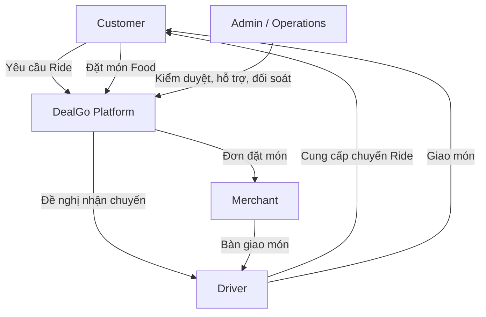

# DealGo — Project Charter / Hiến chương dự án

> **Tình trạng:** `DRAFT` — tài liệu định hướng ban đầu, **chưa được phê duyệt làm cam kết kinh doanh hoặc kế hoạch ra mắt**.
>
> **Mục đích:** thống nhất *vì sao xây DealGo, cho ai, tạo giá trị gì, phạm vi nào đã được quyết định, tiêu chuẩn thành công ra sao, ai có quyền quyết định và khi nào được phát hành*. Đây là hợp đồng về **mục tiêu và ranh giới dự án**, **không** thay thế PRD, business rules, kiến trúc, API contract hoặc quyết định pháp lý.
>
> **Điểm bắt đầu:** [README — hướng dẫn bộ tài liệu](./README.md). Các file dẫn chiếu chưa có trong repository được xem là **planned**, không phải tài liệu đã được duyệt.

## 1. Executive summary

**DealGo** là một nền tảng số phục vụ **di chuyển bằng xe máy và ô tô (Ride)** và **đặt đồ ăn giao tận nơi (Food)**. Phạm vi MVP đã thống nhất bao gồm **cả hai dịch vụ**, trên **một ứng dụng Flutter hỗ trợ ba vai trò Customer / Merchant / Driver**, cùng **Admin Web** phục vụ quản trị và điều hành.

DealGo muốn giải quyết nhu cầu kết nối đúng người — đúng dịch vụ — đúng thời điểm, đồng thời quản lý minh bạch hành trình, trạng thái và trách nhiệm của các bên.

| Thành phần | Định nghĩa ở cấp Charter | Mức độ xác nhận |
|---|---|---|
| Tên dự án | DealGo | `CONFIRMED` |
| Thị trường mục tiêu | Việt Nam; khu vực triển khai đầu tiên chưa chọn | `PROPOSED` / `TBD` |
| Dịch vụ Ride | Đặt xe máy hoặc ô tô có thương lượng giá: khách đề xuất; tài xế chấp nhận/đưa giá khác; khách chọn trước assignment | `CONFIRMED` (`DEC-PROD-005`) |
| Dịch vụ Food | Đặt món từ cửa hàng/nhà hàng, giao đến khách | `CONFIRMED` |
| Đăng ký/xác thực | Phone SMS, email+password đăng ký/đăng nhập, passkey; Admin bật/tắt phương thức | `CONFIRMED` (`DEC-PROD-008`) |
| Liên lạc dịch vụ | Chat và gọi thoại trong app theo giao dịch Ride/Food; không lộ số cá nhân | `CONFIRMED` (`DEC-PROD-007`) |
| Mobile app | Một ứng dụng Flutter hỗ trợ Customer, Merchant, Driver | `CONFIRMED` |
| Kênh vận hành | Admin Web có phân quyền | `BASELINE` từ hồ sơ dự án |
| Hình thức kinh doanh cụ thể | Pháp nhân, mô hình đối tác, biểu phí, thanh toán, hợp đồng | `TBD` |
| Khu vực pilot, ngân sách, mốc release | Chưa phê duyệt | `TBD` |
| Nguồn tham khảo | Grab/GrabFood/ShopeeFood cho service patterns; inDrive cho Ride fare negotiation; không sao chép policy/algorithm | `CONFIRMED` |

**Nguyên tắc hiến chương:** việc triển khai một ứng dụng hoạt động được về mặt kỹ thuật **không đồng nghĩa** đã đủ điều kiện phát hành dịch vụ thương mại thực tế. Phát hành production cần hoàn thành các gate vận hành, pháp lý, an toàn và kiểm thử ở §14.

## 2. Bối cảnh và bài toán

### 2.1. Nhóm nhu cầu cần giải quyết

| Nhóm | Vấn đề / nhu cầu giả định cần xác thực | Kết quả DealGo cần hướng đến |
|---|---|---|
| Customer — Ride | Cần đề xuất mức giá, biết tài xế chấp nhận/đề nghị lại, chọn rõ một tài xế và liên hệ an toàn qua chat/cuộc gọi trong app | Gửi nhu cầu + giá, thương lượng, xác nhận giá cuối trước assignment, theo dõi/hoàn tất/hủy minh bạch |
| Customer — Food | Cần tìm quán/món, hiểu tổng chi phí, biết quán có nhận và tài xế có giao không | Đặt món, nhận phản hồi, theo dõi chuẩn bị/giao và có cơ chế xử lý vấn đề |
| Merchant | Cần kênh nhận đơn, kiểm soát menu/giờ mở, thực hiện đơn và biết khoản phải thu | Quản lý đơn và tình trạng cung ứng, nhìn được kết quả vận hành |
| Driver | Cần thấy công việc phù hợp, điều kiện nhận, tiến trình và thu nhập rõ ràng | Có thể nhận, hoàn thành công việc và đối soát kết quả hợp lệ |
| Admin / Operations | Cần biết ai đang làm gì, xử lý ngoại lệ, xét duyệt đối tác và giải quyết tranh chấp | Có công cụ giám sát, can thiệp có kiểm toán và báo cáo đối soát |

Các nội dung trên là **giả thuyết sản phẩm cấp Charter**, không phải kết quả khảo sát thị trường đã được chứng minh. Nghiên cứu người dùng, cạnh tranh và định lượng vấn đề sẽ thực hiện trong `01-product/*`.

### 2.2. Tại sao tham khảo Grab / GrabFood / ShopeeFood?

Các dịch vụ hiện có công khai những mô hình luồng đáng tham chiếu: chọn loại dịch vụ, nhập địa điểm/địa chỉ, hiển thị chi phí, chọn nhà hàng/món ăn, cập nhật và theo dõi tiến trình, onboarding đối tác. Đây là bằng chứng cho **loại vấn đề và luồng UX phổ biến**, không phải bằng chứng rằng DealGo nên dùng cùng thuật toán, chính sách phí hoặc kiến trúc.

**Phạm vi học hỏi:** UX pattern, bộ câu hỏi nghiệp vụ, exception taxonomy, an toàn, minh bạch và vận hành. **Không tự suy ra:** thuật toán điều phối độc quyền, công thức thưởng phạt, SLA nội bộ, dữ liệu khách hàng hay quyền sử dụng thiết kế/thương hiệu của bên thứ ba.

Nguồn công khai và ngày tham khảo được ghi tại §19; nghiên cứu so sánh chi tiết thuộc `01-product/competitor-benchmark.md`.

## 3. Tầm nhìn và tuyên bố sản phẩm

### 3.1. Product vision

> **DealGo hướng đến trở thành một điểm truy cập tiện lợi cho nhu cầu di chuyển bằng xe máy, ô tô và đặt đồ ăn, kết nối khách hàng, cửa hàng và tài xế bằng các luồng minh bạch, dễ sử dụng và có khả năng vận hành đáng tin cậy.**

Đây là **tuyên bố định hướng được đề xuất**, không phải tuyên bố về vị thế thị trường hoặc lợi thế cạnh tranh đã được kiểm nghiệm.

### 3.2. Product positioning — đề xuất

- **Dành cho:** khách có nhu cầu Ride hoặc Food; cửa hàng tiếp nhận đơn; tài xế/shipper thực hiện chuyến hoặc giao món; nhân sự vận hành hỗ trợ.
- **Sản phẩm là:** nền tảng điều phối giao dịch dịch vụ địa phương, cung cấp hai hành trình Ride / Food từ đầu đến cuối.
- **Giá trị chính:** rõ dịch vụ, rõ trạng thái, rõ trách nhiệm, có quy trình xử lý khi không thành công.
- **Khác biệt cần chứng minh:** trải nghiệm gọn và thống nhất trong một ứng dụng ba vai trò, luồng vận hành chặt chẽ, khả năng triển khai linh hoạt. **Không ghi đây là lợi thế cạnh tranh đã xác nhận.**

### 3.3. Nguyên tắc sản phẩm (product principles)

1. **Hai verticals, một hệ sinh thái:** Ride và Food dùng chung năng lực nền tảng khi phù hợp, nhưng **không cưỡng ép** dùng chung các quy tắc nghiệp vụ khác nhau.
2. **One mobile app, role-aware:** một ứng dụng Flutter; quyền, navigation, dữ liệu và trạng thái tùy vai trò; không cho phép truy cập chéo bằng việc chỉ đổi UI.
3. **State is truth:** mọi đơn/chuyến có trạng thái phía server kiểm chứng được; push notification không phải nguồn sự thật duy nhất.
4. **Trust before growth:** xác minh đối tác, an toàn, dữ liệu cá nhân và phòng chống gian lận là yêu cầu nền, không phải tính năng trang trí.
5. **Money must reconcile:** mọi dòng tiền, COD, hoàn tiền, công nợ và thanh toán đối tác phải có chứng cứ và khả năng đối soát.
6. **Design for failure:** không có tài xế, quán từ chối, trễ GPS, app bị kill, thanh toán timeout, webhook lặp đều là kịch bản cần đặc tả.
7. **Small, testable increments:** ưu tiên phát triển các vertical slice hoàn chỉnh có bằng chứng test, thay vì nhiều giao diện demo rời rạc.
8. **Explicit decisions:** dữ liệu chưa có hoặc quyết định chưa duyệt là `TBD`; coding agent không tự biến đề xuất thành chính sách vận hành.

## 4. Mục tiêu và kết quả mong muốn

### 4.1. Mục tiêu cấp chương trình

| ID | Mục tiêu | Bằng chứng hoàn thành cấp sản phẩm | Trạng thái |
|---|---|---|---|
| `OBJ-001` | Khách hàng hoàn thành luồng Ride (xe máy, ô tô) | Có E2E: báo giá → gửi yêu cầu → gán tài xế → đón → di chuyển → kết thúc → ghi nhận thanh toán / công nợ | `CONFIRMED SCOPE` |
| `OBJ-002` | Khách hàng hoàn thành luồng Food | Có E2E: chọn quán/món → checkout → quán xác nhận/chế biến → gán tài xế → giao → hoàn tất → ghi nhận tài chính | `CONFIRMED SCOPE` |
| `OBJ-003` | Cùng app phục vụ đủ ba vai trò | Customer, Merchant và Driver có luồng truy cập/phân quyền, onboarding, điều hướng và trạng thái đúng | `CONFIRMED SCOPE` |
| `OBJ-004` | Vận hành được luồng ngoại lệ quan trọng | Admin hỗ trợ xử lý hủy, không gán được tài xế, giao không thành công và tranh chấp có audit trail | `PROPOSED ACCEPTANCE` |
| `OBJ-005` | Kiểm chứng an toàn giao dịch | Không ghi nhận thành công sai, không nhận trùng cùng assignment, không cấp quyền vượt vai trò, không bỏ sót nghĩa vụ tài chính | `PROPOSED ACCEPTANCE` |
| `OBJ-006` | Có quy trình triển khai và khôi phục có kiểm soát | CI/CD, giám sát, cảnh báo, backup/restore test, incident handling phù hợp môi trường | `PROPOSED ACCEPTANCE` |
| `OBJ-007` | Xác lập khả năng kinh doanh thực tế | Mô hình pháp lý, đối tác, vùng phục vụ, phương thức thu tiền, hỗ trợ, định giá và chỉ tiêu pilot được phê duyệt | `GATED / TBD` |

**Lưu ý:** hoàn thành E2E kỹ thuật là điều kiện cần, chưa đủ để xác nhận product-market fit hay hiệu quả tài chính.

### 4.2. Điều kiện kết quả phải quan sát được

Ở mức Charter, DealGo đặt mục tiêu có thể đo và truy vết các kết quả sau:

- **Đúng nghiệp vụ:** trạng thái, giá, người được gán và quyền thao tác có thể kiểm tra lại.
- **Đúng trách nhiệm:** khách, cửa hàng, tài xế và admin nhìn thấy hành động và trạng thái có liên quan, không vượt thẩm quyền.
- **Đúng tài chính:** tổng giá trị phát sinh, thu, hoàn và khoản phải trả có thể đối soát.
- **Có đường xử lý sự cố:** giao dịch không hoàn thành có trạng thái cuối hoặc quy trình xử lý được sở hữu rõ ràng.
- **Có bằng chứng chất lượng:** mỗi critical flow có test, log/audit thích hợp và tiêu chí release.

Các ngưỡng định lượng chỉ được điền sau khi có baseline, quy mô pilot và ngân sách: **không tự đặt 99,9%, 30 giây, 5 km, 10% hay mốc doanh thu làm cam kết.**

## 5. Phạm vi hệ thống và ranh giới sản phẩm

### 5.1. In scope đã chốt

| Mã | Phạm vi | Ghi chú |
|---|---|---|
| `SCOPE-001` | Ride — xe máy và ô tô, khách đề xuất giá, tài xế accept/counter, khách chọn trước assignment | Có luồng requester ↔ driver ↔ customer selection |
| `SCOPE-002` | Food — đặt món từ merchant và giao bởi driver | Có luồng customer ↔ merchant ↔ driver |
| `SCOPE-003` | **Một** mobile Flutter có ba role | Customer / Merchant / Driver, không mặc định ba app |
| `SCOPE-004` | Tham chiếu Grab/GrabFood/ShopeeFood cho Ride/Food và inDrive cho thương lượng Ride | Không sao chép tính năng/policy/thuật toán |
| `SCOPE-005` | Account hỗ trợ phone SMS, email+password đăng ký/đăng nhập, passkey; Admin quản lý method | `DEC-PROD-006` đã thu hồi; detail recovery/provider `OPEN-020` |
| `SCOPE-006` | Chat văn bản và gọi thoại in-app gắn với Ride/Food transaction | Không lộ số, voice only/no-recording baseline; policy/provider `OPEN-021` |

### 5.2. Năng lực hỗ trợ cần có giải pháp — mức đề xuất

Những năng lực sau là **phụ thuộc nghiệp vụ phải được phân tích**. Phạm vi chi tiết, nhà cung cấp và thời điểm giao hàng được khóa ở `00-governance/scope-release-plan.md`:

- Identity, authentication, phân quyền theo vai trò và trạng thái duyệt đối tác.
- Merchant onboarding/KYB; Driver onboarding/KYC và kiểm tra điều kiện hành nghề tương ứng.
- Địa điểm, tìm kiếm địa chỉ, bản đồ, lộ trình, ETA và vị trí theo quyền.
- Catalogue/menu, thời gian hoạt động, khả dụng của món/quán và giá niêm yết.
- Quote, tính phí, xác nhận giá, ưu đãi nếu được quyết định.
- Dispatch, matching, nhận/từ chối/reassign, timeouts và ràng buộc concurrent jobs.
- Order / Ride lifecycle, cập nhật realtime, push notification và lịch sử.
- Thanh toán theo phương thức được cấp phép/được duyệt, COD nếu chọn, ledger, refund, settlement.
- Admin Web: xét duyệt, giám sát, hỗ trợ, truy vấn/audit, cấu hình có kiểm soát.
- Logging/metrics/tracing, audit, backup, migration, release và xử lý sự cố.

**Không được hiểu danh sách này là bằng chứng đã chọn nhà cung cấp bản đồ, OTP, KYC, cổng thanh toán hoặc message broker.**

### 5.3. Ngoài phạm vi mặc định của MVP

Trừ khi được duyệt bổ sung trong Scope & Release Plan:

- Dịch vụ gọi ô tô, taxi, xe liên tỉnh hoặc đặt xe nhiều chặng phức tạp.
- Giao kiện hàng độc lập / chuyển phát ngoài đơn Food.
- Đi chợ, thương mại điện tử tổng hợp, livestream, du lịch, đặt phòng.
- Multi-stop pooling, ride sharing nhiều hành khách, batching nhiều đơn giao của nhiều khách.
- Ví tiền lưu giữ số dư, BNPL/tín dụng, sản phẩm tài chính cần khuôn khổ riêng.
- Nhượng quyền nhiều quốc gia, công cụ mở rộng thị trường tự động, thuật toán AI định giá động chưa được duyệt.
- Các tính năng gamification, loyalty hoặc gói thành viên phức tạp không cần thiết cho các luồng chính.

Danh sách này là **out of scope by default**; không kết luận các ý tưởng trên bị cấm ở tương lai.

### 5.4. Cách hiểu MVP

**MVP ở DealGo là tập hai dịch vụ hoạt động end-to-end với những kiểm soát bắt buộc cho phạm vi thử nghiệm đã chọn**, không đồng nghĩa phải đạt độ bao phủ địa lý, số tài xế, số quán hoặc feature parity với Grab/ShopeeFood.

Có thể làm **internal demo/sandbox** trước khi thỏa điều kiện vận hành thương mại. Không triển khai thu tiền thật hoặc onboard đối tác thật chỉ để vượt qua demo gate.

## 6. Actors, stakeholders và giá trị trao đổi

### 6.1. Actors trực tiếp

| Actor | Trách nhiệm chính | Tác vụ trọng yếu | Quyền kiểm soát |
|---|---|---|---|
| `CUSTOMER` | Đưa ra yêu cầu, cung cấp thông tin cần thiết, thanh toán theo phương thức hợp lệ | Chọn Ride/Food, đặt, theo dõi, nhận dịch vụ, hỗ trợ | Chỉ dữ liệu và thao tác được cấp phép của chính mình |
| `MERCHANT` | Cung ứng và chuẩn bị món theo đơn đã chấp nhận | Onboarding, thiết lập quán/menu, xác nhận, chế biến, bàn giao | Dữ liệu cửa hàng được ủy quyền; không xem đơn cửa hàng khác |
| `DRIVER` | Thực hiện chuyến Ride hoặc giao Food được phân công | Xác minh, bật sẵn sàng, nhận/từ chối, điều hướng, cập nhật và hoàn tất | Chỉ công việc và dữ liệu được gán hợp lệ |
| `ADMIN / OPS` | Quản trị và can thiệp trong phạm vi phân quyền | Duyệt đối tác, xem/điều tra, hỗ trợ, đối soát, cấu hình | Quyền tách theo chức năng, đối tượng và audit |

**Phân biệt:** `Admin` là actor vận hành qua web, **không phải role thứ tư phải hiển thị trong app Flutter**. Chủ cửa hàng và nhân viên cửa hàng có cần quyền tách biệt hay không: `TBD` trong `roles-and-permissions.md`.

### 6.2. Stakeholders gián tiếp

- Chủ dự án / Product Owner: phạm vi, ưu tiên, kế hoạch kinh doanh và phê duyệt chính sách.
- Engineering: kiến trúc, triển khai, bảo mật kỹ thuật, chất lượng và phát hành.
- Operations / Customer Support: quy trình ứng phó sự cố và xử lý giao dịch.
- Finance / Accounting: nguyên tắc ghi nhận tiền, đối soát, hoàn, khoản phải thu/trả.
- Legal / Compliance: tư cách vận hành, hợp đồng, dữ liệu cá nhân, quy định ngành và chính sách nền tảng.
- Đối tác cung cấp maps, OTP, push, KYC, payment: SLA tích hợp, dữ liệu và chi phí.
- Các cơ quan có thẩm quyền (nếu áp dụng): các nghĩa vụ theo mô hình triển khai cụ thể.

Không mặc định các vị trí trên đã có nhân sự riêng; **một người có thể kiêm nhiều vai trò**, nhưng những quyết định có rủi ro cao vẫn phải được ghi nhận và xem xét phù hợp.

### 6.3. Mô hình trao đổi giá trị

**Chú giải:** sơ đồ mô tả quan hệ trách nhiệm; **không** mô tả tiền chuyển trực tiếp qua bên nào, ai là bên bán pháp lý hay ai là đơn vị cung cấp dịch vụ vận tải. Các điểm này phải được phê duyệt riêng.

## 7. Các hành trình thành công tối thiểu

### 7.1. Ride (Customer ↔ Driver)

1. Customer chọn Ride, nhập điểm đón/đến và xem giá tham khảo.
2. Customer gửi giá đề xuất; backend tạo yêu cầu/negotiation idempotent.
3. Tài xế chấp nhận hoặc gửi counter-offer; khách xem các đề nghị hợp lệ và chọn một tài xế.
4. Backend khóa giá đã thỏa thuận rồi tạo assignment; khách và tài xế thấy trạng thái phù hợp.
5. Driver đến điểm đón; chuyến được bắt đầu khi thỏa điều kiện.
6. Chuyến kết thúc; hệ thống ghi nhận giá trị tài chính, lịch sử, thông báo liên quan.
7. Nếu có lỗi/hủy: trạng thái, tiền, hỗ trợ và audit được xử lý theo quy tắc rõ ràng.

**Chưa xác định tại Charter:** thời gian tìm, công thức giá, đặt lịch, OTP xác nhận lên xe, chính sách hủy, geofence, thanh toán; chi tiết xác thực/recovery và cửa sổ/provider chat/call thuộc `OPEN-020/021`.

### 7.2. Food (Customer ↔ Merchant ↔ Driver)

1. Customer nhập/chọn địa chỉ, quán và món có thể bán; xem tổng giá/phí trước checkout.
2. Customer gửi đơn; hệ thống kiểm chứng giá, menu, điều kiện nhận và tạo order duy nhất.
3. Merchant nhận/xác nhận hoặc từ chối theo quy tắc; quá trình chuẩn bị có trạng thái.
4. Hệ thống phân công Driver giao theo điều kiện được phê duyệt.
5. Driver nhận món, di chuyển, bàn giao và cập nhật hoàn thành có bằng chứng thích hợp.
6. Hệ thống ghi nhận trạng thái cuối, các khoản thu/hoàn/phải trả và đối soát.
7. Nếu quán hết món/đóng cửa, không tìm được Driver, khách không nhận, mất kết nối: dùng quy trình exception có owner.

**Chưa xác định tại Charter:** tính phí, điều kiện thay món, hủy sau chế biến, tip, giao nhiều đơn, hình thức proof of delivery và thời hạn hỗ trợ.

### 7.3. Cross-role dùng chung một mobile app

- Một user có thể đăng ký hoặc được cấp nhiều role **theo chính sách chưa chốt**.
- UI phải có active role và trạng thái onboarding/approved/suspended tương ứng, nhưng **thực thi quyền phải ở backend**.
- Khi chuyển role, không được vô tình lộ dữ liệu khách hàng, quán hoặc công việc của role khác.
- Cách xử lý khi đang có Ride/Delivery hoạt động, thông báo nền, deep links, multi-device và logout là quyết định cần đặc tả.
- Tính năng từ chối/thu hồi quyền hoặc khóa vai trò không nhất thiết khóa toàn bộ tài khoản; chính sách cụ thể `TBD`.

## 8. Ranh giới trách nhiệm hệ thống

| Hệ thống / kênh | Trách nhiệm tối thiểu | Không mặc định chịu trách nhiệm |
|---|---|---|
| Mobile Flutter | Hiển thị, thao tác theo role, trải nghiệm định vị và tình trạng gần thời gian thực | Là nguồn sự thật độc lập cho giá, quyền, assignment, ledger |
| Backend/API | Validation, business invariants, transaction/state, audit, authorization | Quyết định chính sách kinh doanh chưa được chủ dự án chốt |
| Merchant domain | Catalogue, availability, fulfillment và dữ liệu đối tác | State lifecycle giống Ride |
| Dispatch domain | Candidate selection, offer/accept, concurrency, reassign | Thu hộ/chi hộ không có contract tài chính |
| Finance domain | Ghi nhận nghĩa vụ tiền, idempotency, reconciliation | Tự kích hoạt phương thức thanh toán chưa được cấp phép |
| Admin Web | Kiểm duyệt/quan sát/can thiệp được kiểm soát | Quyền thao tác trực tiếp không kiểm toán vào dữ liệu production |
| Third-party services | Maps / OTP / KYC / PSP / push theo hợp đồng được chọn | Nguồn sự thật của toàn bộ nghiệp vụ DealGo |

Bảng này **chỉ chỉ ra ownership logic**. Chưa quyết định monolith hay microservices, PostgreSQL hay database khác, Redis/Kafka/WebSocket, SDK nào hoặc cách triển khai hạ tầng. Nguồn quyết định kỹ thuật: `05-architecture/*` + ADR.

## 9. Governance và người ra quyết định

### 9.1. Ma trận phân quyền quyết định đề xuất

| Loại quyết định | Accountable / phê duyệt cuối | Tham vấn tối thiểu | Bắt buộc ghi log |
|---|---|---|---|
| Phạm vi, release, ưu tiên | Product Owner | Engineering, Operations | Có |
| Pricing, phí hủy, refund, payout | Business Owner / Product Owner được ủy quyền | Finance, Legal, Engineering | Có |
| Hồ sơ KYC/KYB, an toàn, lưu trữ PII | Chủ dự án / người phụ trách Compliance | Legal, Security, Operations | Có |
| Kiến trúc và data contracts | Tech Lead | Backend, Mobile, SRE, Security khi liên quan | ADR cho thay đổi đáng kể |
| Tiêu chí chấp nhận nghiệp vụ | Product Owner | QA, Engineering, Operations | Có |
| Go-live commercial | Chủ dự án/người chịu trách nhiệm vận hành | Legal/Compliance, Finance, Tech Lead, Ops | Có, không mặc định AI quyết định |
| Hotfix production | Incident Commander được ủy quyền | Tech Lead / Ops | Có, bổ sung hậu kiểm nếu khẩn cấp |

**Lưu ý:** đây là **RACI/approval model đề xuất**, không phải chỉ định tên một cá nhân hay xác nhận đã có bộ phận pháp lý. Một người có thể đảm nhiệm nhiều vị trí nhưng phải ghi rõ quyết định và cơ sở.

### 9.2. Quy tắc thay đổi phạm vi

- Mọi feature mới phải có mô tả giá trị, actor, rủi ro, độ ưu tiên, dependency và tác động release.
- Feature phát sinh làm đổi luồng tiền, quyền, giấy tờ, chính sách vận tải hoặc dữ liệu nhạy cảm bắt buộc có decision ID và review phù hợp trước khi code nhánh rủi ro.
- Scope creep không được hợp thức bằng việc một coding agent đã tạo sẵn code.
- Decision log canonical: `00-governance/decisions-and-assumptions.md`; kế hoạch scope canonical: `00-governance/scope-release-plan.md`.

## 10. Ràng buộc và các giả định cần kiểm chứng

### 10.1. Các ràng buộc đã biết

| ID | Ràng buộc | Tác động |
|---|---|---|
| `CON-001` | Một mobile Flutter cho ba vai trò | Cần multi-role navigation, permission boundary, lifecycle và app background hợp lý |
| `CON-002` | MVP có cả Ride và Food | Phải tránh tối ưu một vertical mà làm mất tính đúng đắn của vertical kia |
| `CON-003` | Có bản Admin Web theo baseline dự án | Cần hợp đồng giữa quản trị và nghiệp vụ, RBAC và audit |
| `CON-004` | Tham khảo sản phẩm hiện có, không sao chép | Benchmark dựa trên nguồn công khai, tạo giải pháp riêng |
| `CON-005` | Khả năng thực hiện bởi team nhỏ / coding agents | Docs-as-code, module boundaries và kiểm thử tự động là ưu tiên |

`CON-005` là **giả định tổ chức làm việc được đề xuất** từ cách triển khai dự án, không phải khẳng định quy mô nhân sự cuối cùng.

### 10.2. Giả định mở

| ID | Giả định / điểm cần kiểm chứng | Nếu sai sẽ ảnh hưởng |
|---|---|---|
| `ASM-001` | Có thể hình thành nguồn cung Driver/merchant đủ dùng tại vùng pilot | Chất lượng dispatch, tỷ lệ hoàn tất, khả năng ra mắt |
| `ASM-002` | Người dùng chấp nhận trải nghiệm ba role trong cùng app | UX onboarding và kiến trúc permission/navigation |
| `ASM-003` | Nhà cung cấp maps/OTP/payment/KYC phù hợp nhu cầu và ngân sách | Chi phí/unit economics, timeline, điều kiện pháp lý |
| `ASM-004` | Có mô hình kinh doanh/đối tác vận tải và giao món đủ điều kiện triển khai | Tính khả thi go-live commercial |
| `ASM-005` | Có thể đo lường chất lượng bằng hệ thống event + ledger đúng đắn | Báo cáo, thí nghiệm, hỗ trợ và đối soát |

Giả định phải có owner, tiêu chí kiểm chứng và thời điểm review ở `decisions-and-assumptions.md`, **không được dùng làm sự thật trong requirements**.

### 10.3. Ràng buộc chưa chốt (không được tự điền)

- Timeline phát hành, ngân sách dự án, số lượng nhân sự và nhà vận hành.
- Thành phố/phường/quận đầu tiên, vùng địa lý, giờ phục vụ, số quán và số tài xế tối thiểu.
- Phương thức thanh toán, đơn vị thu hộ, cổng thanh toán, mô hình thuế/hóa đơn.
- Đơn vị/vị trí pháp lý cung cấp dịch vụ vận tải, hợp đồng đối tác, bảo hiểm và an toàn.
- Giá, commission, phí giao hàng, fee split, thưởng phạt, chính sách hủy và hoàn.
- Dispatch radius, timeout, ETA/SLA, tần suất GPS, sức chứa hệ thống.
- Công nghệ backend, database, hạ tầng realtime/queue, cloud provider.

## 11. Success metrics và hệ đo lường đề xuất

### 11.1. North-star metrics (chưa phê duyệt)

**Đề xuất chỉ số dẫn dắt:** `Completed Valid Transactions` theo từng vertical, tức số Ride/Food kết thúc hợp lệ, không bị rollback/void theo định nghĩa đối soát. Không gộp hai loại giao dịch thành một chỉ số không có phân tổ.

**Guardrails bắt buộc khi đánh giá tăng trưởng:** sự cố an toàn, thanh toán lệch, fraud, hỗ trợ chưa xử lý, chất lượng cung ứng. Nếu completion tăng nhưng tỷ lệ sự cố/đối soát sai tăng thì không coi là thành công thuần túy.

### 11.2. KPI catalog ban đầu

| ID | Chỉ số | Định nghĩa / công thức hướng dẫn | Phân tổ | Target |
|---|---|---|---|---|
| `KPI-001` | Request success rate | Số yêu cầu hợp lệ được tạo thành công / số lần submit hợp lệ | Ride, Food, app version | `TBD` |
| `KPI-002` | Assignment success rate | Yêu cầu cần Driver được gán thành công / tổng yêu cầu cần Driver có điều kiện đo | Ride, Food, khu vực, giờ | `TBD` |
| `KPI-003` | Ride completion rate | Ride hoàn tất hợp lệ / Ride đã bắt đầu hoặc đã xác nhận theo denominator được khóa | Khu vực, thời điểm, cohort | `TBD` |
| `KPI-004` | Food fulfillment rate | Food order hoàn tất hợp lệ / Food order được chấp nhận theo denominator được khóa | Merchant, khu vực | `TBD` |
| `KPI-005` | Cancellation rate | Hủy theo từng actor/stage / các giao dịch tương ứng | Customer, Merchant, Driver, System | `TBD` |
| `KPI-006` | Time to assign | Khoảng thời gian từ request đủ điều kiện đến khi assignment được chốt | p50/p90/p95, Ride/Food | `TBD` |
| `KPI-007` | ETA accuracy | Độ lệch ETA công bố với mốc thực tế, chỉ trên mẫu có dữ liệu GPS hợp lệ | Ride/Food, region | `TBD` |
| `KPI-008` | Reconciliation mismatch | Số/giá trị mục không cân đối so với ledger và các nguồn đối soát | Ngày, phương thức, đối tác | `TBD` |
| `KPI-009` | Incident / dispute rate | Số sự cố/đơn có tranh chấp theo phân loại / giao dịch tương ứng | Loại, severity, vertical | `TBD` |
| `KPI-010` | Driver / Merchant activation | Đối tác đã phê duyệt và thực hiện hoạt động đầu tiên / đối tác đã phê duyệt | Role, khu vực, cohort | `TBD` |
| `KPI-011` | Retention | Khách quay lại có giao dịch hoàn tất hợp lệ trong cửa sổ đo đã định nghĩa | Ride, Food, cohort | `TBD` |
| `KPI-012` | Cost per completed transaction | Tổng chi phí biến đổi được phân bổ / giao dịch hoàn tất hợp lệ | Ride, Food, khu vực | `TBD` |

**Quy tắc bắt buộc trước dashboard:** khóa event schema, denominator, thời điểm chốt giao dịch, xử lý refund/reversal, timezone, late events, phân loại fraud, chính sách xóa/anonymize. Chỉ số còn `TBD` không phải SLA đã cam kết.

### 11.3. Pilot scorecard — mẫu, chưa có target

| Trục đánh giá | Câu hỏi phê duyệt | Quyết định |
|---|---|---|
| Demand | Có nhu cầu đủ để học từ hành vi thực tế? | `TBD` |
| Supply | Có đủ đối tác có điều kiện hợp pháp và sẵn sàng phục vụ? | `TBD` |
| Reliability | Critical flows vận hành ổn định theo SLO đã duyệt? | `TBD` |
| Safety | Có quy trình cấp cứu/hỗ trợ sự cố và điều tra? | `TBD` |
| Finance | Dòng tiền/đối soát đúng, không có unmatched balance nghiêm trọng? | `TBD` |
| Unit economics | Chi phí biến đổi và mô hình thu tiền có thể đo? | `TBD` |
| Legal/compliance | Đầy đủ điều kiện cần thiết cho hình thức thử nghiệm/phát hành? | `TBD` |

## 12. Mô hình delivery và roadmap mức Charter

> **Không cam kết ngày hoặc thứ tự release thương mại tại đây.** Các bước bên dưới là stage gates đề xuất; kế hoạch cụ thể thuộc `scope-release-plan.md` và `implementation-roadmap.md`.

| Gate | Tên | Yêu cầu đầu ra chính | Điều kiện qua gate |
|---|---|---|---|
| `G0` | Business definition | Scope, actor, rule critical, trách nhiệm tài chính và các quyết định chặn | Không còn TBD có thể gây sai luồng tiền/quyền ở phần chuẩn bị code |
| `G1` | Technical foundation | Module boundaries, schema/contract nền, CI, auth, audit, test harness | Review kiến trúc/contract và baseline tests đạt |
| `G2` | Ride vertical slice | E2E Ride happy/failure path, dispatch, trạng thái, ledger giả lập, admin view | Critical Ride test suite pass trong sandbox |
| `G3` | Food vertical slice | E2E Food + Merchant + Driver, catalog, fulfillment, recovery, ledger giả lập | Critical Food test suite pass trong sandbox |
| `G4` | Integrated pilot readiness | Cross-role, concurrency, finance reconciliation, security, observability, rollback | Chỉ số pilot, đối tác, quy trình ops và kiểm thử được duyệt |
| `G5` | Commercial go-live | Phê duyệt pháp lý, đối tác, payment, chính sách, support, incident, release | Người chịu trách nhiệm ký phê duyệt phát hành |

Ride và Food **đều thuộc MVP**; bảng gate chỉ gợi ý thứ tự tích hợp để giảm rủi ro, **không chuyển Food sang sản phẩm giai đoạn hai**.

### 12.1. Mức bằng chứng chấp nhận được

- `Code exists`: chỉ chứng minh có code, **không đủ**.
- `Automated tests pass`: có bằng chứng tính đúng đắn với phạm vi test nêu rõ.
- `Integrated E2E`: chứng minh chuỗi từ UI/API đến state/ledger và recovery.
- `Pilot validated`: có dữ liệu vận hành thử thực tế hoặc giả lập sát thực, cùng giới hạn mẫu.
- `Production approved`: có approval và điều kiện vận hành, không do agent tự đánh dấu.

## 13. Risk register cấp chương trình

| ID | Rủi ro | Tác động chính | Biện pháp đề xuất | Owner tạm thời |
|---|---|---|---|---|
| `RISK-001` | Không đủ tài xế/quán hoạt động | Hủy/không gán, trải nghiệm kém | Pilot khu vực hẹp sau khi đo supply, chế độ unavailable minh bạch | Product/Ops |
| `RISK-002` | Trạng thái lệch do nhiều actor cập nhật | Nhận trùng, giao/hoàn thành sai | State machine server-side, atomic guards, concurrency tests | Tech Lead |
| `RISK-003` | Sai dòng tiền, COD, hoàn tiền | Thiệt hại, tranh chấp, mất niềm tin | Ledger, idempotency, đối soát, tách quyền phê duyệt | Finance/Tech |
| `RISK-004` | Driver/merchant chưa đủ điều kiện hành nghề | An toàn và vi phạm pháp lý | Gating hồ sơ/giấy tờ và kiểm tra tuân thủ trước go-live | Ops/Legal |
| `RISK-005` | Lộ PII/GPS/KYC | Tổn hại người dùng và pháp lý | Least privilege, retention, encryption, audit, threat modeling | Security/Tech |
| `RISK-006` | Push, GPS, maps, payment provider gián đoạn | Không theo dõi được hoặc giao dịch kẹt | Reconnect, degraded modes, webhook reconciliation, runbook | Tech/Ops |
| `RISK-007` | Chi phí maps/SMS/hạ tầng quá cao | Unit economics không bền vững | Cost instrumentation, quotas, caching hợp lệ, vendor evaluation | Product/Tech |
| `RISK-008` | Một app ba role gây nhầm, lộ quyền | UX kém hoặc IDOR | Role-aware design, object-level auth, cross-role E2E | Mobile/Security |
| `RISK-009` | Coding agent suy diễn policy từ benchmark | Code lệch nghiệp vụ, tranh chấp | Source-of-truth, `TBD` guards, approval, traceability | PO/Tech |
| `RISK-010` | Thiếu kịch bản safety/customer support | Xử lý sự cố chậm hoặc không đúng | Runbooks, escalation, case management, kiểm thử diễn tập | Ops |
| `RISK-011` | Scope vượt năng lực delivery | Trễ, chất lượng thấp, nợ kỹ thuật | Vertical slices, DoR/DoD, risk-based prioritization | PO/Tech |
| `RISK-012` | Không đáp ứng quy định vận tải/TMĐT/dữ liệu | Không thể go-live hoặc rủi ro chế tài | Legal checklist cập nhật theo địa phương/mô hình | Legal/PO |

**Định lượng Probability × Impact, residual risk, treatment due date** sẽ thực hiện khi có người nhận trách nhiệm và nguồn lực thực tế. Không coi owner tạm thời là đã nhận công việc.

## 14. Những điều kiện không được bỏ qua trước commercial go-live

Danh sách này là **release blocker category**, nội dung chứng cứ cụ thể do tài liệu chuyên môn định nghĩa:

1. **Pháp lý vận hành:** xác định mô hình cung cấp/điều phối vận tải và giao đồ ăn, nghĩa vụ đối tác, hợp đồng, điều kiện kinh doanh, hóa đơn/thuế, khiếu nại; rà soát bởi người đủ chuyên môn. Không suy ra đủ điều kiện chỉ vì Grab/ShopeeFood đang hoạt động.
2. **Bảo vệ dữ liệu:** có cơ sở xử lý dữ liệu cá nhân, thông báo/chấp thuận khi bắt buộc, bảo vệ vị trí, hồ sơ KYC/KYB, quyền chủ thể dữ liệu và chính sách lưu giữ.
3. **An toàn người dùng:** kiểm soát đối tác, escalation sự cố chuyến đi, báo cáo hành vi, cơ chế can thiệp và nhật ký xử lý.
4. **Financial integrity:** có mô hình thu/chi được phê duyệt, ký hợp đồng nhà cung cấp nếu cần, reconciliation và cơ chế xử lý chênh lệch/hoàn tiền.
5. **Bảo mật:** authn/authz, object-level access, secrets management, bảo vệ API, audit và kiểm thử các luồng nhạy cảm.
6. **Operational readiness:** người trực hỗ trợ, runbook, observability, backup/restore, quy trình rollback và trách nhiệm incident.
7. **Chất lượng bản phát hành:** critical E2E, race/failure tests, load tests theo mục tiêu tải **được duyệt**; không có lỗ hổng nghiêm trọng chưa được xử lý hoặc chấp nhận rủi ro có thẩm quyền.
8. **Store compliance:** kiểm tra quyền định vị nền, xử lý dữ liệu, thanh toán, nội dung chính sách và các quy định App Store/Google Play hiện hành trước submit.

**Không quy định con số SLA/SLO, loại giấy phép hay biểu phí trong charter này.** Các nội dung đó phụ thuộc pháp nhân, mô hình vận hành, khu vực và quyết định sau đánh giá.

## 15. Critical dependencies và external providers

| Dependency | Để giải quyết | Quyết định phải có trước khi tích hợp production |
|---|---|---|
| Maps / geocoding / routing | Địa chỉ, route, distance, ETA | Nhà cung cấp, pricing, quotas, retention, licensing và fallback |
| Auth methods | Passkey, verified phone via SMS, and verified email are in scope; authorized Admins can enable/disable methods | Provider and detailed recovery/admin policy `OPEN-008/020` |
| KYC/KYB & document handling | Xác minh đối tác và giấy tờ | Quy trình/thẩm quyền duyệt, nguồn xác minh, lưu giữ/hủy dữ liệu |
| Payment Service Provider | Thu/hoàn tiền, xác thực giao dịch | Phương thức hợp lệ, merchant of record, webhooks, reconciliation, phí |
| Push notification | Trạng thái, lời mời job, hỗ trợ | Fallback với offline/reconnect; không dùng push làm source-of-truth |
| Hosting / database / event transport | Tính nhất quán và độ tin cậy | Architecture decision, cost envelope, backup, recovery, monitoring |
| Customer support & operations | Escalation, tranh chấp, đối soát | Quy trình, quyền truy cập, thời gian phản hồi có approval |

Các tên công nghệ cụ thể (NestJS, PostgreSQL, Redis, Kafka, FCM...) **được phép đề xuất/đánh giá**, nhưng chưa trở thành cam kết kỹ thuật từ Charter.

## 16. Các quyết định cần chốt (decision backlog)

Sử dụng đúng registry `OPEN-001..021` trong Decisions & Assumptions; không tạo mã trùng ý nghĩa.

| ID | Câu hỏi cần quyết định | Ảnh hưởng nếu chưa chốt | Đề xuất cách khóa |
|---|---|---|---|
| `OPEN-001` | Vùng pilot và phạm vi địa lý? | Giá, ETA, quota maps, đối tác, khả năng vận hành | Quyết định vùng/giờ; khảo sát demand/supply |
| `OPEN-002` | Phương thức thanh toán bản đầu? | Checkout, refund, ledger, thu hộ/đối soát | Chọn phương thức và kiểm tra điều kiện pháp lý |
| `OPEN-003` | Giá, phí hủy, ưu đãi, revenue split? | Tất cả monetary invariants | Thông qua policy + bảng công thức được test |
| `OPEN-004` | Dispatch radius/timeout/assignment concurrency? | Dispatch UX, độ trễ và race conditions | Mô hình quy tắc + mô phỏng/lựa chọn có căn cứ |
| `OPEN-005` | Chính sách đa vai trò và việc đồng thời nhận Ride/Food? | Role transitions, active job, quyền, thuật toán | Phê duyệt concurrency và role eligibility |
| `OPEN-006` | Pháp nhân, mô hình vận tải, hợp đồng đối tác? | Commercial readiness, KYC, payout | Review chuyên môn theo mô hình và địa phương |
| `OPEN-007` | Mục tiêu tải/SLO/ngân sách? | Kiến trúc, sizing, chi phí | Dự kiến demand + pilot targets có phê duyệt |
| `OPEN-008` | Các đơn vị KYC/SMS/maps/payment/communications? | Tích hợp, an toàn và vendor lock-in | Capability/chi phí/legal evaluation |
| `OPEN-020` | Chi tiết passkey, SMS fallback, email identifier, recovery và Admin method controls? | Account security, lockout, abuse, support | Security/Product review và policy được ghi nhận |
| `OPEN-021` | Participant/window, retention, provider và support cho chat/call? | UX, privacy, safety, cost | Product/Ops/Security review và policy được ghi nhận |

### 16.1. Các câu hỏi bổ sung cần theo dõi, chưa cấp mã toàn cục

- Merchant là một chủ tài khoản hay có staff/sub-accounts, multiple branches?
- Food chỉ cho phép một quán mỗi đơn hay đa quán?
- Ride có điểm dừng trung gian hoặc đặt trước không?
- Driver phải sử dụng Android, iOS hay cả hai; nền tảng nào hỗ trợ location background phù hợp?
- Order delivery proof dùng OTP, ảnh hay xác nhận của khách? (tách biệt với SMS sign-in)
- Chính sách refund khi món đã làm nhưng không tìm được Driver?
- Ai chịu trách nhiệm hỗ trợ an toàn khách đang đi Ride?
- Ai là chủ thể xuất hóa đơn/cung cấp chứng từ cho từng loại giao dịch?

Khi tạo `decisions-and-assumptions.md`, các câu hỏi này phải được đăng ký ID chính thức, owner, trạng thái, hạn quyết định **nếu thực sự có**, không tự điền deadline.

## 17. Đường dẫn từ Charter đến các docs chuyên trách

| Câu hỏi | Canonical document sẽ quyết định |
|---|---|
| Release nào gồm tính năng nào? | `00-governance/scope-release-plan.md` |
| Nhu cầu, pain points, acceptance của khách? | `01-product/product-requirements.md` và `01-product/functional-requirements.md` |
| Role/permission và eligibility? | `02-domain/roles-and-permissions.md`, `02-domain/identity-kyc-kyb.md` |
| Pricing, COD, refunds, payout? | `02-domain/pricing-fees-and-promotions.md`, `02-domain/payments-ledger-settlement.md` |
| Hủy/tranh chấp/đền bù? | `02-domain/cancellation-refund-disputes.md` |
| Ride & Food states / exception? | `03-workflows/ride-lifecycle.md`, `03-workflows/food-fulfillment.md`, `03-workflows/exceptions-and-recovery.md` |
| Dispatch và ETA? | `03-workflows/dispatch-and-assignment.md`, `03-workflows/maps-tracking-and-eta.md` |
| Có bao nhiêu màn, flow UI cụ thể? | `04-experience/screen-inventory.md`, `04-experience/screen-specifications.md` |
| Mobile/backend giải quyết bằng module nào? | `05-architecture/*` |
| Contract data/API/event? | `06-data-api/*` |
| Bảo mật và các điều kiện tuân thủ? | `07-security-legal/*` |
| Kiểm thử, vận hành, release gates? | `08-quality/*`, `09-operations/*`, `10-ai-execution/*` |

**Quy tắc source-of-truth:** Charter quản lý *why, boundaries, objectives, governance*. Không sao chép công thức giá, transition table, API payload hoặc test steps chi tiết vào Charter. Khi chính sách được duyệt ở tài liệu canonical, Charter chỉ cập nhật bản tóm tắt và tham chiếu.

## 18. Tiêu chí nghiệm thu và phê duyệt Charter

### 18.1. Checklist trước khi chuyển `APPROVED`

- [ ] Product Owner xác nhận product vision và giá trị cốt lõi.
- [ ] Product Owner xác nhận rõ Ride (xe máy, ô tô) + Food cùng thuộc MVP.
- [ ] Xác nhận một ứng dụng Flutter ba role và Admin Web (nếu có thay đổi so với baseline, phải ghi decision).
- [ ] Xác nhận không có scope ngoài dự kiến bị ghi nhầm là `CONFIRMED`.
- [ ] Có owner cho các critical decisions `OPEN-001..008`, `OPEN-020/021`.
- [ ] Thống nhất success metrics về **định nghĩa** và kế hoạch thu thập trước khi điền target.
- [ ] Xác định mô hình và trách nhiệm review legal/finance/ops trước go-live.
- [ ] Không còn mâu thuẫn với `README.md`, đặc biệt nguồn canonical và mã quyết định.
- [ ] Có recorded approval, ngày, phiên bản; không để AI tự ký phê duyệt.

### 18.2. Approval record

| Vai trò | Người xác nhận | Ngày | Trạng thái |
|---|---|---|---|
| Product Owner | `TBD` | `TBD` | `PENDING` |
| Tech Lead | `TBD` | `TBD` | `PENDING` |
| Operations / Business | `TBD` | `TBD` | `PENDING` |
| Legal / Compliance (trước go-live) | `TBD` | `TBD` | `PENDING` |

## 19. Tài liệu tham khảo công khai

> Những nguồn sau **chỉ dùng để hiểu mô hình dịch vụ và các luồng người dùng công khai**. Thông tin sản phẩm và chính sách của các nền tảng có thể thay đổi. Không dùng các trang này làm quy tắc nghiệp vụ của DealGo.

| Nguồn | Dùng để đối chiếu | Kiểm tra |
|---|---|---|
| [GrabBike — Grab Việt Nam](https://www.grab.com/vn/transport/bike/) | Giá hiển thị, hành trình gọi xe hai bánh, app đa dịch vụ | 2026-10-11 |
| [GrabFood — Grab Việt Nam](https://www.grab.com/vn/food/) | Quy trình chọn địa chỉ → quán → món → đặt và theo dõi | 2026-10-11 |
| [Grab Driver — Grab Việt Nam](https://www.grab.com/vn/driver/drive/) | Onboarding đối tác và danh mục dịch vụ tài xế | 2026-10-11 |
| [ShopeeFood Merchant Education](https://merchant.shopeefood.vn/edu/course/khoi-dau-thanh-cong-cung-shopeefood/quy-trinh-dang-ky-kinh-doanh-tren-shopeefood) | Onboarding quán và vận hành đối tác | 2026-10-11 |

Các nguồn khác về luật, quy định nền tảng và kỹ thuật cần được **kiểm chứng chính thức, theo thời điểm triển khai** trong tài liệu chuyên trách, không khẳng định pháp lý dựa vào Charter.

## 20. Lịch sử thay đổi và bước tiếp theo

| Ngày | Phiên bản | Tình trạng | Nội dung |
|---|---|---|---|
| 2026-10-12 | 0.2.0 | `DRAFT` | Thêm auth passkey/SMS/email, Admin method control và chat/voice-call transaction scope. |
| 2026-10-11 | 0.1.0 | `DRAFT` | Khởi tạo Charter: vision, objectives, roles, scope, outcomes, governance, release gates, metrics, risks, decisions và approval checklist. |

**Tài liệu kế tiếp trong series:** `docs/00-governance/scope-release-plan.md` — chuyển ranh giới tổng quát ở Charter thành danh mục in-scope/out-of-scope và release gates có phụ thuộc, không tự gán ngày ra mắt.
