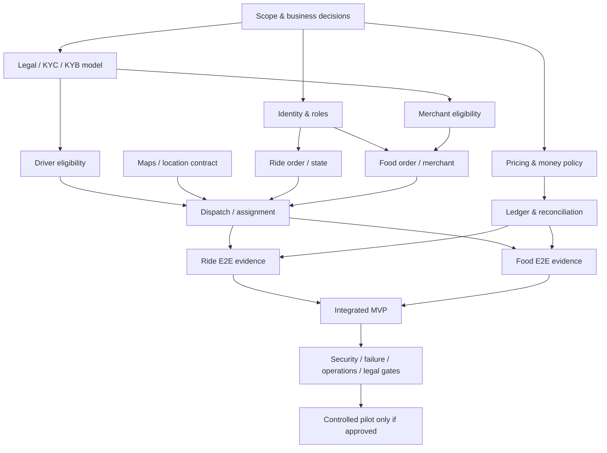
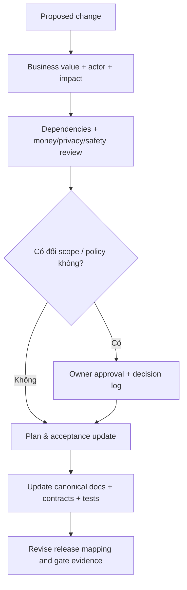

# DealGo — Scope & Release Plan / Phạm vi và kế hoạch phát hành

> **Trạng thái:** `DRAFT`. Đây là **kế hoạch đề xuất**, chưa phải cam kết về thời hạn, chi phí, số lượng nhân sự, chỉ tiêu SLA hoặc tính hợp pháp của hoạt động thương mại. Các hạng mục có nhãn `PROPOSED` cần Product Owner chấp thuận trước khi thành baseline bắt buộc.
>
> **Tài liệu tiền đề:** [README](./README.md) và [Project Charter](./project-charter.md). **Nguồn chuẩn của phạm vi và cách phân chia release** là tài liệu này; đặc tả yêu cầu nằm ở `01-product/*`, quy tắc nghiệp vụ ở `02-domain/*`, trình tự ở `03-workflows/*` và kế hoạch task chi tiết ở `10-ai-execution/*`.
>
> **Điểm chốt đã có:** DealGo là **một ứng dụng Flutter với Customer, Merchant, Driver**; MVP gồm **Ride hai bánh + Food**. Có Admin Web phục vụ vận hành theo baseline dự án. Không biến MVP thành chỉ một vertical, cũng không mặc định có ba ứng dụng mobile riêng.

## 1. Mục tiêu của tài liệu

Tài liệu trả lời các câu hỏi ở **cấp release**, không đi vào payload API hoặc chi tiết thuật toán:

1. Chức năng/năng lực nào **thuộc MVP bắt buộc**, chức năng nào có thể hoãn?
2. Phân biệt **hệ thống demo**, **MVP tích hợp** và **pilot/giao dịch thương mại thật** như thế nào?
3. Các **phụ thuộc** và trình tự delivery nào ngăn phát triển sai thứ tự?
4. Khi nào một release được coi là **sẵn sàng chuyển gate**, ai duyệt, chứng cứ ở đâu?
5. Khi xuất hiện yêu cầu mới, làm thế nào để tránh tăng phạm vi âm thầm?

**Không thuộc trách nhiệm tài liệu này:** chốt công thức giá, thời gian timeout, bán kính điều phối, thời hạn lưu CCCD, loại giấy phép, chọn nhà cung cấp, kiến trúc microservice/monolith hay ngày phát hành. Mọi chỗ đó sẽ liên kết sang tài liệu chuyên trách và chỉ nhận giá trị khi có phê duyệt.

## 2. Từ điển nhãn, mức ưu tiên và đơn vị phạm vi

### 2.1. Trạng thái quyết định

| Nhãn | Ý nghĩa | Có thể dùng làm điều kiện bắt buộc để coding agent code? |
|---|---|---|
| `CONFIRMED` | Đã được chủ dự án xác nhận ở cấp định hướng. | Có, trong đúng phạm vi đã xác nhận; chi tiết còn `TBD` vẫn bị chặn. |
| `BASELINE` | Có trong thiết kế/bộ màn hình tham chiếu; cần rà soát khi phân pha. | Không tự động. |
| `PROPOSED_P0` | Đề xuất năng lực tối thiểu để MVP có thể nghiệm thu một cách an toàn. | Chỉ sau khi được duyệt; có thể thiết kế/test bằng giả lập trước. |
| `PROPOSED_P1` | Bổ sung có giá trị nhưng không chặn MVP cơ bản nếu không liên quan đến luật/an toàn. | Không thuộc điều kiện nghiệm thu MVP mặc định. |
| `PROPOSED_P2` | Mở rộng sau pilot/scale. | Không tự ý implement. |
| `TBD` | Phụ thuộc quyết định hoặc bằng chứng chưa có. | Không đối với nhánh bị ảnh hưởng. |
| `OUT_OF_SCOPE` | Loại khỏi MVP hiện tại theo baseline, có thể xem xét lại bằng change request. | Không. |

**Lưu ý:** `CONFIRMED` của dịch vụ không biến mọi tính năng dưới dịch vụ đó thành `CONFIRMED`. Ví dụ **Food** đã chốt, nhưng loyalty/đặt trước/giao nhiều quán **chưa** chốt.

### 2.2. Định nghĩa ưu tiên

| Mức | Định nghĩa trong DealGo | Ví dụ |
|---|---|---|
| **P0 — release-critical** | Thiếu thì không thể hoàn tất Ride/Food đúng và an toàn trong phạm vi pilot đã phê duyệt; hoặc vi phạm điều kiện bắt buộc về quyền, tiền, an toàn, tuân thủ. | Xác thực tài khoản, order state, dispatch atomic, đối soát giao dịch, admin can thiệp có audit. |
| **P1 — experience/efficiency** | Cải thiện trải nghiệm, hiệu suất vận hành hoặc cạnh tranh; có thể phát hành sau nếu đường thay thế an toàn và được duyệt. | Lưu địa chỉ yêu thích, thống kê nâng cao, chat nhóm/tệp đính kèm, nhiều mẫu báo cáo. |
| **P2 — expansion** | Mở rộng vertical, địa bàn, chương trình tăng trưởng hoặc tính năng phức tạp chưa cần cho hai luồng cơ bản. | Gọi ô tô, giao kiện độc lập, đặt lịch phức tạp, batching/loyalty nâng cao. |

**Ngoại lệ:** một hạng mục P1 có thể trở thành **P0 cho khu vực/mô hình kinh doanh đã chọn** sau đánh giá pháp lý, an toàn hoặc điều kiện đối tác. Mọi lần nâng/hạ priority phải ghi decision ID; không tự diễn giải.

### 2.3. Định nghĩa môi trường và phát hành

- **Sandbox/Internal demo:** dữ liệu giả lập, test users, payment giả lập; không thu tiền thật, không giả định đã được phép vận hành dịch vụ thực tế.
- **Integrated MVP:** Ride và Food cùng chạy end-to-end trên một app theo kiểm thử, có admin và các kiểm soát nền; **chưa mặc nhiên public**.
- **Controlled pilot:** thử nghiệm trong phạm vi được phê duyệt với người/đối tác thật **chỉ khi** đáp ứng đủ các điều kiện vận hành và pháp lý tương ứng.
- **Commercial launch:** mở dịch vụ thương mại trong vùng và năng lực đã duyệt; phải có sign-off rõ ràng, không tự động xuất hiện khi CI xanh.
- **Scale release:** mở rộng sau khi có dữ liệu pilot và quyết định tăng quy mô.

## 3. Ranh giới bất biến của MVP

### 3.1. Phần đã xác nhận

| ID đã dùng ở Charter | Phạm vi | Kênh | Quyết định |
|---|---|---|---|
| `SCOPE-001` | **Ride:** khách gửi giá đề xuất; tài xế chấp nhận hoặc phản hồi giá; khách chọn một offer trước khi phân công xe hai bánh. | Customer + Driver mobile | `CONFIRMED` (`DEC-PROD-005`) |
| `SCOPE-002` | **Food:** khách đặt món, Merchant thực hiện, Driver giao. | Customer + Merchant + Driver mobile | `CONFIRMED` |
| `SCOPE-003` | **Một app Flutter** hỗ trợ ba vai trò; không tách thành ba app mặc định. | Mobile | `CONFIRMED` |
| `SCOPE-004` | Tham chiếu Grab/GrabFood/ShopeeFood cho dịch vụ và inDrive cho thương lượng giá Ride. | Nghiên cứu | `CONFIRMED` |
| `SCOPE-005` | Phone SMS, email+password đăng ký/đăng nhập, passkey; Admin method management. | Account/security | `CONFIRMED` (`DEC-PROD-006` SUPERSEDED → email/password allowed) |
| `SCOPE-006` | In-app transaction-scoped chat và voice call cho Ride/Food. | Communication | `CONFIRMED` (`DEC-PROD-007`) |

**Admin Web:** `BASELINE` theo hồ sơ DealGo và Charter — năng lực admin tối thiểu được đề xuất P0 để vận hành an toàn; không mặc nhiên biến toàn bộ **37 trang** đã liệt kê trước đó thành P0. Tương tự, danh sách khoảng **165 màn mobile** trước đó là **inventory tham chiếu chưa phân pha**, không phải yêu cầu phải hoàn thành toàn bộ để được gọi là MVP. Con số màn hình cuối cùng phải xác thực ở `04-experience/screen-inventory.md`.

### 3.2. Quan điểm ranh giới kỹ thuật

- **Chung:** identity, role eligibility, location, dispatch primitives, payment records, push/event delivery, audit, support và operations có thể dùng chung theo ranh giới domain.
- **Không được gộp sai:** `RideTrip` và `FoodOrder` có lifecycle, chủ thể, bằng chứng giao nhận, policy hủy/hoàn và nghĩa vụ tiền khác nhau. Không buộc hai loại nghiệp vụ dùng chung một bảng trạng thái hoặc một state machine.
- **Nguồn sự thật:** backend kiểm soát quyền, giá được chốt, assignments, trạng thái và ledger; Flutter chỉ là client. Push/realtime dùng để cập nhật UX, không thay thế đọc trạng thái authoritative sau reconnect.
- **Tối thiểu an toàn:** mọi hạng mục ảnh hưởng đến trạng thái giao dịch/tiền phải tính đến retry, replay, concurrency, audit và lỗi mất mạng ngay từ pha P0.

## 4. P0 capability map — nền tảng dùng chung

> Mã `CAP-*` là **mã hạng mục hoạch định release**, không thay cho mã functional requirement `FR-*` hoặc business rule `BR-*`. Trạng thái tại đây là `PROPOSED_P0`, trừ phạm vi cấp sản phẩm đã xác nhận ở §3. Không tạo endpoint/schema chính thức chỉ từ bảng này.

| Capability | P0 cần nghiệm thu ở mức nào? | Các phụ thuộc / điều kiện chặn |
|---|---|---|
| `CAP-CORE-01` Account & session | Phone SMS, email+password register/login, passkey, session/logout; admin method controls. | `DEC-PROD-006` SUPERSEDED; recovery/provider detail `OPEN-008/020`. |
| `CAP-CORE-02` Multi-role & permission | Role eligibility, active role, navigation riêng, API object-level authorization, khóa role chưa duyệt. | `OPEN-005`; policy ở `02-domain/roles-and-permissions.md`. |
| `CAP-CORE-03` Partner onboarding | Hồ sơ Driver/Merchant; xét duyệt, từ chối, yêu cầu bổ sung, gia hạn/thu hồi quyền theo điều kiện hợp lệ. | `OPEN-006`, `OPEN-008`, mô hình KYC/KYB. |
| `CAP-CORE-04` Location foundation | Chọn/tìm địa chỉ, kiểm tra tọa độ/địa bàn, route/ETA ước tính và xử lý lỗi geocoding. | Maps vendor/quota `OPEN-008`, vùng `OPEN-001`. |
| `CAP-CORE-05` Dispatch foundation | Eligible candidates, offer/accept, timeout, không assign trùng, từ chối/reassign, đảm bảo source-of-truth. | `OPEN-004`, `OPEN-005`; concurrency contract. |
| `CAP-CORE-06` Transaction integrity | Idempotent create/confirm, state guard, version/concurrency protection, event replay handling. | Approved Ride/Food state machines. |
| `CAP-CORE-07` Pricing contract | Ride: reference fare + negotiation + selected agreement; Food: checkout quote. Hiển thị breakdown/version, xử lý stale price. | Economics/fees/tax `OPEN-003`; negotiation parameters `OPEN-019`; fixtures sandbox. |
| `CAP-CORE-08` Financial record | Ghi nhận nghĩa vụ thu/chi, refund/cancel adjustment, ledger/đối soát, audit thao tác tiền. | `OPEN-002`, `OPEN-003`, `OPEN-006`; không khởi động thu tiền thật trong sandbox. |
| `CAP-CORE-09` Status delivery | Realtime cập nhật, push khi phù hợp, reconnect/sync, tránh hiển thị trạng thái đã lỗi thời. | Chính sách thông báo, nhà cung cấp push. |
| `CAP-CORE-10` Security & privacy | Authentication/authorization, limit/rate, mã hóa/bảo vệ PII & giấy tờ, audit, secrets. | Legal privacy review, retention policy. |
| `CAP-CORE-11` Support & exceptions | Trạng thái không thành công, liên hệ hỗ trợ, case triage, admin intervention được kiểm soát. | Quy tắc hủy/hoàn, trách nhiệm ops. |
| `CAP-CORE-12` Operational readiness | Logs/metrics/traces, alerts, runbooks, backup/restore proof, feature flags và cơ chế rollback. | Mục tiêu `OPEN-007`, môi trường và trách nhiệm trực. |
| `CAP-CORE-13` In-app communications | Chat văn bản + voice call audio theo Ride/Food context, participant authorization, không lộ số, fallback và support. | `DEC-PROD-007`; window/provider/retention `OPEN-014/021`. |

**Không quyết định tại đây:** SMS hay Zalo OTP; provider maps/payment; Redis/Kafka; số giây timeout; có yêu cầu OTP xác nhận lên xe/giao món hay không; bản thương mại dùng COD hay online. Các quyết định này có tác động tới từng release gate.

## 5. P0 capability map — Customer / Ride

| Capability | Minimum observable outcome | Depends on |
|---|---|---|
| `CAP-RIDE-01` Booking entry | Customer chọn Ride hai bánh, pickup/dropoff hợp lệ, xem route/giá tham khảo và nhập giá đề xuất. | CORE-01/02/04/07; `DEC-PROD-005`. |
| `CAP-RIDE-02` Submit & negotiate | Tạo request/negotiation idempotent; tài xế chấp nhận hoặc counter; khách chọn một offer trước assignment. | CORE-06, `OPEN-003/004/019`. |
| `CAP-RIDE-03` Search & assign | Trạng thái searching → assigned/failed/cancelled có ý nghĩa; một tài xế hợp lệ được gán. | CORE-05, OPEN-004. |
| `CAP-RIDE-04` Driver & pickup | Driver nhận thông tin cần thiết, đến điểm đón; Customer thấy tài xế/chuyến theo quyền. | Role authorization, tracking & privacy. |
| `CAP-RIDE-05` Trip lifecycle | Bắt đầu/di chuyển/kết thúc theo transition được duyệt, không skip/tráo trạng thái sai. | Ride state machine và proof policy. |
| `CAP-RIDE-06` Cancel / no-driver / failure | Customer/Driver/System hủy, hết thời gian tìm hoặc mất kết nối có kết quả cuối và giải thích phù hợp. | Policy `OPEN-003/004`, compensation/recovery. |
| `CAP-RIDE-07` Completion & finance | Trip đã kết thúc có receipt/tóm tắt chi phí, lịch sử và transaction record có thể đối soát. | CORE-08, OPEN-002/003. |
| `CAP-RIDE-08` Help & safety | Có đường liên hệ hỗ trợ, báo cáo sự cố chuyến và escalation vận hành. | CORE-10/11, approved safety process. |

**Nguyên tắc nghiệm thu:** một màn hình bản đồ đẹp hoặc thông báo “đã đặt xe” **không** đủ để pass Ride. Backend phải bảo đảm trạng thái, assignment và xử lý lỗi đúng.

## 6. P0 capability map — Customer / Food / Merchant

| Capability | Minimum observable outcome | Depends on |
|---|---|---|
| `CAP-FOOD-01` Merchant discovery | Customer thấy cửa hàng trong vùng phục vụ và khả dụng phù hợp với thời điểm. | CORE-04, merchant availability. |
| `CAP-FOOD-02` Menu & item | Xem menu, biến thể/tùy chọn cần thiết, giá, tình trạng còn/hết, số lượng, ghi chú theo rule. | Catalogue ownership, price validation. |
| `CAP-FOOD-03` Cart & checkout | Tạo giỏ, địa chỉ nhận, chi phí tổng trước xác nhận; backend revalidate giá/món/merchant. | CORE-07, policy `OPEN-002/003`. |
| `CAP-FOOD-04` Place order | Tạo order idempotent; trả trạng thái rõ ràng nếu quán tạm đóng, hết món, giá thay đổi. | CORE-06, merchant policies. |
| `CAP-FOOD-05` Merchant order inbox | Merchant chỉ xem đơn thuộc cửa hàng có quyền; nhận, từ chối, xác nhận và xem deadline nếu có. | CORE-02/03, order state machine. |
| `CAP-FOOD-06` Prepare & handoff | Merchant cập nhật đang chuẩn bị/sẵn sàng và bàn giao cho Driver có assignment hợp lệ. | `food-fulfillment`, proof rules TBD. |
| `CAP-FOOD-07` Courier dispatch | Phân công tài xế giao theo trạng thái đơn, tránh giao trước khi sẵn sàng theo policy. | CORE-05, OPEN-004/005. |
| `CAP-FOOD-08` Delivery tracking | Khách/quán/tài xế thấy tiến độ đúng theo quyền; cập nhật sau mất mạng. | CORE-09, location privacy. |
| `CAP-FOOD-09` Delivery completion | Giao/nhận và xác nhận hoàn tất theo bằng chứng/phương thức được duyệt; không cho hoàn tất tùy ý. | Proof-of-delivery TBD, fraud handling. |
| `CAP-FOOD-10` Cancel / refund / failed delivery | Hết món, quán từ chối, không tài xế, khách không nhận, app mất mạng… có owner và hậu quả tiền rõ. | CORE-08/11; policy `OPEN-003`. |
| `CAP-FOOD-11` Merchant operations basic | Quản lý thông tin, giờ mở/đóng, khả dụng món/menu, trạng thái nhận đơn. | CORE-03, catalogue rules. |
| `CAP-FOOD-12` History & finance | Customer có lịch sử; Merchant thấy giao dịch liên quan, tài liệu/biên nhận và số tiền theo quy tắc. | CORE-08, financial policy. |

**Giới hạn thiết kế tạm thời:** đơn từ một Merchant/giỏ là **phương án giảm độ phức tạp đề xuất**, chưa phải quyết định đã chốt; nếu muốn nhiều Merchant trong một checkout, cần change request và impact analysis. Không mặc định tất cả trường hợp đổi món, đặt trước, tip hoặc hỗ trợ giao nhiều điểm là P0.

## 7. P0 capability map — Driver / một app ba vai trò

| Capability | Minimum observable outcome | Dependencies |
|---|---|---|
| `CAP-DRV-01` Driver eligibility | Driver chưa đủ điều kiện hoặc giấy tờ hết hiệu lực không được nhận job có yêu cầu pháp lý tương ứng. | KYC/license/vehicle policy `OPEN-006/008`. |
| `CAP-DRV-02` Availability | Online/offline có nghĩa nghiệp vụ; không chỉ là switch client-side; phục hồi đúng sau reconnect. | Presence source-of-truth, stale heartbeat policy. |
| `CAP-DRV-03` Job offer & accept | Có offer, thời hạn theo policy; server kiểm soát accept hợp lệ và assignment atomic. | CORE-05, `OPEN-004`. |
| `CAP-DRV-04` Ride execution | Xem pickup/destination được cấp quyền, chuyển trạng thái đến đón/bắt đầu/kết thúc. | Ride states, safety/legal review. |
| `CAP-DRV-05` Food execution | Xem pickup/drop-off cần thiết, nhận món, giao, cập nhật kết quả hợp lệ. | Food states, proof policy. |
| `CAP-DRV-06` Background/reconnect | Xử lý foreground/background, offline, permission revoked, GPS stale; báo trạng thái rõ ràng. | iOS/Android policies, privacy, approved tracking model. |
| `CAP-DRV-07` Income & work history | Chỉ xem giao dịch/earnings chính mình được phép; phân biệt estimated và settled amounts. | CORE-08, `OPEN-002/003`. |
| `CAP-ROLE-01` Role switching | Cùng user có thể truy cập đúng kênh role đã được cấp; app không làm lộ dữ liệu role khác. | CORE-02, `OPEN-005`. |
| `CAP-ROLE-02` Active work protection | Không chuyển role hoặc chấp nhận job mới theo cách phá vỡ công việc đang hoạt động; chính sách cụ thể TBD. | `OPEN-005`, concurrent job rules. |

**Chưa được khóa:** hai nền tảng mobile có khả năng tracking như nhau trong mọi điều kiện hay không; chỉ sử dụng foreground tracking hay bắt buộc background. Không giả định mọi quyền vị trí đều được hệ điều hành/phân phối ứng dụng chấp thuận.

## 8. P0 capability map — Admin Web & support

> Admin Web là **kênh vận hành riêng**, không phải role thứ tư nằm trong Flutter. Số trang admin ở bản inventory cũ **không** phải số module P0 bắt buộc.

| Capability | Minimum observable outcome | Security/control |
|---|---|---|
| `CAP-OPS-01` Admin identity & RBAC | Chỉ nhân sự có quyền được vào phần vận hành; truy cập theo nghiệp vụ/đối tượng. | Authn/authz; không dùng chung quyền Customer. |
| `CAP-OPS-02` Partner review | Có danh sách và hồ sơ Driver/Merchant, approve/reject/suspend có lý do và audit. | Giới hạn truy cập tài liệu nhạy cảm. |
| `CAP-OPS-03` Ride/Order explorer | Tìm và xem lifecycle, actor, evidence, status, timeline trong phạm vi quyền. | Mask PII, least privilege. |
| `CAP-OPS-04` Exception queue | Phát hiện/xử lý no-driver, rejected order, failed delivery, payment unknown, dispute. | Case ownership và escalation. |
| `CAP-OPS-05` Controlled intervention | Cancel/reassign/refund/adjust khi **policy cho phép** và có tác động được ghi nhận. | Approval & immutable audit; không sửa DB thủ công. |
| `CAP-OPS-06` Finance reconciliation | Truy vết charge/COD/payout/refund, phát hiện unmatched records, xuất dữ liệu kiểm toán cần thiết. | Phân quyền tài chính và chống chỉnh sửa im lặng. |
| `CAP-OPS-07` Service controls | Bật/tắt vùng/feature hoặc tạm ngưng hoạt động theo cơ chế kiểm soát được duyệt. | Dual approval khi phù hợp, rollback. |
| `CAP-OPS-08` Audit & support | Tra cứu sự kiện và quản lý case với lịch sử ai làm gì/khi nào. | PII minimization, audit retention. |

**Không phải P0 tự động:** dashboard BI hàng chục biểu đồ, CMS marketing đầy đủ, nâng cao CRM, hệ thống nhân sự, livestream; những thứ đó cần đánh giá riêng. Tuy nhiên, **không có dashboard đẹp** không có nghĩa có thể **bỏ audit/reconciliation/incident management**.

## 9. Danh sách P1 / P2 và excluded mặc định

### 9.1. Backlog đề xuất — P1

| ID | Hạng mục | Lý do hoãn / trigger xem xét |
|---|---|---|
| `CAP-P1-01` Saved places, favorites & repeat order | Tăng tốc tác vụ lặp; không chặn giao dịch đầu tiên. |
| `CAP-P1-02` Promotion management nâng cao | Tăng trưởng; cần tiền/giá minh bạch trước. |
| `CAP-P1-03` Chat nhóm/attachments/format nâng cao | Chat text theo transaction đã chuyển P0; P1 chỉ mở rộng sau abuse, moderation, privacy và retention review. |
| `CAP-P1-04` Ratings & reviews | Chất lượng nguồn cung; cần moderation/fraud trước khi phát hành. |
| `CAP-P1-05` Merchant multi-staff / multi-branch | Mở rộng vận hành; role và data isolation phức tạp hơn. |
| `CAP-P1-06` Driver performance & earnings analytics sâu | Nâng cao minh bạch/giữ chân đối tác; P0 vẫn cần lịch sử và đối soát. |
| `CAP-P1-07` Food substitutions & partial item adjustments | Cần policy phức tạp về xác nhận, tiền và giao nhận. |
| `CAP-P1-08` Extended analytics & export | Bổ sung phân tích, không thay thế chỉ số/sổ đối soát P0. |
| `CAP-P1-09` Enhanced notifications & lifecycle campaigns | Không chặn trạng thái giao dịch cơ bản. |
| `CAP-P1-10` A/B experiments & personalization | Chỉ hợp lý khi đã có event definitions và nền giám sát. |

### 9.2. Backlog đề xuất — P2 / không nằm trong MVP

| ID | Hạng mục | Trạng thái mặc định |
|---|---|---|
| `CAP-P2-01` Gọi xe ô tô / taxi / nhiều loại phương tiện khác | `OUT_OF_SCOPE` |
| `CAP-P2-02` Giao kiện hàng độc lập với Food | `OUT_OF_SCOPE` |
| `CAP-P2-03` Đi chợ, thương mại điện tử tổng hợp, du lịch | `OUT_OF_SCOPE` |
| `CAP-P2-04` Ride/Delivery multi-stop, pooling, batch nhiều order | `OUT_OF_SCOPE` |
| `CAP-P2-05` Đặt lịch phức tạp, đặt theo gói | `OUT_OF_SCOPE` |
| `CAP-P2-06` Ví lưu giữ tiền, tín dụng, BNPL | `OUT_OF_SCOPE`; phụ thuộc pháp lý riêng |
| `CAP-P2-07` Loyalty/membership đa tầng, referrals phức tạp | `OUT_OF_SCOPE` |
| `CAP-P2-08` Mở đa quốc gia và nhượng quyền toàn diện | `OUT_OF_SCOPE` |
| `CAP-P2-09` AI dynamic pricing tự trị | `OUT_OF_SCOPE`; không áp dụng khi thiếu quyết định rõ |

**Danh sách excluded không nói rằng các ý tưởng này không có giá trị.** Chúng cần business case, dependency, quyền và release decision riêng.

## 10. Release train đề xuất — không gán ngày tùy tiện

> `R*` = **gói phiên bản/mức hoàn thiện**; `G*` = **stage gate ở Charter**. R và G không đồng nghĩa. Có thể lặp một release nhiều lần trước khi qua gate. Thứ tự Ride-slice trước Food-slice là **phương án giảm rủi ro kỹ thuật**, không phải thay đổi phạm vi MVP hay ưu tiên Ride hơn Food về thương mại.

| Release | Loại môi trường | Phạm vi đầu ra | Exit gate liên quan | Điều **chưa được** khẳng định |
|---|---|---|---|---|
| `R0` **Scope & Contracts** | Docs/research | Chốt baseline Ride+Food, actors, nguyên tắc quyền, decision blockers, state diagrams, acceptance P0. | `G0` | Chưa có phần mềm chạy thật. |
| `R1` **Platform Foundation** | Dev/test | Auth/role skeleton, backend contracts, test harness, CI, mock integrations, audit, môi trường. | `G1` | Chưa thu tiền/giao dịch thương mại. |
| `R2` **Ride Vertical Slice** | Sandbox | E2E Ride với Customer + Driver + backend + admin/support tối thiểu; cả failure tests. | `G2` | **Không phải** MVP hoàn chỉnh vì thiếu Food. |
| `R3` **Food Vertical Slice** | Sandbox | E2E Food thêm Merchant, catalog, order/fulfillment/dispatch; tập Ride vẫn pass. | `G3` | Chưa kết luận đạt điều kiện pilot. |
| `R4` **Integrated MVP Hardening** | Staging/sandbox | Cùng app 3 role, Ride+Food regression, cross-domain concurrency, finance, security, observability, rollback. | `G4` | Không mặc nhiên public hoặc nhận tiền thật. |
| `R5` **Controlled Pilot / Go-live** | Production giới hạn **nếu được phê duyệt** | Vùng/đối tác/phương thức trả tiền được duyệt, support, legal/financial readiness, vận hành dưới giám sát, kill switches. | `G5` | Chưa có ngày hoặc chỉ tiêu scale. |
| `R6+` **Optimization & Expansion** | Theo release approved | P1 rồi P2 có bằng chứng pilot/ROI, tăng quy mô có kiểm soát. | Quyết định mới | Không cam kết launch quốc gia. |

### 10.1. Ma trận năng lực theo release

`D` = thiết kế/contract; `M` = mock/implementation sandbox; `V` = chứng cứ kiểm thử end-to-end; `O` = vận hành thật sau khi đủ điều kiện; `—` = chưa thuộc pha. Ký hiệu **không** hàm ý feature đã hoàn thành hiện tại.

| Năng lực | R0 | R1 | R2 | R3 | R4 | R5 |
|---|---|---|---|---|---|---|
| Identity, role/KYC/KYB | D | M | V cho Driver | V cho Merchant | Security review | O |
| Ride negotiation/booking & lifecycle | D | Contract | V | Regression | Hardening | O |
| Food ordering & fulfillment | D | Contract | — | V | Hardening | O |
| Location, dispatch & ETA | D | M | V Ride | V Food | Stress/recovery | O |
| Payment / ledger / reconciliation | D | Mock ledger | Ride simulated V | Food simulated V | Cross-flow V | O nếu vendor/policy approved |
| Admin review, incidents & audit | D | M | Ride support V | Food support V | UAT/rehearsal | O |
| CI, monitoring, backup/restore | D | Baseline | Slice evidence | Slice evidence | Readiness V | O |
| Legal, safety, platform approvals | Checklist | Assess | Review blockers | Review blockers | Signed evidence | Bắt buộc trước launch |

### 10.2. Kế hoạch không có ngày vẫn phải có đơn vị tiến độ

- Tracking mỗi release bằng **capability IDs, acceptance evidence và gate status** thay vì % code subjective.
- Mỗi `CAP-*` liên kết tới các `FR-*`, `WF-*`, `BR-*`, API/event contract và test case khi các file chuyên trách được tạo.
- Không đặt sprint length, headcount hoặc mốc lịch từ số lượng màn hình; chỉ ước lượng sau dependency review và có team capacity.
- Mỗi release có thể phát hành build nội bộ nhiều lần; chỉ khi chuyển trạng thái qua gate mới được tuyên bố “phase complete”.

## 11. Dependency graph và đường găng logic



**Cách đọc:** sơ đồ chỉ là **dependency về khả năng nghiệm thu**. Các nhóm không nhất thiết phải xây nối tiếp hoàn toàn; có thể parallel với mocks/contracts. Không lấy hình vẽ làm quyết định rằng Food bắt buộc được assign sau khi quán làm xong — thứ tự thực tế thuộc `food-fulfillment` và `dispatch-and-assignment`.

### 11.1. Critical decision dependencies

| Decision | Tối thiểu phải giải quyết trước | Có thể làm song song khi chưa chốt |
|---|---|---|
| `OPEN-001` vùng pilot | Production geofence/coverage, giá theo vùng, supply onboarding | UI map mocks, abstract zone contracts |
| `OPEN-002` phương thức thanh toán | PSP integration production, refund/settlement thật | Payment adapter + simulated ledger |
| `OPEN-003` pricing, cancellation, fee split | Chốt quote thật, refund, payout thực tế | Price engine interface, fixtures minh họa không phải production |
| `OPEN-004` dispatch rules | Algorithm/timeout/reassign production | Concurrency invariants, test harness, rules configurable |
| `OPEN-005` role overlap/job concurrency | Role transition và điều phối production | Enforcement points, simulation of prohibited overlap |
| `OPEN-006` mô hình pháp lý/đối tác | Partner activation, go-live, tài liệu/hợp đồng/thuế | KYC/KYB workflow shell, security design |
| `OPEN-007` load/SLO/budget | Infra sizing, SLO approval, load exit thresholds | Benchmark design, instrumentation |
| `OPEN-008` vendors & verification | Production OTP/maps/KYC/payment/push config | Provider abstraction, stubs, failure tests |

**Nguyên tắc chống tắc tiến độ:** chưa chốt `OPEN-*` không ngăn phát triển mọi thứ; nó ngăn **chốt hoặc vận hành các hành vi phụ thuộc quyết định đó**. Stub/mock phải được gắn nhãn rõ và không bật trong production bằng cấu hình sai.

## 12. Release acceptance criteria — bằng chứng bắt buộc

### 12.1. G0 / R0 — Business baseline ready

- [ ] Ride hai bánh và Food đều có actor, entry/exit, success/failure criteria.
- [ ] Phạm vi và nhãn `CONFIRMED/PROPOSED/TBD` được Product Owner xem xét.
- [ ] Quy tắc liên quan tiền, an toàn, quyền và eligibility có owner, decision backlog và điểm chặn.
- [ ] Danh sách R0–R5 được liên kết với inventory capability IDs.
- [ ] Có mẫu traceability và policy đối với TBD; không có “giá/số giây/số km” tự điền.

### 12.2. G1 / R1 — Technical foundation ready

- [ ] CI/lint/test baseline chạy và cung cấp logs hoặc artifacts.
- [ ] Có auth/role authorization boundary; tests từ chối truy cập trái quyền.
- [ ] Passkey/SMS/email verification, Admin auth-method toggle và account recovery được kiểm thử; method cuối không bị tắt ngoài emergency flow.
- [ ] Contracts chuẩn hóa lỗi, idempotency và correlation IDs ở luồng thay đổi trạng thái.
- [ ] Có dữ liệu/migrations test, stubs/mock của vendor, cấu hình môi trường/secrets an toàn.
- [ ] Có audit event tối thiểu và cơ chế quản lý schema changes.

### 12.3. G2 / R2 — Ride slice acceptance

- [ ] Ride happy path: route/reference fare → khách đề xuất giá → driver accept/counter → khách chọn → agreement/assignment → chat/call theo transaction → pickup/start/end → financial record.
- [ ] Hai Driver nhận cùng job đồng thời → đúng **một** assignment được commit; có concurrency test.
- [ ] Customer nhấn đặt lặp/retry → không tạo nhiều giao dịch trái ý định.
- [ ] Driver offline/rejected/no-driver; Customer cancel; GPS mất/chậm; reconnect có kết quả đúng.
- [ ] Role-specific information access đúng; không lộ trip của người khác.
- [ ] Admin/support xem timeline, xử lý case trong phạm vi quyền và có audit; nội dung chat chỉ đọc theo case grant.
- [ ] **Ride chưa hoàn thành toàn bộ MVP** nếu Food chưa qua G3/G4.

### 12.4. G3 / R3 — Food slice acceptance

- [ ] Food happy path từ menu/cart → checkout → merchant confirm → prepare → dispatch → chat/call đúng participant → handoff → deliver → finance.
- [ ] Giá/món/giờ mở thay đổi trước confirm → hệ thống revalidate và trả trạng thái rõ.
- [ ] Quán từ chối/hết món; khách hủy; không tài xế; giao không thành công; app kill/retry có kết quả/owner.
- [ ] Merchant chỉ xem đơn của cửa hàng hợp lệ; driver chỉ xem job của mình.
- [ ] Không có double deliver/paid/refund do event replay hoặc thao tác lặp.
- [ ] Test Ride regression vẫn pass khi thêm Food.
- [ ] Chat/call participant, contact window, microphone permission, no-number-exposure và support fallback được kiểm thử.

### 12.5. G4 / R4 — Integrated MVP ready for pilot assessment

- [ ] **Một Flutter binary/app product** có Customer, Merchant, Driver theo policy, không lộ role chưa duyệt.
- [ ] Ride và Food E2E + negative-path + concurrency suites đều chạy thành công ở môi trường tương đương pilot.
- [ ] Cross-role/dual-job policy được chốt và test; không nhận công việc chồng chéo sai.
- [ ] Reconciliation không bỏ qua giao dịch không khớp; cách điều tra mismatch có owner.
- [ ] Security review, privacy/PII review, platform permissions review có evidence.
- [ ] Load test có workload và ngưỡng **được owner duyệt**; chưa duyệt target thì gate chưa thể pass đầy đủ.
- [ ] Backup/restore drill, rollback drill, alert/rule, support escalation rehearsal có biên bản.
- [ ] UAT đạt và còn lại defects được phân cấp/risk accepted đúng thẩm quyền.

### 12.6. G5 / R5 — Commercial/controlled pilot sign-off

- [ ] Có quyết định vùng phục vụ, giờ hoạt động, mô hình nguồn cung và giới hạn giao dịch.
- [ ] Có xác nhận chuyên môn về điều kiện pháp lý, vận tải, thương mại điện tử, dữ liệu cá nhân, hợp đồng, thuế/chứng từ **phù hợp mô hình cụ thể**.
- [ ] KYC/KYB đối tác và quyền tham gia đã được kiểm tra theo quy định áp dụng.
- [ ] Tiền thật chỉ được xử lý qua luồng/phương thức/đối tác được phê duyệt, có reconciliation thực tế, refund và quy trình tranh chấp.
- [ ] App Store/Google Play, vị trí nền, disclosure/consent và chính sách quyền riêng tư được kiểm tra trước distribution.
- [ ] Có người chịu trách nhiệm vận hành, support, incident, security, finance và phương án tạm dừng vùng/feature.
- [ ] Product/Engineering/Operations/Finance/Legal owners ký decision go/no-go.

**Không có “silent green”:** kết quả không có bằng chứng, `TBD` chưa giải quyết hoặc điều kiện kiểm thử không xác minh được phải là `BLOCKED` / `NOT_VERIFIED`, không phải PASS.

## 13. Các tiêu chuẩn sản phẩm xuyên release

### 13.1. Functional completeness

- Với mỗi P0 capability: có acceptance đủ **happy path**, **alternative**, **error/recovery**, **authorization**, **idempotency/concurrency** nếu liên quan.
- Các đường chưa thực hiện phải được đánh dấu *disabled/not supported*, không tạo UI thao tác giả dẫn tới mất tiền/mất trạng thái.
- Analytics chỉ có giá trị khi định nghĩa trạng thái/đếm chính xác theo contract.

### 13.2. Quality/operability

- **NFR targets** (`p95`, error rate, availability, RTO, RPO, TPS) là `TBD` cho đến khi `OPEN-007` được phê duyệt.
- Phải đo baseline trước khi chốt target; performance của bản demo không đại diện tải production.
- Lỗi external provider có fallback/retry/backoff phù hợp và giới hạn tổn thất; không retry vô hạn với payment hoặc tạo order.
- Monitoring phải phát hiện ít nhất: assignment stuck, orders/trips stuck, payment unknown, ledger mismatch, vendor error, queue backlog (nếu có), auth anomaly.

### 13.3. Data/privacy/security

- Phân quyền ở server theo owner/object, không dựa vào menu ẩn ở Flutter.
- Chỉ lưu/tái sử dụng tọa độ và CCCD/tài liệu đối tác theo mục đích, thời hạn và cơ sở pháp lý đã duyệt.
- Không để PII trong events/analytics/logs không kiểm soát; test dùng dữ liệu tổng hợp.
- Mọi can thiệp admin có actor, reason, timestamp, object, before/after reference khi phù hợp và cơ chế chống sửa audit.

## 14. Chính sách thay đổi phạm vi (change control)

### 14.1. Khi nào phải mở change request?

- Thêm vertical (xe ô tô, giao kiện độc lập), thêm phương thức thanh toán hoặc đối tác thu tiền.
- Bổ sung/mở quyền Customer, Merchant, Driver, Admin, hoặc multi-role concurrency.
- Thay đổi phí, hoàn tiền, chia doanh thu, tính thuế, chứng cứ giao nhận.
- Thay đổi state transitions làm ảnh hưởng API/schema/audit hoặc data retention.
- Bất kỳ thay đổi P0 nào làm trượt điều kiện nghiệm thu Ride/Food hoặc khả năng go-live.

### 14.2. Quy trình tối thiểu



**Change record template** (ghi tại `decisions-and-assumptions.md` hoặc tracker tương ứng):

| Field | Bắt buộc |
|---|---|
| Change ID / requester / ngày | Có |
| Vấn đề, lợi ích, phạm vi liên quan | Có |
| `CAP-*` / `FR-*` / role/service impact | Có |
| Priority cũ → mới; R cũ → mới | Có nếu thay đổi |
| Contract/API/schema/test/UX/legal/finance impact | Có |
| Chi phí/timeline **ước tính** (chỉ khi có cơ sở) | Nếu có dữ liệu |
| Decision / người phê duyệt / ngày | Bắt buộc trước đưa vào baseline |

### 14.3. Quy tắc bảo vệ MVP hai vertical

- Không cắt Food khỏi MVP để tuyên bố “MVP xong” sau R2; trạng thái chính xác là **Ride slice completed**.
- Không tích hợp một tính năng P1 vào bản pilot nếu làm mất an toàn hoặc kéo lùi P0 mà chưa có quyết định rõ.
- Không tuyên bố đã sẵn sàng thương mại chỉ vì cả hai luồng chạy trên emulator.
- Nếu phát sinh pháp lý/điều kiện đối tác chưa đáp ứng, chuyển về **internal sandbox**, không lách bằng cách gọi pilot là “demo”.

## 15. Issue, risk và cơ chế xử lý blocker

| ID | Rủi ro ở cấp release | Dấu hiệu / tác động | Biện pháp khống chế |
|---|---|---|---|
| `REL-RISK-01` | Mốc release chạy theo UI inventory | Nhiều màn chưa nối nghiệp vụ; số màn không nói lên readiness | Đo theo critical vertical slice/E2E evidence. |
| `REL-RISK-02` | Giá/phí chưa chốt nhưng code cố định | Sai tiền, phải sửa nhiều module | `OPEN-003` gate; quote/ledger mocks ở sandbox. |
| `REL-RISK-03` | Race assignment | Double-accept hoặc job trùng | Atomic assignment invariant + concurrent tests. |
| `REL-RISK-04` | Không driver nhưng Food đã chuẩn bị | Thất thoát, tranh chấp trách nhiệm | Exception owner + compensation/refund rule trước pilot. |
| `REL-RISK-05` | Một tài xế hoạt động đa vai trò/job | Quá tải/nhận chồng chuyến | `OPEN-005`, server enforcement + stress tests. |
| `REL-RISK-06` | Vị trí nền không hợp lệ / bị từ chối | Theo dõi đứt, app store rejection | Permission review, degrade gracefully, testing iOS/Android. |
| `REL-RISK-07` | Payment callback trễ/lặp | Double charge/refund, trạng thái ambiguous | Webhook idempotency, reconciliation, unknown-state ops. |
| `REL-RISK-08` | Không đáp ứng điều kiện vận hành | Commercial release bị chặn | Legal review sớm, sign-off gating; không bỏ qua. |
| `REL-RISK-09` | Thiếu quản trị/đối soát | Không xử lý được khách & partner khi có sự cố | Admin Ops P0, runbooks và audit. |
| `REL-RISK-10` | Vendor cost vượt ngân sách | Mất kiểm soát chi phí maps/OTP/push | Quota/cost dashboards, caching theo giấy phép, budget controls. |

**Phân cấp blocker:**

- `BLOCKER-L0`: mất tiền, lộ dữ liệu, sai phân quyền, mất an toàn, vi phạm điều kiện pháp lý → không go-live; cần quyết định xử lý/risk review phù hợp, không cho AI tự waive.
- `BLOCKER-L1`: mất critical Ride/Food flow, không có khôi phục, concurrency sai → không pass integrated MVP gate.
- `BLOCKER-L2`: trải nghiệm không tối ưu nhưng có workaround hợp lệ, không tác động an toàn/tiền → có thể đề xuất chuyển P1 sau review.

## 16. Scope governance, ownership và artifact evidence

| Artifact/bằng chứng | Nguồn chuẩn sau khi được tạo | Ai review / xác nhận |
|---|---|---|
| Phạm vi Release R0–R5 | Tài liệu này | Product Owner / Tech Lead |
| Quy tắc nghiệp vụ và chính sách tiền | `02-domain/*` | Product Owner, Finance/Legal khi liên quan |
| Ride/Food journeys và failure paths | `03-workflows/*` | PO, Engineering, Operations |
| UI screen-level scope | `04-experience/screen-inventory.md` | Design + PO |
| Backend/mobile solution decisions | `05-architecture/*`, ADR | Tech Lead |
| API/events/schema contracts | `06-data-api/*` | Backend/Mobile/QA |
| Test results, quality gates | `08-quality/*` | QA/Engineering |
| Runbook/observability/recovery | `09-operations/*` | Tech Lead/Ops |
| Backlog task & release dependency | `10-ai-execution/task-breakdown-and-dependencies.md` | Tech Lead/PO |
| Decision approval & TBD resolution | `00-governance/decisions-and-assumptions.md` | Người ra quyết định tương ứng |

**Source of truth:** tài liệu này **quy định phạm vi**, không duplicate mã API, logic giá hoặc checklist compliance cụ thể. Khi một tài liệu chuyên môn thay đổi làm ảnh hưởng release, bắt buộc mở impact review và sửa lại ma trận release tại đây.

## 17. Open decisions cần giải quyết trước khi khóa roadmap

> **Giữ cùng ID/ý nghĩa với README và Charter.** Không tự thêm ID trùng toàn cục.

| ID | Nội dung | Phát hành/gate bị chặn | Owner đề xuất |
|---|---|---|---|
| `OPEN-001` | Khu vực pilot/vùng phục vụ | R5; rules địa lý production | Business/Operations |
| `OPEN-002` | Phương thức thanh toán, đối tác/luồng thu tiền | R5; payment production | Product/Finance/Legal |
| `OPEN-003` | Giá, phí, hủy, chiết khấu và chia tiền | Financial acceptance production | Product/Finance |
| `OPEN-004` | Bán kính, timeout, dispatch, reassign | G2/G3 khi khóa hành vi dispatch | Product/Tech/Ops |
| `OPEN-005` | Điều kiện kiêm role và nhận công việc đồng thời | G4/R5 | Product/Tech/Ops |
| `OPEN-006` | Pháp nhân, mô hình vận tải, partner contract | G5 | Business/Legal |
| `OPEN-007` | Capacity, SLO, ngân sách infra | G4/G5 | Product/Tech/Ops |
| `OPEN-008` | Nhà cung cấp OTP/maps/KYC/payment/notification | R5; vendor production | Product/Tech/Legal |

### 17.1. Các câu hỏi nghiệp vụ chi tiết chưa khóa

| Chủ đề | Decision needed | Hệ quả |
|---|---|---|
| Food checkout nhiều quán? | Một quán/đơn hay multi-merchant? | Cart/checkout/schema/settlement. |
| Thanh toán Food trước hay sau merchant accept? | PSP authorization/capture model | Refund và order rollback. |
| Proof pickup/delivery | OTP, ảnh, xác nhận người nhận hoặc phương án khác? | Fraud/dispute và UX. |
| Driver background tracking | Quy trình xin quyền, thời điểm và fallback? | Release stores và vận hành. |
| Merchant store ownership | Một chủ nhiều cửa hàng? Nhân viên có role riêng? | Tenant isolation và RBAC. |
| Communication policy | Contact window sau hoàn tất, role pairs, provider, retention, access trong support case. | Trust/safety, privacy, ops, cost. |
| Incident escalation | Giờ support, quy trình trợ giúp, cấp độ sự cố? | Go-live safety, staffing. |

Không tạo ngày hoàn tất `TBD` giả. Khi owner có lịch phê duyệt thực tế, chuyển thành decision record có timestamp.

## 18. Mẫu Release Decision Record

```yaml
release_id: R4
release_name: Integrated MVP Hardening
date: TBD
status: NOT_EVALUATED # NOT_EVALUATED | BLOCKED | PASS | FAIL | CONDITIONAL
scope_status: PROPOSED
required_capabilities:
  - CAP-RIDE-01..08  # Ký hiệu viết gọn, không phải ID literal đơn lẻ
  - CAP-FOOD-01..12
  - CAP-DRV-01..07
  - CAP-ROLE-01..02
  - CAP-CORE-01..12
  - CAP-OPS-01..08
quality_evidence: []
security_evidence: []
financial_evidence: []
legal_evidence: []
open_blockers: []
accepted_risks: []
approvals:
  product_owner: PENDING
  tech_lead: PENDING
  operations: PENDING
  finance: PENDING
  legal_compliance: PENDING
```

**Chú ý:** `CONDITIONAL` chỉ được sử dụng nếu quy trình release đã quy định trường hợp chấp nhận có điều kiện; **không** được dùng để vượt qua các blocker pháp lý, an toàn, thanh toán hoặc quyền truy cập quan trọng.

## 19. Checklist rà soát tài liệu trước khi `APPROVED`

- [ ] Product Owner duyệt hai vertical Ride+Food cùng MVP và một app ba role.
- [ ] Owner duyệt việc Admin Web tối thiểu thuộc P0 để vận hành.
- [ ] P0/P1/P2 được đánh dấu rõ là confirmed hay proposed; không ngầm khóa policy `TBD`.
- [ ] Release `R0..R6+` và gates `G0..G5` không mâu thuẫn với Charter.
- [ ] Mọi hạng mục P0 đều có actor, observable outcome, dependency và canonical docs sau này.
- [ ] Quy trình fake payment ở sandbox khác rõ production payment và không thể kích hoạt nhầm.
- [ ] Phạm vi KYC/KYB và location privacy đã được đưa vào release gate.
- [ ] Các blocker về contract/legal/finance/ops có owner và quyết định cần chốt.
- [ ] Không có ngày/số liệu, địa phương hay chi phí tự phát thành cam kết.
- [ ] Có traceability path từ `CAP` → `FR/BR/WF` → API/screen/test, chưa có thì ghi planned.
- [ ] Người chịu trách nhiệm đã ghi quyết định phê duyệt, ngày và version.

### 19.1. Approval record

| Role | Người ký | Ngày | Trạng thái |
|---|---|---|---|
| Product Owner | `TBD` | `TBD` | `PENDING` |
| Tech Lead | `TBD` | `TBD` | `PENDING` |
| Operations | `TBD` | `TBD` | `PENDING` |
| Finance | `TBD` | `TBD` | `PENDING` |
| Legal/Compliance (trước R5) | `TBD` | `TBD` | `PENDING` |

## 20. Tham chiếu và lịch sử thay đổi

### 20.1. Tài liệu liên quan

- [README — quản trị bộ docs](./README.md)
- [Project Charter — tầm nhìn, mục tiêu, gates](./project-charter.md)
- `01-product/product-requirements.md` — planned; sẽ mở rộng từ capability sang FR có testable acceptance.
- `02-domain/roles-and-permissions.md`, `02-domain/pricing-fees-and-promotions.md`, `02-domain/payments-ledger-settlement.md` — planned; nguồn chuẩn của business rule.
- `03-workflows/ride-booking-e2e.md`, `03-workflows/food-ordering-e2e.md`, `03-workflows/dispatch-and-assignment.md` — planned; nguồn chuẩn của workflow.
- `04-experience/screen-inventory.md` — planned; phân pha inventory màn hình.
- `08-quality/critical-e2e-test-matrix.md`, `10-ai-execution/requirement-traceability.md` — planned; kiểm thử và nối dữ liệu truy vết.

### 20.2. Tham chiếu phương pháp

- [arc42 — Template](https://arc42.org/overview): bộ khung tài liệu kiến trúc phần mềm; **không** được dùng để suy ra chính sách kinh doanh của DealGo.
- [C4 Model](https://c4model.com/): mô tả software system landscape và containers/components.
- [OWASP MASVS](https://mas.owasp.org/MASVS/): tham chiếu kiểm soát mobile security, không thay thế kiểm thử riêng.
- [Flutter — App Architecture](https://docs.flutter.dev/app-architecture): tham khảo phân tách trách nhiệm Flutter, không chốt framework state management.

### 20.3. Changelog

| Date | Version | Status | Changes |
|---|---|---|---|
| 2026-10-12 | 0.2.0 | `DRAFT` | Thêm P0 auth method controls và transaction-scoped chat/voice, update G2/G3 acceptance và dời advanced chat sang P1. |
| 2026-10-11 | 0.1.0 | `DRAFT` | Khởi tạo capability scope P0/P1/P2, release train R0–R6+, dependency graph, G0–G5 evidence, risk, decisions và change control. |

**Tài liệu tiếp theo theo thứ tự 69 docs:** `docs/00-governance/glossary.md` — từ điển chung để Customer, Merchant, Driver, booking, trip, order, offer, assignment, authorization/capture/refund và các trạng thái không bị dùng lẫn.
