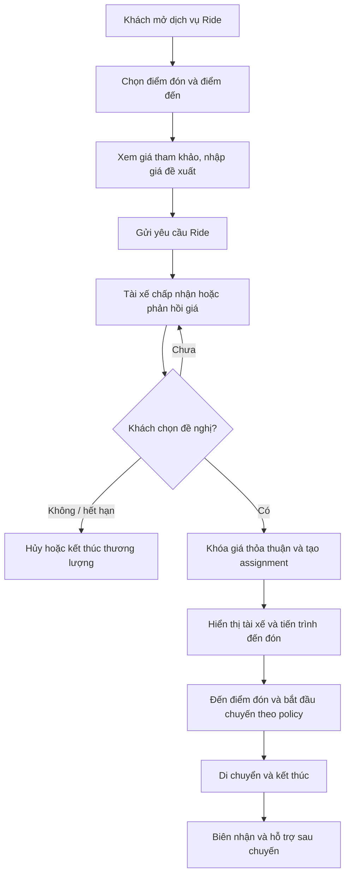
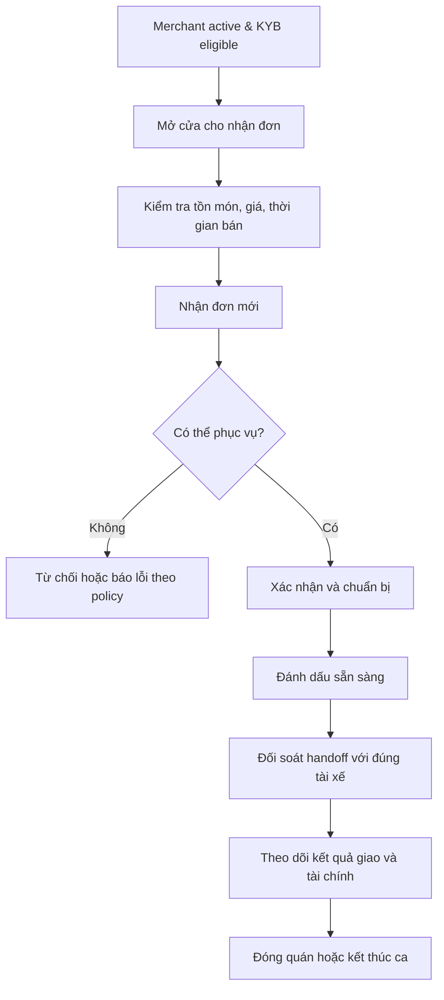

# DealGo — Competitor Benchmark / Nghiên cứu đối thủ và bài học sản phẩm

> **Tình trạng:** `DRAFT`, nghiên cứu công khai chốt tại **12/10/2026**. Tài liệu mô tả những gì có **bằng chứng từ website/trung tâm hướng dẫn chính thức**, khác với kiểm thử phiên bản app đang cài đặt. Không xem chi tiết nội bộ, thuật toán, UI chưa được truy cập, phí, SLA hoặc chính sách có thể thay đổi là dữ kiện chắc chắn.
>
> **Bất biến sản phẩm DealGo:** MVP gồm **Ride (`MOTORBIKE` + `CAR` per `DG-DEC-VEH-001`) + Food giao tận nơi**; **một app Flutter** hỗ trợ **Customer / Merchant / Driver**, cùng Admin Web. Ride thương lượng giá / bid-offer kiểu inDrive theo `DEC-PROD-005` (không auto-match Grab); Food không mặc định dùng thương lượng giá. Benchmark bổ sung evidence cho định hướng đã chốt, không sao chép policy/thuật toán đối thủ. Car fare tiers / regs vẫn **OPEN/DRAFT** đến khi owner duyệt (`OPEN-003`).
>
> **Phạm vi và nguồn chuẩn:** benchmark ghi bằng chứng & cơ hội; PRD ghi yêu cầu; Scope & Release Plan chốt priority/release; Domain/Workflow chốt policies và states. Mọi phần `RECOMMEND` là **đề xuất**, không phải `APPROVED`.

## 1. Tóm tắt điều hành

**Câu hỏi:** Để DealGo phục vụ hành trình Ride + Food một cách tin cậy, có những trải nghiệm, quy tắc và năng lực vận hành nào đã được các nền tảng đi trước thể hiện công khai, và phần nào DealGo nên đưa vào MVP?

**Kết luận:**

1. **inDrive Ride:** nguồn chính thức mô tả khách đề xuất giá; tài xế chấp nhận hoặc phản hồi mức giá khác; khách chọn dựa trên giá và thông tin tài xế. Đây là pattern tham chiếu cho thương lượng giá Ride, không phải bằng chứng về thuật toán hay điều khoản DealGo. [S22][S23]
2. **GrabBike:** công khai giá/ước tính trước khi đặt và tìm tài xế; đối chiếu mô hình giá hiển thị với thương lượng của inDrive. [S01][S24]
3. **GrabFood:** địa chỉ giao → chọn quán → món → ghi chú/voucher → đặt → theo dõi; luồng khách phải gắn với đời sống đơn hàng và giao hàng riêng biệt. [S02]
4. **GrabMerchant:** onboarding, xét duyệt, trạng thái mở/đóng, quản lý đơn và thanh toán không thể thiếu trong vận hành Food; merchant là actor nghiệp vụ, không chỉ là nguồn dữ liệu món ăn. [S03][S04]
5. **ShopeeFood Merchant:** tài liệu chính thức nêu nhận đơn thủ công/tự động; các vùng xử lý đơn; hết món/sửa đơn; quản lý nhân viên và lịch sử. Nhiều logic ngoại lệ ảnh hưởng đến quyền/tiền. [S06][S07][S08][S09]
6. **Cả hai hệ sinh thái Food:** yêu cầu hủy, giao không thành công và bồi hoàn có điều kiện, chứng từ, khiếu nại; DealGo không thể chỉ dùng `cancelled=true` hay hoàn tiền ngay theo thao tác UI. [S05][S10][S11][S12]
7. **Điểm cơ hội có thể kiểm chứng:** giữ trải nghiệm một app đa vai trò mà vẫn tách luồng theo active role; minh bạch trạng thái; giảm thao tác xử lý ngoại lệ; giải thích rõ `thanh toán` khác `quyết toán`. Đây là **giả thuyết khác biệt**, không phải bằng chứng DealGo tốt hơn đối thủ.

**Tuyệt đối không suy diễn:** thuật toán phân chuyến, tỷ lệ hoa hồng, cơ cấu thanh toán, độ chính xác ETA, số giây phản hồi, conversion, retention, rating, pricing nội bộ hay feature chưa được nguồn công khai xác minh.

## 2. Nhiệm vụ nghiên cứu và câu hỏi cần trả lời

| ID | Câu hỏi | Tại sao ảnh hưởng DealGo? | Đầu ra |
|---|---|---|---|
| `RQ-01` | Người dùng xác nhận Ride như thế nào? | Tránh báo sai giá/trạng thái tìm tài xế. | Ride blueprint. |
| `RQ-02` | Food tách trạng thái khách/quán/tài xế ra sao? | Đơn được quán nhận ≠ tài xế được gán. | Food blueprint + state separation. |
| `RQ-03` | Nhà hàng xử lý hết món/đóng cửa/không phản hồi như thế nào? | Tránh hủy ngầm và thiệt hại sau khi chuẩn bị. | Merchant exception matrix. |
| `RQ-04` | Tài xế nhận offer và giao hàng có những rủi ro gì? | Tránh nhận trùng và giao không thành công. | Driver + Dispatch contracts. |
| `RQ-05` | Hoàn tiền/bồi hoàn có những điều kiện nào? | Tránh ghi nhận sai nghĩa vụ tiền. | Payment/claim decision dependencies. |
| `RQ-06` | Một app ba role khác mô hình app đối thủ thế nào? | Yêu cầu cách ly quyền và hướng điều hướng. | UX architecture hypothesis. |
| `RQ-07` | Những năng lực nào thuộc P0, P1, P2? | Giữ MVP đủ cả Ride/Food, tránh phình tính năng. | Prioritized recommendations. |
| `RQ-08` | Còn khoảng trống bằng chứng nào cần test thực địa? | Không biến suy đoán thành requirement. | Validation plan. |

## 3. Phương pháp và giới hạn bằng chứng

### 3.1. Loại nguồn

| Nhãn | Định nghĩa | Cách sử dụng |
|---|---|---|
| `E1_OFFICIAL_CURRENT` | Trang sản phẩm/hướng dẫn chính thức, còn truy cập được, không có cảnh báo rõ về lỗi thời. | Chứng minh hành vi được mô tả công khai, **không** chứng minh triển khai trên mọi tài khoản/vùng. |
| `E2_OFFICIAL_DATED` | Thông báo/chính sách chính thức có ngày ban hành. | Chỉ áp dụng trong mốc/nhóm đối tượng được ghi, **không** giả định áp dụng mọi nơi/mọi thời. |
| `E3_OFFICIAL_LEGACY` | Trang chính thức nhưng dấu hiệu app/brand/luồng cũ. | Tham khảo lịch sử/ý tưởng; **không** khẳng định UI hiện hành. |
| `E4_INFERENCE` | Suy luận từ nhiều bằng chứng, chưa kiểm thử app trực tiếp. | Ghi riêng `INFERENCE`; không báo thành fact. |
| `E5_UNVERIFIED` | Tính năng chưa có nguồn hoặc cần đăng nhập/role thật. | Ghi `NOT_VERIFIED`, chuyển thành checklist khảo sát; không làm bảng so sánh yes/no. |

### 3.2. Quy trình

1. Phân loại dịch vụ và vai trò: Ride Customer/Driver; Food Customer/Merchant/Driver; Ops ở cả hai.
2. Đọc trang sản phẩm và help center chính thức; ghi `[Sxx]`, ngày truy cập, giới hạn áp dụng.
3. Đối chiếu các luồng công khai; tách `OBSERVED`, `INFERENCE`, `RECOMMEND`, `OPEN`.
4. Từ observation → risk/opportunity → đề xuất DealGo → FR/CAP/OPEN → UAT/test.
5. Ưu tiên **correctness + safety + tài chính + operability** trước animation/growth.
6. Review lại khi làm UAT/pilot thực tế hoặc nếu nguồn chính sách thay đổi.

### 3.3. Những gì nghiên cứu này KHÔNG làm

- Không đăng nhập tài khoản thật Grab/ShopeeFood hoặc dùng vai trò Merchant/Driver để đi toàn bộ ứng dụng.
- Không đo UI phiên bản iOS/Android, API, thời gian trả kết quả, network traffic, mã nguồn nội bộ.
- Không mô phỏng/lấy cắp thiết kế pixel, copy nội dung bản quyền hay tên tính năng có nhãn hiệu.
- Không suy đoán chiến lược phân bổ người lái, số vòng offer hoặc công thức cước.
- Không chuyển chính sách hoàn/bồi hoàn của bên thứ ba thành nghĩa vụ hợp đồng của DealGo.

## 4. Định vị ba sản phẩm tham chiếu

| Thuộc tính | GrabBike | GrabFood | ShopeeFood | Bài học DealGo |
|---|---|---|---|---|
| Domain | Ride (GrabBike = 2 bánh; DealGo = MOTORBIKE+CAR per DG-DEC-VEH-001) | Giao đồ ăn | Giao đồ ăn | Cả Ride và Food đều P0. |
| Khách hàng | Dịch vụ trong app Grab [S01] | Dịch vụ trong app Grab [S02] | Trang/app đặt món công khai; trang hướng dẫn có dấu legacy [S15] | Một điểm vào Customer rõ ràng. |
| Merchant | N/A cho Ride | GrabMerchant quản lý vận hành [S03][S04] | Shopee Partner/Merchant quản lý quán [S06][S07] | Cần merchant workspace thật. |
| Driver | Tài xế thực hiện Ride [S01] | Đối tác giao hàng [S11] | Đối tác giao nhận [S14] | Driver có eligibility/job/task riêng. |
| Chính sách hủy/không giao | Không đủ chứng cứ toàn bộ policy Ride | Có quy trình hủy và xử lý giao không thành công [S05][S11] | Có điều kiện bồi hoàn đơn hủy [S10][S12] | Quy tắc hủy/claim theo lifecycle. |
| AI/dispatch nội bộ | `NOT_VERIFIED` | `NOT_VERIFIED` | `NOT_VERIFIED` | Thiết kế riêng; benchmark hành vi, không copy thuật toán. |

**Ghi chú:** cạnh tranh không được lượng hóa bằng số lượt tải, thị phần, phí hay mức giá vì tài liệu này chưa có bộ dữ liệu đo lường đủ đáng tin và so sánh được.

## 5. GrabBike — nghiên cứu Ride từ tài liệu công khai

### 5.1. Những điều xác minh được

| ID | Observation | Evidence | Mức tin cậy | Ý nghĩa |
|---|---|---|---|---|
| `OBS-RIDE-01` | Khách chọn điểm đến và thấy giá chuyến đi trước khi đặt. | [S01] | E1 | Quote + fee breakdown phải hiện trước confirmation. |
| `OBS-RIDE-02` | Khách có thể theo dõi tài xế di chuyển/tiến tới điểm đón. | [S01] | E1 | Tracking với trạng thái freshness và ETA. |
| `OBS-RIDE-03` | Khách có khả năng chia sẻ hành trình cho người thân. | [S01] | E1 | Safety journey cần được cân nhắc, **không** tự động P0. |
| `OBS-RIDE-04` | Grab mô tả Grab là app đa dịch vụ, không yêu cầu app riêng cho GrabBike. | [S01] | E1 | Customer có thể chọn Ride/Food từ cùng home. |
| `OBS-RIDE-05` | Grab có quy định chống hoàn tất chuyến bất thường sớm, được ghi trong thông báo lịch sử. | [S16] | E3 | Server phải kiểm soát trạng thái/kiểm tra bất thường; **không** copy thời lượng khóa tài xế. |

### 5.1A. inDrive — mô hình thương lượng giá công khai

| ID | Observation | Evidence | Mức tin cậy | Giới hạn |
|---|---|---|---|---|
| `OBS-RIDE-BID-01` | Hướng dẫn hành khách mô tả khách nhập điểm đi/đến và giá đề xuất; tài xế có thể chấp nhận hoặc đề nghị giá khác; khách xem và chọn tài xế/giá. | [S22] | E1_OFFICIAL_CURRENT | Không xác nhận số vòng, timer hay mọi thị trường. |
| `OBS-RIDE-BID-02` | Hướng dẫn tài xế mô tả chấp nhận yêu cầu hoặc dùng bidding để gửi counter-offer; khi khách chọn offer thì tài xế đi đón. | [S23] | E1_OFFICIAL_CURRENT | Pattern hai phía, không chỉ là dispatch accept. |
| `OBS-RIDE-BID-03` | inDrive mô tả lựa chọn giá và tài xế; bài viết của hãng nêu khách chọn giữa các đề nghị dựa trên giá và thông tin tài xế/xe. | [S24] | E1/E2 | Không suy rộng mọi cấu hình/địa bàn. |

**Pattern dùng cho DealGo:** khách gửi nhu cầu + giá đề xuất → tài xế chấp nhận hoặc phản hồi giá khác → khách chọn một đề nghị/tài xế → server xác nhận giá cuối → mới tạo assignment. `FareCounterOffer` khác `DispatchOffer`: cái đầu thương lượng tiền, cái sau mời tài xế nhận một công việc đã có điều kiện.

Không suy ra DealGo cần đấu giá tự động, chọn giá thấp nhất, chấp nhận đầu tiên, thương lượng không giới hạn, hay dùng phí/policy inDrive. Mức giá tham khảo, giới hạn, số vòng và timeout thuộc `OPEN-019`; economics thật thuộc `OPEN-003`.

### 5.2. Reference journey (tham khảo công khai, không phải source code đối thủ)



**Phân biệt:** đây là sơ đồ DealGo **đề xuất từ hành trình công khai**, không phải biểu đồ state chính xác của Grab. Hình thức xác nhận bắt đầu/kết thúc của DealGo phải chốt ở `OPEN-017`; dispatch ở `OPEN-004`.

### 5.3. Điểm DealGo cần rút ra

- `RIDE-LESSON-01` — Hiển thị giá tham khảo có căn cứ và cho khách đề xuất giá; ghi riêng giá khách đề xuất, counter-offer và giá cuối được chấp nhận (`FR-RIDE-002/003`, `OPEN-003/019`).
- `RIDE-LESSON-02` — Khách hiểu *đang tìm* vs *đã được phân công* vs *đang đến* vs *chuyến đã bắt đầu* (`FR-RIDE-004/005/007`).
- `RIDE-LESSON-03` — Tracking phải hiển thị trạng thái GPS quá hạn/offline; không trình bày dữ liệu cũ như vị trí hiện tại (`FR-DRV-007`, `OPEN-012`).
- `RIDE-LESSON-04` — Cancellation là transition hợp lệ có người yêu cầu, lý do và hệ quả; hủy sau khi nhận tài xế khác trước khi có tài xế (`FR-RIDE-008`, `OPEN-003/017`).
- `RIDE-LESSON-05` — Có kênh trợ giúp/safety và bằng chứng sự cố; chia sẻ chuyến là tính năng **cần đánh giá riêng** về quyền riêng tư, có thể P1 nếu không là yêu cầu pháp lý/điều kiện safety P0 (`OPEN-015`).

### 5.4. Không thể suy ra từ nguồn

Không thể suy ra Grab dùng broadcast hay sequential dispatch, bán kính mấy km, thời gian offer bao lâu, công thức ETA, tần suất GPS, việc auto-assign, phí hủy cụ thể, yêu cầu OTP bắt đầu cuốc, thứ tự UI chi tiết. Tất cả là `NOT_VERIFIED` đối với đối thủ và `TBD` đối với DealGo.

## 6. GrabFood — hành trình khách đặt đồ ăn

### 6.1. Những điều xác minh được

| ID | Observation | Evidence | Mức |
|---|---|---|---|
| `OBS-GF-01` | Mở app Grab, chọn Food, nhập địa chỉ nhận, lựa chọn nhà hàng và món. | [S02] | E1 |
| `OBS-GF-02` | Có bước ghi chú cho tài xế, áp mã ưu đãi trước khi hoàn tất. | [S02] | E1 |
| `OBS-GF-03` | Có khả năng theo dõi tài xế trong ứng dụng; trang sản phẩm hướng dẫn liên hệ khi vị trí không cập nhật. | [S02] | E1 |
| `OBS-GF-04` | Trang chính thức mô tả chi phí giao phụ thuộc quãng đường từ nhà hàng tới địa chỉ nhận. | [S02] | E1 (mô tả khái quát, không phải công thức đầy đủ) |
| `OBS-GF-05` | Thông báo hủy vì lý do khách quan năm 2023 gắn điều kiện hủy với việc món đã bắt đầu được chuẩn bị hoặc đang giao. | [S05] | E2 (ngày chính sách 26/12/2023, cần xác nhận policy hiện hành) |

### 6.2. Customer journey để thiết kế DealGo

| Bước | Mục tiêu khách | Hệ thống phải giải quyết | Tình huống cản trở |
|---|---|---|---|
| `F-C01` | Chọn vị trí nhận | Geocode và serviceability. | Địa chỉ thiếu pin/sai vùng. |
| `F-C02` | Tìm quán đang bán | Quán/giờ hoạt động/vùng giao. | Quán đóng, dữ liệu cũ. |
| `F-C03` | Chọn món và options | Required modifiers, giá, availability. | Hết món/topping hết. |
| `F-C04` | Kiểm tra cart | Giá món, phí, khuyến mại nếu có, note. | Giá thay đổi; voucher không hợp lệ. |
| `F-C05` | Checkout | Server revalidate, intent idempotent. | Double tap/mạng timeout. |
| `F-C06` | Đợi quán nhận | Merchant acceptance và order timeline. | Quán không trả lời/từ chối. |
| `F-C07` | Đợi làm và giao | Merchant readiness, delivery assignment, ETA. | Không có shipper dù quán đã làm. |
| `F-C08` | Nhận hàng | Proof of delivery, trạng thái thật. | Không liên lạc/sai hàng/chưa nhận. |
| `F-C09` | Xem lịch sử/hỗ trợ | Receipt, refund/claim theo quyền. | Tranh chấp/chênh lệch phí. |

**Nghiệp vụ DealGo:** `FoodOrder`, `DeliveryTask` và payment/settlement là các đối tượng khác nhau; không dùng một `status` duy nhất để gộp ba chu trình (`BR-FOOD-001`, `BR-FIN-002`).

## 7. GrabMerchant — vận hành quán

### 7.1. Bằng chứng công khai

| ID | Observation | Evidence | Tác động |
|---|---|---|---|
| `OBS-GM-01` | Đăng ký merchant qua app và nộp hồ sơ, có bước xét duyệt. | [S03] | KYB/onboarding, trạng thái review. |
| `OBS-GM-02` | Đối tác đăng nhập và cập nhật trạng thái mở quán để bắt đầu nhận đơn. | [S03] | Cửa hàng có availability server-side. |
| `OBS-GM-03` | GrabMerchant giới thiệu quản lý đơn hàng, thanh toán và khuyến mãi. | [S03] | Order inbox + Finance, marketing không tự động P0. |
| `OBS-GM-04` | Có hướng dẫn tự chỉnh giờ hoạt động và đóng/mở quán. | [S04] | Calendar availability và manual pause. |
| `OBS-GM-05` | Đóng cửa bằng 'khung giờ đặc biệt' không tự hủy những đơn hẹn trước đã có, theo trang hướng dẫn. | [S04] | Dù schedule là P2, thay trạng thái quán không được tự xóa đơn đã commit. |
| `OBS-GM-06` | Trang chính thức nhắc dữ liệu đối soát doanh thu qua report/app. | [S03] | Merchant view ước tính/đã ghi nhận/đã chi trả tách biệt. |

### 7.2. Merchant day-in-the-life đề xuất



### 7.3. Giới hạn giải pháp

- **P0:** điều kiện cấp quyền, open/pause, menu availability, nhận/từ chối, preparing/ready/handoff, đối soát cơ bản (`FR-MER-001..009`).
- **P1:** khuyến mãi nâng cao, nhiều nhân viên/chi nhánh, sửa món partial, báo cáo kinh doanh nâng cao (`CAP-P1-05..10`).
- **P2:** tính năng mở rộng quy mô/đặt lịch phức tạp theo `scope-release-plan.md`.
- Không dùng mốc Grab '1-3 ngày' hay tần suất chuyển khoản của họ làm SLA DealGo. Cần Legal/Finance/Ops định nghĩa riêng (`OPEN-002/006/007`).

## 8. ShopeeFood — vận hành Merchant và quản lý đơn

### 8.1. Bằng chứng công khai

| ID | Observation | Evidence | Chú ý áp dụng |
|---|---|---|---|
| `OBS-SF-01` | Trang đào tạo chính thức giới thiệu Shopee Partner cho đối tác quán. | [S06] | Shopee Partner/Merchant là phần quản lý quán; không phải app Customer. |
| `OBS-SF-02` | Có cách nhận đơn tự động và thao tác xác nhận thủ công. | [S07][S08] | Auto-confirm là option, không đương nhiên là P0 DealGo. |
| `OBS-SF-03` | Vùng xử lý gồm đơn mới, đang làm, làm xong, đặt trước và lịch sử. | [S07] | Tách lifecycle quán và đơn khách. |
| `OBS-SF-04` | Merchant có thể điều chỉnh đơn hết món nhưng có điều kiện đặc biệt. | [S09] | Không cho sửa đơn tự do sau confirm; cần agreement. |
| `OBS-SF-05` | Bài hướng dẫn công khai quy định mỗi đơn chỉ chỉnh sửa một lần, phải thông báo khách và chờ khách xác nhận; có phạm vi hỗ trợ khác nhau theo cách xác nhận. | [S09] | Đây là chính sách ShopeeFood tại nguồn, **không** copy hạn mức một lần sang DealGo. |
| `OBS-SF-06` | Quản lý merchant có phân biệt Admin/Quản lý/Nhân viên và quyền khác nhau. | [S17] | Phân quyền tổ chức là cần thiết nếu multi-staff được bật (P1). |
| `OBS-SF-07` | ShopeeFood công khai quy trình đối soát merchant theo tiền ngân hàng và báo cáo trong app/email. | [S13] | Có reconciliation trail/finance status, không giả Payout=Order done. |
| `OBS-SF-08` | Có tài liệu riêng cho đồng bộ menu chuỗi, theo phạm vi tính năng được cho phép. | [S18] | Multi-branch là P1, không khóa schema mono-store thiếu khả năng mở rộng. |
| `OBS-SF-09` | Merchant có thể báo cáo hành vi tài xế sai quy trình và đề nghị xem xét bồi hoàn. | [S19] | Support case/claim có evidence, traceable owner. |
| `OBS-SF-10` | Có hướng dẫn xử lý đơn tự đến lấy (self pickup). | [S20] | **Out of P0 DealGo:** Food MVP là giao tận nơi; không âm thầm thêm Pickup mode. |

### 8.2. Sự khác biệt 'đơn mới' và 'đơn đang làm'

Đây là điểm có thể chuyển hóa trực tiếp thành yêu cầu UI cho merchant:

| Trạng thái hiển thị ở màn quán DealGo (đề xuất) | Ý nghĩa backend | Không được ngộ nhận |
|---|---|---|
| Chờ xác nhận | Merchant chưa cam kết làm món. | Không phải đang chế biến. |
| Đã xác nhận / Đang chuẩn bị | Merchant cam kết nhận đơn, workflow chuẩn bị diễn ra. | Không chứng minh tài xế đã nhận. |
| Sẵn sàng bàn giao | Merchant đã báo có hàng. | Không chứng minh tài xế đã tới/lấy hàng. |
| Tài xế đã nhận | Bằng chứng handoff hợp lệ. | Không chứng minh giao tới khách. |
| Đã giao / Giao thất bại | DeliveryTask đi qua terminal/exception transition. | Không suy ra khoản tiền đã về quán. |
| Tranh chấp / Đang đối soát | Có claim/case hoặc ledger issue. | Không tự thay trạng thái giao hàng gốc. |

**Điều phối có thể chạy song song:** Không yêu cầu system đợi quán 'Sẵn sàng' mới bắt đầu tìm tài xế. Quy tắc đồng bộ dispatch với merchant ETA phải quyết định ở `OPEN-004` và `OPEN-016`.

### 8.3. Món hết: benchmark → đề xuất đặc tả

- `OBSERVED [S09]`: ShopeeFood mô tả giới hạn chỉnh đơn tùy trạng thái và phương thức xác nhận; cần merchant liên lạc với khách trước khi sửa.
- `RECOMMEND`: DealGo cần *khả năng ghi nhận hết món* và từ chối/hủy có lý do trong P0, đảm bảo không tiếp tục làm đơn giả; **in-place edit/substitution** có thể P1 (`CAP-P1-07`).
- `OPEN`: có cho khách chấp nhận món thay thế, thời gian phản hồi, sửa giá/tax/fee, ai có quyền, ảnh hưởng authorization/capture, số lần sửa — **chưa duyệt**.
- `MINIMUM P0`: merchant nhận yêu cầu nhưng hết món → lựa chọn được phép theo policy (từ chối/hủy có audit), thông báo khách, xử lý tiền consistent và case nếu đã phát sinh chi phí.

## 9. Tài xế: chuẩn tham chiếu đa dịch vụ và rủi ro

**Bằng chứng giới hạn:** nguồn GrabBike mô tả khách nhìn thấy tài xế và theo dõi cuốc [S01]; GrabFood có quy trình tài xế xử lý đơn giao thất bại cập nhật **13/08/2026** [S11]; ShopeeFood có bộ quy tắc ứng xử Driver năm 2026 [S14]. Chưa xác minh UI Driver đầy đủ bằng tài khoản hoạt động.

| Khả năng | Học được từ nguồn | Đề xuất DealGo | Policy liên quan |
|---|---|---|---|
| Eligibility | Đối tác tài xế chịu điều kiện/hướng dẫn riêng. | KYC + service permissions riêng Ride/Food. | `OPEN-006/008` |
| Online/offline | Cần trạng thái nguồn lực có thật, không chỉ switch local. | Server-owned availability. | `OPEN-005` |
| Offer | Chi tiết về thuật toán đối thủ chưa công khai. | Expiring, revocable, atomic assignment. | `OPEN-004/005` |
| Ride pickup/trip | Các mốc được customer quan sát. | State machine, guarded transitions và audit. | `OPEN-017` |
| Food pickup | Nhà hàng hoàn tất và bàn giao là hai sự kiện khác nhau. | Pickup proof phù hợp policy. | `OPEN-011` |
| Delivery failure | Grab mô tả không liên lạc được, khách vắng hoặc không thể vào khu giao hàng. [S11] | Reason codes + contact attempts + evidence + ops. | `OPEN-011/015/016` |
| COD | Không đủ nguồn nhất quán để suy ra chính sách. | Theo dõi công nợ/giới hạn/báo nộp tiền **nếu** COD được duyệt. | `OPEN-002/018` |
| Multi-service | DealGo có Driver chung Ride/Food; chính sách song song chưa chốt. | Capacity guard, không cho race tạo hai active jobs trái policy. | `OPEN-005` |

### 9.1. Anti-pattern đặc biệt nguy hiểm

1. Push offer được nhận đồng nghĩa assignment thành công → sai; phải đợi backend commit.
2. Đánh dấu món đã làm đồng nghĩa shipper đã nhận → sai.
3. App bị kill, GPS im lặng nhưng UI tiếp tục hiển thị chấm xe đang chạy → sai.
4. Tài xế mới được KYC cho Food là tự động được chở khách Ride → sai.
5. Tài xế nhận đơn trước khi user role switch rồi app mất context active task → sai.
6. COD collected = thanh toán quán đã hoàn tất → sai.
7. Driver nhấn `delivered` offline là giao dịch đã đóng → sai.

## 10. Cancellation, refund và compensation — bài học có giá trị lớn

### 10.1. GrabFood — nguồn chính thức

- **26/12/2023:** bài hướng dẫn hủy do lý do khách quan ghi hạn chế yêu cầu hủy khi quán đã bắt đầu chuẩn bị hoặc đơn trên đường giao [S05]. Đây là policy **được công bố vào thời điểm đó**, không là chứng cứ đầy đủ cho mọi trường hợp 2026.
- **13/08/2026:** Grab đăng quy trình cập nhật giao không thành công/bồi hoàn cho Driver GrabFood: ví dụ khách không liên lạc sau nhiều lần cố gắng, khách không có mặt, không thể tiếp cận nơi giao; chính sách triển khai theo giai đoạn cho các nhóm đối tác [S11]. Không áp dụng số lần gọi/thời gian chờ đó nguyên xi cho DealGo.

### 10.2. ShopeeFood — nguồn chính thức

- Trang đào tạo chính thức quy định **điều kiện nhiều chiều** để quán được bồi hoàn đơn đã hủy: trạng thái chấp nhận và chuẩn bị, tài xế, hàng có thể bán lại, thời điểm báo, hình ảnh món và hóa đơn, điều kiện tài khoản thanh toán [S10].
- Có mẫu gửi yêu cầu bồi hoàn đơn hủy theo chính sách riêng, không chỉ refund trực tiếp cho khách [S12].
- Có tài liệu tách bạch đơn hủy do quán và ảnh hưởng đánh giá vận hành [S21]. Không dùng chỉ tiêu/tỷ lệ của ShopeeFood làm KPI DealGo.

### 10.3. Ma trận nghĩa vụ DealGo (đề xuất thiết kế, không phải chính sách đã duyệt)

| Scenario ID | Tình huống | Những câu hỏi bắt buộc | Requirement/OPEN |
|---|---|---|---|
| `CMP-01` | Khách hủy Food trước quán nhận | Có authorization hold không? cần release? | `FR-FOOD-010`; `OPEN-010` |
| `CMP-02` | Quán nhận rồi khách yêu cầu hủy | Đã bắt đầu làm chưa? ai chịu chi phí? | `OPEN-003/010/016` |
| `CMP-03` | Quán làm xong, không có tài xế | Ai bồi hoàn món không thể bán lại? thời hạn? | `OPEN-016` |
| `CMP-04` | Driver lấy rồi không liên lạc được khách | Contact attempts, waiting, proof, thức ăn xử lý thế nào? | `OPEN-011/015/016` |
| `CMP-05` | Merchant hết món/sai giá | Merchant có quyền sửa? khách phải chấp thuận không? | `FR-MER-009`; `OPEN-003` |
| `CMP-06` | Đã giao nhưng khách báo thiếu món | Evidence, partial refund, attribution? | `FR-OPS-004`; `OPEN-003/016` |
| `CMP-07` | Ride hủy khi tìm tài xế | Offers đang chờ phải thu hồi thế nào? | `FR-RIDE-008`; `OPEN-004` |
| `CMP-08` | Ride hủy khi tài xế đang tới | Phí hủy, no-show, bằng chứng, override? | `OPEN-003/017` |
| `CMP-09` | Callback refund/charge lặp hoặc đến muộn | Duplicate ledger entry? chưa rõ kết quả? | `BR-FIN-001/002`; `OPEN-002` |
| `CMP-10` | Driver thu tiền mặt rồi bị tranh chấp | Số tiền nợ ai, ai giữ tiền, reconcile thế nào? | `OPEN-018` |

### 10.4. Thiết kế claim tối thiểu

```text
Claim(case_id)
  subject_type: RideTrip | FoodOrder | DeliveryTask | Payment
  subject_id: immutable reference
  requester_actor_id / role
  reason_code / narrative
  event_timeline / evidence references (access controlled)
  state: OPEN -> UNDER_REVIEW -> DECISIONED -> CLOSED
  decision_actor / decision_reason / decision_timestamp
  financial_adjustment_reference (if applicable)
```

**Lưu ý:** `Claim` là mô hình khái niệm, không tự động ấn định tên bảng/enum API. Trong MVP phải có support case với traceability; mức tự động hóa claim, quyền bồi hoàn và chính sách tiền phải được duyệt trước G5.

## 11. Ma trận so sánh Customer — Ride và Food

Ký hiệu: `V` = nguồn chính thức xác minh được; `?` = chưa xác minh; `N/A` = không thuộc dịch vụ. Không có dấu `X` nếu chỉ thiếu bằng chứng.

| Capability | GrabBike | GrabFood | ShopeeFood | DealGo quyết định |
|---|---|---|---|---|
| Ride 2 bánh | V [S01] | N/A | N/A | **CONFIRMED P0** (`MOTORBIKE`) |
| Ride ô tô (4/7 chỗ) | ? (GrabCar ngoài phạm vi nguồn GrabBike [S01]) | N/A | N/A | **CONFIRMED P0 scope** per `DG-DEC-VEH-001`; fare/tier **DRAFT/OPEN-003** |
| Food delivery | N/A | V [S02] | V [S15] | **CONFIRMED P0** |
| Giá trước xác nhận Ride | V [S01] | N/A | N/A | `PROPOSED_P0` |
| Chọn địa chỉ Food | N/A | V [S02] | V [S15] | `PROPOSED_P0` |
| Chọn món/giỏ/checkout | N/A | V [S02] | V [S15] | `PROPOSED_P0` |
| Mã giảm giá | ? | V [S02] | V [S15] | Khuyến mãi cơ bản theo scope; rule `OPEN-003` |
| Theo dõi tài xế | V [S01] | V [S02] | ? | `PROPOSED_P0`, có stale-state UI |
| Chia sẻ chuyến Ride | V [S01] | N/A | N/A | Đề xuất cần đánh giá P1 / yêu cầu safety G5 |
| Hủy theo trạng thái | ? | V (policy lịch sử) [S05] | V (merchant side) [S10] | `PROPOSED_P0`, policy TBD |
| Self pickup Food | N/A | ? | V [S20] | **Không trong Food P0 hiện tại** |
| Gợi ý cá nhân hóa | ? | ? | ? | Chưa có bằng chứng để ưu tiên |

## 12. Ma trận so sánh Merchant

| Capability | GrabMerchant | Shopee Partner/Merchant | DealGo | Ghi chú |
|---|---|---|---|---|
| Đăng ký & xét duyệt quán | V [S03] | V [S06] | `PROPOSED_P0` | KYB theo luật/policy riêng. |
| Mở/đóng & giờ bán | V [S04] | V [S06] | `PROPOSED_P0` | Giờ đặc biệt nâng cao tùy scope. |
| Menu & tình trạng món | V [S03] | V [S06] | `PROPOSED_P0` | Tránh chấp nhận món unavailable. |
| Xác nhận & xử lý đơn | V [S03] | V [S07] | `PROPOSED_P0` | Chốt accept/timeout. |
| Đơn tự xác nhận | ? | V [S07] | `OPEN / PROPOSED_P1` | Không chốt auto-confirm. |
| Đánh dấu đã chuẩn bị xong | ? | V [S07] | `PROPOSED_P0` | Chuẩn bị ≠ bàn giao. |
| Sửa/đổi món sau đặt | ? | V có điều kiện [S09] | `PROPOSED_P1` | P0 hỗ trợ hết món/từ chối đúng policy. |
| Multi-staff roles | ? | V [S17] | `PROPOSED_P1` | Đánh giá P0 nếu operationally mandatory. |
| Multi-branch/menu sync | ? | V giới hạn [S18] | `PROPOSED_P1` | Tránh build cứng 1 store vào user. |
| Đối soát/finance report | V [S03] | V [S13] | `PROPOSED_P0` cơ bản | Phân biệt payable/paid. |
| Claim đơn hủy | ? | V [S10][S12] | `PROPOSED_P0` support/claim trail | Quy tắc tiền TBD. |

## 13. Ma trận so sánh Driver và Admin

| Khả năng | Grab ecosystem | ShopeeFood ecosystem | DealGo |
|---|---|---|---|
| Driver nhận/chạy Ride | Có dịch vụ Ride [S01]; chi tiết màn hình chưa xác minh | N/A | P0 theo Ride lifecycle. |
| Driver giao Food | Có quy trình failure GrabFood [S11] | Có cộng tác tài xế [S14] | P0 theo Food delivery lifecycle. |
| Driver cả Ride và Food | `NOT_VERIFIED` giới hạn đồng thời | Không áp dụng Ride trong benchmark | **DealGo cần capacity policy** `OPEN-005`. |
| Ứng xử và an toàn driver | Không nghiên cứu policy đầy đủ | Quy tắc ứng xử cập nhật 2026 [S14] | Safety/case/permission riêng. |
| Có công cụ Ops nội bộ | Chắc chắn có một số khâu hỗ trợ qua kênh chính thức, nhưng không xác minh UI Admin | Tương tự | Admin Web P0 theo PRD; **không** copy UI nội bộ. |
| Chống gian lận trạng thái | Thông báo GrabBike lịch sử [S16] | `NOT_VERIFIED` toàn diện | Đề xuất guard, audit, anomaly detection. |

## 14. Hệ quả kiến trúc và mô hình dữ liệu cho DealGo

Benchmark không quyết định kiến trúc, nhưng tạo yêu cầu về ranh giới cần kiểm soát:

| Boundary | Vì sao tách | Hệ quả thiết kế tối thiểu |
|---|---|---|
| Identity/Role | Một account chuyển Customer/Merchant/Driver. | Membership/eligibility và active role khác nhau. |
| Merchant/Catalog | Giá và availability thay theo quán. | Server validate checkout; snapshot giá/món tại order. |
| Ride | Đặt chuyến xe có lifecycle riêng. | `RideRequest` khác `RideTrip`. |
| Food | Khách đặt món và quán xử lý đơn. | `FoodOrder` có lifecycle riêng với merchant readiness. |
| Dispatch | Nhận offer không đồng nghĩa được assign. | Assignment atomic, offer expiry/revoke. |
| Delivery | Handoff và delivered không trùng preparing. | `DeliveryTask` lifecycle riêng Food. |
| Pricing | Quote/trả tiền có thời điểm hiệu lực khác nhau. | Quote ID/version và breakdown. |
| Finance | Order/trip completion không đồng nghĩa settlement. | Payment/ledger/settlement độc lập. |
| Claims & Support | Claim yêu cầu evidence và quyền xét duyệt. | Case audit trail, status, amount adjustments referential. |
| Notifications | Thông báo có thể trễ hoặc duplicate. | Push là hint, backend state là source of truth. |

**Không mặc định microservices.** Những boundary này có thể được triển khai dưới dạng module rõ ràng trong modular monolith ban đầu nếu đáp ứng isolation, reliability và observability; quyết định chi tiết thuộc `05-architecture/*`.

## 15. UX patterns và opportunity map

| ID | Vấn đề người dùng | Pattern tham khảo | Đề xuất khác biệt cho DealGo | Cách xác thực |
|---|---|---|---|---|
| `UX-01` | Khách không biết đã đặt thành công chưa | Xác nhận trước/ sau đặt [S01][S02] | CTA loading + idempotent result + màn trạng thái có ID | Double-tap/mobile offline UAT |
| `UX-02` | Khách không hiểu đang tìm xe hay xe đã đến | Theo dõi tài xế [S01] | Timeline có trạng thái, ETA **ước tính**, stale label | Walkthrough 5 trạng thái |
| `UX-03` | Quán khó theo dõi nhiều đơn | Group trạng thái merchant [S07] | Inbox nhóm Mới/Đang làm/Sẵn sàng/Lịch sử | Pilot với quán |
| `UX-04` | Khi hết món phải liên lạc nhiều lần | ShopeeFood có flow chỉnh có điều kiện [S09] | P0 báo hết món rõ ràng, P1 merchant-proposed replacement | 8 exception UAT |
| `UX-05` | Tài xế tới quán quá sớm/muộn | Merchant có trạng thái ready [S07] | Thể hiện merchant ETA/ready riêng driver ETA | Simulation timing scenarios |
| `UX-06` | Khách thấy bản đồ đứng yên | GrabFood hướng dẫn theo dõi/liên hệ [S02] | Stale GPS visual + retry/source-of-truth refresh | GPS spoof/offline test |
| `UX-07` | Quán không rõ tiền nào đã về | Merchant revenue/reconcile [S13] | Earnings: estimated/accrued/payout pending/paid | Finance walkthrough |
| `UX-08` | Một người kiêm nhiều vai trò | Grab đa dịch vụ ở Customer [S01] | Active role switch + role badges + in-flight guard | Usability & RBAC tests |
| `UX-09` | Không nhận/giao được và bối rối xử lý | GrabFood failure compensation [S11] | Reason-specific guided resolution + support case | Driver field test |
| `UX-10` | Khiếu nại không theo dõi được | ShopeeFood claim workflow [S12] | Case timeline, SLA status (số cụ thể TBD) | Case lifecycle E2E |

### 15.1. Đề xuất bố cục Customer home (không mô phỏng UI đối thủ)

- Thể hiện ngay **Đặt xe** và **Đồ ăn** theo concept DealGo đã thống nhất.
- Chọn service trong Customer context; đừng cho Merchant/Driver CTA tranh chỗ trong trang Customer trừ entry chuyển role hợp lý.
- Khi có active Ride/Food, phần status nổi bật và có thể quay lại từ toàn bộ app; không ẩn trách nhiệm giao dịch đang diễn ra.
- Giữ nhất quán địa chỉ/định vị, loading, lỗi, nhận diện giá nhưng không ép Ride/Food dùng chung một loại form.

### 15.2. Đề xuất giao diện role switching

| Tình huống | UX cần hỗ trợ | Backend bắt buộc |
|---|---|---|
| Account chỉ có Customer | Chỉ thấy Customer, có CTA xin trở thành đối tác nếu được phép. | Không cấp quyền từ client. |
| Account có Merchant | Đổi role mở Merchant workspace theo store quyền sở hữu. | RBAC store-level. |
| Account có Driver | Đổi role hiển thị driver availability/job. | Eligibility từng service. |
| Đang có task active | Cho nhìn lại trạng thái hoặc giới hạn chuyển tùy quyết định. | `OPEN-005`: active job invariant. |
| Push đến từ role không active | Chuyển ngữ cảnh có xác nhận/guard. | Deep link kiểm tra resource authorization. |

## 16. Tập yêu cầu DealGo rút ra — ưu tiên đề xuất

**Giải thích:** `PROPOSED_P0` phải được Product Owner review. Đây là mapping vào FR/CAP đã tồn tại, **không tạo 36 yêu cầu mới** hoặc thay đổi số `CAP` trong Scope.

| ID | Khuyến nghị | Priority | Traceability | Nguồn |
|---|---|---|---|---|
| `REC-001` | Ride: giá tham khảo minh bạch + khách đề xuất giá; giá cuối chỉ khóa sau khi khách chọn offer. | CONFIRMED pattern / policy details OPEN | `FR-RIDE-002/003`, `DEC-PROD-005`, `OPEN-019` | [S22][S23] |
| `REC-002` | Ride: searching/assigned/arriving/trip có UI và transition riêng. | PROPOSED_P0 | `FR-RIDE-004/005/007` | [S01] |
| `REC-003` | Ride: không có tài xế, timeout và cancellation recovery. | PROPOSED_P0 | `FR-RIDE-009`, `OPEN-004` | [S01], suy luận hệ thống |
| `REC-004` | Food: serviceability trước merchant listing/checkout. | PROPOSED_P0 | `FR-FOOD-001/005` | [S02] |
| `REC-005` | Food: modifier required + cart + revalidate giá/trạng thái quán. | PROPOSED_P0 | `FR-FOOD-003..006` | [S02] |
| `REC-006` | Food: merchant accept/prepare/ready khác assignment/pickup. | PROPOSED_P0 | `FR-FOOD-007`, `FR-MER-005/006` | [S07] |
| `REC-007` | Merchant: KYB + open/close + menu availability. | PROPOSED_P0 | `FR-MER-001..003` | [S03][S04] |
| `REC-008` | Merchant: inbox theo status, nhận/từ chối có lý do. | PROPOSED_P0 | `FR-MER-004/005` | [S07] |
| `REC-009` | Hủy/không giao được: reason/evidence + case. | PROPOSED_P0 | `FR-FOOD-010`, `FR-OPS-004` | [S05][S11][S12] |
| `REC-010` | Finance: đối soát, không đồng nhất paid và settled. | PROPOSED_P0 | `FR-CORE-008/013`, `FR-MER-008` | [S13] |
| `REC-011` | Driver: expired offer/capacity race guard. | PROPOSED_P0 | `FR-DRV-003/004/008`, `OPEN-004/005` | Logic correctness riêng DealGo |
| `REC-012` | GPS: tracking freshness & reconnect. | PROPOSED_P0 | `FR-CORE-009`, `FR-DRV-007` | [S01][S02] |
| `REC-013` | Admin: có case management và override audit. | PROPOSED_P0 | `FR-OPS-003..006` | [S11][S12] |
| `REC-014` | Merchant auto-accept có guard/timeouts. | PROPOSED_P1 | `CAP-P1-07` hoặc scope revision cần duyệt | [S07] |
| `REC-015` | Merchant sửa món/đề xuất thay thế có customer consent. | PROPOSED_P1 | `CAP-P1-07` | [S09] |
| `REC-016` | Merchant multi-staff RBAC/multi-branch. | PROPOSED_P1 | `CAP-P1-05` | [S17][S18] |
| `REC-017` | Chia sẻ chuyến Ride. | PROPOSED_P1 (review safety G5) | `OPEN-015` | [S01] |
| `REC-018` | Merchant analytics/promotion nâng cao. | PROPOSED_P1 | `CAP-P1-02/08` | [S03][S13] |
| `REC-019` | Food scheduled order/self pickup. | P2 / OUT_OF_SCOPE | `CAP-P2-05`, scope review | [S20] |
| `REC-020` | Batch delivery, stacking, multi-stop. | P2 / OUT_OF_SCOPE | `CAP-P2-04` | Không đủ evidence cho phạm vi P0 |

### 16.1. Điều kiện nâng P1 lên P0

Chỉ nâng khi: (a) có lý do safety/legal/operation rõ ràng, (b) chứng minh P0 hiện tại không vận hành được nếu thiếu, (c) cost-impact & release gate review, (d) có quyết định trong `decisions-and-assumptions.md`. Benchmark tự nó **không** cấp quyền thay đổi scope.

## 17. Gap analysis / Fit-Gap

| Gap ID | Khoảng trống DealGo phải tự thiết kế | Fit với mô hình tham chiếu | Open decision | Tác động nếu bỏ qua |
|---|---|---|---|---|
| `GAP-01` | Một Flutter app có **ba** role | Đối thủ cung cấp nhiều app/portal theo actor, Grab customer đa dịch vụ; không cùng mô hình | `OPEN-005/013` | Role leakage, confused navigation. |
| `GAP-02` | Driver có thể đủ điều kiện Ride/Food | Không có dữ liệu so sánh concurrency chính xác | `OPEN-005` | Double booking. |
| `GAP-03` | Merchant completion ≠ Delivery completion | Cả GrabFood/ShopeeFood mô tả xử lý merchant và delivery | `OPEN-004/016` | Đơn giao sai trạng thái. |
| `GAP-04` | Không có tài xế sau khi quán đã làm | Cả hai có xử lý exception/claim riêng | `OPEN-016` | Thiệt hại không phân bổ được. |
| `GAP-05` | Hoàn tiền vs bồi hoàn quán vs tiền tài xế | Nguồn ShopeeFood minh họa phức tạp | `OPEN-002/003/010/018` | Ledger mismatch. |
| `GAP-06` | Khu vực pilot và source of ETA | Nguồn khái quát; chưa có benchmark thực địa | `OPEN-001/007/008/012` | Không có cung cầu/ETA chính xác. |
| `GAP-07` | Evidence pickup/start/delivery | Policy riêng chưa phê duyệt | `OPEN-011/017` | Fraud/dispute khó xử lý. |
| `GAP-08` | Support không có đội trực 24/7 | Đối thủ lớn có hệ thống hỗ trợ công khai | `OPEN-015` | Người dùng kẹt đơn không có đường ra. |
| `GAP-09` | Policy chỉnh món khi giá biến đổi | ShopeeFood có giới hạn nghiêm ngặt | `OPEN-003/010` | Tính sai giá, tranh chấp. |
| `GAP-10` | KYC/KYB và data privacy | Nền tảng lớn có quy trình xét duyệt riêng | `OPEN-006/008/012` | Không an toàn/không đủ điều kiện go-live. |

## 18. Scenario matrix lấy cảm hứng từ benchmark

Các case dưới đây là **đầu vào QA**, không tự quyết đáp án tiền/phí khi policy chưa chốt.

| QA ID | Role / domain | Điều kiện kiểm thử | Outcome tối thiểu |
|---|---|---|---|
| `BMK-TC-001` | Customer/Ride | Double tap 'Đặt xe'. | Tối đa một business intent tương ứng. |
| `BMK-TC-002` | Customer/Ride | Bấm hủy khi đang tìm, offer accept đến trễ. | Không resurrect assignment sau cancel commit. |
| `BMK-TC-003` | Driver/Ride | Hai tài xế cùng accept. | Một assignment hợp lệ, người còn lại nhận conflict/expired. |
| `BMK-TC-004` | Customer/Ride | Tài xế GPS mất cập nhật. | UI phân biệt stale, không vẽ xe đang chạy giả. |
| `BMK-TC-005` | Customer/Ride | Thay giá sau quote. | Không dùng giá cũ hết hạn; yêu cầu review lại nếu policy cần. |
| `BMK-TC-006` | Driver/Ride | Gửi complete trước start. | Server chặn transition sai. |
| `BMK-TC-007` | Customer/Food | Món hết trong lúc chọn vào giỏ. | Revalidate, có lỗi rõ, không tạo order sai. |
| `BMK-TC-008` | Customer/Food | App crash ngay sau gửi checkout. | Khôi phục order server, không tạo order khác do retry. |
| `BMK-TC-009` | Merchant/Food | Đóng quán sau đơn đã được nhận. | Không tự hủy/sửa đơn cũ trái policy. |
| `BMK-TC-010` | Merchant/Food | Quán không xác nhận. | Timeout/notify/hỗ trợ có trạng thái đúng. |
| `BMK-TC-011` | Merchant/Food | Hết 1/3 món sau khi đặt. | Không tự thay thế/đổi giá nếu thiếu consent/policy. |
| `BMK-TC-012` | Merchant/Food | Merchant ready nhưng không có tài xế. | Exception case, alert, trách nhiệm tiền chờ policy. |
| `BMK-TC-013` | Driver/Food | Đến quán nhưng đơn chưa sẵn. | Không cho picked_up giả. |
| `BMK-TC-014` | Driver/Food | Quét/xác nhận nhầm mã đơn. | Chặn handoff sai order/driver. |
| `BMK-TC-015` | Customer/Food | Driver bảo đã giao nhưng khách không thấy. | Có dispute trail/evidence; không tự đóng claim. |
| `BMK-TC-016` | Driver/Food | Khách vắng/không nghe máy. | Reason/contact evidence/support path theo policy. |
| `BMK-TC-017` | Finance | Payment webhook duplicate. | Không double posting ledger. |
| `BMK-TC-018` | Finance | Refund callback đến sau dispute closed. | Điều chỉnh có referential audit, không đánh dấu sai settled. |
| `BMK-TC-019` | Merchant/Finance | Merchant xem tiền hàng đã hoàn tất giao nhưng payout pending. | Hiển thị trạng thái tài chính độc lập. |
| `BMK-TC-020` | Driver/Finance | COD reconciliation thiếu tiền. | Có open balance/case; không đóng matching giả. |
| `BMK-TC-021` | Multi-role | Driver đang active task chuyển Customer. | Áp rule `OPEN-005`, task không mất/hở quyền. |
| `BMK-TC-022` | Multi-role | Merchant và Driver trùng account. | Permission per-role & store/job scoped. |
| `BMK-TC-023` | Multi-role | Mở deep link order dưới wrong role. | Server từ chối quyền không hợp lệ. |
| `BMK-TC-024` | Customer/Privacy | Push có tên/số điện thoại đối tác nhạy cảm. | Không lộ vượt mức được duyệt. |
| `BMK-TC-025` | Ops | Merchant yêu cầu bồi hoàn đơn hủy có hóa đơn/ảnh. | Case, evidence access, decision/audit. |
| `BMK-TC-026` | Ops | Support agent sửa tiền không có quyền. | Block + audit denial. |
| `BMK-TC-027` | Infra | Realtime reconnect nhận event out-of-order. | Refresh source-of-truth, không lùi trạng thái. |
| `BMK-TC-028` | Infra | Server restart giữa dispatch. | Không tạo assignment trùng; recovery. |
| `BMK-TC-029` | Mobile | Driver background location denied. | Không giả có vị trí; degrade đúng policy/app store. |
| `BMK-TC-030` | Ops | Tắt tiếp nhận Ride theo vùng có chuyến in-flight. | Chặn booking mới, xử lý in-flight theo SOP. |

## 19. Các quyết định cần chốt trước khi triển khai module

| Priority to clarify | OPEN ID | Quyết định cụ thể phải ghi trong source-of-truth |
|---|---|---|
| Trước production launch | `OPEN-001` | Pilot ở đâu, geofence, coverage thực tế? |
| Trước Payment integration thật | `OPEN-002` | Ai thu tiền, payment methods và provider nào? |
| Trước pricing/cancellation | `OPEN-003` | Quote expiry, fare breakdown, merchant/driver fees, refund/compensation? |
| Trước dispatch integration | `OPEN-004` | Offer, timeout, eligibility, reassign, khi nào tìm driver cho Food? |
| Trước role guard | `OPEN-005` | Concurrency Ride/Food và role switch trong active tasks? |
| Trước enable partner thật | `OPEN-006` | KYC/KYB, hợp đồng, eligibility Ride/Food? |
| Trước G4/G5 | `OPEN-007` | Target load, SLO, coverage hỗ trợ? |
| Trước vendor production | `OPEN-008` | OTP, Maps, KYC, Payment, Push providers? |
| Trước cart schema | `OPEN-009` | Một hay nhiều quán trong giỏ? |
| Trước charge/capture | `OPEN-010` | Tại thời điểm nào Food thu/tạm giữ tiền? |
| Trước deliver-proof | `OPEN-011` | OTP/ảnh/chữ ký/location/merchant code? |
| Trước GPS background | `OPEN-012` | Quyền và retention GPS? |
| Trước merchant ACL | `OPEN-013` | Multi-store/multi-staff P0 hay P1? |
| Trước contact flow | `OPEN-014` | Chat/call/help kênh nào? |
| Trước real pilot | `OPEN-015` | Safety escalation, staffed support, emergency response? |
| Trước Food compensation | `OPEN-016` | Không tìm được driver khi món đã làm: ai chịu tiền? |
| Trước Ride finish | `OPEN-017` | Trip start/finish proof và dispute policy? |
| Nếu triển khai COD | `OPEN-018` | Driver cash-on-hand limit, thu/nộp/đối soát? |

## 20. Kế hoạch xác minh thực tế các giả thuyết nghiên cứu

> Benchmark công khai chưa đủ để khẳng định tất cả trạng thái, thứ tự màn hình hoặc hiệu quả UX hiện tại. Trước khi khóa design, thực hiện plan theo đúng ToS/quyền tài khoản và được đối tác đồng ý.

| Research ID | Phương pháp | Mẫu/đối tượng đề xuất | Bằng chứng muốn thu | Điểm dừng |
|---|---|---|---|---|
| `VR-01` | Moderated walkthrough công khai Customer Ride | Người dùng khu vực pilot (mẫu TBD) | Hành trình route → reference fare → passenger offer → driver accept/counter → customer selection → tracking | Không ghi PII, không quay dữ liệu tài xế thật nếu không được phép. |
| `VR-02` | Walkthrough Customer Food | Người dùng thật/giả lập hợp lệ | Các bước merchant/menu/cart/status và lỗi | Không tự tạo nhiều order ảnh hưởng quán/tài xế. |
| `VR-03` | Merchant interview + demo tài khoản được ủy quyền | Quán đồng ý tham gia | Order inbox, readiness, out-of-stock, cancellation, finance | Không thu thông tin đăng nhập, bank details. |
| `VR-04` | Driver interview + demo | Tài xế tự nguyện | Khó khăn pickup/no-show/GPS/COD | Không yêu cầu lộ thông tin cá nhân khách. |
| `VR-05` | DealGo scenario prototype | Customer/Merchant/Driver đại diện | Time on task, misunderstanding rate, severity lỗi | Không báo metric thật trước khi đo. |
| `VR-06` | Ops tabletop drill | Product/Finance/Ops | Claim/no-driver/refund/manual override decision | Escalate legal/policy unresolved. |
| `VR-07` | Cost and map provider pilot | Thiết bị thật trong vùng được duyệt | GPS freshness, ETA deviations, quota/cost | Chưa chọn provider = mock + adapter. |

### 20.1. Research record template

```yaml
research_id: VR-XX
hypothesis: "..."
source_or_session: "Official URL / authorized user session"
date: YYYY-MM-DD
role: customer | merchant | driver | operations
observed_fact: "Chỉ mô tả hành vi trực tiếp thấy"
uncertainty: "..."
evidence_tier: E1_OFFICIAL_CURRENT | E2_OFFICIAL_DATED | E3_OFFICIAL_LEGACY | E4_INFERENCE | E5_UNVERIFIED
product_implication: "..."
recommended_priority: PROPOSED_P0 | PROPOSED_P1 | P2 | NONE
related_fr_ids: []
related_open_ids: []
review_status: DRAFT
```

**Lưu ý:** template này dùng để **tạo ghi nhận mới**, không thay các định danh quan sát `OBS-*` hoặc yêu cầu `FR-*` hiện hành.

## 21. Không sao chép gì từ đối thủ

- Không copy screenshot/logo, typography cụ thể, layout pixel, icon nhận diện hoặc content bảo hộ.
- Không đưa tài liệu quảng bá của đối thủ làm SLA/phí/chính sách DealGo.
- Không sử dụng trang cũ như dữ kiện về app version 2026 khi không xác minh.
- Không tuyên bố có công nghệ định giá/điều phối tự động như Grab mà chưa triển khai/kiểm chứng.
- Không làm theo một thời gian chờ, tỷ lệ phạt, điều kiện bồi hoàn của đối thủ mà không có phê duyệt phù hợp.
- Không nhầm `thiếu nguồn công khai` với `đối thủ không có tính năng`.
- Không thêm multi-merchant cart, scheduled food, batch delivery, loyalty, wallet chỉ vì đối thủ có. (Ride Car **đã** trong scope DealGo theo `DG-DEC-VEH-001` — không phải copy GrabCar; fare/regs vẫn OPEN.)

## 22. Acceptance criteria cho CHÍNH tài liệu benchmark

- [x] Giữ nguyên quyết định đã chốt về Ride + Food và một app ba role.
- [x] Các luồng và claim chủ chốt có nguồn công khai `[Sxx]` tương ứng.
- [x] Nguồn lịch sử hoặc áp dụng theo giai đoạn có cảnh báo giới hạn.
- [x] Không tuyên bố đã test app authenticated hoặc thuật toán backend đối thủ.
- [x] So sánh Customer/Merchant/Driver/Admin và các exception quan trọng.
- [x] Có traceability sang `FR-*`, `CAP-*`, `OPEN-*`.
- [x] Có tập scenario cho QA và plan xác minh thực địa.
- [ ] Product Owner duyệt priority changes hoặc giữ nguyên đề xuất.
- [ ] Researcher hoàn thành app walkthrough có phép và đính kèm evidence nếu dự án yêu cầu.
- [ ] Finance/Legal/Ops xác nhận những nguyên tắc chính sách áp dụng DealGo.

**Kết luận trạng thái:** file đã được biên soạn và rà soát hình thức; **vẫn là `DRAFT`**, không biến các dấu tích trên thành phê duyệt scope/policy.

## 23. Danh mục nguồn chính thức (Research Source Register)

**Truy cập/xác minh:** 12/10/2026. Các URL là link tới nguồn gốc, không phải đường dẫn booking hay API. Nguồn có thể cập nhật sau thời điểm nghiên cứu; xem ngày ban hành được ghi riêng khi có.

| ID | Tổ chức / nguồn | Dữ liệu sử dụng | Độ tin cậy và lưu ý |
|---|---|---|---|
| `[S01]` | [Grab — GrabBike](https://www.grab.com/vn/transport/bike/) | Quote, tìm/nhìn thấy tài xế, tracking, chia sẻ hành trình, Grab đa dịch vụ | `E1_OFFICIAL_CURRENT` |
| `[S02]` | [Grab — GrabFood](https://www.grab.com/vn/food/) | Food ordering, địa chỉ, menu, note/voucher, tracking | `E1_OFFICIAL_CURRENT` |
| `[S03]` | [Grab — Đối tác Thương nhân GrabFood](https://www.grab.com/vn/merchant/) | Merchant onboarding, KYB, trạng thái mở, quản lý đơn, thanh toán | `E1_OFFICIAL_CURRENT`; thời gian xét duyệt chỉ là mức công bố của Grab |
| `[S04]` | [GrabMerchant — Đóng/mở quán và giờ hoạt động](https://merchant.grab.com/vn-vn/blog/dongmoquan) | Store schedule; đóng cửa không tự hủy đơn đã hẹn | `E1_OFFICIAL_CURRENT` (điều kiện cụ thể có thể khác theo sản phẩm) |
| `[S05]` | [GrabFood — chính sách hủy vì lý do khách quan](https://www.grab.com/vn/blog/cap-nhat-chinh-sach-thay-doi-huy-don-hang-grabfood-vi-ly-do-khach-quan/) | Cancellations theo trạng thái chuẩn bị/đang giao | `E2_OFFICIAL_DATED`, thông báo 26/12/2023; cần review policy hiện hành |
| `[S06]` | [ShopeeFood Uni — Nhập môn cho chủ quán mới](https://merchant.shopeefood.vn/edu/article/nhap-mon-cho-chu-quan-moi) | Shopee Partner, chuẩn bị nhận đơn, menu | `E1_OFFICIAL_CURRENT` |
| `[S07]` | [ShopeeFood Uni — Các trạng thái đơn hàng](https://merchant.shopeefood.vn/edu/article/cac-trang-thai-cua-don-hang) | Inbox Mới/Đang làm/Làm xong/Đặt trước/Lịch sử, auto confirm | `E1_OFFICIAL_CURRENT` |
| `[S08]` | [ShopeeFood trên Sapo — Nhận và xử lý đơn hàng](https://merchant.shopeefood.vn/edu/article/nhan-va-xu-ly-don-hang-shopeefood-tren-sapo) | Nhận thủ công/tự động trong ngữ cảnh POS | `E1`, **chỉ với tích hợp Sapo**, không khẳng định app mặc định giống hệt |
| `[S09]` | [ShopeeFood — Hướng dẫn chỉnh sửa đơn hàng](https://merchant.shopeefood.vn/edu/article/huong-dan-chinh-sua-don-hang-tren-ung-dung-shopeefood-merchant) | Hết món, sửa đơn, consent, giới hạn thao tác | `E1`, scope theo loại đơn/app |
| `[S10]` | [ShopeeFood — Điều kiện hoàn tiền đơn hàng hủy](https://merchant.shopeefood.vn/edu/article/dieu-kien-hoan-tien-don-hang-huy) | Compensation quán, evidence và điều kiện | `E1`; tuyệt đối không copy policy sang DealGo |
| `[S11]` | [Grab — Quy trình giao không thành công & bồi hoàn GrabFood](https://www.grab.com/vn/blog/driver/xulydonhanggiaokhongthanhcong/) | No-show/unreachable/customer inaccessible, claim | `E2_OFFICIAL_DATED`: 13/08/2026, triển khai theo nhóm đối tác |
| `[S12]` | [ShopeeFood — Gửi yêu cầu hoàn tiền đơn hủy](https://merchant.shopeefood.vn/edu/article/huong-dan-gui-yeu-cau-hoan-tien-don-huy) | Claim hồ sơ, thời hạn, bằng chứng | `E1`; thời hạn thuộc đối thủ |
| `[S13]` | [ShopeeFood — Hướng dẫn đối soát doanh thu](https://merchant.shopeefood.vn/edu/article/huong-dan-doi-soat-doanh-thu) | Đối chiếu bank/report | `E1`; ví dụ trang có lịch sử 2023 |
| `[S14]` | [ShopeeFood Driver — Bộ Quy tắc Ứng xử 2026](https://driver.shopeefood.vn/tin-tuc/cap-nhat-bo-quy-tac-ung-xu-qtux-danh-cho-tai-xe-shopeefood-2026/) | Quy tắc đối tác tài xế | `E2_OFFICIAL_DATED`, cập nhật hiệu lực 11/05/2026 |
| `[S15]` | [ShopeeFood — Hướng dẫn đặt món](https://shopeefood.vn/how-to-order-delivery) | Chọn món, giỏ, địa chỉ, phí, mã, checkout | `E3_OFFICIAL_LEGACY`: có mô tả ứng dụng Now cũ; chỉ dùng pattern khái quát |
| `[S16]` | [GrabBike — Thông báo hoàn thành chuyến sớm](https://www.grab.com/vn/blog/driver/bike/grabbike-ap-dung-tinh-nang-thong-bao-den-doi-tac-cac-cuoc-xe-hoan-thanh-som/) | Ví dụ historical fraud/anomaly | `E3_OFFICIAL_LEGACY`, thông báo 21/12/2017 |
| `[S17]` | [ShopeeFood — Quản lý tài khoản Merchant](https://merchant.shopeefood.vn/edu/article/quan-ly-tai-khoan) | Phân quyền Admin/Quản lý/Nhân viên | `E1_OFFICIAL_CURRENT` |
| `[S18]` | [ShopeeFood — Đồng bộ menu cho chuỗi](https://merchant.shopeefood.vn/edu/article/huong-dan-dong-bo-menu-cho-chi-nhanh-trong-chuoi) | Menu chain, branch rules, quyền quản lý | `E1`, chỉ dành đối tác được mở tính năng |
| `[S19]` | [ShopeeFood — Báo cáo vấn đề về tài xế](https://merchant.shopeefood.vn/edu/article/lam-the-nao-de-bao-cao-cac-van-de-lien-quan-toi-tai-xe) | Khiếu nại Driver, audit/report | `E1_OFFICIAL_CURRENT` |
| `[S20]` | [ShopeeFood — Self pickup](https://merchant.shopeefood.vn/edu/article/kham-pha-hinh-thuc-giao-hang-tu-lay-tai-quan-cua-don-hang-shopeefood) | Khách tự đến lấy hàng | `E1`, chỉ làm benchmark ngoài P0 |
| `[S21]` | [ShopeeFood — Đơn hủy ảnh hưởng vận hành](https://merchant.shopeefood.vn/edu/article/don-hang-bi-huy-co-anh-huong-toi-diem-van-hanh-cua-quan-khong) | Phân loại nguyên nhân merchant cancels | `E1`, không copy tỷ lệ/penalty |
| `[S22]` | [inDrive — Passengers 101: How To Use Our App](https://blog.indrive.com/lo-la/article/passengers-101-how-to-use-our-app) | Khách gửi giá; tài xế chấp nhận/counter; khách chọn offer/driver | `E1_OFFICIAL_CURRENT`; nội dung có thể khác theo thị trường |
| `[S23]` | [inDrive — Drivers 101: How To Use Our App](https://blog.indrive.com/en-za/article/drivers-101-how-to-use-our-app) | Driver chấp nhận hoặc gửi counter-offer; đi đón sau khi được chọn | `E1_OFFICIAL_CURRENT`; bài hướng dẫn theo thị trường |
| `[S24]` | [inDrive — Name-Your-Price model](https://blog.indrive.com/en-cy/article/global-rideshare-leader-indrive-launches-in-the-u-s-bringing-name-your-price-model-to-consumers-and-drivers) | Hãng mô tả thương lượng giá và lựa chọn tài xế | `E2_OFFICIAL`; công bố theo thị trường Mỹ, không áp thành policy DealGo |

## 24. Traceability & tệp liên quan

| Nhu cầu sau nghiên cứu | Source of truth tương ứng | Status file |
|---|---|---|
| Tầm nhìn & phạm vi | [`project-charter.md`](../00-governance/project-charter.md) | Hiện có, DRAFT |
| P0/P1/P2, releases & gates | [`scope-release-plan.md`](../00-governance/scope-release-plan.md) | Hiện có, DRAFT |
| Quyết định/tồn đọng | [`decisions-and-assumptions.md`](../00-governance/decisions-and-assumptions.md) | Hiện có, DRAFT |
| Yêu cầu sản phẩm | [`product-requirements.md`](./product-requirements.md) | Hiện có, DRAFT |
| Personas & stakeholders | `personas-and-stakeholders.md` | PLANNED |
| Domain rules & payment | `../02-domain/*` | PLANNED |
| Ride/Food workflows & exception cases | `../03-workflows/*` | PLANNED |
| Screen inventory & specs | `../04-experience/*` | PLANNED |
| Architecture & state consistency | `../05-architecture/*` | PLANNED |
| Contract / finance ledger | `../06-data-api/*` | PLANNED |
| Security/privacy | `../07-security-legal/*` | PLANNED |
| Acceptance & regression tests | `../08-quality/*` | PLANNED |
| Readiness & deployment | `../09-operations/*`, `../10-ai-execution/*` | PLANNED |

## 25. Khuyến nghị hành động sau khi duyệt benchmark

1. **Không thay đổi scope xác nhận.** Ride (`MOTORBIKE` + `CAR` / `DG-DEC-VEH-001`) và Food cùng vào MVP; giữ một Flutter app cho ba role. Bid/offer inDrive-like (`DEC-PROD-005`) giữ nguyên các quan sát OBS — không đổi sang auto-match.
2. **Thiết kế state machine domain riêng:** `RideRequest/RideTrip`, `FoodOrder/DeliveryTask`, `Payment/Settlement/Claim` trước khi khóa schema/API.
3. **Ưu tiên exception flow cùng happy path:** đặc biệt no driver, merchant ready, unreachable customer, late payment callback và role switch.
4. **Chốt 18 OPEN theo milestone:** không tự tạo con số giả cho giá cước/timeout/hạn mức COD.
5. **Nghiên cứu thực địa có phép:** verify UI/state chỉ khi có tài khoản và quyền hợp lệ; bản công khai hiện tại không thay thế usability test.
6. **Link các khuyến nghị vào requirements**, không copy/paste điều kiện chính sách đối thủ vào production code.

**Decision requested:** Product Owner xác nhận dùng tài liệu này như *research input* cho PRD và đặc tả luồng, **không** phải là bản approval toàn bộ `REC-*`.
