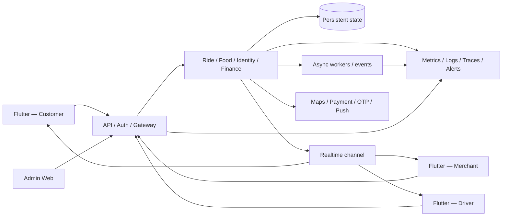

# DealGo — Non-Functional Requirements Specification (NFR)

> **Trạng thái `DRAFT` — KHÔNG PHẢI SLO/SLA ĐÃ CAM KẾT.** Các ngưỡng latency, throughput, concurrent users, tuổi dữ liệu GPS, crash-free, uptime, RTO, RPO, data retention, chi phí và cấu hình cảnh báo thuộc `OPEN-007` cùng các quyết định liên quan. Số liệu được ghi nhãn **CANDIDATE** chỉ là **điểm xuất phát cho lab benchmark**, không được coding agent tự đưa thành cấu hình production, cam kết đối tác hay điều kiện Go-live khi chưa được duyệt.
>
> **Phạm vi cố định:** DealGo MVP có **Ride (xe máy, ô tô) + Food**; **một ứng dụng Flutter** cho Customer, Merchant, Driver; **Admin Web** dành cho nội bộ. NFR này là lớp yêu cầu chất lượng *bao trùm* 71 `FR-*`; không bổ sung nghiệp vụ hoặc nhà cung cấp ngoài PRD.

## 1. Mục đích, giới hạn và nguồn sự thật

### 1.1. Mục tiêu

1. Chuyển những kỳ vọng mơ hồ như *nhanh, mượt, ổn định, chịu tải, an toàn* thành **đặc tính quan sát được**, **phương pháp đo** và **bằng chứng nghiệm thu**.
2. Bao quát cả ba lớp **Flutter Android/iOS**, **backend/API/realtime/jobs**, **Admin Web/operations** và các **phụ thuộc bên ngoài** (map, OTP, push, payment).
3. Phân biệt **sự đúng đắn tuyệt đối của dữ liệu nghiệp vụ** với **mục tiêu thống kê của chất lượng dịch vụ**. Ví dụ: không cho phép ghi hai assignment thắng cho một job không phải SLO 99,9%, mà là invariant bắt buộc.
4. Làm đầu vào cho sizing, test strategy, threat model, observability, DR và các quality gates `G1–G5`.
5. Giữ lại bằng chứng, giới hạn phép đo và quyết định để có thể cải tiến SLO dựa trên dữ liệu pilot.

### 1.2. Tài liệu này KHÔNG chốt

- SLA thương mại, mức đền bù, số liệu sản lượng dự kiến hay số người dùng thực tế.
- Quy tắc tính giá, thu tiền, COD, điều phối, thời gian timeout nghiệp vụ, bán kính tìm tài xế.
- Nhà cung cấp Cloud/Kafka/Redis/database, thuật toán dispatch cụ thể hoặc SDK location.
- Chính sách retention/consent/legal chưa được đánh giá và phê duyệt.

Nguồn chuẩn: `product-requirements.md` quản lý phạm vi và `FR-*`; `functional-requirements.md` quản lý hành vi; `decisions-and-assumptions.md` quản lý `OPEN-*`; file này quản lý **quality attributes, NFR IDs, test evidence và candidate measurements**. Khi xung đột, mở ADR/change request, **không tự hợp nhất âm thầm**.

### 1.3. Trạng thái giá trị và quy ước áp dụng

| Nhãn | Ý nghĩa | Có được dùng làm điều kiện chặn release? |
|---|---|---|
| `BASELINE-INVARIANT` | Nguyên tắc an toàn/đúng đắn được thừa hưởng từ FR và PRD, có thể viết test ngay | Có với chức năng nằm trong release tương ứng |
| `PROPOSED-P0` | NFR được đề xuất là bắt buộc đối với MVP; chờ chủ sở hữu duyệt | Chỉ khi được duyệt hoặc gate yêu cầu theo Charter |
| `CANDIDATE-METRIC` | Ngưỡng ban đầu để đo thử trên môi trường kiểm soát | **Không** chặn go-live cho đến khi `OPEN-007` được chốt |
| `TBD` | Chưa có căn cứ để chốt hoặc chưa xác định người chịu trách nhiệm | Là blocker đối với hạng mục phụ thuộc khi đến gate liên quan |
| `OUT-OF-SCOPE` | Không thuộc MVP hiện hành | Không được tự đưa vào P0 |

Các từ **MUST/SHOULD** trong mô tả NFR thể hiện *đặc tả đề xuất*, không tương đương trạng thái `APPROVED`. Mức ưu tiên kỹ thuật P0/P1 không được nhầm với số thứ tự tài liệu.

## 2. Bối cảnh, đối tượng đo và ranh giới hệ thống

### 2.1. Hành trình người dùng quan trọng nhất

| Journey ID | Người dùng | Chuỗi hành động cần bảo vệ | Kết quả người dùng cảm nhận |
|---|---|---|---|
| `J-RIDE-01` | Customer + Driver | reference fare → passenger proposal → driver accept/counter → customer selection → agreement/assignment → pickup → finish | Không chờ vô hạn; không auto-select; trạng thái có thể tin, không có chuyến kép |
| `J-FOOD-01` | Customer + Merchant + Driver | cart → checkout → merchant acceptance → preparation → pickup → delivery | Đơn đúng giá, đúng món, không giao trùng hay mất tiến trình |
| `J-CORE-01` | Tất cả role | login → enter eligible role → action → resume/reconnect | Không lộ quyền/dữ liệu role khác; không mất công việc đang làm |
| `J-FIN-01` | Customer / Partner / Finance | pay/collect → ledger → reconcile → refund/payout | Không ghi nhận trùng, không che giấu sai lệch |
| `J-OPS-01` | Support / Operations | phát hiện sự cố → triage → can thiệp có quyền → audit | Xử lý được giao dịch kẹt và truy lại được nguyên nhân |

### 2.2. Thành phần áp dụng



Sơ đồ mô tả **ranh giới chức năng**, không bắt buộc microservices hay broker cụ thể. NFR phải được đo theo **journey end-to-end**, không chỉ đo một API rồi tự cho cả luồng đạt.

### 2.3. Phân hạng hành vi khi phụ thuộc lỗi

| Tier | Năng lực | Nguyên tắc degradations |
|---|---|---|
| `T0` | Một assignment thắng, đúng state transitions, ledger đúng, object authorization | **Fail closed** khi không chắc; bảo toàn dữ liệu trước trải nghiệm nhanh |
| `T1` | Create Ride/Food, quote/checkout, merchant/driver action, ops intervention | Trả trạng thái rõ, retry an toàn, có circuit-breaker hoặc stop admission có kiểm soát |
| `T2` | Live map, ETA, push, ảnh món, danh sách khám phá | Có freshness, placeholder, polling/reconnect hay manual fallback được phê duyệt |
| `T3` | Marketing, gợi ý, analytics nâng cao | Có thể tắt hoặc trì hoãn không tác động T0/T1 |

## 3. NFR contract: định dạng và bằng chứng

Mỗi `NFR-*` trong file này phải có: `ID`, `rationale`, `scope`, `priority`, `verifiable requirement`, `metric/SLI` (nếu đo số), `test method`, `owner`, `gate`, `status`. Bảng dưới đây trình bày tối giản để tra cứu; test case chi tiết thuộc `08-quality/*`.

**Ví dụ đầy đủ — NFR-PERF-001**

```yaml
id: NFR-PERF-001
title: "Độ trễ các API tương tác"
status: CANDIDATE-METRIC
scope: ["Customer Flutter", "Merchant Flutter", "Driver Flutter", "Admin Web", "Backend"]
measurement:
  source: "Ingress/gateway server spans, đối chiếu client RUM"
  sample: "Mỗi endpoint interaction, tách GET/command, success/error, role và giờ cao điểm"
  formula: "p95 của thời gian từ request ingress đến response completed"
  excludes: "Synthetic traffic được gắn nhãn riêng; không bỏ mẫu chậm chỉ vì timeout"
  window: "Rolling 28 days khi production; theo test run trong staging"
proposed_test_threshold: "p95 <= 800 ms cho nhóm API interactive trên load profile đã duyệt"
production_target: TBD
conditions:
  - "Môi trường, traffic mix, thiết bị, dữ liệu DB và phụ thuộc phải ghi trong benchmark report"
owner: "Backend Lead + SRE"
gates: ["G4", "G5"]
evidence: ["Load report", "Traces", "Measurement query", "Change review"]
related_frs: ["FR-CORE-001", "FR-RIDE-003", "FR-FOOD-005"]
blocker: "OPEN-007"
```

**Cực kỳ quan trọng:** `p95 <= 800 ms` chỉ là giá trị thực nghiệm **đề xuất**, không có nghĩa 95% mọi tác vụ DealGo hay toàn bộ matching sẽ hoàn thành trong 800 ms.

## 4. Chỉ số đề xuất để khởi động phép đo — chưa phê duyệt

> Đây là **bảng CANDIDATE** phục vụ thử nghiệm và trao đổi trade-off, không phải kết luận hiệu năng hay cam kết nhà cung cấp. Mọi con số ở đây cần điều chỉnh theo pilot area, budget, tải, thiết bị và rủi ro. Nếu không có phương pháp đo/traffic profile chuẩn, ghi `NOT_MEASURED`, không ghi `PASS`.

| SLI / phép đo | Candidate trong controlled test | Population / cửa sổ | Production status |
|---|---|---|---|
| `API interactive latency` | p95 ≤ **800 ms**, p99 ≤ **2.000 ms** | Tách endpoint, theo API ingress, test data đủ kích thước | `TBD / OPEN-007` |
| `Order/Ride command acknowledgment` | p95 ≤ **1.500 ms** | Server **acknowledgment**, không phải tài xế nhận hay merchant hoàn tất | `TBD` |
| `Event delivery latency` | p95 ≤ **3 s** khi client connected và mạng lab ổn định | Từ business commit đến client nhận event hợp lệ; phân biệt push/realtime | `TBD` |
| `Frontend frame time` | Mục tiêu 60 FPS trên thiết bị chuẩn; khung ~**16,7 ms** | Flutter **profile build**, thống kê janky frames riêng | `TBD` |
| `API request success availability` | Khởi điểm cân nhắc **99,9%** | Rolling 28 ngày, loại trừ đúng policy đã duyệt | `TBD` |
| `Crash-free sessions` | Khởi điểm cân nhắc **≥ 99,5%** | Phiên app theo platform/version/role, không tính số launch như session nếu SDK khác định nghĩa | `TBD` |
| `Concurrent workload` | Test bậc thang **50 → 200 → 500 virtual users** | Chỉ là mức phát hiện giới hạn; **không** phải capacity được bảo đảm | `TBD` |
| `Location freshness` | Kiểm thử stale threshold mẫu **15–30 s foreground active task** | Chỉ là fixture để kiểm UI/guard; **không** bảo đảm nhịp GPS ngoài đời | `TBD / OPEN-012` |
| `RTO / RPO` | **Chưa gán số** | Theo tier, loại dữ liệu và quy trình DR đã phê duyệt | `TBD / OPEN-007` |
| `Max cost per completed task` | **Chưa gán số** | Tách Ride/Food, maps/OTP/push/payment và cloud | `TBD / budget review` |

**Tại sao không dùng chung một p95 cho toàn hệ thống?** Food checkout có thể gọi hàng tồn/giá/cổng thanh toán; Ride dispatch chờ tương tác người thật. Đo **command acknowledgment**, **matching outcome** và **journey duration** là ba đại lượng khác nhau. SLO thực tế phải phân lớp và nêu rõ numerator/denominator.

## 5. Performance, capacity và scalability

### 5.1. Danh mục NFR hiệu năng

| ID | Yêu cầu kiểm chứng được | Cách thử / đo | Ưu tiên / gate |
|---|---|---|---|
| `NFR-PERF-001` | API tương tác có latency histogram theo route class, role, status và thiết bị; đo cả p50/p95/p99; không trộn tác vụ kéo dài | Load test và ingress telemetry, test deadline | P0 / G4 |
| `NFR-PERF-002` | Ride quote, create và Food checkout ghi riêng backend processing vs network; thay đổi giá và validation không bị che bởi latency trung bình | Trace client → gateway → DB/vendor | P0 / G2–G4 |
| `NFR-PERF-003` | Các endpoint list có pagination, filter whitelist, giới hạn trả về và index review; tránh full-table scan khi dữ liệu lớn | EXPLAIN ANALYZE, dataset đại diện, regression | P0 / G4 |
| `NFR-PERF-004` | Query tới dữ liệu tài xế/merchant theo vùng không gây tăng độ trễ không kiểm soát khi tăng cardinality | Data scale 1k / 10k / 100k / 1M record mẫu, đo slope | P0 / G4 |
| `NFR-PERF-005` | Realtime fan-out đo được throughput, số kết nối, memory, queue lag và reconnect storms | Soak + reconnect burst, per-role channel metrics | P0 / G4 |
| `NFR-PERF-006` | Task async chậm không chặn thread xử lý tạo Ride/Food; backpressure được quan sát và có hướng xử lý | Inject slow workers + queue depth + gateway latency | P0 / G4 |
| `NFR-PERF-007` | Vendor Maps/OTP/Payment/PUSH chậm có timeout budget và degrade đúng tier, không treo request vô hạn | Simulate vendor 429/5xx/timeouts | P0 / G4 |
| `NFR-PERF-008` | API có giới hạn input size, request concurrency, query complexity và rate abuse để bảo vệ capacity | Fuzz/burst/429 + recovery | P0 / G4 |
| `NFR-PERF-009` | Search/menu/catalog load ảnh theo kích thước và cache strategy phù hợp; không kéo ảnh full-res cho thumbnail | Network profile, bytes/screen và render frame | P0 / G4 |
| `NFR-PERF-010` | Job scheduler / retry phải bounded, có jitter nếu thích hợp; retry storm không khuếch đại lỗi vendor | Fault injection đo request amplification | P0 / G4 |
| `NFR-PERF-011` | Có performance budget per-critical-journey được theo dõi theo release, regression phải có giải trình | CI baseline-vs-current report | P0 / G4 |
| `NFR-PERF-012` | Dashboard/Admin không được thực hiện aggregation nặng đồng bộ làm nghẽn giao dịch T0/T1 | Stress synthetic reports khi booking đang tải | P0 / G4 |

### 5.2. Test profile phải ghi rõ

Mỗi kịch bản performance phải có `profile_id`, commit SHA, schema/database seed size, vùng giả lập, provider mock hay live sandbox, environment CPU/RAM, topology, concurrency, request mix, duration, ramp pattern, device/network, report path và owner.

| Workload profile | Mục đích | Luồng thử bắt buộc | Chú ý |
|---|---|---|---|
| `WL-BASELINE` | So sánh giữa commit | Login/role, menu browse, quote Ride, checkout Food | Không dùng dữ liệu chỉ có 10 record |
| `WL-RUSH-HOUR` | Chịu tải giờ cao điểm mô phỏng | Ride create + Food order + Driver location + Merchant accept | Tỷ lệ mix chưa được chốt |
| `WL-DISPATCH-RACE` | Concurrency và race | N driver chấp nhận cùng offer; cancel đồng thời accept | Invariant đúng hơn throughput |
| `WL-REALTIME-STORM` | Reconnect/backfill | Socket disconnect hàng loạt, client reconnect, resync | Không broadcast toàn bộ payload cho mọi user |
| `WL-VENDOR-FAIL` | Vendor chậm / lỗi | Maps timeout, OTP retry, payment unknown, push delayed | Có backpressure và graceful failure |
| `WL-SOAK` | Memory/resource leaks | Traffic vừa phải kéo dài | Duration `TBD` đến capacity plan |
| `WL-RECOVERY` | Restore/catch-up | Restart consumer/node, replay event | Không side effect trùng |

### 5.3. Cách phân biệt các chỉ số hay bị nhầm

- **RPS/TPS**: phải định nghĩa *request*, *command*, *completed Ride*, *completed Food*; không quy đổi 1 đơn = 1 API.
- **Concurrency**: virtual users, active sockets, available drivers, active tasks và concurrent payment operations là 5 đại lượng khác nhau.
- **p95**: không lấy `AVG(p95 của từng instance)` để suy ra p95 tổng; tổng hợp histogram/distribution đúng.
- **Provider latency**: tách thời gian chờ bên ngoài; nhưng end-user latency vẫn bao gồm vendor nếu journey phụ thuộc vào vendor.
- **Load capacity**: chỉ tuyên bố capacity ở mức kiểm chứng mà error, p95, CPU, queue lag, invariant cùng đạt trên workload profile được định nghĩa.

## 6. Reliability, availability, consistency và recovery

| ID | Yêu cầu kiểm chứng được | Bằng chứng | Ưu tiên / gate |
|---|---|---|---|
| `NFR-REL-001` | Có health probes phân biệt liveness, readiness và dependencies; không tiếp nhận traffic khi chưa ready | Probe + inject DB/downstream fail | P0 / G1–G4 |
| `NFR-REL-002` | Khi tạo cùng business intent lặp lại, không tạo hai RideRequest/FoodOrder hoặc hai side effect tài chính | Double tap/replay/idempotency test | Invariant / G2–G4 |
| `NFR-REL-003` | Chỉ một assignment có thể thắng cho mỗi job theo state/capacity policy; cập nhật atomic | Parallel accept / database constraint | Invariant / G2–G4 |
| `NFR-REL-004` | Các state transition terminal không đảo ngược do event đến trễ; server state là authority | Reorder/replay/out-of-order event test | Invariant / G2–G4 |
| `NFR-REL-005` | Partial failure giữa DB/outbox/async delivery được khôi phục, không mất business event đã commit | Kill process at boundary + replay | P0 / G4 |
| `NFR-REL-006` | Timeout payment được biểu thị `unknown/pending reconciliation`, không suy diễn failed/success | Payment callback delays, duplicate webhooks | Invariant / G4–G5 |
| `NFR-REL-007` | Các workflow active được resync sau client/app restart; client không phát lại lệnh nhạy cảm nếu chưa xác minh | Kill app → relaunch → reconcile | P0 / G2–G4 |
| `NFR-REL-008` | API/client retry có bounded attempts, timeout, backoff và semantic idempotency cho command | Inject flaky network & 429 | P0 / G4 |
| `NFR-REL-009` | Dữ liệu đã commit bền vững qua restart instance; backup có kiểm tra restore trên môi trường cách ly | Disaster recovery exercise | P0 / G4–G5 |
| `NFR-REL-010` | Dừng nhận giao dịch mới theo service/zone không làm mất lịch sử in-flight và có runbook xử lý | Kill switch drill + ops audit | P0 / G4–G5 |
| `NFR-REL-011` | Dependency lỗi lan truyền trong giới hạn; không khiến toàn hệ thống lỗi dây chuyền | Chaos / circuit breaker / bulkhead tests | P0 / G4 |
| `NFR-REL-012` | Sự cố/severity có owner, timeline, escalation, rollback criteria và postmortem | Table-top exercise + simulated incident | P0 / G5 |

### 6.1. Invariants không được biến thành phần trăm

- `INV-01`: Không thể có hai assignment hợp lệ cùng chiến thắng một đơn/chuyến nếu policy không cho phép.
- `INV-02`: Không tạo side effect thu/hoàn tiền hai lần chỉ vì webhook hoặc HTTP retry lặp.
- `INV-03`: Không có phép chuyển `completed/delivered` trái bằng chứng và state guard được phê duyệt.
- `INV-04`: Không thể xem/sửa tài nguyên của người khác chỉ bằng đoán ID hoặc đổi active role.
- `INV-05`: Không có thay đổi tài chính không được ghi ledger/audit; reconcile discrepancy không tự biến thành `matched`.
- `INV-06`: `notification/socket/local cache` không là nguồn dữ liệu authoritative cho kết quả cuối.

Tất cả các invariant trên phải có *negative tests*, không chỉ unit test “happy path”. Đây là cam kết logic thiết kế, không phải bảo đảm hệ thống hiện tại đã thực hiện.

### 6.2. RTO, RPO và khả năng phục hồi theo dữ liệu

| Dataset/component | Mất dữ liệu cho phép | RPO được phê duyệt | RTO được phê duyệt | Phương thức xác minh |
|---|---|---|---|---|
| Ledger / payment references | Không chấp nhận bỏ qua bản ghi đã commit; phải đối soát | `TBD` | `TBD` | Restore + replay + reconcile |
| Ride/Food core state | Không chấp nhận lặng lẽ mất order/trip đã xác nhận | `TBD` | `TBD` | Restore + diff against event log |
| Partner KYC/KYB | Bảo vệ tính bí mật/toàn vẹn theo policy | `TBD` | `TBD` | Encrypted restore + access test |
| Realtime presence & GPS volatile | Có thể tái tạo hoặc báo stale nếu hết hiệu lực | `TBD` | `TBD` | Disconnect/recover test |
| Cache, feeds, derived BI | Có thể xây lại từ nguồn chuẩn | `TBD` | `TBD` | Rebuild + consistency tests |

**Không dùng `RPO=0` hoặc `99,99% uptime` nếu chưa chứng minh kiến trúc đa vùng và chi phí phù hợp.** Với data tier T0 cần xác định transaction durability và reconciliation độc lập với RPO của backup. `RPO` là mức tổn thất dữ liệu có thể chấp nhận theo recovery strategy, không phải bảo đảm rằng mọi transaction sẽ tự động được khôi phục.

## 7. Realtime, location, dispatch và ETA

### 7.1. NFR theo luồng

| ID | Yêu cầu kiểm chứng được | Phương pháp thử | Ưu tiên / gate |
|---|---|---|---|
| `NFR-RT-001` | Event Ride/Food có `event_id`, entity ID, version/sequence phù hợp, created time và correlation ID; consumer phát hiện trễ/trùng | Duplicate + reordered delivery | P0 / G2–G4 |
| `NFR-RT-002` | Sau reconnect, client lấy snapshot từ backend, sau đó áp dụng sự kiện hợp lệ; không đảo trạng thái | Kill/reconnect client + websocket replay | P0 / G2–G4 |
| `NFR-RT-003` | Server kiểm quyền join channel per user/role/entity; không lộ GPS/đơn cho chủ thể khác | Unauthorized socket subscription tests | Invariant / G4 |
| `NFR-RT-004` | App hiển thị trạng thái `last updated` khi location/ETA quá cũ; không biến estimated location thành bằng chứng | Simulate timestamp stale + invalid accuracy | P0 / G2–G4 |
| `NFR-RT-005` | Foreground/background location phải thích ứng permission/battery/network/platform policy; tắt tracking khi hết purpose | Permission matrix Android/iOS, battery tests | P0 / G4–G5 |
| `NFR-RT-006` | Driver location có kiểm chứng freshness/accuracy và chống nhảy bất thường trước khi ảnh hưởng dispatch | Inject 0,0, old, spoofed-like, impossible jumps | P0 / G4 |
| `NFR-RT-007` | Server quyết định eligible/capacity/assignment, không tin chỉ số online hoặc accept từ client | Simulate role suspended / stale location / double accept | Invariant / G2–G4 |
| `NFR-RT-008` | ETA có provenance và timestamp; quá hạn hoặc vendor lỗi thì degrade, không cố hiển thị ETA như dữ liệu xác thực | Vendor fail + stale route result | P0 / G4 |
| `NFR-RT-009` | Push notification có thể trễ, lặp hoặc mất; mọi thao tác đều xác minh status từ server | Duplicate/drop push simulator | P0 / G4 |
| `NFR-RT-010` | Vị trí chỉ phát tới actor có mục đích hợp lệ trong khoảng thời gian cần thiết; stop sharing theo policy | End-trip permission & retention tests | P0 / G4–G5 |
| `NFR-RT-011` | GPS update budget/energy draw và số request bản đồ được đo theo active task, role, OS | Soak navigation + battery consumption | P0 / G4 |
| `NFR-RT-012` | Location background bị hạn chế hoặc bị OS terminate thì UI/server không hứa “tracking liên tục”; có fallback và safety escalation khi thích hợp | Doze/low-power/background kill/permission revoked | P0 / G4–G5 |

### 7.2. Latency không đồng nghĩa tính chính xác vị trí

```
Device sample time → client upload → backend ingest → commit / fan-out
                           ↓
                 customer receives update
```

Tách ít nhất 4 độ trễ: `sample_age`, `upload_delay`, `server_processing`, `fanout_delay`. Một event đến trong 100 ms vẫn có thể mang tọa độ đã chụp từ 5 phút trước. Không gọi đó là `realtime current location`.

### 7.3. Permission matrix tối thiểu

| Trường hợp | Hành vi bắt buộc |
|---|---|
| Customer từ chối location | Cho nhập địa chỉ thủ công trong luồng được hỗ trợ; báo giới hạn nếu không thể dùng tính năng |
| Driver foreground đang online | Đề nghị quyền đủ dùng đúng thời điểm; phát hiện độ chính xác thấp và vị trí cũ |
| Driver đang có nhiệm vụ, app sang background | Chỉ duy trì location nếu điều kiện pháp lý/store/OS cho phép và đã có purpose rõ |
| OS thu hồi quyền khi app chạy | Stop location, cập nhật status/degrade, không giả online hợp lệ |
| Driver đóng app / mất mạng | Server tự xác định stale, không khẳng định cập nhật tọa độ thành công |
| Ride/Food đã kết thúc | Chấm dứt sharing cần thiết theo chính sách; không tiếp tục background tracking vô mục đích |

Nhịp GPS cụ thể, độ chính xác yêu cầu, chính sách bật chế độ tài xế nền và retention là `OPEN-012`/privacy review; không ghi cứng từ ví dụ lab.

## 8. Flutter mobile: performance, stability, accessibility và trải nghiệm mất mạng

### 8.1. Phạm vi thiết bị và build profile

- Một Flutter binary nhưng ba **role workspaces** độc lập; benchmark phải bao phủ Customer, Merchant và Driver, không chỉ trang chủ Customer.
- Test trên Android và iOS thiết bị thật, tối thiểu một thiết bị mức cấu hình thấp trong ma trận hỗ trợ đã chốt. Danh sách OS/version tối thiểu, RAM/GPU và màn hình là `TBD` cho đến khi có quyết định về support matrix.
- Đo Flutter `profile` hoặc `release` mode với instrumentation thích hợp; kết quả `debug mode` không được dùng để kết luận frame performance.
- Phân tích riêng `cold start`, `warm start`, screen-to-interactive, `build frame` và `raster frame`, memory, battery và network traffic.
- Test có ảnh món, bản đồ, transition phức tạp, livestream location, bàn phím mở, font scale lớn, ngôn ngữ dài và state loading/error.

### 8.2. Các yêu cầu chất lượng client

| ID | Yêu cầu kiểm chứng được | Thử nghiệm | Ưu tiên / gate |
|---|---|---|---|
| `NFR-MOB-001` | Màn hình trọng yếu phải có hiệu năng frame được đo trên thiết bị chuẩn; trường hợp dropped/janky frame có báo cáo | Flutter DevTools + trace + integration benchmark | P0 / G4 |
| `NFR-MOB-002` | Giảm rebuild không cần thiết và chạy tính toán nặng ở background isolate hoặc layer thích hợp khi có bằng chứng bottleneck | Stress scroll/map/menu, CPU profile | P0 / G4 |
| `NFR-MOB-003` | Không mất trạng thái work đang active khi lifecycle `background → resume`, process recreation hoặc app relaunch | Instrumented lifecycle tests Android/iOS | P0 / G2–G4 |
| `NFR-MOB-004` | Chuyển role không để lọt dữ liệu cache, navigation stack, thông báo hoặc action của role trước | Switch Customer↔Driver↔Merchant, deep link tests | Invariant / G4 |
| `NFR-MOB-005` | Mọi hành động quan trọng có trạng thái loading/confirm/disabled/error/success/recoverable, chống double tap phù hợp | Golden/interaction tests, tap burst | P0 / G2–G4 |
| `NFR-MOB-006` | Khi offline, không hiển thị tác vụ mutating chưa commit như “đã thanh toán/đã giao/đã hoàn thành” | Airplane mode during pay/accept/complete | Invariant / G2–G4 |
| `NFR-MOB-007` | Kết nối phục hồi phải fetch lại authoritative state trước khi render kết quả cuối; xử lý event stale | Offline → online/reconnect integration test | P0 / G4 |
| `NFR-MOB-008` | Ảnh, cache và local persistence có giới hạn kích thước/chính sách xóa phù hợp; không lưu PII không cần thiết | Disk/cache growth soak test | P0 / G4 |
| `NFR-MOB-009` | App có crash/ANR/hang telemetry phân tách OS, version, device, active role và screen, tránh gửi dữ liệu nhạy cảm | Crash injection + symbolication + dashboard | P0 / G4 |
| `NFR-MOB-010` | Permission request được hỏi đúng khi cần, có giải thích chức năng và đường xử lý khi bị từ chối | Permission denial/revocation tests | P0 / G4–G5 |
| `NFR-MOB-011` | Không tạo polling/location request liên tục vô hạn trong background khi không có business purpose | Battery/network profiler trong lifecycle matrix | P0 / G4 |
| `NFR-MOB-012` | Phiên bản app cũ có chiến lược tương thích API, schema và force/min supported version theo quy định release | Upgrade/downgrade compatibility test | P0 / G4–G5 |

### 8.3. Accessibility / localization

| ID | Yêu cầu kiểm chứng được | Bằng chứng | Gate |
|---|---|---|---|
| `NFR-UX-001` | Mọi nút và thao tác cốt lõi có accessible name/semantics; trạng thái và lỗi được đọc bằng assistive technology | TalkBack + VoiceOver walkthrough | G4 |
| `NFR-UX-002` | Dynamic text scale không che nút thanh toán, nhận chuyến, xác nhận giao hàng, xác nhận hủy | Device text-scale matrix và screenshot diff | G4 |
| `NFR-UX-003` | Màu sắc không là cách duy nhất biểu diễn thành công/lỗi/đang tìm; focus và touch target phù hợp tiêu chuẩn chọn | WCAG review + keyboard/screenreader tests | G4 |
| `NFR-UX-004` | Tiền, ngày giờ, số điện thoại, địa chỉ hiển thị theo locale; số tiền hiển thị không thay đổi precision khi format | Locale tests + monetary snapshot | G4 |
| `NFR-UX-005` | Loading, empty, permission denied, offline, timeout, stale và error không khiến người dùng không biết tiếp tục thế nào | UX state inventory và usability test | G4 |
| `NFR-UX-006` | Admin Web có vận hành bằng bàn phím, biểu mẫu có nhãn/lỗi, thông tin nhạy cảm được mask theo role | Accessibility audit + RBAC tests | G4 |

**Tham chiếu:** Flutter performance 60/120 FPS, profiling và accessibility; WCAG 2.2 dùng làm chuẩn tham khảo kiểm thử, nhưng cấp tuân thủ và scope cho từng nền tảng cần được phê duyệt. Mục tiêu định lượng về startup, frame jank, memory, energy vẫn `TBD` hoặc `CANDIDATE` ở §4.

## 9. Security, identity, authorization và phòng chống lạm dụng

> Đây là baseline an toàn đề xuất dựa trên OWASP ASVS/MASVS và API Security; `07-security-legal/*` sẽ chuyển thành threat model, control requirements và test catalog. Không coi tích hợp SDK authentication là đã xử lý hết bảo mật.

| ID | Yêu cầu kiểm chứng được | Test / evidence | Gate |
|---|---|---|---|
| `NFR-SEC-001` | Mọi API object-level kiểm `principal → eligible role → permission → owner/store scope → state guard` tại backend | BOLA/IDOR negative tests trên Ride/Food/Merchant | G1–G5 |
| `NFR-SEC-002` | Không cấp quyền mới chỉ bằng active role, claim client, deep link hay route guard Flutter | Role escalation / forged payload tests | G4 |
| `NFR-SEC-003` | Session/token có rotation/revocation/expiry phù hợp; token không xuất hiện trong log, crash report, URL hoặc analytics | Secrets scanning + invalid-session tests | G4 |
| `NFR-SEC-004` | Giao tiếp nhạy cảm mã hóa khi truyền; certificate checks và cấu hình TLS không bị vô hiệu trong production | Dynamic/network security tests | G4 |
| `NFR-SEC-005` | Secret/API key của payment, KYC, Maps server chỉ ở secure secret store/backend; mobile không chứa server-secret | Mobile package analysis + secret scan | G4 |
| `NFR-SEC-006` | Mọi API mutating quan trọng được rate limit, anti-replay/idempotency và abuse monitoring tùy loại tác vụ | Flood, replay, brute-force tests | G4 |
| `NFR-SEC-007` | Upload KYC/KYB kiểm loại tệp, giới hạn dung lượng, malware scan khi cần, access scope và expiring access | Malicious upload, cross-account fetch tests | G4–G5 |
| `NFR-SEC-008` | Thao tác Admin nhạy cảm có audit actor/reason/timestamp, least privilege, separation of duties khi được yêu cầu | Unauthorized refund/approve/suspend audit | G4–G5 |
| `NFR-SEC-009` | Lỗ hổng dependency/container/mobile SDK được quản lý bằng SBOM hoặc inventory, có quy trình triage và cập nhật | SCA scan + remediation log | G4 |
| `NFR-SEC-010` | Lỗi xác thực, định vị, input validation và rate limit không làm lộ PII trong response hay telemetry | Error disclosure / log review | G4 |
| `NFR-SEC-011` | Webhooks/payment callbacks được xác minh nguồn, chữ ký hoặc cơ chế tin cậy tương ứng và replay guard | Tampered/replayed webhook tests | G4–G5 |
| `NFR-SEC-012` | Cấu hình production tắt debug endpoints, test accounts, permissive CORS và feature bypass | Release hardening and config scan | G4–G5 |
| `NFR-SEC-013` | Sensitive actions có cơ chế step-up verification theo rủi ro được duyệt; chưa đủ evidence phải có review | Threat model + negative transaction test | G5 |
| `NFR-SEC-014` | App chống rò rỉ thông tin qua clipboard, notifications, screenshots ở các màn hình có dữ liệu nhạy cảm theo risk policy | MASVS mobile assessment | G4–G5 |
| `NFR-SEC-015` | Security incidents có detection, revocation, partner suspension và forensic trace phù hợp quyền | Incident response drill | G5 |
| `NFR-SEC-016` | Passkey challenge one-time, RP ID/origin/signature/user binding verified server-side; SMS/email flows have anti-enumeration, expiry, rate limit and no secret logging; admin method changes require scoped grants/audit/lockout guard | WebAuthn negative tests, OTP abuse tests, admin permission/recovery test | G1/G4/G5 |
| `NFR-SEC-017` | Chat/call authorization uses server-derived transaction participants; call grants are short-lived; admin content access requires case and audit; no recording or number disclosure by default | BOLA tests, stale call-token tests, privacy permission review | G2/G3/G4/G5 |

### 9.1. Security release blocking

- **Bắt buộc khắc phục hoặc có risk acceptance chính thức trước G5:** lỗ hổng critical/high đã xác thực tác động tới giao dịch tiền thật, quyền truy cập của role khác, giấy tờ KYC/KYB, vị trí tài xế, chỉnh sửa đơn/chuyến hoặc lưu/tiết lộ secret.
- Không tự gán “zero high findings” thành cam kết rằng hệ thống đã được pentest. Mỗi finding phải có ID, scope, evidence, severity, owner, fix version, retest result và approved exception nếu có.
- Các phép kiểm security phải theo đúng **phiên bản** chuẩn đã viện dẫn, không trộn mơ hồ MASVS test guide với ASVS web/API. Pin version trong báo cáo security.

### 9.2. Multi-role attack scenarios bắt buộc

1. Merchant A thay `merchant_id/store_id` để đọc menu/orders/KYB hoặc payout của Merchant B.
2. Driver chưa duyệt hoặc đã suspend cố nhận assignment qua endpoint trực tiếp.
3. Customer đăng nhập hợp lệ gọi Admin API với payload tự thêm `role=admin`.
4. Người dùng đổi active role tại client nhưng vẫn dùng token/channel cũ để nghe GPS của người khác.
5. Replay webhook `payment_succeeded`/`refund_succeeded` nhiều lần nhằm cộng tiền lặp.
6. Deep link nhận đơn/chuyến từ notification của tài khoản khác không được phép hiển thị dữ liệu.
7. App bị clone/sửa local state để giả GPS, nhận chuyến hoặc xác nhận giao; server không tin bằng chứng local đơn lẻ.
8. Export ops/reports để lọt CCCD, số điện thoại hoặc vị trí lịch sử ngoài phạm vi quyền.

## 10. Data quality, privacy, retention và auditability

| ID | Yêu cầu kiểm chứng được | Bằng chứng | Gate |
|---|---|---|---|
| `NFR-DATA-001` | Ride, Food, Assignment, Payment, Ledger, Refund có nguồn sự thật và transaction boundary rõ | ERD/DDD review + fault tests | G2–G4 |
| `NFR-DATA-002` | Key quan trọng có uniqueness/foreign key/check phù hợp; không phụ thuộc chỉ vào validation phía Flutter | Migration + constraint tests | G2–G4 |
| `NFR-DATA-003` | Thay đổi schema có kế hoạch migration tương thích, rollback/backfill, không phá bản app cũ trong support window | Expand/migrate/contract rehearsal | G4 |
| `NFR-DATA-004` | Financial amount sử dụng kiểu decimal/integer minor units theo currency policy; không tính monetary business rule bằng binary float | Rounding/precision property tests | G4 |
| `NFR-DATA-005` | Ledger, reconciliation và audit có trace xuyên Payment ↔ Ride/Food ↔ Driver/Merchant, không mất idempotency key/references | Sample trace & reconciliation fixtures | G4–G5 |
| `NFR-DATA-006` | Dữ liệu nhạy cảm và GPS có classification, access control, retention và deletion policy khi có căn cứ pháp lý | Data-flow inventory + privacy review | G5 |
| `NFR-DATA-007` | Log/analytics không chứa raw token, OTP, CCCD, full payment details hoặc chuỗi vị trí cá nhân không cần thiết | Automated log DLP scan + spot review | G4–G5 |
| `NFR-DATA-008` | Dữ liệu xóa/ẩn danh không phá các bản ghi cần thiết cho dispute, ledger, legal hold theo chính sách được duyệt | Deletion/legal hold rehearsal | G5 |
| `NFR-DATA-009` | Clock/timezone lưu thống nhất, hiển thị địa phương hóa, server timestamps bảo toàn ordering và forensic analysis | Clock-skew tests + timestamp validation | G4 |
| `NFR-DATA-010` | Batch export/analytics tạo snapshot nhất quán hoặc nêu rõ cutoff; không dùng dữ liệu cache như giá trị đối soát cuối | Export reconciliation test | G4–G5 |
| `NFR-DATA-011` | Chat body, call metadata/signaling và authentication-method history have separate classification, minimization, access, retention and deletion rules; no audio recording at baseline | Data-flow inventory, access review, deletion/retention test | G4–G5 |

### 10.1. Data-classification proposal

| Loại dữ liệu | Ví dụ | Ràng buộc tối thiểu | Retention |
|---|---|---|---|
| `Restricted` | ảnh CCCD, giấy phép lái xe, KYC evidence | Encrypt, limited privileged access, access audit | `TBD` sau legal review |
| `Sensitive` | số điện thoại, địa chỉ giao, lịch sử GPS, payout account | Purpose limitation, masking, limited role access | `TBD` |
| `Transactional` | Ride/Food states, payment reference, settlement | Immutable trace / append-or-correct strategy, reconcile | `TBD` theo pháp luật/kế toán |
| `Operational` | logs/traces, incidents, vendor timings | Redaction, role access, defined rotation | `TBD` |
| `Public/Published` | món và giá đang hiển thị công khai được phép | Integrity, stale cache control | Theo business policy |

**Đặc biệt:** tracking sống (tọa độ hiện tại) và lưu lịch sử vị trí là **hai hoạt động xử lý dữ liệu khác nhau**. Không tự lưu vô thời hạn mọi sample GPS vì “sau này có thể dùng analytics”. Cần purpose, minimization, retention, delete/access workflow và legal basis cụ thể.

## 11. Observability, alerts và incident response

### 11.1. Danh mục NFR vận hành

| ID | Yêu cầu kiểm chứng được | Bằng chứng | Gate |
|---|---|---|---|
| `NFR-OPS-001` | Có correlation/request ID đi xuyên client → API → domain event → worker → webhook/case khi có thể | Distributed trace từ E2E test | G1–G4 |
| `NFR-OPS-002` | Thu thập metrics, traces và structured logs với giới hạn PII; retention/cost có owner | Telemetry test + sampling policy | G4 |
| `NFR-OPS-003` | Dashboard đo Ride request → assigned → completed/failed; Food created → accepted → picked → delivered/failed; không nhầm số request với số job | Metrics queries + fixture verification | G4 |
| `NFR-OPS-004` | Có cảnh báo khi job kẹt, offer conflict, stale GPS tăng, webhook pending, payment mismatch hoặc worker lag | Alert synthetic trigger + on-call route | G4–G5 |
| `NFR-OPS-005` | Alerts phân cấp theo impact, actionable và có runbook; tránh báo ồ ạt khi dependency chung lỗi | Alert routing & noise tests | G5 |
| `NFR-OPS-006` | Incident có severity, owner, timestamp, blast radius, mitigation, communication và retrospective | Tabletop exercise + incident record | G5 |
| `NFR-OPS-007` | CI/CD có deployment trace, build provenance, rollback/canary strategy theo quy mô hệ thống | Simulated bad release + rollback | G4–G5 |
| `NFR-OPS-008` | Các dịch vụ có capacity utilization, saturation, queue depth và DB resource monitoring | Soak test + dashboard evidence | G4 |
| `NFR-OPS-009` | Cảnh báo vận hành không gửi nội dung CCCD, địa chỉ chính xác hay payment details vào các kênh nhiều người | Alert payload review | G4–G5 |
| `NFR-OPS-010` | SLO dashboard tách user journey/role/region/OS và request health; không báo “xanh” nếu payment flow đang hỏng | Synthetic journey test vs dashboard | G5 |

### 11.2. SLI definition template

```yaml
sli_id: SLI-RIDE-BOOKING-001
name: "Successful Ride request acceptance"
population: "Eligible, authenticated customer intents in supported zone"
good_event: "Server durably commits exactly one request and replies with retrievable request id"
total_event: "All eligible creation intents observed at authoritative ingress"
error_policy: "Exclude malformed/unauthorized requests per approved policy; count server timeout as bad until reconciled"
measurement_point: "API gateway + business database audit"
aggregation: "Separate by zone, version and time window"
production_slo: TBD
proposed_reporting_window: "28 days"
owner: "Ride Backend + SRE"
status: "DRAFT / OPEN-007"
```

**Công thức nền tảng:** `SLI = good_events / eligible_events`. Với SLO 99,9% trên **1.000.000 yêu cầu đủ điều kiện** trong cửa sổ xác định thì **error budget minh họa = 1.000 bad event**. Đây là công thức minh họa, **không** khẳng định đây là traffic DealGo hay SLO đã duyệt.

Một SLO không chỉ có phần trăm: cần `owner`, `population`, `measurement source`, `window`, `inclusion/exclusion`, `budget policy`, `reporting`, `review date` và `escalation route`. Không tính availability chỉ bằng uptime của container hoặc health endpoint; phải đo **trải nghiệm giao dịch có ý nghĩa với người dùng**.

### 11.3. Dashboard tối thiểu cho MVP

| Dashboard | Metrics bắt buộc | Phân đoạn |
|---|---|---|
| `Platform` | Request rate, error rate, p95/p99, CPU, memory, DB pool, queue lag | API/service/region |
| `Ride` | Created, search timeout, assigned, completed, canceled, conflicting offer | Zone / lifecycle |
| `Food` | Orders created, merchant accept latency, no-driver, picked, delivered, canceled | Zone / merchant cohort |
| `Financial integrity` | Pending/unknown payment, unmatched journal, duplicate webhook, refund backlog | Provider / transaction type |
| `Realtime location` | Active connections, event lag, stale GPS ratio, reconnect errors | Android/iOS / role / zone |
| `Mobile quality` | Crash-free sessions, startup, frame-jank, memory, battery anomalies | App version / device / active role |
| `Operations` | Open incident/cases, oldest stuck transactions, approvals pending | Severity / owner / zone |

*Chú ý:* tiêu đề “Metrics” là danh mục dữ liệu giám sát, không phải cam kết về platform/tool; biểu đồ và truy vấn cuối do observability implementation docs chuẩn hóa.

## 12. Delivery, extensibility, maintainability và chi phí

| ID | Yêu cầu kiểm chứng được | Bằng chứng | Gate |
|---|---|---|---|
| `NFR-ENG-001` | Modules Identity/Ride/Food/Dispatch/Finance có boundaries rõ; không để DTO/UI logic thay đổi trực tiếp ledger | Architecture dependency review | G1–G4 |
| `NFR-ENG-002` | Contract HTTP/events được version/compatibility kiểm tra trong CI; mobile cũ có policy deprecation | API contract + compatibility tests | G4 |
| `NFR-ENG-003` | Migration/code deploy có rollback hoặc forward fix strategy, feature flag khi cần | Release rehearsal | G4–G5 |
| `NFR-ENG-004` | Dependency pin/upgrade policy có vulnerability check; thay đổi major framework cần compatibility evaluation | SBOM/dependency CI output | G4 |
| `NFR-ENG-005` | Log/test/observability coverage đi kèm feature mới, không defer đến cuối release | Definition of Done verification | G2–G5 |
| `NFR-ENG-006` | Không lựa chọn microservices/Kafka/Redis chỉ vì trend; quyết định cần workload evidence và ADR | Architecture Decision Record | G1 |
| `NFR-COST-001` | Theo dõi đơn vị chi phí cloud, maps, location, payment, OTP, push per completed Ride/Food | Cost tagging + unit economics sheet | G4–G5 |
| `NFR-COST-002` | Third-party requests có quotas, budgets và usage alerts để tránh phát sinh ngoài kiểm soát | Quota injection + provider invoice comparison | G4–G5 |
| `NFR-COST-003` | Geocoding/routing/cache strategy tuân thủ hợp đồng provider, tối ưu từ dữ liệu dùng thực | Cost-vs-freshness review | G4 |
| `NFR-COST-004` | Retention logging/GPS không vô hạn; có budget và data lifecycle plan | Storage growth forecast + scheduled cleanup test | G5 |
| `NFR-COST-005` | Khi cloud/provider chạm quota thì degrade đúng mức, không tạo giao dịch lỗi tài chính hoặc request storm | Quota-exceeded / budget-guard test | G4–G5 |

### 12.1. Quy ước debt và trade-off

- Khi thay đổi kiến trúc để tăng throughput phải chứng minh không làm giảm `INV-01..06` và không tăng rủi ro privacy.
- Optimization phải có số liệu trước/sau trên cùng workload profile, không chọn caching/Redis vì “có vẻ nhanh”.
- Có thể dùng kiến trúc modular monolith làm baseline nghiên cứu, nhưng đây chỉ là **phương án để đánh giá**, không phải quyết định kiến trúc đã chốt.
- Những chức năng P1/P2 như analytics nâng cao, batch Ride, multi-stop, AI pricing không được dùng làm lý do tăng chi phí/độ phức tạp cho P0 nếu chưa có sự chấp thuận.

## 13. Ma trận traceability NFR → chức năng → test → gate

| NFR cluster | FR/Use Case liên quan (mẫu) | Test suite dự kiến | Cổng |
|---|---|---|---|
| Performance (`PERF`) | `FR-RIDE-002/003`, `FR-FOOD-002/005`, `FR-OPS-003` | `NFR-TC-PERF-*` | G2/G3/G4 |
| Reliability (`REL`) | `FR-CORE-005/008/009`, `FR-RIDE-003/007`, `FR-FOOD-005/009` | `NFR-TC-REL-*` | G2/G3/G4/G5 |
| Realtime (`RT`) | `FR-CORE-004/009/014`, `FR-DRV-002/007/008` | `NFR-TC-RT-*` | G2/G3/G4 |
| Mobile (`MOB`) | `FR-CORE-001/002/009`, `FR-DRV-003/006` | `NFR-TC-MOB-*` | G2/G3/G4 |
| Accessibility (`UX`) | All interactive FR; especially `FR-RIDE-003`, `FR-FOOD-005`, `FR-DRV-004` | `NFR-TC-UX-*` | G4 |
| Security (`SEC`) | `FR-CORE-001/002/003`, `FR-MER-004`, `FR-OPS-002/004/006` | `NFR-TC-SEC-*` | G1/G4/G5 |
| Data (`DATA`) | `FR-CORE-008`, `FR-MER-008`, `FR-DRV-009`, `FR-OPS-006` | `NFR-TC-DATA-*` | G4/G5 |
| Operations (`OPS`) | `FR-CORE-011/012`, `FR-OPS-003/004/009` | `NFR-TC-OPS-*` | G4/G5 |
| Engineering/Cost (`ENG/COST`) | All critical services and partner flows | `NFR-TC-ENG-*`, `NFR-TC-COST-*` | G1/G4/G5 |

**Quy tắc bắt buộc:** một NFR có thể liên kết nhiều FR và một FR có thể có nhiều NFR. Không dùng bảng này để suy luận đã có các file test trên đĩa — những test IDs và report paths là **planned** cho `08-quality/*`.

## 14. Các kịch bản benchmark và failure injection bắt buộc

| Test ID | Điều kiện kích hoạt | Expected outcome | NFR coverage |
|---|---|---|---|
| `NFR-TC-01` | 2–20 Driver accept cùng offer trong cùng khoảng thời gian giả lập | Chỉ 1 assignment thắng; số còn lại nhận state conflict/revoked | `REL-003`, `RT-007` |
| `NFR-TC-02` | Customer double tap create Food Order + HTTP retry sau timeout | Chỉ 1 order cho cùng business intent; có thể fetch kết quả bằng idempotency reference | `REL-002`, `MOB-005` |
| `NFR-TC-03` | Payment webhook trễ 2 phút rồi gửi lặp | Không nhận hai lần; unknown/pending đến khi đối soát; ledger nhất quán | `REL-006`, `SEC-011`, `DATA-005` |
| `NFR-TC-04` | Kill backend worker sau commit trước publish | Event còn thể replay, không tạo side effect trùng | `REL-005`, `REL-009` |
| `NFR-TC-05` | Kill Flutter khi Driver đang ở bước pickup/delivery | App hồi phục đúng resource và state từ backend, không hoàn tất giả | `MOB-003`, `REL-007` |
| `NFR-TC-06` | GPS report timestamps lệch 5 phút, tọa độ nhảy bất thường | Từ chối/degrade, cảnh báo stale; không giả vị trí hiện tại | `RT-004`, `RT-006` |
| `NFR-TC-07` | Reconnect 1.000 websocket giả lập hoặc mức tải được duyệt | Không rò channel; queue/lag được đo; client snapshot vẫn đúng | `PERF-005`, `RT-002/003` |
| `NFR-TC-08` | Maps provider trả 429/timeout liên tiếp | Fallback/thông báo phù hợp; không làm treo pipeline tạo đơn/chuyến | `PERF-007`, `COST-005` |
| `NFR-TC-09` | Merchant A truy cập order của Merchant B | 403/404 theo API policy, không lộ metadata, có audit khi cần | `SEC-001`, `DATA-006` |
| `NFR-TC-10` | Feature flag disable Food trong khu vực pilot có order đang làm | Không nhận order mới, order cũ đi theo runbook; không mất ledger | `REL-010`, `OPS-007` |
| `NFR-TC-11` | Restore backup trên môi trường cách ly, replay events và đối soát | Dữ liệu đúng theo RPO/RTO được duyệt; báo unresolved exceptions | `REL-009`, `DATA-005` |
| `NFR-TC-12` | Low-end Android + menu ảnh + bản đồ + chuyển role | Frame, memory, cold/warm start, energy có profile và không crash blocker | `MOB-001/002/009` |
| `NFR-TC-13` | Android/iOS thu hồi background permission giữa nhiệm vụ | Không tiếp tục thu thập trái phép; server xác định stale; UX có fallback | `MOB-010/011`, `RT-005/012` |
| `NFR-TC-14` | Screen reader, font scale tăng và bật high contrast | CTA nhận đơn/giao hàng/thanh toán còn thao tác được và có accessible labels | `UX-001/002/003` |
| `NFR-TC-15` | Data seed 1k→1M orders / concurrent mixed load | Query cost, latency slope, pool/queue saturation có bằng chứng; không khẳng định capacity ngoài profile | `PERF-003/004/011` |
| `NFR-TC-16` | Deploy API version mới khi app cũ vẫn chạy | Critical flows còn tương thích theo support-window đã chốt | `MOB-012`, `ENG-002/003` |
| `NFR-TC-17` | Bật audit logs/telemetry và chạy KYC/pay flow | Không log raw tokens, CCCD, OTP hoặc payment secret | `SEC-010`, `DATA-007`, `OPS-009` |
| `NFR-TC-18` | Admin tắt SMS hoặc revoke passkey | User enroll/sign-in/recovery | Chỉ scope đã chọn bị ảnh hưởng; alternate/recovery path and audit are correct | `SEC-016`, `DATA-006` |
| `NFR-TC-19` | User ngoài Ride/Food transaction gọi conversation/call ID | Read/send/join | Denied without content, participant metadata, or reusable call token | `SEC-001`, `SEC-017` |
| `NFR-TC-20` | Incident simulate no-driver spike + financial mismatch | Có alert, người nhận, escalation, mitigation và audit evidence | `OPS-004/005/006` |

Ghi `NFR-TC-*` là **scenario catalog**, không tuyên bố 18 scenario này đã chạy. `08-quality/contract-and-load-testing.md` phải chi tiết setup, fixture, pass/fail, expected telemetry và artifact location.

## 15. Kế hoạch kiểm thử chất lượng theo release và quality gates

| Gate | Mục tiêu kiểm chứng tối thiểu | Bằng chứng bắt buộc trước khi qua |
|---|---|---|
| `G0` Scope/decision baseline | Xác định T0/T1 journeys, high-risk NFR, owner, unresolved blocker | NFR review checklist; các chỉ số chưa duyệt ghi `TBD` |
| `G1` Platform foundation | Auth, role separation skeleton, instrumentation/CI, logging redaction, secrets, test environment | CI evidence + baseline auth tests + synthetic traces |
| `G2` Ride sandbox slice | Ride creation/assignment/finish, conflict/retry, realtime, Driver lifecycle, crash recovery | E2E + race tests + provisional performance traces |
| `G3` Food sandbox slice | Food checkout/merchant status/delivery, webhook simulation, failure/cancellation, Ride regression | Food E2E + data integrity + failure report |
| `G4` Integrated MVP hardening | Cross-role and cross-domain tests, load/realtime, security, accessibility, app profiles, backups, observability | Signed NFR test report, open risk register, performance baseline, restore drill |
| `G5` Controlled pilot/go-live | `OPEN-007/012` và liên quan được duyệt; runbooks/on-call/legal/privacy/provider/payment, support và monitoring thực thi | Go/No-Go signed by Product/Tech/Ops/Finance/Security/Legal as applicable |

**Không được nâng `G4 PASS` thành `G5 PASS` chỉ nhờ stress test tốt.** G5 đòi hỏi pháp lý, vận hành, đối tác, thanh toán và an toàn được phê duyệt theo `scope-release-plan.md`.

### 15.1. Chất lượng bằng chứng

Một báo cáo `PASS` tối thiểu phải có:

```yaml
report_id: NFR-REPORT-TBD
build_sha: TBD
app_version: TBD
server_version: TBD
db_migration_version: TBD
reporting_time_utc: TBD
test_environment: TBD
workload_profile: TBD
data_seed_size: TBD
client_device_matrix: TBD
network_conditions: TBD
integrations: "real sandbox / mock / simulated — phải ghi cụ thể"
nfr_ids: []
measurements: []
failures: []
raw_artifact_links: []
threshold_approval_ref: TBD
reviewers: []
verdict: NOT_RUN
```

`PASS` chỉ hợp lệ khi có **ngưỡng được duyệt**, điều kiện đo đúng profile, phép thử đã thực thi, bằng chứng lưu được, reviewer nhận trách nhiệm và không có blocker chưa giải quyết.

## 16. Ownership & sign-off

| NFR nhóm | Primary reviewer | Phối hợp |
|---|---|---|
| PERF/COST | Tech Lead / Backend Lead | SRE, Product/Finance |
| REL/RT | Backend Lead | Flutter, Ops, QA |
| MOB/UX | Flutter Lead / UX Lead | QA, accessibility reviewer |
| SEC | Security Lead hoặc người được ủy quyền | Backend, Flutter, Ops, Legal |
| DATA/Privacy | Data/Backend Lead | Finance, Legal/Privacy |
| OPS/DR | Ops/SRE owner | Tech, QA, support |
| Business impact/SLO target | Product Owner | Tech, Finance, Operations |

Nếu một vai trò chưa được bổ nhiệm, giữ `TBD` và không tự ký duyệt bằng tên AI agent. Các reviewer khác nhau có thể do cùng một người thực hiện trong nhóm nhỏ, nhưng phải ghi lại xung đột lợi ích và ai có thẩm quyền cuối cho rủi ro tài chính/pháp lý.

## 17. OPEN decisions và các blocker phải giải trước pilot

| Open ID | Liên quan | Phải chốt để làm gì? | Blockers |
|---|---|---|---|
| `OPEN-001` | Vùng phục vụ | Xác định network geography, traffic distribution, coverage tests | Giới hạn pilot và load profile |
| `OPEN-002/003/010/018` | Tiền, fees, COD, capture/refund | Integrity tests, latency và reconciliation scope | Go-live với tiền thật |
| `OPEN-004` | Dispatch / candidate / timeout | SLO dispatch outcome và các phép thử no-driver | G2 policy và G5 |
| `OPEN-005` | Active job/concurrency | Capacity, assignment invariant và switch role | Cross-domain G4 |
| `OPEN-006` | Pháp lý đối tác | Dữ liệu cần thu, quyền và yêu cầu audit KYC | G5 |
| `OPEN-007` | Load, SLO, budget, recovery | Target values, SLIs, workload, RTO/RPO và runbooks | **Phê duyệt NFR định lượng / G4–G5** |
| `OPEN-008` | Provider choices | Timeout, quotas, vendor SLO, privacy, fallback | G1–G5 tùy tích hợp |
| `OPEN-011/017` | Proof pickup/drop/start/end | Cách đánh giá completion và lỗi/kháng nghị | Data integrity / G5 |
| `OPEN-012` | Tracking/permissions | GPS collection strategy, foreground/background scope, freshness và retention | **Mobile/location G4–G5** |
| `OPEN-013/014/015` | Merchant tenancy, contact/support, incident | Authorization, privacy, on-call coverage | G4–G5 |
| `OPEN-016` | Food prepared / no driver | Timeout, settlement responsibility và degraded experience | G3–G5 |

Bảng này chỉ **liên kết** các quyết định đã đăng ký; không mở hay đóng quyết định thay cho `decisions-and-assumptions.md`.

## 18. Anti-patterns cần chặn trong code review và AI Agent review

1. Đo trong Flutter debug mode rồi tuyên bố “ứng dụng đạt 60 FPS”.
2. Hardcode `timeout=30`, `GPS 5s`, `99,99% uptime`, `RTO 10m` rồi coi là chính sách đã được duyệt.
3. Ghép `payment_success` và `order_delivered` thành một trạng thái để khỏi xử lý khác biệt.
4. Đọc GPS cũ từ cache nhưng hiển thị tài xế “đang ở đây” không ghi thời điểm cập nhật.
5. Tin role và merchant/store ID từ client mà không có server-side object permission.
6. Retry lệnh thu tiền/assign/chốt chuyến bằng cách gọi lặp mù mà không kiểm tra kết quả trước đó.
7. Chọn Kafka/microservices trước khi biết loại event, consistency và throughput thực tế.
8. Quên test Data Restore mà chỉ kiểm tra cron backup thành công.
9. Nhìn monitoring của API xanh rồi tuyên bố toàn hệ thống ổn, trong khi chưa có Driver assignment hoặc payment reconcile.
10. Gắn dữ liệu đầy đủ CCCD, số điện thoại, địa chỉ giao, vị trí GPS vào payload logs/traces/debug analytics.
11. Đo hiệu năng trên seed chỉ vài chục records và một flagship phone.
12. Đếm số connections/RPS rồi diễn giải thành số chuyến hoàn tất hoặc đơn giao thành công.
13. Dùng retry vô giới hạn/cascading timeout khi cổng thanh toán hay map provider bị lỗi.
14. Dùng expected result của staging mock để tuyên bố đã sẵn sàng vận hành thương mại.
15. Thêm tính năng caching “tối ưu” nhưng không quy định invalidation, freshness, ownership và reconciliation.
16. Thêm tracking background cho mọi role ngay từ launch mà chưa kiểm tra OS policy, consent và purpose.

## 19. Checklist duyệt tài liệu NFR

### 19.1. Trước khi chuyển DRAFT → IN_REVIEW

- [ ] Bảy quyết định `DEC-PROD-001..007` được giữ nguyên.
- [ ] Không đưa app thứ hai/ba hay vertical mới thành MVP.
- [ ] Các NFR có mã duy nhất; các bảng không mâu thuẫn với invariants và PRD.
- [ ] Dùng chính xác `OPEN-*` và `G*` theo governance.
- [ ] Candidate metrics có đủ measurement point, population, environment và status `TBD`.
- [ ] Không có giá trị ngầm định cho giá/phí, dispatch timeouts, location rate, payment provider.
- [ ] Chỉ rõ chủ sở hữu, cách đo, phương thức test, các failure paths và evidence.
- [ ] Security, privacy, KYC/KYB, financial integrity và location được kiểm thử âm tính.
- [ ] SLO/availability không được tính bằng số liệu uptime container đơn thuần.
- [ ] Tài liệu nào chưa tồn tại được xem là `planned`.

### 19.2. Trước khi chuyển DRAFT → APPROVED / dùng làm release contract

- [ ] `OPEN-007` được duyệt đối với các NFR số liệu của release.
- [ ] Có workload profile, device matrix, production topology và chi phí dự kiến được xác nhận.
- [ ] Có bản baseline đo thực tế; candidate numbers được chấp nhận, điều chỉnh hoặc loại bỏ có bằng chứng.
- [ ] Các chủ sở hữu Operations/Security/Finance/Privacy ký duyệt hạng mục liên quan.
- [ ] RTO/RPO, backup/restore, SLI/error budget, alerting, vendor fallback và support window đủ rõ để kiểm chứng.
- [ ] Các hợp đồng downstream triển khai và test đã liên kết bằng mã cụ thể.
- [ ] Có record quyết định, ngày review lại, phiên bản thay đổi và người phê duyệt.

### 19.3. Changelog

| Version | Date | Change | Status |
|---|---|---|---|
| `0.2.0` | `2026-10-12` | Thêm NFR cho passkey/SMS, verified email, Admin method controls, chat/call authorization, privacy và retention. | `DRAFT` |
| `0.1.0` | `2026-10-11` | Tạo NFR baseline cho performance, availability, security, privacy, operations và quality gates. | `DRAFT` |

## 20. Tham khảo chuẩn chính thức — kiểm tra ngày 11/10/2026

**Tài liệu này dùng nguồn tham khảo để định hình phương pháp**, không dùng số liệu của nhà cung cấp làm số liệu đo thực tế của DealGo.

1. **Google SRE Workbook — Implementing SLOs**: khái niệm SLI, SLO, error budget, sự phân biệt latency và availability, owner/measurement. https://sre.google/workbook/implementing-slos/
2. **Google SRE Workbook — Example Error Budget Policy**: quản lý rủi ro reliability và freeze/change policy. https://sre.google/workbook/error-budget-policy/
3. **Flutter — Performance best practices**: frame budget, profiling, tối ưu chi phí build/raster. https://docs.flutter.dev/perf/best-practices/
4. **Flutter — UI performance**: 60/120 FPS và benchmark. https://docs.flutter.dev/perf/ui-performance
5. **Flutter — Accessibility**: accessibility trên Flutter. https://docs.flutter.dev/ui/accessibility
6. **OWASP MASVS**: storage, crypto, auth, network, platform, code, resilience và privacy cho mobile. https://mas.owasp.org/MASVS/
7. **OWASP ASVS**: yêu cầu kiểm chứng bảo mật web/backend/API, tham chiếu phiên bản chính thức trong report. https://owasp.org/projects/asvs
8. **OWASP API Security Project**: API authorization / BOLA, authentication và các rủi ro API. https://owasp.org/projects/api-security-project
9. **OpenTelemetry — Signals**: metrics, traces, logs và correlation, lựa chọn triển khai không bị khóa vào vendor. https://opentelemetry.io/docs/concepts/signals/
10. **Android Developers — Background location**: giới hạn nền, battery, permission và Play policy. https://developer.android.com/develop/sensors-and-location/location/background
11. **Apple Developer — Requesting authorization for location services**: permission đúng ngữ cảnh và privacy. https://developer.apple.com/documentation/corelocation/requesting-authorization-to-use-location-services
12. **Apple Developer — MetricKit**: telemetry hiệu năng/crash trên thiết bị iOS. https://developer.apple.com/documentation/metrickit
13. **W3C — WCAG 2.2**: chuẩn tham chiếu accessibility cho giao diện web và nguyên tắc tương đương mobile. https://www.w3.org/TR/WCAG22/

**Nguồn nội bộ cấp cao:** [Governance README](../00-governance/README.md) · [Project Charter](../00-governance/project-charter.md) · [Scope/Release](../00-governance/scope-release-plan.md) · [Decisions/Assumptions](../00-governance/decisions-and-assumptions.md) · [PRD](./product-requirements.md) · [Functional Requirements](./functional-requirements.md).

---

> **Kết luận quản trị:** NFR của DealGo không phải chỉ là bảng “99,9% uptime”. Nó là **hệ thống yêu cầu chất lượng có thể đo, kiểm thử và quy trách nhiệm** trên cả Ride, Food, Flutter, Backend, Admin và đối tác. Chỉ khi số liệu, workload profile, owner, kinh phí và rủi ro được phê duyệt thì một `CANDIDATE-METRIC` mới được nâng thành **release SLO**.
