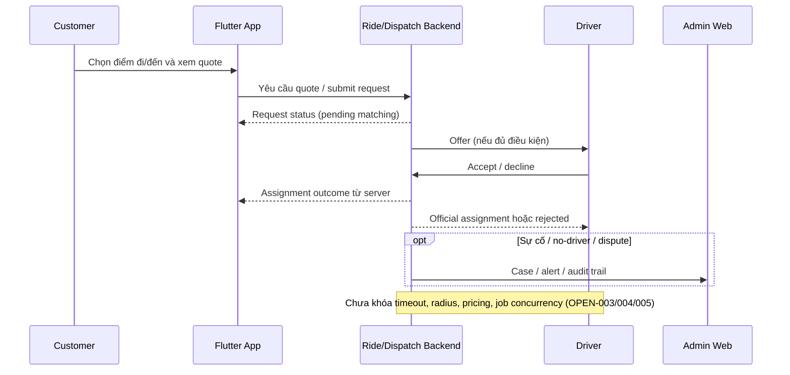
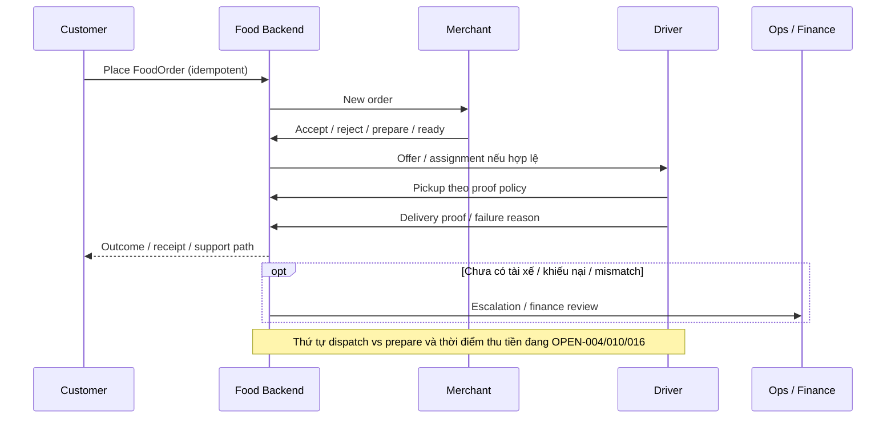

# DealGo — Personas & Stakeholders / Chân dung người dùng và các bên liên quan

> **Trạng thái:** `DRAFT`, phiên bản `0.1.0`, ngày 11/10/2026. **Tất cả persona dưới đây là `PROTO` — giả thuyết thiết kế**, được tổng hợp từ phạm vi DealGo, nghiên cứu thứ cấp và các tình huống nghiệp vụ; **chưa** có nghiên cứu định tính trực tiếp với người dùng DealGo. Mẫu nhân vật, hành vi, độ ưu tiên và pain point **không phải kết quả khảo sát, không phải số liệu thị trường**, không được dùng làm bằng chứng xác nhận product–market fit.
>
> **Phạm vi đã xác nhận:** `DEC-PROD-001`: MVP có Ride **xe hai bánh chở khách** + Food **đặt món giao tận nơi**. `DEC-PROD-002`: **một ứng dụng Flutter** cho Customer, Merchant, Driver; **Admin Web** là kênh nội bộ riêng. Bảy quyết định `DEC-PROD-001..007` không được sửa bởi tài liệu này; `DEC-PROD-005` xác nhận thương lượng giá Ride, `006` auth methods, `007` chat/call.
>
> **Nguồn chuẩn:** file này định nghĩa các **nhóm người dùng, nhu cầu và giả thuyết hành vi**. Quy tắc quyền, phí, số job, hủy/hoàn, bằng chứng giao hàng, SLA, pháp lý và release vẫn do Governance / Domain / Workflow / Contract docs và phê duyệt quyết định chi phối. Một persona **không tự tạo FR, business policy hoặc quyền truy cập**.

## 1. Mục đích, đầu vào và đầu ra

### 1.1. Câu hỏi tài liệu phải trả lời

1. Ai trực tiếp sử dụng DealGo ở mỗi vai trò, khi nào, để đạt **kết quả gì**?
2. Một vai trò có các **nhóm hành vi/bối cảnh** nào khác nhau — không đánh đồng với một kiểu người?
3. Các actor tương tác với nhau ra sao từ **đặt → cung cấp dịch vụ → trả tiền → hỗ trợ**?
4. Ai trong tổ chức chịu trách nhiệm vận hành, duyệt chính sách, giải quyết tranh chấp và tính đúng tiền?
5. Điều gì là sự thật đã có bằng chứng, điều gì mới là **giả định phải kiểm chứng**?
6. Từ mỗi nhu cầu, nhóm phát triển phải truy được `Persona → Need/JTBD → Journey → FR → UI/API/Test` nào?

### 1.2. Đầu ra sử dụng được

| Thành phần | Nội dung | Dùng cho |
|---|---|---|
| Persona catalog `PER-*` | Nhóm hành vi và bối cảnh theo Customer, Merchant, Driver, Admin | Ưu tiên trải nghiệm, tình huống test |
| User needs `NEED-*` | Động cơ độc lập với một giải pháp UI | PRD, use case, discovery |
| Jobs-to-be-Done (JTBD) | Tình huống → mong muốn tiến bộ → kết quả | UX flow, thông điệp |
| Stakeholder matrix `STK-*` | Quan tâm, quyền quyết định, phụ thuộc | Review/approval/escalation |
| Journey + service touchpoints | Frontstage, backstage, exception, recovery | Workflow, UI states, API contracts |
| Research validation plan | Câu hỏi, mẫu tuyển, quan sát, bằng chứng | Chuyển PROTO → QUALITATIVE |
| Traceability + release impacts | Mapping tới FR và các `OPEN-*` | Agent task, QA, quality gates |

### 1.3. Không thuộc phạm vi

- **Không** khẳng định phân khúc người dùng nào đông hơn hoặc nhu cầu có khả năng trả tiền cao hơn khi chưa khảo sát.
- **Không** quyết định giá, chiết khấu, tỷ lệ nhận chuyến, thời gian phản hồi, bán kính hoặc phương thức thanh toán.
- **Không** thay thế thủ tục KYC/KYB, quyền thực sự trong RBAC, hoặc yêu cầu pháp lý Việt Nam.
- **Không** mở rộng MVP sang ô tô, giao kiện hàng độc lập, đa điểm, ví/tín dụng hoặc multi-merchant checkout.
- **Không** buộc tạo màn hình mới chỉ vì persona có một mong muốn; phải đi qua PRD và `scope-release-plan.md`.

## 2. Phương pháp và mức độ tin cậy của bằng chứng

### 2.1. Thang nguồn chứng cứ

| Nhãn | Ý nghĩa | Cách dùng |
|---|---|---|
| `CONFIRMED_PRODUCT` | Chính chủ dự án đã chốt phạm vi/định hướng | Có thể ràng buộc phạm vi theo decision ID |
| `OFFICIAL_EXTERNAL` | Hành vi hoặc luồng có trên tài liệu đối thủ/nguồn phương pháp chính thức | Chỉ chứng minh cách tiếp cận bên ngoài, **không** suy ra DealGo cũng phải làm thế |
| `INTERNAL_HYPOTHESIS` | Dự đoán của Product/UX dựa vào mô hình nghiệp vụ | Cần phỏng vấn và quan sát |
| `FIELD_OBSERVED` | Quan sát trực tiếp có ghi chú, đồng ý tham gia và bối cảnh | Là bằng chứng định tính, chưa đại diện thống kê |
| `VALIDATED_QUALITATIVE` | Kết quả được kiểm chứng qua nhiều participant/kỹ thuật triangulation | Có thể cập nhật persona với trích dẫn và giới hạn |
| `QUANT_VALIDATED` | Có mẫu, phương pháp đo và độ bất định được mô tả | Dùng để kiểm tra phân bố/tần suất nếu thiết kế nghiên cứu phù hợp |

**Nguồn phương pháp:** Nielsen Norman Group phân biệt **proto**, **qualitative**, **statistical personas**; GOV.UK yêu cầu coi nhận định chưa xuất phát từ nghiên cứu người dùng là giả định và nghiên cứu cả nhân sự cung cấp dịch vụ [R01][R02][R03].

### 2.2. Hồ sơ chứng cứ tối thiểu

Mỗi phát hiện sau khi nghiên cứu thực tế cần lưu: `evidence_id`, ngày, phương pháp, quy mô/vai trò mẫu, bối cảnh, trích dẫn đã ẩn danh (nếu được đồng ý), điều quan sát thực tế, điều người tham gia nói, giới hạn/sai lệch, liên kết NEED/Journey/FR, nghiên cứu viên, phiên bản cập nhật. Không lưu dữ liệu định danh vào commit.

### 2.3. Quy tắc tránh ngụy tạo persona

1. Không gán tên thật, tuổi, giới tính, thu nhập, nghề cố định hay câu nói trích dẫn để làm persona có vẻ đã được phỏng vấn.
2. Phân nhóm theo **mục tiêu và hành vi**: tần suất đặt, sức ép thời gian, môi trường thao tác, trách nhiệm tiền và rủi ro; nhân khẩu học chỉ ghi khi **có liên quan và có chứng cứ**.
3. Một người **có thể thuộc nhiều persona theo bối cảnh**, ví dụ ban ngày nhận giao đồ ăn, buổi tối đặt Ride về nhà.
4. Không mặc định người dùng khuyết tật, người ít kỹ năng số, người lớn tuổi hay vùng mạng yếu có cùng nhu cầu.
5. Persona hỗ trợ ra quyết định; hành vi API/permission phải dựa `FR-*`, `BR-*`, security policy đã chốt.
6. Chỉ sửa `research_status` khi có research log, bằng chứng và review của PO/UX.

## 3. Mô hình phân khúc theo nhu cầu, không theo định kiến

| Dimension | Mức/hoàn cảnh cần xem xét | Ảnh hưởng sản phẩm |
|---|---|---|
| Loại dịch vụ | Ride, Food, cả hai | Hai lifecycle khác nhau |
| Tần suất | Lần đầu, thỉnh thoảng, thường xuyên | Onboarding vs thao tác lặp |
| Thời gian | Có kế hoạch, cần ngay, giờ cao điểm | Giá/ETA, cập nhật trạng thái |
| Địa điểm | Chốt được trên bản đồ, hẻm/điểm đón khó xác định | Pin, mô tả điểm đón/giao |
| Mạng/thiết bị | Mạng ổn, chập chờn, thiết bị hạn chế tài nguyên | Reconnect, skeleton, retry, offline UX |
| Tính tiếp cận | Trợ năng, cỡ chữ, thao tác một tay, môi trường nắng/ồn | Semantics, tương phản, tap target, không chỉ màu |
| Vai trò | Customer, Merchant, Driver, nhân sự Ops | Role switch, permissions, work queue |
| Trách nhiệm tài chính | Chi tiền, thu hộ, nhận tiền, đối soát | Receipt, ledger status, dispute |
| Độ phức tạp tác vụ | Một thao tác đơn giản, nhiều đơn cùng lúc, xử lý ngoại lệ | Ưu tiên và chống nhầm thao tác |

**Giới hạn:** Đây là *research dimensions*, không phải các phân khúc đã có sizing hoặc conversion thực tế.

## 4. Persona Catalog (14 proto-personas)

| Persona ID | Vai trò / nhóm hành vi giả định | Kết quả cốt lõi | Trạng thái | Mức ưu tiên nghiên cứu |
|---|---|---|---|---|
| `PER-C-01` | Customer — Ride cần đón nhanh | Biết điểm đón, giá, ai đang tới và ETA | `PROTO` | P0 |
| `PER-C-02` | Customer — Ride khó xác định điểm đón | Đón đúng người/đúng vị trí, giảm liên hệ vòng vo | `PROTO` | P0 |
| `PER-C-03` | Customer — Food đặt bữa ăn thông thường | Chọn món, hiểu tổng phí, giao đúng đơn | `PROTO` | P0 |
| `PER-C-04` | Customer — Food cần sự chắc chắn/khả năng hỗ trợ | Biết quán đã nhận chưa; xử lý hết món/trễ/giao sai | `PROTO` | P0 |
| `PER-M-01` | Merchant — chủ quán tự vận hành | Mở bán, nhận đơn, theo dõi tiền | `PROTO` | P0 |
| `PER-M-02` | Merchant — nhân viên xử lý giờ cao điểm | Không bỏ sót, nhầm món hoặc nhầm tài xế | `PROTO` | P0 (đánh giá luồng); staffing `OPEN-013` |
| `PER-M-03` | Merchant — chủ cửa hàng quan tâm đối soát | Biết vì sao doanh thu và tiền nhận khác nhau | `PROTO` | P0 |
| `PER-D-01` | Driver — chủ yếu nhận Ride | Nhận chuyến hợp lệ, đón/trả đúng, an toàn | `PROTO` | P0 |
| `PER-D-02` | Driver — chủ yếu nhận Food | Nhận món đúng, tìm nơi giao, xác nhận bằng chứng | `PROTO` | P0 |
| `PER-D-03` | Driver — đủ điều kiện cả hai dịch vụ | Hiểu khả dụng, tránh job xung đột khi đổi vai trò/dịch vụ | `PROTO` | P0 (policy `OPEN-005`) |
| `PER-O-01` | Admin — duyệt hồ sơ đối tác | Duyệt đúng điều kiện, ít lộ dữ liệu nhạy cảm | `PROTO` | P0 |
| `PER-O-02` | Admin — giám sát Ride/Food realtime | Phát hiện giao dịch kẹt và can thiệp đúng quyền | `PROTO` | P0 |
| `PER-O-03` | Admin — hỗ trợ, an toàn và tranh chấp | Có chứng cứ và tiến trình giải quyết có kiểm toán | `PROTO` | P0 |
| `PER-O-04` | Admin — tài chính, đối soát | Tìm lệch, chứng minh số tiền, xử lý chưa khớp | `PROTO` | P0 |

**Cách hiểu P0:** mức ưu tiên **nghiên cứu và bảo đảm use case của MVP**; không mặc định tất cả chức năng mong muốn của persona đều `APPROVED_P0`. Chi tiết scope do `scope-release-plan.md` quy định.

## 5. Customer Personas — chi tiết

### 5.1. `PER-C-01` — Ride: người đặt chuyến cần di chuyển đúng giờ

| Trường | Nội dung |
|---|---|
| Bối cảnh kích hoạt | Có điểm đi/đến rõ ràng, muốn xác nhận nhanh một chuyến chở khách bằng xe hai bánh |
| JTBD | **Khi** cần đến một địa điểm, **tôi muốn** biết giá và xe có đang tới không, **để** tự tin quyết định di chuyển |
| `NEED-C-R01` | Biết **giá/điều kiện** trước khi gửi yêu cầu; estimate vs confirmed phải rõ |
| `NEED-C-R02` | Nhận trạng thái tìm tài xế, không chờ vô hạn hay tưởng có xe khi chưa có |
| `NEED-C-R03` | Biết đúng tài xế/phương tiện, điểm đón, trạng thái đến và cơ chế hỗ trợ |
| Friction giả thuyết | Pin sai, giá thay đổi khó hiểu, nút đặt bị nhấn hai lần, tài xế hủy/mất mạng |
| Tác động UX | Chọn điểm đón/đến → quote có thời điểm hiệu lực → confirm → tìm tài xế → driver assigned → pickup → trip → receipt |
| Ngoại lệ tối thiểu | No-driver, duplicate submit, driver reassignment, quote expired, cancel theo chính sách |
| Liên kết FR | `FR-RIDE-001..012`, `FR-CORE-006/007/009/011` |
| Vấn đề chưa chốt | `OPEN-001`, `OPEN-003`, `OPEN-004`, `OPEN-017` |
| Cần xác thực | Mức độ quan trọng tương đối của giá vs ETA; cách người dùng quyết định hủy; mô tả pickup thực tế |

**Success signal (định tính):** người tham gia nêu đúng **có/không có tài xế được phân công**, hiểu khoản phí được hiển thị và biết cách xử lý khi không tìm thấy xe. Không tự đặt KPI conversion.

### 5.2. `PER-C-02` — Ride: người khó xác định điểm đón

| Trường | Nội dung |
|---|---|
| Bối cảnh kích hoạt | Ở vị trí đông xe, nhiều cổng, hẻm, vị trí GPS sai lệch, ánh sáng yếu hoặc mạng chập chờn |
| JTBD | **Khi** vị trí đón khó tìm, **tôi muốn** xác nhận điểm gặp dễ hiểu, **để** không lỡ chuyến và giảm tranh cãi |
| `NEED-C-R04` | Xem/sửa pin và mô tả mốc đón trước khi đặt; biết GPS là ước lượng |
| `NEED-C-R05` | Có thông tin trạng thái vị trí cập nhật gần nhất; không xem GPS cũ như vị trí hiện tại |
| `NEED-C-R06` | Có kênh liên hệ/hỗ trợ thích hợp khi không gặp tài xế, trong giới hạn privacy policy |
| Friction giả thuyết | Pin ở sai làn đường; điểm đón chỉ nhận dạng bằng tên chung; tài xế đến vị trí khác |
| Tác động UX | Map pin editable, địa chỉ rõ, trạng thái stale location, nhánh cannot-meet-driver |
| Ngoại lệ tối thiểu | Không có quyền location, không có tọa độ hợp lệ, GPS drift, mất kết nối khi tài xế đến |
| Liên kết FR | `FR-CORE-004/009/011`, `FR-RIDE-001/005/006/009/012` |
| Vấn đề chưa chốt | `OPEN-012`, `OPEN-014/015/017` |
| Cần xác thực | Người dùng mô tả vị trí ra sao và có nhận biết được pin sai không |

### 5.3. `PER-C-03` — Food: người đặt bữa ăn hằng ngày

| Trường | Nội dung |
|---|---|
| Bối cảnh kích hoạt | Muốn chọn quán, chọn món, điều chỉnh tùy chọn và đặt giao đến địa chỉ xác định |
| JTBD | **Khi** không tiện đi mua đồ ăn, **tôi muốn** chọn đúng món và biết trọn chi phí, **để** đặt hàng không bị bất ngờ |
| `NEED-C-F01` | Thấy tình trạng phục vụ của quán và món (còn/hết/đóng cửa) phù hợp thời điểm |
| `NEED-C-F02` | Cấu hình option bắt buộc, số lượng, ghi chú đúng; giỏ tính tiền lại minh bạch |
| `NEED-C-F03` | Xem phần tiền món, vận chuyển, giảm giá và tổng payable theo chính sách đã duyệt |
| Friction giả thuyết | Hết món khi checkout, giá đổi, chọn nhầm variant, vô tình đặt lặp |
| Tác động UX | Discovery → menu/options → cart → checkout revalidation → đặt đơn → theo dõi |
| Ngoại lệ tối thiểu | Merchant closed, unavailable item, quote changed, request timeout, retry idempotent |
| Liên kết FR | `FR-FOOD-001..008`, `FR-FOOD-011/012`, `FR-CORE-006/007` |
| Vấn đề chưa chốt | `OPEN-002/003/009/010` |
| Cần xác thực | Ưu tiên chọn theo món hay theo quán; mức hiểu phí giao, thông tin món quan trọng |

### 5.4. `PER-C-04` — Food: người cần sự chắc chắn về tiến độ đơn

| Trường | Nội dung |
|---|---|
| Bối cảnh kích hoạt | Đã gửi đơn; đang chờ quán nhận, chuẩn bị hoặc chờ tài xế |
| JTBD | **Khi** đơn chưa tới, **tôi muốn** biết ai đang xử lý và cách giải quyết nếu có trục trặc, **để** không phải đoán |
| `NEED-C-F04` | Phân biệt **đơn đã tạo**, **quán chấp nhận**, **đang làm**, **có người giao**, **đã giao** |
| `NEED-C-F05` | Thấy ETA dưới dạng dự đoán và nhận cảnh báo hợp lý khi không còn đáng tin |
| `NEED-C-F06` | Biết cách báo trễ, sai món, không giao được hoặc đòi hỗ trợ/hoàn tiền đúng quy định |
| Friction giả thuyết | App báo “đang giao” khi quán chưa làm; đã thanh toán nhưng đơn bị hủy; khách bị chuyển nhiều nơi khiếu nại |
| Tác động UX | Timeline đa actor, ETA ghi rõ estimate, trạng thái failed/refund pending/case ID |
| Ngoại lệ tối thiểu | Merchant reject, no-driver-after-prep, driver failed delivery, payment unknown |
| Liên kết FR | `FR-FOOD-007..012`, `FR-CORE-008/009/011/013` |
| Vấn đề chưa chốt | `OPEN-010/011/014/016` |
| Cần xác thực | Thông báo nào thực sự giúp giảm lo lắng; thông tin nào khiến người dùng hiểu nhầm |

## 6. Merchant Personas — chi tiết

### 6.1. `PER-M-01` — Chủ quán tự vận hành

| Trường | Nội dung |
|---|---|
| Bối cảnh kích hoạt | Tự mở cửa hàng, thiết lập giờ bán, menu/giá và trực tiếp theo dõi đơn |
| JTBD | **Khi** bán qua nền tảng, **tôi muốn** chỉ nhận các đơn có thể thực hiện và kiểm soát trạng thái bán, **để** hạn chế lãng phí |
| `NEED-M-01` | Onboarding rõ từng bước; hiểu hồ sơ chờ duyệt/bổ sung/từ chối |
| `NEED-M-02` | Bật/tắt nhận đơn và tình trạng còn/hết món có hiệu lực đáng tin |
| `NEED-M-03` | Xác nhận hoặc từ chối đơn hợp lệ; biết thời điểm cần chuẩn bị |
| Friction giả thuyết | Đang đóng cửa vẫn có đơn, không thấy thông báo đơn, thao tác nhầm accepted/rejected |
| Tác động UX | Merchant dashboard nhiệm vụ theo trạng thái, bật/tắt nhận đơn, cảnh báo đơn mới |
| Ngoại lệ tối thiểu | Notification lost, reject expired order, menu update race, merchant offline |
| Liên kết FR | `FR-MER-001..006/009`, `FR-CORE-003/009` |
| Vấn đề chưa chốt | `OPEN-006/008/013/016`, merchant accept timeout `TBD` |
| Cần xác thực | Quy mô thao tác thực tế, số bước quán chấp nhận được, cách phát hiện đơn bỏ sót |

### 6.2. `PER-M-02` — Người trực quầy giờ cao điểm

| Trường | Nội dung |
|---|---|
| Bối cảnh kích hoạt | Nhận nhiều đơn/khách tại quầy, môi trường ồn, tay bận, thông báo liên tục |
| JTBD | **Khi** đơn đến dồn dập, **tôi muốn** xác định ưu tiên, trạng thái món và người nhận hàng, **để** bàn giao đúng |
| `NEED-M-04` | Danh sách đơn đọc nhanh, phân biệt new/accepted/preparing/ready/handoff |
| `NEED-M-05` | Giảm khả năng nhấn nhầm; việc đổi trạng thái quan trọng có guard và feedback rõ |
| `NEED-M-06` | Bàn giao đúng `FoodOrder`/`DeliveryTask` cho Driver đã được phân công |
| Friction giả thuyết | Hai đơn cùng món, âm thanh bị bỏ qua, giao nhầm tài xế, thao tác duplicate |
| Tác động UX | Order queue lọc trạng thái, định danh đơn nổi bật, xác nhận handoff; touch target phù hợp |
| Ngoại lệ tối thiểu | Hai thiết bị Merchant thao tác cùng đơn, driver assignment changed, ready rồi có refund |
| Liên kết FR | `FR-MER-004..007`, `FR-CORE-006`, `BR-FOOD-002` |
| Vấn đề chưa chốt | `OPEN-011/013/016` |
| Cần xác thực | Có cần phân quyền nhân viên P0 không (`OPEN-013`); nhiệm vụ nào thường hay bị nhầm |

**Ghi chú đặc biệt:** sự tồn tại của người trực quầy **không phê duyệt** hệ thống multi-staff P0. Có thể nghiên cứu hành vi quầy trước, còn phân quyền nhân viên phải chờ `OPEN-013`.

### 6.3. `PER-M-03` — Chủ quán theo dõi doanh thu/đối soát

| Trường | Nội dung |
|---|---|
| Bối cảnh kích hoạt | Kiểm tra cuối ca/kỳ, theo dõi đơn hoàn thành, hủy, phí và khoản phải nhận |
| JTBD | **Khi** tính doanh thu, **tôi muốn** đối chiếu từng đơn và lý do điều chỉnh, **để** tin tưởng số tiền được ghi nhận |
| `NEED-M-07` | Phân biệt giá trị bán, các phí/điều chỉnh, khoản phải thu, khoản đã trả và khoản chưa khớp |
| `NEED-M-08` | Tra cứu bằng order ID, thời gian, trạng thái và lý do refund/correction |
| Friction giả thuyết | App hiện “đã thanh toán” nhưng chưa nhận khoản chuyển; phí/hủy thiếu giải thích |
| Tác động UX | Financial breakdown, settlement vs estimated labels, invoice/order link |
| Ngoại lệ tối thiểu | Reversal, refund sau delivered, provider callback lặp, settlement pending |
| Liên kết FR | `FR-MER-008/009`, `FR-CORE-008/013`, `FR-OPS-006` |
| Vấn đề chưa chốt | `OPEN-002/003/010/016/018` |
| Cần xác thực | Đối soát theo ngày hay theo đơn; chứng từ tối thiểu người bán cần |

## 7. Driver Personas — chi tiết

### 7.1. `PER-D-01` — Driver nhận chuyến Ride

| Trường | Nội dung |
|---|---|
| Bối cảnh kích hoạt | Đã được xét duyệt đủ điều kiện chở khách; chủ động bật availability |
| JTBD | **Khi** có yêu cầu phù hợp, **tôi muốn** biết điều kiện chuyến và kết quả nhận thật, **để** đón đúng khách và hoàn thành an toàn |
| `NEED-D-R01` | Xem offer cần thiết, hạn hiệu lực và kết quả accept/reject rõ ràng |
| `NEED-D-R02` | Biết pickup/destination, chỉ dẫn và cách bắt đầu/kết thúc đúng quy trình |
| `NEED-D-R03` | Xử lý khách vắng, GPS sai, hủy, mất mạng mà không phải ghi nhận sai |
| Friction giả thuyết | Accept rồi báo đã có người khác nhận; báo ready nhưng chưa có assignment; state nhảy sai |
| Tác động UX | Incoming offer → atomic accept outcome → pickup → verify/start → destination → complete |
| Ngoại lệ tối thiểu | Offer expired, revoked, duplicate accept, cannot-find-rider, cancel, offline |
| Liên kết FR | `FR-DRV-001..005/007..010`, `BR-DISPATCH-001/002` |
| Vấn đề chưa chốt | `OPEN-004/005/011/012/017` |
| Cần xác thực | Thông tin tối thiểu để nhận chuyến; mức thao tác an toàn khi đang dừng/di chuyển |

**Safety boundary:** tuyệt đối không thiết kế luồng buộc Driver thao tác phức tạp khi đang điều khiển phương tiện; phải thử nghiệm cả môi trường đường phố thực tế.

### 7.2. `PER-D-02` — Driver giao Food

| Trường | Nội dung |
|---|---|
| Bối cảnh kích hoạt | Đã được phân công `DeliveryTask` hợp lệ cho một `FoodOrder` |
| JTBD | **Khi** nhận nhiệm vụ giao, **tôi muốn** biết điểm lấy, tình trạng món, địa chỉ giao và cách xác minh, **để** hoàn thành không tranh cãi |
| `NEED-D-F01` | Thấy merchant/location, thời điểm quán sẵn sàng (nếu có), mã tham chiếu đơn |
| `NEED-D-F02` | Có chỉ dẫn giao và proof hợp lệ; thấy rõ completion đã được backend xác nhận hay chưa |
| `NEED-D-F03` | Có đường xử lý khách không nhận, giao không thành công, merchant chưa sẵn, cần hỗ trợ |
| Friction giả thuyết | Đến khi quán chưa làm, tài xế khác nhận nhầm, không gọi được khách, proof upload lỗi |
| Tác động UX | Assignment → navigate merchant → handoff → delivery → proof → server ack → earnings |
| Ngoại lệ tối thiểu | Merchant delays, wrong bag, unreachable customer, image/proof not uploaded, offline submit |
| Liên kết FR | `FR-DRV-003/004/006/007/009/010`, `FR-FOOD-009` |
| Vấn đề chưa chốt | `OPEN-004/011/012/014/016/018` |
| Cần xác thực | Thông tin khi giao ở tòa nhà/hẻm, bằng chứng phù hợp và độ khó thao tác |

### 7.3. `PER-D-03` — Driver đủ điều kiện Ride và Food

| Trường | Nội dung |
|---|---|
| Bối cảnh kích hoạt | Một tài khoản có eligibility cho nhiều dịch vụ, chọn chế độ khả dụng theo cấu hình được duyệt |
| JTBD | **Khi** đã làm một công việc, **tôi muốn** biết việc nào còn được nhận, **để** không vô tình làm hỏng tiến độ của khách khác |
| `NEED-D-X01` | Biết đang bật dịch vụ nào và có job active không |
| `NEED-D-X02` | Không nhận hai nhiệm vụ trái chính sách ngay cả khi nhiều thiết bị hoặc mạng chậm |
| `NEED-D-X03` | Chuyển role/service vẫn quay lại đúng công việc còn hiệu lực |
| Friction giả thuyết | Nhấn đổi sang Customer/Merchant khi đang giao; push tới role không active; hệ thống cấp hai job xung đột |
| Tác động UX | Active-task banner, protected navigation, resume active job, role-specific notification |
| Ngoại lệ tối thiểu | Switch role mid-job, parallel requests, app killed, revoked eligibility |
| Liên kết FR | `FR-CORE-002/009/014`, `FR-DRV-002/008`, `BR-DISPATCH-001` |
| Vấn đề chưa chốt | **`OPEN-005`** (chưa duyệt số job / chuyển role), `OPEN-012/014` |
| Cần xác thực | Thói quen sử dụng nhiều dịch vụ; khi nào muốn chuyển ngữ cảnh; conflict thực tế |

**Phân biệt quan trọng:** “một app ba role” là `CONFIRMED`; “được nhận Ride và Food cùng lúc” **không** được xác nhận.

## 8. Admin / Operations Personas — chi tiết

### 8.1. `PER-O-01` — Reviewer xét duyệt đối tác

| Trường | Nội dung |
|---|---|
| JTBD | **Khi** nhận hồ sơ Driver/Merchant, **tôi muốn** đánh giá đủ điều kiện và ghi lý do, **để** cấp đúng quyền và tra cứu được |
| `NEED-O-01` | Queue theo trạng thái và loại hồ sơ, biết thiếu tài liệu nào |
| `NEED-O-02` | Xem giấy tờ đúng phạm vi; masking, audit, least privilege |
| Friction giả thuyết | Hồ sơ trùng, tài liệu không đọc được, quyền bị cấp trước khi xét duyệt |
| UX/Workflow | Pending → review → require changes / approve / reject / suspend, lý do và dấu vết |
| FR | `FR-OPS-001/002/008`, `FR-CORE-003/015` |
| Open | `OPEN-006/008` |
| Cần xác thực | Checklist kiểm hồ sơ và thời điểm cần escalation theo địa bàn pháp lý |

### 8.2. `PER-O-02` — Người điều hành theo dõi giao dịch

| Trường | Nội dung |
|---|---|
| JTBD | **Khi** Ride/Food xảy ra trục trặc, **tôi muốn** biết giao dịch đang kẹt ở đâu và ai có quyền sửa, **để** giảm thiệt hại |
| `NEED-O-03` | Tìm theo ID/actor/state/time, có timeline trung thực, không buộc query DB trực tiếp |
| `NEED-O-04` | Phát hiện no-driver/expired assignment/stale location/pending merchant order |
| Friction giả thuyết | Tín hiệu dashboard và server khác nhau, lỗi không có correlation ID, thao tác override thiếu reason |
| UX/Workflow | Ops explorer → investigate → authorized action / safe-stop → audit and resolution |
| FR | `FR-OPS-003/005/007/009`, `FR-CORE-012/015` |
| Open | `OPEN-004/007/012/015` |
| Cần xác thực | Quy trình trực, alert quan trọng và kiểu sự cố lặp; staffing chưa xác nhận |

### 8.3. `PER-O-03` — Customer Support / Trust & Safety

| Trường | Nội dung |
|---|---|
| JTBD | **Khi** có tranh chấp hoặc sự cố, **tôi muốn** tập hợp đúng bằng chứng và gửi quyết định cho đúng người, **để** không hứa sai quyền lợi |
| `NEED-O-05` | Một case có owner, trạng thái, timeline, thông tin được phép truy cập |
| `NEED-O-06` | Phân loại bình thường / tài chính / an toàn khẩn cấp và escalation |
| Friction giả thuyết | Khách phải kể lại nhiều lần, không truy được proof, người hỗ trợ thao tác nhầm refund |
| UX/Workflow | Intake → classify → investigate → escalate/resolve → notify → audit |
| FR | `FR-OPS-004/008`, `FR-RIDE-012`, `FR-FOOD-010`, `FR-CORE-011` |
| Open | `OPEN-003/011/014/015/016/017` |
| Cần xác thực | Ai trực tiếp ứng cứu, loại sự cố, thẩm quyền và thời gian hỗ trợ được phê duyệt |

### 8.4. `PER-O-04` — Finance / Settlement Operator

| Trường | Nội dung |
|---|---|
| JTBD | **Khi** các bên báo tiền không khớp, **tôi muốn** thấy dòng tiền và chứng cứ điều chỉnh theo từng nghiệp vụ, **để** đối soát chính xác |
| `NEED-O-07` | Tách quote, collected, paid, due, refund, settled, payout |
| `NEED-O-08` | Biết giao dịch lệch đang `UNRESOLVED` hay đã đối soát có chứng cứ |
| Friction giả thuyết | PSP webhook gửi lặp, COD thiếu chứng từ, khoản hoàn chưa phản ánh trong báo cáo |
| UX/Workflow | Ledger/reconciliation explorer → investigate → correction proposal → authorized posting |
| FR | `FR-OPS-006/008`, `FR-MER-008`, `FR-DRV-009`, `BR-FIN-001/002` |
| Open | `OPEN-002/003/010/016/018` |
| Cần xác thực | Mẫu biên bản đối soát, cutoff cycle, dual approval/segregation-of-duties |

## 9. Sử dụng nhiều vai trò: phân biệt Identity / Eligibility / Active Role

| Khái niệm | Cách hiểu đúng | Ví dụ chống hiểu nhầm |
|---|---|---|
| `Account` | Danh tính đăng nhập liên kết các quyền nếu được cấp | Một account không mặc định là Driver hợp lệ |
| `Eligible Role` | Quyền/điều kiện được server phê duyệt | App hiển thị nút Driver không đồng nghĩa đã hoàn tất KYC |
| `Active Role` | Ngữ cảnh giao diện người dùng đang thao tác | Đổi active role không biến mất booking/order/job trên server |
| `Active Work` | Công việc/đơn/chuyến đang có hiệu lực | Chính sách số job chồng `OPEN-005` chưa phê duyệt |
| `Admin Web` | Kênh nội bộ với quyền riêng, không phải tab thứ tư trong mobile | Nhân sự Ops phải có role authorization riêng |

### 9.1. Các kịch bản chuyển ngữ cảnh phải nghiên cứu

| ID | Kịch bản | Hành vi cần đạt | Blocker |
|---|---|---|---|
| `CTX-01` | Customer chuyển sang Merchant khi còn FoodOrder chờ | Không làm mất order; quyền merchant tách biệt | `OPEN-005/013` |
| `CTX-02` | Driver nhận Ride rồi đổi role/đóng app | Resume active RideTrip đúng state từ server | `OPEN-005/012` |
| `CTX-03` | Driver nhận thông báo Food khi đang Ride | Không tạo job xung đột; thông báo theo quyền/policy | `OPEN-005/014` |
| `CTX-04` | Account chưa được duyệt Driver chọn tab Driver | Xem trạng thái hồ sơ phù hợp, không online nhận job | `OPEN-006/008` |
| `CTX-05` | Cùng account đăng nhập hai thiết bị thao tác một offer | Accept atomic server-side, không có double assignment | `OPEN-004/005` |
| `CTX-06` | Merchant đang xử lý đơn nhưng push của Customer mở app | Deep link authz đúng role, không lộ PII/đơn ngoài quyền | `OPEN-014` |

## 10. Stakeholder Register — ai ảnh hưởng và ai chịu trách nhiệm

> Các vị trí nội bộ là **responsibility placeholders**, không xác nhận DealGo có nhân sự hoặc tổ chức vận hành như mô tả. Một founder/solo developer có thể kiêm nhiều role, nhưng cần ghi **ai phê duyệt chính sách** và **ai chỉ tư vấn**. Quy tắc ký duyệt chuẩn: `../00-governance/decisions-and-assumptions.md`.

| ID | Nhóm / Stakeholder | Mối quan tâm | Vai trò đề xuất | Cơ chế trao đổi / dấu vết |
|---|---|---|---|---|
| `STK-001` | Chủ dự án / Product Owner | Phạm vi Ride + Food, ưu tiên, tính khả thi | Accountable về sản phẩm | Decision register / PRD sign-off |
| `STK-002` | Tech Lead / Architecture | Tính đúng, bảo trì, performance, contracts | Kỹ thuật / ADR | Architecture review / CI |
| `STK-003` | UX Research / UI Designer | Mức hiểu, trải nghiệm theo vai trò, accessibility | Research lead | Evidence log / prototype tests |
| `STK-004` | Mobile / Flutter Engineers | App một binary, active role, resume state | Implementer | Mobile specs + QA tests |
| `STK-005` | Backend / Data Engineers | Domain, concurrency, API, ledger, authz | Implementer | FR/API/ERD/contract tests |
| `STK-006` | Customer Ride/Food | Giá, trải nghiệm, an toàn, giải quyết sự cố | External user / consulted | Interview/usability/support feedback |
| `STK-007` | Driver | Công việc, thu nhập, GPS, quy trình và an toàn | External partner / consulted | Driver field interview / pilot logs |
| `STK-008` | Merchant / Store Operators | Menu, đơn, bàn giao, tiền | External partner / consulted | Shadowing / interview |
| `STK-009` | Partner Operations / KYC-KYB Review | Eligibility, giấy tờ, fraud | Operational owner | Approval SOP / audit |
| `STK-010` | Dispatch / Live Operations | Tỷ lệ gán, sự cố kẹt, trạng thái thật | Operational owner | Dashboard/runbook/incident log |
| `STK-011` | Customer Support & Trust/Safety | Khiếu nại, ứng cứu, refund request | Operational owner | Case/escalation policy |
| `STK-012` | Finance / Reconciliation | Dòng tiền và trách nhiệm thanh toán | Financial sign-off | Settlement tests / finance review |
| `STK-013` | Legal / Privacy / Compliance | Mô hình vận hành hợp pháp, bảo vệ dữ liệu | Mandatory specialist reviewer trước thương mại | Compliance checklist / legal evidence |
| `STK-014` | QA / Release / SRE | E2E, reliability, recovery, rollback | Quality/release reviewer | Evidence G0–G5 / postmortem |
| `STK-015` | Map/OTP/PSP/Notification vendors | Hợp đồng, tích hợp, SLA, data processing | External dependency | Official contract/API/support docs |
| `STK-016` | Cơ quan quản lý có thẩm quyền | Nghĩa vụ theo loại hình hoạt động & địa bàn | External regulatory | Legal review, hồ sơ theo yêu cầu áp dụng |

### 10.1. Influence / Impact Map (giả định lập kế hoạch)

| Nhóm | Ảnh hưởng tới quyết định | Bị tác động nếu thiết kế sai | Engagement |
|---|---|---|---|
| PO, Finance, Legal khi quyết định tiền và tuân thủ | Cao | Cao | Phải review trước chốt policy |
| Tech, Ops, Safety ở dispatch/eligibility | Cao | Cao | Workshop + scenario review + QA signoff |
| Customer, Driver, Merchant | Không tự phê duyệt chính sách | Rất cao | Phỏng vấn, usability, pilot có đồng ý |
| Support, reviewers, finance operators | Vận hành / quy trình | Cao | Shadowing + table-top tests |
| External vendor | Tùy hợp đồng và API | Có thể rất cao | Contract review, fallback design |

**Không** dùng ô Influence như phép đo quyền lực xã hội; ma trận này chỉ dùng xếp lịch tham vấn. Phải cập nhật khi có tổ chức thật.

### 10.2. Decision & Escalation Matrix

| Loại thay đổi/vấn đề | Đề xuất / tư vấn | Phê duyệt theo register hiện tại | Blocking gate |
|---|---|---|---|
| Thay đổi phạm vi P0/Ride/Food | BA, UX, Tech | PO + Tech nếu ảnh hưởng scope/release | G0/G1 |
| Driver job concurrency/dispatch | Driver, Ops, Backend | PO + Tech theo `OPEN-004/005` | G2/G4/G5 |
| Quán không có tài xế sau khi làm món | Merchant, Support, Finance | PO + Finance + Ops theo `OPEN-016` | G3/G5 |
| Giá, COD, payment/refund | Finance, UX, Legal, Backend | PO + Finance, sign-off chuyên môn phù hợp | G3/G5 |
| KYC/KYB, giấy phép, privacy | Ops, Privacy, Legal | Theo Governance decision matrix và legal sign-off | G5 |
| Khẩn cấp an toàn / vận hành | Trust/Safety, Ops | Theo runbook và quyền được duyệt (`OPEN-015`) | G5 |
| ADR, lựa chọn kiến trúc | Tech + Implementers | Tech Lead, kèm NFR/QA review khi liên quan | G1–G4 |

## 11. Customer Journey Map — Ride (conceptual, không phải state machine)

| Stage | Hành động người dùng | Kỳ vọng / moment of truth | Frontstage UI | Backstage service | Failure/recovery |
|---|---|---|---|---|---|
| Discover | Vào Ride | Biết dịch vụ hai bánh đang có thể dùng | Ride entry, location permission | Serviceability/location | Outside zone / denied GPS |
| Plan | Nhập điểm đón/đến | Pin đúng và giải thích rõ | Map, pickup details | Geocoding/routes | GPS drift, address unresolved |
| Evaluate | Xem giá và ETA dự đoán | Hiểu điều kiện trước đặt | Quote/breakdown | Pricing/quote snapshot | Quote expired / price changed |
| Request | Xác nhận đặt | Không bị tạo hai chuyến | Submit + progress | Idempotency + RideRequest | Double tap/retry/timeout |
| Match | Chờ tài xế | Biết có/không có assignment | Searching / no-driver | Dispatch offers + atomic accept | Expired offer / no-driver |
| Pickup | Gặp tài xế | Nhận đúng người, biết kênh hỗ trợ | Driver card/location | Tracking / eligibility | Wrong pin, stale GPS, cancel |
| Trip | Di chuyển | Trạng thái thật, an toàn | Trip status | Valid server transitions | Offline, incident |
| Close | Kết thúc | Khoản phí rõ; có lịch sử | Receipt / case entry | Ledger/history | Payment unknown, dispute |

### 11.1. Ride moments of truth

- Trước confirm: **giá thể hiện cái gì**, chưa bao gồm gì, cần xin xác nhận lại khi điều kiện đổi.
- Sau confirm: **request đang tìm** khác **đã có tài xế được gán**.
- Trong pickup: vị trí/ETA luôn có khả năng cũ; thiết kế không được khẳng định vị trí realtime khi thiếu nguồn.
- Sau trip: hoàn thành vận hành khác **đã thu/đã quyết toán** về tài chính.

## 12. Customer Journey Map — Food (conceptual)

| Stage | Người dùng / Merchant / Driver | Kỳ vọng | UI chính | Backstage | Failure/recovery |
|---|---|---|---|---|---|
| Discover | Customer chọn nơi giao, quán, món | Đủ vùng phục vụ và còn bán | Merchant/menu availability | Catalog/serviceability | Closed/unavailable |
| Configure | Customer chọn món/options | Đúng món & tùy chọn | Product detail/cart | Price/menu validation | Option invalid/sold out |
| Checkout | Customer xác nhận tổng | Không phát sinh phí ngầm | Breakdown + review | Revalidate quote/order | Repricing/address changed |
| Place | Customer đặt đơn | Không tạo trùng do retry | Placing/created state | FoodOrder idempotency | Network/payment pending |
| Accept | Merchant nhận/từ chối | Có câu trả lời đáng tin | Customer timeline + Merchant inbox | Merchant acceptance | Timeout/rejection |
| Prepare | Merchant chế biến | ETA là ước tính | Preparing/ready | Order lifecycle | Overrun/merchant delay |
| Match | System phân tài xế | Không bỏ quên đơn đã làm | Courier assignment visibility | Dispatch + availability | No-driver-after-prep |
| Handoff | Merchant giao cho Driver | Đúng đơn/đúng tài xế | Handoff/proof | DeliveryTask | Wrong bag/driver changed |
| Deliver | Driver đến khách | Khách nhận món đúng | Tracking/arrival/proof | Tracking + proof guard | Unreachable customer |
| Resolve | Các bên phản ánh kết quả | Hủy/hoàn/thu tiền có chứng cứ | Receipt/help/case | Ledger + support | Partial error/payment unknown |

**Không cố định** thứ tự thuật toán `match` và `prepare`: vận hành có thể dispatch trước hoặc sau trạng thái `ready`, đang cần quyết định `OPEN-004/016`. Bảng diễn giải điểm chạm, **không** phê duyệt sequence contract.

## 13. Partner Journeys — Merchant và Driver

### 13.1. Merchant onboarding → daily operations

| Stage | Need | Điểm dễ bỏ sót | Nguồn liên kết |
|---|---|---|---|
| Submit | Biết thông tin/hồ sơ cần có | Bảo vệ CCCD/tài liệu, không duyệt ngầm | `FR-MER-001`, `OPEN-006/008` |
| Review | Biết hồ sơ thiếu gì / khi nào xử lý | Dùng trạng thái thật, không tự hứa SLA | `FR-CORE-003` |
| Setup | Ảnh/menu/options/giờ mở, availability | Menu có thể thay đổi lúc checkout | `FR-MER-002/003` |
| Sell | Nhận/reject/prepare/ready | Atomic actions, giờ cao điểm | `FR-MER-004..006` |
| Handoff | Bàn giao FoodOrder đúng DeliveryTask | Không đưa cho sai tài xế | `FR-MER-006/007` |
| Close | Xem tiền và giải trình lệch | Settled khác earned/due | `FR-MER-008/009` |

### 13.2. Driver onboarding → active job → cash/earnings

| Stage | Need | Điểm dễ bỏ sót | Nguồn liên kết |
|---|---|---|---|
| Submit | Đăng ký dịch vụ/xe/hồ sơ | Chỉ eligible mới nhận offer | `FR-DRV-001` |
| Availability | Bật/tắt nhận job | Role UI không là source-of-truth | `FR-DRV-002` |
| Offer | Xem rõ thông tin và hạn hiệu lực | Expired offer không tạo assignment | `FR-DRV-003/004` |
| Execute Ride | Pickup → start → end | Server state guard & safety | `FR-DRV-005/007` |
| Execute Food | Merchant → proof pickup → deliver | Đúng đơn & chứng cứ | `FR-DRV-006/007` |
| Exception | Khách/quán không sẵn, mất mạng | Không đánh dấu xong giả | `FR-DRV-010` |
| Earnings | Xem earned/paid/due | COD, net amount và settlement có policy | `FR-DRV-009`, `OPEN-018` |

## 14. Service Blueprint — ranh giới đa actor

### 14.1. Ride

### 14.2. Food

**Đây là blueprint ở cấp trải nghiệm**, không phải API spec, lệnh bắt buộc hay bằng chứng trạng thái production.

## 15. Cross-persona edge cases và test seeds

| ID | User/context | Vấn đề | Hành vi hệ thống cần kiểm chứng | Liên kết |
|---|---|---|---|---|
| `PJ-001` | C-Ride, mạng yếu | Gửi RideRequest 2 lần | Một intent không sinh 2 request | `FR-RIDE-003`, `FR-CORE-006` |
| `PJ-002` | C-Ride, khó tìm điểm đón | GPS inaccurate | Cho xem/chỉnh pin, không giả chính xác | `FR-CORE-004`, `FR-RIDE-001` |
| `PJ-003` | C-Ride, driver offer | Hai Driver cùng accept | Chỉ một assignment hợp lệ | `FR-DRV-004`, `BR-DISPATCH-001` |
| `PJ-004` | C-Ride, chờ lâu | Không có driver | Chuyển trạng thái có hồi đáp/hỗ trợ theo policy | `FR-RIDE-004/009`, `OPEN-004` |
| `PJ-005` | C-Food, checkout | Món hết/giá đổi | Revalidate & yêu cầu xác nhận phù hợp | `FR-FOOD-005` |
| `PJ-006` | M-Order rush | Hai thiết bị Merchant sửa cùng đơn | Guard state và ủy quyền, không nhầm handoff | `FR-MER-004..006` |
| `PJ-007` | M-Prepared | Không có tài xế | Có escalation, không tự quyết ai chịu phí | `FR-MER-009`, `OPEN-016` |
| `PJ-008` | D-Food, mất mạng | Proof gửi chậm | Không giả `delivered` trước server ack | `FR-DRV-006`, `FR-FOOD-009` |
| `PJ-009` | D-Ride, app bị kill | Resume sau khi mở lại | Server-state recovery, không reset job | `FR-CORE-009`, `FR-DRV-005` |
| `PJ-010` | D-Both | Role switch khi có job | Không nhận job trái policy, không mất active task | `FR-DRV-008`, `OPEN-005` |
| `PJ-011` | O-Reviewer | Không đủ hồ sơ | Không cấp eligibility; reason/audit | `FR-OPS-002` |
| `PJ-012` | O-Finance | PSP callback lặp | Ledger idempotency, xử lý mismatch | `FR-OPS-006`, `BR-FIN-001` |
| `PJ-013` | O-Support | Yêu cầu refund trong tranh chấp | Cần authority/evidence; chưa duyệt không được ghi tiền | `FR-OPS-004`, `OPEN-003` |
| `PJ-014` | Bất kỳ người dùng | Cỡ chữ lớn/screen reader | Thứ tự focus, labels, tap target/contrast được test | `04-experience/ui-states-and-accessibility.md` (planned) |
| `PJ-015` | Bất kỳ người dùng | Notifications đến role khác | Authz của deep link server-side, privacy-safe payload | `FR-CORE-010/014` |

## 16. Research Plan — chuyển từ Proto-Persona sang Persona có căn cứ

### 16.1. Research objectives

| ID | Câu hỏi nghiên cứu | Phương pháp đề xuất | Bằng chứng cần thu |
|---|---|---|---|
| `RQ-01` | Customer Ride chọn điểm đón/đến thế nào khi GPS sai? | Contextual interview + moderated usability | Quan sát chỉnh pin, hiểu pickup |
| `RQ-02` | Khách hiểu “đang tìm xe” khác “đã có tài xế” không? | Task-based prototype | Diễn giải trạng thái bằng lời của họ |
| `RQ-03` | Food customer phản ứng ra sao với giá đổi/hết món? | Prototype + think aloud | Lỗi hiểu nhầm, cách sửa đơn |
| `RQ-04` | Merchant nhận/chuẩn bị/bàn giao trong giờ cao điểm thế nào? | Field shadowing + walkthrough | Các bước/thao tác/điểm nhầm |
| `RQ-05` | Driver phân biệt offer với assignment ra sao? | Moderated task, safety context | Quyết định nhận và hiểu kết quả |
| `RQ-06` | Bối cảnh giao thất bại phổ biến cần người dùng xử lý thế nào? | Critical incident interview (ẩn danh) | Quy trình và thông tin cần hỗ trợ |
| `RQ-07` | Support cần chứng cứ nào để xử lý ca phức tạp? | Ops workflow mapping | Decision dependencies, privacy risks |
| `RQ-08` | Merchant/Driver hiểu tiền đã kiếm vs tiền đã trả không? | Prototype reconciliation test | Cách diễn giải số tiền/fee |
| `RQ-09` | Một account ba role có làm người dùng chuyển ngữ cảnh nhầm không? | Role-switch usability tasks | Sai role, mất task, back behavior |
| `RQ-10` | Trợ năng, pin yếu, mạng yếu ảnh hưởng tác vụ thế nào? | Inclusive usability + network simulation | Điều kiện truy cập và recovery |

### 16.2. Kế hoạch tuyển mẫu đề xuất (không phải kết quả nghiên cứu)

Mẫu khám phá **đề xuất để bắt đầu**, điều chỉnh theo độ đa dạng và saturation chứ không xem là mẫu thống kê đại diện. Có thể phỏng vấn theo các vòng nhỏ 4–8 người/vòng theo thực hành nghiên cứu của GOV.UK [R04]. **Không** được coi 4–8 người đủ để chứng minh quy mô thị trường hoặc tỉ lệ hành vi.

| Vòng | Nhóm cần tuyển | Gợi ý cấu phần mẫu / tiêu chí | Đầu ra |
|---|---|---|---|
| `UR-01` | Customer Ride | Người đặt thường xuyên + lần đầu + từng gặp pickup khó | JTBD Ride & location |
| `UR-02` | Customer Food | Đặt thường xuyên/thỉnh thoảng + từng gặp hủy/sai món | Checkout/order progress |
| `UR-03` | Merchant | Chủ cửa hàng + người trực quầy, đơn thấp/cao, thao tác thiết bị khác nhau | Merchant flow + proof |
| `UR-04` | Driver | Người có kinh nghiệm Ride, Food hoặc cả hai (nếu có) | Offer/pickup/delivery |
| `UR-05` | Ops/Support/Finance | Người từng giải quyết đơn/chuyến/đối soát tương tự | Case/reconciliation workflow |
| `UR-06` | Inclusive use | Người dùng trợ năng, kỹ năng số khác nhau, mạng yếu hoặc thiết bị cũ | Accessibility & resilience |

**Quy tắc tuyển:** tuyển từ những người thực sự làm công việc tương tự hoặc có khả năng sử dụng; không chỉ bạn bè/nhân sự kỹ thuật; không loại nhóm tiếp cận khó. Khu vực fieldwork còn phụ thuộc `OPEN-001` (pilot location). Nếu chỉ nghiên cứu một khu vực thì phải ghi rõ giới hạn khái quát hóa.

### 16.3. Bộ câu hỏi phỏng vấn theo hướng hành vi

**Customer — Ride/Food:**

1. Lần gần đây nhất bạn cần di chuyển/đặt đồ ăn, bạn đã làm gì từ đầu đến cuối?
2. Bạn dùng thông tin nào để quyết định đặt hay không đặt? Những gì làm bạn không chắc chắn?
3. Hãy kể lại trường hợp không tìm được tài xế/quán hết món/đơn giao trễ; ai giúp bạn xử lý?
4. Có lúc nào bạn không biết đơn đã nhận hay chưa, hoặc không rõ số tiền phải trả không?
5. Bạn thường làm gì khi điểm đón/giao bị định vị sai hoặc mạng chập chờn?

**Merchant:**

1. Hãy dẫn tôi qua một đơn thật từ lúc nhận đến lúc giao cho shipper.
2. Giờ đông khách, thao tác nào dễ bị bỏ sót hay nhầm nhất?
3. Nếu quán đã làm xong mà shipper không tới, bạn xử lý thực tế ra sao?
4. Bạn kiểm tra đối soát và khoản tiền nhận được theo cách nào?

**Driver:**

1. Trước khi nhận công việc bạn cần biết thông tin gì? Khi nào bạn quyết định từ chối?
2. Lúc không gặp được khách hoặc quán chưa chuẩn bị, bạn xử lý ra sao?
3. Bạn nhận biết thế nào giữa thông báo offer và giao việc đã xác nhận?
4. Khi mạng mất hoặc app đóng đột ngột, bạn kỳ vọng hệ thống khôi phục gì?

**Ops/Support/Finance:**

1. Một case khó gần đây nhất: bạn cần thông tin/bằng chứng nào để quyết định?
2. Có thao tác nào phải người thứ hai duyệt, hoặc quyền nào phải giới hạn?
3. Trạng thái nào gây hiểu nhầm giữa app khách, đối tác và đối soát tiền?

**Cấm câu hỏi dẫn dắt:** tránh “Bạn có thích màn hình mới của DealGo không?”, “Bạn có muốn AI tự phân chuyến thông minh hơn không?” trước khi quan sát hành vi thực tế. Hỏi **đã làm gì**, **vì sao**, **cái gì đã xảy ra**.

### 16.4. Task-based usability script

| ID | Task giao cho participant | Tín hiệu quan sát (không ngụ ý câu trả lời) |
|---|---|---|
| `UT-R-01` | Đặt Ride tại điểm đón có hai cổng khác nhau | Có kiểm tra/chỉnh pin trước confirm? |
| `UT-R-02` | Nhìn màn hình searching, giải thích trạng thái | Có nghĩ đã có tài xế chưa? |
| `UT-F-01` | Đặt món với bắt buộc chọn size/topping | Có hiểu giá tùy chọn? |
| `UT-F-02` | Checkout khi một món vừa hết | Có nhận ra đơn chưa được gửi hay chưa? |
| `UT-M-01` | Trong 4 đơn mô phỏng, xác nhận đơn và đánh dấu ready | Có nhầm đơn hay trạng thái? |
| `UT-D-01` | Nhận offer vừa hết hạn | Có hiểu kết quả accept thất bại? |
| `UT-X-01` | Chuyển role khi một job/đơn vẫn active | Có truy lại được task? |
| `UT-O-01` | Xử lý một ca khi khách báo đã trả tiền nhưng ledger pending | Có phân biệt trạng thái và từ chối refund không đủ quyền? |

### 16.5. Quy tắc bảo mật nghiên cứu và sự đồng ý

- Có thông báo mục đích, cách thu/giữ/xóa dữ liệu và lấy sự đồng ý phù hợp trước ghi hình/ghi âm.
- **Không** yêu cầu participant tải ảnh CCCD thật, gửi OTP, mật khẩu, số thẻ hoặc tọa độ nhà riêng vào test system.
- Dùng dữ liệu giả/sandbox cho thao tác payment, KYC và tranh chấp; ẩn danh transcript, giới hạn quyền truy cập.
- Không tự chuyển data phỏng vấn sang production logs/analytics; privacy/legal review nếu dùng dữ liệu cá nhân.
- Nghiên cứu tài xế khi đang **dừng xe an toàn**, không tạo tác vụ nguy hiểm trong lúc lái.
- Review tuyển mẫu/accessibility và tránh phân loại nhạy cảm không cần thiết.

### 16.6. Cách kết luận kết quả nghiên cứu

Mỗi `RQ-*` phải có kết luận `SUPPORTED` / `PARTIALLY_SUPPORTED` / `NOT_SUPPORTED` / `INCONCLUSIVE`, chứng cứ kèm giới hạn; sửa persona/NEED và tạo `ISS-*`/proposal khi phát hiện vấn đề. Một lời kể duy nhất không đủ để kết luận toàn bộ người dùng có cùng hành vi.

## 17. Metrics — cách đo user outcomes (chưa đặt target)

| ID | Chỉ số cần nghiên cứu/đo sau instrument | Định nghĩa đo tối thiểu | Caveat |
|---|---|---|---|
| `UXM-01` | Ride request clarity | % participant giải thích đúng searching vs assigned trong task | Usability measure, không phải dispatch acceptance rate |
| `UXM-02` | Ride pickup edit success | Tỷ lệ task sửa pickup đúng và hiểu kết quả | Ghi điều kiện thiết bị và bối cảnh |
| `UXM-03` | Food checkout comprehension | Tỷ lệ hiểu đúng tổng phí trước xác nhận | Policy `OPEN-003` phải được chốt cho production |
| `UXM-04` | Duplicate-intent occurrence | Số retry/double-tap so với server-side duplication | Phân biệt hành vi client vs correctness backend |
| `UXM-05` | Merchant order action errors | Sai state/order trong test; tỉ lệ correction khi pilot | Tách prototype và live |
| `UXM-06` | Driver assignment understanding | % participant phân biệt offer và assigned | Không đo lúc điều khiển phương tiện |
| `UXM-07` | Support resolution friction | Số lần chuyển tuyến/cần bổ sung chứng cứ theo case | Bảo vệ PII và không giả định SLA |
| `UXM-08` | Finance clarity | Tỷ lệ diễn giải đúng earned/due/paid/settled | Không biến estimate thành payout promise |
| `UXM-09` | Role-switch recovery | Hoàn thành task active sau app kill/switch | Test cùng server state |
| `UXM-10` | Accessibility task completion | Task outcome theo nhu cầu hỗ trợ cụ thể | Không suy rộng cho mọi nhóm khuyết tật |

**Mọi target, baseline, cỡ mẫu thống kê, khoảng thời gian đo đều `TBD`**; định nghĩa NFR/SLO cuối cùng thuộc `non-functional-requirements.md` và `OPEN-007`.

## 18. User Need → FR → Experience/Test traceability

| Need ID | Persona | FR/BR nguồn | UI/Workflow dự kiến | Test seeds |
|---|---|---|---|---|
| `NEED-C-R01..03` | C-01 | `FR-RIDE-001..007`, `FR-CORE-007` | Ride fare proposal/negotiation/driver choice | `UT-R-02`, `PJ-001/004` |
| `NEED-C-R04..06` | C-02 | `FR-CORE-004/009/011`, `FR-RIDE-009` | Pickup confirmation, stale GPS/help | `UT-R-01`, `PJ-002` |
| `NEED-C-F01..03` | C-03 | `FR-FOOD-001..006`, `FR-CORE-006/007` | Catalog/cart/checkout | `UT-F-01/02`, `PJ-005` |
| `NEED-C-F04..06` | C-04 | `FR-FOOD-007..012`, `FR-CORE-011` | Food tracking / support | `PJ-007/008/013` |
| `NEED-M-01..03` | M-01 | `FR-MER-001..006` | Merchant onboarding/order queue | `UT-M-01`, `PJ-006` |
| `NEED-M-04..06` | M-02 | `FR-MER-004..007`, `BR-FOOD-002` | Merchant handoff | `PJ-006/007` |
| `NEED-M-07..08` | M-03 | `FR-MER-008/009`, `FR-OPS-006` | Merchant finance | `PJ-012` |
| `NEED-D-R01..03` | D-01 | `FR-DRV-003..005/010` | Driver Ride active job | `UT-D-01`, `PJ-003/009` |
| `NEED-D-F01..03` | D-02 | `FR-DRV-006/007/010` | Pickup/proof/delivery failure | `PJ-008` |
| `NEED-D-X01..03` | D-03 | `FR-CORE-002/009`, `FR-DRV-008` | Role switch/resume | `UT-X-01`, `PJ-010/015` |
| `NEED-O-01..02` | O-01 | `FR-OPS-002/008` | KYC/KYB approval queue | `PJ-011` |
| `NEED-O-03..04` | O-02 | `FR-OPS-003/005/009` | Live transaction explorer | `PJ-004/007` |
| `NEED-O-05..06` | O-03 | `FR-OPS-004/008`, `FR-CORE-011` | Support case/escalation | `PJ-013` |
| `NEED-O-07..08` | O-04 | `FR-OPS-006/008`, `BR-FIN-001/002` | Reconciliation explorer | `UT-O-01`, `PJ-012` |

**Các đường dẫn UI/Workflow là planned:** `../03-workflows/*` và `../04-experience/*` sẽ là nguồn chuẩn khi được tạo. Các ID `NEED-*`, `PJ-*`, `UT-*` ở đây là ID **discovery/test seed**; không tự thay thế test case có assertions ở `08-quality/*`.

## 19. Hypothesis Backlog & Research-driven prioritization

| Hypothesis ID | Giả thuyết (không phải fact) | Test đầu tiên | Nếu sai, cần sửa gì? | Liên kết |
|---|---|---|---|---|
| `HYP-001` | Khách Ride thường phân biệt sai searching vs assigned nếu UI mơ hồ | `UT-R-02` | Copy/status component & notifications | `NEED-C-R02` |
| `HYP-002` | Chỉnh pin pickup quan trọng hơn tự động GPS trong một số địa điểm | `UT-R-01`, field work | Map pin editing, address recovery | `NEED-C-R04` |
| `HYP-003` | Food customer cần hiển thị merchant acceptance riêng khỏi driver matching | Journey prototype | Timeline/status taxonomy | `NEED-C-F04` |
| `HYP-004` | Quán giờ cao điểm cần ưu tiên queue theo trạng thái hơn dashboard phức tạp | Merchant shadowing | Inbox layout/filters | `NEED-M-04` |
| `HYP-005` | Driver cần kết quả accept offer rõ hơn animation đồng hồ đếm | `UT-D-01` | Driver offer feedback | `NEED-D-R01` |
| `HYP-006` | Hình thức giao nhận dễ gây tranh chấp nếu mã đơn không nổi bật | Merchant/driver field test | Handoff proof UX | `NEED-M-06` |
| `HYP-007` | Role switch khi active task khiến người dùng nhầm rằng job đã mất | `UT-X-01` | Active work restore/navigation | `NEED-D-X03` |
| `HYP-008` | Finance operators không thể xác nhận dispute nếu không thấy ledger event chain | `UT-O-01`, workflow interview | Reconciliation view | `NEED-O-08` |
| `HYP-009` | Khách ít kỹ năng số gặp khó khi lỗi mạng và retry | Assisted usability | Error message/retry UX | `PJ-001/008/014` |

### 19.1. Ưu tiên xác thực

1. **An toàn & integrity P0:** tài xế đón đúng người, giao món đúng đơn, nhận một assignment, chống duplicate và xử lý payment ambiguous.
2. **Hiểu trạng thái P0:** request vs assignment; merchant accepted vs delivery assigned; earned vs paid.
3. **Khả năng phục hồi P0:** mất mạng, kill app, mất GPS, thiếu permission, lỗi proof.
4. **Nhanh/thuận tiện P0:** giảm bước thao tác nhưng không xóa xác nhận có tác động lớn.
5. **Tăng trưởng nâng cao P1+:** re-order, promotions, loyalty, gamification — cần bằng chứng và scope approval riêng.

## 20. Các vấn đề còn mở ảnh hưởng trực tiếp đến persona

| ID | Persona bị ảnh hưởng | Vì sao phải giữ `OPEN` |
|---|---|---|
| `OPEN-001` | Tất cả external users | Pilot city, vùng phục vụ quyết định bối cảnh nghiên cứu |
| `OPEN-002/003` | C-01/C-03, M-03, D-01/D-02, O-04 | Phí, phương thức thu tiền, settlement chưa chốt |
| `OPEN-004/005` | C-01, D-01/D-02/D-03, O-02 | Dispatch, concurrency, app multi-role |
| `OPEN-006/008` | M-01, D-01/D-02, O-01 | Eligibility, onboarding, vendor integrations |
| `OPEN-007` | Tất cả | SLA/target latency/ops coverage không được tự bịa |
| `OPEN-009/010` | C-03/C-04, M-03, O-04 | Cart boundaries và payment timing |
| `OPEN-011/012` | D-01/D-02, C-02, M-02 | Proof/retention/background GPS |
| `OPEN-013` | M-01/M-02 | Quyền nhân viên và multi-branch chưa duyệt |
| `OPEN-014/015` | C-02/C-04, D-01/D-02, O-03 | Kênh liên hệ và xử lý sự cố an toàn |
| `OPEN-016/017/018` | M-03, D-01/D-02, C-04, O-04 | Chi phí do Food thất bại, ride start/end, COD |

**Khi một `OPEN-*` được duyệt:** cập nhật Decision Register → PRD / Domain / Workflow → persona test scenario và need interpretation nếu bị ảnh hưởng. Không tự sửa baseline quyết định từ file này.

## 21. Definition of Ready/Done cho tài liệu Persona

### 21.1. Ready cho Discovery/Prototype

- [x] Không thay đổi `DEC-PROD-001..007`.
- [x] Phân biệt Ride vs Food và Customer/Merchant/Driver vs Admin Web.
- [x] Các persona được đánh dấu `PROTO`, không giả trích dẫn/định lượng.
- [x] Có JTBD, friction, nhu cầu, trạng thái lỗi và mapping FR.
- [x] Có stakeholder/decision owner đề xuất, không bịa người đã chấp thuận.
- [x] Có research plan + ethics + exception scenarios.
- [x] Các `OPEN-*` chính được kế thừa và không tự đóng.

### 21.2. Chưa Done để xác nhận người dùng thực tế

- [ ] Xác định khu vực/mẫu phù hợp sau quyết định `OPEN-001`.
- [ ] Thực hiện vòng phỏng vấn/quan sát theo `UR-*`, có informed consent và evidence log.
- [ ] Chuyển giả thuyết `HYP-*` thành findings được phân loại, sửa persona/needs khi sai.
- [ ] Review inclusion/accessibility và các nhu cầu ít gặp nhưng hệ quả cao.
- [ ] PO/UX/Operations xác nhận version phục vụ release phù hợp.
- [ ] Liên kết test case thật trong `08-quality/*` và theo dõi kết quả field pilot.

**Quy tắc gate:** file này đủ làm **discovery baseline**, **không** là bằng chứng hoàn tất nghiên cứu người dùng hay sẵn sàng go-live. Không dùng những proto-persona này để tự approve pricing, compliance hoặc safety policy.

## 22. Source Register và giới hạn diễn giải

| Ref | Nguồn | Đã kiểm tra | Dùng để chứng minh điều gì? | Không chứng minh |
|---|---|---|---|---|
| `[R01]` | Nielsen Norman Group — 3 Persona Types: Lightweight, Qualitative, and Statistical: https://www.nngroup.com/articles/persona-types/ | 2026-10-11 | Phân biệt proto/qualitative/statistical personas, persona dựa trên nhu cầu và hành vi | Hành vi DealGo đã được xác thực |
| `[R02]` | GOV.UK — Learning about users and their needs: https://www.gov.uk/service-manual/user-research/start-by-learning-user-needs | 2026-10-11 | Viết user needs, xem nhận định chưa nghiên cứu là giả định, trace stories | Một nhóm người DealGo có nhu cầu theo tần suất cụ thể |
| `[R03]` | GOV.UK — User research for government services: https://www.gov.uk/service-manual/user-research/how-user-research-improves-service-design | 2026-10-11 | Nghiên cứu end-to-end, inclusive, cả nhân sự hỗ trợ | DealGo phải copy quy trình dịch vụ công |
| `[R04]` | GOV.UK — Finding participants for user research: https://www.gov.uk/service-manual/user-research/find-user-research-participants | 2026-10-11 | Tuyển đúng người thực tế/đa dạng; vòng nghiên cứu nhỏ và tránh bias | Quy mô mẫu đảm bảo tính đại diện thống kê |
| `[R05]` | Grab VN — Đối tác thương nhân GrabFood: https://www.grab.com/vn/merchant/ | 2026-10-11 | Một đối thủ hỗ trợ merchant onboarding, quản lý đơn, thanh toán | DealGo phải dùng thời gian duyệt/phí tương tự |
| `[R06]` | GrabMerchant — nhận đơn thủ công: https://merchant.grab.com/vn-vn/blog/nhandonthucong | 2026-10-11 | Nhận/từ chối đơn là hành vi vận hành được tài liệu hóa | DealGo đã duyệt timeout/auto-accept |
| `[R07]` | ShopeeFood — Trang chính thức: https://shopeefood.vn/ | 2026-10-11 | Merchant app và Driver app tồn tại như các vai trò chuyên biệt | DealGo phải tách ra ba app |
| `[R08]` | ShopeeFood — Đăng ký quán: https://shopee.shopeefood.vn/merchant-register | 2026-10-11 | Onboarding merchant có các bước đăng ký và vận hành | DealGo phải áp dụng cùng giấy tờ/phí/contract |
| `[R09]` | GOV.UK — Planning user research: https://www.gov.uk/service-manual/user-research/plan-user-research-for-your-service | 2026-10-11 | Nghiên cứu liên tục qua các giai đoạn | Một vòng interview đủ cho mọi release |

### 22.1. Tài liệu nội bộ liên quan

- `../00-governance/README.md`: mục lục, quy tắc tài liệu, năm quyết định đã chốt.
- `../00-governance/project-charter.md`: mục tiêu, actors, stakeholders cấp cao.
- `../00-governance/scope-release-plan.md`: ranh giới P0/P1/P2, release G0–G5.
- `../00-governance/glossary.md`: thuật ngữ Identity, RideRequest/Trip, FoodOrder/DeliveryTask, offer/assignment.
- `../00-governance/decisions-and-assumptions.md`: Decision, Open, Assumption Register; approval.
- `./product-requirements.md`: `FR-*`, business invariants, mục tiêu nghiệm thu.
- `./competitor-benchmark.md`: ma trận bằng chứng công khai và kiến nghị đối thủ.

## 23. Quản trị phiên bản, ownership và bước tiếp theo

### 23.1. Changelog

| Date | Version | Status | Change |
|---|---|---|---|
| 2026-10-11 | 0.1.0 | `DRAFT` | Khởi tạo 14 proto-personas, Need ID, Stakeholder Register, Journeys, Research Plan, Hypotheses, Traceability, Open Decisions, Ethics và Source Register. |

### 23.2. Approval Record

| Người/nhóm | Vai trò | Kết quả | Ngày/bằng chứng |
|---|---|---|---|
| Product Owner | Scope/persona endorsement | `PENDING` | `TBD` |
| UX Research / Design | Research quality | `PENDING` | `TBD` |
| Operations | Partner/ops feasibility | `PENDING` | `TBD` |
| Tech Lead | Traceability & constraints | `PENDING` | `TBD` |

### 23.3. Tài liệu kế tiếp trong bộ 69 docs

`docs/01-product/use-case-catalog.md` — lập danh mục use cases theo actor/service, tiền điều kiện/hậu điều kiện, happy/alternative/error flow, `FR-*`, quyền và acceptance seeds, **không** phát minh chính sách đang mở.

---

**Quy tắc kết:** Persona là công cụ để hiểu **người dùng cần kết quả gì và vì sao**; PRD/business rules/architecture mới quyết định **hệ thống làm điều đó như thế nào**, và chỉ sau nghiên cứu thực tế mới có quyền gọi nhu cầu giả định là đã được xác thực.
