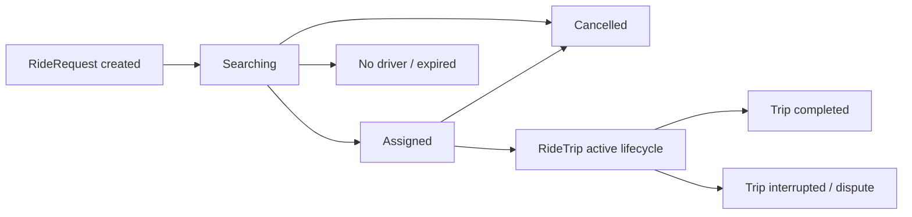
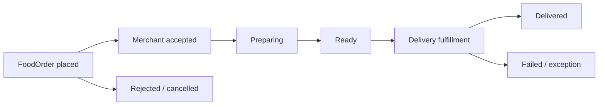
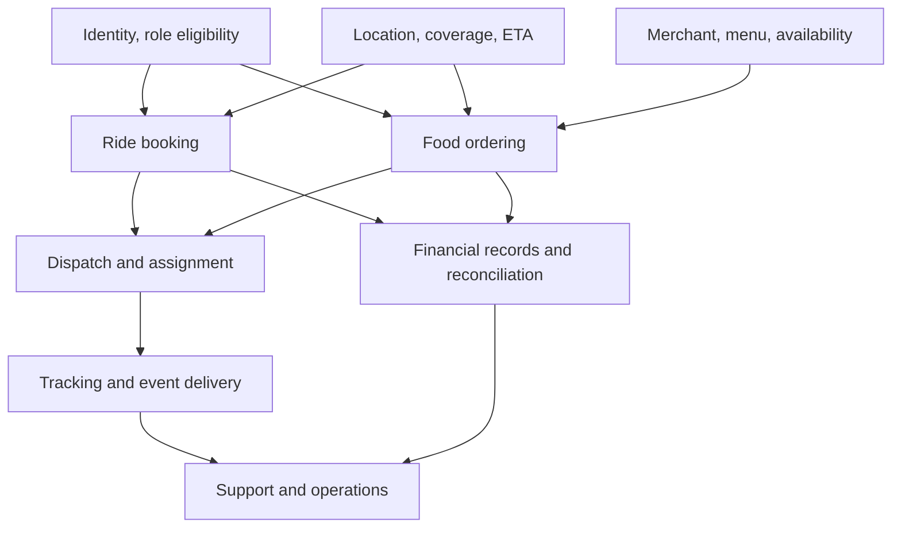

# DealGo — Product Requirements Document (PRD)

> **Trạng thái:** `DRAFT / v0.1.0`. Đây là PRD cấp sản phẩm, **chưa phải hợp đồng API, schema database, chính sách pháp lý hoặc điều kiện go-live được phê duyệt**. Hạng mục chỉ có trạng thái `PROPOSED_P0` khi phạm vi MVP tổng thể đã chốt nhưng chi tiết nghiệp vụ còn chờ duyệt. Không tự điền giá, phụ phí, tỷ lệ hoa hồng, timeout, bán kính, SLO hoặc provider.
>
> **Bảy định hướng đã xác nhận:** MVP Ride (xe máy **và** ô tô per `DG-DEC-VEH-001`) + Food; một app Flutter cho Customer/Merchant/Driver; Ride thương lượng giá; tham khảo luồng công khai mà không sao chép; docs đủ cho triển khai/QA/ops; đăng ký passkey + phone SMS + email verified và Admin method controls; chat + voice call trong app theo transaction. Nguồn: `DEC-PROD-001..007`, `DG-DEC-VEH-001`.

## 1. Tóm tắt điều hành

DealGo là nền tảng dịch vụ địa phương có hai hành trình:

- **Ride:** khách chọn điểm đón/đến, xem giá tham chiếu, đưa giá đề xuất; tài xế chấp nhận hoặc đề xuất giá khác; khách chọn một đề nghị/tài xế. Chỉ sau lựa chọn đó hệ thống mới xác nhận giá cuối và phân công; sau đó tài xế đến đón, thực hiện chuyến, hoàn tất và ghi nhận nghĩa vụ tài chính.
- **Food:** khách chọn khu vực giao, cửa hàng, món ăn và tùy chọn; xem tổng chi phí; gửi đơn; cửa hàng xác nhận/chế biến; tài xế nhận nhiệm vụ giao; khách theo dõi; việc giao và nghĩa vụ thanh toán được hoàn tất hoặc đi vào quy trình xử lý ngoại lệ.

**Một sản phẩm mobile không đồng nghĩa một giao diện dùng chung:** cùng tài khoản và binary nhưng ba không gian tác vụ độc lập, kiểm soát **eligible role** + **active role**, phân quyền phía server và phục hồi trạng thái công việc đang dở. **Admin Web** là kênh vận hành độc lập theo role nội bộ, không phải vai trò thứ tư của app Flutter.

### 1.1. Mục tiêu của PRD

1. Chốt *vì sao* và *cho ai* xây DealGo; diễn đạt kết quả người dùng và nghiệp vụ phải đạt.
2. Đặt ranh giới chính xác của MVP/P0, tránh lẫn tính năng tham khảo từ đối thủ với cam kết sản phẩm.
3. Định nghĩa requirements có ID, hành vi quan sát được, điều kiện nghiệm thu, vai trò và dependency.
4. Nêu rõ failure paths, tình huống an toàn/tài chính và câu hỏi còn mở trước khi coding agent tự thực hiện.
5. Tạo đường nối từ `PRD → FR/BR → Workflow → UI → API/Event/Data → Test → Release Gate`.

### 1.2. PRD không quyết định thay các tài liệu chuyên trách

| Nội dung | Nguồn chuẩn sau khi được duyệt |
|---|---|
| Phạm vi release và các `CAP-*` | `../00-governance/scope-release-plan.md` |
| Quyết định, giả định, blocker `OPEN-*` | `../00-governance/decisions-and-assumptions.md` |
| SRS / yêu cầu chức năng nguyên tử | `functional-requirements.md` |
| NFR có ngưỡng đo | `non-functional-requirements.md` |
| Persona, nghiên cứu người dùng | `personas-and-stakeholders.md` |
| Chính sách nghiệp vụ/phí/đối soát | `../02-domain/*` |
| State machines / BPMN / sequence | `../03-workflows/*` |
| Screens, UX states, thiết kế | `../04-experience/*` |
| Kiến trúc, API, data contracts | `../05-architecture/*`, `../06-data-api/*` |
| Bằng chứng test/production readiness | `../08-quality/*`, `../09-operations/*` |

**Quy tắc:** Nếu một quyết định chưa được duyệt, ghi `TBD` và liên kết `OPEN-*`. Không tạo `FR-*` mới chỉ để sửa chính sách; phải có phân tích tác động và quyết định tương ứng.

## 2. Bối cảnh, vấn đề và cơ hội

### 2.1. Nhu cầu của các bên

| Bên | Công việc cần thực hiện (job-to-be-done) | Điểm gây thất bại cần giải quyết |
|---|---|---|
| Customer / Ride | Tôi muốn biết có thể đi từ A đến B, dự kiến giá bao nhiêu và ai sẽ đến đón. | Không có tài xế; vị trí đón sai; báo giá không rõ; hủy/gián đoạn không minh bạch. |
| Customer / Food | Tôi muốn tìm quán phục vụ đến địa chỉ của mình, chọn món và biết đơn đang ở đâu. | Hết món, giá đổi, quán đóng, không ai giao, đơn trễ, giao thất bại. |
| Merchant | Tôi cần nhận đơn đúng quán, quyết định khả năng phục vụ, chuẩn bị và đối soát tiền. | Đơn đến ngoài giờ; món hết; giao quá sớm/quá muộn; trạng thái và tiền không khớp. |
| Driver | Tôi cần biết việc nào mình đủ điều kiện nhận, di chuyển và hoàn tất không nhầm lẫn. | Offer hết hạn; nhận trùng; mất mạng/GPS; tranh chấp công việc; thu nhập khó đối soát. |
| Operations/Admin | Tôi cần kiểm soát hồ sơ đối tác, hỗ trợ và xử lý sai lệch minh bạch. | Thiếu audit, không rõ người chịu trách nhiệm, không có công cụ khôi phục và reconciliation. |

**Chưa xác minh bằng nghiên cứu người dùng:** mức độ ưu tiên của từng nỗi đau, dung lượng thị trường, willingness-to-pay, nguồn cung tài xế/merchant, khác biệt thực sự so với đối thủ. Cần nghiên cứu ở `competitor-benchmark.md`, `personas-and-stakeholders.md`; không ghi kết luận thị trường dựa trên trực giác.

### 2.2. Bài học từ đối thủ — chỉ dùng làm tham khảo công khai

- Trang GrabFood mô tả các bước chọn địa chỉ, chọn quán, chọn món, nhập ghi chú/ưu đãi, xác nhận và theo dõi giao hàng; cửa hàng khả dụng phụ thuộc địa điểm/giờ hoạt động [SRC-01].
- Trang GrabBike nêu việc hiển thị giá chuyến cho khách và mô hình dịch vụ đi xe hai bánh [SRC-02].
- GrabMerchant cho phép quản lý hồ sơ, thực đơn và đơn hàng; bài viết về xác nhận đơn cho thấy việc phối hợp giữa thời gian chuẩn bị và điều phối giao món cần được quyết định rõ [SRC-03], [SRC-04].
- Trang ShopeeFood hướng dẫn xem đơn, phí giao và mã ưu đãi trước xác nhận; portal đối tác giới thiệu năng lực xử lý đơn và báo cáo vận hành [SRC-05], [SRC-06].

**Không suy ra:** thuật toán dispatch, mức sàn/trần hoặc công thức nội bộ của inDrive/Grab, phí/chiết khấu, trách nhiệm hủy hay hợp đồng đối tác. DealGo học pattern thương lượng giá công khai của inDrive nhưng tự chốt quy tắc; bảng benchmark ghi nguồn và giới hạn evidence.

## 3. Tầm nhìn, nguyên tắc và giá trị

**Định hướng sản phẩm (PROPOSED):** DealGo giúp người dùng truy cập hai nhu cầu thiết yếu — di chuyển bằng xe máy **và** ô tô (`DG-DEC-VEH-001`) và đặt đồ ăn — trong một trải nghiệm nhất quán, có thể theo dõi và có phương án xử lý khi giao dịch không như mong đợi.

**Nguyên tắc thiết kế sản phẩm:**

1. **Rõ trước khi xác nhận:** người dùng thấy điều kiện dịch vụ, tạm tính/giá dự kiến, địa điểm và hệ quả liên quan.
2. **Trạng thái đáng tin:** UI hiển thị trạng thái authoritative từ backend; push/realtime là kênh thông báo, không là chứng cứ giao dịch.
3. **Hai vertical độc lập:** `RideRequest/RideTrip` không được gộp sai với `FoodOrder/DeliveryTask`; thương lượng giá chỉ thuộc Ride trong MVP, Food dùng giá món và phí checkout được server xác thực.
4. **Đúng vai trò và quyền:** Merchant, Driver, Customer và Admin chỉ xem hoặc làm điều được phép trên đúng đối tượng.
5. **Chịu được thất bại:** retry, tắt app, GPS yếu, webhook trễ, phân công cạnh tranh và thiếu cung đều có đường thoát.
6. **Dòng tiền giải thích được:** khác biệt giữa quote, số phải thu, số đã thu, thu nhập dự kiến, khoản đã đối soát.
7. **Không giả định đủ điều kiện go-live:** demo/sandbox và thương mại phải đi qua các gates riêng.

## 4. Mục tiêu và chỉ số thành công

### 4.1. Outcome theo đối tượng

| ID | Outcome mong muốn | Bằng chứng quan sát | Gate |
|---|---|---|---|
| `OBJ-001` | Customer hoàn tất Ride | Gửi yêu cầu → match → pickup → trip completed → giao dịch/biên nhận; kèm negative paths. | `G2`, `G4` |
| `OBJ-002` | Customer hoàn tất Food | Chọn món → order → quán xử lý → giao → biên nhận/đối soát; kèm negative paths. | `G3`, `G4` |
| `OBJ-003` | Ba role hoạt động trong một app | Role switching, eligibility, active-work protection, isolation tests. | `G4` |
| `OBJ-004` | Nhân sự xử lý được sự cố | Tra cứu timeline, điều tra, audit mọi tác vụ nhạy cảm, có quy trình phục hồi. | `G4`, `G5` |
| `OBJ-005` | Có khả năng pilot thương mại khi được duyệt | Kiểm thử, pháp lý, đối tác, thanh toán, vận hành và Go/No-Go đủ bằng chứng. | `G5` |

### 4.2. Metric dictionary — không đặt target khi chưa có dữ liệu

| Metric ID | Công thức/phân định gợi ý | Phân đoạn cần đo | Target / owner |
|---|---|---|---|
| `MET-RIDE-01` | `successful_completed_ride_requests / valid_submitted_ride_requests` theo cohort rõ ràng; tách customer-cancel, no-driver, driver-cancel. | Theo vùng, giờ, app version. | `TBD` — Product/Ops |
| `MET-RIDE-02` | Thời gian từ `request_accepted_by_backend` đến `driver_assigned` (chỉ nhóm đã assign). | Theo vùng/giờ, kể cả các yêu cầu không assign trong báo cáo riêng. | `TBD` |
| `MET-FOOD-01` | `delivered_food_orders / accepted_food_orders`; theo dõi cả từ tổng đơn được đặt. | Theo quán, vùng, giờ, lỗi nguyên nhân. | `TBD` |
| `MET-FOOD-02` | Thời gian từ merchant xác nhận đến `ready`; từ `ready` đến `picked_up`; từ pickup đến delivered. | Theo quán, dịch vụ, vùng. | `TBD` |
| `MET-CORE-01` | Tỷ lệ giao dịch tạo trùng trái phép / tổng intents trong tải test/pilot. | Ride, Food, provider callback. | Mục tiêu **không có vi phạm tính đúng đắn**; phương án đo duyệt trong QA. |
| `MET-OPS-01` | Tỷ lệ sự cố có owner và resolution theo policy; số tồn quá hạn. | Theo nguyên nhân và mức nghiêm trọng. | `TBD` |
| `MET-FIN-01` | Giá trị/số lượng các khoản chênh lệch ledger vs provider/đối tác chưa đối soát. | Theo kỳ, merchant, driver, kênh thanh toán. | `TBD`, không che giấu mismatch. |
| `MET-UX-01` | Task completion, error rate và confusion khi chuyển ba role. | Theo role, thiết bị, điều kiện mạng. | `TBD` — nghiên cứu UX |
| `MET-TECH-01` | p95 latency, realtime lag, assignment errors, availability, crash-free sessions. | Theo dịch vụ và nền tảng. | `OPEN-007` |

**Quy tắc analytics:** mẫu số, event thời điểm, loại giao dịch test/bị hủy/phát sinh lại phải định nghĩa trước khi lập dashboard. Không dùng metric này như kết luận traction trước pilot.

## 5. Phạm vi sản phẩm và độ ưu tiên

### 5.1. Phần đã được xác nhận

| ID | Cam kết |
|---|---|
| `DEC-PROD-001` | MVP có **Ride** (xe máy **và** ô tô per `DG-DEC-VEH-001`) và **Food giao tận nơi**. |
| `DEC-PROD-002` | **Một app Flutter** có Customer, Merchant và Driver. |
| `DEC-PROD-003` | Dùng tài liệu công khai của Grab/GrabFood/ShopeeFood để nghiên cứu *patterns*, không sao chép hoặc mặc định policy. |
| `DEC-PROD-004` | Docs phải hỗ trợ coding/testing/operations; không chỉ có screen list. |
| `DEC-PROD-005` | Ride có thương lượng giá trước assignment. |
| `DEC-PROD-006` | **SUPERSEDED** — email+password đăng ký/đăng nhập bình thường cùng phone SMS và passkey. |
| `DEC-PROD-007` | Chat và gọi thoại trong app theo transaction Ride/Food. |

### 5.2. Phân loại mức ưu tiên

- `CONFIRMED_SCOPE`: đã chốt định hướng cấp sản phẩm; không nói chi tiết policy được duyệt.
- `PROPOSED_P0`: năng lực **đề xuất phải có để MVP vận hành an toàn**, đang chờ duyệt mức triển khai và policy. Tương thích các `CAP-*` trong release plan.
- `PROPOSED_P1`: nên có sau P0/pilot hoặc sớm hơn nếu bằng chứng thay đổi.
- `PROPOSED_P2`: chưa cần cho MVP, cần business case/decision mới.
- `OUT_OF_SCOPE`: không triển khai trong baseline MVP; muốn thêm phải change request.

**Không đánh đồng:** 49 `CAP-*` P0 đã hoạch định trong `scope-release-plan.md` là *capability inventory*; yêu cầu `FR-*` bên dưới chi tiết hóa hành vi, **không** làm tăng 49 capabilities hoặc tự cấp quyền approve cho feature. Screen inventory 165 mobile / 37 admin là tham chiếu chưa phân pha, không phải KPI giao hàng P0.

### 5.3. In scope / out of scope

| In scope ở mức mục tiêu MVP | Chưa tự đưa vào MVP |
|---|---|
| Customer đặt Ride (xe máy **và** ô tô) và Food; theo dõi, lịch sử, hỗ trợ; auth passkey/SMS/verified email; transaction-scoped chat/voice call | Nhiều điểm, liên tỉnh, đặt hộ nhiều khách; chat tự do/video/ghi âm; Car fares/KYC/regs remain OPEN-003/006 |
| Driver đủ điều kiện nhận và thực hiện Ride/Food | Gom nhiều đơn, pooling, thuật toán điều phối phức tạp độc quyền |
| Merchant được xét duyệt, mở/đóng, menu, nhận/chuẩn bị/bàn giao đơn | Marketplace bán hàng phi thực phẩm, livestream, loyalty phức tạp |
| Multi-role trong cùng app, xét quyền server-side | Tự động cho phép hoạt động đồng thời nhiều job khi chưa có policy |
| Admin vận hành tối thiểu, audit, xử lý ngoại lệ, đối soát | Dashboard BI lớn, CRM marketing toàn diện |
| Tích hợp map, notification và phương thức thanh toán được phê duyệt | Một nhà cung cấp cụ thể, COD, ví nội bộ hoặc credit mặc định là đã duyệt |

### 5.4. Phạm vi release

`R0` scope/contracts → `R1` foundation → `R2` Ride E2E sandbox → `R3` Food E2E sandbox → `R4` integrated MVP/hardening → `R5` controlled pilot **sau khi** đạt `G5`; `R6+` tối ưu/mở rộng. **R2 không phải MVP hoàn tất vì còn thiếu Food.** Không đặt ngày release hoặc số người dùng khi chưa có kế hoạch được duyệt.

### 5.5. Backlog chức năng sau MVP (`PROPOSED_P1/P2`)

Bảng này giữ đồng bộ với `scope-release-plan.md` và **không thay đổi phạm vi P0**.

| Ưu tiên | Capability IDs | Ý nghĩa / điều kiện xem xét |
|---|---|---|
| `PROPOSED_P1` | `CAP-P1-01..04` | Địa chỉ yêu thích/đặt lại, marketing ưu đãi nâng cao, rating/review; không gồm chat/call cốt lõi đã chuyển P0 theo `DEC-PROD-007`. |
| `PROPOSED_P1` | `CAP-P1-05..07` | Multi-staff/multi-branch Merchant, phân tích hiệu suất Driver, chỉnh/sửa món hoặc partial adjustments theo policy. |
| `PROPOSED_P1` | `CAP-P1-08..10` | Analytics/export nâng cao, lifecycle messaging, A/B experiments/personalization. |
| `OUT_OF_SCOPE` (`P2`) | `CAP-P2-01..04` | `CAP-P2-01` remaining = taxi/subtypes beyond Ride catalog; **Car itself is in-scope** per `DG-DEC-VEH-001` (2026-10-23). Also: giao kiện độc lập, đi chợ/vertical khác, pooling/batch/multi-stop. |
| `OUT_OF_SCOPE` (`P2`) | `CAP-P2-05..09` | Đặt lịch phức tạp, ví/tín dụng, loyalty nhiều tầng, nhượng quyền, AI tự định giá. |

**Ưu tiên:** chat văn bản và gọi thoại trong app theo giao dịch là P0 theo `DEC-PROD-007`; chat tự do, video call, ghi âm, tệp đính kèm và liên lạc ngoài ngữ cảnh chưa thuộc baseline.

## 6. Người dùng, kênh và quyền nghiệp vụ

### 6.1. Actors / role boundaries

| Actor | Kênh | Trách nhiệm chính | Boundary |
|---|---|---|---|
| Customer | Flutter app / Customer area | Tìm dịch vụ, tạo chuyến/đơn, theo dõi, thanh toán/hỗ trợ. | Chỉ tác động transaction thuộc mình, trừ quyền hỗ trợ có kiểm soát. |
| Merchant | Cùng Flutter app / Merchant area | Quản lý cửa hàng được ủy quyền, món, availability, orders. | Không xem dữ liệu cửa hàng khác chỉ bằng đổi ID. |
| Driver | Cùng Flutter app / Driver area | Kích hoạt làm việc, nhận job, thực hiện chuyến/giao và xem earnings. | Chỉ job hợp lệ, có quyền, còn hiệu lực; hết điều kiện không được tiếp tục nhận mới. |
| Admin/Support/Finance/Ops | Admin Web | Kiểm duyệt, giám sát, hỗ trợ, đối soát, cấu hình trong phạm vi role. | Phân quyền tối thiểu và audit; hành động nhạy cảm cần reason. |
| System | Backend/workers/integrations | Dispatch, timeout, events, reconcile, cảnh báo. | Các tác vụ tự động có chính sách và dấu vết riêng. |

### 6.2. Một app, nhiều vai trò

1. Người dùng có một định danh đăng nhập; số profile/role có thể nhiều nhưng quyền hoạt động phải do backend quyết định.
2. `Customer` là hành trình người dùng cuối. `Merchant` và `Driver` có onboarding và điều kiện phê duyệt riêng.
3. Chuyển *active role* không tự động cấp role mới, không bỏ qua KYC/KYB, không làm đổi chủ sở hữu đơn/chuyến.
4. Nếu đang có Ride/Food active, hành vi chuyển role/bật chế độ công việc khác cần policy ở `OPEN-005`; UI phải cảnh báo/khóa phù hợp sau khi chốt.
5. Push mở lại ứng dụng phải điều hướng về đúng dữ liệu theo role và quyền hiện thời; link sâu không được bypass authorization.
6. Admin không đăng nhập vào khu vực vận hành thông qua token Customer thông thường nếu chưa được cấp quyền admin độc lập.

## 7. Service blueprint — Ride

### 7.1. Điều kiện tiên quyết

- Customer có phiên đăng nhập hợp lệ (phương thức đăng nhập `OPEN-008`), chọn Ride và `vehicleClassCode` (MOTORBIKE hoặc CAR catalog).
- Điểm đón và điểm đến được hệ thống nhận dạng/định vị ở địa bàn có thể phục vụ (`OPEN-001`); phải báo lỗi địa chỉ không xác định hoặc không thuộc vùng.
- Giá và điều kiện chuyến được trình bày trước xác nhận, với chính sách quote/version `OPEN-003`.
- Driver cần profile và quyền nhận Ride hợp lệ; hiện trạng online/khả dụng phải được backend kiểm tra.

### 7.2. Happy path đề xuất — WF-RIDE-001

| Bước | Ai | Hành vi | Kết quả quan sát/nguồn sự thật |
|---|---|---|---|
| 1 | Customer | Mở Ride, nhập/chọn pickup và destination, có thể hiệu chỉnh vị trí. | Điểm/địa chỉ hợp lệ, ETA/route ước tính khi có dữ liệu. |
| 2 | System | Kiểm tra vùng/route, trả reference fare có version; không coi là giá thỏa thuận cuối. | Điều kiện hiển thị rõ; invalid không cho gửi. |
| 3 | Customer | Nhập giá đề xuất và gửi yêu cầu Ride. | Backend tạo một `RideRequest` + negotiation cho intent; chưa có assignment/Trip. |
| 4 | System/Driver | Tài xế đủ điều kiện nhận request giá, chấp nhận hoặc gửi counter-offer còn hiệu lực. | Mỗi proposal có actor/time/amount; counter-offer chưa tạo assignment. |
| 5 | Customer | Xem đề nghị còn hiệu lực và chọn một tài xế/giá. | Backend commit một agreement + assignment; các đề nghị khác đóng nguyên tử. |
| 6 | Customer/Driver | Xem giá cuối đã thỏa thuận, thông tin tài xế/xe và pickup; Driver đến đón. | Giá và assignment đồng bộ từ backend, không tin push đơn lẻ. |
| 7 | Driver / System | Bắt đầu chuyến theo bằng chứng/điều kiện được duyệt (`OPEN-017`). | `RideTrip` chuyển trạng thái hợp lệ; ghi audit thời điểm và actor. |
| 8 | Driver | Hoàn tất tại điểm trả (hoặc xử lý ngoại lệ nếu khác). | Trip completed hợp lệ, dữ liệu tính tiền/biên nhận được đóng sổ theo policy. |
| 9 | Customer/Driver | Xem kết quả, lịch sử, tiền và đường hỗ trợ. | Không hiển thị nhầm `estimated` thành `paid/settled`. |

### 7.3. Ranh giới Ride

- `RideRequest` = yêu cầu tìm dịch vụ; `RideTrip` = chuyến đã gắn với hành trình thực tế. Việc `request` thành công **không** có nghĩa chuyến đã bắt đầu.
- `FareCounterOffer` khác `DispatchOffer` và `Assignment`; chỉ lựa chọn của khách được backend commit mới khóa giá cuối và gán tài xế.
- GPS là dữ liệu quan sát có thể sai/trễ; không đơn độc chứng minh hoàn tất, địa điểm thực tế hoặc tiền.
- Chưa chốt: giới hạn/số vòng/thời hạn thương lượng, matching/dispatch, concurrency, phụ phí/hủy, xác thực lên xe, sửa điểm đón/đến, thanh toán. Liên kết `OPEN-003/004/005/017/019`.

### 7.4. Ride exception paths

Không có driver chấp nhận/counter; request hết hạn; driver offline; khách không chọn; offer hết hạn hoặc khách hủy trước/sau assignment; đổi pickup/dropoff; GPS stale; mất mạng; double-complete; giá/route đổi; tranh chấp bắt đầu/kết thúc. Mỗi trường hợp phải có terminal/recoverable state, actor sở hữu xử lý và hệ quả tài chính sau khi policy được phê duyệt.

## 8. Service blueprint — Food

### 8.1. Điều kiện tiên quyết

- Customer có địa chỉ giao được hỗ trợ, Merchant có quyền bán, cửa hàng có lịch hoạt động/availability hợp lệ.
- Product/menu và các lựa chọn (size, topping, số lượng, ghi chú) có giá và tình trạng khả dụng.
- Checkout hiển thị tiền hàng, phí giao và các thành phần được duyệt; backend xác thực lại trước tạo order.
- Merchant và Driver phải có quyền phù hợp để tác động trên đúng order/delivery task.

### 8.2. Happy path đề xuất — WF-FOOD-001

| Bước | Ai | Hành vi | Kết quả quan sát/nguồn sự thật |
|---|---|---|---|
| 1 | Customer | Chọn địa chỉ giao; tìm quán theo địa bàn/khả dụng. | Kết quả không cam kết quán đóng hoặc ngoài vùng có thể phục vụ. |
| 2 | Customer | Xem menu, chọn món/option/quantity và thêm giỏ. | Dữ liệu menu và giá hiện tại; giỏ chỉ là draft. |
| 3 | Customer/System | Vào checkout; hệ thống revalidate availability, giá, số lượng và phương thức trả tiền. | Tổng tiền có breakdown; invalid yêu cầu khách xác nhận lại thay đổi. |
| 4 | Customer | Xác nhận đơn. | Tạo một `FoodOrder` theo intent/idempotency; không mặc định quán đã nhận. |
| 5 | Merchant | Nhận thông báo/inbox, xác nhận hoặc từ chối. | Đơn thay đổi đúng state, lý do nếu từ chối. |
| 6 | Merchant | Chuẩn bị và đánh dấu sẵn sàng. | Tracking thể hiện tiến trình; readiness là tín hiệu điều phối theo policy. |
| 7 | Dispatch/Driver | Tìm, phân bổ người giao đủ điều kiện; Driver nhận và đến lấy. | `DeliveryTask`/assignment liên kết đúng đơn, đúng merchant. |
| 8 | Merchant/Driver | Bàn giao thực phẩm với bằng chứng theo policy. | Ghi event pickup/handoff có actor, thời điểm và guard. |
| 9 | Driver/Customer | Giao đến địa chỉ và xác nhận kết quả theo chính sách. | Order delivered không bị duplicate bởi thao tác lặp. |
| 10 | System/Actors | Tạo biên nhận và nghĩa vụ tiền; cung cấp lịch sử, hỗ trợ. | Financial records đối soát được; không trộn tiền hàng và phí vận chuyển. |

**Lưu ý điều phối:** bước 6 rồi bước 7 thể hiện luồng dễ hiểu để đọc. **Không chốt việc chỉ bắt đầu dispatch sau khi quán ấn “sẵn sàng”**. Điều phối sớm/theo ETA/merchant acceptance là chính sách còn cần quyết định `OPEN-004`, phụ thuộc `OPEN-016`; UX vẫn phải phản ánh merchant readiness độc lập.

### 8.3. Ranh giới Food

- `FoodOrder` = giao dịch mua món; `DeliveryTask` = nhiệm vụ tài xế giao hàng. Không gộp hai lifecycle thành một trạng thái đơn duy nhất.
- Cart 1 merchant là **phương án đơn giản hóa `PROPOSED`**, liên kết `OPEN-009` nếu phân tích mô hình multi-merchant; không mặc định là quyết định đã xác nhận.
- Menu/giá đã lưu trên mobile không phải báo giá cuối; tổng tiền cần được backend tính lại tại checkout.
- Merchant không thể tự xác nhận “đã giao cho khách” thay cho cơ chế proof-of-delivery được phê duyệt.
- Payment success không đồng nghĩa food delivered; food delivered không đồng nghĩa payout đã settled.

### 8.4. Food exception paths

Merchant closed, món hết khi checkout, giá đổi, merchant không phản hồi, merchant reject, khách muốn thay món, quá thời gian chuẩn bị, không có driver khi đồ ăn đã làm, driver không đến, shipper nhận nhưng không lấy, giao nhầm/khách không nhận, sai địa chỉ, mất mạng, payment callback trễ/lặp, refund/partial refund sau tranh chấp. Phải nêu trách nhiệm chịu chi phí trước go-live (`OPEN-003`, `OPEN-010` (thời điểm thu tiền), `OPEN-016`, `OPEN-018`; policy đổi món/hết món/merchant timeout còn `TBD`).

## 9. Danh sách yêu cầu P0 đề xuất — Shared Platform

> **Format:** mỗi `FR-*` là một *product-level requirement* và một tiêu chí kiểm tra cấp cao. Đây là **candidates của P0**, chưa phải approval từng yêu cầu. Sau khi chốt sẽ phân tách acceptance nguyên tử ở `functional-requirements.md` và `08-quality/acceptance-criteria.md`. Tránh copy nguyên văn sang các file khác; dẫn chiếu ID.

| ID | Yêu cầu (actor / observable behavior) | Minimum acceptance | `CAP-*` / blocker |
|---|---|---|---|
| `FR-CORE-001` | Account đăng nhập/đăng xuất, khôi phục quyền truy cập theo phương thức được duyệt. | Session invalid/expired không thể dùng để tạo giao dịch; logout thu hồi truy cập theo policy. | `CAP-CORE-01`, `OPEN-008` |
| `FR-CORE-002` | Một account quản lý các role đã được cấp; có active role. | Chuyển role không cấp quyền mới và deep link không bypass RBAC. | `CAP-CORE-02`, `CAP-ROLE-01`, `OPEN-005` |
| `FR-CORE-003` | Partner gửi hồ sơ onboarding và biết trạng thái chờ/duyệt/bổ sung/từ chối. | Chưa eligible không được nhận công việc/đơn kinh doanh; dữ liệu nhạy cảm chỉ người có quyền xem. | `CAP-CORE-03`, `OPEN-006/008` |
| `FR-CORE-004` | Customer/Driver chọn, sửa, xác minh địa chỉ hoặc GPS khi được phép. | Không có tọa độ hợp lệ thì không tạo booking/order; có fallback địa chỉ nhập tay theo policy. | `CAP-CORE-04`, `OPEN-001/012` |
| `FR-CORE-005` | Hệ thống phát hành và đánh giá tính hợp lệ của offer/assignment. | Offer expired/revoked không tạo assignment; chỉ người được quyền mới nhận. | `CAP-CORE-05`, `OPEN-004/005` |
| `FR-CORE-006` | Mọi hành động create/confirm/complete có bảo vệ chống retry trùng và race. | Cùng intent được replay không tạo thêm booking/order/payment/assignment ngoài ý muốn. | `CAP-CORE-06` |
| `FR-CORE-007` | Khách thấy quote/breakdown trước cam kết và phản hồi khi giá/điều kiện đổi. | Không dùng quote không còn hợp lệ; phải xin xác nhận lại nếu thay đổi vật chất theo policy. | `CAP-CORE-07`, `OPEN-003` |
| `FR-CORE-008` | Ghi nhận các nghĩa vụ tài chính/correction/refund/settlement theo chính sách. | Mọi tác động tiền có reference, state và audit; sai lệch không bị đánh dấu đã cân bằng. | `CAP-CORE-08`, `OPEN-002/003` |
| `FR-CORE-009` | Trạng thái được đồng bộ qua foreground, background được phép và reconnect. | Sau reconnect, trạng thái được đọc lại từ backend; không tin thông báo cũ là trạng thái cuối. | `CAP-CORE-09`, `OPEN-012` |
| `FR-CORE-010` | Người dùng chỉ truy cập data/operation của mình hoặc được ủy quyền. | Thay ID của order/trip/store/driver không vượt object-level authorization. | `CAP-CORE-10` |
| `FR-CORE-011` | Có luồng báo lỗi/hỗ trợ/kháng nghị phù hợp từng role. | Ticket/case có ID, người xử lý và dấu vết; không yêu cầu liên hệ ngoài app. | `CAP-CORE-11`, `OPEN-014/015` |
| `FR-CORE-012` | Vận hành có thể phát hiện giao dịch kẹt/sai lệch và tạm dừng năng lực an toàn. | Có sự kiện đo và thao tác can thiệp audit; không cần dashboard BI phức tạp để có cảnh báo. | `CAP-CORE-12`, `OPEN-007` |
| `FR-CORE-013` | Lịch sử và chi tiết giao dịch phản ánh nhất quán các trạng thái. | Receipt, estimated amount, paid amount, due amount, settled amount không bị đánh đồng. | `CAP-CORE-08/09` |
| `FR-CORE-014` | Notification không tiết lộ dữ liệu nhạy cảm và chỉ đến actor liên quan. | Push/deep link không lộ order/trip nhạy cảm trên role không được phép. | `CAP-CORE-09/10`, `OPEN-014` |
| `FR-CORE-015` | Hệ thống ghi nhận actor/time/reason cho thay đổi nhạy cảm. | Có audit chain đủ tra cứu sự cố mà không rò PII trong log ứng dụng công khai. | `CAP-CORE-10/11/12` |
| `FR-CORE-016` | Passkey-first cho đăng ký/đăng nhập không cần nhập identifier; email+password và phone SMS OTP là fallback; account quản lý nhiều method, recovery an toàn. | Discoverable credential ánh xạ về Account ở server; đăng ký passkey-first tạo CUSTOMER contact-less; passkey không đọc phone; SMS OTP rate-limited. | `CAP-CORE-01`, `DEC-PROD-046`, `OPEN-020` |
| `FR-CORE-017` | Chat văn bản với participant Ride/Food trong cửa sổ liên lạc được cấp. | Chỉ participant server-authorized đọc/gửi; message gắn đúng context; Admin đọc theo case/audit. | `CAP-CORE-13`, `DEC-PROD-007`, `OPEN-021` |
| `FR-CORE-018` | Gọi thoại trong app giữa participant Ride/Food đủ điều kiện. | Call authorization ngắn hạn; không lộ số; microphone permission rõ; không ghi âm mặc định. | `CAP-CORE-13`, `DEC-PROD-007`, `OPEN-021` |

## 10. Danh sách yêu cầu P0 đề xuất — Ride / Customer

| ID | Yêu cầu | Minimum acceptance | `CAP-*` / blocker |
|---|---|---|---|
| `FR-RIDE-001` | Customer chọn loại Ride (MOTORBIKE hoặc CAR catalog), pickup và destination. | Điểm ngoài vùng/không hợp lệ có lỗi rõ; thiếu `vehicleClassCode` → 400; không gửi yêu cầu. | `CAP-RIDE-01`, `OPEN-001`, `DG-DEC-VEH-001` |
| `FR-RIDE-002` | Xem route/ETA và giá tham khảo; nhập giá đề xuất Ride. | Tách giá tham khảo, giá khách đề xuất và giá cuối; nêu rõ điều kiện/phí. | `CAP-RIDE-01`, `DEC-PROD-005`, `OPEN-003/019` |
| `FR-RIDE-003` | Xác nhận gửi RideRequest. | Double tap/retry cùng intent không tạo hai RideRequest hợp lệ. | `CAP-RIDE-02`, `CAP-CORE-06` |
| `FR-RIDE-004` | Theo dõi quá trình tìm tài xế; có trạng thái hết tài xế/hủy. | Searching không tồn tại vô hạn nếu policy yêu cầu timeout; UX giải thích kết quả. | `CAP-RIDE-03`, `OPEN-004` |
| `FR-RIDE-005` | Xem driver/vehicle được phân công và trạng thái đến điểm đón. | Không lộ thông tin tài xế trước quyền phù hợp; không hiển thị assignment cũ. | `CAP-RIDE-04` |
| `FR-RIDE-006` | Chat/gọi thoại an toàn với tài xế liên quan trong contact window; biết fallback hỗ trợ. | Transaction participant authorization; không lộ số; voice call audio-only/no recording baseline. | `CAP-CORE-13`, `DEC-PROD-007`, `OPEN-014/021` |
| `FR-RIDE-007` | Theo dõi chuyến từ bắt đầu đến hoàn tất. | Transition không hợp lệ bị từ chối, không skip trip stages. | `CAP-RIDE-05`, `OPEN-017` |
| `FR-RIDE-008` | Yêu cầu hủy chuyến theo giai đoạn và biết hệ quả. | Nếu không được hủy/phát sinh phí phải phản hồi theo policy trước xác nhận cần thiết. | `CAP-RIDE-06`, `OPEN-003/017` |
| `FR-RIDE-009` | Gặp tình huống không tìm thấy xe, tài xế rời chuyến, mất mạng. | Có trạng thái xử lý, recovery và đường hỗ trợ; không tự kết luận đã hủy nếu server chưa xác nhận. | `CAP-RIDE-06/08` |
| `FR-RIDE-010` | Xem biên nhận/chuyến đã hoàn tất và chi phí tương ứng. | Biên nhận tham chiếu đúng trip và payment/finance status. | `CAP-RIDE-07` |
| `FR-RIDE-011` | Xem lịch sử và chi tiết chuyến theo quyền. | Không xem chuyến của user khác; lọc test transactions theo môi trường. | `CAP-RIDE-07` |
| `FR-RIDE-012` | Báo cáo sự cố/tranh chấp chuyến từ lịch sử hoặc chuyến active. | Có case ID và quá trình xử lý; không có thao tác âm thầm thay đổi ledger. | `CAP-RIDE-08`, `OPEN-015` |

## 11. Danh sách yêu cầu P0 đề xuất — Food / Customer

| ID | Yêu cầu | Minimum acceptance | `CAP-*` / blocker |
|---|---|---|---|
| `FR-FOOD-001` | Customer chọn địa chỉ giao và xem merchant có thể phục vụ. | Merchant ngoài vùng/đóng không được nhận order sai trạng thái. | `CAP-FOOD-01`, `OPEN-001` |
| `FR-FOOD-002` | Tìm, lọc, xem cửa hàng và menu. | Danh sách và menu phản ánh availability có nguồn thời điểm; empty/error states rõ. | `CAP-FOOD-01/02` |
| `FR-FOOD-003` | Xem chi tiết món, biến thể, tùy chọn, số lượng và ghi chú. | Required options được chọn hợp lệ, không bán item unavailable. | `CAP-FOOD-02` |
| `FR-FOOD-004` | Quản lý cart và tổng tạm tính. | Đổi số lượng/xóa món cập nhật chính xác; giỏ không tự biến thành đơn. | `CAP-FOOD-03`, `OPEN-009` |
| `FR-FOOD-005` | Checkout xác minh lại giá, trạng thái quán, món, địa chỉ, chính sách trả tiền. | Thay đổi bắt buộc có review/confirm; server không dùng giá trong UI làm source-of-truth. | `CAP-FOOD-03`, `OPEN-002/003` |
| `FR-FOOD-006` | Đặt FoodOrder một cách idempotent. | Retry/double tap không tạo đơn trùng trái ý định. | `CAP-FOOD-04` |
| `FR-FOOD-007` | Theo dõi merchant nhận/từ chối và thời gian chuẩn bị có phân biệt estimate. | Khi bị từ chối/hết món, hiển thị lý do/đường xử lý, không giả vờ đơn đang được làm. | `CAP-FOOD-04/06/08`, `TBD: merchant accept/timeout` |
| `FR-FOOD-008` | Theo dõi giao món và tài xế theo quyền. | Tracking stale/offline được hiển thị phù hợp; reconnect cập nhật từ backend. | `CAP-FOOD-08` |
| `FR-FOOD-009` | Nhận thông báo kết quả giao hàng/không thành công. | Chỉ hiển thị `delivered` khi server đã chấp nhận proof/transition. | `CAP-FOOD-09`, `OPEN-011` |
| `FR-FOOD-010` | Chat/gọi thoại với Merchant/Driver liên quan và yêu cầu hỗ trợ, hủy, refund/dispute theo tình huống. | Mỗi yêu cầu có trạng thái và hệ quả tài chính có thể tra cứu. | `CAP-FOOD-10`, `OPEN-003/010/016` |
| `FR-FOOD-011` | Xem chi tiết đơn, món, phí, receipt, lịch sử. | Phân biệt merchant accepted, courier assigned, delivered, payment settled. | `CAP-FOOD-12` |
| `FR-FOOD-012` | Có thông điệp dễ hiểu khi không thể đặt/giao. | Không để trạng thái kẹt spinner; có retry an toàn hoặc hành động phù hợp. | `CAP-FOOD-10`, `CAP-CORE-11` |

## 12. Danh sách yêu cầu P0 đề xuất — Merchant

| ID | Yêu cầu | Minimum acceptance | `CAP-*` / blocker |
|---|---|---|---|
| `FR-MER-001` | Đăng ký/hoàn thiện hồ sơ cửa hàng, thông tin và giấy tờ được yêu cầu. | Chỉ cửa hàng đủ điều kiện mới bật nhận đơn. | `CAP-CORE-03`, `OPEN-006/008` |
| `FR-MER-002` | Cửa hàng được bật/tắt khả năng nhận đơn và quản lý giờ hoạt động. | Không nhận đơn mới khi unavailable, trừ logic đặt trước đã được duyệt. | `CAP-FOOD-11` |
| `FR-MER-003` | Quản lý món/giá/options/tình trạng còn-hết trong cửa hàng được ủy quyền. | Không sửa menu cửa hàng khác; thay giá không sửa ngầm giá đơn đã xác nhận. | `CAP-FOOD-02/11`, `OPEN-013` |
| `FR-MER-004` | Xem inbox đơn thuộc merchant/store hợp lệ. | Merchant B không thể truy cập order merchant A; có phân biệt trạng thái. | `CAP-FOOD-05`, `OPEN-013` |
| `FR-MER-005` | Chấp nhận hoặc từ chối đơn theo quy tắc. | Chỉ hành động khi order đang ở state hợp lệ; phải có reason nếu policy yêu cầu. | `CAP-FOOD-05`, `TBD: merchant accept/timeout` |
| `FR-MER-006` | Đánh dấu preparing/ready và sẵn sàng handoff. | Không handoff cho sai driver/order; retry không tạo sự kiện giao trùng. | `CAP-FOOD-06`, `OPEN-011` |
| `FR-MER-007` | Biết trạng thái tài xế lấy hàng, đơn giao thành công/thất bại. | Không suy đoán delivered chỉ dựa vào notification. | `CAP-FOOD-08/09/12` |
| `FR-MER-008` | Xem khoản phải thu/đã thu/đối soát và lịch sử theo quyền. | Số tiền theo trạng thái và chính sách, không báo đã nhận nếu ledger chưa settled. | `CAP-FOOD-12`, `OPEN-002/003` |
| `FR-MER-009` | Báo vấn đề đơn/hết món/không có tài xế hoặc tranh chấp bàn giao. | Có ticket/case và owner xử lý; không âm thầm đổi đơn. | `CAP-FOOD-10`, `OPEN-016` |

## 13. Danh sách yêu cầu P0 đề xuất — Driver

| ID | Yêu cầu | Minimum acceptance | `CAP-*` / blocker |
|---|---|---|---|
| `FR-DRV-001` | Đăng ký và theo dõi trạng thái xét duyệt/giấy tờ/xe/dịch vụ đủ điều kiện. | Không được online nhận job Ride/Food nếu thiếu quyền bắt buộc. | `CAP-DRV-01`, `OPEN-006/008` |
| `FR-DRV-002` | Bật/tắt availability theo dịch vụ được phép. | Hệ thống backend quyết định driver eligible/available, không dựa vào switch local. | `CAP-DRV-02`, `OPEN-005` |
| `FR-DRV-003` | Xem thông tin cần thiết của offer có hạn nhận. | Không lộ thông tin ngoài quyền; offer expired/revoked hiện trạng thái đúng. | `CAP-DRV-03`, `OPEN-004` |
| `FR-DRV-004` | Nhận/từ chối offer và biết kết quả chính thức. | Accept cạnh tranh chỉ có một assignment được commit; không mở job nếu thua. | `CAP-DRV-03`, `CAP-CORE-06` |
| `FR-DRV-005` | Đến pickup Ride, bắt đầu/kết thúc chuyến hợp lệ. | Thứ tự chuyển state được kiểm soát server và ghi dấu vết. | `CAP-DRV-04`, `OPEN-017` |
| `FR-DRV-006` | Đến merchant, xác nhận lấy món, giao và hoàn tất theo proof policy. | Không giả hoàn tất vì offline hoặc chỉ nhấn nút; proof được kiểm tra. | `CAP-DRV-05`, `OPEN-011` |
| `FR-DRV-007` | Xem bản đồ/ETA/định hướng phù hợp quyền, xử lý mất GPS/mạng. | Stale location có biểu thị; hệ thống không cố dùng GPS cũ làm hiện tại. | `CAP-DRV-06`, `OPEN-012` |
| `FR-DRV-008` | Tránh nhận job chồng chéo trái policy Ride/Food. | Server từ chối assignment gây conflict theo policy, kể cả khi 2 thiết bị nhận đồng thời. | `CAP-ROLE-02`, `OPEN-005` |
| `FR-DRV-009` | Xem lịch sử công việc, earnings estimate và khoản đã quyết toán. | Không hiển thị `estimated` như khoản tiền đã chi trả. | `CAP-DRV-07`, `OPEN-002/003/018` |
| `FR-DRV-010` | Báo sự cố khách vắng, merchant chưa sẵn, không giao được, tranh chấp tiền. | Có reason/case/proof path và ops escalation; không tự xử tiền trái quyền. | `CAP-CORE-11`, `OPEN-015/016/018` |

## 14. Danh sách yêu cầu P0 đề xuất — Admin Web & Operations

| ID | Yêu cầu | Minimum acceptance | `CAP-*` / blocker |
|---|---|---|---|
| `FR-OPS-001` | Nhân sự vận hành đăng nhập và được phân quyền theo chức năng. | Không có quyền không xem/sửa; không phụ thuộc chỉ ẩn menu. | `CAP-OPS-01` |
| `FR-OPS-002` | Xem, duyệt, từ chối, tạm khóa hồ sơ Driver/Merchant hợp lệ. | Mọi quyết định có actor, reason, audit, hồ sơ nhạy cảm được bảo vệ. | `CAP-OPS-02`, `OPEN-006/008` |
| `FR-OPS-003` | Tra cứu Ride/Order/Delivery với timeline và actor liên quan. | Có xác định source-of-truth, giới hạn dữ liệu theo nhân viên. | `CAP-OPS-03` |
| `FR-OPS-004` | Xử lý yêu cầu hỗ trợ, sự cố và hoàn/hủy có kiểm soát. | Không có quyền tự tạo refund bất hợp lệ; can thiệp có audit/reason. | `CAP-OPS-04/05`, `OPEN-003/015` |
| `FR-OPS-005` | Quan sát offer/assignment stuck, thất bại, trạng thái giao dịch lệch. | Có khả năng điều tra theo correlation ID, không cần đọc trực tiếp DB để vận hành thường nhật. | `CAP-OPS-03/04` |
| `FR-OPS-006` | Đối soát giao dịch khách/merchant/driver/payment provider. | Chênh lệch có trạng thái unresolved và owner; không tự đánh dấu matched. | `CAP-OPS-06`, `OPEN-002/003` |
| `FR-OPS-007` | Quản lý cấu hình vùng/dịch vụ/feature/merchant eligibility trong quyền duyệt. | Không cấu hình ngoài phạm vi được duyệt hoặc bỏ qua gate `OPEN-001`. | `CAP-OPS-07`, `OPEN-001/004` |
| `FR-OPS-008` | Có audit trail và phân loại sự cố/anomaly. | Tra được ai/thời điểm/hành động/lý do; không lưu mật khẩu/token/CCCD đầy đủ trong log. | `CAP-OPS-08` |
| `FR-OPS-009` | Tạm dừng tiếp nhận giao dịch mới theo vùng/service khi có sự cố nghiêm trọng. | Stop admission không phá dữ liệu giao dịch đã được tạo; xử lý in-flight theo runbook. | `CAP-OPS-07/08`, `OPEN-007` |
| `FR-OPS-010` | Admin Security quản lý bật/tắt phương thức xác thực toàn hệ thống hoặc theo account. | Có scope, reason, step-up, audit và guard tránh khóa mọi phương thức ngoài emergency workflow. | `CAP-CORE-01`, `DEC-PROD-006`, `OPEN-020` |

## 15. Business invariants — các điều không được phá vỡ

> Các invariant này là **ràng buộc correctness/safety đề xuất cho bất kỳ thiết kế hợp lệ nào**, không phải công thức thương mại. Mỗi invariant phải có kiểm thử cạnh tranh/replay/authorization; chi tiết guard nằm ở `02-domain/*`, `03-workflows/*`.

| ID | Invariant | Điều kiện kiểm chứng |
|---|---|---|
| `BR-CORE-001` | Một business intent hợp lệ không tạo nhiều đối tượng giao dịch do thao tác lặp/retry. | Replay idempotency key hoặc request giống nhau theo contract không tạo đôi ngoài ý định. |
| `BR-CORE-002` | Không có role eligible thì không được cấp quyền thực hiện giao dịch tương ứng. | Client đổi UI/token/request không vượt authz. |
| `BR-CORE-003` | Tác nhân chỉ chuyển trạng thái của đối tượng mình có quyền tác động. | Server chặn IDOR/BOLA và ghi nhận truy cập bị từ chối theo policy. |
| `BR-DISPATCH-001` | Một nhiệm vụ dispatch không có hai assignment đang có hiệu lực cùng lúc trái policy. | Two-driver-accept race tạo tối đa một assignment thành công. |
| `BR-DISPATCH-002` | Offer đã expired, revoked, mất eligibility không thể trở thành assignment mới. | Event đến trễ hoặc thiết bị offline không bypass guard. |
| `BR-RIDE-001` | Không báo RideTrip hoàn tất khi chưa đi qua transition hợp lệ. | Skip/double-complete bị từ chối hoặc idempotent hợp lệ. |
| `BR-FOOD-001` | Không báo FoodOrder delivered chỉ vì merchant ready hoặc tài xế được gán. | Order/DeliveryTask không đồng nhất; completion dựa trên chứng cứ hợp lệ. |
| `BR-FOOD-002` | Không giao nhiệm vụ tài xế sang order của merchant khác do ghép sai ID. | Reference integrity từ order → delivery → merchant/handoff. |
| `BR-FIN-001` | Một callback thanh toán/refund lặp không được tăng/giảm số dư nhiều lần. | Provider replay → một accounting outcome được ghi nhận. |
| `BR-FIN-002` | Không tự coi trạng thái tài chính UNKNOWN/RECONCILIATION_REQUIRED là PAID/SETTLED. | UI, ledger, admin thể hiện chưa xác nhận và đưa vào queue tra soát. |
| `BR-OPS-001` | Can thiệp trạng thái/tiền/quyền đối tác phải có actor, quyền, reason và audit. | Admin action thiếu quyền hoặc lý do bắt buộc bị từ chối. |
| `BR-PRIV-001` | Vị trí/CCCD/giấy tờ và liên hệ không rò tới người không liên quan. | Authorization, masking, retention và consent tests theo policy. |

## 16. Trạng thái nghiệp vụ cần đặc tả ở docs chuyên trách

**Các biểu đồ dưới đây là conceptual (PROPOSED), không khóa tên enum, API, DB hoặc thời gian chuyển.** Canonical state machines phải xác nhận cùng business guard, event, side effect, rollback/compensation trong `03-workflows/ride-lifecycle.md`, `03-workflows/food-fulfillment.md`, `03-workflows/dispatch-and-assignment.md`.

### 16.1. RideRequest và RideTrip phải tách biệt



Không cho suy luận rằng `assigned = trip started` hoặc `cancelled = refunded`.

### 16.2. FoodOrder và DeliveryTask phải tách biệt



DeliveryTask có offer/assignment/pickup/delivery lifecycle riêng. Thời điểm dispatch **có thể** trước khi `READY` nếu policy được duyệt — sơ đồ chỉ biểu đạt tiến trình khách hàng, không là thuật toán dispatch.

### 16.3. Financial state là miền độc lập

Một giao dịch có thể `order_delivered` trong khi `payment_pending` hoặc `merchant_payout_unsettled`. Hủy có thể cần `refund_pending`. Cần phân biệt `authorization`, `capture`, `collection`, `refund`, `ledger adjustment`, `settlement` sau khi kênh `OPEN-002` và quy tắc `OPEN-003` được phê duyệt.

## 17. Ma trận tình huống ngoại lệ và trách nhiệm

| Case ID | Điều kiện | Hành vi sản phẩm cần bảo đảm | Quyết định/owner |
|---|---|---|---|
| `EX-RIDE-01` | Không tài xế ở vùng | Hiển thị tìm không thành công/đang tiếp tục theo policy; không hiển thị driver ảo. | `OPEN-001/004` — Product/Ops |
| `EX-RIDE-02` | Hai khách chọn/ hai offer cạnh tranh hoặc một offer hết hạn đồng thời | Một agreement + assignment thắng; các selection khác bị conflict stale. | Ride/Pricing |
| `EX-RIDE-03` | Customer hủy trong negotiation hoặc selection | Không tạo agreement/assignment sau cancel commit; counter-offer bị thu hồi. | `OPEN-003/004/019` |
| `EX-RIDE-04` | Driver offline sau khi được gán | Ghi trạng thái, recovery/reassignment theo policy; customer được thông báo. | `OPEN-004/005` |
| `EX-RIDE-05` | Khách/tài xế tranh chấp pickup/start/end | Lưu evidence, case, hướng xử lý; không tự điều chỉnh tiền. | `OPEN-017`, Ops |
| `EX-FOOD-01` | Món hết/giá đổi trước checkout | Không tạo order theo giá cũ; yêu cầu xem xét thay đổi. | Product/Merchant |
| `EX-FOOD-02` | Quán đóng/không nhận | Không giả đang chuẩn bị; refund/cancel theo payment policy. | `OPEN-010`, `OPEN-002` |
| `EX-FOOD-03` | Merchant chuẩn bị xong nhưng không có driver | Cảnh báo, escalations, responsibility/compensation theo quyết định. | `OPEN-016` — Product/Finance/Ops |
| `EX-FOOD-04` | Driver đến nhưng món chưa sẵn | Biểu thị waiting, cập nhật ETA; không đánh dấu picked-up sai. | `OPEN-004/016` |
| `EX-FOOD-05` | Khách không nhận/sai địa chỉ | Có failure evidence, ops review và money impact được duyệt. | `OPEN-011/016` |
| `EX-FOOD-06` | Yêu cầu sửa món sau merchant confirm | Không tự sửa đơn/giá; chỉ cho phép qua policy đã phê duyệt. | `TBD: edit/substitution policy`, `OPEN-003` nếu ảnh hưởng tiền |
| `EX-CORE-01` | App bị kill trong chuyến/đơn | Khi mở lại, fetch trạng thái theo backend; hiển thị active transaction. | Mobile/Backend |
| `EX-CORE-02` | Internet hoặc GPS gián đoạn | Không dùng dữ liệu stale như real-time; hướng dẫn/tối thiểu khả năng tiếp tục. | `OPEN-012` |
| `EX-CORE-03` | Push đến muộn/sai thứ tự | Không làm đảo ngược trạng thái; refresh từ backend. | Backend/Mobile |
| `EX-CORE-04` | Payment response timeout/unknown | Không tự gọi lại thu tiền không có idempotency; chờ đối soát. | `OPEN-002`, Finance |
| `EX-CORE-05` | Callback refund/payment lặp | Không double post tài chính; log duplicate event. | Finance/Backend |
| `EX-CORE-06` | Driver đủ quyền lúc nhận nhưng bị đình chỉ giữa task | Quy tắc an toàn/in-flight rõ; ngăn job mới, xử lý job active theo SOP. | `OPEN-006/015`, Ops |
| `EX-CORE-07` | User switch role trong active job | Không mất ngữ cảnh hoặc bypass guard; nếu policy cấm phải ngăn có giải thích. | `OPEN-005` |
| `EX-CORE-08` | Admin sửa sai transaction | Hành động có quyền, reason, immutable audit và reconciliation. | Finance/Ops |
| `EX-CORE-09` | Vendor maps/OTP/push downtime | Có error/retry/fallback được kiểm soát; không gửi sai geolocation. | `OPEN-008/012` |
| `EX-CORE-10` | Server restart trong dispatch | Recover in-flight job và expiry; không tạo hai assignment. | Tech/QA |

Đối với mỗi case: thiết lập `trigger`, `precondition`, `system behavior`, `allowed actions`, `terminal vs retryable`, `financial impact`, `audit`, `notification`, `test case`. Các giá trị policy cụ thể **để TBD cho đến approval**.

## 18. Yêu cầu trải nghiệm và nguyên tắc thiết kế

### 18.1. Điều hướng/IA

- Customer Home có lối vào **Ride** và **Food** rõ ràng. Không gọi Food là “Mua hàng”; thuật ngữ thống nhất là **Đồ ăn/Food**.
- Customer giữ được giỏ đồ ăn và thông tin địa chỉ theo quy tắc bảo mật/retention được duyệt, nhưng không được xem giỏ là order thành công.
- Merchant Home ưu tiên đơn mới, đang làm, cần bàn giao, availability và cảnh báo món hết.
- Driver Home ưu tiên trạng thái eligibility, online/offline, việc đang thực hiện, offer và lịch sử/thu nhập.
- Đổi role phải dễ hiểu và không phá flow của đơn/chuyến active; cấu hình cụ thể chờ `OPEN-005`.
- Admin Web dùng navigation theo quyền; operation actions rủi ro cao không lẫn với các thao tác thường.

### 18.2. Trạng thái UI bắt buộc cho P0

Mỗi màn hình giao dịch phải thiết kế **initial/loading**, **empty**, **data-ready**, **submitting**, **success**, **recoverable error**, **terminal error**, **offline**, **permission denied**, **stale/reconnecting** nếu áp dụng. Một số trạng thái có thể kết hợp nhưng không được che giấu việc hệ thống chưa xác nhận giao dịch.

- Nút hành động tiền/đơn/chuyến cần chống nhấn lặp; chỉ *disable client* không đủ để bảo vệ server.
- Khi giá, cửa hàng hoặc địa chỉ thay đổi, phải yêu cầu review lại trước xác nhận nếu policy quy định.
- Toast chỉ để phản hồi nhẹ; kết quả hủy/hoàn/thu tiền quan trọng phải có trạng thái bền vững trên màn hình/transaction history.
- GPS tracking và ETA là **ước tính** khi phù hợp; hiển thị “vị trí cập nhật cách đây ...” hoặc thông điệp tương tự khi stale nếu UX áp dụng.
- Các bước xin quyền location/notification phải rõ mục đích và có đường tiếp tục hợp lý khi bị từ chối trong phạm vi có thể.

### 18.3. Accessibility / ngôn ngữ

- Tiếng Việt là ngôn ngữ nội dung nền đầu tiên ở baseline; chuẩn i18n phải cho phép mở rộng nhưng đa ngôn ngữ thương mại chưa được cam kết P0.
- Hỗ trợ cỡ chữ hệ thống, touch targets, contrast, Semantics, screen reader, focus và thông báo trạng thái không chỉ phụ thuộc màu.
- Định dạng tiền và thời gian theo locale; không dùng text UI để phân biệt financial state trong backend.
- Thiết kế UI đẹp/animation không được làm chậm cập nhật tình trạng quan trọng hoặc làm sai trạng thái giao dịch.

## 19. Thanh toán và nghĩa vụ tài chính ở cấp sản phẩm

### 19.1. Các khái niệm không được gộp

| Thuật ngữ | Ý nghĩa cho sản phẩm |
|---|---|
| `Quote / Fare estimate` | Giá hiển thị trước cam kết; có thể hết hiệu lực/theo policy. |
| `Order total / Fare due` | Nghĩa vụ thanh toán khi giao dịch thỏa điều kiện. |
| `Collection / Payment received` | Việc nhận tiền thành công theo kênh được duyệt. |
| `Merchant receivable` | Khoản phải trả cho merchant sau tính phí/điều chỉnh theo hợp đồng. |
| `Driver earnings` | Thu nhập tài xế từ công việc, phân biệt tạm tính và quyết toán. |
| `Refund` | Khoản trả lại theo chính sách và trạng thái xử lý. |
| `Settlement / Payout` | Đối soát và chuyển tiền cho đối tác, không đồng nghĩa với trạng thái giao món. |

### 19.2. Các điểm cần quyết định trước giao dịch thương mại

- `OPEN-002`: kênh thanh toán nào mở, ai thu tiền, provider/cơ chế callback, failure/unknown/refund.
- `OPEN-003`: giá Ride, giá Food, phí giao, phí nền tảng, phụ phí/hủy, voucher, thuế và doanh thu phân chia.
- `OPEN-016`: Food đã chuẩn bị nhưng không có người giao: trách nhiệm, bồi hoàn, chính sách merchant/customer/driver.
- `OPEN-018`: nếu chấp nhận COD, tài xế có được thu hộ hay không, tiền cọc/công nợ/hạn mức/đối soát và xử lý thiếu tiền.

**Không triển khai thu tiền thật, trả tiền thật hoặc “balance” nội bộ như production** nếu chưa có chính sách, đối tác, điều kiện pháp lý và kế hoạch reconciliation được phê duyệt. Có thể xây adapter/stub và test fixtures trong sandbox, phân biệt hoàn toàn với giao dịch thật.

## 20. Chỉ dẫn an toàn, quyền riêng tư và khả năng vận hành

| Khu vực | Kết quả tối thiểu bắt buộc | Quyết định/chuyên trách |
|---|---|---|
| KYC/KYB | Đối tác chưa xác minh không được hành nghề/dịch vụ trái điều kiện; tài liệu nhạy cảm chỉ có người đủ quyền. | `OPEN-006/008`; domain + legal review |
| Vị trí | Thu thập/tạm lưu/hiển thị trong đúng mục đích và giai đoạn; background tracking có đánh giá riêng. | `OPEN-012`; mobile/security/legal |
| Địa chỉ & liên lạc | Chỉ các bên cần thiết trong giao dịch xem được; masking/retention theo policy. | Privacy, `OPEN-014` |
| An toàn chuyến xe | Đường báo cáo sự cố, nhân sự tiếp nhận, escalation và chứng cứ; không tuyên bố có đường dây khẩn cấp nếu chưa bố trí. | `OPEN-015/017` |
| Financial safety | Provider callback idempotency; ledger/reconciliation; refund authorization; audit. | `OPEN-002/003/018` |
| Fraud | Kiểm soát duplicate/collusion, GPS spoofing risk, fake proof, stolen account. | Security, Ops |
| Operational readiness | Logs/metrics/traces có correlation ID, alert, feature kill switch, rollback, backup/restore rehearsal. | `OPEN-007`; SRE/Ops |
| Compliance | Legal review mô hình vận tải và thương mại điện tử, bảo vệ dữ liệu cá nhân, điều khoản đối tác và store policies. | `OPEN-006/008/012`; `07-security-legal/*` |

**Không ghi NFR giả:** p95, TPS, SLO, crash-free target, RTO/RPO, giới hạn chi phí và retention đều `TBD` đến khi owner đưa baseline/số liệu và phê duyệt `OPEN-007`/privacy policy.

## 21. Acceptance criteria cấp sản phẩm — UAT scenarios

Các kịch bản này là **test intent để review sản phẩm**, không phải test scripts đầy đủ. Từng scenario phải được hiện thực bằng API/mobile/E2E test có ID trong `08-quality/*`.

| UAT ID | Given | When | Then |
|---|---|---|---|
| `UAT-CORE-01` | Một user có role Customer và Merchant đã duyệt | Chuyển Customer → Merchant → Customer | Đúng navigation và dữ liệu theo quyền; không lộ đơn khác. |
| `UAT-CORE-02` | User chưa được duyệt Driver | Cố mở API job accept bằng request trực tiếp | Backend từ chối, không tạo assignment. |
| `UAT-CORE-03` | Mobile gián đoạn sau create request | Gửi lại cùng intent/idempotency key | Không tạo order/booking trùng. |
| `UAT-CORE-04` | Transaction đang active, app bị kill | Mở app lại/login | Tải lại source-of-truth và hiển thị đúng transaction. |
| `UAT-RIDE-01` | Pickup/destination hợp lệ, có tài xế eligible | Customer book và Driver nhận, hoàn tất | Trip có lịch sử, tài chính liên kết, trạng thái đúng. |
| `UAT-RIDE-02` | Hai tài xế nhận đồng thời | Cùng accept offer trên server | Một assignment thắng; người còn lại không thể điều khiển trip. |
| `UAT-RIDE-03` | Không có driver đáp ứng điều kiện | Customer đặt Ride | Có outcome rõ theo timeout/ops policy, không kẹt vô hạn. |
| `UAT-RIDE-04` | Customer gửi hủy trong lúc dispatch đang assign | Hủy và accept chạy cạnh tranh | Chỉ một kết quả hợp lệ, không tạo chuyến mồ côi. |
| `UAT-RIDE-05` | Driver cố bỏ qua pickup/start | Bấm hoàn tất trực tiếp hoặc gọi API | Server chặn transition bất hợp lệ. |
| `UAT-RIDE-06` | GPS cập nhật cũ | Customer xem vị trí | Không bị giới thiệu như vị trí chắc chắn hiện tại. |
| `UAT-FOOD-01` | Cửa hàng mở, món sẵn, tài xế eligible | Customer đặt; merchant làm; driver giao | Order/DeliveryTask hoàn tất đúng và tài chính ghi nhận. |
| `UAT-FOOD-02` | Giá món thay đổi trước checkout | Customer confirm từ cart cũ | Checkout buộc review giá mới; không tạo order sai giá. |
| `UAT-FOOD-03` | Món hết hoặc merchant đóng | Customer xác nhận đơn | Không tạo/tiếp tục đơn không hợp lệ; UI giải thích. |
| `UAT-FOOD-04` | Merchant reject | Customer xem tracking | Trạng thái không thành công rõ; money action theo policy. |
| `UAT-FOOD-05` | Merchant ready nhưng không có driver | Hết deadline điều phối theo cấu hình thử nghiệm | Case được ghi nhận, escalation/refund theo policy đã duyệt. |
| `UAT-FOOD-06` | Driver nhận giao nhưng không xác nhận handoff | Cố đánh dấu delivered | Server không chấp nhận completion trái rule. |
| `UAT-FOOD-07` | Truy cập order ID cửa hàng khác | Merchant cố đọc/sửa | Bị từ chối; không rò thông tin. |
| `UAT-DRV-01` | Driver đang trong Ride active | Cố nhận Food job trái concurrency policy | Backend ngăn, kết quả trên app nhất quán. |
| `UAT-DRV-02` | Driver mất mạng khi đến quán | Mạng phục hồi | UI đồng bộ; không double-pickup hoặc double-deliver. |
| `UAT-FIN-01` | Provider callback bị gửi lặp | Webhook replay | Không tăng/giảm financial balance thêm lần nữa. |
| `UAT-FIN-02` | Payment đang UNKNOWN | Customer/Merchant mở lịch sử | Không hiển thị PAID/SETTLED giả; ops có thể tra soát. |
| `UAT-OPS-01` | Support có quyền đọc nhưng không quyền refund | Cố hoàn tiền | Từ chối, audit, không thay đổi ledger. |
| `UAT-OPS-02` | Admin được phép can thiệp khi có incident | Thực hiện action nhạy cảm | Có actor/reason/timestamp/result; tài liệu chứng cứ. |
| `UAT-OPS-03` | Payment và ledger mismatch | Đối soát chạy | Vẫn giữ exception unresolved có owner, không auto mark matched. |
| `UAT-OPS-04` | Tắt admission Ride theo vùng | Khách gửi yêu cầu mới | Yêu cầu mới bị chặn đúng cách; active jobs không tự bị xóa. |

### 21.1. Mẫu Gherkin chi tiết tham khảo

```gherkin
Feature: Ride assignment concurrency
  Scenario: Two eligible drivers accept the same available job
    Given a RideRequest is searching and its offer is still valid
    And Driver A and Driver B are individually eligible
    When both drivers submit accept concurrently
    Then exactly one active assignment is committed for that job
    And the losing accept receives a deterministic conflict outcome
    And the customer sees only the committed driver after refresh

Feature: Food checkout price integrity
  Scenario: Menu item price changes after it was put in the cart
    Given the customer has a cart with a previously viewed item price
    And the merchant's authoritative price has changed
    When the customer proceeds to checkout
    Then the current price and revised total are shown for review
    And the system does not create an order using the stale price

Feature: Repeated payment webhook
  Scenario: A provider sends the same successful payment callback twice
    Given a payment reference already has an accounting outcome
    When the exact same provider event is delivered again
    Then the system does not post a second accounting effect
    And the duplicate event is recorded without altering settlement
```

**TBD-specific testing:** Test có thể dùng cấu hình giả lập xác định (ví dụ timeout thiết lập trong fixture), nhưng không được viện dẫn fixture như policy production. `UAT-DRV-01` chỉ pass khi concurrency policy `OPEN-005` được phê duyệt.

## 22. Tracking và requirement traceability

### 22.1. Nguyên tắc ID

- Product-level yêu cầu: `FR-CORE-*`, `FR-RIDE-*`, `FR-FOOD-*`, `FR-MER-*`, `FR-DRV-*`, `FR-OPS-*`.
- Quy tắc nghiệp vụ: `BR-*`; workflow: `WF-*`; screens `SCR-*`; API `API-*`; events `EVT-*`; tests `TC-*`; release capability `CAP-*`.
- Không tái sử dụng ID đã xóa/đổi nghĩa; dùng `SUPERSEDED` hoặc `DEPRECATED` và dẫn chỉ mới.
- `FR-*` trong PRD là baseline *candidate*; trước implementation phải được review và link yêu cầu chi tiết + contract + test.

### 22.2. Ví dụ một đường đi hoàn chỉnh

`FR-RIDE-003` (create request) → `BR-CORE-001` (idempotent intent) → `WF-RIDE-001` (flow đặt xe) → `CAP-RIDE-02` (release scope) → `SCR-CUSTOMER-[TBD]` (màn đặt xe) → `API-RIDE-[TBD]` (hợp đồng tạo request) → `TC-RIDE-[TBD]` (double-tap/retry) → `G2/G4` (bằng chứng).

**Không tự gán ID chính thức** cho màn/API/test chưa tồn tại; placeholder `TBD` để owner chuyên trách tạo. Tất cả trace được tổng hợp ở `../10-ai-execution/requirement-traceability.md`.

### 22.3. Phụ thuộc module (logical, không là deployment)



Diagram này **không** yêu cầu microservices, Kafka, Redis hay một database/vendor cụ thể. Kiến trúc tùy evidence thực tế và ADR được chấp thuận.

## 23. Open decisions, blockers và điều kiện không được tự suy đoán

Dưới đây là bảng nhóm **đầy đủ `OPEN-001..019`** đã được ghi nhận trong Governance; nguồn đăng ký/cập nhật duy nhất là `../00-governance/decisions-and-assumptions.md`.

| ID | Vấn đề cần quyết | PRD bị ảnh hưởng / gate |
|---|---|---|
| `OPEN-001` | Địa bàn/vùng phục vụ đầu tiên | Discovery, Ride, Food, geofence / `G5` |
| `OPEN-002` | Phương thức thanh toán đầu tiên, bên nhận tiền | Checkout, Ride/Food payment, finance / `G4–G5` |
| `OPEN-003` | Giá, phí, hủy, hoa hồng, ưu đãi, refund | Quote, receipt, driver earnings, merchant payout / `G4–G5` |
| `OPEN-004` | Dispatch radius, candidate order, timeout, reassignment | Match Ride/Food / `G2–G5` |
| `OPEN-005` | Multi-role, active job và concurrency | Driver + role switching / `G2–G4` |
| `OPEN-006` | Pháp nhân, vận tải, hợp đồng merchant/driver | Onboarding, legal gate / `G5` |
| `OPEN-007` | Tải mục tiêu, SLO, budget, recovery | Metrics, rollout criteria / `G4–G5` |
| `OPEN-008` | OTP/KYC/maps/payment/push providers và xác minh | Identity/integrations / `G1–G5` |
| `OPEN-009` | Một hay nhiều merchant cho một cart/checkout | Food cart, price, dispatch / `G3` |
| `OPEN-010` | Thời điểm authorize/capture/collect so với merchant acceptance và driver assignment | Food payment, cancel/refund / `G3–G5` |
| `OPEN-011` | Bằng chứng pickup, drop-off, delivery | Food completion/fraud / `G3–G5` |
| `OPEN-012` | Tracking foreground/background, permissions | Driver tracking / `G4–G5` |
| `OPEN-013` | Merchant nhiều cửa hàng/nhân sự | Merchant access boundaries / `G3–G4` |
| `OPEN-014` | Kênh giao tiếp ba bên/support | Ride/Food contact, privacy / `G4–G5` |
| `OPEN-015` | Support/an toàn, trực, escalation | Ride safety, failure handling / `G5` |
| `OPEN-016` | Food đã làm nhưng thiếu driver/hủy và trách nhiệm chi phí | Food cancellations/reconciliation / `G3–G5` |
| `OPEN-017` | Xác nhận pickup/start/end Ride và tranh chấp | Ride state machine / `G2–G5` |
| `OPEN-018` | Thu hộ COD nếu có, hạn mức/công nợ/đối soát | Driver earnings/settlement / `G3–G5` |
| `OPEN-019` | Số vòng, thời hạn, giới hạn giá và kết thúc thương lượng Ride | Ride UX/pricing/matching / `G2–G5` |
| `OPEN-019` | Số vòng, thời hạn, giới hạn giá và kết thúc thương lượng Ride | Ride UX/pricing/matching / `G2–G5` |

### 23.1. Quy tắc chống AI tự chốt policy

1. Agent **được** xây app shell, generic abstractions, mocks, tests, UI states, logging theo contract đã duyệt.
2. Agent **phải** ghi decision proposal nếu yêu cầu tác động phí, trách nhiệm bồi hoàn, điều phối, KYC, concurrency, vị trí nền hoặc tiền.
3. Agent **không được** tự kích hoạt giao dịch tiền thật, tự approve đối tác, tự mặc định COD/giá/km/timeout/số job tối đa hoặc bỏ qua legal/privacy gates.
4. Nếu upstream `DRAFT` thay đổi, agent phải thực hiện impact review, cập nhật contract/test và nêu rủi ro; không im lặng lấy dòng mới nhất làm sự thật.
5. Có thể chạy vertical slice trong **sandbox/test-only**; dữ liệu giả không chứng minh production readiness.

## 24. Tiêu chí chấp nhận PRD và cổng release

### 24.1. PRD review checklist (để chuyển `DRAFT` → `IN_REVIEW`)

- [ ] `DEC-PROD-001..007` không bị thay đổi ngầm.
- [ ] Cả Ride và Food đều có actor, happy path, alternative/failure và UAT case.
- [ ] Multi-role và Admin Web có ranh giới quyền, không gộp admin vào app customer.
- [ ] Mỗi `FR-*` có actor, observed outcome và link capability/dependency.
- [ ] Financial statuses, refund/COD, concurrency và tracking được nêu rõ chỗ chưa chốt.
- [ ] Không có giá/km/số giây timeout/SLO hay target traction do người viết tự phát minh.
- [ ] Open decisions được đồng bộ với Governance và gắn release gates.
- [ ] Có evidence source/date cho benchmark, không đoán chính sách nội bộ của đối thủ.
- [ ] Người phụ trách Product, UX, Tech, Finance/Ops, Security/Legal biết phần cần review.

### 24.2. Definition of Ready cho một vertical slice P0

- [ ] `FR/BR` có owner và trạng thái hợp lệ; câu hỏi chặn đã được xử lý hoặc sandbox limitation công khai.
- [ ] Workflow/state transitions, guards, timeout và recovery đã có đặc tả chuyên trách.
- [ ] UI screens/states + API/data/event contracts có phiên bản truy vết.
- [ ] Idempotency, object authorization, concurrency và failure tests đã xác định.
- [ ] Điều kiện nghiệm thu rõ và không phụ thuộc provider production chưa được duyệt.

### 24.3. Gate summary

| Gate | Điều kiện trọng tâm | Tuyệt đối không suy diễn |
|---|---|---|
| `G0` | Đủ product baseline, scope, actor, decisions, acceptance P0 | `DRAFT` PRD = quyết định kinh doanh chính thức |
| `G1` | Nền tảng auth/role/contracts/CI/audit chạy trong dev/test | Có thể cho đối tác/người dùng giao dịch thật |
| `G2` | Ride E2E + no-driver/cancel/race/reconnect/security tests | MVP đã xong khi chỉ có Ride |
| `G3` | Food E2E + merchant/fulfillment/dispatch/refund/error tests | Có thể nhận tiền khi chưa xác minh legal/finance |
| `G4` | Ride+Food tích hợp, multi-role, reliability, reconciliation, recovery | Pilot sẽ thành công hoặc scale đã bảo đảm |
| `G5` | Go/No-Go với chứng cứ legal/payment/security/ops và vùng/đối tác | Demo thành công = đã đủ điều kiện thương mại |

Chi tiết nguồn chuẩn và bộ bằng chứng ở `../00-governance/scope-release-plan.md`.

## 25. Kế hoạch viết docs liền kề

1. `competitor-benchmark.md`: ma trận nguồn công khai, tính năng và pattern Ride/Food; ghi ngày xác minh và giới hạn bằng chứng.
2. `personas-and-stakeholders.md`: hồ sơ giả thuyết persona, interview plan, JTBD, usability risks cho 3 role.
3. `use-case-catalog.md`: use cases có ID, primary/secondary actors, trigger, preconditions, alternatives và exceptions.
4. `functional-requirements.md`: tách `FR-*` thành nguyên tử, quy tắc validation, acceptance và test mapping.
5. `non-functional-requirements.md`: NFR measurable, mẫu benchmark, ngưỡng target theo owner approval.
6. Sau product group: domain rules → workflows → experience → architecture → data/API → security → quality → operations → AI execution.

## 26. Nguồn tham khảo, giới hạn và lịch sử thay đổi

### 26.1. Nguồn công khai đã đối chiếu ngày 2026-10-11

| Ref | Nguồn | Kiến thức quan sát được | Giới hạn |
|---|---|---|---|
| `[SRC-01]` | [GrabFood Việt Nam](https://www.grab.com/vn/food/) | Flow chọn địa chỉ/quán/món, xác nhận, tracking, ảnh hưởng của giờ mở. | Không là quy tắc DealGo, không khẳng định trạng thái tối ưu hay policy hiện thời mọi khu vực. |
| `[SRC-02]` | [GrabBike Việt Nam](https://www.grab.com/vn/transport/bike/) | Ride xe hai bánh và hiển thị giá chuyến trước thực hiện. | Không công bố thuật toán dispatch, giá chuẩn DealGo. |
| `[SRC-03]` | [GrabMerchant Việt Nam](https://merchant.grab.com/vn-vn) | Khả năng quản lý merchant profile/menu/order. | Không là bản mô tả kỹ thuật nội bộ. |
| `[SRC-04]` | [GrabMerchant — tính năng xác nhận đơn](https://merchant.grab.com/vn-vn/blog/xacnhandonhang) | Quan hệ giữa chuẩn bị, trạng thái ready và điều phối giao. | Bài có bối cảnh và thời điểm triển khai riêng; không áp dụng nguyên xi. |
| `[SRC-05]` | [ShopeeFood — hướng dẫn đặt đồ ăn](https://shopeefood.vn/how-to-order-delivery) | Chọn thông tin giao, kiểm tra phí, mã ưu đãi và xác nhận. | Có tính năng đặt nhóm/đặt giờ nhưng **không** mặc định thuộc MVP DealGo. |
| `[SRC-06]` | [ShopeeFood — đăng ký đối tác nhà hàng](https://shopeefood.vn/merchant-register) | Merchant quản lý đơn, báo cáo, thông tin quán và chương trình ưu đãi. | Chính sách đối tác và ví của ShopeeFood không là tài chính DealGo. |
| `[SRC-07]` | [Atlassian — Product Requirements Document](https://www.atlassian.com/agile/product-management/requirements/) | PRD xác định mục đích, mục tiêu, users, stories, giả định, out-of-scope và câu hỏi mở. | Hướng dẫn tài liệu chung, không thay nghiệp vụ của hệ thống. |

**Nguồn nội bộ:** `README.md`, `project-charter.md`, `scope-release-plan.md`, `glossary.md`, `decisions-and-assumptions.md` trong `../00-governance/`. Mọi thay đổi trái các tài liệu này cần mở `DOC-CONFLICT` và review chủ trách nhiệm; không tự chọn tài liệu “mới hơn”.

### 26.2. Changelog

| Version | Date | Change | Status |
|---|---|---|---|
| `0.2.0` | `2026-10-12` | Xác nhận passkey/SMS/verified-email, Admin auth-method control và P0 chat/voice-call; chuyển advanced chat sang P1. | `DRAFT` |
| `0.1.0` | `2026-10-11` | Khởi tạo PRD sản phẩm cho Ride+Food, multi-role Flutter, FR/BR/UAT baseline, edge cases, blockers và traceability. | `DRAFT` |

---

> **Tiêu chuẩn hoàn thành:** PRD này đủ để bắt đầu *review, thiết kế use cases và chia việc*, **chưa đủ một mình** để AI agent khóa giá/phí, chứng cứ bàn giao, concurrency policy, vị trí nền hoặc triển khai production. Phần phải chốt ở docs chuyên trách và trong `OPEN-*` cần được xác nhận trước khi code hành vi thương mại tương ứng.
