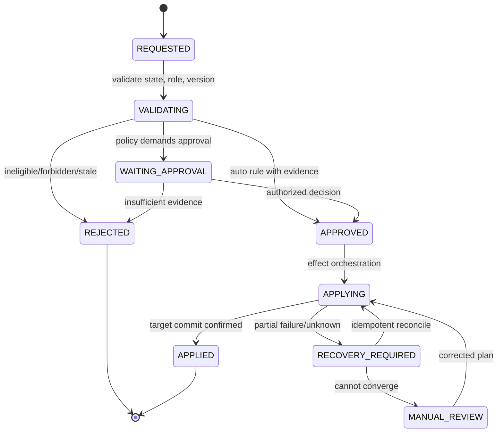
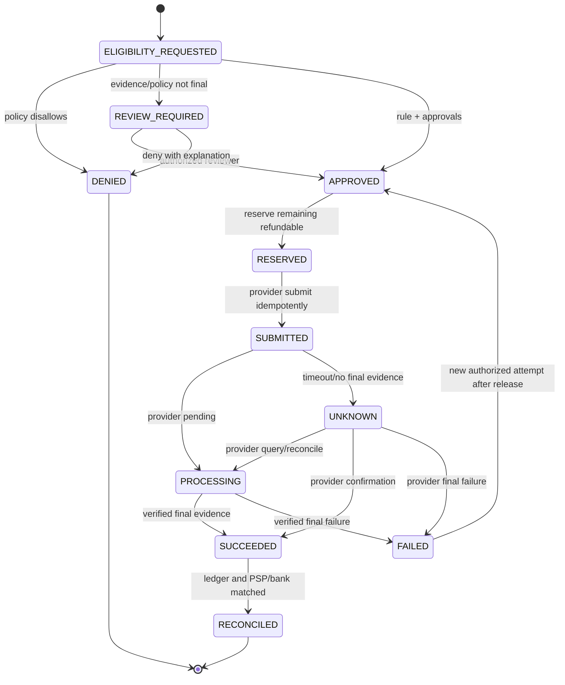
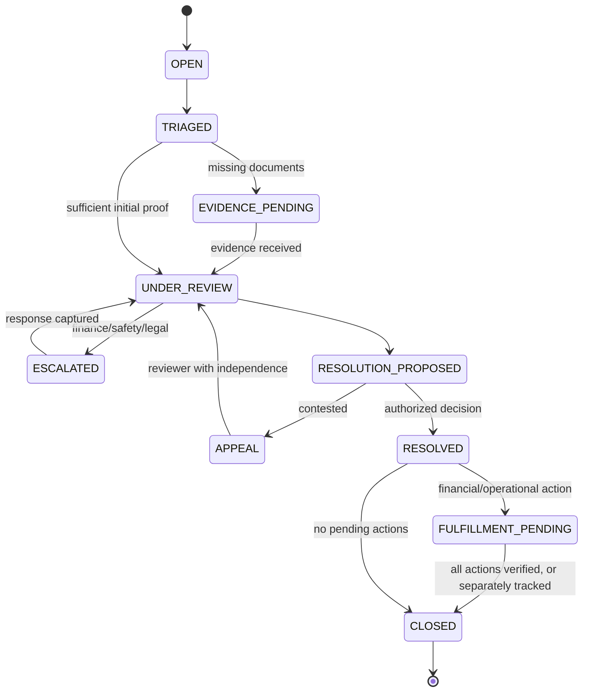
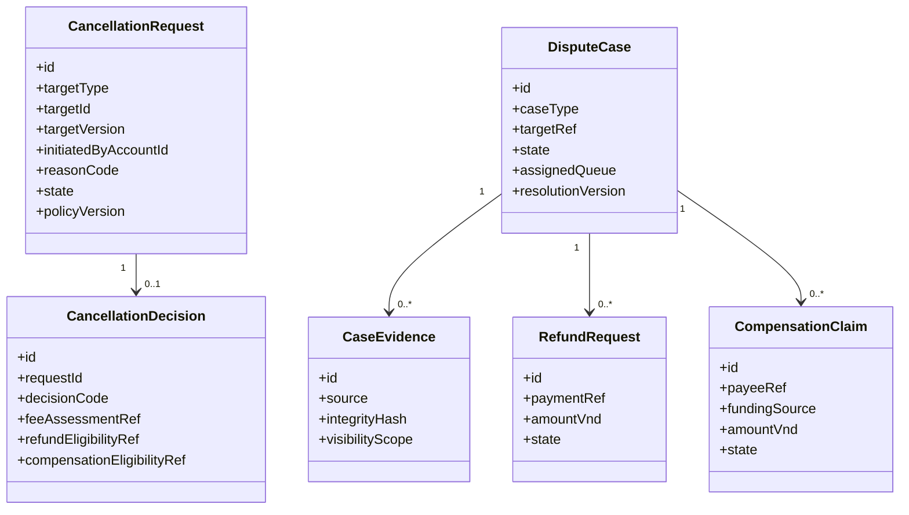
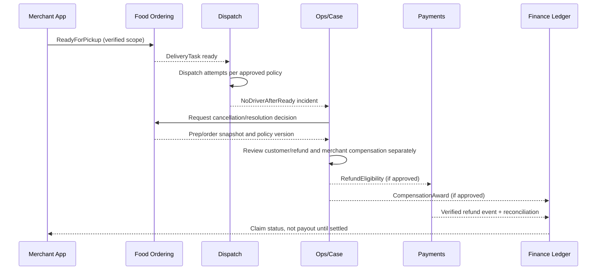

# DealGo — Cancellation, Refund, Compensation & Disputes

> **DRAFT / DESIGN PROPOSAL — KHÔNG PHẢI CHÍNH SÁCH THƯƠNG MẠI ĐƯỢC DUYỆT.** `DEC-PROD-001..005` xác nhận phạm vi Ride hai bánh + Food + ba role trong một Flutter app; **chưa chốt** mức phí hủy, mức bồi hoàn, thời gian chờ, chính sách không nhận hàng, lúc thu tiền Food, phương thức COD hay quyền tài xế được thu hộ. Mọi ngưỡng, phần trăm và ví dụ tiền đều `TEST_ONLY`/`TBD`, phải được duyệt theo `OPEN-002/003/006/010/016/017/018/019` trước khi dùng production. Thương lượng giá Ride là pattern đã xác nhận (`DEC-PROD-005`); phí hủy và liability vẫn chưa chốt.
>
> **An toàn tài chính:** `cancelled != refunded`; `refund_requested != refund_succeeded`; `order_canceled != delivery_task_canceled` cho mọi tình huống; `compensation_approved != payout_completed`. AI Agent **không** được gộp các trạng thái này.

## 1. Mục đích, Definition of Success

Tài liệu mô tả **ai được yêu cầu hủy/hỗ trợ, lúc nào được hủy, điều kiện và chứng cứ nào được xét, phải thay đổi trạng thái nghiệp vụ nào, ai chịu phí/tổn thất, hoàn tiền hoặc bồi hoàn bằng cách nào, ai có quyền phê duyệt và làm sao đối soát được toàn bộ**.

Điều kiện đạt:

1. Từ một yêu cầu hủy hoặc khiếu nại, hệ thống trả về kết luận có thể giải thích bằng `reasonCode`, snapshot state, rule/version và evidence; không áp dụng công thức phí tự đặt khi policy còn mở.
2. Không thể hủy hoặc hoàn tất sai state, không thể double-cancel/double-refund/double-compensate dù 2 thiết bị, webhook trễ hay operator xử lý đồng thời.
3. RideRequest, RideTrip, FoodOrder, DeliveryTask, DriverAssignment và Finance **giữ state machine riêng**; phép đổi trạng thái xuyên context là workflow/saga có ghi nhận và phục hồi.
4. Toàn bộ tiền hoàn và tiền hỗ trợ đối tác có nguồn vốn, chủ thể nhận, bằng chứng, quyết định và sổ cái; mọi khoản chi cuối cùng có chứng cứ từ PSP/bank/COD reconciliation.
5. Khách hàng, tài xế, cửa hàng và hỗ trợ chỉ nhìn thấy tình trạng thực; `PENDING` không được hiển thị "đã hoàn".
6. Có case management cho tranh chấp sau khi chuyến/đơn kết thúc, kể cả khiếu nại thiếu món, đón nhầm, COD, chargeback và sự cố an toàn.
7. Không có production enablement khi chưa phê duyệt policy/điều kiện pháp lý, PSP refund capability, quyền Admin và các test tại §39–40.

## 2. Phạm vi và ngoài phạm vi

**Bao gồm:** Ride đặt xe máy, Food đặt đồ ăn/giao bởi tài xế, hủy do Customer/Driver/Merchant/System/Admin, timeout/no-show, partial/full refund, merchant/driver compensation, cost allocation, dispute, customer support, evidence, financial adjustments, audit, abuse monitoring, SLA cấu hình và reconciliation.

**Không tự mở rộng:** GrabCar, giao hàng độc lập, đa quán trong một đơn, bảo hiểm/đền bù tai nạn, ví tiền nạp/rút, chargeback API thật của PSP chưa ký hợp đồng, đấu giá tự động hoặc chương trình bồi hoàn có tỷ lệ cố định. Thương lượng giá giữa khách và tài xế của Ride đã nằm trong scope; các ngưỡng/điều khoản vẫn theo `OPEN-019`. Nội dung pháp lý là checklist để Legal xác nhận.

## 3. Sources of Truth và thứ tự ưu tiên

| Nội dung | Tài liệu sở hữu | Trách nhiệm file này |
|---|---|---|
| Phạm vi, policy được duyệt, issue `OPEN-*` | `00-governance/*` | Theo đúng quyết định; không tự đóng `OPEN` |
| Intent, lifecycle chuyến/đơn | `domain-model.md`, `03-workflows/*` | Quy tắc yêu cầu hủy, outcome và phối hợp trạng thái |
| Menu, merchant acceptance, trạng thái đã chế biến | `merchant-and-catalog-rules.md` | Dùng snapshot chuẩn bị/bàn giao làm evidence |
| Giá/coupon/phí/hợp đồng | `pricing-fees-and-promotions.md` | Đọc frozen financial breakdown và policy snapshot; không tính lại tùy ý |
| Thanh toán/hoàn/bút toán/chi tiền | `payments-ledger-settlement.md` | Quyết định *đủ điều kiện*; thực thi do Payments/Finance |
| Quyền, IDOR, dual control | `roles-and-permissions.md` | Xác định entitlement theo case, field, store và actor |
| Sự cố an toàn/gian lận | `trust-safety-and-fraud.md` (kế tiếp) | Tạo và escalate case, không tự phán quyết an toàn |
| API/DB schema thực thi | `06-data-api/*` (kế tiếp) | Contract ngữ nghĩa, không cưỡng ép tên bảng/schema |

Thứ tự ưu tiên khi có mâu thuẫn: `CONFIRMED` decision mới nhất → governance approved → PRD/FR approved → domain contract approved → proposal. Phát hiện xung đột thì tạo issue/decision, **không để agent tự lựa chọn luật hủy hoặc mức tiền**.

## 4. Bằng chứng từ hệ sinh thái Grab/ShopeeFood và giới hạn áp dụng

| Nguồn công khai (tra cứu 12/10/2026) | Quan sát có chứng cứ | Bài học đề xuất cho DealGo |
|---|---|---|
| Grab Help — Hủy chuyến xe | Hướng dẫn hủy trước khi đón và phân biệt trường hợp đã bắt đầu chuyến | Phân loại quyền hủy theo state Ride, không luôn bật một nút hủy |
| Grab Help — Xe chờ quá 5 phút | Chính sách chờ và khoản phí đi kèm trạng thái khách không tới | No-show cần evidence/điều kiện riêng; **không sao chép mức hoặc thời hạn** |
| GrabMerchant — cập nhật bồi hoàn từ 06/05/2026 và tự động bồi hoàn từ 22/06/2026 | Một số đơn chuẩn bị rồi bị hủy không do quán có thể được xét bồi hoàn | Merchant compensation là một claim/obligation riêng, không đồng nghĩa refund khách |
| GrabMerchant — Nhận đơn thủ công (02/02/2026) | Merchant có thể nhận/từ chối và hết thời gian nhận đơn | Phân biệt merchant reject/timeout với tài xế không nhận |
| ShopeeFood — Khi nào đơn hủy đủ điều kiện hoàn tiền cho quán | Có điều kiện theo quá trình chuẩn bị của quán | Đánh giá preparation milestone/evidence trước kết luận trách nhiệm |
| Stripe API — Refund / Disputes | Có partial refund, giới hạn số tiền và vòng đời tranh chấp riêng | Refund, chargeback, case hỗ trợ cần tách state và số tiền |

**Không suy diễn** nội bộ dispatch, thresholds, tỷ lệ bồi hoàn hay các điều kiện chỉ hiện trong hình minh họa trên trang đối thủ. Không coi các chính sách của Grab/ShopeeFood là quy tắc được phê duyệt cho DealGo. Link nguồn ở §42.

## 5. Thuật ngữ Domain / chống nhầm lẫn

| Object | Mô tả chuẩn | Không đồng nghĩa |
|---|---|---|
| `CancellationRequest` | Đề nghị hủy có actor, reason, target và snapshot | Target đã `CANCELED` |
| `CancellationDecision` | Kết quả xét điều kiện/fee/liability theo policy version | PSP refund thành công |
| `CancellationEffect` | Thay đổi có kiểm soát state Ride/Food/Dispatch | Ghi sổ, thông báo đã gửi |
| `Incident` | Sự cố cần ghi nhận, có thể hoặc chưa có tranh chấp | Đương nhiên hoàn tiền |
| `DisputeCase` | Case phản ánh/kháng nghị có bằng chứng, timeline và quyết định | `PaymentDispute` của network/PSP |
| `RefundRequest` | Yêu cầu hoàn có căn cứ/amount/cap/approval | Tiền về tài khoản khách |
| `RefundExecution` | Lệnh thực thi hoàn tiền qua kênh đã duyệt | Refund đã reconcile thành công |
| `CompensationClaim` | Yêu cầu/đề xuất bồi hoàn cho đối tác | Khấu trừ luôn từ khách |
| `CompensationAward` | Nghĩa vụ chi được duyệt sau evaluation | Đã thực chi qua payout |
| `FeeAssessment` | Kết quả xét phí hủy/no-show theo version | Thu tiền thật |
| `LiabilityAllocation` | Sơ đồ phân chia bên chịu thiệt/cấp tiền | Kết tội chủ thể khi chưa điều tra |
| `OrderAdjustment` | Điều chỉnh kinh tế tham chiếu snapshot gốc | Sửa trực tiếp lịch sử đơn |
| `EvidenceBundle` | Bằng chứng với nguồn, độ tin cậy, thời điểm và phân quyền | GPS/client event là sự thật duy nhất |
| `ChargebackCase` | Tranh chấp thanh toán từ phía PSP/network | Khiếu nại hỗ trợ thông thường |
| `PolicyVersion` | Bản chính sách áp dụng cho một hành động tại một thời điểm | App version hoặc current default |

**Ubiquitous Language:** `RideRequest` khác `RideTrip`; `FoodOrder` khác `DeliveryTask`; `FareCounterOffer` (đề nghị giá Ride) khác `DispatchOffer` (lời mời nhận job) và khác `DriverAssignment`; `customer_refund` khác `merchant_compensation`; `refund` khác `void/authorization_release`; `cancel` khác `reverse_a_posted_ledger_journal`.

## 6. Các quyết định OPEN phải giữ nguyên

| ID | Điểm mở | Chặn quyết định gì | Triển khai an toàn trước |
|---|---|---|---|
| `OPEN-002` | COD/online, pháp nhân thu tiền, PSP/refund | Kênh trả tiền thật, luồng hoàn thật | Refund adapter, sandbox/mock |
| `OPEN-003` | Giá, phí, chính sách hủy, bồi thường, chiết khấu | Mức phí/phân bổ thực tế | Rule engine deterministic, `TEST_ONLY` |
| `OPEN-004` | Dispatch timeout/reassign | Trigger không tài xế/no-show driver | Configurable lifecycle test |
| `OPEN-005` | Một hay nhiều job đồng thời | Reassign khi driver đã có Ride/Food | Concurrency guards, policy flags off |
| `OPEN-006` | Legal/trách nhiệm các bên | Điều khoản bồi hoàn, thu/giữ tiền, khấu trừ | Audit & compliance review |
| `OPEN-007` | SLO/nhân sự trực | SLA chính thức, escalation deadline | Metrics, simulation, TBD timers |
| `OPEN-008` | Provider PSP/OTP/map/notification | Refund route, bank confirmation | Provider interface, contract tests |
| `OPEN-009` | Multi-merchant Food? | Refund chia nhiều store | Scope 1 store/đơn trong fixtures; không activate multi-store |
| `OPEN-010` | Food authorize/capture lúc nào | Void hay refund khi merchant reject | Payment-stage adapters |
| `OPEN-011` | Proof pickup/delivery | Chứng cứ dispute, damage allocation | Evidence reference + privacy controls |
| `OPEN-014` | Kênh trao đổi hỗ trợ | Conversation evidence + consent | Case notes/test channels |
| `OPEN-015` | Trực hỗ trợ và safety escalation | Human intervention SLA | Pending-review queues, fail-safe |
| `OPEN-016` | Food đã làm nhưng không có driver | Merchant compensation/funder | Hold/review, không tự quyết tiền |
| `OPEN-017` | Proof Ride start/end, đón nhầm | Ride abort/dispute/no-show fee | Trip evidence + manual review |
| `OPEN-018` | Thu hộ COD, giới hạn và công nợ | Refund khách COD, tài xế nợ quán/platform | Cash custody ledger TEST_ONLY |

`DEC-PROD-001..005`: xác nhận scope/pattern sản phẩm, nhưng không thay thế phê duyệt fee/cancellation/payment policy.

## 7. Nguyên tắc/bất biến (`CAN-INV-*`)

| Mã | Invariant bắt buộc có unit + integration tests |
|---|---|
| `CAN-INV-001` | Server là thẩm quyền cuối cho cancel eligibility; client không tự set state target. |
| `CAN-INV-002` | Một target chỉ có tối đa **một cancellation outcome có hiệu lực** cho cùng phiên/lifecycle; request khác phải idempotent hoặc conflict có giải thích. |
| `CAN-INV-003` | Cancel, refund, compensation, payout là các aggregate độc lập với trạng thái riêng. |
| `CAN-INV-004` | Đã `STARTED` Ride không lén đổi thành `CANCELED` bằng cancel thường; đi luồng interrupted/early-stop/dispute theo policy. |
| `CAN-INV-005` | Food sau `PICKED_UP` không quay về `PENDING_MERCHANT` hoặc `CANCELED` tùy ý; xử lý delivery failure/recovery. |
| `CAN-INV-006` | Merchant ready và Driver assigned không có nghĩa Food delivered (`BR-FOOD-001`). |
| `CAN-INV-007` | Refund chỉ xét trên số thực `CAPTURED/COLLECTED` đủ điều kiện; với authorization chưa capture, hành động phù hợp có thể là void/release, không gọi refund. |
| `CAN-INV-008` | Tổng refund reservations + active refund executions + successful refunds không vượt refundable captured amount; có cơ chế release reservation khi failed cuối cùng được xác nhận. |
| `CAN-INV-009` | Một economic event không tạo hai journal/compensation/payout effects (`BR-FIN-001`). |
| `CAN-INV-010` | `UNKNOWN`, `PENDING`, `SUBMITTED` không được trả `REFUNDED`, `SETTLED` (`BR-FIN-002`). |
| `CAN-INV-011` | Refund khách **không tự tạo** compensation đối tác; compensation cần policy, review và liability source. |
| `CAN-INV-012` | Fee/no-show chỉ được áp dụng khi policy approved, state/evidence đủ; không thu phí vì một GPS ping. |
| `CAN-INV-013` | Operator không thể vừa tạo và phê duyệt payout/adjustment vượt ngưỡng phân quyền theo policy. |
| `CAN-INV-014` | Không xóa/sửa history order, charge, journal đã `POSTED`; mọi điều chỉnh bằng record/reference mới. |
| `CAN-INV-015` | Refund/compensation/dispute phải truy vết được `targetId`, `paymentId`, `ruleVersion`, `actor`, `evidence`, `decisionId`, `ledgerRef`. |
| `CAN-INV-016` | Chứng cứ quyền riêng tư: viewer chỉ thấy dữ liệu tối thiểu theo case/role; không gửi CCCD, full GPS trail, thông tin thanh toán lên push. |
| `CAN-INV-017` | Tái diễn giải rule sau khi thay policy không được tự thay kết luận lịch sử; mở adjustment/case có version nếu cần. |
| `CAN-INV-018` | Driver/merchant/customer bị vô hiệu hóa sau case phải qua Eligibility/Role policy; không tự block vĩnh viễn vì có một dispute. |
| `CAN-INV-019` | Mọi case terminal có resolution/reason/evidence và trạng thái fulfillment của action đã duyệt; không đóng như "đã giải quyết" khi refund còn pending nếu nghĩa vụ tài chính chưa được theo dõi riêng. |
| `CAN-INV-020` | Reconciliation phải phát hiện cả orphan refund, chargeback hoặc compensation không còn liên kết trực tiếp UI. |

## 8. Actor, quyền và trách nhiệm

| Actor | Gửi yêu cầu | Thẩm quyền xử lý | Điều tuyệt đối không cho phép |
|---|---|---|---|
| Customer | Hủy Ride/Food theo state, báo lỗi, xem case của mình | Không tự quyết penalty hay PSP outcome | Hủy job khác, sửa fee, tự xác nhận refund |
| Driver | Báo không thể đón/giao, no-show, sự cố, đính kèm proof | Có thể thực hiện transition được backend cho phép | Hủy FoodOrder tài chính một mình; nhận tiền bồi hoàn tự phát |
| Merchant Owner/Staff | Từ chối trước nhận, báo hết món, yêu cầu bồi hoàn | Chỉ store thuộc membership/scope | Cancel store khác, giả trạng thái refund |
| Support | Triage, liên hệ, thu thập chứng cứ | Đề xuất outcome trong hạn quyền | Tự payout hoặc override ledger |
| Ride/Food Ops | Phân loại nguyên nhân, can thiệp nhiệm vụ | Approve nghiệp vụ trong policy/limit | Đổi state qua bypass command/guard |
| Finance | Xác định liability, approve adjustments/refunds | Thực thi hợp đồng tài chính theo maker-checker | Edit journal `POSTED` hoặc tự đánh dấu bank paid |
| Safety | Xử lý sự cố an toàn, bảo toàn bằng chứng | Escalation/hold có expiry/review | Kết tội tự động chỉ dựa trên complaint |
| System scheduler | Timeout/retry/escalate theo policy | Không có quyền chính sách thương mại mới | Retry không idempotency hoặc tự quy kết lỗi |

Mọi quyền dựa trên `roles-and-permissions.md`, kiểm tra server-side object relation + tenancy. Với các hành động rủi ro cao phải có `reason`, `evidence`, `auditTrail` và có thể yêu cầu dual control.

## 9. Mã lý do chuẩn — taxonomy gợi ý

| Prefix | ReasonCode đề xuất | Chủ thể báo / trạng thái phù hợp |
|---|---|---|
| `RIDE_CUST_` | `RIDE_CUST_CHANGED_MIND`, `RIDE_CUST_WRONG_PICKUP`, `RIDE_CUST_WAIT_TOO_LONG` | Khách, trước khi RideTrip bắt đầu |
| `RIDE_DRIVER_` | `RIDE_DRIVER_VEHICLE_ISSUE`, `RIDE_DRIVER_CANNOT_REACH`, `RIDE_DRIVER_SAFETY` | Tài xế, trước/đang chuyến có exception route |
| `RIDE_SYSTEM_` | `RIDE_SYSTEM_NO_DRIVER`, `RIDE_SYSTEM_DISPATCH_EXPIRED`, `RIDE_SYSTEM_INVALID_ZONE` | Scheduler/Ops với proof server-side |
| `RIDE_INCIDENT_` | `RIDE_INCIDENT_WRONG_PASSENGER`, `RIDE_INCIDENT_TRIP_INTERRUPTED`, `RIDE_INCIDENT_DISPUTED_COMPLETION` | Case sau khi/đang chuyến |
| `FOOD_CUST_` | `FOOD_CUST_CANCEL_REQUEST`, `FOOD_CUST_WRONG_ADDRESS`, `FOOD_CUST_ITEM_MISSING` | Khách theo phase của Food |
| `FOOD_MER_` | `FOOD_MER_OUT_OF_STOCK`, `FOOD_MER_CLOSED`, `FOOD_MER_CANNOT_PREPARE`, `FOOD_MER_PREPARATION_COMPLETE` | Quán, có evidence theo phase |
| `FOOD_DRV_` | `FOOD_DRV_PICKUP_FAILED`, `FOOD_DRV_DELIVERY_FAILED`, `FOOD_DRV_SAFETY_EVENT` | Tài xế, nhiệm vụ giao hàng |
| `FOOD_SYS_` | `FOOD_SYS_MERCHANT_TIMEOUT`, `FOOD_SYS_NO_DRIVER`, `FOOD_SYS_DISPATCH_TIMEOUT` | Hệ thống dựa trên rule |
| `PAY_` | `PAY_DUPLICATE_CAPTURE`, `PAY_UNKNOWN_PAYMENT`, `PAY_REFUND_FAILED`, `PAY_CHARGEBACK` | Payments/Support |
| `OPS_` | `OPS_FRAUD_REVIEW`, `OPS_LEGAL_HOLD`, `OPS_SAFETY_ESCALATION` | Bộ phận có quyền |

Quy tắc: `reasonCode` là dữ liệu phân loại, **không tự xác nhận trách nhiệm**; reason category có version, ghi `reporter`, `source`, `notes` tách biệt. Không cho phép `OTHER` rỗng chứng cứ trong các case có ảnh hưởng tiền.

## 10. Evidence/Proof: nguồn và mức độ tin cậy

| Evidence | Nguồn | Dùng làm gì | Giới hạn |
|---|---|---|---|
| `ServerStateSnapshot` | DB/versioned event | Chứng minh state/actor thời điểm quyết định | Cần correlation và clock thống nhất |
| `Offer/AssignmentAudit` | Dispatch | Offer timeout, assign, accept/reject | Client click không bằng confirmed assignment |
| `LocationObservation` | Telemetry GPS | Hỗ trợ arrived/pickup/dropoff | GPS spoof/stale/permission/accuracy issues |
| `MerchantPrepMilestone` | Merchant workflow | Accepted/Preparing/Ready/handoff | Merchant tự đánh dấu chưa đủ chứng minh chi phí |
| `Pickup/DeliveryProof` | Authorized capture | Chứng minh handoff/delivery nếu policy quy định | `OPEN-011` chưa chốt proof loại nào |
| `Chat/SupportHistory` | Kênh hỗ trợ được duyệt | Diễn biến thỏa thuận/kháng nghị | Tránh thu thập vượt mục đích, masking PII |
| `PaymentProviderEvent` | Verified PSP API/webhook | Tình trạng thu/hoàn | Có thể trễ/lặp/mất thứ tự |
| `Ledger/ReconciliationSnapshot` | Finance | Số tiền đã ghi và còn lệch | Không chứng minh đơn hàng đã giao |
| `IncidentReport` | Authorized reporter | Safety triage | Lời khai cần được kiểm tra, không mặc định đúng |

Evidence có `evidenceId`, `caseId`, `origin`, `occurredAt`, `receivedAt`, `integrityHash`, `accessScope`, `retentionPolicyId`, `verificationStatus`; tách storage object nhạy cảm khỏi hồ sơ được hiển thị.

## 11. Cancellation Request — state machine



- `CancellationRequest` đã `APPLIED` không có nghĩa đã hoàn tiền; phải đọc `FinancialResolution`/`RefundExecution` riêng.
- `REJECTED` không cấm khách mở `DisputeCase` nếu họ cho rằng hệ thống sai.
- Request hủy chưa thành công không được hiển thị là "đã hủy" chỉ do app tap thành công.
- Khi policy đòi human approval mà ca khẩn cấp/safety, có thể **tạm giữ/khóa hành động tiếp** theo quyền, không tự động kết luận lỗi và không tự khóa tiền vĩnh viễn.

## 12. Ma trận Ride — trạng thái và quyền hủy

| Ride phase | Khách yêu cầu | Driver yêu cầu | Hệ thống | Outcome mặc định kỹ thuật (không phải phí) |
|---|---|---|---|---|
| `REQUEST_CREATED` | Có thể thu hồi ý định | Không applicable | Validate + expire | Hủy `RideRequest`, đóng dispatch nếu có |
| `NEGOTIATING` | Yêu cầu hủy | Tài xế có thể bỏ qua/đóng proposal | No response/expiry | Đóng negotiation, thu hồi mọi counter-offer; không có assignment |
| `CUSTOMER_SELECTING` | Yêu cầu hủy | Counter-offer có thể hết hạn | Hết hạn request | Chỉ một offer được chọn; hủy/select race có một winner |
| `DISPATCH_OFFERED` | Yêu cầu hủy | Tài xế có thể reject dispatch offer | Dispatch expiry | Thu hồi offer; không nhận trễ |
| `ASSIGNED/DRIVER_EN_ROUTE` | Yêu cầu hủy theo state | Driver cancellation case | Reassign/hủy theo policy | Atomic release assignment, fee assessment riêng |
| `DRIVER_ARRIVED` | Yêu cầu hủy/no-show | Driver report no-show | Evidence check | Xác nhận arrival/waiting bằng bằng chứng được duyệt |
| `TRIP_STARTED` | Không dùng cancel thường | Incident/interrupted trip | Escalate | Hoàn tất bất thường/early-stop theo policy, không rollback RideTrip |
| `TRIP_COMPLETED` | Dispute sau dịch vụ | Dispute | Review | Điều chỉnh tiền/case, **không đổi history thành canceled** |
| `CANCELED/EXPIRED` | Idempotent view | Idempotent view | No duplicate effect | Terminal với audit và trạng thái tiền riêng |

Các tên phase là **mô hình ngữ nghĩa**; state chính thức sẽ được khóa ở `03-workflows/ride-lifecycle.md`.

## 13. Ride — workflow chi tiết theo actor

**Khách hủy khi đang thương lượng/chưa chọn tài xế:** backend xác thực owner/version và trạng thái, atomically chuyển request/negotiation sang canceled, thu hồi/hết hiệu lực mọi lời mời và counter-offer, giải phóng reservation theo policy; mọi accept/select tới sau bị conflict/stale. Nếu đã authorize/capture theo policy, tính eligibility void/refund.

**Khách hủy sau khi chọn tài xế:** gắn cancellation vào RideRequest + `AcceptedFareAgreement`; không đổi agreed fare và không tự thu phí. Hệ quả phí/liability vẫn theo `OPEN-003`; các offer cạnh tranh đã đóng không được kích hoạt lại.

**Khách hủy sau khi driver nhận:** hệ thống kiểm arrival/dispatch snapshot và điều khoản hủy (`OPEN-003`), xác nhận trạng thái an toàn, quyết định fee/liability theo policy, đánh dấu cancellation trong context Ride, giải phóng capacity ở Dispatch; driver app được notify. Không mặc định có phí.

**Driver hủy sau assignment:** bắt buộc reason và audit; có thể reassign nếu chưa `TRIP_STARTED` và dispatch policy cho phép; nếu không reassign được phải thông báo khách và tạo no-service resolution. Không tự quy trách nhiệm driver chỉ do hủy.

**Driver báo khách không xuất hiện:** arrival proof + thời điểm đến + thời gian chờ hợp lệ + quyền thông báo khách + policy version; không dựa vào GPS ping đơn lẻ. Nếu proof thiếu, trạng thái `NEEDS_REVIEW`, không auto fee.

**Chuyến đã bắt đầu nhưng khách cần dừng giữa đường:** chuyển sang `INTERRUPTED` hoặc `EARLY_STOP_REQUESTED` theo domain contract, tính final fare/adjustment có chứng cứ nếu policy cho phép; không xóa chuyến hoặc đánh dấu chưa từng đón khách.

**Đón nhầm người/giả hoàn tất:** khóa payout nhạy cảm theo policy và mở dispute; giữ bằng chứng hành trình, server events, liên hệ support; không đánh đồng "driver nói đã tới" với đã phục vụ đúng khách.

## 14. Ride — No-show / late pickup / safety

1. Nhiều trạng thái có thể cùng diễn ra trên client do offline; chỉ server snapshot/version quyết định nhánh.
2. `arrivalAt` phải từ nguồn đã được phép, có chất lượng/toạ độ hợp lệ; nếu không đáp ứng thì không tự phạt khách.
3. `waitDuration` tính theo clock server và trạng thái đã xác nhận, không dùng timer từ Flutter như chứng cứ phí.
4. Nhánh `CUSTOMER_NO_SHOW` khác `DRIVER_NO_SHOW` và `SYSTEM_DELAY`; hệ quả có thể khác nhưng policy còn `TBD`.
5. Phí chờ/hủy/phạt/khoản hỗ trợ tài xế chỉ được sinh qua `FeeAssessment` có policy/version, không nằm trong UI code.
6. Incident an toàn (đe dọa, tai nạn, khẩn cấp) ưu tiên hỗ trợ/định vị trạng thái, không ép flow thanh toán thông thường; bảo toàn chứng cứ theo quyền và retention policy.
7. Khi mất liên lạc hoàn toàn, tùy mức độ có thể `OPS_REVIEW_REQUIRED`; không tuyên bố lỗi thuộc về một bên khi thiếu chứng cứ.

## 15. Ma trận Food — trạng thái, trách nhiệm và các loại hủy

| Food phase | Ý định khách | Merchant | DeliveryTask/Driver | Điều bắt buộc trước phân bổ tiền |
|---|---|---|---|---|
| `CHECKOUT_DRAFT` | Xóa giỏ | Không có order | Không có | Release voucher reservation nếu có |
| `PENDING_MERCHANT` | Yêu cầu hủy | Reject/timeout | Có thể chưa dispatch | Xác định Payment authorized/captured (`OPEN-010`) |
| `ACCEPTED` | Yêu cầu hủy có điều kiện | Bắt đầu chuẩn bị | Dispatch song song nếu cấu hình | Snapshot acceptance/cost evidence |
| `PREPARING` | Không hủy vô điều kiện | Quá trình chế biến | Driver tìm/chờ | Nếu hủy, review liability/compensation |
| `READY_FOR_PICKUP` | Case hỗ trợ | Có đồ hoàn thành | Nếu no driver, incident riêng | Chuẩn bị xong không bảo đảm bồi hoàn |
| `PICKED_UP` | Không tự cancel FoodOrder như chưa giao | Chỉ có claim/case | Giao hàng đang diễn ra | Delivery failure/reassignment/recovery |
| `DELIVERING` | Dispute, đổi địa chỉ nếu policy | Không còn quyền fulfillment direct | Driver report failed/no-show | Proof, safety, COD state |
| `DELIVERED` | Khiếu nại thiếu/sai/hỏng món | Bồi hoàn/kháng nghị | Driver evidence | Partial refund/credit case; không xóa delivered |
| `CANCELED/FAILED` | Theo dõi refund/case | Theo dõi claim | DeliveryTask cancel/review separately | Liabilities phải reconcile |

`PENDING_MERCHANT`, `READY_FOR_PICKUP` là **semantic labels** dùng cho phân tích; trạng thái API chính thức do workflow sau phê duyệt. Không quy định Food có bao nhiêu lần sửa món, không tự kích hoạt giỏ nhiều quán.

## 16. Food — các luồng đặc biệt bắt buộc

**A. Quán từ chối/chậm xác nhận.** Khi merchant reject hoặc timeout hợp lệ, order không bị báo "đã nhận". Nếu capture đã xảy ra, tạo eligibility cho refund; nếu mới authorization thì void/release tùy provider. Ghi nhận reason cụ thể: `OUT_OF_STOCK`, `CLOSED`, `CANNOT_PREPARE`, `MERCHANT_TIMEOUT`.

**B. Hết món sau chốt đơn.** Ưu tiên luồng đề xuất thay món/giảm số lượng có chấp thuận khách (nếu được product duyệt). Chênh giá đi qua adjustment snapshot + payment policy; không âm thầm tăng tiền, không tự coi từ chối thay món là khách có lỗi.

**C. Đã chế biến xong nhưng không có tài xế (`OPEN-016`).** Đánh dấu `NO_DRIVER_AFTER_READY`; freeze inventory/proof snapshot; thử dispatch/reassign trong giới hạn policy; khi không thể hoàn thành, mở CancellationCase + `CompensationClaim` cho merchant, `RefundEligibility` cho customer, driver payables nếu có; **không tự quy nguồn chịu thiệt, không auto bồi hoàn**.

**D. Driver nhận nhiệm vụ nhưng không đến lấy.** Trước pickup có thể reassign theo policy; nếu quán đã ready phải kiểm chất lượng/thời hạn đồ ăn, log delay, cung cấp phương án Ops review. `FoodOrder` không được `DELIVERED` do tài xế `ASSIGNED`.

**E. Đã pickup, khách không nhận / sai địa chỉ / không liên lạc.** Bắt buộc `DeliveryFailureCase`, proof attempts và safety constraints; chính sách xử lý hàng, hoàn và trách nhiệm còn TBD; không để tài xế tự tuyên bố "khách bỏ hàng" nhằm nhận tiền.

**F. Đơn đã giao, thiếu/sai món hoặc chất lượng.** Mở dispute theo item, modifier, quantity và funding source. Có thể partial refund hoặc compensation theo policy, nhưng **không** đổi toàn bộ `FoodOrder` thành canceled nhằm trả một phần tiền.

**G. Sai đơn hàng/shipper lấy nhầm.** Cross-reference storeId/orderId/driverAssignmentId/proof; không để hoàn tiền nhầm khách hay bồi thường nhầm merchant (`BR-FOOD-002`).

## 17. Ma trận nguyên nhân → hành động đề xuất

| Nguyên nhân | Nghiệp vụ ưu tiên | Financial decision | Cần human review? |
|---|---|---|---|
| Khách đổi ý trước có driver/merchant accept | Cancel request hợp lệ | Void/refund fee theo policy | Có thể tự động nếu đủ evidence |
| Merchant hết món trước prep | Reject/adjust được khách đồng ý | Refund/void phần không giao | Chỉ case mơ hồ |
| Merchant đã prep nhưng no driver | Dispatch retry → incident nếu không cứu được | Customer resolution + merchant claim | **Có** khi `OPEN-016` chưa chốt |
| Driver không đến/không nhận | Reassign hoặc termination | Đánh giá compensation/refund độc lập | Theo ngưỡng/policy |
| Khách no-show tại pickup Ride | Verify arrival/wait | FeeAssessment nếu được duyệt | Khi evidence thiếu/kháng nghị |
| Ride đã started, bị gián đoạn | Safety/early-stop flow | Fare adjustment sau review | Có nếu ảnh hưởng tiền/an toàn |
| Food đã delivered, khách báo thiếu món | Dispute item-level | Partial refund/adjustment | Theo risk/amount/evidence |
| Thanh toán trùng | Payment reconciliation | Refund phần thừa | Fraud/Finance nếu PSP UNKNOWN |
| PSP chargeback | PaymentDispute | Hold/chargeback accounting | Finance/Legal bắt buộc |

**Không phải chính sách mặc định:** bảng này là logic phân loại/điều phối. Chỉ Policy Engine được triển khai quyết định mức tiền và eligibility sau approval.

## 18. Cancellation Policy Evaluator — hợp đồng thuần nghiệp vụ

`evaluateCancellation(input)` **không sửa DB, không gọi PSP**, nhận immutable snapshot và trả `PolicyDecision` có thể kiểm tra:

```typescript
// CONCEPTUAL / TEST_ONLY; names are illustrative, not final API schema.
type DecisionKind = 'ALLOW' | 'DENY' | 'REVIEW_REQUIRED' | 'CONFLICT';
interface CancelPolicyInput {
  target: { type: 'RIDE_REQUEST' | 'RIDE_TRIP' | 'FOOD_ORDER' | 'DELIVERY_TASK';
            id: string; version: number; state: string };
  actor: { accountId: string; role: string; scopeId?: string };
  reasonCode: string;
  time: { serverNow: string; stateEnteredAt?: string };
  evidenceRefs: string[];
  financialSnapshotId?: string;
  paymentState?: string;
  policyVersion: string;
}
interface CancelPolicyResult {
  kind: DecisionKind;
  decisionCode: string;
  allowedTargetTransitions: string[];
  requiredEvidence: string[];
  feeAssessment: { state: 'NOT_APPLICABLE' | 'PENDING_POLICY' | 'PROPOSED';
                   amountVnd?: number; fundingSource?: string };
  refundReview: 'NONE' | 'VOID_OR_RELEASE' | 'REFUND_ELIGIBILITY' | 'MANUAL';
  compensationReview: 'NONE' | 'CLAIM_ELIGIBILITY' | 'MANUAL';
  escalationQueue?: string;
  policyVersion: string;
}
```

**Evaluation order:** validate syntax → authenticate → target owner/role/tenant → version/terminal guard → evidence quality → policy effective at relevant event → service-specific state rules → calculate eligibility **without execution** → return decision and required approvals. Với policy không tồn tại/đang `OPEN`, fail-safe `REVIEW_REQUIRED` hoặc disable feature tương ứng, không tự coi `0đ fee` là policy được duyệt.

## 19. Price, Fee, Refund Amount: cách tính đúng

Sử dụng `CommittedFinancialBreakdown` đã chốt, không tính lại theo bảng giá *hiện tại*. Xác định các đại lượng:

- `customerCaptured`: tổng tiền thu thành công hợp lệ qua PSP/COD được đối chiếu, **không phải** quote.
- `priorRefundSucceeded`: tổng tiền refund đã xác nhận thành công.
- `refundReserved`: tổng refund amount đang được cấp quyền/đã submit nhưng chưa terminal, trừ reservation đã giải phóng đúng quy trình.
- `refundableRemaining = max(0, customerCaptured - priorRefundSucceeded - refundReserved - otherConfirmedReversals)`; công thức này là **capacity guard**, không phải số tiền khách được hưởng.
- `policyRefundEligible`: số tiền do điều khoản và evidence xác định; `newRefundAmount <= min(refundableRemaining, policyRefundEligible)`.
- `customerFeeLiability`, `merchantCompensation`, `driverCompensation`, `platformCost`: **các khoản riêng** có provenance, funding allocation và giới hạn theo policy.

Mọi giá trị VND lưu integer VND, không dùng float. Chỉ áp dụng làm tròn tại bước Pricing đã version và phù hợp PSP. Không dùng `PriceQuote.total - somePercent` để suy ra bồi hoàn sau khi đơn đã được điều chỉnh nhiều lần.

## 20. Refund Workflow: void, refund, pending, failed



- **Authorization uncaptured:** sử dụng `VOID`/`RELEASE` nếu provider contract cho phép, không xuất hóa đơn "hoàn tiền" khi thực ra tiền chưa bị thu.
- **Capture succeeded:** tạo refund intent theo PSP/merchant account/currency; partial refund có thể nhiều đợt nhưng tổng không vượt cap.
- **COD:** không có PSP charge để refund; xử lý qua `CashCollection` reconciliation + refund rail được duyệt (`OPEN-018`); không tạo lệnh refund giả bằng PSP.
- **`UNKNOWN`:** retry theo provider idempotency/query trước; tuyệt đối không blind submit bằng idempotency key mới.
- **Refund failed:** chỉ giải phóng reservation khi đã có chứng cứ fail cuối cùng hoặc reconciliation xác thực; không chạy nhiều lần dựa vào callback "timeout".
- **Refund success nhưng payout đã xảy ra:** ghi corrective journal/receivable/cash recovery theo model Finance; không sửa journal cũ.

## 21. Partial Refund cấp item và điều chỉnh phí

1. Refund item-level phải nhận `itemSnapshotId`, SKU/variant/modifier/quantity, đơn giá đã chốt, funding attribution của promo, phần refund được phép.
2. Nếu voucher phân bổ trên nhiều item, không refund theo giá niêm yết rồi để tổng > actual captured; dùng frozen allocation + rounding reconciliation.
3. Merchant payable adjustment và phí giao hàng adjustment **không tự động bằng** customer item refund; chúng phụ thuộc fault allocation/policy.
4. Partial refund sau delivery không làm thay `DELIVERED` thành `CANCELED`.
5. Một item có nhiều complaint phải có `refundClaimKey`/subledger guard để không vượt số tiền đủ điều kiện.
6. Khi merchant chịu một phần và platform chịu phần còn lại, ghi các funding sources tách biệt; không trừ hết từ payable của merchant khi merchant chưa chịu trách nhiệm.
7. Nếu có thay món được đồng ý trước delivery, đó là `OrderAdjustment` (có thể dẫn đến partial refund) chứ không luôn là hủy toàn bộ.

## 22. Voucher, khuyến mại và budget khi hủy

| Trạng thái ưu đãi | Nguyên tắc đề xuất |
|---|---|
| Chưa commit đơn | Release redemption reservation idempotently, trừ khi policy khác được duyệt |
| Đơn commit nhưng merchant reject | Trả lại eligibility nếu chương trình cho phép; không tự hứa voucher hồi lại |
| Food prep/delivered và partial refund | Attribution giữ theo `pricingPolicyVersion`/voucher allocation đã chốt |
| Khách hủy Ride | Policy về voucher recovery riêng với fee/refund |
| Voucher hết hạn khi cần hoàn | Không âm thầm cấp coupon mới/hoàn tiền mặt nếu chưa duyệt |
| Ngân sách campaign đã tiêu/thanh toán | Reverse/adjust accounting entries theo nguồn tài trợ, không sửa budget history |

Khách phải được thông báo rõ **trạng thái tiền** và **trạng thái voucher**, không dùng một nhãn "đã hoàn" cho cả hai.

## 23. Compensation (merchant/driver) và ai chịu tổn thất

`CompensationClaim` → `ELIGIBILITY_CHECK` → `REVIEW_REQUIRED/ELIGIBLE/INELIGIBLE` → `AWARD_APPROVED` → `PAYABLE_RECORDED` → `SETTLEMENT_HELD/AVAILABLE` → `PAYOUT_SUBMITTED` → `PAYOUT_COMPLETED/FAILED`.

Nguyên tắc:
- **Merchant:** claim chỉ đủ điều kiện nếu loại đơn, thời điểm, mức chuẩn bị, nguồn lỗi và điều khoản/contract đáp ứng policy đã duyệt. Merchant ready không đủ tự xác nhận số tiền.
- **Driver:** hỗ trợ đi quãng đường đón/giao, hủy của khách hay sự cố đặc biệt cần rule riêng; không tự khẳng định tỷ lệ hoặc khoản hỗ trợ.
- **Customer refund** có thể 100% trong một fixture, trong khi merchant nhận một khoản compensation do platform tài trợ; không mặc định chi merchant bằng tiền vừa hoàn khách.
- Cấm ghi cùng một khoản bồi hoàn qua `RefundExecution` — chúng có payee, accounting reason, tax/invoice implications khác nhau.
- Khi claim liên quan đến alleged fraud/safety hoặc thiếu chứng cứ, đưa vào hold có người xử lý và audit; không phê duyệt auto vô điều kiện.
- Post-award correction dùng `CompensationAdjustment` + journal đối ứng, không overwrite chứng cứ phê duyệt cũ.

## 24. COD: trả lại tiền mặt, thu hộ và tranh chấp

COD **không được giả định thuộc MVP** khi `OPEN-002/018` chưa chốt. Nếu triển khai, mỗi incident phải trả lời:

1. Ai **thực sự** đã thu tiền mặt, amount bao nhiêu, lúc nào, evidence thế nào?
2. Người nhận đã đối soát/ nộp tiền về bên có quyền nhận chưa, hay còn `cashCustodyReceivable`?
3. Khách được hoàn bằng rail nào (chuyển khoản, đối tác trực tiếp, khoản điều chỉnh khác theo luật)? Có được đồng ý sử dụng kênh đó không?
4. Merchant/driver/platform chịu tiền do payment chưa thu, thiếu tiền mặt hoặc đã giao thất bại như thế nào?
5. Hệ thống có chặn việc vừa COD vừa PSP capture cùng một khoản không?
6. Người dùng khiếu nại đã trả tiền nhưng driver nói chưa thu: freeze settlement/triage proof, không tự thu lại.

Không bù trừ công nợ tài xế hay thu hồi tiền từ ví/earnings ngoài điều khoản, bằng chứng và giới hạn pháp luật đã được duyệt.

## 25. Dispute Case — state machine và các loại case



Case types: `SERVICE_NOT_DELIVERED`, `WRONG_PASSENGER`, `FAKE_ARRIVAL`, `FOOD_MISSING_ITEM`, `FOOD_WRONG_ITEM`, `FOOD_QUALITY`, `DRIVER_BEHAVIOR`, `PAYMENT_DUPLICATE`, `COD_MISMATCH`, `CHARGEBACK`, `MERCHANT_COMPENSATION`, `SAFETY_INCIDENT`, `ACCOUNT_ABUSE`. Mỗi loại có evidentiary checklist riêng, triage queue và expected output; không để generic complaint đóng mọi case mà không đủ proof.

**Case resolution outcomes:** `NO_ADJUSTMENT`, `FULL_REFUND_APPROVED`, `PARTIAL_REFUND_APPROVED`, `COMPENSATION_APPROVED`, `CORRECTIVE_CHARGE_PROPOSED`, `SERVICE_RECOVERY`, `ESCALATE_EXTERNAL`, `REJECT_WITH_REASON`. Quyết định có thể là tổ hợp, nhưng financial effects tách rời và đủ authorization.

## 26. Chargeback và tranh chấp với PSP/network

- Chargeback từ ngân hàng/PSP không giống refund khách tự yêu cầu. Tạo `ChargebackCase` liên kết PaymentAttempt/ProviderTransaction/CustomerOrder, reason code, deadline, evidence và khoản tiền bị tạm giữ/thu hồi.
- Provider dispute event phải được xác minh chữ ký, account scope, idempotency, receivedAt; không tự đặt dispute `WON/LOST` do URL callback không chứng thực.
- Deadline phản hồi bằng cấu hình provider, không hard-code một con số. Khi deadline gần đến, cảnh báo Finance/Ops.
- Chi phí chargeback, currency conversion, PSP fee, reserve/hold và liability theo hợp đồng PSP + Finance policy đã duyệt.
- Refund đang `PENDING` khi chargeback xuất hiện phải tra soát trước hành động tiếp theo; cấm double refund/chargeback payout.
- Evidence bundle tối thiểu hóa PII, chỉ chia sẻ cho bên có quyền và tuân thủ thời hạn/điều khoản. Quyết định cuối từ PSP/network không đồng nghĩa hệ thống đã reconciled ledger.

## 27. SLA/TAT và nhắc việc (mọi số đều TBD)

| Milestone | Metric đề xuất | Ngưỡng/owner |
|---|---|---|
| Initial acknowledgement | Thời gian từ case mở đến có acknowledgment thực | `TBD` / Support |
| Triage | Thời gian đến phân loại + assignment queue | `TBD` / Ops |
| Evidence request | Thời gian chờ bổ sung và escalation | `TBD` / Ops/Security |
| Financial decision | Thời gian duyệt adjustment/refund | `TBD` / Finance |
| PSP refund completion | Thời gian đến provider final evidence | Theo vendor contract / Finance |
| Payout release | Thời gian sau claim approved và hết hold | `TBD` / Finance |
| Safety escalation | Thời gian chuyển human safety on-call | `TBD` / Safety |
| Chargeback deadline | Thời gian còn lại tới hạn PSP/network | Theo provider / Finance |
| Appeal window | Khoảng cho phép xem xét lại resolution | `TBD` / PO/Legal |

Hệ thống cần queue aging, work calendar/timezone, priority class, owner, pause reason và overdue alarm; không hứa giờ giải quyết với người dùng khi `OPEN-007/015` chưa xác nhận.

## 28. Chống gian lận, abuse và review độc lập

- Không coi mọi yêu cầu refund là gian lận; phân biệt user report, risk signal và confirmed fraud.
- Velocity flags: lặp refund theo item/account/store/driver/địa chỉ/thiết bị, yêu cầu liên tục sau delivery, reuse proof, đồng thời nhiều tài khoản. Chỉ là **tín hiệu review**, không phải căn cứ tự động từ chối/hình phạt.
- Bảo vệ chống GPS spoof, image reuse, duplicate delivery OTP, merchant ready timestamp replay, fake chat screenshot. `OPEN-011/017` quyết định proof chính thức.
- Các case tài chính lớn hoặc xung đột lợi ích có reviewer độc lập, conflict-of-interest check, maker-checker và audit không thể chỉnh sửa.
- Fraud hold có lý do, phạm vi, expiration/review schedule và kênh appeal; tránh indefinite silent suspension.
- Safety incident phải ưu tiên an toàn, privacy, và preserve evidence, không thiết kế như một trường hợp customer refund bình thường.

## 29. Data ownership và aggregate candidates

| Aggregate / Record | Owner context đề xuất | Thay đổi quan trọng |
|---|---|---|
| `RideRequest`, `RideTrip` | Ride | Lifecycle/hủy hoặc interrupted outcome |
| `FoodOrder` | Food Ordering | Merchant/food fulfillment/cancel outcome |
| `DeliveryTask`, `DriverAssignment` | Dispatch | Assignment released/reassigned/failure |
| `CancellationRequest`, `CancellationDecision` | Resolution/Operations context | Rule evaluation, review, action progress |
| `DisputeCase`, `CaseEvidence`, `CaseAction` | Support/Resolution | Case timeline and ownership |
| `RefundRequest`, `RefundExecution` | Payments | Eligibility accepted for execution, provider final state |
| `CompensationClaim`, `CompensationAward` | Finance/Claims | Payable entitlement; correction |
| `LedgerJournal`, `SettlementItem`, `Payout` | Finance | Immutable records and bank reconciliation |
| `PriceQuote`, `CommittedFinancialBreakdown` | Pricing | Immutable reference used for evaluation |

Các aggregate là **candidate DDD design**, không là bảng Prisma đã duyệt; cross-context reference bằng stable IDs/events/ACL, không cho Admin UI sửa bảng trực tiếp.

## 30. Logical Data Model (candidate)



Mandatory candidate fields chung: `id`, `tenant/zone/store scope if applicable`, `correlationId`, `idempotencyKey`, `createdAt`, `updatedAt`, `stateVersion`, `effectivePolicyVersion`, `actor`, `sourceEventId`, `auditRef`. For resolved monetary consequences record `currency`, `amountInteger`, `fundingParty`, `beneficiary`, `payment/ledger/settlementRef`.

## 31. Command / API contracts sơ bộ

| Command intent | Actor | Outcome body | Idempotency / guards |
|---|---|---|---|
| `RequestRideCancellation` | Customer/Driver/Ops | requestId, eligibility, targetState, nextAction | target version, target ownership, actor scope |
| `RequestFoodCancellation` | Customer/Merchant/Ops | requestId, decision state, prep milestone | target version, merchant/store tenancy |
| `ConfirmCancellationDecision` | authorized Ops | decisionId, stateVersion, requiredActions | approved policy + audit |
| `OpenDispute` | eligible actor/Support | caseId, caseType, state | duplicate semantic case check |
| `SubmitCaseEvidence` | case participant/reviewer | evidenceId, moderation/verification state | signed-upload constraints/size/type/privacy |
| `ProposeRefund` | policy engine/Support | refundRequestId, proposedAmount, approval state | amount cap, no double refund |
| `ApproveRefund` | Finance authorized reviewer | approval record, execution eligibility | dual-control threshold; cannot self-approve where forbidden |
| `RequestCompensation` | Merchant/Driver/Ops | claimId, state, requiredProof | same canceled task/claim uniqueness policy |
| `ResolveDispute` | authorized reviewer | resolutionId, follow-up actions | version check, required evidence |
| `AppealResolution` | eligible affected party | appealId, reviewer queue | appeal window/policy constraints |

Đây là **contract ngữ nghĩa**, không phải URL REST final. Schema chính thức thuộc `06-data-api/rest-api.openapi.yaml`. `GET` chỉ đọc, command làm thay đổi phải có idempotency, audit và server authorization.

## 32. Concurrency/atomicity: sáu race phải xử lý

| Race | Invariant | Xử lý |
|---|---|---|
| Khách hủy ngay lúc driver accept | At most one effective assignment/cancel outcome | Lock/CAS request version, deterministic winner, compensating event |
| Merchant nhận đơn và khách hủy cùng lúc | Không vừa accepted-preparing vừa canceled trái phép | Transaction compare state + version, return conflict/re-fetch |
| Hai Support approve refund | Không refund hai lần | Unique decision key + reservation transaction |
| PSP refund webhook trễ/lặp/out-of-order | Một final accounting outcome | Inbox dedup, PSP query, compare provider state |
| Driver pickup ngay khi system cancel Food | Không giao pickup cho canceled task | Atomic assignment/task proof guard + recovery/escalation |
| Merchant claim bồi hoàn trong lúc payout batch khóa | Không payout nhầm hay double payable | Serialized claim→ledger→settlement locking and frozen batch |

**Transaction boundary mẫu:** lock target + validate state/version + append cancellation effect + append outbox atomically trong owner context; downstream Payments/Dispatch/Finance qua saga/idempotent consumer và reconciler. Không có distributed DB transaction giả định giữa PSP và hệ thống.

## 33. Pseudocode cho cancel và refund (CONCEPTUAL)

```typescript
async function requestCancellation(cmd: CancelCommand): Promise<CancelResult> {
  const actor = await authorizeAction(cmd.actor, cmd.targetRef); // object + role + tenant
  return cancellationRepository.withTransaction(async (tx) => {
    const replay = await tx.idempotency.find(actor.id, cmd.idempotencyKey);
    if (replay) return replay.result;
    const target = await tx.targets.lockAndRead(cmd.targetRef);
    if (target.version !== cmd.expectedVersion) throw new ConflictError('STALE_STATE');
    const snapshot = await collectRequiredImmutableFacts(tx, target);
    const decision = await policyEngine.evaluate({ actor, snapshot, reason: cmd.reasonCode });
    if (decision.kind === 'DENY' || decision.kind === 'CONFLICT') {
      return tx.saveDecisionAndIdempotency(cmd, decision);
    }
    const request = await tx.cancelRequests.create(cmd, decision);
    if (decision.kind === 'ALLOW') await tx.targets.applyAllowedTransition(target, decision);
    await tx.outbox.append(buildCancellationEvent(request, decision));
    return tx.saveIdempotencyResult(cmd, request);
  });
}

async function prepareRefund(req: RefundApproval): Promise<RefundPlan> {
  // Called only after policy authorization; separate from cancellation transaction.
  return financeRepository.withTransaction(async (tx) => {
    await tx.refundableBalance.lock(req.paymentRef);
    const current = await tx.refundableBalance.getVerifiedCapturedAndReservations(req.paymentRef);
    if (!current.isVerified || req.amountVnd > current.remaining) {
      throw new DomainError('REFUND_LIMIT_OR_UNVERIFIED_CAPTURE');
    }
    const existing = await tx.refundRequests.findByEconomicEventId(req.economicEventId);
    if (existing) return existing.plan;
    const plan = await tx.refundRequests.reserve(req);
    await tx.outbox.append({ type: 'RefundRequested.v1', aggregateId: plan.id });
    return plan;
  });
}
```

Minh họa này không thay thế kiến trúc/DB/API chính thức. Worker external execution phải xác minh response/provider event, không coi HTTP success hoặc timeout là `SUCCEEDED`.

## 34. Integration Events / Outbox (đề xuất)

| Event name | Producer | Consumers | Dedup/ordering |
|---|---|---|---|
| `CancellationRequested.v1` | Resolution | Ride/Food/Ops projections | `(eventId, aggregateVersion)` |
| `RideCancellationApplied.v1` | Ride | Dispatch, Support, Pricing/Finance | owner-approved terminal transition only |
| `FoodCancellationApplied.v1` | Food | Dispatch, Merchant, Payments | orderId/version; delivery compensating flow |
| `RefundEligibilityApproved.v1` | Resolution/Finance | Payments | economicEventId uniqueness |
| `RefundSubmitted.v1` | Payments | Support/Finance | provider reference |
| `RefundSucceeded.v1` | Payments | Finance, Customer projections | verified provider event unique |
| `RefundReconciliationRequired.v1` | Payments | Finance/Ops | retry/reconcile not re-charge |
| `CompensationAwardApproved.v1` | Finance | Ledger/Settlement | awardId uniqueness |
| `DisputeOpened.v1` | Support | Ops/Safety/Finance | caseId |
| `DisputeResolved.v1` | Support | Finance/Notifications | resolution version |
| `ChargebackReceived.v1` | Payments | Finance/Legal/Ops | provider dispute ID |

Envelope: `eventId`, `eventType`, `schemaVersion`, `aggregateId`, `aggregateVersion`, `occurredAtUTC`, `correlationId`, `causationId`, `tenantScope`, `traceId`. Event consumption `at-least-once`, dedup inbound/outbound, no hidden exactly-once assumption. PII not in event payload; use references.

## 35. Sequence: Ride cancel cạnh tranh với Driver accept

```mermaid
sequenceDiagram
  participant C as Customer App
  participant R as Ride Backend
  participant D as Dispatch
  participant F as Finance
  participant X as Driver App
  C->>R: RequestCancel(requestId, expectedVersion)
  X->>D: AcceptOffer(offerId, expectedVersion)
  par Competing writes
    R->>R: Validate + CAS RideRequest state
  and Dispatch commit
    D->>D: CAS Assignment + request eligibility
  end
  alt Cancel wins before assignment
    R-->>D: RideCancellationApplied(outbox)
    D->>D: Revoke outstanding offers
    R-->>C: Confirm canceled / finance pending
    D-->>X: Offer no longer available
  else Assignment wins
    R-->>C: State changed; re-fetch and review cancellation rules
    D-->>X: Assignment confirmed
  end
  R-->>F: Evaluate void/refund eligibility asynchronously
```

## 36. Sequence: Food đã chuẩn bị, không có driver



## 37. Financial example (`TEST_ONLY` — không phải DealGo policy)

**Case A — Food đã thu 120.000 VND, chưa trả đối tác, hủy đủ điều kiện refund toàn phần.** Breakdown gốc fixture: 85.000 merchant payable, 20.000 driver payable, 15.000 platform income. Dù định khoản cũ được ghi thế nào, khi hủy phải tạo các adjustment **phù hợp với liability thực tế**, không tái sử dụng dòng refund để tự chi merchant.

| Item | Số tiền (VND) | Tình trạng trong bài test |
|---|---:|---|
| Original customer capture verified | 120.000 | `CAPTURED` |
| Refund approved for customer | 120.000 | `APPROVED` (chưa phải tiền về) |
| Provider refund succeeded | 120.000 | `SUCCEEDED`, sau đó reconcile |
| Merchant compensation proposed | 40.000 | `CLAIM_ELIGIBLE`, **chưa payable** |
| Merchant compensation authorized | 40.000 | `AWARD_APPROVED`, source platform `TEST_ONLY` |
| Driver compensation | 0 | No service entitlement trong fixture, không suy rộng |
| Additional cash required if both obligations are honored | 40.000 | Do platform/funder TEST_ONLY chịu; không trừ từ tiền đã refund |

**Capacity assertion:** `refundReserved + successfulRefunds <= capturedAmount` tại mọi thời điểm. **Ledger assertion:** mỗi journal post cân bằng Nợ/Có, correction không update journal đã post. **Liability assertion:** người hưởng merchant compensation được thanh toán theo settlement riêng, không được ghi giảm "customer refund" để che tổn thất.

**Case B — Partial refund:** capture 100.000, item bị thiếu trị giá thực sau voucher allocation là 18.000, prior refund 10.000, outstanding reservation 5.000 → capacity remaining **85.000**. Policy có thể chỉ cho hoàn 18.000; không tự phát refund 85.000. Sau refund 18.000 thành công, total `successfulRefunds = 28.000`; outstanding reservation 5.000 vẫn bị giữ tới outcome final.

**Case C — Pre-capture:** order 100.000 mới chỉ authorize; merchant reject → void/release theo provider; số `RefundSucceeded = 0` vì chưa capture (trừ PSP đã tự capture theo contract phải tra soát).

**Case D — COD disputed:** app ghi khách đã giao tiền mặt nhưng driver report chưa thu; không tạo PSP refund, không ghi `COLLECTED_CONFIRMED` thiếu reconciliation; mở COD mismatch case và theo dõi custody ledger.

## 38. UX/Notification/Accessibility requirements

**Customer:** trước khi xác nhận hủy, chỉ hiển thị khoản phí nếu có assessment approved và đủ dữ liệu; nếu cần review, dùng thông báo "phí có thể áp dụng theo điều khoản" với đường dẫn policy, không hiện giá suy đoán. Sau hủy phân biệt **đã hủy đơn/chuyến**, **đang xử lý hoàn tiền**, **đã gửi yêu cầu hoàn**, **đã xác nhận hoàn** và **chưa thể xác minh**.

**Merchant:** hiển thị reason, giai đoạn chuẩn bị, khả năng nộp claim, hồ sơ chứng cứ, trạng thái bồi hoàn; không gán trách nhiệm quán dựa trên thao tác của shipper.

**Driver:** hiển thị khi assignment bị revoke, lý do ở mức cần biết, hướng dẫn xử lý an toàn khi đã đón khách/nhận món, không hiển thị tiền nhạy cảm ngoài quyền.

**Admin:** case timeline, payment/ledger flags, policy version, immutable decision trail, reviewer conflicts, pending external actions và status cập nhật từ source có thẩm quyền.

Mọi form có field validation, loading, network retry, duplicate tap prevention, deep link restriction, Vietnamese plain language, accessibility labels, readable status và confirmation cho action destructive. Không dùng toast thành công cho action mới `REQUESTED/UNKNOWN`.

## 39. Test matrix / acceptance scenarios

Tất cả test bên dưới là **đề xuất bắt buộc review**, không phải bằng chứng đã chạy. `Given/When/Then` chi tiết sẽ nằm ở `08-quality/critical-e2e-test-matrix.md`.

| TC ID | Loại | Scenario | Oracle / expected behavior |
|---|---|---|---|
| CAN-TC-001 | Ride | Customer cancel trước dispatch | Một cancellation effect; no trip; release offers |
| CAN-TC-002 | Ride | Cancel khi đang searching | Outbox revoke, no future assignment |
| CAN-TC-003 | Race | Cancel vs accept offer same ms | Một winner, conflict deterministic, no orphan |
| CAN-TC-004 | Ride | Customer cancel after assigned | Apply only after state/fee policy eligibility |
| CAN-TC-005 | Ride | Driver cancels assigned | No fake customer no-show; reassign/terminate policy |
| CAN-TC-006 | Ride | GPS says arrived but stale | No automatic no-show fee |
| CAN-TC-007 | Ride | Client clock manipulated | Fee uses server evidence only |
| CAN-TC-008 | Ride | Driver reports customer no-show | Evidence + waiting policy required |
| CAN-TC-009 | Ride | Customer appeals no-show charge | New case, no silent posted journal edit |
| CAN-TC-010 | Ride | Trip started; customer tap cancel | Reject normal cancel, suggest interrupted flow |
| CAN-TC-011 | Ride | Trip completed then dispute | Trip remains completed; case separate |
| CAN-TC-012 | Ride | Wrong-passenger incident | Human review/evidence hold, no automatic fee |
| CAN-TC-013 | Ride | Driver started but phone offline | Recovery via server; no duplicate transitions |
| CAN-TC-014 | Ride | Repeated cancel tap | One outcome via idempotency |
| CAN-TC-015 | Ride | Unauthorized cancel trip of another customer | 403/404 policy; no mutation |
| CAN-TC-016 | Food | Merchant rejects before preparation | Correct order outcome, refund/void per payment state |
| CAN-TC-017 | Food | Merchant timeout before accept | Scheduler based server policy, audit timeout |
| CAN-TC-018 | Food | Merchant out of stock | Customer consent/adjustment or cancellation review |
| CAN-TC-019 | Food | Price changed during cancel request | Original committed snapshot used |
| CAN-TC-020 | Food | Customer cancel vs merchant accepts | Atomic winner; no simultaneous illegal states |
| CAN-TC-021 | Food | Order preparing; customer cancels | No unconditional no-fee refund |
| CAN-TC-022 | Food | Ready but no driver | Separate customer refund and merchant claim |
| CAN-TC-023 | Food | Driver accepts but never pickup | Reassign/escalate by policy; no delivered |
| CAN-TC-024 | Food | Pickup race with system cancel | No canceled task simultaneously picked up without recovery |
| CAN-TC-025 | Food | Driver picks wrong order | Cross-store/reference integrity check |
| CAN-TC-026 | Food | After pickup customer unreachable | Delivery failure evidence; no silent disposal |
| CAN-TC-027 | Food | Customer rejects delivery | Case and custody controls, no forced success |
| CAN-TC-028 | Food | Delivered; customer reports missing item | Item-level dispute, no full order cancellation |
| CAN-TC-029 | Food | Partial refund with modifier/size | Snapshot allocation; customer captured cap |
| CAN-TC-030 | Food | Two missing-item complaints same item | Claim/refund dedup or cap guard |
| CAN-TC-031 | Food | Merchant cannot access other store case | Tenancy authorization |
| CAN-TC-032 | Food | Merchant compensation claim without prep proof | REVIEW_REQUIRED, not auto payable |
| CAN-TC-033 | Food | Merchant claim approved after payout batch closed | Correction/next batch, no edit frozen batch |
| CAN-TC-034 | Food | No driver + refund success + claim pending | UI separately represents states |
| CAN-TC-035 | Food | Voucher already expired on cancellation | Promotion rule determines reinstatement; no invented cash |
| CAN-TC-036 | Payment | Authorization not captured | Void/release; no fake refund |
| CAN-TC-037 | Payment | Capture verified then refund request | Eligible amount within verified captured cap |
| CAN-TC-038 | Payment | Two parallel refund approvals | Reservation lock, no over-refund |
| CAN-TC-039 | Payment | Refund amount > remaining captured | Reject without PSP side effect |
| CAN-TC-040 | Payment | Refund webhook duplicated | One final finance journal/effect |
| CAN-TC-041 | Payment | Refund event out-of-order | Provider reconciliation before terminal |
| CAN-TC-042 | Payment | PSP timeout on refund | UNKNOWN; never blind retry new request |
| CAN-TC-043 | Payment | Refund ultimately failed | Release reservation only with verified final failure |
| CAN-TC-044 | Payment | Refund success then app crash | Backend reconciliation, UI fetch authoritative |
| CAN-TC-045 | Payment | Refund + chargeback overlapping | Hold/triage, prevent double economic refund |
| CAN-TC-046 | Payment | Captured amount differs from quote | Flag mismatch and safe review |
| CAN-TC-047 | COD | Client claims cash refund through PSP | Reject, COD case/payment rail required |
| CAN-TC-048 | COD | Driver says cash not received, customer says paid | Hold and investigate, no forced second charge |
| CAN-TC-049 | Ledger | Corrective journal after previous payout | Compensating journal; prior posted immutable |
| CAN-TC-050 | Ledger | Same compensation economic event replay | One payable/award/effect |
| CAN-TC-051 | Ledger | Mixed funding promotion partial refund | Funding attribution preserved and balanced |
| CAN-TC-052 | Support | Support read-only tries payout | Denied, logged, no side effect |
| CAN-TC-053 | Support | Same reviewer creates/approves privileged adjustment | Maker-checker separation if rule requires |
| CAN-TC-054 | Security | Guess case ID from another customer | IDOR/BOLA denied |
| CAN-TC-055 | Security | Merchant downloads unrelated evidence | Signed URL scope denied |
| CAN-TC-056 | Security | Forged GPS/photo proof | Evidence verification/risk review |
| CAN-TC-057 | Security | Driver spoofed pickup events | Eligibility/evidence checks block payout auto |
| CAN-TC-058 | Support | Dispute resolved but refund still pending | Case and financial action separately tracked |
| CAN-TC-059 | Support | Appeal after initial rejection | New appeal, independent reviewer when required |
| CAN-TC-060 | Safety | Emergency issue escalated | Safety escalation, preserve evidence, no automated blame |
| CAN-TC-061 | Ops | Cancel policy version changed after order | Evaluate correct effective version, no retroactive silent change |
| CAN-TC-062 | Ops | System scheduler fires twice | One state transition + outbox effect |
| CAN-TC-063 | Ops | Backend crash between local commit and PSP call | Outbox/recovery; no lost outcome or duplicate refund |
| CAN-TC-064 | Ops | Worker consumes event twice | Inbox dedup and idempotent effects |
| CAN-TC-065 | Ops | Partner revoked permissions during case | Permission recheck at action time |
| CAN-TC-066 | Ops | Reconciliation finds orphan PSP refund | Incident/recover with preserved audit trail |
| CAN-TC-067 | UX | App killed during cancel/refund | Reload authoritative server statuses |
| CAN-TC-068 | UX | Offline action queued past terminal state | Revalidate state/version; no invalid replay |
| CAN-TC-069 | UX | Financial status `UNKNOWN` | UI does not claim completed refund |
| CAN-TC-070 | UX | All roles review same case | Correct scoped timeline and sanitized data |

**Mandatory pass criteria:** zero unauthorized/refund over-cap/double compensation; ledger journals balance; no direct terminal state via client; all escalations have assigned queue and trace. Performance thresholds remain from `non-functional-requirements.md` and `OPEN-007`.

## 40. Release gates và acceptance checklist

| Gate | Cancellation/Refund/Dispute evidence |
|---|---|
| `G0` | Nghiệp vụ Ride/Food, glossary, owner, OPEN decisions và policy/version traceability |
| `G1` | Aggregate/Events/API errors/design review, authorization strategy, integration mocks |
| `G2` | Ride cancellation/no-show/interrupted/race UAT không side effect trùng |
| `G3` | Merchant preparation/no driver/delivery failure; refund vs compensation riêng |
| `G4` | Multi-role Flutter/Admin states, app offline, concurrent/callback/recovery, security tests |
| `G5` | Policy giá và phí hủy approved; provider contracts/legal; real reconciliation & support; runbooks, alerts, incident exercises, Finance approvals |

**Checklist before production:**

- [ ] Các rule có rủi ro tiền thuộc `OPEN-002/003/006/010/016/018` đã có decision/effective policy version và người phê duyệt.
- [ ] Ride started/interrupted/no-show proof theo `OPEN-017` đã chốt để tránh phí/hủy sai.
- [ ] Food proof pickup/delivery theo `OPEN-011` và handling khi thiếu tài xế đã được UAT.
- [ ] PSP sandbox contract và refund/reversal/chargeback semantics đã được xác nhận từ nhà cung cấp thực tế.
- [ ] Refund approval, merchant award, chargeback, payouts phân quyền và maker-checker.
- [ ] 70 test case chính đã đưa vào QA, có automation cho money/concurrency/authz safety gates.
- [ ] Không có command bypass state version, outbox, audit, finance authorization.
- [ ] Customer/Merchant/Driver/Admin thấy đúng trạng thái cuối và trạng thái tài chính riêng.
- [ ] Legal/Security xác nhận retention, quyền riêng tư, chính sách nhận bồi hoàn, các thông báo cho người dùng.
- [ ] Monitoring, queue aging, PSP reconciliation, on-call escalation và rollback plan đã có owner.

## 41. Mapping yêu cầu → domain → kiểm thử

| Requirement / Rule nguồn | Design responsibility | Test refs |
|---|---|---|
| `FR-RIDE-010`, `BR-RIDE-001` | Ride cancel, interrupted, disputes | CAN-TC-001..015 |
| `FR-FOOD-010`, `FR-FOOD-011`, `BR-FOOD-001/002` | Food cancellation/fulfillment issues | CAN-TC-016..035 |
| `FR-CORE-008`, `BR-FIN-001/002` | Refund, compensation, ledger consistency | CAN-TC-036..051, 066 |
| `FR-OPS-004`, `FR-OPS-006`, `BR-CORE-003` | Case management, approvals, access | CAN-TC-052..059, 065 |
| `FR-DRV-009`, `OPEN-017`, `OPEN-011` | Driver case evidence | CAN-TC-006..013, 023..027, 057 |
| `OPEN-016`, `OPEN-018` | Compensation, COD unknowns | CAN-TC-022, 032..034, 047..048 |
| `FR-CORE-012/013/015` | Notifications, privacy, audit | CAN-TC-054..055, 067..070 |

Các ID `CAN-TC-*`, `CAN-INV-*` là local identifiers trong tài liệu này, **không phải** ID `BR-*`, `FR-*` đã được Governance duyệt. Khi tài liệu QA chính thức hình thành, phải map/cross-reference chứ không thay thế nguồn FR.

## 42. Tài liệu tham khảo và ngày kiểm chứng

**Ngày truy cập/đối chiếu: 12/10/2026.** Link dùng để tham khảo sản phẩm hoặc mẫu thiết kế kỹ thuật; điều khoản/bảng phí/hợp đồng có thể thay đổi theo thời điểm/địa bàn. Chỉ Legal/Finance/Product mới được chốt policy DealGo.

1. Grab Help VN — [Hủy chuyến xe](https://help.grab.com/passenger/vi-vn/articles/360001819447).
2. Grab Help VN — [Phí xe chờ quá 5 phút](https://help.grab.com/passenger/vi-vn/360001973687).
3. GrabMerchant — [Chuẩn bị đơn trước, bồi hoàn dễ dàng: cập nhật 2026](https://merchant.grab.com/vn-vn/blog/tinhnangboihoandonhanghuy).
4. GrabMerchant — [Tự động bồi hoàn từ 22/06/2026](https://merchant.grab.com/vn-vn/blog/tudongboihoan).
5. GrabMerchant — [Nhận đơn thủ công từ 02/02/2026](https://merchant.grab.com/vn-vn/blog/nhandonthucong).
6. GrabMerchant — [Phải làm gì khi đơn hàng bị hủy?](https://merchant.grab.com/vn-vn/blog/donhangbihuy).
7. ShopeeFood Merchant — [Khi nào đơn hủy đủ điều kiện hoàn tiền?](https://merchant.shopeefood.vn/edu/article/khi-nao-don-huy-moi-du-dieu-kien-hoan-tien).
8. ShopeeFood Merchant — [Hoàn tiền và hủy giao dịch đơn hàng](https://merchant.shopeefood.vn/edu/article/huong-dan-hoan-tien-va-huy-giao-dich-don-hang) (cần xác minh đúng sản phẩm/kênh nghiệp vụ trước khi áp dụng).
9. Stripe API — [Create a refund](https://docs.stripe.com/api/refunds/create).
10. Stripe API — [Disputes](https://docs.stripe.com/api/disputes).
11. Stripe Docs — [Dispute evidence](https://docs.stripe.com/disputes/visual-evidence).
12. DealGo internal — [`pricing-fees-and-promotions.md`](./pricing-fees-and-promotions.md), [`payments-ledger-settlement.md`](./payments-ledger-settlement.md), [`decisions-and-assumptions.md`](../00-governance/decisions-and-assumptions.md), [`functional-requirements.md`](../01-product/functional-requirements.md).

## 43. Owner review, change control, changelog

| Role | Hạng mục cần review | Sign-off |
|---|---|---|
| Product Owner | Customer/Driver/Merchant policy, scope MVP, customer expectation | `PENDING` |
| Finance | Refund capacity, compensation funding, ledger/settlement/COD | `PENDING` |
| Operations | No-show, failed-delivery/dispatch, human dispute runbooks | `PENDING` |
| Legal/Compliance | Điều khoản phí/hủy, quyền lợi khách/đối tác, thanh toán và privacy | `PENDING` |
| Backend/Flutter | Atomicity, owner contexts, UX states/authorization | `PENDING` |
| Security/QA | Authz/BOLA, fraud evidence, concurrency/E2E automation | `PENDING` |

| Version | Date | Change | Status |
|---|---|---|---|
| 0.1.0 | 2026-10-12 | Bản domain proposal đầu tiên: cancel Ride/Food, refund/compensation/dispute, state, concurrency, 70 test cases, risk gates | DRAFT |
| 0.2.0 | 2026-10-12 | Bổ sung negotiation Ride; hủy đóng negotiation và vô hiệu proposal; phí/liability vẫn chưa được duyệt. | DRAFT |
| 0.2.0 | 2026-10-12 | Bổ sung scope thương lượng giá Ride; hủy đóng negotiation và vô hiệu offer/counter-offer; phí hủy vẫn chưa duyệt. | DRAFT |

**Next documents:** `02-domain/trust-safety-and-fraud.md` (19/69); sau đó `03-workflows/*` chi tiết hóa từng bước và `06-data-api/*` đóng schema/contract. Khi có decision mới, update Governance trước, sau đó version domain policy và rerun acceptance matrix; không silently patch file để retroactively đổi outcome đã phát sinh.
