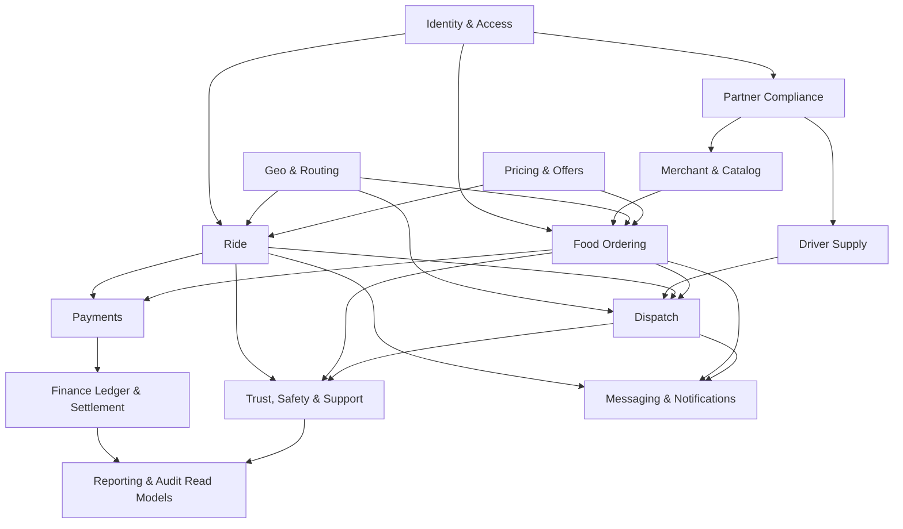
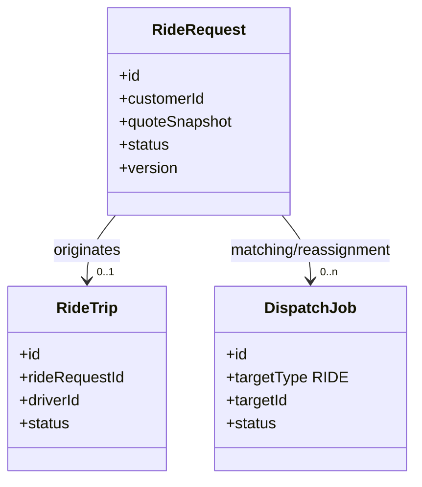
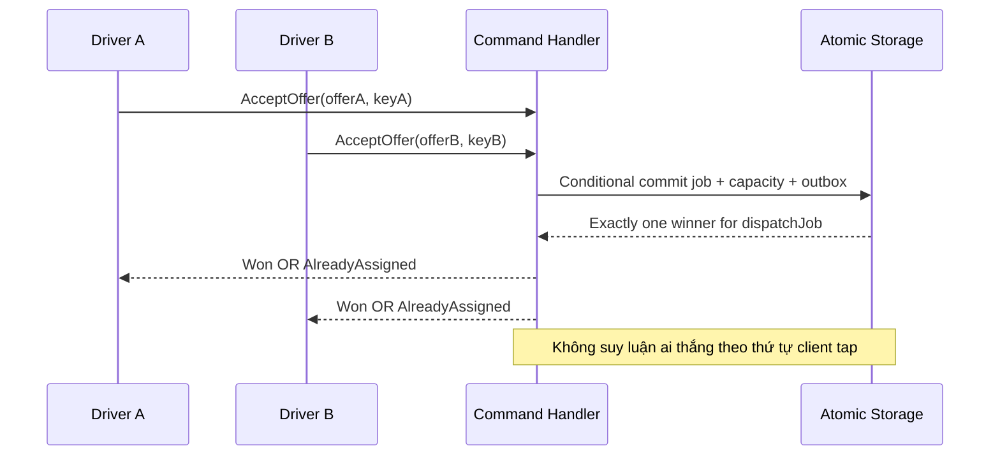
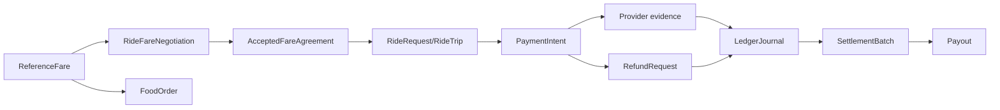
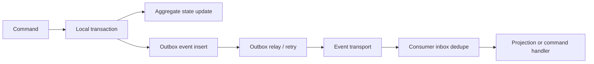

# DealGo — Domain Model / Mô hình miền nghiệp vụ

> **Trạng thái: `DRAFT / PROPOSED`.** Đây là **mô hình khái niệm và định hướng phân ranh giới**, không phải Prisma schema, tên bảng production, API contract hay kiến trúc triển khai đã phê duyệt. Các quyết định `DEC-PROD-001..005` đã được xác nhận theo Governance. Các chính sách liên quan `OPEN-001..019` vẫn là **chưa chốt**.
>
> **Phạm vi đã chốt:** DealGo là **một ứng dụng Flutter ba vai trò Customer / Merchant / Driver**, có **Ride hai bánh có thương lượng giá** và **Food**, cùng **Admin Web**. Không tự bổ sung ô tô, chuyển phát hàng độc lập, ví điện tử, đa nhà hàng/giỏ hay microservices bắt buộc.

## 1. Mục đích và tiêu chí hoàn thành

### 1.1. Vấn đề cần giải quyết

Nếu không có Domain Model, các tác nhân thường gọi nhiều đối tượng khác nhau cùng một từ “đơn”: yêu cầu đặt xe, chuyến đi, đơn đồ ăn, chuyến giao, phân công shipper và giao dịch tiền bị gộp làm một. Hậu quả là state transition sai, cập nhật chéo không kiểm soát, quyền bị lọt và khó xử lý hoàn tiền/đối soát. File này xác định **ai sở hữu sự thật nào, ai được phép ra lệnh và quy tắc nào phải luôn đúng**.

### 1.2. Đầu ra bắt buộc

1. Bản đồ **bounded contexts** và quan hệ giữa các miền.
2. Danh mục **entity, aggregate root, value object, domain service, domain event**.
3. Quy tắc sở hữu dữ liệu, nhất quán, khóa giao dịch và idempotency.
4. Mô hình các luồng Ride / Food / Dispatch / Finance; các failure paths.
5. Ma trận truy vết tới `FR-*`, `BR-*`, `OPEN-*`, workflow và test.
6. Các vấn đề cần Product / Tech / Finance / Ops xác nhận trước khi code nghiệp vụ thật.

### 1.3. Những thứ **không** thuộc trách nhiệm của file này

- Không chốt giá, hoa hồng, phụ phí, phí hủy, thu hộ, chiết khấu hoặc quy tắc bồi hoàn.
- Không chốt thời gian timeout, bán kính tìm kiếm, thuật toán matching, công nghệ realtime, PSP hay vendor KYC.
- Không cung cấp ERD/cột/index production hoàn chỉnh, API endpoints hoặc enum final.
- Không kết luận rằng chỉ có một microservice/một database hoặc yêu cầu chia service ngay từ MVP.
- Không thay thế state-machine contracts trong `03-workflows/*` hay financial contract trong `02-domain/payments-ledger-settlement.md`.

## 2. Nguồn sự thật, cấp độ tin cậy và quy tắc thay đổi

| Loại nội dung | Cấp độ | Quy tắc thực thi |
|---|---|---|
| `DEC-PROD-001..005` | **CONFIRMED** | Ràng buộc thiết kế; mọi thay đổi cần Product Owner phê duyệt. |
| `BR-*` từ PRD | **Invariant đề xuất bắt buộc xác thực** | Xây guard và test; không thay bằng policy chưa được quyết định. |
| `FR-*`, `UC-*` | **PROPOSED_P0** theo tài liệu chức năng | Map thành behavior; chỉ chốt hợp đồng sản xuất khi yêu cầu được phê duyệt. |
| Bounded contexts/aggregates trong file này | **DESIGN_PROPOSAL** | Có thể sửa thông qua review và ADR; không tự chuyển trạng thái `APPROVED`. |
| `OPEN-001..019` | **OPEN** | Không điền giả giá trị vào constants/config production. |
| `ASM-*` | **UNKNOWN** | Cần điều tra và bằng chứng, không được coi là sự thật. |
| Sơ đồ, status, TypeScript minh họa | **CONCEPTUAL** | Không tự sinh migration/API từ mô tả khi chưa xác nhận. |

**Thứ tự khi có mâu thuẫn:** quyết định `CONFIRMED` mới nhất → Governance → PRD/FR/UC được phê duyệt → Domain/Workflow contract đã phê duyệt → triển khai. Nếu hai nguồn cùng cấp xung đột: ghi issue, chặn phần thay đổi; **không tự chọn một bên**.

## 3. Thuật ngữ chuẩn (Ubiquitous Language)

| Thuật ngữ | Ý nghĩa duy nhất | Không được nhầm với |
|---|---|---|
| `Account` | Danh tính đăng nhập của một người/chủ thể theo policy. | `CustomerProfile`, `DriverProfile`, `MerchantStaff`. |
| `RoleGrant` / `RoleMembership` | Quyền tham gia một vai trò với phạm vi và trạng thái. | `ActiveRole` đang hiển thị trên Flutter. |
| `PartnerEligibility` | Kết quả xét điều kiện hoạt động (KYC/KYB/xe/giấy tờ). | Có nút chuyển vai trò trên UI. |
| `MerchantStore` | Một cửa hàng cụ thể có lịch mở, địa điểm, menu và đơn. | Tài khoản chủ doanh nghiệp. |
| `RideRequest` | Ý định tìm dịch vụ Ride của khách; có thể tìm không được người lái. | `RideTrip` đã hình thành. |
| `RideTrip` | Vòng đời chuyến xe thực hiện dịch vụ sau agreement/assignment. | `DispatchOffer`, `RideRequest`, receipt. |
| `FoodCart` | Nháp các món trước checkout; có thể cần revalidate. | `FoodOrder` đã được tạo. |
| `FoodOrder` | Giao dịch đặt món và thực hiện của quán. | `DeliveryTask` của tài xế. |
| `DeliveryTask` | Nhiệm vụ lấy/giao một đơn Food theo scope cho phép. | `FoodOrder` hay `RideTrip`. |
| `DispatchJob` | Nhu cầu tìm một tài xế cho nhiệm vụ cụ thể đã đủ điều kiện. | `DispatchOffer` hoặc `DriverAssignment`. |
| `DispatchOffer` | Lời mời một tài xế nhận job đã có điều kiện, có hạn hiệu lực. | Bằng chứng đã thắng assignment hoặc counter-offer giá. |
| `FareCounterOffer` | Giá tài xế chấp nhận hoặc đề xuất lại trong negotiation Ride. | Dispatch invitation hoặc assignment. |
| `AcceptedFareAgreement` | Snapshot bất biến của giá Ride cuối do khách chọn và server commit. | Giá tham khảo, giá khách đề xuất, payment success. |
| `DriverAssignment` | Kết quả phân công có hiệu lực sau atomic acceptance. | Tap "Nhận" ở client. |
| `PriceQuote` | Báo giá được backend tính và có snapshot/version. | Số tiền đã thu, đã quyết toán. |
| `PaymentIntent` | Ý định thanh toán có trạng thái qua PSP/bộ xử lý. | `LedgerJournal`, `Settlement`, `Payout`. |
| `LedgerJournal` | Bút toán cân bằng ghi nhận nghĩa vụ tiền tệ. | Tình trạng bên PSP hay tiền thực chi. |
| `Settlement` | Chu trình đối soát và xác lập khoản phải trả/nhận. | `Payout` đã chuyển tiền. |
| `LocationObservation` | Tọa độ được ghi nhận ở một thời điểm, có thể sai/trễ. | Bằng chứng pháp lý mặc định rằng đã đón/giao. |

Tra cứu các thuật ngữ và phân biệt tên gọi tại [`../00-governance/glossary.md`](../00-governance/glossary.md). **`Task` ở đây chỉ nhiệm vụ giao hàng `DeliveryTask`, không đồng nghĩa toàn bộ “đơn”.**

## 4. Nguyên tắc thiết kế miền áp dụng cho DealGo

1. **Business boundaries trước kỹ thuật:** Context không được chia chỉ vì route, bảng DB, folder Flutter hoặc nhóm màn hình.
2. **Một thông tin có một authoritative owner:** Consumer nhận event/projection, không chỉnh sửa bảng/domain của owner.
3. **Aggregate bảo vệ bất biến đồng bộ của chính nó:** Chỉ aggregate root thực hiện command làm đổi trạng thái hợp lệ.
4. **Tham chiếu chéo bằng stable ID:** Không nhúng mutable child entities thuộc context khác như đối tượng được tự do sửa.
5. **Tách command khỏi observation:** GPS, push, cache, read model không được tự chuyển trạng thái tiền/chuyến.
6. **Chốt sự thật trên server:** Flutter/merchant UI là client; backend là nơi validate eligibility, state version và permission.
7. **Độc lập vòng đời Ride / Food / Dispatch / Finance:** Không tạo một enum `OrderStatus` hoặc bảng `orders` làm state machine vạn năng.
8. **Idempotency cho mọi thao tác không an toàn khi lặp:** tạo booking, accept offer, hoàn tất, thu/hoàn tiền, can thiệp Admin.
9. **Consistency rõ ràng:** giao dịch local cho invariant đòi atomic; eventual consistency cho projection, notifications, analytics.
10. **Thông báo không phải nguồn sự thật:** push chỉ là signal; client fetch/sync từ backend sau reconnect.
11. **An toàn/riêng tư mặc định:** scope truy cập tối thiểu, audit hành động rủi ro, tách dữ liệu nhạy cảm.
12. **Chính sách chưa quyết định vẫn là `OPEN`:** Kiến trúc có điểm mở, không hard-code default thành cam kết vận hành.

> Về nguyên lý, Bounded Context và Aggregate giúp giới hạn mô hình, giao dịch và ranh giới nhất quán. Nguồn: Fowler và Microsoft (liệt kê §25).

## 5. Phân loại miền nghiệp vụ (Strategic DDD)

| Phân loại | Context | Lý do ưu tiên |
|---|---|---|
| **Core Domain — khả năng tạo khác biệt** | `Ride` | Vòng đời yêu cầu → chuyến xe, xử lý ngoại lệ, bằng chứng chuyến. |
| **Core Domain** | `Food Ordering` | Order lifecycle, merchant acknowledgment, sửa/hết món, bàn giao. |
| **Core Domain** | `Dispatch` | Eligibility candidate, offer, assignment, race, timeout, recovery. |
| **Supporting** | `Driver Supply & Work Capacity` | Trạng thái khả dụng và khả năng giữ vị trí công việc; áp dụng cả Ride/Food. |
| **Supporting** | `Merchant & Catalog` | Store, menu, price/availability nguồn, staff, merchant isolation. |
| **Supporting** | `Pricing & Offers` | Quote/snapshot, fee breakdown; policy vẫn `OPEN-003`. |
| **Supporting, critical** | `Payments` | Payment intent/provider reconciliation; chính sách `OPEN-002/010`. |
| **Supporting, critical** | `Finance Ledger & Settlement` | Money obligations, reconciliation, payout, immutable accounting. |
| **Supporting** | `Trust, Safety & Support` | Dispute, proof, incident, fraud review, admin controlled interventions. |
| **Supporting** | `Partner Compliance` | Driver/Merchant onboarding, KYC/KYB, giấy phép, eligibility. |
| **Generic** | `Identity & Access` | Authentication, role grants, sessions, object authorization. |
| **Generic** | `Geo & Routing` | Location observation, geofence, route/ETA provider abstractions. |
| **Generic** | `Messaging & Notifications` | Push/in-app notifications; delivery not guaranteed. |
| **Generic** | `Reporting & Audit Read Models` | Projections, reporting và append-only audit evidence. |

**14 bounded contexts ứng viên ≠ 14 microservices.** MVP có thể triển khai thành modular monolith với interface, module ownership, transactional boundaries và event contract rõ ràng. Quyết định triển khai thực tế cần ADR ở `05-architecture/*` và cân nhắc `OPEN-007`.

## 6. Context Map cấp hệ thống

### 6.1. Sơ đồ trách nhiệm (conceptual)



**Chú giải:** Mũi tên ở sơ đồ nghĩa là *sử dụng một khả năng/bằng chứng hoặc nhận thông tin từ context khác*, **không** có nghĩa được phép sửa database của context đó, cũng không khẳng định gọi HTTP đồng bộ. Quan hệ upstream/downstream và owner cụ thể ở bảng sau.

### 6.2. Context relationships và integration style đề xuất

| Owner cung cấp | Consumer | Dữ liệu/capability công khai | Boundary contract |
|---|---|---|---|
| Identity & Access | tất cả | `actorId`, role scopes, session claims đã xác thực | AuthN/AuthZ port; caller vẫn phải check ownership. |
| Partner Compliance | Driver Supply, Merchant | trạng thái eligibility được cấp phép | Versioned eligibility query/event; không cho client tự xác nhận. |
| Merchant & Catalog | Food | snapshot merchant/menu/price at checkout | Revalidate + immutable order lines; không tin cached menu. |
| Pricing & Offers | Ride, Food | Ride reference fare + negotiation/agreement; Food checkout quote | Versioned snapshots and expiry by policy; Ride negotiation is separate from dispatch. |
| Geo & Routing | Ride, Food, Dispatch | địa chỉ đã resolve, route/ETA estimate | Provider adapters; dữ liệu mang timestamp/quality. |
| Ride | Dispatch | dispatchable ride requirement + cancellation | Command/Integration event có `rideRequestId`. |
| Food | Dispatch | delivery requirement + merchant readiness | Command/Event có `foodOrderId`, dispatch timing `OPEN-004/016`. |
| Driver Supply | Dispatch | eligible/available capacity observation | Concurrency guard tại commit assignment, không chỉ read cache. |
| Dispatch | Ride/Food | assignment/revoke/timeout outcome | Idempotent integration event theo `dispatchJobId`. |
| Ride/Food | Payments | invoice-able/collectable obligation | Policy-controlled trigger; không tạo capture từ UI. |
| Payments | Finance | payment/refund evidence và reconciliation status | Provider IDs + immutable event dedupe. |
| Ride/Food/Dispatch | Trust & Support | lifecycle/proof/incident data theo quyền | Snapshot/evidence references; không sửa trực tiếp lifecycle. |
| các owners | Notifications / Reporting | domain/integration events | Eventually consistent projection; không phải state authority. |

### 6.3. Quy tắc chống chia context sai

- Cùng `Driver` trong Ride và Food là *actor*, không khiến Ride/Food thành cùng một context.
- `Merchant` và `Customer` có thể cùng `Account`, nhưng quyền và dữ liệu cửa hàng không thuộc `Account`.
- `Assignment` có thể phục vụ Ride **hoặc** Food; nguồn yêu cầu vẫn ở owner nghiệp vụ tương ứng.
- `PriceQuote`, `PaymentIntent`, `LedgerJournal`, `SettlementBatch` có id/vòng đời khác nhau, kể cả khi cùng một số tiền hiển thị.
- `ReadModel` phục vụ UI đa vai trò được join dữ liệu tối thiểu theo quyền, không được là write model thay thế.

## 7. Domain object taxonomy

### 7.1. Entity

Có danh tính ổn định, thay đổi theo thời gian, như `RideRequest`, `FoodOrder`, `MerchantStore`, `DriverProfile`, `DispatchJob`. Hai entity có cùng dữ liệu hiển thị vẫn là hai đối tượng khác nếu ID khác.

### 7.2. Value Object (VO)

Bất biến theo giá trị, ví dụ:

| VO | Nội dung/validation | Áp dụng |
|---|---|---|
| `Money` | `amountMinor`, `currency` (ví dụ VND); phép cộng chỉ cùng currency; không dùng float cho tiền. | Giá, thanh toán, ledger. |
| `PriceBreakdown` | Item subtotal, vận chuyển, phí, khuyến mại, thuế nếu áp dụng, total có policyVersion. | Food checkout quote hoặc các fee lines kèm Ride fare agreement. |
| `GeoPoint` | Latitude/longitude hợp lệ và metadata precision nếu có. | Pickup/dropoff, store, observation. |
| `ResolvedAddress` | Địa chỉ đã chuẩn hóa, tọa độ, nguồn resolve, geofence result. | Ride/Food, delivery. |
| `TimeWindow` | start/end, timezone và thứ tự thời gian hợp lệ. | Store schedule, offer validity. |
| `EligibilityDecision` | eligible, reasons, evaluatedAt, version. | Driver/merchant authorization. |
| `LocationQuality` | observedAt, receivedAt, accuracy, freshness, permission/source. | Geo/read model. |
| `QuoteSnapshot` | Giá, breakdown, inputHash, policyVersion, expiry, currency. | Đóng dấu tại request/order. |
| `MerchantOrderLineSnapshot` | Tên món, lựa chọn, quantity, giá/thành phần tại thời điểm đặt. | `FoodOrder`. |
| `BusinessReason` | Enum/domain code + note + actor (PII đã kiểm soát). | Hủy, refund, override. |
| `ProofReference` | Type, encrypted object reference, capturedAt, actor, scope. | Pickup/Delivery/Ride. |
| `IdempotencyScope` | actor, operation, key, payloadFingerprint, expiry. | Commands có side effect. |

**Không** tạo shared mutable `Money` hoặc global `Address` entity dùng để tự cập nhật giá/tọa độ của lịch sử giao dịch. Snapshot đã chốt phải giữ nguyên; correction dùng revision/event có audit.

### 7.3. Domain Service / Policy

| Component | Lý do không thuộc một entity đơn | Trạng thái |
|---|---|---|
| `DispatchCandidatePolicy` | Xếp candidates từ đa driver, geo, capability. | Contract-only; thuật toán `OPEN-004`. |
| `DriverCapacityPolicy` | Kiểm tra capacity trong hai service. | Contract-only; `OPEN-005`. |
| `QuotePolicy` | Kết hợp route, merchant snapshot, fee policy, promotions. | Contract-only; công thức `OPEN-003`. |
| `CancellationDecisionPolicy` | Phân nhánh timing/reason/financial impact. | Contract-only; `OPEN-003/016/017`. |
| `ReconciliationPolicy` | So bằng chứng PSP/ledger, tìm missing/duplicate. | Contract skeleton; `OPEN-002/010/018`. |
| `EligibilityPolicy` | Giấy tờ/địa bàn/cấp phép từng service. | Contract skeleton; `OPEN-006/008`. |

Dịch vụ miền chứa **quy tắc nghiệp vụ**, Application Service chỉ orchestration giao dịch / port / repository; không để business policy trong controller hoặc Flutter widget.

## 8. Aggregate Catalog — ownership, root và điều kiện nhất quán

> Ký hiệu `P` = proposed, `B` = blocked bởi quyết định mở. `Candidate` không có nghĩa entity/table bắt buộc tồn tại độc lập. Aggregate dùng để giữ invariant và command boundary, không dùng để chỉ kích thước một object graph.

| Root (owner context) | Thành phần/VO quan trọng | Command chính | Invariant đồng bộ / policy |
|---|---|---|---|
| `Account` (Identity) | credential refs, verified contacts, sessions | Register, Verify, Disable | Không tự cấp role hoặc store owner nếu chưa kiểm tra. `P`. |
| `RoleMembership` (Identity) | role, scope, status, grants | RequestRole, Grant, Revoke | Authz độc lập với `activeRole` UI. `P`. |
| `PartnerApplication` (Compliance) | applicant, document refs, review history | Submit, Review, Approve, Reject | Chỉ approved theo policy mới active, có audit. `B: OPEN-006/008`. |
| `MerchantStore` (Merchant) | owner ref, address, availability, staff scopes | Open, Pause, UpdateHours | Store isolation và eligibility; chưa chốt multi-store `OPEN-013`. |
| `MenuCatalog` (Merchant) | menu categories, items, options, versions | Publish, Unpublish, UpdateItem | Versioning/availability; historical order không đổi. `P`. |
| `DriverProfile` (Driver Supply) | account ref, service capabilities, vehicle refs | Activate, Suspend, UpdateCapability | Không active khi không eligible. `B: OPEN-006`. |
| `DriverWorkSlot` (Driver Supply) | driverId, assignment reservation, version | Reserve, Release, Expire | Capacity/overlap policy kiểm tra tại commit. `B: OPEN-005`. |
| `RideRequest` (Ride) | customer, pickup/dropoff, referenceFareRef, fareNegotiationRef, dispatchJobRef | Create, Cancel, MarkAssigned, Expire | Một intent không tạo 2 request; chưa có agreement thì chưa assignment; assigned ≠ started. |
| `RideFareNegotiation` (Ride/Pricing) | rideRequestId, passengerOffer, fareCounterOffers, selectedOfferId, state/version | SubmitPassengerOffer, DriverAccept, DriverCounter, PassengerSelect, Expire, Cancel | Chỉ một offer selection thắng; counter-offer không tự tạo assignment; amount/currency/actor/time immutable. `B: OPEN-003/019`. |
| `AcceptedFareAgreement` (Ride/Pricing) | negotiationId, selectedOfferId, agreedFareSnapshot, fee/tax breakdown reference, acceptedAt | CommitAgreement, InvalidateBeforeAssignment (guarded) | Một thỏa thuận cho request; không đổi âm thầm sau commit; repricing cần consent/version mới. |
| `RideTrip` (Ride) | requestId, driverId, start/end evidence, route summary | Start, Finish, Interrupt | Chỉ terminal bằng transition hợp lệ; không đồng nhất payment. `B: OPEN-017`. |
| `FoodCart` (Food) | account/store refs, draft items, revision | Add, Edit, Clear | Draft không được xem như confirmed order. `P`; persistence optional. |
| `FoodOrder` (Food) | merchant ID, immutable line snapshots, address, fulfillment state | Place, MerchantAccept, Reject, Prepare, MarkReady, RecordFulfillment | Merchant ready ≠ delivered; financial state tách riêng. `B: OPEN-009/016`. |
| `DeliveryTask` (Food) | order ID, pickup/dropoff refs, assigned driver, proofs | Create, MarkPickup, MarkDelivered, MarkFailed | Chỉ nhiệm vụ đúng order/store; proof `OPEN-011`. |
| `DispatchJob` (Dispatch) | jobTargetRef, offers, activeAssignmentId, stateVersion | Start, Offer, Assign, Revoke, Expire | Tối đa một active assignment **cho một dispatch job**. |
| `DriverAssignment` (Dispatch) | dispatchJobId, driverId, winning offer, terminal reason | Activate, Complete, Revoke | No duplicate active assignment; phối hợp với `DriverWorkSlot`. `B: OPEN-005`. |
| `PriceQuote` (Pricing) | priceSnapshot, inputHash, validity, scope | Calculate, Issue, Invalidate | Không dùng quote hết hạn/khác intent; policy `OPEN-003`. |
| `PaymentIntent` (Payments) | provider refs, attempts, status, amount | Create, Authorize, Capture, Fail | PSP callback/retry không double-charge. `B: OPEN-002/010`. |
| `RefundRequest` (Payments) | original payment refs, approved amount, reason | Request, Approve, Execute, Resolve | Không refund lặp/vượt mức đủ điều kiện. `B: OPEN-003/016`. |
| `LedgerJournal` (Finance) | journal lines, debit/credit, immutable refs | Post, ReverseByNewJournal | Tổng debit = credit theo currency; không mutate posted journal. `P`. |
| `SettlementBatch` (Finance) | payable items, cycle, reconciliation refs | Prepare, Reconcile, Close | Không coi ledger posted là money transferred. `B: OPEN-002/018`. |
| `Payout` (Finance) | destination reference, amount, provider result | Request, Execute, Reconcile | Payout duy nhất cho nghĩa vụ đã duyệt; không lặp callback. `B: OPEN-002`. |
| `SupportCase` (Trust & Support) | subject reference, actors, evidence, decisions | Open, Escalate, Resolve | Can thiệp có actor/permission/reason/audit. `B: OPEN-015/016`. |

**Quan trọng:** `DriverAssignment` và `DriverWorkSlot` được mô hình hóa riêng để cho thấy *hai invariant khác nhau*: một job chỉ có một người được gán, và một tài xế chỉ giữ workload theo capacity policy. Nếu cả hai phải đúng tức thời, hạ tầng cần **một atomic commit được chứng minh** hoặc một aggregate reservation coordinator phù hợp; không thể chỉ “kiểm tra rồi ghi” qua hai request rời.

## 9. Detail: Identity & Access + Partner Compliance

### 9.1. `Account` không sở hữu mọi vai trò

- `Account.id` là danh tính phiên đã xác thực, không tự suy ra eligible để lái xe hay bán hàng.
- `RoleMembership(role, scope)` xác định được truy cập phạm vi nào; `activeRole` chỉ điều hướng UX.
- `MerchantStore` liên kết người có quyền với cửa hàng theo membership, không giả định một user chỉ có một store.
- `DriverProfile` chứa capability/eligibility link; phương thức xác thực giấy tờ nằm trong Compliance.
- KYC/KYB chưa đủ/đã hết hạn/đã bị đình chỉ phải từ chối hoạt động yêu cầu quyền tương ứng, kể cả client gửi token cũ.
- Hành động chuyển vai trò trên Flutter không xóa active Ride/Food job, cũng không tự giải phóng reservation.

### 9.2. Commands và events ứng viên

| Command | Guard tối thiểu | Event sau commit |
|---|---|---|
| `ApplyForDriverRole` | account valid, hồ sơ theo yêu cầu. | `PartnerApplicationSubmitted` |
| `ReviewPartnerApplication` | reviewer có permission và reason. | `PartnerEligibilityChanged` |
| `GrantStoreStaffAccess` | actor có grant đúng store, scope và expiry. | `StoreStaffAccessGranted` |
| `SuspendDriver` | role Ops, audit reason, xử lý in-flight theo runbook. | `DriverEligibilityChanged` |

Không định nghĩa exact driver onboarding checklist trước `OPEN-006/008`. Tham chiếu `02-domain/roles-and-permissions.md` và `02-domain/identity-kyc-kyb.md`.

## 10. Detail: Ride Context

### 10.1. `RideRequest` aggregate root

**Sở hữu:** requester, pickup/destination snapshot, pricing snapshot reference, idempotency intent, requestedAt, dispatch reference và trạng thái tìm kiếm. **Không sở hữu** PSP payment status, driver GPS feed hoặc whole `DriverProfile`.

**Commands mẫu:** `PlaceRideRequest`, `SubmitPassengerFare`, `RespondToRideFare` (accept/counter), `SelectFareOffer`, `AcceptAssignmentOutcome`, `CancelRideRequest`, `ExpireFareNegotiation`.

**Guards:** route/reference fare version hợp lệ; actor chính chủ; proposal guardrail nếu được duyệt; chưa terminal; transition theo expectedVersion. `SelectFareOffer` chỉ Customer sở hữu request mới được gọi, offer phải còn hiệu lực/thuộc request đó, một lựa chọn thắng nguyên tử. `AcceptAssignmentOutcome` chỉ nhận assignment event từ server sau agreement; client không gửi driverId để tự gán.

**Events:** `RideRequestPlaced`, `PassengerFareProposed`, `DriverFareAccepted` hoặc `DriverFareCountered`, `FareAgreementCommitted`, `RideRequestAssigned`, `RideRequestCancelled`, `FareNegotiationExpired`.

**Lifecycle tối thiểu:** `REQUEST_CREATED → NEGOTIATING → CUSTOMER_SELECTING → FARE_AGREED → ASSIGNED`; các nhánh `NO_OFFER/EXPIRED/CANCELED` đóng negotiation mà không tạo assignment. State names là proposal, số vòng/expiry thuộc `OPEN-019`.

### 10.2. `RideTrip` aggregate root

- Khởi tạo/liên kết từ RideRequest đã có assignment thắng và đủ điều kiện; **không đồng nghĩa với việc trip đang di chuyển**.
- `StartRideTrip` cần bằng chứng/actor/guard chính thức từ `OPEN-017`; `FinishRideTrip` cần guard và idempotency.
- Thay đổi pickup/destination sau khi tạo request hoặc trong trip phải qua rule riêng, không âm thầm sửa quote lịch sử.
- Một Trip có một lifecycle rõ ràng và nhiều location observations; không lưu tọa độ stream realtime như mutable field làm chứng cứ duy nhất.
- Completion có thể kích hoạt yêu cầu thu tiền/đối soát qua Integration Event, nhưng không tự coi `payment=settled`.

**Events:** `RideTripCreated`, `RideTripStarted`, `RideTripFinished`, `RideTripInterrupted`, `RideTripDisputed`.

### 10.3. Quan hệ khái niệm



**Lưu ý:** quan hệ một Request với nhiều DispatchJob là phương án để cho phép retry/reassign có lịch sử; không mặc định yêu cầu mới cho từng lần tìm. Đặc tả final ở `ride-lifecycle.md` và `dispatch-and-assignment.md`.

## 11. Detail: Food Ordering & Merchant

### 11.1. `MerchantStore` / `MenuCatalog`

- Store có availability, merchant/staff quyền quản lý và trạng thái đủ điều kiện bán.
- Menu có version; giá/món/option được revalidate tại checkout. Không overwrite ảnh hưởng order trước đó.
- Read model menu có thể cache; xác nhận đặt món phải kiểm tra authoritative availability.
- `OPEN-013` quyết định nhiều store và staff authorization cấp nào tại MVP; mô hình vẫn cần scope `storeId` để tránh leak.

### 11.2. `FoodOrder`

**Sở hữu:** buyerId, storeId, immutable order line snapshots, delivery address snapshot, merchant acceptance/prep state, references tới `DeliveryTask`, quote/payment links và cancellation records (không chứa ledger posting). Chỉ có **một trạng thái domain authority cho phần merchant fulfillment**; trạng thái tổng hợp hiển thị được suy ra từ các context.

**Commands:** `PlaceFoodOrder`, `AcceptFoodOrder`, `RejectFoodOrder`, `BeginPreparation`, `MarkFoodReady`, `RequestOrderCancellation`, `ApplyDeliveryOutcome`.

**Guards:** actor merchant gắn đúng store, item version hợp lệ lúc checkout, transition hợp lệ, expectedVersion, chống double mutation. Merchant không trực tiếp set `delivered` mà phải qua kết quả fulfillment có kiểm soát từ DeliveryTask.

**Events:** `FoodOrderPlaced`, `FoodOrderAccepted`, `FoodOrderRejected`, `FoodPreparationStarted`, `FoodMarkedReady`, `FoodOrderFulfillmentCompleted`, `FoodOrderCancellationRequested`, `FoodOrderCancelled`.

### 11.3. `DeliveryTask`

- Sở hữu pickup/delivery progression và evidence reference, assignment outcome ID, failure reasons; tham chiếu `foodOrderId` và `storeId`.
- Driver `PickupFood` không hợp lệ nếu khác merchant/store/order, proof thiếu theo policy hoặc assignment không active.
- `CompleteDelivery` cần điều kiện handoff/proof được duyệt (`OPEN-011`); không dùng mỗi GPS gần địa chỉ làm completion.
- Một FoodOrder có thể cần nhiều nỗ lực giao theo recovery policy; mô hình không giả định số task >1 ở MVP, cũng không ngăn thiết kế có lịch sử attempts sau này.

### 11.4. Hành trình tương tác, không gộp lifecycle

```mermaid
sequenceDiagram
  participant C as Customer
  participant FO as Food Ordering
  participant M as Merchant
  participant DIS as Dispatch
  participant D as Driver/DeliveryTask
  participant FIN as Payments/Finance
  C->>FO: PlaceFoodOrder (idempotency key)
  FO-->>C: FoodOrderCreated
  FO-->>M: NewOrder (notification/projection)
  M->>FO: Accept / Prepare / Ready
  Note over FO,DIS: Thời điểm bắt đầu dispatch chưa chốt OPEN-004/016
  FO->>DIS: Request delivery capacity (according to policy)
  DIS-->>FO: Assignment outcome
  D->>D: Confirm pickup with valid proof
  D->>D: Confirm delivery with valid proof
  D-->>FO: DeliveryCompleted event
  FO-->>C: Fulfillment updated
  FO-->>FIN: Money obligation candidate
  Note over FO,FIN: Payment timing OPEN-002/010; delivery ≠ settled
```

**Cần chốt:** single/multi-merchant cart `OPEN-009`; acceptance/timeout; order edit/substitution; chuẩn bị xong mà thiếu driver `OPEN-016`; phương thức thu tiền/thời điểm `OPEN-002/010`; proof `OPEN-011`.

## 12. Detail: Dispatch & Driver Supply

### 12.1. Phân biệt 4 lớp

1. `DriverAvailabilityObservation`: vị trí, online, lastSeen, eligibility cache (không phải reservation).
2. `DispatchJob`: nhu cầu tìm người cho một source target (`RIDE_REQUEST` hoặc `FOOD_DELIVERY_TASK`).
3. `DispatchOffer`: lời mời nhận job đã có giá/điều kiện, có ID/expiry/state; không phải thương lượng giá.
4. `FareCounterOffer`: đề nghị giá của tài xế trong negotiation Ride; khách mới có quyền chọn.
5. `AcceptedFareAgreement`: snapshot giá cuối; được tạo trước assignment sau khi server commit lựa chọn của khách.
4. `DriverAssignment` / `DriverWorkSlot`: kết quả phân công thực tế và giữ capacity.

### 12.2. Assignment winning path — hợp đồng atomic



**Invariant bắt buộc:** `BR-DISPATCH-001/002`. Optimistic version/CAS, unique constraint và transaction/lock là **biện pháp thực thi có thể kết hợp**, không chỉ dùng mutex trong một Node process. Việc điều phối nhiều job tranh cùng driver cần capacity invariant riêng theo `OPEN-005`.

### 12.3. Cơ chế reservation đề xuất (không khóa schema)

- `Offer` chỉ chứng minh được mời, **không chiếm capacity** mặc định.
- Tại `AcceptOffer`, server kiểm tra offer còn hiệu lực, actor đúng driver, khả năng phục vụ và state hiện tại; sau đó commit một winner + reservation theo atomic contract.
- Unique active assignment theo `dispatchJobId` là guard tối thiểu. Capacity theo `driverId` phụ thuộc `OPEN-005`; trường hợp chưa có policy phải **fail closed** cho workload chồng chéo không được chứng minh an toàn.
- Khi cancel/reassign/fail, có event và state-transition hợp lệ để release reservation; không release trước khi record sự kiện cần thiết.
- Offer đến muộn, retry, push trễ, reconnect, process restart đều không thể tạo thêm assignment trái policy.
- Cơ chế lease/heartbeat/expiry (nếu dùng) phải reconcile database authority, không dùng TTL Redis một mình như quyết định cuối.

### 12.4. Chính sách chưa chốt

`OPEN-004`: radius, ranking ETA, dispatch offer batch/sequential, timeout, retries, reassign. `OPEN-005`: concurrency Ride/Food, driver switching roles/capacity. `OPEN-012`: background GPS. `OPEN-019`: negotiation rounds/expiry/price guardrails and no-response handling. Domain/API must keep fare negotiation and dispatch invitation separate.

## 13. Detail: Pricing, Payments và Finance

### 13.1. Tách chuỗi tiền và trạng thái



Mũi tên là **quan hệ nghiệp vụ khả dĩ**, không quyết định thứ tự chính xác; payment capture có thể trước/sau merchant acceptance theo `OPEN-002/010`. Không được tự động kích hoạt payout từ `FoodOrder.delivered`.

### 13.2. Quy tắc tính tiền

- `Money.amountMinor` dùng integer hoặc decimal chính xác theo currency, không dùng JS floating point cho accounting totals.
- `ReferenceFare`/`PriceQuote` có input snapshot/hash, breakdown, version và validity; chỉ là giá tham khảo cho Ride.
- `RideFareNegotiation` ghi passenger offer và từng counter-offer tách biệt; `AcceptedFareAgreement` lưu giá cuối immutable sau khi khách chọn.
- `FoodOrder` vẫn dùng quote checkout authoritative từ backend; không áp fare negotiation Ride lên giá món/Food.
- Khi phát sinh thay đổi làm ảnh hưởng giá, yêu cầu re-quote/consent theo chính sách đã duyệt, không sửa snapshot cũ.
- Order/Trip tham chiếu quote/pricing snapshot immutable; tài chính ghi nghĩa vụ riêng và khả năng điều chỉnh có lý do.
- Khi có khuyến mại/thuế/phí, cách áp dụng/rounding là `OPEN-003`, chưa có công thức cụ thể.

### 13.3. Sự thật tài chính phải tách

| Trạng thái | Owner | Ý nghĩa | Không suy ra |
|---|---|---|---|
| Reference fare issued | Pricing | Có mức tham khảo hợp lệ theo policy/version. | Giá cuối được thỏa thuận hoặc khách đã trả tiền. |
| Fare agreement committed | Ride/Pricing | Khách đã chọn một đề nghị còn hiệu lực; snapshot giá cuối được khóa. | Payment success hoặc Ride completed. |
| Payment initiated/pending | Payments | Đã bắt đầu tương tác thu tiền. | PSP confirmed, ledger posted. |
| Payment confirmed | Payments (sau verification) | Có bằng chứng PSP/collection hợp lệ. | Đã đối soát, payout xong. |
| Ledger posted | Finance | Nghĩa vụ được ghi nhận bằng bút toán. | PSP thực chuyển tiền, settlement complete. |
| Settlement reconciled | Finance | Khoản phải thu/chi được khớp theo cycle. | Payout thực tế thành công. |
| Payout completed | Finance với provider evidence | Khoản thanh toán đối tác đã hoàn tất. | Đơn hàng/chuyến xe có trạng thái nào khác. |

### 13.4. Integrity bắt buộc

- Idempotency tại initiation và PSP callback; provider event identity scoped per provider.
- Một refund request không được gây hai external refund hoặc hai bút toán cho cùng sự kiện, kể cả sau crash/retry.
- `LedgerJournal` đã POSTED là immutable; đảo bằng `reversal/new journal`, không sửa/xóa dòng cũ.
- Journal balanced trên từng currency; tách payable merchant, payable driver, revenue/fee/tax nếu có theo mô hình được duyệt.
- Trạng thái provider mơ hồ `UNKNOWN`/`RECONCILIATION_REQUIRED` **không** hiển thị là `PAID` hoặc `SETTLED` (`BR-FIN-002`).
- `OPEN-018` không hàm ý COD được chọn. Nếu COD được duyệt mới thiết kế rõ debt/collection/limit/settlement authority.

## 14. Geo, Notifications, Trust & Admin projections

### 14.1. Geo & Routing

- `LocationObservation` tách `observedAt` với `receivedAt`; cần `accuracy`, `source`, `permissionStatus`, quality/freshness.
- Route/ETA là **estimate** có timestamp và provider; không phải thời gian thực hiện cam kết.
- `PickupLocationSnapshot` / `DeliveryAddressSnapshot` cố định trong phiên giao dịch đã xác nhận; chỉnh sửa phải tạo revision có audit.
- Không tiết lộ lịch sử GPS, liên hệ hoặc hành trình cho actor không có quyền; policy thu thập/lưu trữ `OPEN-012`.
- Geofence/coverage vùng hoạt động `OPEN-001`; không dùng cached location để lách kiểm tra vùng server.

### 14.2. Messaging & Notifications

- Notification có `notificationId`, recipient scope, event source và status gửi; gửi thành công không bằng recipient nhận/đọc.
- Realtime/socket/push delivery có thể lặp, mất hoặc đảo thứ tự. Client fetch authoritative state, áp dụng version để bỏ state cũ.
- Định nghĩa masked call/in-app chat/support P0 còn `OPEN-014`.

### 14.3. Trust & Support / Admin

- `SupportCase` tham chiếu subject bằng `{subjectType, subjectId}` có quyền/visibility; attachments dùng encrypted refs.
- Admin can thiệp bằng command chuyên trách, check RBAC + ownership + maker/checker (nếu policy cần), reason và append-only audit.
- Không cho admin ghi tay `paid=true`, `completed=true` hoặc xóa journal để “sửa đơn”.
- Sự kiện safety có escalation runbook, access control, retention, redaction; mức hỗ trợ/trực `OPEN-015`.
- User/driver/merchant rating/review không thay thế bằng chứng payment/delivery.

## 15. Commands: contract thống nhất giữa các Bounded Contexts

### 15.1. Command envelope đề xuất

```ts
// Conceptual only — không phải API/DB contract final
interface DomainCommand<TPayload> {
  commandId: string;           // stable ID để chống xử lý lặp
  intentId?: string;           // logical request intent nếu phù hợp
  actorId: string;             // server-authenticated; không tin header tùy ý
  activeRole?: 'CUSTOMER' | 'MERCHANT' | 'DRIVER' | 'ADMIN';
  targetScope?: { storeId?: string; driverId?: string };
  targetId?: string;
  expectedVersion?: number;    // optimistic concurrency
  idempotencyKey?: string;
  correlationId: string;
  requestedAt: string;
  payload: TPayload;
}
```

**Validation order tối thiểu:** authenticate → authorize action+object → validation+scope → idempotency record+payload fingerprint → preconditions/version/state guard → atomic mutation+outbox → safe response. Thứ tự kiểm tra dữ liệu nhạy cảm phải chống existence leak (không trả 404/403 theo kiểu lộ đối tượng người khác).

### 15.2. Command result/error semantics

| Kết quả | Hành vi |
|---|---|
| Success first commit | Trả stable authoritative resource ID, state, version; event đã ghi outbox. |
| Retry same key+same payload | Trả same logical outcome, không phát sinh mutation/charge mới. |
| Retry same key+different payload | Từ chối key reuse; không overwrite request đầu. |
| Stale `expectedVersion` | Concurrency conflict; client refetch, không tự retry non-idempotent command. |
| State không cho chuyển | Domain rejection kèm stable error code; không ghi side effect. |
| Thiếu quyền | Deny trên server, audit theo policy; không rò PII. |
| Provider timeout | Trạng thái `UNKNOWN/PENDING`, reconcile trước replay external side effect. |

Tên error code final dùng chung RFC 9457 ở API contract sau này, nhưng domain errors phải độc lập HTTP (`ForbiddenOperation`, `InvalidTransition`, `ConcurrentModification`, `OfferExpired`, `AlreadyAssigned`, `PaymentOutcomeUnknown`, `NotEligible`).

## 16. Domain Events vs Integration Events

| Loại | Kích hoạt và người nhận | Consistency/transport |
|---|---|---|
| Domain Event | Fact quan trọng phát sinh từ một aggregate, dùng nội bộ cùng context. | Có thể dispatch trong application transaction; phải kiểm soát lỗi và side effects. |
| Integration Event | Bản phát hành đã chuyển đổi từ domain fact để context khác tiêu thụ. | Qua transactional outbox, delivery at-least-once, consumer idempotent. |
| UI Notification | Thông tin đối với recipient, có thể được gửi qua FCM/socket/inbox. | Best effort hoặc retry; không phải bằng chứng chính xác state. |
| Audit Event | Ghi ai/điều gì/khi nào/tại sao theo quyền. | Append-only, retention theo chính sách. |

### 16.1. Event inventory đề xuất

| Event (past tense) | Producer | Consumer / side effect | Không được tự suy ra |
|---|---|---|---|
| `RideRequestPlaced.v1` | Ride | Dispatch request, customer tracking projection. | Driver đã có. |
| `RideRequestCancelled.v1` | Ride | Dispatch revoke, notify, finance review. | Refund đã trả. |
| `RideTripStarted.v1` | Ride | Tracking, safety, ETA read model. | Đã thu tiền. |
| `RideTripFinished.v1` | Ride | Pricing finalization candidate, payment obligation, reporting. | PSP/settlement hoàn tất. |
| `FoodOrderPlaced.v1` | Food | Merchant inbox, payment flow per policy. | Quán đã xác nhận. |
| `FoodOrderAccepted.v1` | Food | preparation tracking, dispatch per policy. | Có shipper. |
| `FoodMarkedReady.v1` | Food | merchant/dispatch updates, ETA. | Shipper đã pickup. |
| `DeliveryTaskPickedUp.v1` | Food delivery | Food order projection, notify. | Khách đã nhận. |
| `DeliveryTaskCompleted.v1` | Food delivery | Food order fulfillment outcome, reporting. | Tiền đã settled. |
| `DispatchAssignmentConfirmed.v1` | Dispatch | Ride/Food & driver workload projections. | Trip đã bắt đầu. |
| `DriverAssignmentRevoked.v1` | Dispatch | Ride/Food recovery, capacity release. | Original job bị hủy luôn. |
| `PartnerEligibilityChanged.v1` | Compliance | Driver/Merchant ability, authorization cache invalidation. | In-flight job tự động được hủy. |
| `PaymentConfirmed.v1` | Payments | Finance posting candidate, order finance projection. | Settlement completed. |
| `RefundConfirmed.v1` | Payments | Journal reversal/adjustment per policy. | Mọi khoản bồi thường đã giải quyết. |
| `LedgerJournalPosted.v1` | Finance | Settlement/reporting projection. | Payout đã gửi. |
| `PayoutConfirmed.v1` | Finance | Partner finance history. | Thực tế tài khoản ngân hàng thay đổi ngoài provider proof. |

**Sự kiện không được chứa trực tiếp** số CCCD, ảnh giấy tờ, token, secret, toàn bộ tọa độ thô không cần thiết hay số tài khoản ngân hàng. Dùng reference + authorized fetch.

### 16.2. Versioned integration envelope

```json
{
  "eventId": "evt_unique_id",
  "eventType": "DispatchAssignmentConfirmed",
  "schemaVersion": 1,
  "aggregateType": "DispatchJob",
  "aggregateId": "job_123",
  "aggregateVersion": 8,
  "occurredAt": "2026-10-12T02:00:00Z",
  "correlationId": "corr_abc",
  "causationId": "cmd_xyz",
  "tenantScope": "platform_or_store_scope",
  "data": {
    "assignmentId": "as_123",
    "targetType": "RIDE_REQUEST",
    "targetId": "ride_123",
    "driverId": "drv_123"
  }
}
```

Giá trị ID minh họa, không phải dữ liệu thật. Chỉ producer tăng `aggregateVersion`, consumer bỏ events đã xử lý và xử lý out-of-order theo policy; **không** giả định broker cung cấp ordering toàn cục.

### 16.3. Transactional outbox + inbox (đề xuất)



- Producer ghi business state và outbox record **trong cùng DB transaction**, tránh dual-write mất event.
- Relay có thể publish trùng; consumer dedupe bằng event ID/consumer name và commit dedupe + side effect atomically khi cùng storage.
- Projection/retries phải có dead-letter/quarantine, observability, replay có kiểm soát.
- `at-least-once` không tương đương `exactly-once business effects`; correctness đến từ idempotency/unique/transaction.
- Thông tin contract sẽ được chuẩn hóa tại `06-data-api/events.asyncapi.yaml` và `05-architecture/realtime-and-event-architecture.md`.

## 17. Transaction boundaries, consistency và concurrency

### 17.1. Consistency matrix

| Nghiệp vụ | Phải đồng bộ/atomic | Có thể eventual | Rủi ro nếu làm sai |
|---|---|---|---|
| Place RideRequest | Idempotency intent + request + outbox. | Candidate search, push. | Double booking, request lost. |
| Place FoodOrder | Idempotency + immutable line snapshots + order + outbox. | Merchant push/inbox projection. | Double order, giá sai. |
| Accept DispatchOffer | Job winner + active assignment + driver capacity guard. | Customer/driver notification. | Double assignment/driver overbook. |
| Cancel RideRequest | Request state guard + mutation + cancellation outbox. | Dispatch revoke, support notifications. | Assignment đến sau cancel. |
| Food Merchant accept | Store ownership + version + order state. | Start dispatch per policy, notify. | Merchant chấp nhận order sai/quá hạn. |
| Complete DeliveryTask | Assignment valid + proof rule + terminal transition + outbox. | FoodOrder/read models. | Double delivered hoặc ghi nhầm store. |
| Payment callback | Provider event dedupe + payment state mutation; ledger command dedupe. | Statement reconciliation. | Double capture/post. |
| Post LedgerJournal | Balance validation + immutable lines + source uniqueness. | Reports/settlement projections. | Sai công nợ, double posting. |
| Admin override | Permission + reason + audit + domain command outcome. | Analytics/report. | Sửa tiền/trạng thái không chứng cứ. |

### 17.2. Cross-aggregate strong invariant — trường hợp ngoại lệ thực dụng

Nguyên tắc DDD ưu tiên transaction theo aggregate, nhưng assignment gồm ít nhất invariant của một job và capacity của tài xế. **Không được hy sinh correctness chỉ để tuân thủ một khẩu hiệu “một transaction một aggregate”.** Hai phương án hợp lệ cần benchmark/ADR:

1. **Atomic DB transaction** có conditional update/version và reservation/unique constraint của job + driver capacity; outbox trong transaction đó.
2. Thiết kế lại **reservation coordinator/aggregate boundary** để commit một invariant chung, đảm bảo mọi consumer nhìn vào cùng authority.

Không chấp nhận `GET driver.available == true` rồi `INSERT assignment` trong các request không có bảo vệ race. Nếu database/transport phân tán không hỗ trợ một commit, phải đưa vào thiết kế state reservation + compensation với safety proof; không được quảng cáo strong guarantee khi mới chỉ eventual.

### 17.3. Idempotency and replay scope

- Khóa idempotency scoped bởi `{authenticatedActor, operation, logicalIntent}` và fingerprint của payload, không dùng một global key trần.
- Lưu cả response/result hoặc authoritative pointer đủ để trả lại đúng outcome.
- Với provider callback, dedupe thêm `provider + providerEventId + businessReference` và ràng buộc uniqueness.
- Không áp dụng retry vô điều kiện khi outcome payment unknown; reconcile bằng provider query/webhook contract.
- `IdempotencyKey` retention/expiry là chính sách kỹ thuật cần đo; không đặt giá trị cụ thể nếu chưa review.
- Admin override phải độc lập với customer commands và luôn có audit actor.

### 17.4. Authority vs consistency in Mobile

Flutter lưu local navigation/draft/offline pending intent, **không** lưu authoritative `assignment`, `paymentConfirmed`, `delivered`, `payoutPaid`. Khi reopen/resume/reconnect: fetch by known IDs, resolve conflicts theo server version, rồi render projection phù hợp active role.

## 18. Cross-context orchestration / Saga và compensation

### 18.1. Ride — orchestration đề xuất

1. Ride nhận `PlaceRideRequest`, xác thực reference fare + passenger offer/idempotency rồi tạo RideRequest + negotiation + outbox; chưa tạo assignment.
2. Negotiation phục vụ Driver accept/counter; sau `FareAgreementCommitted`, mới tạo DispatchJob và tìm/assign driver theo `OPEN-004` nếu contract cần dispatch riêng. Không gửi job offer thay cho fare response.
3. Winning assignment được commit atomic; Ride cập nhật kết quả có event/source version.
4. RideTrip có thể được tạo khi assignment confirmed theo contract final; `start` là bước riêng với proof `OPEN-017`.
5. Cancel/fail/reassign phát facts có unique IDs; capacity được release theo state machine.
6. Payment/Finance xử lý theo nghĩa vụ và policy riêng, không đồng bộ terminal state tiền với terminal state trip bằng cập nhật bảng trực tiếp.

**Compensation mẫu:** customer cancel thắng trước assignment → Dispatch reject late accept; assignment thắng trước customer cancel → xử lý theo cancel window/fees được phê duyệt, không assume miễn phí hoặc refund tự động.

### 18.2. Food — orchestration đề xuất

1. Food checkout revalidate menu/quote, tạo FoodOrder + immutable snapshots.
2. Merchant accept/reject; timeout policy chưa chốt, handler chỉ thực thi sau approval.
3. Khi điều kiện dispatch được thỏa (`OPEN-004/016`), tạo DeliveryTask/DispatchJob.
4. Driver pickup và complete dựa trên actor+proof hợp lệ, FoodOrder nghe outcome để đồng bộ fulfillment.
5. Payment/capture/refund/settlement theo policy `OPEN-002/003/010/016/018`.

**Compensation mẫu:** quán đã làm xong nhưng không tìm được driver → tạo incident/exception, không tự động viết `refund 100%` hoặc `merchant payout 0`, vì `OPEN-016` chưa được duyệt.

### 18.3. Phân biệt rollback và compensation

- **Rollback:** thất bại trước commit cùng local transaction → database không lưu aggregate/outbox.
- **Compensation:** đã có commit/side effect ở context khác → phát một **hành động mới có audit**, không xóa lịch sử sự kiện đã xảy ra.
- Không có distributed transaction tự động cho mọi bước người dùng/chủ quán/PSP; mỗi bước cần workflow timeout, idempotency, reconciliation và owner hỗ trợ.

## 19. Failure modes & recovery map

| Tình huống | Context authority | Recovery an toàn | Test seed |
|---|---|---|---|
| Hai driver tap accept cùng job | Dispatch | Conditional winner + rejected loser; no double assignment. | `TC-DOM-001` |
| Một driver nhận hai job khác nhau cùng lúc | Driver Supply + Dispatch | Capacity guard theo policy; không chỉ check Redis. | `TC-DOM-002` |
| Customer cancel và driver accept gần đồng thời | Ride + Dispatch | Conflict winner có event; reconcile via source version. | `TC-DOM-003` |
| Merchant hết món sau khi cart được tạo | Merchant/Food | Revalidate checkout; yêu cầu khách xác nhận thay đổi. | `TC-DOM-004` |
| PriceQuote hết hạn ngay lúc place order | Pricing/Food/Ride | Atomic validation và stable error; không ghi order sai quote. | `TC-DOM-005` |
| Food delivered event đến trước picked-up event | Delivery/Food | Version/order guard; không apply event cũ tùy tiện. | `TC-DOM-006` |
| Merchant đã chuẩn bị xong nhưng thiếu driver | Food/Dispatch/Ops | Escalate, wait/compensate theo approved policy. | `TC-DOM-007` |
| PSP gửi callback 3 lần, ngược thứ tự | Payments/Finance | Dedupe + provider verification + reconcile. | `TC-DOM-008` |
| Provider payment timeout | Payments | UNKNOWN/PENDING; no guessed PAID or new charge. | `TC-DOM-009` |
| App bị kill sau `AcceptOffer` | Dispatch | Re-fetch assignment outcome by driver/job; no second accept effect. | `TC-DOM-010` |
| GPS ngưng/trễ hoặc giả | Geo/Trust | Mark stale, guard critical proof and flag review. | `TC-DOM-011` |
| Driver bị suspend giữa active Ride | Compliance/Ride/Ops | Block new assignment; in-flight safety path defined. | `TC-DOM-012` |
| Admin sửa sai số tiền | Finance/Support | New corrective journal + permission/reason/audit. | `TC-DOM-013` |
| Outbox relay crash sau publish | Producer/Consumer | Replay safe by inbox dedupe and version. | `TC-DOM-014` |
| Merchant staff truy cập cửa hàng khác | Identity/Merchant | Object-scope deny, audit without data leak. | `TC-DOM-015` |
| Notification đến trễ sau cancel | Notifications/Flutter | Render by authoritative version/refresh. | `TC-DOM-016` |

**Không tạo giả định** rằng mọi case là P0 release scope đã phê duyệt. Các case tài chính/partner/G5 chờ quyết định tương ứng nhưng đều phải có thiết kế chống dữ liệu sai trước production.

## 20. Data ownership, schema boundary & query models

### 20.1. Authority matrix

| Dữ liệu | Authoritative context | Consumers được phép |
|---|---|---|
| Account, role membership | Identity & Access | Ride/Food/Admin read by grants. |
| KYC/KYB status, compliance documents | Partner Compliance | Eligibility boolean/reasons tối thiểu; không chia tài liệu thô. |
| Store, menu, item availability | Merchant & Catalog | Food checkout read/revalidate + snapshot. |
| Driver work reservation/capacity | Driver Supply | Dispatch commit path, Ops with permission. |
| Ride request/trip state | Ride | Dispatch, Finance obligation, read models. |
| Food order/item snapshots | Food | Merchant ops, Delivery, Finance, support. |
| Dispatch offers/assignments | Dispatch | Driver app, Ride/Food, Ops projections. |
| Raw location observations | Geo & Routing | Tracking masked/time-bound view; Trust authorized review. |
| Quote & price policy version | Pricing & Offers | Ride/Food immutable reference. |
| PSP proof/payment attempts | Payments | Finance reconcile; support minimal redacted. |
| Journals, balances, settlement | Finance | Partner earnings, Admin reports. |
| Incident/case/evidence references | Trust & Support | Authorized actors only. |

### 20.2. Database implementation constraints (không phải ERD final)

- Strong ownership bằng repository/module boundaries: cấm direct write từ module khác, dù dùng chung một PostgreSQL.
- Scoped foreign references là IDs; version và audit metadata trên đối tượng giao dịch quan trọng.
- Unique constraints được đề xuất cho idempotent intent, active assignment per job, provider webhook id, posted financial source id.
- `CHECK`/constraint cho `amountMinor >= 0` khi field tương ứng là non-negative; journal signed lines cần semantics riêng.
- Không dùng cascaded deletes trên financial/audit records. PII deletion phải theo retention/anonymization rules, giữ bằng chứng tối thiểu hợp pháp.
- Geo positions theo retention policy, không buộc để trong cùng main aggregate row hoặc query tracking bằng unbounded history scan.
- Reporting/search/geospatial projections có thể có denormalization; **không** thành owner của thay đổi nghiệp vụ.
- Xử lý timezone dùng instant UTC + timezone phục vụ trình bày/schedule; tiền dùng precision an toàn.

### 20.3. Query vs command model

`CustomerActiveActivityView`, `MerchantOrderQueueView`, `DriverJobView`, `AdminIncidentView`, `DriverEarningsView` đều là **read models ứng viên** ghép nhiều context qua sự kiện. Chúng có `projectionUpdatedAt`, `sourceVersion`, privacy scope và trạng thái `STALE` nếu mất đồng bộ. Không cho UI POST cập nhật thẳng các read models để bypass aggregate command.

## 21. Security, privacy và authorization invariants

| Requirement | Domain guard đề xuất | Nguồn |
|---|---|---|
| Chỉ actor đủ vai trò và eligibility mới thao tác | `RoleMembership` + `PartnerEligibility` trên server. | `BR-CORE-002` |
| Không thao tác object người khác | `ownerId/storeScope/assignedDriverId` + role + command. | `BR-CORE-003` |
| Không tiết lộ CCCD, raw GPS, bank details | references, encryption, row/object scope, log redaction, time-bound access. | `BR-PRIV-001` |
| Admin override phải audit | command có actor, permission, reason, before/after refs. | `BR-OPS-001` |
| Không cấp quyền chỉ dựa vào UI active role | session identity + effective grants + object guard. | `DEC-PROD-002` |
| Client/driver không tự xác nhận đã thu tiền | provider reconciliation + finance authority. | `BR-FIN-001/002` |

Thiết kế chi tiết threat model, lawful basis, retention, KYC storage, permissions thuộc `07-security-legal/*`. Domain Model **không** xác nhận quy định pháp lý cụ thể hay chính sách lưu trữ đã phê duyệt.

## 22. Traceability: FR/UC → Context → Aggregate → Test

| Capability | FR/UC nguồn | Owner context/aggregate | Test quan trọng | Decisions |
|---|---|---|---|---|
| Identity / role access | `FR-CORE-001..015` / `UC-CORE-*` | Account, RoleMembership, Compliance | Authz, IDOR, role switch/resume | `OPEN-005/006/008/013` |
| Ride booking/tracking | `FR-RIDE-001..012` / `UC-RIDE-*` | RideRequest, RideTrip, Geo | idempotent place, state guards, cancel race | `OPEN-001/003/004/017` |
| Customer food checkout | `FR-FOOD-001..012` / `UC-FOOD-*` | FoodCart, FoodOrder, PriceQuote | stale cart, price/version, duplicate place | `OPEN-002/003/009/010` |
| Merchant fulfillment | `FR-MER-001..009` / `UC-MER-*` | MerchantStore, MenuCatalog, FoodOrder | unauthorized store, out-of-order accept | `OPEN-013/016` |
| Driver offers/work | `FR-DRV-001..010` / `UC-DRV-*` | DriverProfile, DriverWorkSlot, DispatchJob, DriverAssignment, DeliveryTask | two-driver race, capacity race, expired offer | `OPEN-004/005/011/012` |
| Admin/operations | `FR-OPS-001..009` / `UC-OPS-*` | SupportCase, PaymentIntent, LedgerJournal, PartnerApplication | audit, partial failure, manual override | `OPEN-002/006/015/018` |

**Ghi chú:** Mỗi khoảng `FR-*` ở đây là **mapping theo group**, không khẳng định mọi FR trong group cùng một aggregate. Mapping item-by-item phải được triển khai qua `06-data-api`, `08-quality`, `10-ai-execution/requirement-traceability.md`. Những người lập trình có trách nhiệm mở FRS để biết nội dung chính xác của từng FR.

## 23. Ma trận quyết định còn mở → ranh giới ảnh hưởng

| OPEN | Phạm vi ảnh hưởng | Điều có thể làm ngay | Bị chặn trước production |
|---|---|---|---|
| `OPEN-001` | Geo, Ride/Food coverage | Geofence port + test fixtures. | Công bố địa bàn và luật vùng. |
| `OPEN-002` | Payments, Finance, UX | Provider adapter + mocked PSP, idempotency tests. | Kết nối tiền thật/định nghĩa đơn vị thu. |
| `OPEN-003` | Pricing, Ride/Food, refunds | Money VO, breakdown schema/version. | Công thức giá/phí/chiết khấu thực tế. |
| `OPEN-004` | Dispatch | Offer/assignment atomic core. | Radius/rank/timeout/reassignment behavior chính thức. |
| `OPEN-005` | Driver WorkSlot, identity UX | Object authz, conservative conflict blocking. | Concurrent jobs/role switching trong live service. |
| `OPEN-006` | Partner Compliance | Application/review interface, mock documents. | Activation đối tác thực tế. |
| `OPEN-007` | All/infra | Benchmark, SLI instrumentation. | Capacity/SLO production pledge. |
| `OPEN-008` | Auth, maps, PSP, KYC, push | Mock adapters và integration ports. | Provider selection/keys/production flows. |
| `OPEN-009` | Food cart/order | Order model references single store in candidate. | Multi-merchant behavior/checkout semantics. |
| `OPEN-010` | Food/Payments | Separate payment and fulfillment state. | Capture/authorize/collect timing. |
| `OPEN-011` | Delivery/Ride proof | ProofReference and guard abstraction. | Chọn OTP/ảnh/chữ ký xác nhận. |
| `OPEN-012` | Geo/Flutter/privacy | Freshness metadata, degraded UI states. | Background tracking and retention specifics. |
| `OPEN-013` | Merchant/Identity | Store-scoped auth design. | Multi-store/staff scope production. |
| `OPEN-014` | Messaging/Trust | Channel adapters and privacy review. | Chat/call/support channel obligations. |
| `OPEN-015` | Support/Safety | SupportCase/escalation data model. | Mức trực/cơ chế emergency activation. |
| `OPEN-016` | Food/Finance/Dispatch | Exceptions with audit and deferred decision. | Bồi hoàn/hủy khi thiếu driver. |
| `OPEN-017` | Ride/Trust | Start/finish proof hooks. | Chứng thực điểm đón/trả/chuyển trạng thái. |
| `OPEN-018` | Finance/Driver | Ledger, cash-obligation abstraction. | COD, hạn mức và settlement tài xế. |

**Không được đánh dấu `OPEN-*` là `CLOSED` trong file này.** Chỉ Decision Register trong Governance quản lý việc chốt chính sách.

## 24. Model QA, review gates và Definition of Done

### 24.1. Bộ kiểm thử domain bắt buộc trước module release

| Test class | Tiêu chí |
|---|---|
| Aggregate unit tests | Every legal/illegal transition và invariant kiểm thử ở lớp domain. |
| Property-based tests | Tổng tiền/line items, trạng thái terminal, journal balance, identity uniqueness. |
| Concurrency tests | 2+ driver nhận 1 job, 1 driver nhận 2 job, cancel-vs-accept, refund-vs-webhook. |
| Event replay tests | duplicate, missing, out-of-order, DLQ+replay, restart worker. |
| Permission/tenant isolation | IDOR/BOLA, staff store scope, suspended eligibility, admin high-risk actions. |
| Payment/ledger tests | PSP duplicate callback, refund reconciliation, payout duplicate, immutable journal. |
| Crash recovery tests | Process crash between mutation/outbox relay/notification; recover without duplicate effect. |
| Mobile state recovery | Flutter killed/resumed, offline, stale GPS, switching roles. |
| Workflow integration tests | RideRequest/Trip/Dispatch; FoodOrder/DeliveryTask/Finance independently. |

### 24.2. Approval checklist (điều kiện để lên `APPROVED`)

- [ ] Product Owner xác nhận bounded context không thay đổi phạm vi Ride/Food/ba vai trò.
- [ ] Tech Lead xác nhận ownership của 14 context, giới hạn aggregate và strong invariants.
- [ ] Backend Lead xác nhận atomic assignment strategy và transactional outbox/inbox design.
- [ ] Finance xác nhận ranh giới payment / ledger / settlement và blockers.
- [ ] Security xác nhận eligibility, privacy, object authorization và audit assumptions.
- [ ] Ops xác nhận paths thất bại, incident owner và sự kiện an toàn.
- [ ] Các `OPEN-*` được gắn owner/gate đúng Governance, không bị tự chốt.
- [ ] FR/UC và `BR-*` đã truy vết, có test/contract nơi cần.
- [ ] Sơ đồ không ngụ ý state enum/timeout/fee final.
- [ ] Reconciliation chưa xác định thì không có đường code production gán `PAID/SETTLED` tùy ý.

**Hiện tại:** Chưa có bằng chứng ký duyệt nào được cung cấp; tài liệu giữ `DRAFT`.

### 24.3. Release gates

- `G0`: product domain language, context map, open decisions được nhận diện.
- `G1`: Identity/eligibility và shared foundation contracts có tests.
- `G2`: RideRequest/RideTrip/Dispatch state authority, race, replay, safety evidence.
- `G3`: FoodOrder/DeliveryTask, merchant store isolation, checkout, financial uncertainty.
- `G4`: E2E cross-context, crash recovery, load/observability, multi-role Flutter.
- `G5`: legal/vendor/finance/safety policy APPROVED; live payments and partners mới được mở.

Đây là các gate kế thừa `00-governance/scope-release-plan.md`, **không** thêm gate mới.

## 25. Tài liệu nguồn, references và giới hạn áp dụng

### 25.1. Nội bộ DealGo — nguồn yêu cầu

1. [`../00-governance/README.md`](../00-governance/README.md) — scope, nguồn sự thật, ID.
2. [`../00-governance/project-charter.md`](../00-governance/project-charter.md) — business boundaries và mục tiêu.
3. [`../00-governance/decisions-and-assumptions.md`](../00-governance/decisions-and-assumptions.md) — 4 DEC, 18 OPEN.
4. [`../00-governance/glossary.md`](../00-governance/glossary.md) — thuật ngữ.
5. [`../01-product/product-requirements.md`](../01-product/product-requirements.md) — 12 BR invariants, ride/food service blueprint.
6. [`../01-product/functional-requirements.md`](../01-product/functional-requirements.md) — 67 FR + acceptance.
7. [`../01-product/use-case-catalog.md`](../01-product/use-case-catalog.md) — use cases + failure paths.
8. [`../01-product/non-functional-requirements.md`](../01-product/non-functional-requirements.md) — latency, consistency, location, availability.
9. [`../00-governance/scope-release-plan.md`](../00-governance/scope-release-plan.md) — G0–G5 và P0/P1/P2.

### 25.2. Nguồn kỹ thuật — **nguyên tắc**, không phải policy DealGo

1. Martin Fowler — [Bounded Context](https://martinfowler.com/bliki/BoundedContext.html) (2014): chia mô hình thành các ranh giới ngữ nghĩa.
2. Martin Fowler — [DDD Aggregate](https://martinfowler.com/bliki/DDD_Aggregate.html) (2013): aggregate root và invariant.
3. Microsoft Learn — [Designing a microservice domain model](https://learn.microsoft.com/en-us/dotnet/architecture/microservices/microservice-ddd-cqrs-patterns/microservice-domain-model): entities, aggregate root và Value Objects.
4. Microsoft Learn — [Domain events: design and implementation](https://learn.microsoft.com/en-us/dotnet/architecture/microservices/microservice-ddd-cqrs-patterns/domain-events-design-implementation): domain vs integration events, giao dịch và eventual consistency.
5. Microsoft Learn — [Tactical DDD to design microservices](https://learn.microsoft.com/en-us/azure/architecture/microservices/model/tactical-ddd): phân ranh application service/domain service.
6. Microsoft Learn — [Transactional Outbox pattern](https://learn.microsoft.com/en-us/power-platform/architecture/reference-architectures/transactional-outbox-pattern): tránh dual write, at-least-once và idempotency.
7. Microsoft Learn — [Idempotent Consumer Pattern](https://learn.microsoft.com/en-us/azure/architecture/patterns/idempotent-consumer): inbox transaction, dedupe duplicate/concurrent events.

**Giới hạn:** tham khảo kỹ thuật chung không chứng minh Grab/ShopeeFood dùng cùng kiến trúc, cũng không chứng minh rule thương mại của DealGo đã được chốt.

## 26. Handoff cho các docs tiếp theo & AI coding agent

### 26.1. Contract cho AI Agent

- Đọc `README`, `decisions-and-assumptions`, `glossary`, PRD, FRS, Use Cases **trước** Domain Model.
- Khi code tính năng phải xác định `{command, actor, owner context, aggregate root, guards, events, idempotency, tests}`.
- Thấy thiếu `OPEN-*` thì implement port/mock/contract/test safety độc lập được phép; **không** tự chốt business numbers.
- Không sinh `orders` chung hay `status` đa nghĩa chỉ vì tên route/UI tương tự.
- Không để controller/service ở module khác sửa trực tiếp bảng sở hữu context.
- Mọi migration/API sau này phải chứng minh invariant và permission test; `TODO/TBD` phải có owner, blocker và source.

### 26.2. Tài liệu tiếp theo — `02/08` của nhóm Domain

**`docs/02-domain/roles-and-permissions.md`** sẽ chốt ở mức policy/contract các vai trò, actor-to-resource scope, active-role/eligibility, RBAC/ABAC, quản lý nhân viên cửa hàng, quyền tài xế, Admin roles, ownership and IDOR tests. `OPEN-005/006/013` vẫn phải được xử lý theo Governance.

## 27. Changelog & phê duyệt

| Ngày | Phiên bản | Trạng thái | Thay đổi |
|---|---|---|---|
| 2026-10-12 | 0.1.0 | DRAFT | Khởi tạo 14 bounded contexts, 21 aggregate candidates, context map, invariants/atomicity, domain/integration events, authority matrix, saga/recovery, FR/BR/OPEN traceability và tests. |

| Vai trò | Người phê duyệt | Trạng thái |
|---|---|---|
| Product Owner | TBD | PENDING |
| Technical Lead | TBD | PENDING |
| Finance / Operations | TBD | PENDING |
| Security / Privacy | TBD | PENDING |

---

**Kết luận:** Domain Model này phân tách Ride, Food, Dispatch và Finance thành các sự thật độc lập, có các hợp đồng nhất quán đủ để thiết kế nghiệp vụ và viết test, đồng thời không cố định các chính sách kinh doanh/đối tác vẫn chưa được phê duyệt. Việc chuyển sang ERD, API và code production phải qua các review gates đã nêu.
