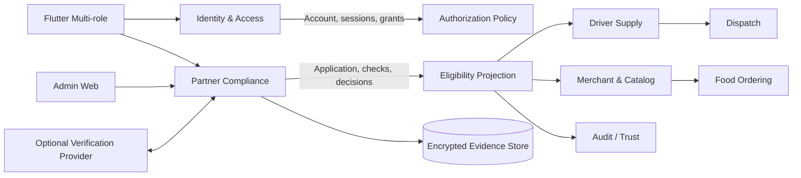
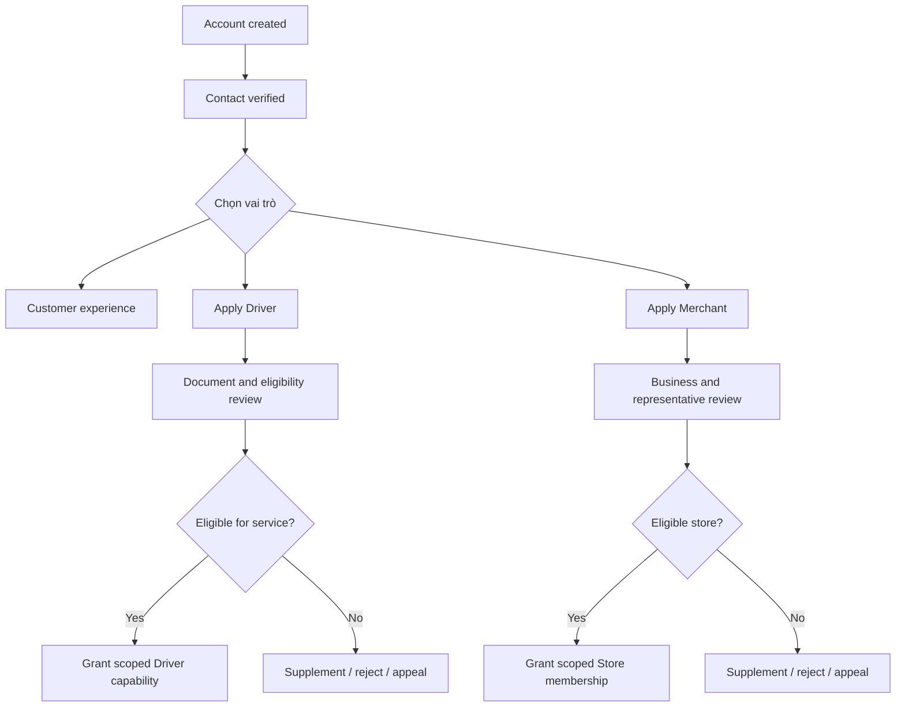
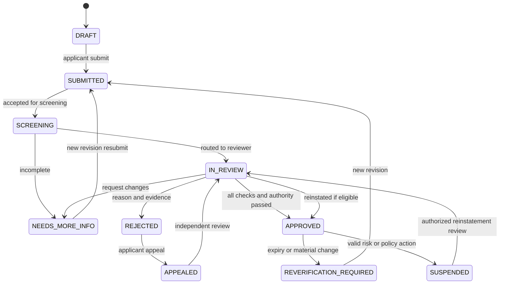

# DealGo — Identity, KYC & KYB

> **Trạng thái `DRAFT`, chưa được phê duyệt cho vận hành thương mại.** Tài liệu này xác định mô hình nghiệp vụ và yêu cầu kiểm soát đối với Identity, Customer, Driver và Merchant trong DealGo; không xác nhận DealGo có quyền truy cập CSDL dân cư, VNeID, API định danh nhà nước hoặc được phép tự động kết luận tính hợp lệ của giấy phép/giấy tờ. **Giấy tờ thật, dữ liệu khuôn mặt, số định danh, bí mật xác thực và dữ liệu người dùng không được đưa vào tài liệu, test fixture công khai hoặc nhật ký hệ thống.**
>
> **Phạm vi chắc chắn:** MVP bao gồm Ride (xe máy, ô tô) + Food; một Flutter app ba role và Admin Web; đăng ký/xác thực có passkey, xác minh phone qua SMS, email verified; Admin được phân quyền bật/tắt method; chat và voice call trong app gắn Ride/Food. `OPEN-006/008/020/021` vẫn chặn giấy tờ, provider, recovery/retention và chi tiết production.

## 1. Mục tiêu, phạm vi và outcome

Mục tiêu: **biết người dùng đã xác thực ở mức nào, đã được kiểm chứng điều gì, có quyền hoạt động dịch vụ nào, tại vùng nào, trong khoảng thời gian nào, do ai phê duyệt và vì sao.**

- Customer: tạo tài khoản, xác minh liên hệ, dùng Ride/Food trong phạm vi chính sách; **không mặc định cần upload CCCD để đặt dịch vụ**.
- Driver: đăng ký cung cấp Ride và/hoặc Food, gửi hồ sơ phù hợp, theo dõi kết quả, xử lý bổ sung/tái xác minh; chỉ được online/nhận việc đúng capability đã duyệt.
- Merchant: chủ/đại diện cửa hàng đăng ký, chứng minh quyền đại diện và hồ sơ kinh doanh thích hợp; staff của cửa hàng được cấp quyền *theo store*, không mặc nhiên là chủ thể KYB đã duyệt.
- Operations: có hàng đợi review, kiểm chứng bằng chứng, phân công reviewer, phê duyệt/từ chối/yêu cầu bổ sung/đình chỉ, kháng nghị, audit.
- Security/Legal/Privacy: xác định cơ sở xử lý dữ liệu, vòng đời dữ liệu nhạy cảm, quyền của chủ thể dữ liệu, điều kiện liên thông vendor và xử lý sự cố.

**Ngoài phạm vi:** mã nguồn API/Prisma hoàn chỉnh; công thức chấm điểm eKYC; giá dịch vụ; hợp đồng thương mại; cam kết review; kết luận pháp lý; vendor SMS/voice/WebRTC cụ thể; xác thực hộ chiếu mọi quốc tịch; sinh trắc học mặc định. Kênh đã chốt ở `DEC-PROD-006/007`; provider và policy chi tiết còn `OPEN-008/020/021`.

## 2. Nguồn chuẩn và phân loại quyết định

| Loại | Nguồn | Trạng thái |
|---|---|---|
| Phạm vi hai dịch vụ, một Flutter app | `DEC-PROD-001/002` | `CONFIRMED` |
| Mã yêu cầu Identity và Partner onboarding | PRD / FRS | `PROPOSED_P0` chi tiết chờ duyệt |
| Ownership context và role grants | `domain-model.md`, `roles-and-permissions.md` | `DRAFT` |
| Phân loại giấy tờ Driver/Merchant theo pháp luật, trách nhiệm các bên | `OPEN-006` | `BLOCKED` production |
| SMS/KYC/KYB/voice provider, quyền gọi nguồn xác minh và chuyển dữ liệu | `OPEN-008` | `BLOCKED` live integration |
| Recovery, enrollment, method disable/restore, account lockout policy | `OPEN-020` | `BLOCKED` live policy |
| Participant pairs/cửa sổ chat-call | `OPEN-014` | `BLOCKED` live policy |
| Provider, retention, support access và privacy workflow | `OPEN-021` | `BLOCKED` live policy/provider |
| Chuyển role khi đang có job, kiêm nhiệm | `OPEN-005` | `BLOCKED` policy concurrency |
| Multi-store và người đại diện | `OPEN-013` | `BLOCKED` phần mở rộng |
| Tài xế/nhà hàng được phục vụ vùng nào | `OPEN-001` | `BLOCKED` production region |
| Escalation, support staffing và nghi vấn an toàn | `OPEN-015` | `BLOCKED` go-live |

**Quy tắc trình bày:** `MUST (design)` = ràng buộc kiểm soát được đề xuất để đạt an toàn; `PROPOSED` = gợi ý triển khai; `TBD` = không có quyết định; `PRODUCTION_BLOCKED` = không được kích hoạt thật dù demo chạy được.

## 3. Thuật ngữ không được nhầm

| Thuật ngữ | Ý nghĩa trong DealGo | Không đồng nghĩa |
|---|---|---|
| `Account` | Identity tạo phiên đăng nhập, có ID ổn định. | Customer đã đủ điều kiện mua bán/lái xe. |
| `PasskeyCredential` | Public-key credential reference/RP ID/state/revocation metadata; key pair được kiểm qua authenticator. | Server-stored private key. |
| `AuthMethodPolicy` | Versioned controls cho enroll/auth/revoke theo method và scope. | UI feature flag thay authorization. |
| `VerifiedEmail` | Email đã xác minh dùng làm contact/account identifier. | Email OTP độc lập để đăng nhập. |
| `ContactVerification` | Xác minh quyền kiểm soát số điện thoại/email hoặc liên hệ. | Chứng minh danh tính pháp lý. |
| `Authentication` | Chứng minh quyền đăng nhập tại thời điểm request. | KYC/KYB và role authorization. |
| `IdentityProofing` | Quy trình gắn người đăng ký với danh tính được khai báo và bằng chứng. | Một kết quả OCR/đọc ảnh. |
| `KYC` | Xác minh đối tác là cá nhân theo mức assurance/rủi ro phù hợp. | Quyền lái xe hoặc nhận Food mặc nhiên. |
| `KYB` | Xác minh chủ thể/cơ sở kinh doanh và đại diện có thẩm quyền. | `MerchantStore` đã mở bán. |
| `PartnerApplication` | Hồ sơ đăng ký đối tác có revision, nguồn bằng chứng và quyết định review. | Role được grant. |
| `EvidenceDocument` | Tham chiếu tới một bằng chứng có loại, phiên bản, provenance và hạn kiểm tra. | File URL public hoặc CCCD raw trong DB nghiệp vụ. |
| `VerificationCheck` | Từng kiểm tra: đọc giấy tờ, so trùng, xác minh chính danh, quyền đại diện... | Phê duyệt hồ sơ tổng thể. |
| `ReviewDecision` | Kết quả có reviewer, reason, policy version, timestamp. | Toggle bật vai trò trên mobile. |
| `Eligibility` | Kết luận có thể thực hiện `service × region × time` hay không. | Membership cũ hoặc status lưu trên thiết bị. |
| `RoleMembership` | Grant theo role/scope và trạng thái. | `activeRole` chỉ là ngữ cảnh hiển thị. |
| `Reverification` | Yêu cầu xác minh lại khi có trigger hoặc giấy tờ thay đổi. | Đăng nhập lại. |
| `Suspension` | Biện pháp đình chỉ khả năng kinh doanh/nhận job; scope có thể giới hạn. | Xóa toàn bộ tài khoản. |
| `Appeal` | Đề nghị xem xét lại quyết định. | Tự động phê duyệt/khôi phục quyền. |
| `Assurance` | Mức tin cậy nghiệp vụ có bằng chứng, phiên bản chính sách. | NIST IAL tự nhận đã đạt nếu chưa được đánh giá. |

> **Nhãn nội bộ (nếu cần):** `CONTACT_VERIFIED`, `IDENTITY_REVIEWED`, `PARTNER_APPROVED` là nhãn đề xuất; **không gọi là “CCCD/VNeID cấp 1/2” hoặc chứng nhận NIST IAL** nếu không đáp ứng tiêu chuẩn và không có bằng chứng/ủy quyền.

## 4. Bản đồ context và nguồn sự thật



- **Identity & Access** owns Account, session, trusted contact status, RoleMembership/RoleGrant.
- **Partner Compliance** owns PartnerApplication, evidence references, check results, reviewer decisions, appeals, verification history và eligibility decisions.
- **Driver Supply** owns DriverProfile, capability preferences, operational online state, vehicle reference được chứng nhận là phù hợp; **không tự duyệt hồ sơ**.
- **Merchant & Catalog** owns MerchantStore, StoreMembership, availability/menu; **không được tự bypass KYB**.
- **Dispatch** đọc eligibility đã được kiểm chứng và guard ở thời điểm commit; dữ liệu cache/realtime chỉ giúp lọc ứng viên, không phải authority.
- **Trust & Safety** sở hữu SupportCase/incident; có thể yêu cầu review lại/suspend theo policy và audit.
- **Protected Evidence Store** giữ bytes, hash/provenance; không dùng URL public hoặc nhúng base64 vào event.

### 4.1. Cross-context contract

| Producer | Consumer | Dữ liệu cho phép | Không được cấp |
|---|---|---|---|
| Identity | Compliance | accountId, contactVerified, trạng thái account | Token, OTP code, refresh token |
| Compliance | Driver Supply | driverId, service capability, eligibility state/version, next review due | Ảnh CCCD, sinh trắc học, số định danh đầy đủ |
| Compliance | Merchant | storeId, approved business eligibility, decision/version | Hồ sơ pháp nhân raw cho staff không có quyền |
| Compliance | Dispatch | driverId, eligible service/region, version, blocking reason code hạn chế | Hình giấy tờ, OCR raw, review nội bộ |
| Compliance | Admin/Support | trạng thái và masked summary theo field-policy | Toàn bộ tài liệu mặc định |
| Compliance | Audit | event ID, actor, action, status, reason code, policy version | Secret hoặc bản sao file |

## 5. Ranh giới giữa Login, KYC/KYB và quyền hoạt động



**Ràng buộc:** verified phone/email → account usable; KYC/KYB *có thể* là bước cần cho partner; sau khi approved vẫn phải có `role membership + eligibility current + region/service + account active + object check` ở từng request. Role UI không có khả năng override.

## 6. Actor và responsibility map

| Actor | Được làm | Không được làm |
|---|---|---|
| Applicant Customer | Xác minh liên hệ, xem hồ sơ mình, đề nghị sửa quyền riêng tư | Đọc hồ sơ tài xế/người bán khác |
| Applicant Driver | Tạo/sửa draft hồ sơ của mình, gửi, theo dõi, phản hồi yêu cầu bổ sung | Tự cập nhật trạng thái Approved/đổi reviewer |
| Merchant representative | Nộp hồ sơ của đơn vị/cửa hàng trong quan hệ có bằng chứng | Thay người đại diện pháp lý bằng client-side flag |
| Merchant staff | Quản lý tác vụ cửa hàng theo store grant | Xem giấy tờ KYC/KYB của chủ sở hữu mặc định |
| Reviewer | Xem hồ sơ được giao và các trường cần kiểm chứng, yêu cầu bổ sung, đề xuất quyết định | Tự điều chỉnh policy, sửa raw evidence, duyệt sai scope |
| Approval authority | Phê duyệt/từ chối theo policy/SoD đã duyệt | Bỏ qua duplicate/conflict checks mà không có exception được audit |
| Fraud investigator | Xem case và phần bằng chứng đã cấp quyền | Tra cứu hàng loạt dữ liệu cá nhân không có case |
| Security/Privacy | Audit sự cố, giám sát access, kiểm tra retention | Sử dụng tài liệu vào mục đích ngoài thông báo |
| Vendor adapter | Gửi/nhận dữ liệu trong phạm vi hợp đồng và quyền hợp lệ | Tự cấp role, lưu dữ liệu vô hạn |

**Separation of Duties (đề xuất P0):** reviewer tạo kết quả kiểm tra không tự bypass quyết định có xung đột lợi ích; phê duyệt ngoại lệ nhạy cảm cần người có quyền khác và reason/ticket. Quy mô nhóm nhỏ có thể chấp nhận kiểm soát tương đương được Legal/Security chấp thuận; không đặt luật hai người một cách giả tưởng khi chưa có nhân sự.

## 7. Customer onboarding — yêu cầu chức năng

| ID | Hành vi cần đặc tả | Điều kiện tối thiểu | Acceptance có thể kiểm thử |
|---|---|---|---|
| `IDN-CUS-001` | Tạo Account qua phone SMS, email+password hoặc passkey-first. | provider/flow detail `OPEN-008/020`. | Passkey-first không hỏi phone/email; tạo một CUSTOMER account contact-less, challenge được server xác minh; contact liên kết sau. |
| `IDN-CUS-002` | Verify phone bằng SMS challenge; đăng ký/đăng nhập email+password; verify email ownership khi cần. | SMS OTP one-time/expiry/rate-limit; email+password hash (argon2) phát hành session. | Sai/hết hạn/replay không verify; không lộ secret trong log/analytics. |
| `IDN-CUS-003` | Quản lý phiên và thu hồi session. | Backend kiểm token/lifecycle. | Revoke/disable chặn mutating request, cả refresh/realtime. |
| `IDN-CUS-004` | Chuyển active role và xem role có sẵn. | Không tạo RoleGrant mới. | Đổi tab không cho phép hành động Driver chưa approved. |
| `IDN-CUS-005` | Đề nghị xem/sửa/xóa dữ liệu theo quy định. | Luồng privacy case và legal holds. | Có receipt/ticket, xử lý theo policy không xóa bằng chứng còn phải giữ hợp pháp. |
| `IDN-CUS-006` | Chống takeover khi đổi contact, add/remove passkey hoặc recover account. | Re-auth/risk check, notify trusted channels; admin method actions có case/reason/audit. | Đổi contact không âm thầm restore quyền partner hoặc bỏ qua recovery guards. |

### 7.1. Authentication methods & admin method controls

| Method | Vai trò trong MVP | Invariants |
|---|---|---|
| Passkey | Phương thức đăng nhập/đăng ký ưu tiên; dùng discoverable credential nên không yêu cầu phone/email trước ceremony. User có thể đăng ký nhiều passkey trên thiết bị/provider khác nhau. | Server tạo/verifies one-time challenge; credential ID ánh xạ Account, kiểm RP ID/origin/signature/user verification. Passkey không đọc hoặc tự cung cấp số điện thoại. Private key không rời authenticator. |
| Phone + SMS | Xác minh phone; SMS OTP là sign-in/recovery fallback được đánh dấu restricted, có expiry, one-time use, rate limit, anti-enumeration và risk checks. | SIM swap/recycled number risk; đổi số/recovery cần step-up và notification; không coi SMS là phishing-resistant. |
| Email | Contact/account identifier đã verified; có thể dùng để nhận thông báo bảo mật và link xác minh địa chỉ. | Email OTP/link không là phương thức đăng nhập độc lập theo baseline; không cho email-only takeover/recovery. |

**Enrollment/linking:** User tạo Account bằng phone SMS, email+password hoặc passkey-first. Passkey-first tạo CUSTOMER account với `phone = null`, `email = null`; profile/contact được bổ sung sau session khi workflow yêu cầu. Có thể liên kết thêm method sau khi đã có session. Không bắt buộc SMS/email để tạo tài khoản.

**Admin controls:** `SECURITY_ADMIN` được quản lý method policy platform-wide/per environment và disable method cụ thể của account khi có case/grounds; `OPS_CONFIG_MANAGER` chỉ quản lý rollout/global availability nếu được grant riêng. Mọi thao tác cần step-up, scope, reason, actor, timestamp, before/after/version và audit. Thay đổi global có preview blast radius + dual approval theo policy. Disable một method chặn enroll/sign-in mới; xóa credential, revoke sessions, account suspension là các action riêng.

**Lockout guard:** Không cho tắt mọi phương thức đang khả dụng cho một account hoặc toàn hệ thống theo thao tác thường. Nếu sự cố buộc khóa tất cả, dùng emergency account lock/suspend có recovery/support path, thông báo người bị ảnh hưởng và incident record. Khi tắt một phương thức toàn hệ thống, giữ nguyên passkey/alternate paths; không xóa credential history.

**Email/SMS note:** Passkey vẫn là phương thức ưu tiên khi thiết bị hỗ trợ; SMS và email+password là phương thức đăng nhập đầy đủ theo yêu cầu sản phẩm 2026-10-18. Cần rà soát assurance khi chốt `OPEN-020`.

> **Hành vi hiện tại của code (policy `OPEN-020` chưa chốt):** OTP phone không tạo Account trước khi verify; verify lần đầu tạo/khớp Account và cấp `CUSTOMER` `ACTIVE` ở mọi môi trường. Đăng ký email+password hai bước giống phone: `POST /v1/auth/email/register` lưu challenge pending (mật khẩu đã hash, OTP 6 số hash, TTL 10 phút, tối đa 5 lần sai tính trên cả challenge — gửi lại không reset, đạt ngưỡng thì khóa và không gửi lại được, phải bắt đầu challenge mới; gửi lại sau 60 giây, tối đa 5 lần gửi, 5 challenge/email/giờ — theo `DEC-PROD-008`) và gửi OTP qua `MailSender`; Account + credential + `CUSTOMER` `ACTIVE` + session chỉ được tạo ở `…/register/:id/verify` (email verified). Email đã có Account nhận cùng phản hồi, chủ email nhận thư báo thay vì mã. Quên mật khẩu: `POST /v1/auth/email/password-resets` luôn trả 202 (không lộ email tồn tại), token one-time TTL 30 phút, confirm đổi mật khẩu và thu hồi session Customer. Đăng nhập email chỉ cho email đã verify. Account cũ chưa verify: đăng nhập đúng mật khẩu → 403 `AUTH_EMAIL_NOT_VERIFIED` kèm `details` `{challengeId, expiresAt, resendAvailableAt}` và OTP kích hoạt qua email (challenge `ACTIVATE_EXISTING`, cùng giới hạn); verify qua cùng `…/register/:id/verify` → đánh dấu email verified, đảm bảo `CUSTOMER` (giữ nguyên nếu đang `SUSPENDED`), trả session. Sai mật khẩu → 401, không gửi mã. Quên mật khẩu vẫn kích hoạt được.

**Không tự yêu cầu CCCD/selfie cho mọi Customer**: thu thập có điều kiện, mục đích phù hợp, tối thiểu hóa dữ liệu và xem xét rủi ro. KYC customer nâng cao chỉ khi có nhu cầu pháp lý/nghiệp vụ được phê duyệt.

## 8. Driver onboarding — vòng đời đầy đủ

### 8.1. Nguyên tắc nghiệp vụ

- Một account có thể xin Driver role và từng service capability `RIDE_2W`/`FOOD_DELIVERY` (tên gợi ý, chưa khóa enum/API).
- **Bộ hồ sơ bắt buộc theo loại dịch vụ không được xác định bằng phỏng đoán**; cần Legal/Ops đánh giá theo `OPEN-006`, địa bàn `OPEN-001` và điều kiện cấp phép/hợp đồng.
- Ảnh CCCD/bằng lái/giấy tờ xe chỉ được thu thập nếu có căn cứ, mục đích và thời hạn lưu giữ hợp lệ; có thể cân nhắc xác thực bằng nguồn chính thức qua đối tác được phép để giảm lưu raw.
- `KYC approved` không đồng nghĩa `vehicle approved`, và cả hai không đồng nghĩa `available/online`.
- Trình tự mặc định ở bản demo: draft → submit → screening → human review → decision → eligible projection; không auto-open job khi chỉ qua OCR.

### 8.2. Hồ sơ theo mục đích (không khẳng định bắt buộc theo luật)

| Nhóm | Trường ứng viên | Điều kiện lựa chọn / lưu ý |
|---|---|---|
| Liên hệ | accountId, phoneVerified, emailVerified? | Phone/email tùy provider/policy; không yêu cầu tất cả nếu không cần. |
| Danh tính | họ tên, năm/ngày sinh, identifier tokenized, loại/hiệu lực giấy tờ | Chỉ các trường cần cho proofing và compliance; tránh lưu mã đầy đủ trong business models. |
| Bằng chứng định danh | tài liệu được phép, nguồn, thời điểm, hash, kết quả kiểm tra | Không cho nhân viên tự tải hàng loạt; không expose public URL. |
| Bằng lái | loại bằng, hiệu lực, phù hợp dịch vụ | Loại bằng yêu cầu xác định theo pháp luật hiện hành, loại xe và vùng. `OPEN-006`. |
| Phương tiện | chủ/đơn vị sở hữu, loại xe, biển số (masked), tình trạng giấy tờ | Năng lực nhận Ride vs Food có thể khác. |
| Điều kiện vùng/dịch vụ | region, eligible services, effectiveFrom/Until | Đồng bộ với Dispatch khi suspend/revoke. |
| Hồ sơ hợp tác | trạng thái hợp đồng/điều khoản đã được chấp nhận | Mẫu hợp đồng và chủ thể hợp tác do Legal quyết định. |
| Tài khoản nhận thu nhập | payout destination token/providerRef (khi cần) | Không lưu ảnh thẻ, CVV, credential ngân hàng; tài chính xử lý chuyên biệt. |
| Kiểm tra bổ sung | anti-fraud check, duplicate detection, reverify triggers | Chỉ thu thập dữ liệu có cơ sở phù hợp; quyết định có giải thích và kháng nghị. |

### 8.3. Chặng luồng Driver

1. `Start`: Account contact verified; yêu cầu cấp khả năng Driver, chọn service request và vùng dự kiến.
2. `Draft`: Hiển thị danh mục hồ sơ *từ policy registry* theo dịch vụ/vùng/quy định đã duyệt; chỉ nhập dữ liệu thật ở môi trường được cho phép.
3. `Upload`: Check file trước upload + tại server, mã hóa, AV/sandbox, metadata/provenance, không đưa raw bytes vào response.
4. `Submit`: Snapshot application revision, hash danh mục evidence, policyVersion, idempotency; khoá revision để review.
5. `Screen`: Completeness + optional vendor check; false-positive/manual review route, không tự phê duyệt bằng OCR.
6. `Review`: Reviewer được giao kiểm từng check; có `needs_more_info`, `flagged`, `verified`, `not_verified` với reason code.
7. `Decision`: Phê duyệt/từ chối/bổ sung theo quyền, ghi audit, policy version, proof rationale.
8. `Provision`: Sau khi policy đủ điều kiện, tạo/điều chỉnh RoleGrant scope và eligibility của từng capability.
9. `Operate`: Driver được online khi `eligibilityActive ∧ accountActive ∧ serviceActive ∧ regionAllowed ∧ roleGrantValid`; online switch chỉ là yêu cầu.
10. `Maintain`: Expiry, thay đổi giấy tờ, complaint, fraud, đình chỉ hoặc thay đổi điều kiện pháp lý kích hoạt reverify.
11. `Appeal`: Applicant biết reason công bố an toàn, nộp thông tin bổ sung và nhận kết luận có audit.

### 8.4. Eligibility theo từng dịch vụ

| Driver state | Ride service | Food service | Hệ quả |
|---|---|---|---|
| Account verified, chưa nộp hồ sơ | deny | deny | Có thể dùng Customer nhưng không nhận job. |
| KYC đang review | deny | deny | Không cho `driver.go_online`. |
| KYC passed, Vehicle/Ride license chưa valid | deny | `depends on approved FOOD policy` | Không tự giả định Food được phép. |
| RIDE approved, FOOD chưa duyệt | allow RIDE nếu còn guard | deny FOOD | Phân quyền capability độc lập. |
| FOOD approved, RIDE chưa duyệt | deny RIDE | allow FOOD nếu còn guard | Một DriverProfile không đồng nghĩa cả hai. |
| Một giấy tờ hết hạn liên quan Ride | deny RIDE | evaluate FOOD independently | Không đình chỉ toàn bộ account nếu không cần. |
| Suspected identity fraud nghiêm trọng | `risk policy: restricted` | `risk policy: restricted` | Fail-closed các hành vi nhạy cảm, case + human review. |
| Suspended theo admin decision hợp lệ | deny theo scope | deny theo scope | Không làm mất lịch sử chuyến/đơn và nghĩa vụ tài chính. |

*`allow` ở bảng là kết quả về mặt thiết kế sau phê duyệt policy, không phải quyền production đã được cấp.*

## 9. Merchant KYB & Store onboarding

### 9.1. Tách ba loại thực thể

- `Account` = cá nhân đã xác thực; có thể là đại diện hoặc nhân viên của cửa hàng.
- `MerchantOrganization`/`BusinessSubject` (*ứng viên*) = chủ thể kinh doanh hoặc người bán theo mô hình pháp lý được chốt (`OPEN-006`), không mặc định phải là doanh nghiệp có giấy chứng nhận đăng ký doanh nghiệp.
- `MerchantStore` = địa điểm/đơn vị vận hành nhận đơn Food; membership gắn storeId, **không gắn bằng string tên quán**.

### 9.2. Ma trận kiểm tra KYB đề xuất

| Check ID | Nội dung | Input tối thiểu | Reviewer result |
|---|---|---|---|
| `KYB-001` | Xác định chủ thể và loại hình kinh doanh | khai báo theo legal type | `verified / needs_info / rejected` |
| `KYB-002` | Quyền của người đăng ký đại diện | relation/authorization evidence hợp lệ | `verified / needs_info / rejected` |
| `KYB-003` | Hồ sơ kinh doanh theo loại hình | các giấy tờ thực sự yêu cầu bởi policy/legal | `verified / needs_info / rejected` |
| `KYB-004` | Địa chỉ và địa điểm kinh doanh | địa chỉ, bằng chứng được cho phép | `verified / needs_info / rejected` |
| `KYB-005` | Ngành hàng và điều kiện bán thực phẩm | danh mục/giấy tờ phù hợp theo mô hình | `verified / needs_info / rejected` |
| `KYB-006` | Tính trùng lặp/đại diện bất thường | candidate match metadata tối thiểu | `clear / investigate` |
| `KYB-007` | Điều khoản hợp tác/giá trị thanh toán | acceptance record, version | `accepted / pending` |
| `KYB-008` | Quyền nhận tiền nếu bật payout | payout destination verification providerRef | `verified / pending / blocked` |

Không phải check nào cũng bắt buộc với mọi Merchant. **Required/optional/forbidden** được chọn từ `DocumentPolicy(service=FOOD, businessType, region, effectiveAt)` sau khi Legal phê duyệt. Bất kỳ trường hợp “được miễn giấy tờ” phải có policy và evidence, không hard-code theo tên cửa hàng.

### 9.3. Merchant journey

1. Account được xác minh liên hệ, chọn đăng ký đối tác Merchant.
2. Chọn mô hình chủ thể/loại hình cửa hàng; nếu cần, tạo Organization candidate.
3. Nhập thông tin store, location, category, representative và dữ liệu theo policy.
4. Nộp bằng chứng, chấp nhận điều khoản và gửi hồ sơ với application revision.
5. Kiểm tra KYB và quyền đại diện; review `needs_more_info`/`rejected`/`approved` theo reason.
6. Tạo StoreMembership sau phê duyệt hợp lệ; phân biệt quyền chỉnh menu và quyền bật nhận đơn.
7. Store có thể chuẩn bị menu trước duyệt; **không được bật nhận đơn thật** trước đủ eligibility + operational readiness.
8. Thêm staff thông qua grant scoped đúng store; role nhân viên không thừa kế quyền xem giấy tờ đại diện.
9. KYB thay đổi chủ thể, người đại diện, địa điểm nhạy cảm hoặc trạng thái kinh doanh → policy xem xét lại; có thể pause nhận đơn mới.

### 9.4. Multi-store và chuyển chủ sở hữu

`OPEN-013` chưa chốt multi-store release đầu: mô hình nên **không chặn khả năng mở rộng**, nhưng UI/tính năng chưa mặc định có nhiều chi nhánh.

- Một account là owner/store member ở nhiều nơi không có quyền xem dữ liệu tất cả bằng cách trộn danh sách token.
- Chuyển chủ sở hữu/quyền đại diện cần chứng cứ mới, review và giới hạn quyền phù hợp.
- Đổi tài khoản nhận tiền cần step-up authentication + risk check + audit; không chấp nhận thay qua staff bình thường.
- Khi organization bị suspend, từng store phải nhận eligibility update; đơn in-flight cần runbook, không xóa hoặc âm thầm hoàn tiền.

## 10. Document Policy Registry — cấu hình có phiên bản

**Không hard-code checklist giấy tờ ở Flutter.** Backend cung cấp phiên bản hồ sơ tương ứng app type/service, legal subject, operating region và effective date sau khi policy được duyệt.

```yaml
# MINH HỌA — TEST_ONLY; KHÔNG PHẢI QUY ĐỊNH PHÁP LÝ/CONFIG LIVE
policyId: DOCPOL-DEALGO-DEMO-01
status: DRAFT_TEST_ONLY
scope:
  applicant: DRIVER
  service: RIDE_2W
  region: MOCK_REGION
  businessType: INDIVIDUAL
requirements:
  - category: IDENTITY_EVIDENCE
    required: true
    validationMode: HUMAN_REVIEW
  - category: LICENSE_EVIDENCE
    required: "TBD_OPEN_006"
    validationMode: POLICY_DEPENDENT
consentNoticeVersion: TEST_ONLY_NOTICE
retentionScheduleId: UNAPPROVED
activation: DISABLED_FOR_PRODUCTION
```

**Policy Registry fields:** `id`, `version`, `effectiveFrom`, `effectiveTo`, `service`, `region`, `legalSubjectType`, `requirements[]`, `approvedBy`, `approvalEvidenceRef`, `privacyNoticeVersion`, `retentionScheduleRef`, `status`, `supersededBy`. Runtime chỉ dùng phiên bản `APPROVED_ACTIVE`; bản ghi review đã submit giữ `policyVersion` tại thời điểm submit, sau thay đổi pháp luật áp dụng migration/reverification policy riêng.

### 10.1. Quy tắc policy migration

- Không sửa ngược checklist của application revision cũ; tạo revision mới.
- Chuyển policy mới phải có impact list: hồ sơ nào cần bổ sung, deadline theo quy định, khả năng tạm dừng.
- Nếu policy bị thu hồi do bảo mật/pháp lý, **không** giữ quyền eligible chỉ vì cache cũ hoặc optimistic fallback.
- Phê duyệt lại có dấu vết của reviewer, lệnh `ReevaluateEligibility`, thông báo và phương án kháng nghị.

## 11. State machine — Contact verification

| State | Trigger | Next | Guard |
|---|---|---|---|
| `UNVERIFIED` | create challenge | `CHALLENGE_ISSUED` | channel allowed, abuse limits |
| `CHALLENGE_ISSUED` | correct proof | `VERIFIED` | server validated, freshness, bound to account/contact |
| `CHALLENGE_ISSUED` | expire | `EXPIRED` | challenge TTL policy |
| `CHALLENGE_ISSUED` | max attempts | `LOCKED_TEMPORARILY` | risk policy configurable |
| `VERIFIED` | contact change | `UNVERIFIED` for new contact | step-up and previous session risk review |
| any | account disabled | access denied | verification history retained per approved policy |

**Abuse cases:** OTP replay, resend flooding, enumeration, SIM swap, wrong account binding, concurrent code usage, race on contact change. Giới hạn thử, cooldown và step-up là cấu hình security đề xuất, chưa đặt giá trị live.

## 12. State machine — Partner application



**Bất biến:**

1. `APPROVED` chỉ tồn tại khi các required checks (theo policyVersion) hoàn tất và decision được một principal có quyền commit; không thể submit → approved do client.
2. Revision đã SUBMITTED không sửa bytes/fields; bổ sung là **revision mới** có lineage để reviewer biết thay đổi.
3. `REJECTED`, `SUSPENDED` có reason code phân quyền phù hợp, actor, timestamp, link tới evidence decision; thông điệp gửi applicant có thể được redact để không lộ fraud detection.
4. `SUSPENDED` có thể là **eligibility status** độc lập với PartnerApplication approval lịch sử; không làm mất approval event cũ.
5. `REVERIFICATION_REQUIRED` chưa chắc chặn mọi capability cùng lúc: policy quyết định, nhưng thiếu policy hợp lệ → fail-closed capability có rủi ro.
6. Trạng thái ứng viên ở sơ đồ không khóa enum DB; module Architecture/Data sẽ quyết định cách lưu state và lịch sử.

## 13. Verification Check lifecycle

| Check status | Khi nào áp dụng | Hệ quả |
|---|---|---|
| `NOT_STARTED` | hồ sơ chưa đủ hoặc chưa xếp reviewer | pending |
| `PENDING_VENDOR` | gửi đến provider hợp lệ | không cấp quyền chỉ vì request được gửi |
| `PENDING_HUMAN` | check được chuyển đến reviewer | không phê duyệt tự động |
| `VERIFIED` | có bằng chứng và evaluation hợp lệ | chỉ thỏa **check này**, không phải toàn hồ sơ |
| `INCONCLUSIVE` | kết quả không đủ chắc chắn | bổ sung/human review, không giả thành rejected |
| `FAILED` | không đạt check policy | reason code và appeal path |
| `CANCELLED` | hồ sơ superseded/thu hồi | callback cũ không thể hồi sinh quyền |

**Một check `VERIFIED`** phải mang `checkType`, `provider/manual`, `evidenceVersion`, `policyVersion`, `verifiedAt`, `expiresAt` nếu cần, `reviewerOrVerifierId`, `verificationMethod`, `externalVerificationRef` (tokenized), `decisionReasonCode`. Nếu provider lỗi/timeout, đánh dấu `INCONCLUSIVE` hoặc `PENDING`, không kết luận `FAILED` chắc chắn.

## 14. Eligibility authority — ma trận guard

```text
canOperate(actor, capability, region, now) =
  authenticated(account)
  AND account.status == ACTIVE
  AND roleMembership(actor, scope).isValid(now)
  AND partnerEligibility(actor, capability, region).isValid(now)
  AND riskRestrictions.allow(capability)
  AND requiredEvidenceSnapshot.isStillValid(now)
  AND operationalContextAllowsAction(capability)
```

**Lưu ý:** đây là predicate khái niệm, không khóa tên bảng/phương thức code. `service` có thể là `DRIVER_RIDE`, `DRIVER_FOOD`, `MERCHANT_FOOD_ACCEPT`, và phải tách khỏi trạng thái online/availability.

| Tác vụ | Recheck ở đâu | Fail-safe behavior |
|---|---|---|
| Driver bật online | API server | reject, trả reason code user-safe |
| Driver nhận offer | server, tại thời điểm commit | no assignment khi eligibility sai/hết hạn |
| Driver nhận DeliveryTask | server, tại thời điểm commit | reject + evaluate reassign |
| Merchant bật nhận Food order | backend | false khi store không đủ điều kiện |
| Merchant accept order | backend ngay lúc state mutation | reject, trigger ops flow nếu affected |
| Admin cấp role | authorization + compliance policy | deny nếu thiếu evidence/authority |
| Admin giải khóa | authorization + approved review + state version | không resurrect revoked grants qua stale callback |
| Flutter đổi activeRole | client nav + server permission refresh | chỉ chuyển UI, không grant quyền |

### 14.1. In-flight jobs khi bị suspended

- **New work:** ngăn offer, assignment, order admission theo policy có hiệu lực.
- **Existing RideTrip/Food DeliveryTask:** không xóa/cưỡng ép terminal state; tạo incident/ops case, đánh giá an toàn hành khách và việc bàn giao; quyết định tiếp tục/chuyển giao theo runbook đã duyệt (`OPEN-015`).
- **Finance:** nghĩa vụ/ledger cũ vẫn tồn tại; suspension không được mặc định đóng băng hoặc chuyển tiền khi chưa có policy tài chính/pháp lý.
- **Communication:** mobile/merchant nhận trạng thái và phương án hỗ trợ; không tiết lộ chi tiết hồ sơ gian lận hoặc của người khác.

## 15. Duplicate identity, conflict & fraud review

Phân biệt **duplicate candidate** (có thể trùng) với **confirmed fraud** (kết luận có bằng chứng). Không công khai chi tiết phát hiện duplicate để kẻ xấu dò dữ liệu.

| Tình huống | Detection đề xuất | Hệ quả phù hợp |
|---|---|---|
| Hai account có cùng contact hiện tại | normalized verified contact uniqueness/ownership | conflict; account recovery/dispute case |
| Giấy tờ tương tự nộp nhiều lần | token/hash với salt/pepper và vùng truy cập hạn chế | review, không auto-ban vì có thể là lỗi/đại diện hợp lệ |
| OCR khác thông tin tự khai | compare with confidence | yêu cầu sửa hoặc manual review |
| Tệp bị chỉnh sửa/giả mạo | provenance, integrity checks, chuyên môn review | `FLAGGED`/`INCONCLUSIVE`, không suy diễn bản án |
| Vendor trả callback lặp | verify signature + event id + version guard | xử lý một lần, không nhân đôi approval |
| Vendor trả kết quả trễ cho revision cũ | bind result to revision/policy | ignore/record stale, không approve revision mới |
| Tài khoản bị chiếm quyền sau approval | risk signal, step-up, revoke sessions | chặn thao tác nhạy cảm, case/appeal |
| Reviewer thiên vị/self-approval | conflict-of-interest policy, audit trails | route second review where policy requires |

**Sinh trắc học:** chỉ cân nhắc nếu chứng minh sự cần thiết, căn cứ xử lý dữ liệu, lựa chọn nhà cung cấp, đánh giá tác động riêng và biện pháp chống giả mạo được duyệt. **Không lưu template khuôn mặt mặc định** chỉ để “làm eKYC cho giống Grab”.

## 16. Quản lý bằng chứng KYC/KYB: upload → lưu → review → xóa

### 16.1. Upload contract

1. API cấp upload intent ngắn hạn, scoped `applicantId + applicationRevision + evidenceType`, kiểm quyền chủ hồ sơ.
2. Chỉ chấp nhận allowlist extension, MIME thực qua sniff/magic bytes, kích thước và chiều ảnh/tài liệu theo cấu hình có thể đổi; từ chối polyglot/unsafe payload khi khả thi.
3. Tạo object key ngẫu nhiên; không lấy filename, CCCD hoặc phone từ client làm storage key.
4. Lưu object tách webroot, mã hóa at rest, TLS in transit, kiểm malware/quarantine; xử lý resize/OCR trên bản sao an toàn, không đẩy đến dịch vụ bên ngoài không được duyệt.
5. Kiểm tra upload object association, content integrity hash, expiry, owner, revision và scan result trước khi cho submit.
6. Chỉ cấp quyền xem qua backend authorized download proxy hoặc short-lived signed URL kèm audit và policy; tuyệt đối không public bucket/CDN.
7. Không coi `evidence uploaded` là `verified`; người dùng thấy đúng `Uploaded / Checking / Needs more info / Verified`.

### 16.2. Evidence metadata ứng viên

```json
{
  "evidenceId": "ev_demo_001",
  "applicationId": "app_demo_001",
  "revision": 2,
  "documentType": "IDENTITY_EVIDENCE",
  "storageObjectRef": "opaque_internal_ref",
  "contentHashRef": "protected_hash_ref",
  "scanStatus": "CLEARED",
  "visibilityPolicy": "REVIEWER_NEED_TO_KNOW",
  "retentionScheduleRef": "PENDING_LEGAL_APPROVAL",
  "uploadedAt": "<server_timestamp>",
  "status": "SUBMITTED"
}
```

**Không đưa** `fullNationalId`, OCR raw, selfie, biometric template, credential, signed URL, `secretKey` vào event bus, error response hoặc analytics. Object keys/hash có thể là dữ liệu nhạy cảm và phải có access policy.

### 16.3. Evidence viewing, lifecycle và purge

| Phase | Quy tắc |
|---|---|
| DRAFT | owner có thể thay evidence bản nháp, object cũ được cleanup theo policy |
| SUBMITTED/REVIEW | immutable revision + evidence refs; reviewer thấy tối thiểu cần thiết |
| APPROVED | giữ kết quả/minimal attributes theo legal retention; raw evidence theo retention schedule |
| REJECTED/WITHDRAWN | áp dụng retention/deletion schedule được duyệt, không “giữ mãi phòng khi cần” |
| APPEAL/INCIDENT/LEGAL_HOLD | legal hold có căn cứ, phạm vi, owner, expiry/review, audit |
| RETENTION_EXPIRED | purge raw object, derived OCR, cache, thumbnails và vendor copies theo quy trình |
| SUBJECT_REQUEST | xác minh quyền yêu cầu, xem cơ sở lưu giữ, phản hồi/cung cấp/xóa theo luật và ngoại lệ hợp lệ |

Không tự chốt số ngày/tháng/năm lưu. Mức lưu và lịch xóa phụ thuộc legal basis, loại dữ liệu, mục đích, hợp đồng provider, nghĩa vụ lưu chứng từ và luật hiện hành (`OPEN-006/008`).

## 17. Privacy by design và dữ liệu cá nhân

| Nguyên tắc | Cách thực hiện bắt buộc ở thiết kế | Bằng chứng QA |
|---|---|---|
| Data minimization | chỉ thu trường được yêu cầu bởi policy cụ thể | field inventory vs legal basis |
| Purpose limitation | mục đích chính xác cho identity, eligibility, chống gian lận | privacy notice version / decision |
| Transparent collection | thông báo trước khi thu hoặc chuyển cho vendor | screenshot/copy + version |
| Appropriate basis | ghi căn cứ xử lý cho từng trường/luồng; không mặc định cứ tick consent là đủ | compliance review |
| Access restriction | field-level + object-level + store/driver case scope | negative tests BOLA/BOPLA |
| Encryption and key management | TLS, at rest, KMS, rotation, least-privileged secrets | infra/security review |
| Data locality/transfers | đánh giá lưu trữ/xử lý, chuyển ra nước ngoài khi áp dụng | data flow map, vendor DPA, required assessments |
| DSAR | quy trình tiếp nhận, xác minh, phản hồi, escalation | case lifecycle test |
| Retention/deletion | rules theo loại dữ liệu, retention owner, periodic purge | sample purge/audit evidence |
| Breach response | phát hiện, containment, đánh giá, thông báo theo nghĩa vụ được xác định | incident tabletop/test |
| AI/biometric safeguard | không dùng dữ liệu nhận dạng để huấn luyện mô hình nếu chưa được phép và đánh giá | vendor terms, configuration review |

**Legal checkpoint 2026:** Luật Bảo vệ dữ liệu cá nhân 91/2025/QH15 có hiệu lực 01/01/2026; Nghị định 356/2025/NĐ-CP có hiệu lực từ 01/01/2026; luật và văn bản liên quan cần được luật sư/chuyên gia tuân thủ đánh giá theo vai trò của DealGo. Nghị định 69/2024/NĐ-CP về định danh/xác thực điện tử đã có sửa đổi tại Nghị định 320/2026/NĐ-CP có hiệu lực 28/09/2026; việc tích hợp hệ thống nhà nước không tự động được phép chỉ vì có văn bản pháp luật.

## 18. Review operation — queue, assign và quyết định

### 18.1. Queue vận hành tối thiểu

| Loại hàng đợi | Công việc | Quyền truy cập |
|---|---|---|
| `NEW_APPLICATIONS` | hồ sơ mới đủ dữ liệu chờ xử lý | reviewer scope phù hợp |
| `NEEDS_INFO` | chờ applicant bổ sung / nhắc nhở hợp lệ | applicant + assigned reviewer |
| `FLAGGED` | evidence mismatch, suspected fraud | investigator được cấp quyền |
| `AWAITING_FINAL_DECISION` | check hoàn tất, chờ approver | approver độc lập theo policy |
| `EXPIRING_DOCUMENTS` | tài liệu sắp cần gia hạn | operations/owner theo region |
| `APPEALS` | xử lý khiếu nại | reviewer độc lập, support case |
| `SUSPENSION_REVIEWS` | xử lý suspension/reactivation | restricted approver + auditor |

### 18.2. Review commands và bắt buộc audit

| Command | Precondition | Required audit fields |
|---|---|---|
| `AssignReviewer` | permission + correct region/workload scope | actor, target, reviewer, reason, time |
| `RequestMoreInfo` | current revision reviewable | check/field categories, sanitized reason, deadline if approved |
| `RecordCheck` | designated reviewer and valid evidence | checkType, outcome, evidenceRef, version, reason |
| `ApproveApplication` | required checks valid, no blockers, decision authority | actor, policyVersion, verified checks, eligibility scope |
| `RejectApplication` | authorized reviewer + reason | applicant-safe reason, protected rationale |
| `SuspendPartnerCapability` | valid grounds, correct scope, runbook | affected scope, reason, in-flight handling, reviewer |
| `ReinstatePartner` | new verified evidence/review, state version | authorizer, source case, policyVersion |
| `HandleAppeal` | independent and authorized | input, new evidence, decision, actor/lineage |

**Audit phải append-only hoặc có tamper-evident controls**, chính sách lưu log được review. Các tác vụ admin nhạy cảm có thể yêu cầu step-up/MFA; không đưa real KYC images vào bug tracker hoặc email thông thường.

## 19. API command contracts (semantic, không khóa endpoint)

| Command / Query | Input khái niệm | Output | Error conditions |
|---|---|---|---|
| `StartPartnerApplication` | actor, desiredRole, region, services, intentKey | draft application ID | account not verified, invalid scope |
| `GetApplicationRequirements` | applicationType, region, businessType, time | policyVersion, requirements, notices | policy unavailable (fail closed for production) |
| `CreateEvidenceUploadIntent` | applicationId, revision, type | restricted upload intent | forbidden, stale revision, invalid type |
| `SubmitPartnerApplication` | applicationId, revision, policyVersion, intentKey | submitted ID, next status | missing evidence, outdated policy, conflict |
| `GetApplicationStatus` | applicationId | owner-safe status/checklist | BOLA, app not found |
| `ReviewPartnerCheck` | applicationId, revision, check, outcome | updated check+version | wrong reviewer, stale rev, failed validation |
| `DecidePartnerApplication` | applicationId, rev, outcome, reason, version | immutable decision, eligibility side effect ref | ineligible approver, missing checks, conflict |
| `SuspendPartner` | partnerId, capabilityScope, reason, version | new eligibility version | unauthorized, stale, active incident handling |
| `RequestReverification` | partnerId, reason/policy | new application/revision | unauthorized, active duplicate |
| `SubmitAppeal` | decisionId, argument/evidence | appeal case ID | not owner, invalid window per approved policy |
| `GetMyCapabilities` | authenticated account | filtered role grants, eligibility, restrictions | unauthorized/disabled |

**Semantic requirements:**

- Mutation uses idempotency key and version/CAS where applicable; duplicate request returns same result or explicit conflict.
- Admin API audits before/outbox in same transaction as authoritative decision where feasible; never publish `PartnerApproved` before transaction commit.
- Responses only expose necessary fields and generalized denial where enumeration risk; no raw national IDs, OCR, provider secret, scan result details.
- WebSocket/push contains status hint, not private evidence; client refetches authorized server state.
- Vendor API called via outbox/work queue; response/callback verified and bound to `applicationId + revision + checkId + providerRequestId`.

## 20. Data model ứng viên, không phải Prisma schema final

| Object | Key fields (minimization) | Owner |
|---|---|---|
| `Account` | accountId, status, verifiedContactRefs, sessionRevocationVersion | Identity |
| `RoleMembership` | membershipId, accountId, role, scope, status, validFrom/Until, grantReason | Identity |
| `PartnerApplication` | applicationId, accountId, applicationType, serviceScope, state, revision, policyVersion | Compliance |
| `BusinessSubject` | subjectId, legalType, representativeRef, verifiedBusinessAttributes | Compliance/Merchant boundary TBD |
| `ApplicationEvidence` | evidenceId, applicationId, revision, type, storageOpaqueRef, scan, retentionRef | Compliance + vault |
| `VerificationCheck` | checkId, applicationId, revision, result, verifier, evidenceRefs, expiresAt | Compliance |
| `ReviewDecision` | decisionId, applicationId, revision, decision, reasonCode, actor, decidedAt | Compliance |
| `PartnerEligibility` | actorRef, service, region, state, effectiveAt, expiresAt, version | Compliance |
| `MerchantStoreMembership` | membershipId, storeId, accountId, relation, status, scope | Merchant/Identity contract |
| `VehicleEvidenceLink` | vehicleRef, driverRef, policy, verificationRef, applicability | Driver/Compliance contract |
| `AppealCase` | appealId, relatedDecision, applicantRef, status, evidence refs, reviewer | Trust/Compliance |
| `AuditEvent` | eventId, actor, targetRef, action, outcome, policyVersion, timestamp | Audit |
| `ConsentOrNoticeRecord` | actorRef, noticeVersion, purpose, legalBasisRef, recordTime | Privacy/Compliance |

**Index/uniqueness ứng viên:** unique `(applicationId, revision)`; guarded unique active eligibility `(actorRef, service, region)` hoặc logic versioned; protected hash/token for document duplicate detection không dùng plaintext ID; event inbox `(provider,eventId)` unique; partial index review queue. Chỉ khóa schema sau data dictionary, legal retention design và migration review.

## 21. Domain events, outbox và replay

| Event (candidate) | Khi nào | Consumers | Data policy |
|---|---|---|---|
| `ContactVerified` | verification commit | Identity/Compliance | accountId, contactType, no contact raw |
| `PartnerApplicationSubmitted` | application revision committed | Review queue | appRef, type, rev, policy version |
| `PartnerCheckCompleted` | check outcome committed | Eligibility reevaluation | checkId, status, rev, no raw evidence |
| `PartnerApplicationApproved` | authorized decision committed | Membership provisioning, Ops | partnerRef, scoped capability, version |
| `PartnerApplicationRejected` | decision committed | Notifications, appeals | public reasonCode only |
| `PartnerEligibilityChanged` | eligibility recalculated/committed | Driver Supply, Merchant, Dispatch | actorRef, service, region, eligible, version |
| `PartnerSuspended` | authorized suspension committed | Dispatch, Operations | scope, severity class, version |
| `PartnerReverificationRequired` | expiry/policy change | Applicant notifications | requiredAction, due info if approved |
| `PartnerAppealCreated` | applicant appeal committed | Review queue | caseRef, sourceDecisionRef |
| `EvidenceRetentionExpired` | approved retention clock reached | Data lifecycle worker | opaque evidenceRef, action only |

**Rules:** schema version in envelope; order not guaranteed across partitions; consumers idempotent; event carries causation/correlation IDs; an older `Approved` event cannot restore eligibility after a newer `Suspended` because projection applies monotonic `eligibilityVersion`. No raw document in payload.

## 22. Consistency, race, timeout và recovery

| Case | Concurrency invariant | Recovery |
|---|---|---|
| Double submit cùng revision | one accepted submission / idempotent replay | return canonical status |
| Submit sau reviewer đã `NEEDS_MORE_INFO` | cannot mutate reviewed revision | create next revision |
| Reviewer A approve, B reject cùng lúc | one decision per current revision/state-version | loser gets conflict + refresh |
| Old vendor callback after resubmit | must bind old revision | discard as stale, audit |
| Policy updated during review | pinned old revision with reevaluation policy | migrate/review; never silent auto approval |
| Evidence scan still PENDING | submit/approval guard by approved policy | show checking; retry asynchronously |
| Suspension and assignment concurrently | eligibility recheck at commit; version guard | deny new assignment, handle in-flight separately |
| Role revoked while app offline | backend denies even if UI shows role | reconnect refresh; no local promotion |
| Evidence deleted while review ongoing | authorized cancellation or legal hold handling | audit + manual remediation |
| Queue backlog / vendor down | no approved by timeout | `PENDING_HUMAN`, operational alerts |
| Provider duplicate billing/callback | check idempotent + provider reference unique | one check finalization |
| Restore backup with revoked eligibility | recovery must reapply revocations from authoritative timeline | fail-closed until reconciled |

### 22.1. Race guard example — pseudocode

```text
BEGIN TRANSACTION
  application = SELECT FOR UPDATE application_id
  REQUIRE application.revision == command.revision
  REQUIRE application.state == IN_REVIEW
  REQUIRE actor.authorized_to_decide(application)
  REQUIRE required_checks_valid(application.policy_version)
  REQUIRE no_active_blocking_risk(application)
  INSERT immutable_review_decision WITH unique(application_id, revision)
  UPDATE application SET state = APPROVED, version = version + 1
  UPSERT eligibility snapshot with strictly higher version
  INSERT outbox event PartnerEligibilityChanged
COMMIT
```

Không triển khai `check → external API → grant role` ở ngoài transaction rồi giả định atomic; side effects cross-context dùng event có xác thực, idempotent provisioning và reconciliation. Đối với role grant/eligibility lưu khác DB, cửa sổ eventual consistency phải **fail closed** khi chưa có bản cập nhật hợp lệ; không cấp quyền sớm.

## 23. Abuse & threat model rút gọn

| Threat | Entry point | Control đề xuất | Test minh chứng |
|---|---|---|---|
| BOLA truy cập hồ sơ người khác | `GET applicationId` | object ownership + reviewer assignment/scope | negative ID swap |
| BOPLA lộ số định danh/ảnh | DTO/GraphQL/realtime | field projections, mask, no raw | response/schema audit |
| Privilege escalation qua role switch | Flutter/deep link | backend eligibility check | force client role/URL |
| Upload độc hại | evidence endpoint | allowlist + sniff + AV/quarantine + object isolation | polyglot/oversize fixtures |
| Bucket lộ public | storage/CDN | private bucket, restricted signed access | unauthenticated retrieval denied |
| Approve bằng replay | Admin mutation | version CAS + immutable decision | concurrent decisions |
| Vendor callback giả | webhook | signature/issuer verification, nonce/time/replay guard | invalid signature rejected |
| OCR coi là bằng chứng đủ | screening | human/policy review & source assurance | fake OCR result cannot grant |
| Identity document reuse | duplicate matching | protected token + adjudication | false-positive does not auto-ban |
| Reviewer misuse | Admin Web | least privilege, export restriction, immutable audit | unauthorized download/exports |
| Insider mass exfiltration | search / signed URLs | result limits, anomaly alerts, JIT access | mass enumeration detects |
| Mobile cache leak between roles | Flutter | logout/role cache isolation, secure storage | role switch stale KYC clear |
| Provider data reuse for training | vendor data flow | contracted no-reuse settings, DPA + due diligence | legal + config evidence |
| Sensitive logs | SDK/telemetry | structured redaction and sampling policy | scan logs for secrets/PII |

## 24. UX specification — three roles, privacy first

### 24.1. Customer

- Đăng nhập/OTP với copy trung lập không tiết lộ tài khoản có tồn tại hay không khi rủi ro enumeration.
- Lựa chọn role rõ ràng; nút “Đăng ký làm đối tác” không tự chuyển sang quyền đã được duyệt.
- Quyền dữ liệu, kênh liên hệ hỗ trợ và thông tin xử lý dữ liệu dễ truy cập.

### 24.2. Driver

- Onboarding wizard: role/capability → danh mục yêu cầu theo service → hồ sơ → preview → consent/notice → submit → trạng thái.
- Từng mục có `required`, `optional`, `under review`, `needs more info`, `verified`, `expired`, với văn bản dễ hiểu.
- Upload có progress, retry, resume khi được phép; app killed không tạo hai hồ sơ.
- Nếu service Ride được duyệt còn Food bị chặn, hiển thị trạng thái theo service, không gộp “tài khoản đã xác minh”.
- Có timeline xử lý, lý do thiếu giấy tờ ở mức có thể công bố, kháng nghị/hỗ trợ.

### 24.3. Merchant

- Đăng ký chủ thể → đại diện → store → danh mục hồ sơ theo loại hình → xét duyệt.
- Sau approve business, có thể cấu hình menu nhưng nút “Mở nhận đơn” chỉ khả dụng khi store đủ điều kiện hiện tại.
- Nhân viên cửa hàng không được thấy tab/hình giấy tờ chủ kinh doanh trừ khi có quyền riêng.
- Chuyển store/role không trộn dữ liệu riêng tư, review status hoặc tài liệu từ store khác.

### 24.4. Admin Web

- Queue có trạng thái, loại hồ sơ, service/vùng, ngày nộp, age bucket, reviewer.
- Màn review có dấu vết từng check, document viewer được bảo vệ, action có reason bắt buộc và confirm khi suspend/approve high-risk.
- Hạn chế bulk approve/export; filter audit protected; mask mặc định; quyền theo case/region.
- UI empty/error/loading/permission denied, stale revision conflict, provider outage, escalation rõ ràng; tránh auto-approve khi loading spinner timeout.

## 25. Testing acceptance — Positive paths

| Test ID | Given | When | Then |
|---|---|---|---|
| `TC-IDN-001` | account verified | apply Driver | có draft application, chưa eligible |
| `TC-IDN-002` | application complete with valid policy fixture | submit | immutable revision and status SUBMITTED |
| `TC-IDN-003` | assigned reviewer, checks valid | approve | one immutable decision, correct scoped eligibility |
| `TC-IDN-004` | Driver only Ride eligible | request FOOD offer | refused; Ride still allowed if all other guards pass |
| `TC-IDN-005` | Merchant KYB approved and store ready | open store | receive food allowed under test-only policy |
| `TC-IDN-006` | reviewer requests correction | resubmit | revision increments; old evidence lineage preserved |
| `TC-IDN-007` | partner evidence expires | eligibility reevaluate | relevant service restricted, user notified |
| `TC-IDN-008` | applicant appeals | authorized new review | track appeal without mutating old decision |
| `TC-IDN-009` | admin suspends Driver | driver tries new assignment | assignment denied at commit |
| `TC-IDN-010` | data subject submits request | support privacy flow | request tracked, review retention/legal hold |
| `TC-IDN-037` | valid passkey registration/auth challenge | enroll/sign in | server validates one-time challenge, RP ID/origin/signature; no private key stored server-side |
| `TC-IDN-038` | SMS OTP replay, expired, brute-force or recycled phone risk | verify/login/recovery | deny/rate-limit; no enumeration or secret logging |
| `TC-IDN-039` | email+password credential exists, email verified | sign-in with correct email/password | issue customer session; unverified email → 403 `AUTH_EMAIL_NOT_VERIFIED` + activation challenge (OTP emailed), verify → session |
| `TC-IDN-040` | Admin disables active method | account signs in/enrolls/recover | method denied; alternate path retained; audit records scope and reason |
| `TC-IDN-041` | Admin attempts to disable last auth path | ordinary method toggle | block or route to emergency lock/recovery with approvals |
| `TC-IDN-042` | unauthorized Admin or stale policy version | toggle global/account method | deny/stale conflict; no config mutation |

## 26. Testing acceptance — Negative/security & recovery paths

| Test ID | Attack/failure | Expected result |
|---|---|---|
| `TC-IDN-011` | OTP reused / incorrect / expired | no verification, no leak |
| `TC-IDN-012` | account A reads account B evidence ID | deny access / non-enumerating response |
| `TC-IDN-013` | staff store A reads KYB store B | deny, audit anomalous access |
| `TC-IDN-014` | Driver crafts `eligibility=approved` payload | reject without state change |
| `TC-IDN-015` | two approvers race | exactly one decision, conflict for loser |
| `TC-IDN-016` | webhook replay with same eventId | processed once, no duplicate grant |
| `TC-IDN-017` | callback for revision 1 after revision 2 submitted | cannot approve latest revision |
| `TC-IDN-018` | malware/polyglot oversized evidence | quarantine/reject; never publicly served |
| `TC-IDN-019` | presigned URL leaked/expired | scoped expiry prevents unauthorized retrieval; recorded event |
| `TC-IDN-020` | remove grant while Driver offline | backend denies new job on reconnect and direct API |
| `TC-IDN-021` | suspend during assignment commit | atomic eligibility guard rejects wrong commit |
| `TC-IDN-022` | vendor outage | pending, safe recovery and alert, never auto-approve |
| `TC-IDN-023` | applicant changes phone after approval | step-up and trust assessment, no unintended role changes |
| `TC-IDN-024` | OCR false match | human review/appeal route; no auto fraud verdict |
| `TC-IDN-025` | approve without final required check | deny, audit actor and reason |
| `TC-IDN-026` | force activeRole to Merchant in Flutter | no store grant, cannot access merchant data |
| `TC-IDN-027` | duplicate submit on network retry | same application rev, no duplicate evidence/process |
| `TC-IDN-028` | multiple stores on same account | store-scoped access, no cross-store documents |
| `TC-IDN-029` | restore stale read replica post-revocation | fail closed until eligibility version reconciled |
| `TC-IDN-030` | logs include document/raw national ID | pipeline scanner fails build/alerts; no raw exposure |
| `TC-IDN-031` | request deletion while valid legal hold applies | documented lawful review, no silent data loss |
| `TC-IDN-032` | download evidence URL without review grant | deny and record sensitive-document access attempt |
| `TC-IDN-033` | approval on policy DRAFT_TEST_ONLY | production activation refused |
| `TC-IDN-034` | expired license for Ride only | Ride denied; Food reevaluated independently |
| `TC-IDN-035` | suspension while in-flight Food task | no silent order deletion; ops case and safe recovery |
| `TC-IDN-036` | malicious reviewer bulk-export KYC files | scoped/threshold controls deny or flag, audit |

**Fixture policy:** generate only synthetic data; do not use real CCCD/selfies/biometric samples in repo or CI. Data corruption scenarios phải test bằng artificial identifiers. `TC-IDN-*` là ID đề xuất do file này sở hữu, chưa đồng nghĩa đã có test code tự động.

## 27. Traceability: requirement → spec → tests → gate

| Upstream ID | Mô tả | Domain section | Acceptance tests | Gate dự kiến |
|---|---|---|---|---|
| `FR-CORE-001` | Account sessions/login | §5, §7, §11 | TC-IDN-001, 011, 023 | G1/G4 |
| `FR-CORE-002` | Multi-role and activeRole | §5, §14, §24 | TC-IDN-004, 026 | G1/G4 |
| `FR-CORE-003` | Partner onboarding | §8–§13 | TC-IDN-002, 006, 025, 027 | G1/G4/G5 |
| `FR-CORE-010` | Resource authorization | §6, §18, §23 | TC-IDN-012, 013, 032 | G1/G4 |
| `FR-MER-001` | Merchant KYB | §9–§10 | TC-IDN-005, 028 | G3/G4/G5 |
| `FR-DRV-001` | Driver documents and eligibility | §8, §12, §14 | TC-IDN-003, 007, 034 | G2/G4/G5 |
| `FR-DRV-002` | Driver online / availability | §8, §14 | TC-IDN-004, 009, 021 | G2/G4 |
| `FR-OPS-001` | Admin Web authentication/permissions | §6, §18, §23 | TC-IDN-013, 036 | G4/G5 |
| `FR-OPS-002` | Review, reject, suspend | §12, §18, §22 | TC-IDN-015, 025, 035 | G2/G3/G5 |
| `FR-OPS-008` | Audit trail | §17–§18, §21 | TC-IDN-016, 030, 036 | G4/G5 |

**Gate policy:** G1 = platform identity/design quality; G2 = Ride vertical slice; G3 = Food vertical slice; G4 = integrated hardening/UAT; G5 = commercial readiness. Gates không phải lịch cố định. `G5` **blocked** đến khi legal, security, operations, provider, retention, consent/notice và data processing quyết định đầy đủ; sandbox UAT không đủ để kích hoạt thực tế.

## 28. Acceptance / Definition of Done cho module

- [ ] Account, verified contacts và RoleMembership được tách nhau theo đúng authority.
- [ ] PartnerApplication revision + immutable ReviewDecision + check-by-check evidence đã thiết kế và kiểm thử.
- [ ] Chính sách hồ sơ có version và được duyệt, có service/region/legal subject scope; không hard-code ở app.
- [ ] KYC/KYB verification/check outcome không tự cấp mọi role/capability.
- [ ] Eligibility atomic/read-safe tại lệnh Driver online, accept offer và Merchant accept Food.
- [ ] Chưa được duyệt hoặc pending/outage → deny new partner work; không auto approve.
- [ ] Upload, storage, reviewer document views đạt kiểm tra OWASP file handling + BOLA/BOPLA.
- [ ] Không lộ raw PII, evidence, token, OCR, provider payload trong logs/events/analytics/errors.
- [ ] Reverification/expiry/suspension/appeal có state history, audit và notifications.
- [ ] Có khiếu nại, minh bạch kết luận ở phạm vi công bố an toàn, human fallback khi automated verification inconclusive.
- [ ] Các test `TC-IDN-001..036` có fixtures/expected outcome, đặc biệt replay/concurrency/IDOR.
- [ ] Legal/Privacy duyệt notice, retention, DSAR, vendor transfers, điều kiện xe/chủ thể kinh doanh/đại diện.
- [ ] Quyền thao tác trên Admin Web theo reviewer scope và Separation of Duties được kiểm chứng.
- [ ] Có runbook suspension với job in-flight, không xóa trip/order/financial obligations.
- [ ] G5 có `OPEN-006`, `OPEN-008`, `OPEN-015` được resolved hoặc có quyết định mitigation chính thức; không chỉ ghi comment TBD trong production code.

## 29. Open issues và decision dossier cần duyệt

| ID | Chủ đề phải quyết định | Options cần phân tích | Owner đề xuất | Go-live blocker |
|---|---|---|---|---|
| `OPEN-006` | DealGo là đơn vị cung cấp/kết nối dịch vụ kiểu nào? | agency/marketplace/other theo tư vấn pháp lý | PO + Legal | YES |
| `OPEN-006` | Driver Ride (xe máy, ô tô) phải thỏa hồ sơ/giấy phép gì? | service × vehicle × region × legal entity | Legal + Ops | YES |
| `OPEN-006` | Food Merchant yêu cầu chứng từ gì theo business type? | cá nhân/hộ kinh doanh/tổ chức và loại thực phẩm | Legal + Ops | YES |
| `OPEN-008` | OTP login provider? | SMS / Zalo OTP / provider khác theo điều kiện chính thức | Tech + PO + Security | YES for live |
| `OPEN-008` | KYC: manual review hay đối tác eKYC được phép? | capability, data sources, cost, DPA, fallback | Legal + Tech + Security | YES |
| `OPEN-008` | Có dùng VNeID/NFC/cơ sở dữ liệu định danh được ủy quyền không? | chỉ khi provider và quyền hợp pháp rõ ràng | Legal + Security | YES for that integration |
| `OPEN-001` | Địa bàn pilot và điều kiện tương ứng? | 1 city / vùng geofence / phased rollout | Product + Ops | YES |
| `OPEN-005` | Kiêm nhiệm Ride+Food và active job? | 1 job / capacity model / scoped capabilities | Product + Ops | YES for dispatch |
| `OPEN-013` | Một chủ thể nhiều store/staff? | single-store MVP / multi-store scoped grants | Product + Tech | Partially |
| `OPEN-015` | Ai xử lý sự cố KYC/đình chỉ/kháng nghị ngoài giờ? | business-hours / escalation / emergency 24x7 | Ops + Trust | YES |
| `NEW-PRIVACY-01` | Mục đích/cơ sở thu từng trường, chính sách lưu/xóa | data inventory và legal assessment | Legal + Privacy | YES |
| `NEW-PRIVACY-02` | Xử lý ảnh khuôn mặt/sinh trắc và hợp đồng vendor | không dùng / on-device / licensed provider | Legal + Security | YES if used |
| `NEW-OPS-01` | Quyền review, phê duyệt và xử lý khiếu nại | SoD mức tối thiểu, staff, audit | PO + Ops | YES |

**Quản trị ID:** `NEW-*` ở bảng là **đề xuất issue để chuyển vào Governance**, không tự tạo mã `OPEN-*` mới hoặc làm thay đổi register chuẩn. Khi đã có quyết định thực tế, cập nhật `decisions-and-assumptions.md` trước, sau đó đổi status/contract nơi liên quan.

## 30. Rollout và monitoring tối thiểu

| Phase | Nội dung an toàn | Evidence |
|---|---|---|
| Local/CI | synthetic docs, mocked OTP/KYC, restricted evidence, authz tests | CI results, no live identity data |
| Staging | vendor sandbox với DPA / test accounts nếu được phép | provider verification, replay/security tests |
| Internal beta | manual review nhỏ, security signoff, logging masked | negative test + audit trace |
| Controlled pilot | vùng/dịch vụ có giấy tờ/legal/ops approved | partner approval and incident rehearsal |
| Commercial go-live | tất cả production blockers resolved | compliance approval + G5 checklist |

**Operational metrics (candidate, chưa chốt SLO):** submission→decision distribution (median/p95), missing-document rate, verified vs inconclusive by check, reviewer workload, duplicate-candidate false positives, appeal overturned rate, inappropriate access attempts, document retrieval anomaly, eligibility stale projection, upload/AV failures, retention purge success. Không đo/dash raw national ID hay biometric.

## 31. Tài liệu và căn cứ tham khảo (kiểm tra 2026-10-12)

> Những nguồn dưới đây hỗ trợ thiết kế/rà soát. Chúng **không thay thế tư vấn pháp lý cho mô hình kinh doanh cụ thể** hoặc cho phép truy cập tài nguyên định danh nhà nước.

### 31.1. Luật Việt Nam cần Legal đánh giá

1. **Luật Bảo vệ dữ liệu cá nhân số 91/2025/QH15** (hiệu lực 01/01/2026): https://vanban.chinhphu.vn/?classid=1&docid=214590&pageid=27160&typegroup=
2. **Nghị định 356/2025/NĐ-CP**, quy định chi tiết/biện pháp thi hành Luật Bảo vệ dữ liệu cá nhân (hiệu lực 01/01/2026): https://vbpl.vn/TW/Pages/vbpq-toanvan.aspx?ItemID=187276
3. **Nghị định 69/2024/NĐ-CP** về định danh, xác thực điện tử, được sửa đổi bởi **Nghị định 320/2026/NĐ-CP** (hiệu lực sửa đổi 28/09/2026): https://vanban.chinhphu.vn/?docid=219189&pageid=27160&typegroupid=4
4. **Luật Thương mại điện tử 122/2025/QH15** (hiệu lực 01/07/2026): https://vanban.chinhphu.vn/?classid=1&docid=216503&pageid=27160
5. **Nghị định 13/2023/NĐ-CP** (văn bản lịch sử/đối chiếu; cần xác định điều khoản còn áp dụng và quan hệ với luật/nghị định mới, không tự suy luận hiệu lực từng điều): https://vanban.chinhphu.vn/default.aspx?docid=207759&pageid=27160

**Hạng mục rà soát pháp lý chưa giải quyết:** quy định hiện hành về hoạt động kinh doanh vận tải bằng xe máy, ô tô tại địa phương, bằng lái/loại xe, giấy tờ cần có, điều kiện đối tác Food và an toàn thực phẩm, xử lý/giữ dữ liệu điện tử, chuyển dữ liệu xuyên biên giới và thời hạn thông báo sự cố. Không dùng văn bản quản lý vận tải **ô tô** để tự áp vào xe máy.

### 31.2. Security & identity methods

6. NIST SP 800-63-4 Digital Identity Guidelines (July 2025): https://pages.nist.gov/800-63-4/
7. NIST SP 800-63A-4 — Identity Proofing: https://pages.nist.gov/800-63-4/sp800-63a/proofing/
8. OWASP File Upload Cheat Sheet: https://cheatsheetseries.owasp.org/cheatsheets/File_Upload_Cheat_Sheet.html
9. OWASP Authorization Cheat Sheet: https://cheatsheetseries.owasp.org/cheatsheets/Authorization_Cheat_Sheet.html
10. OWASP Mobile Application Security Cheat Sheet: https://cheatsheetseries.owasp.org/cheatsheets/Mobile_Application_Security_Cheat_Sheet.html
11. OWASP Authorization / BOLA / BOPLA controls: https://devguide.owasp.org/en/04-design/02-web-app-checklist/07-access-controls/
12. W3C Web Authentication Level 3 Recommendation: https://www.w3.org/TR/webauthn-3/
13. NIST SP 800-63B-4 Authenticators (PSTN restricted; email OOB prohibited): https://pages.nist.gov/800-63-4/sp800-63b/authenticators/
14. Google for Developers — server-side passkey authentication: https://developers.google.com/identity/passkeys/developer-guides/server-authentication
15. Apple Developer — Supporting passkeys / associated domains: https://developer.apple.com/documentation/authenticationservices/supporting-passkeys
16. Apple Developer — CallKit VoIP calling: https://developer.apple.com/documentation/callkit/voip-calling-with-callkit
17. Android Developers — build a calling app with Telecom: https://developer.android.com/develop/connectivity/telecom/voip-app

### 31.3. DealGo internal canonical sources

- [README / overall scope](../00-governance/README.md)
- [Decisions & Assumptions](../00-governance/decisions-and-assumptions.md)
- [Glossary](../00-governance/glossary.md)
- [PRD](../01-product/product-requirements.md)
- [Functional Requirements](../01-product/functional-requirements.md)
- [Domain Model](./domain-model.md)
- [Roles & Permissions](./roles-and-permissions.md)

**Planned, chưa được tạo tại thời điểm file này:** `03-workflows/account-onboarding-role-switching.md`, `07-security-legal/privacy-and-data-protection.md`, `07-security-legal/partner-document-security.md`, `06-data-api/data-dictionary.md`, `08-quality/critical-e2e-test-matrix.md`.

## 32. Handoff cho AI Agent và nhóm triển khai

1. Đọc Governance, PRD, FRS, Domain Model, Roles & Permissions, rồi đến file này trước khi code Identity/KYC/KYB.
2. Không thay đổi `DEC-PROD-001/002`; không gộp Account–RoleGrant–KYC/KYB–Eligibility thành một boolean `isVerified`.
3. Thực hiện theo vertical slices: `contact verification` → `partner draft/submission` → `evidence vault + review` → `decision/eligibility` → `suspension/reverification/appeal` → `production compliance`.
4. Với `OPEN-006/008`, chỉ triển khai contract, policy registry ở trạng thái mock, synthetic fixtures, security tests; **không kích hoạt nhận chuyến/đơn cho partner production**.
5. Nếu thiếu cơ sở yêu cầu giấy tờ cụ thể, tạo `Decision Dossier` để PO/Legal quyết định; tuyệt đối không bịa hình thức giấy phép hoặc quyền truy cập VNeID.
6. Không đưa dữ liệu thật vào test và example; không copy data nhạy cảm vào log, traces, AI prompt, bug report.
7. Điểm bàn giao cho Backend: commands, aggregate/version, event, evidence reference, eligibility predicate, audit + recovery.
8. Điểm bàn giao cho Flutter: UI/UX states, forms theo policy registry, masked status, upload failure/retry và role-scoped cache.
9. Điểm bàn giao cho QA: 42 test cases có expected outcomes, policy fixtures tách sandbox/prod, concurrency và BOLA/BOPLA.
10. Mọi implementation PR phải trỏ tới `FR-*`, `TC-IDN-*`, `OPEN-*` khi liên quan và báo rõ `READY`, `BLOCKED`, `TEST_ONLY`.

## 33. Changelog và phê duyệt

| Version | Ngày | Thay đổi | Status |
|---|---|---|---|
| 0.2.0 | 2026-10-12 | Bổ sung passkey + phone SMS + verified email semantics, Admin method controls, recovery/lockout invariants và test; thêm chat/voice-call scope/security references. | DRAFT |
| 0.1.0 | 2026-10-12 | Khởi tạo mô hình Identity, KYC/KYB, capability eligibility, lifecycle, evidence security, legal checkpoints, 36 QA scenarios và AI handoff. | DRAFT |

| Vai trò | Người duyệt | Trạng thái |
|---|---|---|
| Product Owner | TBD | PENDING |
| Legal / Compliance | TBD | PENDING |
| Security / Privacy | TBD | PENDING |
| Operations | TBD | PENDING |
| Tech Lead | TBD | PENDING |

**Tài liệu tiếp theo theo kế hoạch 69 docs:** `docs/02-domain/merchant-and-catalog-rules.md` (15/69). Nội dung tiếp theo sẽ đi từ điều kiện cửa hàng được mở bán sang domain MerchantStore, menu, availability, out-of-stock, accept/reject và tính nhất quán giữa giá hiển thị với FoodOrder snapshot.
