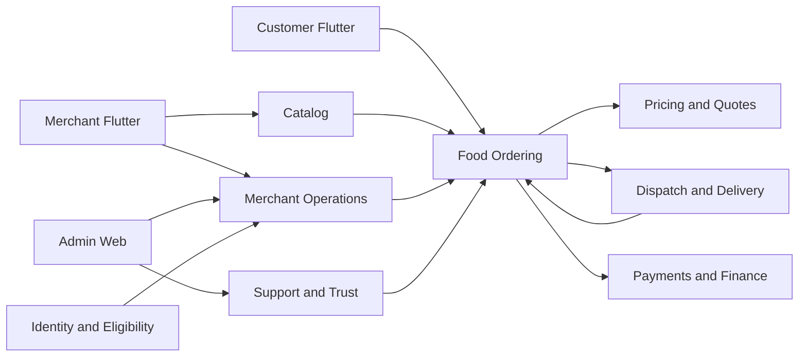
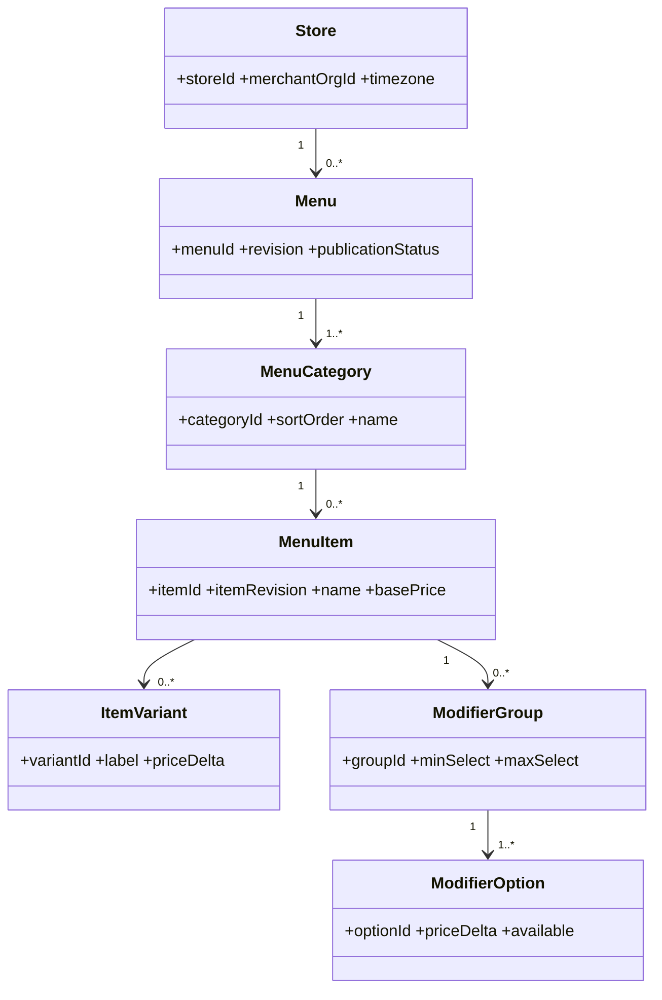
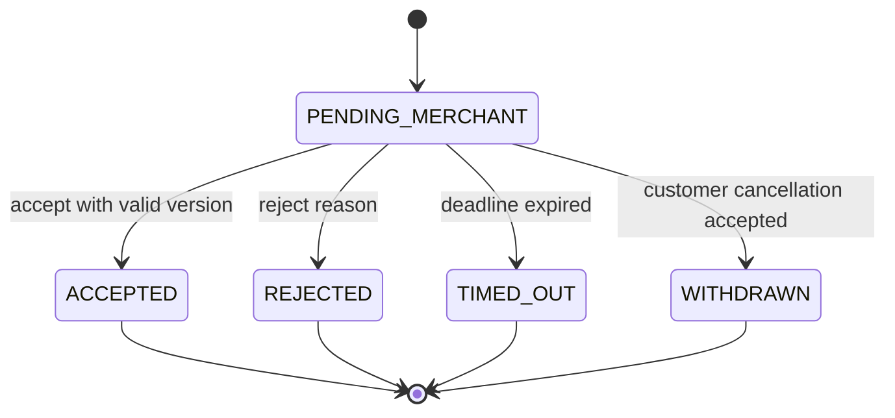
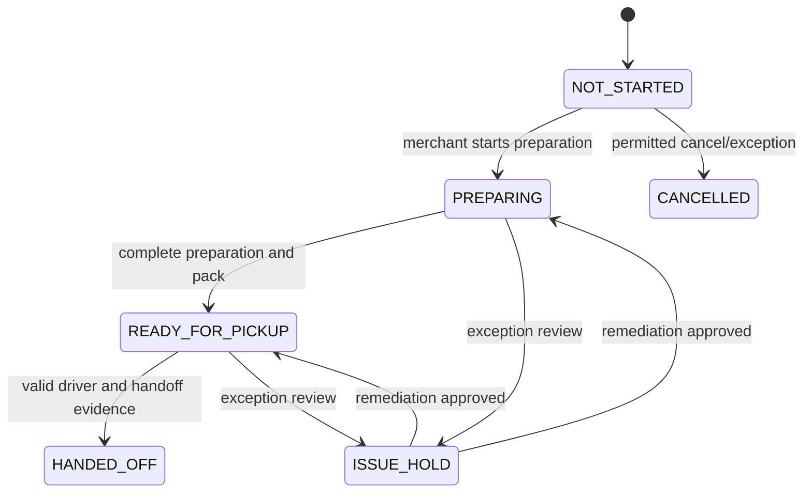
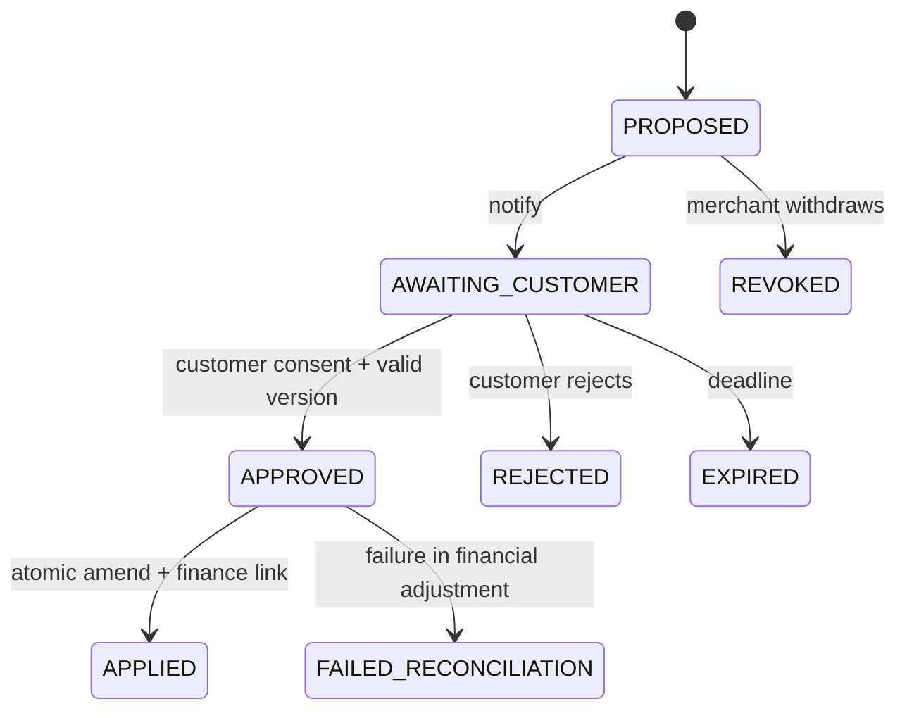
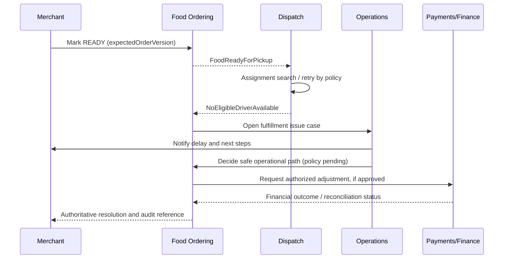

# DealGo — Merchant & Catalog Rules / Nghiệp vụ cửa hàng và thực đơn

> **Tình trạng:** `DRAFT` — đề xuất triển khai và tiêu chí kiểm thử, **không phải** chính sách thương mại đã được duyệt. DealGo có **một ứng dụng Flutter với ba vai trò** (Customer, Merchant, Driver) và **Admin Web riêng**; bản MVP bao gồm cả Ride (xe máy, ô tô) và Food. Tài liệu này chỉ đặc tả Merchant và Catalog của Food, không áp quy tắc món ăn cho Ride.
>
> **Nguyên tắc tối quan trọng:** Cửa hàng đang mở **không đồng nghĩa** đủ điều kiện nhận đơn; món có trong menu **không đồng nghĩa** còn bán; món còn trong giỏ **không đồng nghĩa** đủ điều kiện checkout; `MERCHANT_READY` **không đồng nghĩa** `DELIVERED`; sửa giá/menu **không được** ghi đè tiền và tên món đã chốt trong đơn cũ.
>
> **Chính sách chưa chốt:** `OPEN-009` (đơn 1 hay nhiều cửa hàng), `OPEN-013` (đa cửa hàng/nhân viên), `OPEN-016` (đã chế biến nhưng không có tài xế), `OPEN-002/003/010` (tiền và thanh toán) và các vấn đề pháp lý/nhà cung cấp khác. Mọi ví dụ tiền, thời gian, hạn mức và thuật toán phía dưới chỉ dùng ở **test fixtures**, trừ khi được phê duyệt riêng.

## 1. Mục tiêu và phạm vi

Tài liệu giúp Product, UI/UX, Flutter, Backend, Admin, Operations và AI coding agents thống nhất cách cửa hàng tạo thực đơn, nhận và xử lý đơn **mà không suy diễn từ giao diện**.

**Kết quả phải có:**

1. Merchant có thể quản lý cửa hàng, thời gian kinh doanh, trạng thái nhận đơn, món/giá/tùy chọn và khả dụng một cách có kiểm soát.
2. Customer chỉ nhìn thấy món phù hợp với địa bàn, giờ bán, khả dụng và điều kiện của cửa hàng; mọi hiển thị có trạng thái loading/stale/empty/error tương ứng.
3. Checkout luôn tái xác thực giỏ, giá, tùy chọn và điều kiện cửa hàng bằng nguồn dữ liệu authoritative phía server.
4. Order đã chấp nhận giữ bản chụp bất biến; merchant xử lý đơn theo state machine và quyền đã cấp.
5. Chuyển giao món cho đúng tài xế, đúng đơn và đúng cửa hàng; tách lifecycle đơn món và nhiệm vụ giao hàng.
6. Các vấn đề hết món, khách không chấp thuận sửa đơn, thiếu tài xế, quá tải và tranh chấp có lộ trình recovery/audit.
7. Mọi yêu cầu có liên kết tới FR/UC/BR, kiểm thử và release gate.

**Ngoài phạm vi:** quyết định pháp nhân/quy định an toàn thực phẩm; công thức phí/hoa hồng chính thức; PSP/COD production; chính sách hoàn tiền; cơ chế kiểm chứng giao hàng cuối; thiết kế UI pixel-perfect; database Prisma final; hàng tạp hóa/GrabMart; đặt bàn; gói đồ ăn định kỳ; multi-store combined checkout được triển khai chính thức.

## 2. Nguồn sự thật và mức độ chắc chắn

| Nguồn | Vai trò | Quy tắc | 
|---|---|---|
| `product-requirements.md`, `functional-requirements.md` | Yêu cầu sản phẩm nền | Không đổi FR ID hoặc tự bổ sung P0 được phê duyệt |
| `domain-model.md` | Ngữ nghĩa aggregate/context | Giữ `FoodOrder` độc lập `DeliveryTask`; không sở hữu dữ liệu Finance |
| `roles-and-permissions.md` | Phân quyền và scope | Kiểm tra tại server và từng `storeId`; UI chỉ là projection |
| `identity-kyc-kyb.md` | Eligibility và xét duyệt | Hồ sơ hợp lệ khác với quyền nhận đơn đang có hiệu lực |
| `decisions-and-assumptions.md` | Chốt/để mở | Không chuyển `OPEN-*` thành policy production |
| Merchant guides từ Grab/ShopeeFood | Đối chiếu tham khảo | Không suy đoán thuật toán nội bộ và không copy giới hạn nền tảng khác |

**Trạng thái đặc tả:** `CONFIRMED_BASELINE` = phạm vi đã đồng thuận (Ride + Food, 3 roles/app, Admin riêng); `PROPOSED_P0` = điều kiện triển khai cần PO duyệt; `OPEN_POLICY` = phương án thiết kế được mô hình hóa nhưng chặn áp dụng production; `REFERENCE_ONLY` = quan sát từ đối thủ. Nếu có xung đột, mở Decision Record, không lặng lẽ chọn một cách hiểu.

## 3. Ngôn ngữ miền nghiệp vụ

| Thuật ngữ | Ý nghĩa, chủ sở hữu | Không được nhầm với |
|---|---|---|
| `MerchantOrganization` | Chủ thể đối tác đứng sau một hoặc nhiều cửa hàng (mô hình ứng viên) | `Store` chi nhánh vật lý |
| `Store` | Điểm bán, tọa độ, giờ làm, trạng thái nhận đơn, tenant scope | Tài khoản owner/staff |
| `StoreMembership` | Quyền một account thao tác trên cửa hàng cụ thể | `activeRole` Flutter |
| `StoreEligibility` | Quyền được nhận FoodOrder mới theo compliance/ops | `StoreOperationalMode` |
| `StoreOperationalMode` | `NORMAL`, `BUSY`, `PAUSED` do vận hành đặt | `OPEN/CLOSED` do lịch |
| `Serviceability` | Cửa hàng/vùng/điểm giao được hệ thống phục vụ | Cửa hàng đang online |
| `Menu` | Tập nhóm món và món dùng để trưng bày, có phiên bản | Giỏ hàng của khách |
| `MenuCategory` | Nhóm món trong menu của store | Danh mục hệ thống toàn cục |
| `MenuItem` | Món/sản phẩm bán ở store | Dòng `OrderItemSnapshot` |
| `ItemVariant` | Size/phiên bản với giá và rule | `ModifierSelection` topping |
| `ModifierGroup` | Nhóm tùy chọn, `min/max`, required/optional | Một topping đơn lẻ |
| `ModifierOption` | Topping, mức đường/đá, lựa chọn kèm giá | Món bán độc lập |
| `ItemAvailability` | Có thể bán, tạm hết, ẩn, hết vĩnh viễn theo chính sách | `StockQuantity` tồn vật lý |
| `PriceQuote` | Bản tính giá có hiệu lực giới hạn, kiểm chứng server | Giá hiển thị trong cache |
| `FoodCart` | Ý định mua chưa chốt, có thể lỗi thời | `FoodOrder` đã tạo |
| `FoodOrder` | Hợp đồng đặt món và điều phối merchant stage | `DeliveryTask` việc giao |
| `OrderItemSnapshot` | Tên/size/topping/đơn giá/thuế/phí tại thời điểm đặt | MenuItem mutable |
| `MerchantDecision` | Accept/reject theo phiên bản trạng thái | Quyết định assign tài xế |
| `PreparationStage` | Chưa làm/đang làm/sẵn sàng bàn giao | Trạng thái thanh toán |
| `Handoff` | Ghi nhận chuyển giao cho driver hợp lệ | Delivered cho Customer |
| `MerchantIssueCase` | Yêu cầu hỗ trợ/ngoại lệ có evidence, owner | Lệnh âm thầm sửa đơn |

**Định danh:** `merchantOrgId`, `storeId`, `menuId`, `itemId`, `variantId`, `modifierGroupId`, `optionId`, `cartId`, `orderId`, `deliveryTaskId`, `assignmentId`, `handoffId`. Các ID là opaque server identifiers; mọi dereference bắt buộc scope/ownership check.

## 4. Context ownership và ranh giới miền

| Context | Sở hữu | Không được ghi trực tiếp |
|---|---|---|
| Identity & Partner Compliance | KYC/KYB, eligibility, account membership | FoodOrder state, ledger |
| Merchant Operations | Store settings, lịch/mode/capacity, thao tác cửa hàng | Payment, Driver assignment |
| Catalog | Menu/categories/items/modifiers/availability/revisions | FoodOrder snapshot đã commit |
| Food Ordering | Cart validation, order snapshot, merchant decision, preparation | Driver GPS/DeliveryTask outcome |
| Dispatch & Delivery | DispatchOffer, Assignment, DeliveryTask, pickup/handoff logistics | MenuItem price/stock |
| Pricing | Quote, discount, fee/tax calculation policy | Chuyển trạng thái merchant/order tùy tiện |
| Payments & Finance | PaymentIntent, Ledger, Refund, Settlement | Menu operational mode |
| Support/Trust | Case, dispute evidence, action audit | Sửa dữ liệu gốc bằng phép gán ngầm |

**Khuyến nghị triển khai:** Modular Monolith với module boundaries rõ, không bắt buộc microservices. Dữ liệu có thể cùng PostgreSQL instance nhưng command phải đi qua domain/application API đúng owner. Không dùng shared ORM repository để context khác update trực tiếp aggregate không sở hữu.



## 5. Actor và permission boundaries

| Actor | Điều được thực hiện (sau kiểm tra quyền) | Không được tự ý |
|---|---|---|
| Customer | Xem storefront; cấu hình món; tạo giỏ/đặt; chấp nhận/từ chối yêu cầu sửa khi policy cho phép | Gửi giá/tổng tiền tùy ý, đổi order merchant khác |
| Merchant Owner | Sửa hồ sơ, cấu hình giờ/mode, catalog, quản lý nhân viên khi được duyệt | Bỏ qua KYB, truy cập quán khác |
| Merchant Manager | Quản lý menu/đơn trong các store được cấp | Xem toàn bộ giấy tờ owner hoặc cấp role cao hơn |
| Merchant Operator | Xem/accept/reject/prepare/ready theo quyền | Đổi tài khoản nhận tiền, menu publish nếu không có quyền |
| Driver | Xem yêu cầu pickup đã được gán, chứng minh nhận hàng | Sửa món, tổng tiền, tự đánh dấu merchant đã nhận |
| Merchant Ops/Admin | Tạm dừng theo incident, xem sự kiện và hỗ trợ | Chỉnh ledger/payment trực tiếp khi không có quyền Finance |
| Finance | Xem khoản ghi nhận, kiểm tra đối soát | Thay đổi menu/merchant eligibility không có quyền |

**Permission naming** kế thừa `roles-and-permissions.md`: `store.dashboard.read`, `store.profile.write`, `store.open_close`, `store.menu.create_update`, `store.menu.publish`, `store.order.accept_reject`, `store.order.prepare_ready`, `store.staff.invite`, `store.staff.grant_revoke`, `store.finance.read`, `food.order.read`. Quyền phát sinh mới phải qua thay đổi policy có review, không âm thầm dùng wildcard.

### 5.1 Bộ guard chuẩn

`permit(actor, action, resource)` phải xét: `account.status`, `activeRole`/membership phía server, `merchantOrgId/storeId`, scopes, approval/eligibility, resource ownership, lifecycle, `version`, suspension, time window, vùng hoạt động. `activeRole` chỉ là ngữ cảnh điều hướng/UI; không phải bằng chứng cấp quyền độc lập.

## 6. Aggregate catalog đề xuất

| Aggregate Root | Các đối tượng bên trong | Consistency boundary | Revision |
|---|---|---|---|
| `Store` | profile, opening rules, operational state, exceptions | Một thay đổi mode/giờ có tính nguyên tử | `storeVersion` |
| `Menu` | categories, item references, publication metadata | Publish tạo snapshot menu có revision | `menuRevision` |
| `MenuItem` | variant/modifier associations, availability | Chỉnh sửa item/price/options không overwrite lịch sử | `itemRevision` |
| `FoodCart` | draft lines, chosen modifiers, validation summary | Một intent checkout hợp lệ | `cartVersion` |
| `FoodOrder` | immutable order lines, merchant actions, preparation | Chấp nhận/từ chối/chuyển preparation theo optimistic lock | `orderVersion` |
| `MerchantIssueCase` | reason, attachments refs, activities, outcome | Một issue có audit và owner | `caseVersion` |

Đây là phân tách **ứng viên**, không phải bảng/Prisma schema đã chốt. Lưu ý order có thể reference `Store`, `MenuItem`, `PriceQuote` bằng ID và bản chụp dữ liệu, nhưng không giữ ORM object mutable của context khác.

## 7. Store identity, onboarding và lifecycle

### 7.1 Các điều kiện được bán

Một `Store` chỉ có thể hiện là **ORDERABLE** khi đồng thời đạt:

- Merchant KYB và cửa hàng đạt `StoreEligibility` theo `identity-kyc-kyb.md`.
- Không bị suspension/legal hold/fraud hold.
- Store thuộc địa bàn dịch vụ, và điểm giao phù hợp serviceability (theo `OPEN-001`).
- Trong khung giờ được phép bán, không ở `PAUSED`; tối thiểu còn món có thể bán theo catalog.
- Cấu hình nhận đơn, mode và khả năng đáp ứng khớp contract.
- Không bị chặn bởi cấu hình an toàn/pháp lý/payment kênh đang chọn.

`isOrderable` là **derived predicate trên server**, không phải một boolean client gửi lên. Ví dụ mã minh họa:

```ts
function mayAcceptNewFoodOrder(ctx: StoreOrderabilityContext): boolean {
  return ctx.partnerEligible
    && ctx.storeEnabled
    && !ctx.suspended
    && ctx.isWithinBusinessHours
    && ctx.operationalMode !== 'PAUSED'
    && ctx.serviceAreaEligible
    && ctx.hasPurchasableItems
    && ctx.paymentRouteSupported;
}
```

### 7.2 State sets độc lập

`StoreReview`: `DRAFT → SUBMITTED → UNDER_REVIEW → APPROVED | NEEDS_CHANGES | REJECTED`; APPROVED có thể `SUSPENDED/REVERIFY_REQUIRED`.

`Schedule`: `OPEN_NOW | CLOSED_NOW` được suy ra từ weekly schedule + overrides + timezone.

`OperationalMode`: `NORMAL | BUSY | PAUSED`. Cơ chế tự đóng/đổi mode vì hệ thống ngoài sức chứa là **đề xuất**, cần `reason`, audit, quyền quản lý và policy.

`StorefrontVisibility`: `LISTED | HIDDEN | RESTRICTED`; có thể **được nhìn thấy nhưng không đặt được** để khách xem/menu/hẹn lại tùy chính sách.

**Cấm** dùng một enum `storeStatus` gộp tất cả KYB, mode, lịch, moderation và availability; sẽ gây nhảy trạng thái không kiểm soát.

## 8. Giờ hoạt động, ngoại lệ và múi giờ

- Lưu giờ ở timezone IANA (ví dụ `Asia/Ho_Chi_Minh`), dùng ngày địa phương để đánh giá lịch; backend lưu thời điểm sự kiện UTC.
- Khai báo lịch theo thứ trong tuần; nhiều ca/ngày; ca qua nửa đêm; ngày lễ/ngoại lệ; đóng sớm; tạm nghỉ có hạn.
- Xử lý **ngày nghỉ** ưu tiên hơn lịch thường; schedule override có `effectiveFrom/To`, `reason`, `actorId`.
- Chỉnh sửa lịch không hủy đơn đang accepted; cấm nhận đơn mới nếu lệch eligibility, và phải có xử lý riêng cho đơn scheduled (nếu release sau cho phép).
- Giới hạn đặt trước, giờ nhận cuối, cutoff cho món cần nhiều thời gian vẫn thuộc `TBD`.
- Giờ hiển thị có thể cache, nhưng checkout phải đánh giá lại bằng server clock.
- Trường hợp giờ đổi giữa cart và checkout → trả `STORE_CLOSED_AT_CHECKOUT` hoặc mã tương đương, không thu tiền theo trạng thái cũ.

**Cạnh tranh:** một phiên đổi schedule cùng phiên đổi mode phải có mỗi command idempotent và conditional `storeVersion`; nếu conflict trả conflict + state hiện tại.

## 9. Mode cửa hàng: NORMAL, BUSY, PAUSED

| Mode | Nhận order mới | Prep ETA | Order đang xử lý | UI Customer |
|---|---|---|---|---|
| `NORMAL` | Có, nếu orderable | Chuẩn theo quote | Tiếp tục | Đang nhận đơn |
| `BUSY` | Có theo capacity policy (TBD) | Có thể kéo dài có kiểm soát | Tiếp tục | Đang bận; ETA dài hơn |
| `PAUSED` | Không nhận order mới | Không quote mới | Vẫn hoàn tất/escale | Tạm dừng nhận đơn |

- Mọi đổi mode ghi `actor`, `reason`, `startedAt`, `expiresAt?`, `storeVersion` và audit.
- Hết hạn BUSY/PAUSED tự reset **chỉ khi** policy được duyệt và không bị compliance/safety hold; fail-safe ưu tiên chặn order mới nếu không xác định trạng thái.
- **Không tự hủy** đơn in-flight khi PAUSED; hỗ trợ Operations can thiệp theo case.
- Định nghĩa capacity: `maxActiveOrders`, prep slots, queue depth, manual override, scheduled worker model là **config ứng viên**, không hardcode.
- Exceed capacity khi 2 checkout cùng đến phải được guard nguyên tử hoặc theo reservation policy; không chỉ check `count() < limit` trên hai request riêng.

## 10. Menu structure và catalog relationships

Một store có thể có menu, các nhóm món, item, biến thể và modifier. MVP ưu tiên **model đủ tổng quát, UI không nhất thiết phơi toàn bộ khả năng**.



**Lưu ý:** item có thể nằm nhiều category hay chỉ một category là schema decision; tránh duplicate `MenuItem` vì cùng món xuất hiện trong nhiều group (nên dùng relation). `variantId` không được trộn với `optionId` trong API order lines. Mọi resource phải nằm trong cùng `storeId` và revision có hiệu lực.

## 11. CRUD thực đơn và publishing workflow

| Command | Tiền điều kiện | Side effect | Điều cấm |
|---|---|---|---|
| `CreateCategory` | Store grant + menu draft | Category version/position | Tên rỗng, target store khác |
| `CreateMenuItem` | Có category, các trường hợp lệ | Draft item, audit | Mặc định xuất bản public chưa qua review nếu cần |
| `UpdateMenuItem` | Version khớp | Revision mới, invalidation cache | Ghi đè line item của order cũ |
| `ReorderCategory` | List thuộc cùng menu | Đổi thứ tự theo transaction | Lẫn `categoryId` store khác |
| `SetItemAvailability` | Quyền và lý do | Availability event, clear relevant cache | Coi đây là hủy đơn cũ |
| `PublishMenu` | Đã validate toàn bộ menu, store đúng scope | Atomic publication pointer | Partial publish lộ menu không nhất quán |
| `ArchiveMenuItem` | Không xóa chứng cứ audit/order history | Ẩn món khỏi menu mới | Physical delete gây mất lịch sử order |

**Catalog revisions:**

- Draft có thể sửa liên tục; customer chỉ đọc published projection trừ quyền preview.
- Publish tạo revision có `publishedAt`, `publisherId`, `changeSummary`, `integrityHash` (tùy), audit.
- Nếu UI sửa nhanh cần immediate publish, vẫn phải tạo revision, server validation và tracking; không bỏ các bước bảo toàn giá.
- Xóa category khi có món: yêu cầu chọn **move items / archive / reject** theo policy; không cascade xóa lịch sử đơn.
- Thay menu/giá trên món đang trong giỏ → giỏ stale; validate ở checkout và hiển thị thay đổi, không tự trừ tiền theo giá cũ.
- `PATCH` phải dùng `If-Match` / revision, hoặc optimistic version trong command để tránh lost update.

## 12. Trường bắt buộc của MenuItem

| Nhóm | Trường ứng viên | Validation |
|---|---|---|
| Identity | `itemId`, `storeId`, `name`, `categoryIds` | Tên không rỗng, thuộc đúng store |
| Content | `description?`, `images?`, `dietaryTags?` | Sanitize, giới hạn, moderation; tránh claim không có bằng chứng |
| Price | `basePriceMinor`, `currency=VND`, `taxTreatment?`, `packagingFee?` | Server validates nonnegative policy; không lấy total từ client |
| Options | `variantIds`, `modifierGroupIds` | Groups cùng store và active published revision |
| Availability | `availabilityStatus`, `reason?`, `until?`, `availabilityWindows?` | Hiệu lực có khoảng thời gian rõ ràng |
| Fulfillment | `prepTimeEstimate?`, `maxPerOrder?` | Policy/capacity versioned |
| Presentation | `sortOrder`, `featured?`, `tags?` | Không quyết định thứ tự tạo giá/khả dụng |
| Audit | `version`, `createdBy`, `updatedBy`, timestamps | Không sửa trực tiếp bởi customer |

Chính sách ảnh, sản phẩm cấm, nội dung dinh dưỡng/dị ứng, VAT/hóa đơn và mức phê duyệt admin cần phối hợp Compliance/Legal; không sao chép nguyên xi tiêu chuẩn từng nền tảng đối thủ.

## 13. Biến thể, modifier group và topping

### 13.1 Các kiểu lựa chọn

- `SINGLE_SELECT`: chọn một size hay loại đường nếu bắt buộc.
- `MULTI_SELECT`: chọn nhiều topping trong `minSelect/maxSelect`.
- `QUANTITY_OPTION`: chọn số lượng mỗi topping, chỉ triển khai nếu requirement và UI đã duyệt (có giới hạn tổng và theo option).
- `INCLUDED_DEFAULTS`: lựa chọn được chọn sẵn, phải hiển thị minh bạch và cho thay đổi theo policy.

### 13.2 Validation bắt buộc

1. Với mỗi group: `0 ≤ minSelect ≤ maxSelect ≤ availableOptionCount` (ngoại lệ khi có quantity model được khai báo rõ).
2. `required=true` không thể đi kèm `minSelect=0`, trừ schema có giải thích semantically khác.
3. `selectedOptions` chỉ chứa `optionId` thuộc đúng group, item, store và revision.
4. Không cho chọn option đã `UNAVAILABLE` hoặc bị khóa bởi variant không tương thích.
5. Không cho lặp option nếu group không hỗ trợ số lượng; khi hỗ trợ quantity, kiểm tra per-option min/max.
6. Delta price được tính phía server; negative delta/discount phải qua Pricing policy.
7. Thay group/options sau khi khách tạo cart → `CART_REVALIDATION_REQUIRED` nếu selection cũ không hợp lệ.
8. Topping chọn ở item A không được gắn sang item B bằng sửa payload.

### 13.3 Ví dụ fixture thử nghiệm — KHÔNG phải bảng giá production

```yaml
fixture_id: MENU-FIXTURE-001
use: TEST_ONLY
item: "Trà sữa minh họa"
variants:
  - { id: size_m, label: M, price_delta_vnd: 0 }
  - { id: size_l, label: L, price_delta_vnd: 5000 }
modifier_groups:
  - group: sugar
    min_select: 1
    max_select: 1
    options: [sugar_0, sugar_50, sugar_100]
  - group: toppings
    min_select: 0
    max_select: 2
    options: [pearl, pudding, jelly]
```

Không biến `5.000`, `max=2` ở fixture thành chính sách áp dụng cho mọi quán.

## 14. Mức độ khả dụng món (Availability) và giới hạn tồn

| Trạng thái | Ý nghĩa | Hành vi |
|---|---|---|
| `AVAILABLE` | Có thể bán theo lịch và điều kiện khác | Có thể thêm giỏ khi store orderable |
| `TEMP_UNAVAILABLE` | Tạm hết món/nguyên liệu | Ẩn CTA đặt mới, giữ món trong lịch sử |
| `SCHEDULED_UNAVAILABLE` | Không bán trong một khoảng thời gian | Hiển thị không khả dụng theo clock/window |
| `PERMANENTLY_UNAVAILABLE` | Không còn kinh doanh | Không order; archive khi cần |
| `HIDDEN_DRAFT` | Chưa public hoặc đang chờ duyệt | Không lộ cho khách |

MVP **không mặc định có kho hàng định lượng chính xác**; có thể bắt đầu với availability flag và quantity cap. Nếu hỗ trợ hard inventory:

- Lượng khả dụng = on-hand − reserved − allocated (định nghĩa source-of-truth).
- Phải xác định thời điểm reservation (cart không giữ tồn mặc định; checkout/order placement mới có reservation có TTL nếu policy).
- Reservation/release/consume phải chống trùng khi retry, cancellation, order timeout.
- Race hai khách mua đơn vị cuối phải để tối đa một reservation thành công.
- Nếu không có inventory authoritative, UI **không cam kết “còn đúng N phần”**.

Với “hết đến ngày mai” hay tự mở lại: biểu diễn `unavailableUntil` theo timezone cửa hàng + policy; không reset theo giờ UTC một cách tùy tiện.

## 15. Giá, thuế, phí đóng gói và tính toán

**Single price authority:** Catalog lưu các thành phần giá gốc có phiên bản; Pricing context quyết định giá cuối, discount, phí và rounding theo `OPEN-003`. Client gửi `itemId`, `variantId`, `optionIds`, `quantity`, quote token; **không gửi số tiền do client tự khẳng định**.

```text
Item subtotal (per line) = qty * (base + variant delta + modifier deltas)
Cart subtotal = sum(validated line subtotals)
Payable = PricingService.quote(cart, store, delivery, promotions, tax, fees)
```

Phương trình minh họa, **không quyết định** ai chịu VAT/khuyến mại/bao bì hay công thức giá chính thức.

- Tiền VND lưu ở đơn vị nguyên tối thiểu theo thiết kế tài chính, không dùng `float` để tính toán.
- Thông tin giá phải minh bạch: trước và sau khuyến mại, phí/thuế hợp lệ, tổng phải trả và phần payable cho quán nếu được phép hiển thị.
- Sale price, modifier price, combo, khuyến mại theo store, campaign platform/merchant phải có hiệu lực và priority.
- Giá trong đơn đã commit là snapshot; sửa menu hoặc campaign không hồi tố.
- Khi total thay đổi ở checkout: trả diff với quote mới, yêu cầu khách xác nhận lại nếu thay đổi material theo policy.
- Không double-apply coupon/merchant discount sau retry, không chấp nhận client-supplied negative total.
- Khi đổi/thiếu món sau order: không mutate committed price bằng update trực tiếp; phải tạo `OrderChangeRequest`/amendment và dòng tài chính điều chỉnh nếu được phép (theo `OPEN-010`, `OPEN-016`).

## 16. Menu timing và điều kiện bán theo ngày

- Store schedule quyết định quán mở hay đóng; item sale window quyết định món có trong giờ bán hay không.
- Hiệu lực cuối = `storeOrderable && itemPublished && itemAvailable && itemTimeWindowActive && variantModifiersValid`.
- Nếu mục bán buổi sáng biến mất buổi chiều, lịch sử/cart không bị xóa ngầm; phải có stale state rõ ràng.
- Item chỉ bán cuối tuần hoặc combo theo khung giờ: luôn tính bằng local timezone của store.
- Khi thay đổi giờ bán ảnh hưởng cart/order mới, invalidate relevant read projections.
- Khi khách mở app đúng boundary thời gian, CTA có thể hiển thị cũ do cache; checkout validation authoritative phải chặn.

## 17. Cart invariants và checkout revalidation

1. Cart thuộc một customer và có `cartVersion`.
2. Cart lines trỏ đúng item/option/store, và có snapshot hiển thị nhưng chưa bảo đảm giá.
3. `OPEN-009` chưa chốt: thiết kế cart API có `storeId` rõ; không hardcode đa cửa hàng trong order một cách ngầm định. **Phương án mặc định để triển khai thử nghiệm:** một `FoodOrder` thuộc một store, ghi `PROPOSED_P0`, chờ PO duyệt.
4. Checkout kiểm tra customer, merchant eligibility, store orderability, item/modifier version, quantity, serviceability, quote validity, payment readiness, anti-abuse và `idempotencyKey`.
5. Nếu giỏ stale, trả **structured diff** gồm hết món / tăng giá / giảm giá / hết giờ / thay options; không tự thay món gây phát sinh chi phí.
6. Request trùng key cùng payload trả cùng result; cùng key khác payload trả conflict.
7. Khi server tạo order, snapshot tên, ảnh tham chiếu, variant, modifier, quantity, unit price và order total được đóng băng.
8. Nếu không đủ điều kiện checkout, không tạo `FoodOrder` ở trạng thái thành công và không capture tiền trái policy.

### 17.1 Ví dụ lỗi có cấu trúc

```json
{
  "type": "https://docs.dealgo.example/problems/cart-stale",
  "title": "Giỏ hàng cần cập nhật",
  "status": 409,
  "code": "CART_REVALIDATION_REQUIRED",
  "details": [
    { "itemId": "item_example", "reason": "UNAVAILABLE" }
  ],
  "currentCartVersion": 12,
  "traceId": "example-trace"
}
```

Domain `.example` ở trên chỉ là **minh họa, không phải URL đang hoạt động**. HTTP/error shape cuối phụ thuộc OpenAPI và RFC 9457; không tự chốt endpoint ở tài liệu này.

## 18. Đặt đơn mới và merchant acceptance modes

MVP cần hỗ trợ service boundary giữa `OrderPlaced` và merchant acknowledgment. Hai chế độ cấu hình ứng viên:

| Mode | Hành vi | Rủi ro, phụ thuộc |
|---|---|---|
| `MANUAL_ACCEPT` | Store nhận thông báo, nhân viên chấp nhận/từ chối trong window | Chưa chốt timeout, xử lý payment trước accept |
| `AUTO_ACCEPT` | Server tự chấp nhận khi mọi guard store/stock/capacity hợp lệ | Cần chất lượng vận hành, policy hàng tồn và lộ trình rollout |

**Đề xuất P0:** có `MANUAL_ACCEPT` làm đường đi thử nghiệm; `AUTO_ACCEPT` sau khi có metrics/rules. Không coi policy của Grab năm 2026 là policy mặc định của DealGo.

### 18.1 Merchant decision state (độc lập FoodOrder status tổng)



- Không cho accept sau cancel/timeout/reject.
- Với auto accept vẫn phát sinh một outcome authoritative có audit actor `SYSTEM`.
- Nếu merchant và customer cùng quyết định khi request đang chờ, backend dùng version/CAS để có **một kết quả hợp lệ**.
- Timeout có event/case tương ứng; policy timeout và chủ thể chịu phí cần được duyệt.

## 19. Merchant Inbox và xử lý công việc

**Inbox views:** `NEW/PENDING`, `ACCEPTED`, `PREPARING`, `READY`, `PICKED_UP`, `COMPLETED`, `CANCELLED/ISSUES`. Views có thể là projections từ `FoodOrder + DeliveryTask`, không gộp vào một DB enum.

- Merchant chỉ thấy order theo `storeId` được cấp quyền, có tìm kiếm theo mã đơn, thời gian, stage và xử lý nhanh.
- Bản ghi trên mỗi card: mã đơn, thời gian, dòng món/ghi chú hợp lệ, preparation status, cảnh báo timeout, tài xế/handoff khi có quyền, cảnh báo thanh toán ở mức cho phép.
- Không lộ số điện thoại/địa chỉ đầy đủ của khách khi không cần thiết cho quán.
- Khi offline, hiển thị cached snapshot + stale marker; không giả accept thành công.
- Mọi thao tác accept/reject/ready từ hai nhân viên phải có `expectedOrderVersion`.
- Push/email/SMS chỉ để báo thay đổi, **không phải** nguồn sự thật; reconnect phải refetch.
- Tự động sắp xếp ưu tiên theo deadline chỉ là UI; không thay domain permissions.

## 20. Bắt đầu chế biến, chuẩn bị xong và đóng gói



- Transition cần order accepted; không thể `READY_FOR_PICKUP` khi còn pending merchant.
- `PREPARING` là stage sản xuất của quán; tài xế có thể được gán song song tùy dispatch policy.
- `READY_FOR_PICKUP` không tự tạo `PICKED_UP/DELIVERED`, và không bảo đảm có tài xế.
- Thời gian dự kiến chế biến là estimate; cần lưu source, update reason, không hứa chính xác tuyệt đối.
- Có thể ghi checklist đóng gói, số túi, món cần giữ nhiệt, dao nĩa theo config; không dùng dữ liệu riêng tư ngoài cần thiết.
- Sau khi `HANDED_OFF`, sửa/chỉnh món phải qua dispute/compensation, không tự sửa đơn.

## 21. Handoff cho tài xế và DeliveryTask

- Pickup phải liên kết `orderId + deliveryTaskId + assignmentId + storeId` đúng quan hệ và trạng thái.
- Tài xế **đang được phân công hợp lệ**, chưa bị revoked/expired, cùng store và task; merchant phải có quyền xác nhận.
- Bằng chứng bàn giao (`OTP`, mã order, QR, confirm đôi bên, ảnh, chữ ký) là lựa chọn chưa chốt tại `OPEN-011`; storage/privacy theo Compliance.
- Handoff event idempotent theo `{orderId, assignmentId, handoffAttemptId}`; retry cùng action không tạo hai pickup nghiệp vụ.
- Hai tài xế thay nhau đến: driver A bị revoke không được lấy hàng sau khi assignment sang B.
- Mismatch số túi/món, tài xế không đến, customer cancel giữa handoff: tạo incident/case có timestamp, không âm thầm complete.
- Merchant chỉ được xem thông tin cần thiết để xác định pickup; không có quyền đọc toàn bộ GPS lịch sử driver.

## 22. Hết món sau khi khách đã đặt và OrderChangeRequest

**Không thay đổi order lines đã chốt bằng `UPDATE order_items SET price=...` trực tiếp.** Nếu policy cho phép sửa đơn:

1. Merchant báo `ITEM_UNAVAILABLE` và đề xuất sửa (xóa, thay thế, giảm số lượng, sửa tùy chọn); kèm lý do và phiên bản hiện tại.
2. Food context tạo `OrderChangeRequest` có `changeRequestId`, `orderId`, `proposedDiff`, `old/new amount candidate`, `expiresAt`, trạng thái.
3. Pricing context tính lại adjustment theo policy; hiển thị rõ số tiền tăng/giảm và ảnh hưởng khuyến mại/phí.
4. Customer nhận thông báo và chủ động chấp thuận/từ chối theo rule đã duyệt; không chế biến món thay thế trước khi đồng ý.
5. Nếu approved, apply bằng một transition/version hợp lệ, lưu history + snapshot amendment và phát hành payment adjustment nếu cần.
6. Nếu rejected/timeout/driver en route, tạo cancellation/issue case theo stage, không tự động bồi hoàn theo giả định.

### 22.1 State machine minh họa



**Chưa chốt:** số lần sửa tối đa, stage cho phép, ai thanh toán chênh lệch, thay thế có cần same category/value không và timeout. ShopeeFood có chính sách riêng (từ 05/2026 quy định một lần sửa và hạn mức chênh lệch) — các giá trị đó chỉ là đối chiếu, **không áp đặt cho DealGo**.

## 23. Từ chối/hủy đơn và ma trận nguyên nhân

| Reason code | Actor chủ động | Có thể ở stage | Xử lý bắt buộc |
|---|---|---|---|
| `STORE_CLOSED` | Merchant/Ops | Pending trước accept | Lưu lý do, cập nhật mode khi cần, xử lý payment |
| `ITEM_SOLD_OUT` | Merchant | Pending/accepted theo policy | Đề xuất sửa hoặc case hủy, cập nhật availability |
| `CAPACITY_OVERFLOW` | Merchant/System | Pending trước accept | Ghi báo quá tải, đề xuất BUSY/PAUSED |
| `STORE_UNREACHABLE` | System/Ops | Pending | Timeout, issue, không giả merchant đã reject |
| `CUSTOMER_REQUESTED_CANCEL` | Customer | Theo policy theo stage | Guard cancel, notifications, fees/refund nếu đã duyệt |
| `NO_DRIVER_AVAILABLE` | System/Ops | Có thể sau ready | Escalate `OPEN-016`, không giả delivered |
| `HANDOFF_MISMATCH` | Merchant/Driver | Ready/handoff | Khóa hành động sai, tạo case, audit |
| `SAFETY_INCIDENT` | Ops | Bất kỳ giai đoạn áp dụng | Ưu tiên bảo vệ an toàn, lưu evidence, xử lý theo runbook |

Cancellation outcome cần tách: `order status`, `merchant loss compensation`, `customer refund`, `driver compensation`, `platform fee adjustment`. Không suy ra outcome tài chính từ một lý do hủy mà chưa có policy.

## 24. Không tìm được tài xế sau khi quán chuẩn bị xong

**Đây là luồng P0 phải mô hình hóa, nhưng policy tiền vẫn `OPEN-016`.**



Kịch bản xử lý ứng viên: tiếp tục tìm, thông báo ETA mới, hủy có bồi hoàn, giao phương án thay thế; **không tự áp dụng** trước khi PO + Finance + Ops + Legal duyệt. Nếu food đã được chế biến, tránh cho khách thấy “đã giao” hoặc “đã hoàn tiền” khi chưa có chứng cứ tương ứng.

## 25. Đa cửa hàng, nhiều chi nhánh, nhiều nhân viên

`OPEN-013` quyết định merchant có hỗ trợ nhiều store và staff trong MVP. Thiết kế phải tương thích từ đầu:

- Tất cả key catalog, order, finance, report đều có `storeId` scoped; `merchantOrgId` là organizational grouping (nếu có).
- Chủ cùng organization không mặc nhiên xem mọi dữ liệu nếu thiếu membership hợp lệ; scope phải kiểm tra server.
- Nhân viên cửa hàng A không thể sửa giá của B bằng `itemId` đoán được hoặc đổi `storeId` trong request.
- Thao tác grant/revoke staff ghi audit; quyền bị revoke ngừng áp dụng ngay theo revocation strategy, kể cả session cũ.
- `global item template` và `branch override` chỉ là tùy chọn P1/P2; nếu triển khai phải khai báo owner revision rõ.
- Merchant chuyển active store trên UI phải clear/cache namespace theo store, invalidate form đang mở từ store cũ, và recheck quyền.
- Một order phải có source store rõ để không handoff nhầm giữa chi nhánh.

## 26. Read models, search và trải nghiệm khách hàng

### 26.1 Public storefront

Phần public có thể hiển thị: tên, hình, địa chỉ khu vực phù hợp, giờ mở, khoảng thời gian chuẩn bị dự kiến, trạng thái nhận đơn, categories, món và mức giá theo quote/disclaimer. **Không công khai** giấy tờ KYB, số điện thoại nội bộ, ngân hàng, dữ liệu giá vốn, review notes, payout.

### 26.2 Search/filter/sort

- Tìm quán theo tên, món, phân loại được duyệt, vùng giao được phục vụ; hạn chế tính năng xếp hạng chưa có bằng chứng.
- Paging/cursor có ordering ổn định, tránh item duplicate hoặc mất item khi menu update.
- Search index có thể eventual consistency; storefront phải thể hiện sold out sau cập nhật và checkout guard cuối.
- Filter `availableNow` cần dựa trên thời gian server/region; không chỉ theo text status đã cache.
- Menu `NO_ITEMS`, `ALL_SOLD_OUT`, `STORE_PAUSED`, `OUT_OF_SERVICE_AREA` là những empty states **khác nhau**.

### 26.3 UX state contract

`loading`, `fresh`, `stale`, `offline`, `error`, `forbidden`, `empty`, `closed`, `busy`, `paused`, `item-sold-out`, `price-changed`, `order-updated` phải rõ ràng; không hiển thị loading vô hạn trong thao tác merchant quan trọng. Khi re-enter app, fetch trạng thái server authoritative trước khi khuyến khích xử lý một order có thể đã thay đổi.

## 27. Dữ liệu, schema ứng viên và indices

**Đây là conceptual data model, không định danh bảng Prisma cuối.**

| Model ứng viên | Fields cơ bản | Index/constraint quan trọng |
|---|---|---|
| `MerchantOrganization` | id, status, legalRef | legalRef nội bộ; không public |
| `Store` | id, organizationId, timezone, locationRef, complianceRef | owner/scope, region; status/version |
| `StoreScheduleRule` | storeId, weekday, intervals, timezone, version | range validation, không overlap trái policy |
| `StoreScheduleOverride` | storeId, dateRange, type, reason | index theo store, hiệu lực |
| `StoreModeChange` | storeId, oldMode, newMode, reason, actorId, timestamp | append-only audit |
| `Menu` | id, storeId, publishedRevision | (storeId, revision) unique |
| `MenuCategory` | id, menuId, name, sortOrder | tenant FK; stable ordering |
| `MenuItem` | id, storeId, itemRevision, basePriceMinor, status | scoped references, version |
| `ModifierGroup/Option` | itemId/groupId, min/max, priceDeltaMinor | FK + constraint min ≤ max |
| `CatalogAvailability` | itemId, mode, unavailableUntil, reason | efficient current view |
| `FoodCart/CartLine` | customerId, storeId, version, selectionRefs | ownership; idempotency |
| `FoodOrder/OrderLineSnapshot` | orderId, storeId, totals, immutable lines | snapshot invariant, order id unique |
| `MerchantDecision/StageEvent` | orderId, version, action, actor, reason | CAS/order version; dedupe event |
| `OrderChangeRequest` | orderId, diff, status, version | one active request if policy |
| `HandoffRecord` | orderId, assignmentId, proofRef, actor | unique valid handoff business key |
| `MerchantIssueCase` | storeId, orderId, reason, owner, status | case lookup, audit |

Dùng `(storeId, itemId)` hoặc equivalent tenant-scoped integrity khi cần; DB constraints + application policy cùng ngăn cross-store link. Chỉ tạo index dựa trên EXPLAIN và workload thực tế; không đưa tất cả vào một bảng JSON không thể quản lý ràng buộc.

## 28. API command/query contract (semantic, chưa khóa routes)

| Capability | Input quan trọng | Output và invariant |
|---|---|---|
| `GetStorefront` | storeId, customer location/context | Orderability, public menu revision, status |
| `GetMenu` | storeId, filters, pagination | Published revision, availability |
| `SaveStoreSchedule` | storeId, version, overrides, auth | Updated version + audit |
| `SetStoreOperationalMode` | storeId, newMode, expectedVersion, reason | Updated server mode; in-flight untouched |
| `CreateOrUpdateItem` | storeId, item data, expectedRevision | Validated draft revision, audit |
| `PublishMenu` | storeId, menuRevision, expectedVersion | One published menu version |
| `SetItemAvailability` | storeId, itemId, state, expectedVersion | Event + item availability revision |
| `ValidateCart` | cartId, cartVersion, delivery context | Error diff or validated quote |
| `MerchantAcceptOrder` | orderId, expectedVersion, idempotencyKey | One merchant decision |
| `MerchantRejectOrder` | orderId, reason, expectedVersion, key | Terminal decision + downstream signal |
| `MarkPreparing/Ready` | orderId, expectedVersion, key | Valid preparation stage transition |
| `ConfirmHandoff` | orderId, assignmentId, proof, key | Idempotent pickup evidence if authorized |
| `ProposeOrderAmendment` | orderId, diff, reason, expectedVersion | Request awaiting consent/policy |
| `ReportMerchantIssue` | orderId, issueType, evidence refs, key | Support case and audit |

**Không tin giá từ payload.** Query paths kiểm tra store scope ngay cả khi `storeId` là path param. Mutating commands cần `requestId/idempotencyKey`, version guard và structured errors. OpenAPI cụ thể nằm ở `../06-data-api/rest-api.openapi.yaml` trong giai đoạn sau.

## 29. Domain Events, Outbox, Inbox và downstream consumers

| Event | Publisher | Consumers | Payload tối thiểu |
|---|---|---|---|
| `StoreOperationalModeChanged` | Merchant Ops | Catalog projection, storefront, Ops | storeId, mode, effectiveAt, version |
| `StoreEligibilityChanged` | Identity/Compliance | Merchant Ops, Food | storeId, eligibility version, reason code |
| `MenuPublished` | Catalog | Search, storefront, Food | storeId, menuRevision, timestamp |
| `MenuItemAvailabilityChanged` | Catalog | Search, Cart/UI | itemId, storeId, state, version |
| `FoodOrderPlaced` | Food | Merchant Inbox, Payment, Dispatch | orderId, storeId, orderVersion |
| `MerchantOrderAccepted` | Food | Customer UI, Prep, Dispatch | orderId, storeId, version |
| `MerchantOrderRejected` | Food | Customer, Finance, Support | orderId, reason code, version |
| `FoodPreparationStarted` | Food | ETA projection | orderId, version, timestamp |
| `FoodReadyForPickup` | Food | Dispatch, Driver UI, Customer | orderId, storeId, version |
| `FoodHandoffConfirmed` | Food/Delivery orchestration | Tracking, Support, Finance | orderId, assignmentId, eventId |
| `FoodOrderChangeProposed` | Food | Customer, Pricing | changeRequestId, orderId, version |
| `MerchantIssueReported` | Support | Ops, Merchant UI | caseId, orderId, reason |

**Event versioning:** có `eventId`, `occurredAt`, `aggregateId`, `aggregateVersion`, `schemaVersion`, correlation/causation IDs, tenant/store scope. Dùng outbox cho commit + publish cùng ý định; inbox/idempotent consumers chống duplicate. Event không phải lệnh đọc/ghi bảng context khác; consumer theo dõi event order/version, xử lý out-of-order và retry.

## 30. Concurrency, idempotency và recovery patterns

| Trường hợp cạnh tranh | Contract bắt buộc |
|---|---|
| Hai nhân viên sửa cùng món | One revision wins, second gets conflict/reload; không last-write-wins âm thầm |
| Menu published khi checkout | Quote/checkout kiểm tra revision; order snapshot nhất quán |
| Customer checkout đúng lúc quán PAUSED | Guard mode trong transaction/validity boundary; một outcome xác định |
| Hai khách mua món cuối | Atomic reserve/availability guard nếu hard-stock enabled |
| Hai staff accept/reject order | CAS on orderVersion, một decision duy nhất |
| Merchant ready và customer cancel đồng thời | Theo policy stage + CAS, compensation nếu cần |
| Hai tài xế cùng đến handoff | Chỉ active assignment được phép; one handoff |
| Cache còn item sold-out | Add-to-cart có thể warn; checkout chặn authoritative |
| Payment callback đến trễ sau reject | Finance idempotent; show UNKNOWN nếu chưa reconcile |
| WebSocket push đến sau REST newer state | Client giữ version monotonic; refetch khi gap |
| Merchant offline rồi bấm accept lại | Không hứa thành công offline; retry key; refetch snapshot |
| Store bị suspended khi có order accepted | Không nhận mới; in-flight incident review/ops path |

**Failure-handling quy tắc:**

- Side-effect event/notification thất bại không rollback một merchant decision đã commit; retry outbox, theo dõi DLQ.
- Payment unknown không tự chuyển thành paid, và refund unknown không tự coi đã hoàn.
- Sau restart, worker tìm các state quá hạn bằng server timestamp/version, không gửi hành động đôi.
- Nếu Merchant App ở background/killed, server vẫn giữ timer; push không quyết định deadline.
- Mọi manual override có actor/reason/audit và quyền rõ ràng, không chỉnh DB trực tiếp.

## 31. Abuse & threat model cho Merchant/Catalog

| Mối nguy | Phòng vệ/kiểm thử |
|---|---|
| Merchant A sửa menu Merchant B qua guessed ID | Object-level authorization + store scope; deny without leak |
| Staff bị thu hồi quyền dùng access token cũ | Membership/permission revocation check; invalidate cached ability |
| Customer sửa giá/topping trong request | Server recomputation from published refs & pricing |
| Upload ảnh chứa payload độc hại | MIME sniff, size limits, malware scan, secure storage/signed delivery |
| XSS HTML qua tên món/ghi chú | Validate/sanitize; output encode trên mọi client |
| Scraping menu quá mức hoặc bot đặt giả | Rate-limit, detection, quota policy; không gây từ chối khách thật |
| Tăng giá ngay sau checkout bằng menu edit | Immutable order snapshot, quote provenance, audit |
| Fake driver/QR pickup | Active assignment + proof check + privacy-safe evidence |
| Staff tự thay tài khoản nhận tiền | Separate elevated permission/verification; dual-control khi phù hợp |
| Support bypass guard để refund | Authorization + Finance-owned command + ledger/audit |
| Cross-role cache leak trên Flutter | Cache namespace theo actor/role/store + invalidate on switch |
| Lộ tài liệu KYB trong merchant reports | Field minimization, secure document pipeline |

## 32. Operational metrics, cảnh báo và capacity

Metrics đề xuất, **targets chưa duyệt** (`OPEN-007`):

| Metric | Định nghĩa | Segmentation |
|---|---|---|
| `store_orderable_rate` | Thời gian có thể nhận đơn / thời gian dự kiến hoạt động | city, store, merchant org |
| `item_unavailable_rate` | Số món bị tắt bán / món published | store, category |
| `merchant_acceptance_rate` | Accepted / quyết định merchant hợp lệ | store, hour, mode |
| `merchant_response_latency` | Receive → accept/reject p50/p95 | store, network, mode |
| `order_prep_time` | Accepted → READY p50/p95 | store, meal period |
| `ready_to_pickup_latency` | READY → HANDOFF | zone, supply status |
| `change_request_rate` | Orders có đề xuất sửa / orders | store, reason |
| `cancellation_by_stage` | Hủy theo merchant/order stage | store, actor, reason |
| `no_driver_after_ready_rate` | READY quá mức dispatch policy mà chưa assigned/picked | zone, store |
| `catalog_checkout_conflict_rate` | Checkout bị stale menu/price/mode | release, store |
| `menu_publish_error_rate` | Publish failed / attempts | client/app version |
| `finance_reconciliation_pending` | Cases UNKNOWN/unsettled theo owner | finance, store |

Không ghi PII, số điện thoại, địa chỉ đầy đủ, chứng từ KYC vào metrics/logs. SLI/SLO ngưỡng và escalation phải được duyệt trước G5.

## 33. Acceptance Matrix: nghiệp vụ chuẩn

Mỗi mã `AC-MCAT-*` cần chuyển thành automated test, review tại G3/G4/G5.

| Test ID | Given / When | Then |
|---|---|---|
| `AC-MCAT-001` | Cửa hàng approved, trong giờ, NORMAL, món available; khách xem | Public menu và CTA hiển thị đúng |
| `AC-MCAT-002` | Store bị SUSPENDED nhưng operational mode NORMAL | Checkout bị từ chối; không thể override eligibility |
| `AC-MCAT-003` | Store chuyển PAUSED trong khi còn order preparing | Không nhận đơn mới; order cũ vẫn hiển thị/có recovery |
| `AC-MCAT-004` | Store BUSY với ETA cập nhật | Quote mới phản ánh config; quote cũ cần revalidate |
| `AC-MCAT-005` | Giờ bán qua nửa đêm | Local time chính xác; không nhảy sai ngày |
| `AC-MCAT-006` | Ngày lễ đóng cửa override lịch ngày thường | Checkout từ chối đúng timezone |
| `AC-MCAT-007` | Tạo nhóm món/món hợp lệ rồi publish | Read projection nhận version mới |
| `AC-MCAT-008` | Publish menu một item thiếu required modifier | Reject nguyên publication, không partial |
| `AC-MCAT-009` | Item TEMP_UNAVAILABLE | Không checkout item, lịch sử vẫn giữ |
| `AC-MCAT-010` | Hai nhân viên sửa item cùng revision | Chỉ một update commit; conflict còn lại |
| `AC-MCAT-011` | Group required min=1 không chọn | Cart validation báo field-level error |
| `AC-MCAT-012` | Option/variant từ store khác | Server từ chối không mutate cart |
| `AC-MCAT-013` | Quantity topping vượt max | Reject server dù bypass UI |
| `AC-MCAT-014` | Khách có cart, merchant đổi giá | Checkout trả diff/quote mới; không charge giá cũ sai |
| `AC-MCAT-015` | Merchant đổi menu sau khi order commit | Snapshot/order receipt cũ giữ nguyên |
| `AC-MCAT-016` | Checkout hai lần cùng idempotency key | Một order được tạo, cùng outcome |
| `AC-MCAT-017` | Checkout while store closes | Một outcome authoritative, không tạo order ở quán đóng |
| `AC-MCAT-018` | Hai nhân viên accept/reject cùng order | Một final decision, loser conflict |
| `AC-MCAT-019` | Accept sau timeout/cancel | Reject command, không hồi sinh đơn |
| `AC-MCAT-020` | Merchant READY trước ACCEPTED | Reject state transition |
| `AC-MCAT-021` | READY nhưng chưa driver pickup | Không báo delivered; order vẫn theo dõi |
| `AC-MCAT-022` | Driver A revoked, Driver B active | A không handoff được, B đúng proof mới được |
| `AC-MCAT-023` | Hai request xác nhận handoff cùng key | Chỉ một handoff event nghiệp vụ |
| `AC-MCAT-024` | Quán hết món sau accept, đề xuất sửa | Có change request, chờ khách, không silently mutate |
| `AC-MCAT-025` | Customer từ chối sửa đơn | Không áp dụng diff, case/cancel theo policy |
| `AC-MCAT-026` | READY nhưng không tìm được driver | Case escalation, không giả delivered/settled/refunded |
| `AC-MCAT-027` | Merchant B đọc inbox Store A | 403/404 theo security contract, không leak |
| `AC-MCAT-028` | Staff bị thu hồi quyền giữa session | Mutating command thất bại an toàn |
| `AC-MCAT-029` | Socket nhận event version thấp hơn REST | UI không rollback trạng thái |
| `AC-MCAT-030` | PSP refund callback trùng | Finance xử lý idempotent; merchant display không tăng số dư |
| `AC-MCAT-031` | Publish menu rồi search index chưa refresh | Checkout đúng published revision; stale result có guard |
| `AC-MCAT-032` | Account chuyển Customer ↔ Merchant ↔ Driver | Cache store/order role khác không lộ |
| `AC-MCAT-033` | Mode PAUSED tự hết hạn khi store vẫn bị suspended | Không tự bật nhận order |
| `AC-MCAT-034` | Staff sửa order cùng lúc khách cancel | CAS bảo vệ một outcome và audit |
| `AC-MCAT-035` | Order issue có ảnh/evidence | File chỉ actor được ủy quyền đọc; signed URLs có hạn |
| `AC-MCAT-036` | Merchant report item sold-out | Chỉ tạo issue, không đổi invoice/ledger đã chốt |
| `AC-MCAT-037` | Store staff thuộc nhiều chi nhánh, đổi active store | Không sửa nhầm store do stale form/request |
| `AC-MCAT-038` | Merchant offline nhận thông báo accept mới | Không hiển thị success ảo; refetch state |
| `AC-MCAT-039` | Guest/customer cố gọi menu mutation API | Backend từ chối và audit abuse cần thiết |
| `AC-MCAT-040` | Cập nhật số lượng món cuối khi có 2 checkout | Nếu hard inventory bật, tối đa một reserve thành công |

## 34. Negative test matrix — những tình huống dễ bị AI Agent bỏ qua

Các scenario này là **khối lượng kiểm thử bổ sung** so với 40 acceptance scenarios ở trên.

| Test ID | Lỗi kích hoạt | Kỳ vọng |
|---|---|---|
| `NEG-MCAT-01` | Mở menu từ deep link của store bị xóa | 404/410 an toàn, không crash Flutter |
| `NEG-MCAT-02` | Ảnh món 404 hoặc corrupt | Placeholder, log an toàn, không chặn đặt món khác |
| `NEG-MCAT-03` | Duplicate `optionId` giả trong payload | Không cộng tiền hai lần ngoài rule quantity |
| `NEG-MCAT-04` | Modifier required bị xóa sau thêm giỏ | Checkout stale với diff |
| `NEG-MCAT-05` | Khách đổi địa chỉ sang ngoài vùng ở màn cuối | Reject hoặc re-quote, không tạo order sai vùng |
| `NEG-MCAT-06` | Order notification duplicate/out of order | Inbox một card theo orderId, state monotonic |
| `NEG-MCAT-07` | Merchant staff app bị kill khi đang approve | Server quyết định một lần, khôi phục thấy thật |
| `NEG-MCAT-08` | Timeout payment khi merchant đã accept | Không tự đánh dấu paid; wait/reconcile qua Finance |
| `NEG-MCAT-09` | Admin suspend store giữa preparation | Không nhận mới; in-flight case workflow |
| `NEG-MCAT-10` | Refund/adjustment sau order amendment lỗi | Không mất audit/ledger, `RECONCILIATION_REQUIRED` |
| `NEG-MCAT-11` | SKU trùng do bulk import retry | Deduplicate theo externalRef + store/version |
| `NEG-MCAT-12` | Client giả merchant đổi field owner/kyb | Field-level authz chặn, không over-posting |
| `NEG-MCAT-13` | Store owner tạo staff quyền lớn hơn mình | Grant bị chặn/audit |
| `NEG-MCAT-14` | Storefront cache hiển thị trạng thái cũ khi PAUSED | Checkout server chặn; UI tự refresh/error |
| `NEG-MCAT-15` | Scheduled item window qua DST ở timezone khác | Timezone library tính đúng, không hardcode offset |
| `NEG-MCAT-16` | Đơn chỉnh sửa chưa được khách đồng ý nhưng quán báo READY | Flow guard hoặc cảnh báo theo approval policy |

## 35. Requirement traceability: FR → Business Rule → UC → Test → Gate

| Requirement/UC | Business rule / phần doc | Test seed | Gate |
|---|---|---|---|
| `FR-MER-001` / `UC-MER-001` | §7, §25; eligibility `BR-CORE-002` | AC-002, AC-027, NEG-12 | G3/G4 |
| `FR-MER-002` / `UC-MER-002` | §8–9; store orderability | AC-003–006, AC-017, AC-033 | G3/G4 |
| `FR-MER-003` / `UC-MER-003` | §10–17, §27; snapshot integrity | AC-007–016, AC-031, NEG-03 | G3/G4 |
| `FR-MER-004` / `UC-MER-004` | §19; `BR-CORE-003`, `BR-PRIV-001` | AC-027–029, NEG-06 | G3/G4 |
| `FR-MER-005` / `UC-MER-005` | §18, §23; merchant decision CAS | AC-018–019, AC-034 | G3/G4 |
| `FR-MER-006` / `UC-MER-006` | §20–21; `BR-FOOD-001/002` | AC-020–023 | G3/G4 |
| `FR-MER-007` / `UC-MER-007` | §21, §26; DeliveryTask read projection | AC-021–023, NEG-06 | G3/G4 |
| `FR-MER-008` / `UC-MER-008` | §15, §23–24, §32; `BR-FIN-001/002` | AC-030, NEG-08/10 | G4/G5 |
| `FR-MER-009` / `UC-MER-009` | §22–24; issue & order change | AC-024–026/036, NEG-16 | G3/G5 |
| `FR-FOOD-003..006` / `UC-FOOD-*` | Cart, modifier, checkout §13–17 | AC-011–017, NEG-03–05 | G3/G4 |
| `FR-FOOD-009..012` / `UC-FOOD-*` | Tracking, payment, issue §21–24 | AC-021–026, NEG-08/10 | G3/G5 |
| `BR-CORE-001` | Idempotency (§17, §30) | AC-016 | G3 |
| `BR-DISPATCH-001/002` | Handoff/assignment (§21, §30) | AC-022–023 | G3 |
| `BR-OPS-001` | Admin intervention (§23, §31) | NEG-09/12 | G4/G5 |

Đối với bất kỳ requirement nào không còn đúng khi PO chốt OPEN, cập nhật PRD/FR và test matrix **trước** khi báo implementation done.

## 36. Release slicing theo giai đoạn

| Slice | Chức năng | Trạng thái đề xuất | Phụ thuộc |
|---|---|---|---|
| `M0` | Store KYB, membership, eligibility + admin approval | `PROPOSED_P0` | `OPEN-006/008/013` trước live |
| `M1` | Store hours, modes, menu CRUD, categories, item/modifiers, sold-out | `PROPOSED_P0` | Catalog design, permissions |
| `M2` | Storefront, cart validation, checkout, immutable order snapshot | `PROPOSED_P0` | Pricing/Payment decisions |
| `M3` | Merchant inbox, manual accept/reject, preparing/ready/handoff | `PROPOSED_P0` | Food/Dispatch/workflow |
| `M4` | Issues, no-driver handling, notifications, analytics, audit | `PROPOSED_P0` | Ops, Finance, `OPEN-016` |
| `M5` | Auto-accept, advanced capacity, bulk imports, branch templates, inventory quantities | `P1/P2 candidate` | Dữ liệu vận hành + PO approval |

**Demo có thể** triển khai với payment mocks/TEST_ONLY, merchant manual acceptance và dữ liệu cửa hàng giả, miễn không được quảng bá là production-ready. **G5 thương mại** chặn nếu chưa có pháp lý, settlement/refund, driver supply và on-call/incident coverage được xác nhận.

## 37. Open Decisions / Decision Dossier

| ID | Cần chốt | Người chịu trách nhiệm | Nếu chưa chốt, agent được làm gì? |
|---|---|---|---|
| `OPEN-001` | Pilot location và serviceability | PO + Ops | Geofence abstraction/test-only |
| `OPEN-002` | Kênh nhận tiền và chính sách COD/online | PO + Finance + Legal | Mock payment interface, không thu thật |
| `OPEN-003` | Phí món/ship, promotion, thuế/bao bì, merchant share | PO + Finance | Quote engine cấu hình, test-only |
| `OPEN-006` | Merchant legal entity, loại giấy tờ, food safety | Legal + Ops | KYC/KYB workflow, không approve production |
| `OPEN-008` | OTP/payment/maps/vendors | Tech + PO + Legal | Adapter/mock/sandbox |
| `OPEN-009` | Cart một/quán hay nhiều quán | PO + Tech | Store-scoped model, không multi-store checkout live |
| `OPEN-010` | Capture/authorization timeline | Finance + Tech | Idempotency/ledger abstractions |
| `OPEN-011` | Proof-of-handoff | PO + Ops + Security | Handoff proof interface/test fixtures |
| `OPEN-013` | MerchantOrg, multi-branch, staff MVP | PO + Tech | Store-scoped memberships, feature flag |
| `OPEN-014` | Kênh chat/liên hệ khi hết món | PO + Ops + Security | Notification interface + no-PII preview |
| `OPEN-016` | Thức ăn đã làm nhưng không có driver: compensation | PO + Finance + Ops | Issue queue, dry-run recovery, không ra tiền thật |

**Decision phụ cần đăng ký mới (chưa có ID cho đến khi Governance cập nhật):** manual vs auto acceptance default; merchant timeout; sửa đơn bao nhiêu lần/đến stage nào; busy capacity; stock reservation; self pickup/scheduled Food có ở MVP không; required proof; hình thức publish instant vs moderation; import POS; sản phẩm/dinh dưỡng bị cấm hoặc cần chứng nhận. Ghi vào danh sách `OPEN-CANDIDATE` dưới đây, không tự cấp mã `OPEN` mới làm source-of-truth khi Governance chưa đồng bộ.

## 38. Handoff và checklist triển khai cho AI Agent

**Thứ tự đọc bắt buộc:** `README.md` → `scope-release-plan.md` → `decisions-and-assumptions.md` → `product-requirements.md` → `functional-requirements.md` → `domain-model.md` → `roles-and-permissions.md` → `identity-kyc-kyb.md` → **tài liệu này** → workflow cụ thể → API contracts.

### 38.1 Acceptance/DoR

- [ ] Có actor, owner, store scope, requirement ID và open-policy IDs.
- [ ] State machine và transition guard được review; order stage không gộp delivery stage.
- [ ] Snapshot giỏ/đơn, quote và status revisions được chỉ rõ.
- [ ] Có test cho stale cart, item sold out, duplicate accept, cross-store IDOR, loss of driver.
- [ ] Có nguồn quyết định cho mọi threshold/fee/time window dùng ở production.
- [ ] Có API contract dự kiến, field-level authorization, errors, audit/correlation IDs.
- [ ] Có phương án roll-forward/back cho schema/event changes.

### 38.2 Definition of Done

- [ ] Test unit của invariants, integration cho DB transaction và event outbox.
- [ ] Contract tests giữa Food, Catalog, Merchant, Pricing, Dispatch, Finance.
- [ ] UI Customer/Merchant/Driver có empty/loading/stale/error state, fallback đúng.
- [ ] E2E chạy các test ở §33–34 phù hợp phase/release, có evidence CI.
- [ ] Security tests RBAC/ABAC/BOLA và PII redaction pass.
- [ ] Monitoring events/metrics/logs không có bí mật hoặc dữ liệu riêng tư.
- [ ] Mọi OPEN ảnh hưởng production được duyệt, hoặc feature flag chặn trước G5.

**Agent không được:** tự chốt commissions/cancel fees; tự sửa bảng `FoodOrder` từ Merchant Catalog; tự coi READY = DELIVERED; ghi khách đã đồng ý khi chưa có acceptance event; bỏ qua eligibility; tự kích hoạt merchant sản xuất; báo pass khi mới có mock test.

## 39. Nguồn nghiên cứu, đối chiếu và giới hạn áp dụng

Các tài liệu dưới đây được kiểm tra ngày **2026-10-12**. Chúng xác nhận khả năng/quy trình công khai của nền tảng tương ứng, **không cung cấp quyền tái sử dụng thuật toán hoặc chính sách nội bộ** cho DealGo.

1. GrabMerchant Việt Nam, *Tính năng nhận đơn theo cách thủ công* (cập nhật liên quan 02/02/2026): https://merchant.grab.com/vn-vn/blog/nhandonthucong
2. GrabMerchant, *Managing your Store & Orders* (NORMAL/BUSY/PAUSED, order workflow): https://merchant.grab.com/en-sg/guides/default/managing-your-store-and-orders
3. GrabMerchant Việt Nam, *Tính năng thiết lập trạng thái bận*: https://merchant.grab.com/vn-vn/blog/tinhnangtrangthaiban
4. GrabMerchant Việt Nam, *Tự chỉnh sửa thực đơn*: https://merchant.grab.com/vn-vn/blog/tuchinhsuathucdon
5. GrabMerchant Việt Nam, *Quản lý Kho hàng và Thực đơn*: https://merchant.grab.com/vn-vn/blog/khohangvathucdongrabmerchant
6. GrabMerchant Việt Nam, *Đánh dấu đơn hàng sẵn sàng*: https://merchant.grab.com/vn-vn/guides/all/danh-dau-don-hang-san-sang
7. Grab Help VN, *Tìm kiếm sản phẩm hoặc đơn hàng trên GrabMerchant*: https://help.grab.com/merchant/vi-vn/4415026496025-T%C3%ACm-ki%E1%BA%BFm-s%E1%BA%A3n-ph%E1%BA%A9m-ho%E1%BA%B7c-%C4%91%C6%A1n-h%C3%A0ng-tr%C3%AAn-%E1%BB%A9ng-d%E1%BB%A5ng-GrabMerchant
8. ShopeeFood Merchant VN, *Thiết lập thực đơn*: https://merchant.shopeefood.vn/edu/article/thiet-lap-thuc-don
9. ShopeeFood Merchant VN, *Hướng dẫn chỉnh sửa đơn hàng trên Shopee Partner* (thay đổi công khai từ 05/2026): https://merchant.shopeefood.vn/edu/article/huong-dan-chinh-sua-don-hang-tren-ung-dung-shopee-partner
10. ShopeeFood Merchant VN, *Hướng dẫn hủy đơn do Quán hết món*: https://merchant.shopeefood.vn/edu/article/huong-dan-huy-don-do-quan-het-mon
11. ShopeeFood Merchant VN, *Các tiêu chuẩn xây dựng thực đơn Quán*: https://merchant.shopeefood.vn/edu/article/cac-tieu-chuan-xay-dung-thuc-don-quan
12. ShopeeFood Merchant VN, *Các thao tác nhận đơn, tắt món tạm thời qua iPOS*: https://merchant.shopeefood.vn/edu/article/nhung-thao-tac-quan-trong-khi-nhan-don-shopeefood-tren-iposvn

**Cảnh báo:** nguồn Grab ở Singapore/Campuchia/Thái Lan minh họa khả năng phần mềm tại các thị trường khác; không mặc định chế độ/giá/điều khoản tương tự ở Việt Nam. Không dùng nội dung tài liệu này làm tư vấn pháp lý; Compliance phải xác nhận luật/điều kiện kinh doanh cụ thể trước vận hành.

## 40. Open Candidates (chưa có mã OPEN chuẩn)

| Candidate | Vấn đề | Rủi ro nếu không chốt | Gợi ý owner |
|---|---|---|---|
| `MCAT-CAND-01` | Manual acceptance deadline và auto-accept eligibility | Timeout, đơn ảo | Product + Ops |
| `MCAT-CAND-02` | Sửa order sau accept, chấp thuận khách, số lần | Tranh chấp giá, thất thoát | Product + Finance |
| `MCAT-CAND-03` | Busy capacity/prep ETA estimation | Quán quá tải, ETA không tin cậy | Ops + Tech |
| `MCAT-CAND-04` | Stock hard reservation vs flag-only | Oversell hoặc phức tạp hóa sớm | Product + Tech |
| `MCAT-CAND-05` | Chính sách images/moderation/banned items/allergen | Rủi ro chất lượng và pháp lý | Trust + Legal |
| `MCAT-CAND-06` | Group orders, scheduled orders, pickup | Scope creep | Product |
| `MCAT-CAND-07` | Menu publish immediate vs draft approval | Spam, menu không ổn định | Product + Ops |
| `MCAT-CAND-08` | Store merchant self-delivery/POS sync | Trùng task/khó đối soát | Product + Tech |
| `MCAT-CAND-09` | Multi-branch menu sharing and tenant overrides | Rò dữ liệu/sai giá | Product + Tech |
| `MCAT-CAND-10` | Customer contact channel for amendments | PII & consent | Product + Security |

## 41. Changelog, kiểm duyệt và điểm bàn giao

| Phiên bản | Ngày | Thay đổi | Trạng thái |
|---|---|---|---|
| `0.1.0` | 2026-10-12 | Thiết lập store orderability, hours/modes, menu/options, cart validation, merchant decision/preparation, amendment, handoff, failure policies, event/test matrices | DRAFT |

**Reviewer checklist:** Product (scope & policy), Merchant Ops (vận hành quán), Tech (state/invariants/API), Security (scope/PII), Finance (pricing/adjustments), Legal (eligibility/food business). Chỉ chuyển sang `APPROVED` khi OPEN blockers được xử lý cho đúng release.

**Bàn giao tài liệu kế tiếp:** `../02-domain/pricing-fees-and-promotions.md` — mô hình quote, fees, merchant price, delivery charge, promotion funding, discount stacking và chính sách rounding/điều chỉnh. Tài liệu này tiếp tục là nền tảng để viết `food-fulfillment.md`, OpenAPI và ERD.
