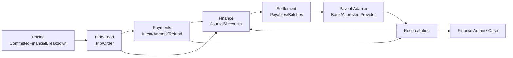
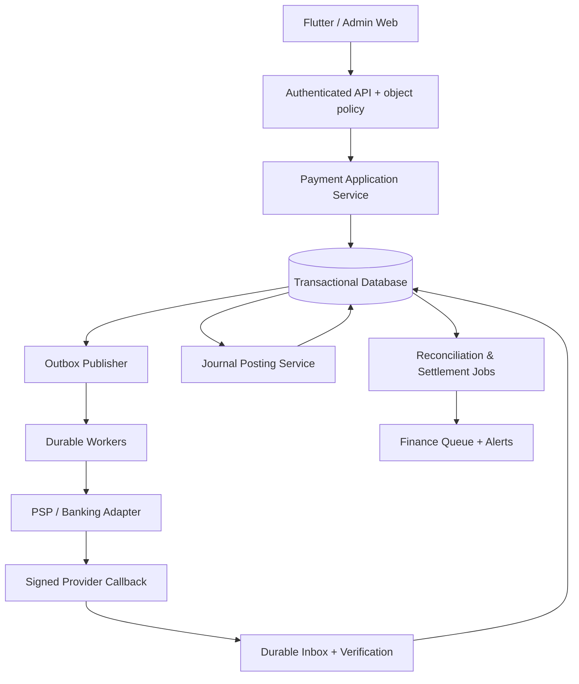
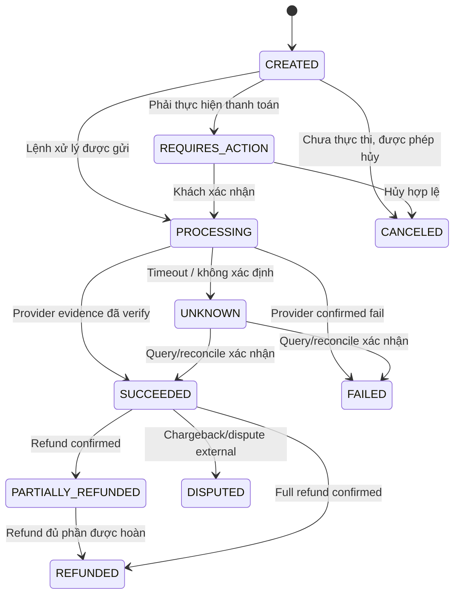
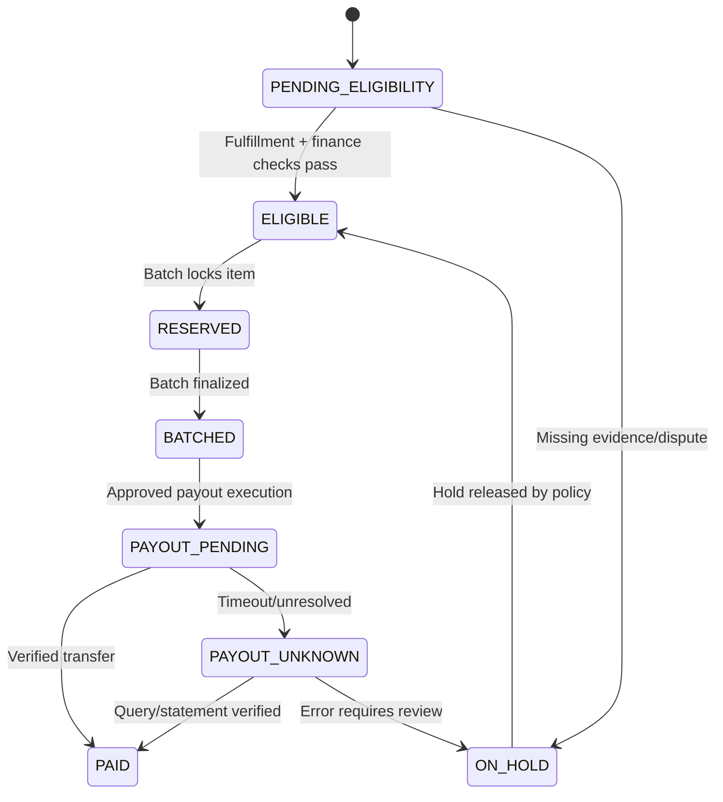
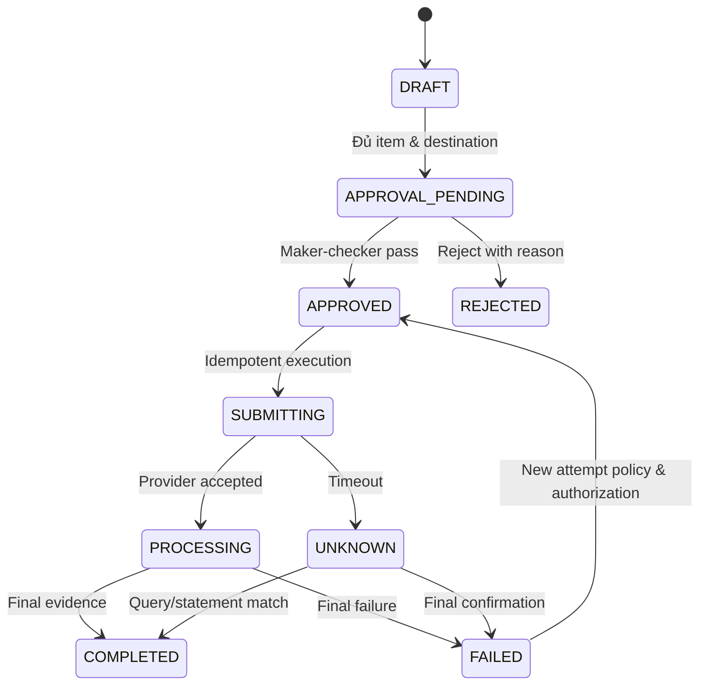
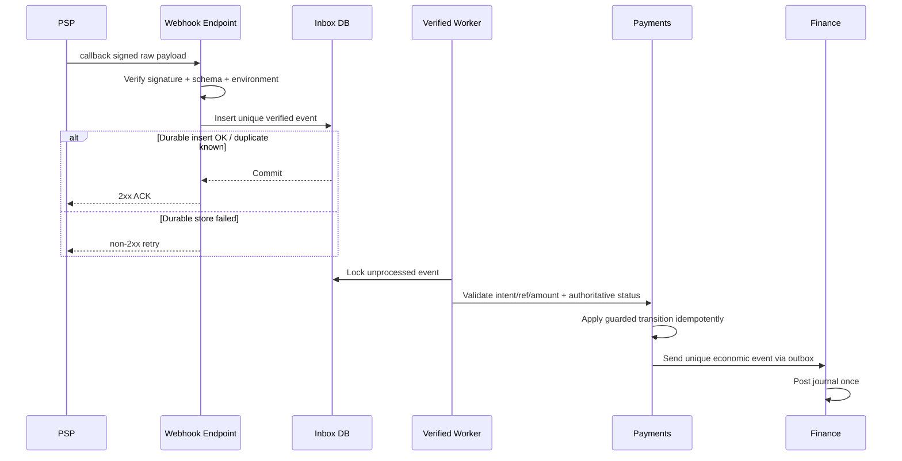

# DealGo — Payments, Ledger & Settlement

> **DRAFT — bản thiết kế nghiệp vụ và hợp đồng tính đúng đắn, không phải quyết định thanh toán production.** Các định hướng `DEC-PROD-001..007` đã xác nhận. `OPEN-002` (kênh thu/đơn vị nhận tiền/COD), `OPEN-003` (phí và phân chia), `OPEN-010` (lúc authorize/capture), `OPEN-016` (tổn thất Food) và `OPEN-018` (thu hộ COD của tài xế) **chưa được phê duyệt**. Không tự mở luồng thu tiền thật, ví tích tiền, giữ hộ tiền hay payout thật khi chưa được Legal, Finance, PO và provider duyệt.
>
> **Phạm vi đã chốt:** DealGo MVP hỗ trợ Ride (xe máy, ô tô) + Food, một Flutter app cho Customer/Merchant/Driver và Admin Web. Ví dụ số tiền/bút toán đều gắn nhãn `TEST_ONLY`; không thể dùng làm chính sách thuế, kế toán, hóa đơn, chiết khấu hay hợp đồng đối tác.
>
> **Hệ thống hiện có (code là nguồn chuẩn):**
> - Ra mắt chỉ thu tiền mặt (`PAYMENT_PROVIDER=cash-only`). VNPAY/MoMo mới tạo `PaymentIntent` chuyển hướng (`CREATED`/`PENDING_REDIRECT`), chưa thu tiền thật.
> - Ledger kép (`LedgerAccount`/`LedgerEntry`, journal `POSTED`, tổng Nợ = Có), ghi cùng transaction với thay đổi trạng thái. Sự kiện journal: `COD_OBLIGATION_POSTED`, `PROMOTION_DISCOUNT_FUNDED`, `DRIVER_PLATFORM_FEE_ACCRUED`, `MERCHANT_COMMISSION_ACCRUED`, `SANDBOX_REFUND_RECORDED` (ghi nhận hoàn tiền, không chuyển tiền).
> - Hoa hồng là cài đặt Admin (Cài đặt › Tham số › Dòng tiền & hoa hồng): `RIDE_COMMISSION_BIKE_PERCENT` / `RIDE_COMMISSION_CAR_PERCENT` trên giá chuyến, `FOOD_DRIVER_COMMISSION_PERCENT` trên phí giao, `FOOD_MERCHANT_COMMISSION_PERCENT` trên tiền món (subtotal). Phần trăm được chốt vào đơn lúc hoàn tất.
> - Tài xế giữ tiền mặt nên nợ DealGo phí nền tảng + phí huỷ/không xuất hiện + điều chỉnh; vượt `DRIVER_DEBT_LIMIT_VND` thì không nhận việc mới. Ops ghi nhận thu/trả ở trang chi tiết tài xế (có audit).
> - Quán trả hoa hồng theo kỳ `MERCHANT_SETTLEMENT_CYCLE_DAYS`; Ops ghi nhận "quán đã trả" cho kỳ đã đóng (không chồng kỳ, có audit). Đối soát theo ngày Asia/Ho_Chi_Minh.
> - Voucher: nhà tài trợ `PLATFORM` / `MERCHANT` / `SHARED`; với `SHARED`, DealGo chịu `VOUCHER_SHARED_PLATFORM_PERCENT` phần giảm giá.
> - Chưa có ví, rút tiền, payout tự động hay hoàn tiền qua cổng thanh toán. Giá trị mặc định là DRAFT (`DEC-PROD-059`…`DEC-PROD-062`); xem [bản đồ cài đặt](../10-ai-execution/open-admin-settings-map.md).

## 1. Mục tiêu và điều kiện đạt

Hệ thống phải có khả năng chứng minh, cho từng chuyến Ride và đơn Food: **ai phải trả bao nhiêu, ai đã thực trả, ai đang giữ tiền, ai có quyền nhận, khi nào quyền nhận được xác lập, hệ thống đã ghi nhận bút toán nào, còn lệch gì, đã chuyển tiền thực tế hay chưa**.

**Definition of Success:**

1. Mỗi nghiệp vụ phát sinh tiền có business reference, actor, số tiền và nguồn chứng cứ bất biến.
2. Không tạo hai lần hiệu quả tài chính với cùng hành động kinh tế, dù callback/retry/replay/thao tác đồng thời.
3. Journal `POSTED` cân bằng debit/credit theo từng currency và không được sửa/xóa; điều chỉnh bằng journal đối ứng.
4. Trạng thái `PAID`, `RECONCILED`, `PAYOUT_COMPLETED` chỉ được phát ra nếu có bằng chứng tương ứng; `UNKNOWN` không được coi là thành công.
5. Số dư công nợ merchant/driver truy ngược được tới từng order/trip, event, journal, batch và giao dịch ngoài hệ thống.
6. Báo cáo chênh lệch và lệnh chi ngoài hệ thống phải có reconciliation, xử lý lỗi, maker-checker, log bất biến.
7. Không tuyên bố đạt production financial readiness khi còn vướng các quyết định/điều kiện pháp lý tại §5 và §33.

## 2. Ranh giới trách nhiệm tài liệu

| Chủ đề | Nguồn sở hữu | Tài liệu hiện tại |
|---|---|---|
| Scope, vai trò, release gates | Governance/PRD | Giữ scope, không bổ sung ví điện tử hay dịch vụ mới |
| Công thức giá, thuế/giảm giá, snapshot | `pricing-fees-and-promotions.md` | Nhận **committed FinancialBreakdown**, không tính lại |
| Chuyến/đơn và chứng cứ hoàn thành | Ride/Food workflows | Quy định điều kiện được tạo nghĩa vụ thu/chi từ trạng thái đã xác nhận |
| Ai được xem/sửa dữ liệu | `roles-and-permissions.md` | Tách quyền read earnings, approve adjustment, execute payout |
| Khi nào được hủy/refund/ai chịu thiệt | `cancellation-refund-disputes.md` (kế tiếp) | Hợp đồng thi hành refund/correction an toàn, không tự chốt policy |
| ERD/Prisma/API | `06-data-api/*` | Model logic, keys, constraints, event semantics, không khóa tên bảng |
| Lệnh chi thật và thời điểm chuyển | Legal/Finance/provider contracts | Adapter, trạng thái, kiểm chứng, không tự mặc định khả năng provider |

## 3. Thuật ngữ chuẩn — không được dùng thay nhau

| Khái niệm | Ý nghĩa | **Không đồng nghĩa** |
|---|---|---|
| `ReferenceFare` | Giá tham khảo backend tính cho Ride | Giá cuối được chấp nhận hoặc đã thanh toán |
| `AcceptedFareAgreement` | Giá Ride cuối do khách chọn và server commit | Payment success hoặc settlement |
| `CommittedFinancialBreakdown` | Snapshot giá, phí, ưu đãi, phân bổ đã khóa theo nghiệp vụ | PSP amount có thể tự thay đổi |
| `PaymentIntent` | Ý định thu tiền với số tiền/currency/reference cụ thể | Attempt, tiền vào ngân hàng |
| `PaymentAttempt` | Một lần yêu cầu PSP/khách thực hiện thanh toán | Chứng minh tiền thành công |
| `ProviderTransaction` | Record PSP hoặc bank trả về | Journal nội bộ |
| `PaymentEvidence` | Callback hợp lệ + xác minh/query/reconciliation đủ tin cậy theo contract | Screenshot biên lai từ client |
| `RefundRequest` | Đề nghị hoàn tiền, kiểm tra policy và phân quyền | PSP đã hoàn tiền |
| `RefundExecution` | Lần thực thi hoàn tiền ngoài hệ thống | Bút toán đối ứng đã ghi nhận |
| `LedgerAccount` | Tài khoản kế toán nội bộ phục vụ đối chiếu các khoản giá trị | Ví tiền cho người dùng |
| `LedgerJournal` | Tập bút toán debit/credit cân bằng | Payout/transfer thành công |
| `LedgerEntry` | Dòng ghi Nợ/Có, thuộc đúng một journal | Lịch sử callback |
| `Receivable` | Nghĩa vụ bên ngoài phải trả lại cho bên được xác định | Tiền đã thực nhận |
| `Payable` | Nghĩa vụ DealGo phải thanh toán cho đối tác theo mô hình đã duyệt | Thu nhập ước tính hoặc đã chuyển |
| `SettlementBatch` | Nhóm khoản phải đối soát/khóa chi trả theo chu kỳ | File chuyển khoản đã thực thi |
| `Payout` | Lệnh chi tiền hoặc ghi nhận trả nợ cho merchant/driver | Settlement đã đối soát |
| `Reconciliation` | Quá trình đối chiếu sự thật giữa các hệ thống | Tự động cho mọi giao dịch là matched |
| `CashCollection` | Bằng chứng tài xế/merchant thu tiền mặt khi policy cho phép | PSP capture |
| `SuspenseAccount` | Tài khoản tạm chờ phân loại giao dịch tiền chưa rõ nguồn | Tự ý ghi doanh thu |
| `Dispute` | Khiếu nại, tra soát và điều tra | Chargeback hoặc refund đã xảy ra |

## 4. Các bất biến tài chính — bắt buộc có test

Gắn mã nội bộ `FIN-INV-*` để truy vết; **không tạo mới mã `BR-*` cấp PRD** nếu chưa được Governance bổ sung.

| Invariant | Quy tắc |
|---|---|
| `FIN-INV-001` | Số tiền lưu bằng integer ở đơn vị tiền nhỏ nhất của đồng tiền; không dùng float cho tính toán kế toán. Với VND trong bản MVP, amount integer là VND. |
| `FIN-INV-002` | Mỗi journal `POSTED` có >=2 entries và `SUM(debit)=SUM(credit)` **trong từng currency**. |
| `FIN-INV-003` | Journal `POSTED` không được update/delete; correction tạo journal riêng có `reversesJournalId`/`adjustsJournalId`. |
| `FIN-INV-004` | Cùng `(economicEventType, businessEventId, accountingPolicyVersion)` chỉ post một accounting outcome; thực thi lại trả về kết quả hiện có. |
| `FIN-INV-005` | Một provider success phải match `PaymentIntent`, amount, currency, merchant account, reference, status; thiếu một trường không ghi `PAID`. |
| `FIN-INV-006` | Tổng refund executed/captured không vượt số tiền thực đã thu đủ điều kiện hoàn theo policy, kể cả nhiều refund requests cùng lúc. |
| `FIN-INV-007` | Payout không vượt nghĩa vụ `AVAILABLE` đã đối soát và không bị hold; không dựa vào earnings ước tính. |
| `FIN-INV-008` | Một settlement item chỉ thuộc một active/finalized batch; item bị sửa bằng correction tham chiếu, không sửa batch đã khóa. |
| `FIN-INV-009` | Một PSP event không được tạo order/trip/refund/ledger effect lặp (`BR-FIN-001`). |
| `FIN-INV-010` | `UNKNOWN`, `PENDING_VERIFICATION`, `RECONCILIATION_REQUIRED` không phải `PAID/REFUNDED/SETTLED` (`BR-FIN-002`). |
| `FIN-INV-011` | Webhook, app callback hoặc Admin UI không tự cấp quyền thay đổi tiền không qua server-side authorization/audit. |
| `FIN-INV-012` | Merchant payable, driver payable, platform income và customer charged là các đại lượng riêng, không thay thế lẫn nhau. |
| `FIN-INV-013` | Không có ledger entries vượt qua transaction commit dở dang: journal header + lines + outbox commit atomic. |
| `FIN-INV-014` | Refund/chargeback/compensation làm thay đổi nghĩa vụ qua event + journal, không âm thầm sửa lịch sử giá. |
| `FIN-INV-015` | Reconciliation có thể phát hiện orphan transfer/PSP transaction dù order/trip record lỗi/mất liên kết. |
| `FIN-INV-016` | Không chuyển trạng thái payout `COMPLETED` chỉ do HTTP 200 từ gateway; cần bằng chứng cuối phù hợp hợp đồng provider/bank. |

## 5. Decision gates phải chốt trước tiền thật

| ID | Chủ đề còn mở | Chặn chức năng nào | Có thể làm trước (sandbox) |
|---|---|---|---|
| `OPEN-002` | Kênh thu, pháp nhân nhận tiền, COD/online, refund, tiền đi qua ai | Payment/COD/payout thật | `PaymentProvider` adapter, fake gateway, reconciliation engine |
| `OPEN-003` | Commission, taxes, fee allocation, settlement economics | Giá, liability, doanh thu production | Rule versioning, balanced journal fixtures |
| `OPEN-006` | Vai trò pháp lý của nền tảng, hợp đồng, tax/accounting | Thu hộ/giữ hộ/chuyển tiền/ghi nhận doanh thu | Chart of accounts giả lập, compliance checklist |
| `OPEN-007` | Traffic/SLO và staffing | Recovery, reconciler, alert thresholds | Metrics, test replay/failover |
| `OPEN-008` | PSP, bank, payout vendor, hợp đồng/credential | External adapter production | Contract tests trên sandbox |
| `OPEN-010` | Food authorize/capture/collect trước hay sau merchant accept/driver assign | Order payment timeline | Tách payment state khỏi order state, multiple workflows fixture |
| `OPEN-011` | Proof pickup/delivery | Payout entitlement theo completion evidence | Proof reference interface |
| `OPEN-016` | Hủy Food khi quán đã làm, không có driver | Refund, compensation, loss allocation | Dispute/compensation model, no payout automation |
| `OPEN-018` | Quyền tài xế thu COD, hạn mức/nợ, đối soát | COD collection, driver debt offset | Ledgers cho cash custody dùng test only |

**Không tạo `walletBalance` mang ý nghĩa số dư ví điện tử được phép nạp/rút/chuyển** chỉ từ thiết kế ledger nội bộ. Đó là sản phẩm/giấy phép và mô hình pháp lý khác; LedgerAccount chỉ là hạch toán nội bộ theo vai trò của DealGo.

## 6. Bounded Contexts và data ownership



**Ownership:**

- **Pricing** sở hữu breakdown và pricing version; không gọi PSP.
- **Ride/Food** sở hữu điều kiện kinh tế phát sinh từ lifecycle; không tự chỉnh số dư.
- **Payments** sở hữu state giao dịch với PSP, attempts, provider verification, refunds external.
- **Finance Ledger** sở hữu double-entry accounting facts và derived balances.
- **Settlement** sở hữu eligibility, period, payable items, hold/release và batch reconciliation.
- **Payout** sở hữu instruction/external transfer lifecycle; không tự tạo khoản phải trả.
- **Reconciliation** sở hữu kết quả match/mismatch với provider/bank statement, không được hợp thức hóa giao dịch đáng ngờ.
- **Finance Operations** sở hữu phê duyệt điều chỉnh và tình trạng dispute; không sửa journal trực tiếp.

## 7. Kiến trúc gợi ý cho MVP

**Khuyến nghị:** modular monolith với transaction boundaries rõ, database quan hệ có ACID và constraint, asynchronous outbox/inbox; không cần microservice/Kafka chỉ để đạt tính đúng đắn của tiền. Nếu lựa chọn Kafka sau này, những invariants trong file vẫn giữ nguyên. Đó là **kiến trúc đề xuất**, không phải backend framework bắt buộc.



Không đặt toàn bộ logic hạch toán chỉ trong consumer nhận Kafka/event; đường write journal phải có unique constraints và transaction commit độc lập với mức bảo đảm delivery của broker.

## 8. Entity/Aggregate trong domain Finance

| Aggregate | Owner | Dữ liệu tối thiểu | Identity & mutation |
|---|---|---|---|
| `PaymentIntent` | Payments | id, subjectType/id, snapshotRef, amount, currency, status, methodCandidate, createdAt | State machine + optimistic version |
| `PaymentAttempt` | Payments | intentId, attemptNumber, provider, providerRequestId, externalId, status, timestamps | Không reuse attempt id cho lần thu khác |
| `ProviderEventInbox` | Payments | provider, eventId, payloadHash, verifiedAt, processedAt, result, deliveryCount | Unique `(provider,eventId)` nếu provider có ID ổn định |
| `RefundRequest` | Payments/Dispute | paymentRef, reason, maxAmount, requested, approved, status, policyRef | Separate approve/execute, unique economic key |
| `RefundExecution` | Payments | requestId, executionId, providerTxnRef, amount, status, outcome | Có thể nhiều lần retry cùng execution key; không vượt refundable |
| `LedgerAccount` | Finance | accountId, accountType, ownerScope, currency, normalBalance | Không phải customer wallet |
| `LedgerJournal` | Finance | id, sourceEventRef, currency, policyVersion, status, postedAt, reversalRef | Atomic header + entries, immutable after posting |
| `LedgerEntry` | Finance | journalId, accountId, debit/credit, amount | Mỗi entry thuộc đúng journal |
| `SettlementItem` | Settlement | source payable ref, beneficiary, amount, hold, eligibility, batchId | Unique theo payable economic event |
| `SettlementBatch` | Settlement | beneficiary, period, currency, items, summary, status, version | Finalized immutable, corrections separate |
| `PayoutInstruction` | Payout | beneficiary, approved destination ref, batchRef, idempotency key, amount, state | External execution with maker-checker |
| `PayoutAttempt` | Payout | instructionId, provider, externalTxn, response, state | Provider response verified independently |
| `ReconciliationRun` | Finance Ops | source, date window, imported artifact hash, run/status, metrics | Repeatable, audit logged |
| `ReconciliationCase` | Finance Ops | issueType, refs, evidence, owner, resolution, timestamps | `RESOLVED` requires evidence + reason |

**Lưu ý:** Đây là **logical domain schema**, không ép kiểu `Prisma model`. Bản vật lý phải bổ sung khóa ngoại, unique index, version, status transition guard, history và partition/archive policy trong `06-data-api/*`.

## 9. Money Value Object và precision

```ts
// Semantic pseudocode — NOT an approved production implementation.
type CurrencyCode = 'VND';
type Money = Readonly<{ amountMinor: bigint; currency: CurrencyCode }>;

type FinancialAllocation = Readonly<{
  customerCharge: Money;
  merchantPayable: Money;
  driverPayable: Money;
  platformShare: Money;
  taxComponent?: Money;
  promotionFunding: readonly { sponsorId: string; amount: Money }[];
  sourceQuoteId: string;
  committedSnapshotVersion: number;
}>;
```

- Toán học sử dụng số nguyên/decimal exact; không dùng IEEE-754 float; mọi nguồn amount từ client bị xem là chưa đáng tin.
- Rounding phải được quy định ở Pricing theo thành phần và **một lần ở ranh giới đã định nghĩa**; không để UI/Backend/PSP tự làm tròn khác nhau.
- Cùng một journal có nhiều currencies chỉ khi thiết kế FX riêng, mỗi currency cân bằng độc lập. MVP này **không** tự thêm FX.
- Amount âm là semantics nghiệp vụ riêng (correction/reversal); không chấp nhận negative amount gửi vào các lệnh thu/chi thông thường.
- Serialize amount dạng integer/string theo contract để không mất precision qua Flutter/JS/JSON.

## 10. PaymentIntent lifecycle



**Lưu ý:** `SUCCEEDED` ở đây là tiền đã được provider xác nhận theo loại giao dịch (authorize hay capture phải phân biệt trong các subfields/attempt). Nếu chỉ `AUTHORIZED` nhưng chưa `CAPTURED`, không nói đã thu đủ tiền. Một số PSP không hỗ trợ preauthorization; các transition phải capability-gated thay vì ép adapter giả hỗ trợ.

| Chuyển trạng thái | Bằng chứng cần | Hành vi khi thiếu |
|---|---|---|
| `CREATED→PROCESSING` | Locked snapshot + valid method + idempotency | Reject or wait for approval |
| `PROCESSING→SUCCEEDED` | Verified provider evidence, match amount/reference | `PENDING_VERIFICATION` |
| `PROCESSING→FAILED` | Provider explicit failure/final query | Remain unknown if only client dismisses modal |
| `UNKNOWN→SUCCEEDED` | Reconciler/authoritative query | No second independent charge |
| `SUCCEEDED→REFUNDED` | Refund provider final outcome, total <= captured | Pending refund review |
| `ANY→REQUIRES_RECONCILIATION` | Conflicting states/amount mismatch | Hold downstream payouts, open Finance case |

## 11. PaymentAttempt và timeout

1. `PaymentIntent` có thể có nhiều attempts, nhưng **chỉ một kết quả thu tiền hợp lệ được công nhận cho đúng nghĩa vụ**; các trường hợp provider thu trùng phải mở case/refund/reconcile chứ không mặc định xóa event.
2. Với timeout trước khi biết provider đã nhận request, query bằng external request/reference và idempotency semantics của provider **trước khi thử lệnh mới**.
3. Retry cùng `idempotencyKey` và cùng payload được trả cùng kết quả; cùng key khác payload trả `409 IDEMPOTENCY_KEY_REUSED`.
4. Không dùng `retry` vô hạn, không đổi ID chỉ để né khóa chống trùng. Retry intervals/TTL được xác định theo PSP thực và `OPEN-008`.
5. Nếu PSP không có idempotency gốc, DealGo kiểm soát local **nhưng vẫn phải query state đối tác** trước gửi lại hành động có nguy cơ thu trùng.
6. Một attempt fail không tự hủy `FoodOrder`/`RideRequest`; hành vi nghiệp vụ phụ thuộc điều kiện thanh toán đã chốt trong `OPEN-010`.

## 12. Payment method candidate — không tự mở feature

| Phương thức | Status | Cần làm rõ |
|---|---|---|
| Gateway/PSP thanh toán online | `PROPOSED` | Provider support, settlement account, callback security, refund/chargeback |
| Bank transfer / VietQR theo đối tác được phê duyệt | `CANDIDATE` | Dynamic order reference, statement match, timeout, orphan funds |
| COD tài xế thu khách | `BLOCKED_BY_OPEN-002/018` | Ai được thu, giới hạn, xác nhận thu, nghĩa vụ hoàn tiền, công nợ |
| Khách đưa tiền mặt cho nhà hàng | `NOT_IN_MVP_UNLESS_APPROVED` | Không suy diễn từ Ride/Food scope |
| Nạp/rút ví DealGo | `OUT_OF_SCOPE` | Không tự thiết kế regulatory wallet |
| Lưu thẻ trực tiếp tại DealGo | `NOT_PROPOSED` | Cần PSP tokenization; không lưu PAN/CVV |

## 13. Ride — điều kiện phát sinh khoản phải thu

1. `RideRequest` được tạo chưa đồng nghĩa `RideTrip` completed hoặc customer charged.
2. Trong thương lượng, không tạo khoản phải thu từ giá tham khảo/counter-offer chưa được khách chọn. Khi khách chọn và server commit, gắn `AcceptedFareAgreement` + giá cuối immutable vào RideRequest/Trip; payment/ledger dùng snapshot này. Thay đổi route/charges cần adjustment/consent theo policy, không overwrite history.
3. Chỉ event hoàn thành với bằng chứng theo `OPEN-017` và payment policy đã duyệt mới tạo/điều chỉnh quyền hưởng tiền của driver và platform.
4. Online payment có thể thu ở thời điểm khác nhau tùy chính sách; model tách `Authorization`, `Capture`, `Earned`, `Settled`.
5. Canceled/no-driver/no-show: cancellation liability thuộc tài liệu kế tiếp; không tự thu phí hủy nếu `OPEN-003` chưa đóng.
6. Driver earnings **estimated** có thể hiển thị phục vụ UX nhưng không tạo payout eligibility tự động.

## 14. Food — điều kiện phát sinh khoản phải thu

1. `FoodOrder`, `MerchantAcceptance`, `DeliveryTask`, `PaymentIntent` và `SettlementItem` là các lifecycle độc lập.
2. `OPEN-010` quyết định tiền thu/ủy quyền tại create order, merchant accept hoặc trước/ sau assignment; workflow phải hỗ trợ bằng policy engine.
3. Merchant đã nấu không đồng nghĩa rider đã giao; payout eligibility được tách theo event/hợp đồng.
4. Food prepared nhưng driver unavailable: không tự trả merchant hay hoàn khách khi chưa có `OPEN-016`.
5. Modification/out-of-stock sau checkout cần `OrderAmendment`, chênh lệch price breakdown và khách xác nhận khi cần; refund bổ sung qua saga có audit.
6. Customer không nhận hàng/driver giao thất bại: compensation, cash collection, refund thuộc policy và dispute review, không tự kết thúc payment as success.

## 15. Event-sourced facts và transactional outbox

| Economic event | Origin | Consumer | Invariant |
|---|---|---|---|
| `PriceCommitted.v1` | Pricing/Order | Payments | Chốt snapshot version, không thu tiền |
| `PaymentAttemptInitiated.v1` | Payments | PSP adapter | Idempotent external request |
| `PaymentCaptureConfirmed.v1` | Payments verified | Finance | Journal at most once |
| `PaymentStateUnknown.v1` | Payments | Reconciler | Không phát `PaymentConfirmed` |
| `RideTripCompleted.v1` | Ride | Finance eligibility | Chỉ khi verified trip state |
| `FoodOrderFulfillmentConfirmed.v1` | Food | Finance eligibility | Tách merchant/driver entitlements |
| `RefundApproved.v1` | Dispute/Finance | Payments | Không có nghĩa đã refund |
| `RefundProviderConfirmed.v1` | Payments | Finance | Adjustment journal once |
| `LedgerJournalPosted.v1` | Finance | Settlement/Reporting | Ledger is immutable |
| `SettlementBatchFinalized.v1` | Settlement | Payout | Không đồng nghĩa money transferred |
| `PayoutProviderConfirmed.v1` | Payout verified | Finance | Giải nghĩa vụ dựa evidence |
| `ReconciliationMismatchDetected.v1` | Reconciliation | Finance Ops | Mở case, không auto write-off |

**Event delivery được giả định là *at-least-once*, out-of-order và có thể trễ.** Chính xác một lần về **hiệu quả tài chính** đạt nhờ unique keys + state guards + database transaction, không dựa vào broker chuyển đúng một lần.

## 16. Double-entry Ledger — nguyên lý tối thiểu

- Một `LedgerJournal` bao gồm ít nhất hai `LedgerEntry`: Nợ (`DEBIT`) và Có (`CREDIT`).
- Debit/Credit là hướng kế toán, **không** tương ứng trực tiếp với người dùng “bị trừ tiền/được cộng tiền” trong UI.
- Mỗi journal phải cân bằng theo currency; nếu không cân bằng toàn transaction rollback.
- `POSTED` không update; `reversal` có ID khác, tham chiếu journal gốc, cùng currency và số tiền đảo chiều hợp lệ.
- “Account balance” là derived value từ entries/balance snapshots transactional, không lấy từ field `walletBalance` client.
- Chart of Accounts (CoA), chính sách ghi nhận doanh thu theo gross/net, thuế và đối tượng chịu phí **bắt buộc do Finance/Legal phê duyệt theo mô hình pháp lý thực**.

### 16.1. Chart of Accounts ứng viên (mang tính mô phỏng)

| Code minh họa | Account | Normal side | Mục đích |
|---|---|---|---|
| `1010` | Bank Cash | Debit | Tiền ngân hàng thực nhận/chuyển |
| `1020` | PSP Clearing Receivable | Debit | PSP còn phải thanh toán cho đơn vị đủ điều kiện |
| `1030` | Driver Cash Custody Receivable | Debit | Công nợ tài xế thu hộ *nếu COD được phép* |
| `2010` | Merchant Payable | Credit | Nghĩa vụ phải trả merchant |
| `2020` | Driver Payable | Credit | Nghĩa vụ phải trả driver |
| `2030` | Customer Refund Payable | Credit | Tiền phải hoàn nếu policy phát sinh |
| `2040` | Unidentified Funds Suspense | Credit | Tiền nhận chưa match, chưa nhận doanh thu |
| `4010` | Platform Service Revenue | Credit | Doanh thu nền tảng theo accounting treatment được duyệt |
| `5010` | PSP Processing Fee Expense | Debit | Chi phí provider khi nền tảng là bên chịu |
| `5090` | Promotion Subsidy Expense | Debit | Chi phí khuyến mại do nền tảng tài trợ khi được duyệt |

> Bảng trên không khẳng định DealGo có quyền pháp lý thu hộ, giữ tiền cho partner, hoặc bắt buộc ghi doanh thu gross/net theo những code này. Đội Finance phải phê duyệt trước production.

## 17. Ví dụ bút toán Food online — `TEST_ONLY`

**Giả định kiểm thử:** khách đã thanh toán 120.000 VND; theo breakdown giả lập *sau* ưu đãi và các thành phần đã phân bổ: merchant payable 85.000, driver payable 20.000, platform revenue 15.000. PSP giả lập phí 1.200 do nền tảng chịu; PSP chuyển thực 118.800. Đây chỉ là ví dụ một cấu hình phân phối, **không** bao gồm xử lý thuế/khoản hold thực tế.

**Journal J1 — ghi nhận nghĩa vụ từ một lần thu tiền đã xác minh**

| Account | Debit | Credit |
|---|---:|---:|
| PSP Clearing Receivable | 120.000 | — |
| Merchant Payable | — | 85.000 |
| Driver Payable | — | 20.000 |
| Platform Service Revenue | — | 15.000 |
| **Tổng** | **120.000** | **120.000** |

**Journal J2 — PSP đối soát và chuyển tiền thực vào ngân hàng**

| Account | Debit | Credit |
|---|---:|---:|
| Bank Cash | 118.800 | — |
| PSP Processing Fee Expense | 1.200 | — |
| PSP Clearing Receivable | — | 120.000 |
| **Tổng** | **120.000** | **120.000** |

**Journal J3 — Payout merchant đã xác nhận thành công**

| Account | Debit | Credit |
|---|---:|---:|
| Merchant Payable | 85.000 | — |
| Bank Cash | — | 85.000 |
| **Tổng** | **85.000** | **85.000** |

**Journal J4 — Payout driver đã xác nhận thành công**

| Account | Debit | Credit |
|---|---:|---:|
| Driver Payable | 20.000 | — |
| Bank Cash | — | 20.000 |
| **Tổng** | **20.000** | **20.000** |

**Đối chiếu `TEST_ONLY`:** khách 120.000 = merchant 85.000 + driver 20.000 + platform 15.000; PSP chuyển 118.800 + phí 1.200 = 120.000; nền tảng còn 13.800 sau payout, trùng 15.000 - 1.200 (trước chi phí/thuế khác). Các journal phải post **tại thời điểm đủ bằng chứng tương ứng**, không gộp tất cả vào callback thanh toán.

## 18. Ví dụ Ride COD — `TEST_ONLY`, bị chặn bởi `OPEN-002/018`

Chỉ để chứng minh mô hình công nợ **nếu** pháp nhân/hợp đồng cho phép driver trực tiếp thu từ customer: fare 80.000; driver thực hưởng 65.000; nền tảng có claim 15.000.

**Phương án kế toán minh họa tối giản (chưa phải CoA approved):** khi chuyến hoàn tất có bằng chứng thu tiền được xác minh, nền tảng ghi `Dr Driver Fee Receivable 15.000 / Cr Platform Revenue 15.000`. Driver đã giữ phần doanh thu của mình, DealGo **không** tự xuất lệnh payout 65.000 khi chưa từng giữ phần tiền ấy. Khi driver thanh toán công nợ: `Dr Bank Cash 15.000 / Cr Driver Fee Receivable 15.000`.

- Không dùng `customerPays=80.000` để suy ra `DealGoBankReceives=80.000`.
- Không tự trừ 15.000 vào earning của **một đơn online khác** nếu chưa có chính sách setoff, hợp đồng, consent và kiểm soát dòng tiền.
- Tiền mặt bị thất lạc, khách nói đã trả/tài xế nói chưa thu, thu sai số tiền, hoàn cho khách → dispute/collection procedures, không auto `SETTLED`.
- Mô hình gross vs net/principal vs agent phải được thẩm định kế toán/pháp lý trước khi quyết định journal production.

## 19. Refund/chargeback và correction contracts

Phân biệt ba lớp:

1. **Eligibility:** có hoàn hay không, hoàn cho ai, ai chịu chi phí, phải qua dispute/approval nào; policy do `cancellation-refund-disputes.md` sở hữu.
2. **Execution:** có đủ funds/captured amount, provider còn cho hoàn không, partial/full, request idempotency, callback/query state.
3. **Accounting:** khi đủ bằng chứng, post correction/reversal journal cân bằng; không sửa journal lịch sử.

| Tình huống | Xử lý | Trạng thái không được tự gán |
|---|---|---|
| Khách yêu cầu nhưng chưa duyệt | `RefundRequest.PENDING_REVIEW` | `REFUNDED` |
| Refund được duyệt, chưa gọi PSP | `APPROVED` / `QUEUED` | `REFUNDED` |
| PSP nhận yêu cầu trả timeout | `EXECUTION_UNKNOWN`, query/reconcile | `FAILED` hoặc `REFUNDED` không có chứng cứ |
| Provider xác nhận refund cuối | `EXECUTION_CONFIRMED`, journal correction theo policy | `PAYOUT_COMPLETED` cho merchant |
| Refund partial lần 2 | Lock refundable remainder, check limits | Refund quá captured |
| Chargeback ngân hàng | Freeze affected settlement items, dispute case | Tự coi customer đã đủ điều kiện refund mới |
| Hủy Food sau chế biến | `OPEN-016`, manual policy gate | Tự trừ merchant thu nhập theo giả định |
| PSP hoàn tiền nhưng internal event rớt | Reconciler phát hiện và bổ sung effect idempotently | “Không có refund” vì DB chưa nhận callback |

Ví dụ `TEST_ONLY`: khoản đã capture 120.000, đã refund confirmed 30.000 → `remainingRefundable <= 90.000`, trừ các reserve/dispute amounts cần tính theo policy. Hai lệnh refund 60.000 chạy cạnh tranh phải không được cùng lấy snapshot remaining = 90.000 rồi dẫn tới tổng 150.000. Dùng lock/counter transaction hoặc serializable/conditional update, unique `refundExecutionKey`.

### 19.1. Refund accounting không đồng nhất với refund PSP

- Refund tiền thật có thể xảy ra **sau** khi merchant/driver đã được chi trả → phát sinh receivable/clawback/expense, không thể chỉ `Dr MerchantPayable` nếu nghĩa vụ đã hết.
- Refund khách hàng qua PSP có thể mất thời gian; `REFUND_INITIATED` khác `REFUND_CONFIRMED`.
- Chênh lệch exchange/processing/refund fee theo provider cần account và owner rõ, không âm thầm giảm customer refund.
- Khi PSP trả tiền nhưng chưa rõ order, ghi suspense theo policy, mở case. Không tự tạo order với `paid=true` từ amount trùng.

## 20. Quy trình ghi journal an toàn

```mermaid
sequenceDiagram
  participant S as Source Domain Event
  participant J as Journal Service
  participant DB as SQL Transaction
  participant O as Outbox
  S->>J: Post(eventId, policyVersion, lines)
  J->>DB: Begin; unique event key
  DB-->>J: Existing journal? / lock
  alt Journal đã tồn tại
    J-->>S: Return same journal
  else Chưa tồn tại
    J->>J: Validate currency + balance + account status
    J->>DB: Insert Journal + Entries + Outbox
    DB-->>J: Commit atomic
    O-->>S: Eventual publication
    J-->>S: JournalPosted
  end
```

**Pseudocode triển khai đề xuất:**

```ts
async function postJournal(command: PostJournalCommand) {
  return database.transaction(async (tx) => {
    const existing = await tx.journal.findByEconomicKey(command.economicKey);
    if (existing) {
      assertSameCanonicalPayload(existing.payloadHash, command);
      return existing;
    }

    assertApprovedAccountingPolicy(command.accountingPolicyVersion);
    assertAllAmountsAreIntegerAndPositive(command.lines);
    assertAllAccountsActiveAndCurrencyMatched(command.lines);
    assertBalancedPerCurrency(command.lines);

    const journal = await tx.journal.insert({
      economicKey: command.economicKey,
      payloadHash: stableCanonicalHash(command),
      sourceEventId: command.sourceEventId,
      accountingPolicyVersion: command.accountingPolicyVersion,
      status: 'POSTED',
      lines: command.lines,
    });
    await tx.outbox.insert({
      aggregateId: journal.id,
      eventType: 'LedgerJournalPosted.v1',
      eventId: deterministicEventId(journal.id, 'posted'),
    });
    return journal;
  });
}
```

- `find` trước `insert` **chưa đủ** chống race: database phải có unique constraint trên `economicKey` và xử lý conflict, transaction/lock phù hợp.
- Unique `(sourceEventId, accountingPolicyVersion, postingType)` phải tính cả reversal/adjustment semantics; không vô tình ngăn adjustment hợp lệ.
- `POSTED` transaction commit trước khi emit. Broker publish lỗi sẽ được outbox replay; consumer phải dedupe.
- Account version, balance hold, spend checks phải atomic. Eventual projection chỉ dùng đọc/báo cáo, **không** quyết định payout available một cách thiếu đồng bộ.

## 21. Posting vs pending vs available balances

| Balance | Ý nghĩa | Dùng để payout? |
|---|---|---|
| `projectedEarnings` | Giá trị dự đoán từ báo giá/chuyến/đơn | Không |
| `pendingPayable` | Nghĩa vụ ước tính/chờ fulfillment/clearing/hold | Không |
| `postedPayable` | Ledger đã công nhận khoản phải trả | Chưa chắc |
| `availableForSettlement` | Đã đủ policy, không hold/dispute, khớp funding | Có thể đưa vào batch, chưa phải payout |
| `inPayout` | Đã khóa cho instruction đang xử lý | Không được đưa batch khác |
| `paidOutConfirmed` | External transfer thành công + ledger cleared | Đã hoàn tất |

Công thức khái niệm: `available = eligible_posted - pending_holds - disputed_holds - reserved_for_payout - approved_offsets` (các thành phần phải cùng đơn vị tiền, không âm ngoài các ngoại lệ được định nghĩa).

Không có `wallet balance` hiển thị cho customer nếu chưa có sản phẩm ví được duyệt. Merchant/Driver **earnings dashboard** hiển thị từng buckets cùng mốc `asOf`, không cộng giả số đang tranh chấp vào “đã nhận”.

## 22. Settlement eligibility và item lifecycle



- Settlement item = nghĩa vụ tiền nhỏ nhất có thể trace tới source `RideTrip`/`FoodOrder`/adjustment, beneficiary, accounting policy/version.
- Hai quá trình đóng batch cùng lúc không thể cùng reserve item; unique partial index hoặc transactional compare-and-swap theo status/version.
- Batch không trộn nhiều beneficiaries/currencies khi provider không hỗ trợ; mỗi item có một owner/bank destination verification snapshot.
- Sau `FINALIZED` không sửa amount; correction sinh delta item ở batch sau hoặc xử lý manual policy khi payout đang pending.
- Settle period cutoffs/timezone, minimum payout amount, phí chuyển khoản, holdback, reserve days **là `OPEN-003/018` hoặc quyết định Finance riêng**, không hard-code.

## 23. Settlement batch closing

1. Chọn `eligible` items theo period/beneficiary/currency/contract version.
2. Lock/reserve cùng transaction; fail nếu eligibility đổi, `hold` mới hoặc item đã được reserve.
3. Tổng hợp số phải chi, offsets, corrections, reserves với từng source refs.
4. Reconcile funding source và PSP/bank receivables theo chính sách; khoản đang `UNKNOWN` phải hold, không payout.
5. Xuất batch preview với immutable hash và proof references; Finance review.
6. Maker gửi `SUBMIT_FOR_APPROVAL`; Checker đủ quyền xác nhận theo ngưỡng/cơ cấu duyệt (TBD).
7. Batch `FINALIZED`, snapshot policy/version; không mutate để thêm item mới.
8. Payout worker tạo `PayoutInstruction` duy nhất theo batch+beneficiary+currency+destination version.
9. `PayoutExecution` là bước riêng, kết quả kiểm chứng qua provider/bank statement.
10. Batch có partial payouts phải thể hiện item-level status; không đánh dấu toàn batch completed khi còn pending/unknown.

## 24. Payout instruction và external transfer lifecycle



**Destination:** tài khoản ngân hàng/đích nhận tiền phải được xác minh theo KYC/KYB/ownership/consent policy, versioned và snapshot vào payout instruction. Thay số tài khoản sau approval phải **hủy/re-approve instruction**, không sửa lệnh đang gửi.

**Chống gian lận:** thay đổi destination gần thời điểm payout, payout tới tài khoản mới, số tiền bất thường hoặc admin tự phê duyệt lệnh do chính mình tạo phải kích hoạt step-up/maker-checker/risk hold theo policy.

**Không thực thi payout trực tiếp từ callback thành công của customer payment**: khoản thực thu chưa chắc đủ điều kiện chia và chưa qua reconciliation.

## 25. Merchant settlement

- Merchant có thể có merchant entity, store branch; tiền phải trả thuộc **beneficiary được duyệt theo hợp đồng**, không mặc định mỗi cửa hàng có bank account riêng (`OPEN-013`).
- `foodSubtotal`, bao bì, phí vận chuyển, platform commission, merchant-funded promo, platform-funded promo, applicable taxes được phân loại rõ theo price snapshot và contract version.
- `MerchantPayable` khác doanh số món và khác PSP total. Không dùng `orderTotal` làm payout gross.
- Đơn đã bị cancel/return/partial fulfillment tạo line adjustment, không sửa gốc.
- Trang Merchant phải hỗ trợ: doanh thu ước tính, đủ điều kiện, chờ đối soát, đang chi, đã chi, adjustment/dispute và chứng từ.
- Nếu cửa hàng bị khóa KYB trước payout, xử lý theo hold/review policy; không xóa khoản nợ đã ghi nhận.

## 26. Driver earnings, COD debt và netting

- Driver earnings được sinh từ event đủ điều kiện theo chính sách Ride/Food; không từ `offerAccepted` hoặc GPS arrived.
- Giữ riêng `TripEarnings`/`DeliveryEarnings`, tip (nếu có policy), cash collected, platform fee debt, penalties (nếu hợp pháp/được duyệt), bonus, refunds/adjustments.
- Nếu COD được duyệt, **phải có ledger và dashboard riêng cho cash collected, amount owed, settlement due, aging và dispute**.
- Không tạo “số dư ví tài xế” có quyền nạp/rút tự do chỉ bằng việc gộp earned và cash collection.
- Bù trừ nợ COD với earnings online (`setoff/netting`) chỉ khi hợp đồng/quy định/consent, limits, safe balances và approval đã được chốt.
- Tài xế bị đình chỉ trong lúc có công nợ: khoản nợ/thu nhập chưa biến mất; xử lý hold và collections/dispute tách việc cấp quyền nhận job.

## 27. PSP integration và anti-corruption layer

```ts
interface PaymentProvider {
  capabilities(): Promise<{
    createPayment: boolean;
    preauthorize: boolean;
    capture: boolean;
    partialRefund: boolean;
    refundStatusQuery: boolean;
    transferPayout: boolean;
  }>;
  createPayment(input: ProviderPaymentRequest): Promise<ProviderInitiationResult>;
  queryPayment(reference: ProviderReference): Promise<ProviderPaymentState>;
  requestRefund(input: ProviderRefundRequest): Promise<ProviderRefundState>;
  queryRefund(reference: ProviderReference): Promise<ProviderRefundState>;
  verifyCallback(rawBody: Uint8Array, headers: HeaderMap): VerifiedProviderEvent;
}
```

**Không giả định** tất cả PSP đều cung cấp authorize/capture, partial refund, payout merchant/driver hay API query cùng ngữ nghĩa. Mapping trả về normalized internal statuses nhưng giữ raw result code, provider version, event ID, request ID, signed payload digest để tra soát.

- `providerRequestId`, `providerTransactionId`, `intentId` khác nhau; không dùng một chuỗi như mọi loại ID.
- Sandbox/production phân tách keys, callback URL, settlement account, webhook secret và statement artifacts.
- Signature verification: đúng thuật toán provider (HMAC/cert), trên nguyên văn payload cần ký, timestamp/nonce khi provider hỗ trợ, chống replay, secret rotation.
- Provider callback đến từ mạng ngoài **không chứa user session**; chỉ được chuyển thành normalized, verified provider fact, không chạy logic admin action.
- Callback hợp lệ không đồng nghĩa result thành công: kiểm tra code/status, amount, currency, ref, receiver, environment.
- Không lấy `success` từ webview return/deep link/Flutter UI để hạch toán.

### 27.1. Ma trận nhà cung cấp chỉ để nghiên cứu

| Provider/public docs | Khả năng được tài liệu chính thức thể hiện | Kết luận cho DealGo |
|---|---|---|
| MoMo | Refund/query refund, unique request ID trong API; webhook/IPN theo sản phẩm | **CANDIDATE**, cần xét hợp đồng/tài khoản, capability và cơ chế query của integration chọn |
| ZaloPay | Callback kiểm tra MAC, refund async + status query | **CANDIDATE**, không suy ra payouts supported |
| Stripe docs | Mẫu idempotent request, signed webhook | **REFERENCE_ONLY** cho pattern; không ngầm chọn Stripe cho Việt Nam |
| Bank/PSP khác | Tùy hợp đồng và tài liệu chính thức | **RESEARCH_REQUIRED**, không tạo thông số fee/SLA |

## 28. Webhook ingestion / Inbox / retry



- ACK **chỉ sau** khi verified event được ghi bền vững hoặc duplicate đã có; không chờ payout/ledger dài, và không ACK nếu lưu không thành công.
- `providerEventId` có thể không có/không ổn định ở một số PSP: dedupe bằng provider-specific business key và normalized economic effect key, **không chỉ payload hash**.
- Sự kiện đến khác thứ tự: không regress `SUCCEEDED` thành `PROCESSING`; query provider state nếu dữ liệu không chắc.
- Hàng đợi retry có exponential backoff, jitter, bounded attempts, DLQ/quarantine. Không retry vĩnh viễn để tạo lệnh charge/refund mới.
- Callback không verify signature phải reject + security alert; không đưa vào financial worker.
- Payload chứa PII được mã hóa/giới hạn retention/redact theo contract; không log tokens, signing secrets, PAN/CVV.

## 29. Reconciliation — đối soát nhiều lớp

| Lớp | Nguồn A | Nguồn B | Mismatch detection |
|---|---|---|---|
| `R1` | Ride/Food committed quote | PaymentIntent | Amount/currency/snapshot version |
| `R2` | PaymentAttempt/Internal state | PSP payment query/webhook | Success missing, duplicate capture, wrong merchant account |
| `R3` | PSP captured transactions | PSP statement/net settlement | Missing fee, net vs gross mismatch |
| `R4` | PSP settlement receivable | Bank statement | Bank chưa nhận hoặc chênh lệch phí |
| `R5` | Posted journals | Settlements/payables | Unbalanced/missing/double journal |
| `R6` | Settlement batch | Payout instructions | Omitted/duplicate beneficiary, amount mismatch |
| `R7` | Payout outcome | Bank transfer statement | Timeout/unknown, returned transfer |
| `R8` | Cash collected (if allowed) | Driver confirmation, merchant/customer evidence, debt | Under/over collection, unpaid debt |

**Matching keys:** provider + environment + merchant account + external txn ID + direction + amount + currency + settlement date/reference; một số hệ thống cần thêm tolerance thời gian/cutoff được chốt. **Không match chỉ bằng số tiền** vì nhiều đơn có thể trùng tổng giá.

**Chênh lệch phải được phân loại:** `MISSING_INTERNAL`, `MISSING_PROVIDER`, `AMOUNT_MISMATCH`, `DUPLICATE`, `LATE_EVENT`, `BANK_UNMATCHED`, `FEE_MISMATCH`, `REFUND_UNMATCHED`, `PAYOUT_UNKNOWN`, `COD_UNCOLLECTED`, `UNAUTHORIZED_ACCOUNT`.

### 29.1. ReconciliationCase workflow

`DETECTED → TRIAGED → INVESTIGATING → (WAITING_PROVIDER | WAITING_PARTNER | ACTION_REQUIRED) → RESOLVED` hoặc `ESCALATED`.

Một case cần amount, currency, provider refs, economic event ref, source artifacts + hashes, affected accounts, severity, owner, deadlines đề xuất, hành động/approver và evidence closure. Không xóa case khi processor tự hồi phục; đánh dấu resolved kèm record match.

## 30. Out-of-balance, unresolved và suspense handling

- Nếu journal không cân bằng: rollback, log error có correlation ID, alert sev1 cho financial integrity; **không** tạo bút toán giả để “cho cân”.
- Nếu PSP nói paid nhưng không có order hoặc ref sai: tạm giữ/suspense theo policy, truy vết provider statement, không tự tạo order giả.
- Nếu bank đã báo nhận tiền nhưng PSP chưa confirmed: reconcile, không tự đánh dấu order fulfilled chỉ do bank amount trùng.
- Nếu customer bị thu hai lần: case/high priority, điều tra unique provider txn, áp dụng approved refund khi đủ bằng chứng.
- Nếu bảng projection earnings khác ledger: rebuild projection read model từ journal, không tự sửa journal.
- Nếu thiếu provider statement: `RECONCILIATION_PENDING` và có owner/escalation; không đánh dấu “0 discrepancy”.
- Nếu phát hiện lệnh payout tới đích sai: trigger incident, stop affected execution, contact provider/bank, freeze new payouts theo playbook; không xóa audit evidence.

## 31. Admin Finance operations và quyền phân tách

| Action | Roles đề xuất | Guard |
|---|---|---|
| View customer payment | Support, Finance theo scope | Redact PII, least privilege, case link |
| View merchant/driver earning | Finance/Ops được phân quyền | Beneficiary-scoped, audit on export |
| Open reconciliation case | Auto-reconciler, Finance Ops | Evidence attached |
| Request refund | Support/Ops authorized | Không execute khi chưa approve |
| Approve refund | Finance Reviewer | Maker-checker / spend policy |
| Execute refund | Finance Executor / background adapter | Approved request + idempotent key |
| Prepare settlement | Finance Ops | Only eligible items |
| Approve payout | Finance Approver | Cannot approve own high-risk instruction |
| Change payout destination | Partner KYC workflow + independent reviewer | Versioned destination, re-approval |
| Post manual journal correction | Finance + privileged control | Approval + immutable reason/source |
| Export statement | Finance authorized | Scoped, encrypted, expiry and audit |

**Admin không được “fix tiền” bằng SQL trực tiếp hoặc bật cờ `paid=true` trên UI.** Manual corrections chỉ đi qua audited commands, kiểm tra đủ approval và journal invariants.

## 32. Security & data protection

1. Server-side RBAC/ABAC/ownership checks với PaymentIntent, journal, statement, settlement, payout, refund.
2. Least privilege cho payment keys, webhook signature secret, encryption keys; vault/secret manager và rotation.
3. Không lưu PAN/CVV/OTP; hosted payment/tokenized integration nếu provider hỗ trợ; phạm vi PCI xác định theo thực tế tích hợp.
4. PII financial (bank account, người thụ hưởng, KYC, lịch sử tài chính) mã hóa, mask và audit read/download.
5. Anti-CSRF/anti-replay cho authenticated commands; rate limits/step-up cho refund và đổi ngân hàng.
6. Callback dùng raw request body verification, no trusting headers not covered by signature, method/content-type/size limits.
7. Tách môi trường sandbox/prod và tài khoản nhận tiền, dùng synthetic data cho test.
8. Webhooks/statement imports từ nguồn ngoài được xem là dữ liệu không đáng tin tới khi parse/verify.
9. Sensitive data retention/transfer phải được review theo luật và hợp đồng, không đặt mặc định thời hạn bằng suy đoán.
10. Suspend/read-only mode cho Finance khi incident; action restore có dual approval và forensic evidence.

## 33. Legal/Accounting review — bắt buộc trước G5

Các nhóm vấn đề cần Legal/Finance xác nhận trên văn bản cập nhật và hợp đồng thực tế:

- DealGo là principal hay agent trong từng luồng; ai bán dịch vụ cho ai, ai thu hộ/chi hộ, cơ chế hóa đơn và tax reporting.
- Có được nhận/giữ/luân chuyển tiền cho merchant/driver qua tài khoản DealGo không, hay bắt buộc PSP/bank phân chia trực tiếp.
- Quan hệ giữa nền tảng, tài xế/đối tác cửa hàng, ủy quyền thu tiền, chargeback và thời hạn trả.
- Điều kiện cung ứng các dịch vụ liên quan thanh toán theo quy định Ngân hàng Nhà nước; **không tự coi ledger nội bộ là quyền cung ứng ví điện tử/trung gian thanh toán**.
- Chứng từ kế toán, retention, kiểm toán, quyền xử lý dữ liệu tài chính và nghĩa vụ bảo vệ thông tin cá nhân.
- Provider contract quyết định chargeback fees, payout API, refund windows, payout cutoff và account hierarchy.

**Nguồn để kiểm tra pháp lý:** CSDL VBPL Nghị định 52/2024/NĐ-CP về thanh toán không dùng tiền mặt và các văn bản sửa đổi, hướng dẫn còn hiệu lực theo từng thời điểm. *Trạng thái hiển thị/siêu dữ liệu trên một số trang tra cứu có thể khác văn bản gốc; Legal phải rà bản gốc, lịch sử sửa đổi và hiệu lực tại ngày triển khai, không dựa riêng vào file này.*

## 34. Observability, SLI/SLO và bảo trì

| Signal | Definition | Action nếu bất thường |
|---|---|---|
| `payment_intent_unknown_total` | Payment states không xác định theo tuổi | Requery & alert |
| `verified_webhook_lag_seconds` | Delay từ received→durable→processed | Backlog/PSP connectivity |
| `unprocessed_provider_events` | Inbox durable chưa apply | Replay/quarantine |
| `journal_post_failures_total` | Balance/unique/DB consistency failures | Block wrong posting + investigate |
| `ledger_balance_invariant_violations` | Bất kỳ journal unbalanced | Critical alert |
| `provider_internal_mismatch_count` | Payment comparison discrepancies | Recon owner queue |
| `reconciliation_oldest_unresolved_age` | Age case chưa kết luận | Ops escalation |
| `unsettled_eligible_payables` | Eligible nhưng không vào batch | Settlement stuck monitor |
| `payout_unknown_amount_minor` | Tổng tiền payout thiếu bằng chứng cuối | Finance incident |
| `destination_change_near_payout` | Changed beneficiary destination | Fraud review |
| `cod_uncollected_receivable_age` | Nợ COD nếu bật policy | Collections/case |
| `bank_statement_import_lag` | Statement missing/delayed | Provider escalation |

Threshold, review cadence, retention, on-call, RTO/RPO thuộc `OPEN-007` và NFR. Không hardcode số % uptime hay thời gian đối soát mà chưa có baseline.

## 35. Performance/concurrency design

- Tách synchronous **economic correctness path** khỏi async notifications/dashboard/reporting.
- Database làm commit barrier cho journal, changes available balance và outbox.
- Dùng unique index/constraints cho payment intent key, provider event key, economic posting key, settlement item reservation và payout instruction.
- Tránh hotspot không cần thiết trên ledger global account; phân vùng account/sub-ledger và lock granularity theo evidence benchmark, **không** tối ưu bằng cách bỏ transaction integrity.
- Index theo `(ownerId, status, createdAt)`, `(sourceEventId, journalType)`, `(provider, externalTxnId)` và period/beneficiary tùy query thật.
- Reporting/read models có thể eventual, nhưng POST payout availability phải từ authoritative state không stale cache.
- Retrying job phải idempotent, deterministic, observable; không cho cron quét trùng tạo lệnh chuyển tiền mới.
- Backup/restore DR test phải bảo toàn uniqueness, journal audit, inbox/outbox và khả năng recover unknown PSP requests.

## 36. API semantics — chưa khóa route

| Command/query | Preconditions | Response semantic |
|---|---|---|
| `CreatePaymentIntent` | Confirmed subject, locked amount, allowed method | New or existing intent with consistent idempotency key |
| `BeginPaymentAttempt` | Intent payable, no unresolved duplicate risk | Attempt/redirect/QR token if supported |
| `GetPaymentStatus` | Caller owns subject or scoped Admin | State + evidence confidence, no secret fields |
| `ReceiveProviderWebhook` | Valid signature & schema | Durable verified inbox ACK |
| `QueryProviderPayment` | Authenticated internal reconciler | Normalized state + raw provider trace |
| `RequestRefund` | Eligible subject/actor, approved reason | Request pending approval/execution |
| `ApproveRefund` | Reviewer policy, maker-checker | Approval event and signed audit |
| `ExecuteRefund` | Approved, remaining captured amount locked | Idempotent execution pending/unknown/final |
| `PostJournal` | Approved accounting policy, balanced entries | Same journal for same economic event |
| `GetPartnerStatement` | Scoped Merchant/Driver/Admin | Bucketed earnings/payables, asOf |
| `PrepareSettlementBatch` | Reconciled eligible items | Batch preview and hold summary |
| `ApprovePayoutInstruction` | Correct separation of duties | Immutable approved instruction |
| `ExecutePayout` | Approved, verified destination, no hold | Idempotent attempt, await final evidence |
| `RunReconciliation` | Scoped Finance job | Run ID, mismatch case refs |

**Error vocabulary (RFC 9457-style):** `PAYMENT_STATE_UNKNOWN`, `PAYMENT_AMOUNT_MISMATCH`, `PAYMENT_METHOD_UNAVAILABLE`, `PAYMENT_ATTEMPT_IN_PROGRESS`, `IDEMPOTENCY_KEY_REUSED`, `REFUND_LIMIT_EXCEEDED`, `REFUND_NOT_AUTHORIZED`, `LEDGER_UNBALANCED`, `SETTLEMENT_ITEM_LOCKED`, `PAYOUT_DESTINATION_CHANGED`, `PAYOUT_EVIDENCE_PENDING`, `RECONCILIATION_REQUIRED`. HTTP code semantics phải thống nhất trong OpenAPI sau.

### 36.1. Payment status response — illustrative

```json
{
  "paymentIntentId": "pi_test_123",
  "subject": { "type": "FOOD_ORDER", "id": "food_test_123" },
  "amount": { "amountMinor": 120000, "currency": "VND" },
  "state": "PENDING_VERIFICATION",
  "evidenceLevel": "PROVIDER_QUERY_REQUIRED",
  "provider": "SANDBOX_ADAPTER",
  "asOf": "2026-10-12T04:00:00Z",
  "nextAction": "POLL_STATUS",
  "isTestOnly": true
}
```

Không trả provider secrets, raw card/QR payload chứa token dài hạn hoặc chi tiết dữ liệu KYC qua status endpoint.

## 37. Fault recovery / incident playbook

| Fault | Detect | Recovery không gây duplicate |
|---|---|---|
| Timeout create payment | Attempt `UNKNOWN` + providerRequestId | Query provider trước retry |
| Valid callback đến 2 lần | inbox unique event | ACK and no-op processing |
| Callback success trước API response | Inbox processed first | Match intent by immutable provider ref |
| Callback success nhưng order đã canceled | Unexpected payment after cancellation | Suspense/refund review, do not resurrect order |
| Journal committed, outbox publish failed | Outbox unpublished metric | Replay same outbox event |
| Two workers post same event | Unique `(economicKey, policyVersion)` | One commits, other returns existing |
| Bank transfer done, payout callback lost | Payout `UNKNOWN` + statement later | Reconcile/mark completed, no new transfer |
| Operator retries payout 3 times | Same instruction idempotency key | Query, prohibit another distinct external instruction |
| PSP statement import duplicated | Artifact fingerprint/import ID | Idempotent import, no duplicate ledger |
| Incorrect bank destination | Destination version mismatch before send | Hold and force re-approval |
| COD driver offline | Cash evidence incomplete | Open case, no auto-paid |
| Reconciliation difference appears after batch close | New adjustment event | Subsequent batch or case, do not mutate closed batch |

## 38. Test strategy / acceptance criteria

**Mỗi testcase** cần: input fixture, actors, initial states, action(s), expected DB changes, journal diff, external provider calls, final statuses, audit trail, reconciliation and retry outcomes. Dùng test clock, fake provider with controllable callback order/failure, deterministic financial fixtures và race harness.

### 38.1. Acceptance Test Matrix (58 scenarios)

| ID | Priority | Scenario | Expected invariant |
|---|---|---|---|
| `FIN-TC-001` | P0 | PaymentIntent từ snapshot giá đúng | Locked amount/currency |
| `FIN-TC-002` | P0 | Client thay `amount` | Server reject/tái tính từ quote |
| `FIN-TC-003` | P0 | Quote expired | No provider charge initiated |
| `FIN-TC-004` | P0 | Duplicate create same key/payload | One intent |
| `FIN-TC-005` | P0 | Same idempotency key different payload | 409 conflict |
| `FIN-TC-006` | P0 | Concurrent create payment | One economic payment obligation |
| `FIN-TC-007` | P0 | Provider create timeout | Unknown + status query |
| `FIN-TC-008` | P0 | Retry after timeout | No duplicate charge |
| `FIN-TC-009` | P0 | Fake callback signature | Rejected, no posting |
| `FIN-TC-010` | P0 | Valid duplicate callback | ACK, one business outcome |
| `FIN-TC-011` | P0 | Success callback arrives before API response | Reconciled to same attempt |
| `FIN-TC-012` | P0 | `PROCESSING` callback after `SUCCEEDED` | State not regressed |
| `FIN-TC-013` | P0 | Provider amount mismatch | Reconciliation case |
| `FIN-TC-014` | P0 | Currency mismatch | No PAID |
| `FIN-TC-015` | P0 | Merchant account mismatch | Quarantine, no PAID |
| `FIN-TC-016` | P0 | Callback references wrong order | No foreign order paid |
| `FIN-TC-017` | P0 | Client redirects “success” without PSP evidence | Remain unconfirmed |
| `FIN-TC-018` | P0 | Provider `UNKNOWN` | No fake success/failure |
| `FIN-TC-019` | P0 | Crash after durable inbox before worker | Replay once |
| `FIN-TC-020` | P0 | Inbox storage failed | No 2xx ack |
| `FIN-TC-021` | P0 | Post balanced journal | Debits equal credits |
| `FIN-TC-022` | P0 | Post unbalanced journal | Atomic rollback |
| `FIN-TC-023` | P0 | Two concurrent journal posts | One journal |
| `FIN-TC-024` | P0 | Re-post same economic event | Same prior result |
| `FIN-TC-025` | P0 | Attempt edit posted journal | Rejected |
| `FIN-TC-026` | P0 | Reverse journal | New compensating journal |
| `FIN-TC-027` | P0 | Kill process during journal transaction | No partial entries |
| `FIN-TC-028` | P0 | Outbox publish retry | No double accounting |
| `FIN-TC-029` | P0 | Float amount sent through client | Reject invalid representation |
| `FIN-TC-030` | P0 | Ledger account currency differs | Reject posting |
| `FIN-TC-031` | P0 | Two partial refunds race | Cap within refundable |
| `FIN-TC-032` | P0 | Duplicate refund callback | One correction |
| `FIN-TC-033` | P0 | Refund timeout after PSP accepted | Query, don't fire second refund |
| `FIN-TC-034` | P0 | Refund requested before capture | Policy gate |
| `FIN-TC-035` | P0 | Refund after partner payout | Compensating liability/receivable, not mutate old payout |
| `FIN-TC-036` | P0 | Food prepared + no driver | Hold `OPEN-016`, no invented compensation |
| `FIN-TC-037` | P0 | Ride canceled + payment already captured | Await cancellation/refund policy |
| `FIN-TC-038` | P0 | Settling same item in two batches | One reserved batch |
| `FIN-TC-039` | P0 | Batch finalize with disputed item | Hold/disallow |
| `FIN-TC-040` | P0 | Change settlement item after finalized | Rejected; create delta |
| `FIN-TC-041` | P0 | Duplicate payout instruction | One economic payout |
| `FIN-TC-042` | P0 | Payout HTTP 200 but transfer pending | Not completed |
| `FIN-TC-043` | P0 | Payout timeout, operator presses retry | Query and reuse attempt safe |
| `FIN-TC-044` | P0 | Payout destination changed after approval | Require new approval |
| `FIN-TC-045` | P0 | Maker attempts checker action | Denied |
| `FIN-TC-046` | P0 | Merchant A reads Merchant B statement | Denied (BOLA) |
| `FIN-TC-047` | P0 | Driver accesses another driver's debt | Denied |
| `FIN-TC-048` | P0 | Support executes refund without authority | Denied + audit |
| `FIN-TC-049` | P0 | Bank statement transfer missing internally | Create mismatch case |
| `FIN-TC-050` | P0 | PSP fee difference vs bank net | Fee mismatch case |
| `FIN-TC-051` | P0 | Statement import same artifact twice | No duplicate match/posting |
| `FIN-TC-052` | P0 | Reconciliation matching only amount | Must not falsely match |
| `FIN-TC-053` | P0 | Payment succeeded for nonexistent order | Orphan/suspense case |
| `FIN-TC-054` | P0 | Completed Ride paid amount ≠ `AcceptedFareAgreement` + approved adjustment | Flag discrepancy |
| `FIN-TC-055` | P0 | Food earnings estimated vs payable vs paid | Distinct UI buckets |
| `FIN-TC-056` | P0/conditional | COD without approved policy | Feature disabled |
| `FIN-TC-057` | P0/conditional | COD debt offset unapproved | Block netting |
| `FIN-TC-058` | P0 | Database restore from backup and PSP replays | Rebuild without double effects |

### 38.2. Property-based / invariant tests

```text
For each generated journal per currency:
  sum(debit(amountMinor)) == sum(credit(amountMinor))
For N replays of a verified economic event:
  count(posted journals with same economicKey) == 1
For concurrent refund approvals/executions:
  sum(confirmedRefundAmount) <= confirmedCapturedAmount
For multiple settlement batches:
  one settlement item cannot be finalized in two batches
For a payout instruction:
  COMPLETED requires bank/provider final evidence
For any unknown provider outcome:
  customerPaidFlag != true and partnerPayoutCompletedFlag != true
```

### 38.3. Test fixtures tối thiểu

| Fixture | Giá trị giả lập | Kịch bản |
|---|---|---|
| `FIX-FOOD-ONLINE-001` | Customer 120.000, merchant 85.000, driver 20.000, platform 15.000, PSP fee 1.200 | J1–J4 cân bằng |
| `FIX-RIDE-COD-001` | Customer 80.000, driver share 65.000, platform claim 15.000 | Cash debt only when COD enabled |
| `FIX-PAYMENT-TIMEOUT-001` | PSP actually captured; local request timed out | Query, one outcome |
| `FIX-REFUND-RACE-001` | Captured 120.000, existing confirmed refund 30.000, two requests 60.000 | Không vượt 90.000 remaining |
| `FIX-SETTLE-RACE-001` | One eligible item, 2 concurrent batch creation | Only one finalized reservation |
| `FIX-PAYOUT-UNKNOWN-001` | Bank transfer executed, callback lost | Bank statement reconcile, no second transfer |

## 39. Requirement traceability / modules / release gates

| Requirements | Domain contract | Modules | QA evidence | Gate |
|---|---|---|---|---|
| `FR-CORE-007` | Price quote locked, amount verified | Pricing, Checkout, Payments | FIN-TC-001–005 | G2/G3/G4 |
| `FR-CORE-008`, `BR-FIN-001/002` | Stable payment effects, ledger, refunds | Payments, Finance | FIN-TC-006–35 | G3/G4/G5 |
| `FR-CORE-010/015` | Financial object auth/audit | Policy, Finance Admin | FIN-TC-044–48 | G4/G5 |
| `FR-CORE-012/013` | Visibility, transaction histories | Monitoring, Statement | FIN-TC-049–55 | G4/G5 |
| `FR-RIDE-010` | Trip receipt vs payment and finance | Ride, Payments | FIN-TC-037, 054 | G2/G4 |
| `FR-FOOD-010/011` | Refund/dispute/history | Food, Finance | FIN-TC-031–36, 055 | G3/G4 |
| `FR-DRV-009` | Driver earnings and paid out | Driver, Settlement | FIN-TC-041–43, 055–57 | G4/G5 |
| `FR-OPS-004/006/008` | Controlled refund, recon, audit | Admin Finance | FIN-TC-045–53 | G4/G5 |

**Gates:** `G2` Ride integration, `G3` Food integration, `G4` overall technical UAT, `G5` production/pilot readiness. Details and authorization in `scope-release-plan.md`.

## 40. Implementation slices (thứ tự xây)

| Slice | Deliverable | Trạng thái có thể đạt khi OPEN chưa đóng |
|---|---|---|
| `FIN-S0` | Domain types, Money, economic refs, state machines, invariant test harness | `BUILD_ALLOWED` |
| `FIN-S1` | Fake PSP, PaymentIntent/Attempt, sandbox verified callback/inbox, outbox | `BUILD_ALLOWED_SANDBOX` |
| `FIN-S2` | Double-entry ledger posting, reversal, unique keys, journal projection, reconciliation fixtures | `BUILD_ALLOWED_SANDBOX` |
| `FIN-S3` | Refund state machine, bounded partial refund, cases and manual review | `BUILD_ALLOWED_SANDBOX` |
| `FIN-S4` | Settlement item/hold/batch, partner statements, maker-checker, fake payout | `BUILD_ALLOWED_SANDBOX` |
| `FIN-S5` | Reconciliation jobs, Finance dashboard, alerts, statement import and recovery | `BUILD_ALLOWED_SANDBOX` |
| `FIN-S6` | Chọn PSP/bank, production integration, accounting chart, legal/payout contracts | `BLOCKED_BY_OPEN_002_003_006_008_010_018` |
| `FIN-S7` | Load/DR/financial UAT, controlled launch, signed operational runbooks | `BLOCKED_UNTIL_G5` |

**Definition of Ready** cho slice: quyết định upstream, sample data/source, invariants, API/event semantics, owner, test acceptance, failure semantics. **Definition of Done**: code, migrations, unit/integration/contract/property/race tests, audit and alerts, incident runbooks, evidence signed off; docs and traceability updated.

## 41. Checklist review trước khi phê duyệt production

- [ ] `OPEN-002/003/006/008/010/016/018` liên quan đã được giải quyết và có văn bản approval.
- [ ] Legal/Finance xác nhận settlement funds flow, tax/accounting recognition, beneficiary ownership và nghĩa vụ hoàn tiền.
- [ ] PSP/bank chính thức có hợp đồng, account, webhook verification và failure/query semantics tested.
- [ ] Hợp đồng idempotency của provider, dedupe keys, reconciliation/statement artifacts được kiểm chứng bằng test.
- [ ] Chạy được 58 acceptance tests, bao gồm duplicate/reorder callback, timeouts, refund race và batch/payout race.
- [ ] Double-entry journal balancing, immutability, reversal + ledger rebuild từ source events/passbook được chứng minh.
- [ ] Bắt buộc phân biệt `UNKNOWN`, `PAID`, `RECONCILED`, `PAYOUT_COMPLETED` trong backend, Admin Web, Flutter.
- [ ] Merchant/Driver có view earnings không gây hiểu nhầm; các sửa đổi có history và quyền hạn.
- [ ] SOP daily reconciliation, cash exception, PSP/bank outage, mistaken transfer, finance freeze, reopen reconciliation cases có người chịu trách nhiệm.
- [ ] Bank destination changes, maker-checker, multi-factor/step-up, read access kiểm thử bảo mật.
- [ ] Đo và phê duyệt SLO/SLI, reconciliation cadence, payout cutoff, failure alert, staffing (`OPEN-007`).
- [ ] Tất cả live credentials/key rotation/secrets/payment evidence retention được Security và Legal review.
- [ ] Finance sign-off + PO sign-off + Tech/QA sign-off trước `G5`.

## 42. Nguồn nghiên cứu và sử dụng có kiểm soát

> Các tài liệu bên ngoài sau là **tham khảo cho design pattern và năng lực provider tại thời điểm nghiên cứu 2026-10-12**, không biến thành quyết định dùng nhà cung cấp hay tuyên bố compliance đã đạt. Trước tích hợp hãy kiểm tra phiên bản docs/API, agreement và regulatory obligations thực tế.

1. Modern Treasury, [Ledgers Overview](https://docs.moderntreasury.com/ledgers/docs/overview) — immutable double-entry ledger fundamentals.
2. Modern Treasury, [Debits and Credits](https://docs.moderntreasury.com/ledgers/docs/guide-to-debits-and-credits) — debit/credit và balancing.
3. Modern Treasury, [Ledger Transactions](https://docs.moderntreasury.com/platform/reference/ledger-transaction-object) — posted immutability và balanced entries.
4. Modern Treasury, [Design a Ledger for Concurrency](https://docs.moderntreasury.com/ledgers/docs/handle-concurrency) — atomic balances, synchronous/asynchronous posting.
5. Stripe, [Idempotent Requests](https://docs.stripe.com/api/idempotent_requests) — design pattern retry an toàn, **REFERENCE_ONLY**.
6. Stripe, [Webhook Signatures](https://docs.stripe.com/webhooks/signature) — xác thực webhook trên raw body, **REFERENCE_ONLY**.
7. MoMo Developers, [Reverse & Refund](https://developers.momo.vn/v3/docs/payment/api/payment-api/refund/) — unique refund request ID, refund query; review current product-specific API.
8. ZaloPay Docs, [Callback](https://docs.zalopay.vn/vi/docs/developer-tools/knowledge-base/callback/) — MAC verification.
9. ZaloPay Docs, [Order Refund](https://docs.zalopay.vn/vi/docs/specs/order-refund/) — asynchronous refund và status query.
10. VBPL, [Nghị định 52/2024/NĐ-CP](https://vbpl.vn/botaichinh/Pages/vbpq-toanvan.aspx?ItemID=167087) — nền tảng pháp lý thanh toán không dùng tiền mặt; **rà lại toàn bộ sửa đổi và hiệu lực tại ngày triển khai**.
11. VBPL, [Thông tư 15/2024/TT-NHNN](https://vbpl.vn/TW/Pages/vbpq-toanvan.aspx?ItemID=168089) — cung ứng dịch vụ thanh toán không dùng tiền mặt, hiệu lực sửa đổi cần kiểm tra.
12. OWASP, [API Security Top 10 2023](https://owasp.org/API-Security/editions/2023/en/0x11-t10/) — object/function-level authorization, abuse controls.

## 43. Changelog / approval record

| Date | Version | Status | Content |
|---|---|---|---|
| 2026-10-12 | 0.1.0 | `DRAFT` | Khởi tạo Payment/Refund/Settlement/Payout lifecycle, double-entry ledger, journal fixtures, reconciliation, CODE/FIN invariants, 58 financial tests, release gates. |

**Review/approval sign-off:**

| Role | Decision | Date | Evidence |
|---|---|---|---|
| Product Owner | PENDING | TBD | — |
| Finance Lead | PENDING | TBD | — |
| Legal / Compliance | PENDING | TBD | — |
| Backend Lead | PENDING | TBD | — |
| Security | PENDING | TBD | — |
| QA Lead | PENDING | TBD | — |

**Next:** `02-domain/cancellation-refund-disputes.md` phải chốt logic đề xuất về eligibility và trách nhiệm hoàn/bồi thường, nhưng **không tự chốt chính sách thương mại** khi các `OPEN-*` còn mở. Sau đó `03-workflows/payment-and-payout-flow.md` sẽ gắn contract ở đây vào sequence thực thi.
