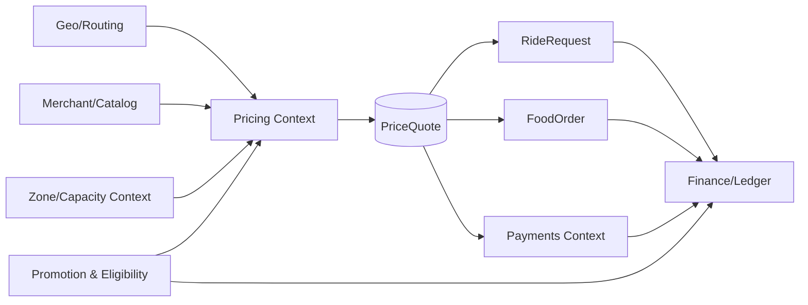
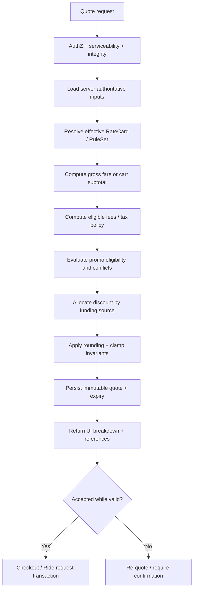
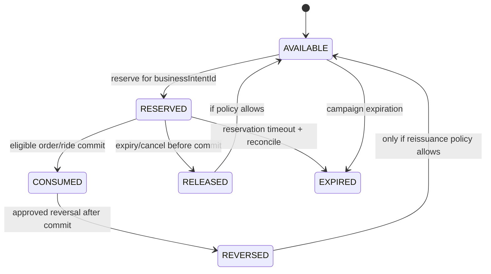
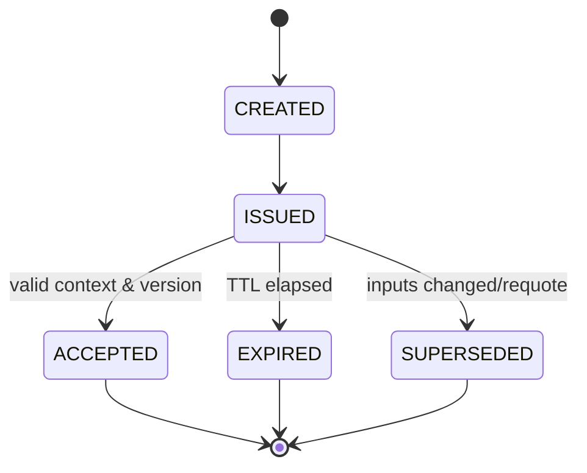
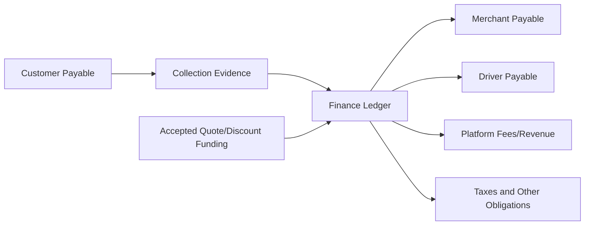

# DealGo — Pricing, Fees & Promotions

> **Trạng thái: DRAFT / đề xuất thiết kế.** Tài liệu này xác định *hợp đồng nghiệp vụ và tính đúng đắn* cho báo giá Ride/Food; **không** phê duyệt mức giá, % chiết khấu, thuế, kênh thu hộ, khuyến mại cụ thể, thời gian hiệu lực quote hay ngân sách chiến dịch. Các điểm ấy thuộc `OPEN-002/003/006/010/018` và chỉ được chuyển sang production sau review/approval tương ứng.
>
> Ví dụ tiền trong tài liệu là **`TEST_ONLY`**, không phải bảng giá, voucher hoặc chính sách thương mại DealGo.

## 1. Mục tiêu, câu hỏi tài liệu phải trả lời

1. Từ vị trí đón/trả hoặc giỏ đồ ăn, backend tạo giá đáng tin cậy bằng cách nào?
2. Giá thay đổi vì map, giao thông, món hết, giờ cao điểm, phí phát sinh hoặc voucher được xử lý thế nào?
3. Tổng tiền khách, tiền cửa hàng, tiền tài xế, phí nền tảng và bên chịu giảm giá được tính/tách/đối soát thế nào?
4. Làm gì để retry, callback trễ, hai thiết bị, race số lượt voucher hoặc cấu hình giá mới không tạo giảm giá/thu tiền sai?
5. Những kiểm thử nào chứng minh quote, order, payment, settlement và UI khớp nhau?
6. Phần nào engineering có thể xây ngay, phần nào bị chặn bởi quyết định sản phẩm/tài chính/pháp lý?

**Definition of success:** Mỗi `PriceQuote` có đủ inputs authoritative, breakdown, policy/version, currency, điều kiện hiệu lực, chữ ký hoặc tham chiếu server-side và khả năng replay/kiểm toán; mỗi điều chỉnh sau commit được truy vết riêng chứ không sửa ngầm quote đã chấp nhận.

## 2. Nguồn sự thật và thẩm quyền

| Chủ đề | Tài liệu sở hữu | Tài liệu này chịu trách nhiệm |
|---|---|---|
| Chốt phạm vi Ride/Food và 3 vai trò | `README.md`, `project-charter.md`, `scope-release-plan.md` | Không tự thêm GrabCar, delivery độc lập, đa nhà hàng trong một order |
| Yêu cầu chức năng | `product-requirements.md`, `functional-requirements.md` | Chuyển thành giá/giảm giá/checkout contracts |
| Thuật ngữ | `glossary.md` | Dùng `PriceQuote`, `PricingRule`, `FeeBreakdown`, `PaymentIntent`, `Settlement` đúng nghĩa |
| Nguồn giá món/option, tồn khả dụng | `merchant-and-catalog-rules.md` | Chỉ đọc catalog snapshot/version; không sở hữu menu CRUD |
| Flow Ride, Dispatch | `domain-model.md`, docs workflows tương lai | Định giá dựa trên routing/supply inputs; không điều phối tài xế |
| PSP, Ledger, Payout | `payments-ledger-settlement.md` (sẽ viết) | Trả về price components và attribution, không thực hiện capture/settlement |
| Hủy/hoàn tiền | `cancellation-refund-disputes.md` (sẽ viết) | Xác định các căn cứ giá/điều chỉnh; không tự chốt mức bồi hoàn |
| Chính sách chưa duyệt | `decisions-and-assumptions.md` | Dẫn chiếu `OPEN-*`, dùng fixtures an toàn |

**Precedence:** quyết định đã phê duyệt (decision record) → yêu cầu approved → contracts đã version → bản docs draft. Nếu xung đột, lập impact review; coding agent không tự sửa policy để "cho chạy".

## 3. Phạm vi và ngoài phạm vi

**Trong phạm vi:**
- Ride hai bánh: giá tham khảo theo hành trình + negotiation giữa khách và tài xế; lưu giá khách đề xuất/counter-offer riêng; khóa giá cuối do khách chọn trước assignment. Phí/thuế ngoài mức thỏa thuận phải tách bạch và được duyệt.
- Food: giá từng dòng món/variant/modifier, phí giao hàng, phí bao bì/khác khi hợp lệ, ưu đãi món/đơn/phí giao, thời điểm xác thực lại cart, price snapshot khi order commit.
- Hai dịch vụ: pricing rule registry, cấu hình theo service/zone/store, ưu đãi theo người dùng/thời gian/budget, phân bổ funder, attribution, audit và rollback.
- Liên kết Finance: frozen economics snapshot, external reference, chênh lệch/điều chỉnh, đối soát nguyên tắc.

**Ngoài phạm vi hiện tại:**
- Tự quyết mức giá, biểu giá theo địa phương, khoản thuế cụ thể, nghĩa vụ xuất hóa đơn, quy trình khấu trừ và mô hình thu hộ hợp pháp.
- Chốt dynamic surge algorithm, đấu giá tự động, auto-select mức giá, gói GrabCar, giao kiện hàng độc lập, ví điện tử/cashback, subscription, loyalty point exchange. **Thương lượng giá Ride giữa người dùng là scope đã xác nhận; không phải đấu giá tự động.**
- Thiết lập merchant commission/tỷ lệ chia lãi cụ thể; mọi ví dụ đều `TEST_ONLY`.

## 4. Các quyết định khóa trước khi production

| Decision | Ý nghĩa với giá/khuyến mại | Hạng mục vẫn làm an toàn | Bắt buộc có approval trước |
|---|---|---|---|
| `OPEN-001` | Vùng phục vụ, zone IDs, route validity | Zone interface + fixtures | Bảng giá vùng thật |
| `OPEN-002` | COD/online, đơn vị nhận tiền | Payment adapters + sandbox | Quote có lời hứa thanh toán production |
| `OPEN-003` | Công thức Ride/Food, phụ phí, discount, commissions, cancellation | Deterministic pricing engine với rules TEST_ONLY | RuleSet active production, biểu giá/voucher thực |
| `OPEN-004` | Supply/dispatch, ETA, no-driver fee semantics | Inputs có version và data quality | Surge/supply multiplier nếu dùng |
| `OPEN-006` | Pháp nhân, vận tải và TMĐT, thuế | Trường tax/fee có `pendingLegalReview` | Tax/fee treatment, hợp đồng đối tác |
| `OPEN-007` | SLO và ngân sách dịch vụ map/pricing | Instrumentation, benchmark | Cam kết latency/capacity production |
| `OPEN-008` | Map/PSP/provider phụ thuộc | Sandbox routing + stubs | Production credentials và fee dependencies |
| `OPEN-009` | Một hay nhiều nhà hàng/giỏ | Scope quote theo store | Multi-store pricing/allocations |
| `OPEN-010` | Thời điểm Food thu tiền | Quote/payment readiness state | Authorize/capture production |
| `OPEN-016` | Food chuẩn bị rồi không tìm được shipper | Non-committed adjustments, incident tagging | Ai chịu mất mát/bồi hoàn |
| `OPEN-018` | Driver thu tiền COD và công nợ | `CollectionPolicy` interface | COD balances/driver deduction |
| `OPEN-019` | Số vòng/thời hạn/guardrails của Ride negotiation, no-response, route changes | Negotiation state machine và test config | Production timer/limits/guardrails |

## 5. Ubiquitous Language và từ dễ nhầm

| Khái niệm | Định nghĩa bắt buộc | Không đồng nghĩa |
|---|---|---|
| `RateCard` | Bộ thông số biểu giá có phạm vi/phiên bản/hiệu lực | Một quote phát cho khách |
| `PricingPolicyVersion` | Phiên bản bất biến của biểu giá và điều kiện sử dụng | Version app/mobile |
| `PriceQuote` | Báo giá tính tại một thời điểm, có snapshot, expiry | Payment thành công |
| `QuoteAcceptance` | Customer xác nhận Food checkout quote hợp lệ | FoodOrder hoàn thành hoặc payment thành công |
| `PassengerProposedFare` | Mức khách đưa ra trong thương lượng Ride | Reference fare hoặc final agreed fare |
| `FareCounterOffer` | Mức tài xế phản hồi cho request Ride | DispatchOffer hoặc tự động assignment |
| `AcceptedFareAgreement` | Snapshot giá cuối do khách chọn và server commit | Payment success/settlement |
| `FeeLine` | Dòng phí được phân loại, actor chịu tiền, tax behavior | Thu nhập driver |
| `DiscountAllocation` | Dòng giảm giá kèm nguồn tài trợ, beneficiary, cách phân bổ | Refund |
| `VoucherRedemption` | Lượt sử dụng voucher hợp lệ theo lifecycle | Voucher được nhập vào input |
| `PromotionBudgetReservation` | Giữ tạm ngân sách/lượt dùng để tránh overcommit | Đã ghi nhận chi phí cuối |
| `MerchantNet` | Khoản cửa hàng được hưởng theo settlement policy | Khách đã trả bao nhiêu |
| `DriverEarnings` | Thu nhập driver tính theo compensation rules | Delivery fee khách trả |
| `PlatformRevenue` | Thu nhập thực của nền tảng theo mô hình hợp đồng | Tổng phí hiển thị |
| `Requote` | Phát quote mới để khách review khi input/policy đã đổi | Sửa giá vào lịch sử order |
| `Adjustment` | Thay đổi nghĩa vụ tài chính có lý do, tham chiếu và audit | UPDATE quote cũ |
| `TaxTreatment` | Cách áp dụng thuế theo tư vấn pháp lý/hóa đơn | Mức VAT mặc định đoán được |

## 6. Bounded Context và ownership



- `Pricing` là **source of truth** của bảng giá đang hiệu lực, quote và breakdown; chỉ Pricing được sinh quote chấp nhận được.
- `Catalog` sở hữu giá/option trước order; Pricing phải lấy snapshot/version từ Catalog, không tự cập nhật món.
- `Geo/Routing` sở hữu tuyến dự báo, distance/duration và chất lượng dữ liệu; Pricing không tự giả lập khoảng cách Haversine để thay route distance.
- `Promotion` sở hữu campaign rules, eligibility và budget redemption; có thể là module nội bộ cùng deployment với Pricing trong MVP, nhưng ranh giới miền rõ.
- `Payments` thực thi thu/hoàn theo PSP và payment method; `Finance` sở hữu bút toán, đối soát và payout. Không gộp PaymentIntent với PriceQuote.
- `FoodOrder` lưu accepted checkout quote; `RideRequest` lưu reference fare + negotiation ref, và sau lựa chọn thì `AcceptedFareAgreement`. `RideTrip`/`DeliveryTask` không tự thay snapshot tiền bằng GPS thực đo.

## 7. Aggregate và Value Object đề xuất

| Aggregate root / object | Owner | Vai trò | Invariant |
|---|---|---|---|
| `RateCard` | Pricing | Draft/publish/supersede biểu giá | Published version immutable |
| `PricingRuleSet` | Pricing | Các rule, thứ tự/cơ chế kết hợp | Không có priority ambiguity khi publish |
| `FoodCheckoutQuote` | Pricing | Giá món/phí/discount snapshot có hạn dùng, customer consent | Không mutate accepted checkout |
| `RideReferenceFare` | Pricing/Ride | Mức tham khảo theo route/policy version | Không phải agreed fare |
| `RideFareNegotiation` | Ride/Pricing | Passenger proposal + driver responses + customer selection | Không tạo assignment trước selected offer |
| `AcceptedFareAgreement` | Ride/Pricing | Giá Ride cuối immutable | Payment success hoặc settlement |
| `PromotionCampaign` | Promotion | Budget/funder/target/rules | Không vượt giới hạn/lượt dùng |
| `Voucher` | Promotion | Code/entitlement cụ thể | Không áp dụng trái scope/currency |
| `Redemption` | Promotion | Reserve/consume/release một business intent | At-most-once commit per eligible unit |
| `Money` | VO | `{amountMinor, currency}` | Hạn chế số âm theo loại line |
| `FareBreakdown` | VO | Các thành phần giá Ride | Sum invariant |
| `OrderPriceBreakdown` | VO | Các thành phần Food | Snapshot item version/currency |
| `Allocation` | VO | Bên tài trợ + amount + basis | Tổng shares == discounted amount |
| `PricingContext` | VO | Zone, service, clock, route/cart, role eligibility | Context stable hash |

**Ghi chú DDD:** bảng/collection và transaction boundary cuối cùng chờ ERD; aggregate != microservice và != mỗi bảng Prisma. Dùng optimistic lock/CAS và transaction để bảo vệ reservation trong database.

## 8. Đơn vị tiền, precision và rounding

1. Giá trị tiền ở Việt Nam biểu diễn VND dưới dạng **số nguyên** trong domain (`amountMinor` theo quy ước currency) hoặc decimal chính xác cho bước trung gian; tuyệt đối không dùng `number` floating point để làm kế toán.
2. `currency = 'VND'` vẫn phải ghi tường minh ở quote/payment/ledger; không assume toàn hệ thống luôn chỉ VND.
3. Không âm với unit price, base fee, subtotal, payable, positive tax lines; discounts và adjustments có sign convention phân biệt.
4. Mỗi amount có nguồn, taxable/non-taxable treatment (khi được duyệt), beneficiary, funder, rounding context, policy version.
5. Phải chốt quy tắc rounding (`round-half-up`, `half-even`, floor/ceil…), *thời điểm* round (line/unit/total), phân bổ phần dư và hiển thị; đó là **hạng mục con của `OPEN-003`**.
6. Nếu có decimal trung gian, giữ full precision đến stage do policy định nghĩa rồi quy đổi thành integer VND; không round hai lần không kiểm soát.
7. `customerPayable >= 0` và tổng các dòng hiển thị phải bằng số tiền provider được yêu cầu thu; 0 đồng là trạng thái hợp lệ chỉ nếu payment method/business policy hỗ trợ.
8. Overflow/underflow bị chặn bằng giới hạn domain + check safe integer/decimal storage; DB lưu `BIGINT`/numeric phù hợp thiết kế ERD.

Ví dụ hàm phân bổ giảm giá 10.001 VND lên 3 dòng 40.000/35.000/25.000: tính tỷ lệ nguyên chính xác, chia floor từng dòng rồi phân phối phần dư theo *largest remainder* với stable tie-breaker `lineId`. Tổng allocation **luôn chính xác 10.001 VND**. Đây là **thuật toán được đề xuất**, không là quy tắc kế toán đã được duyệt.

## 9. Mô hình dữ liệu đầu vào cho Pricing Engine

| Trường | Authoritative owner | Validation / rejection |
|---|---|---|
| `requesterAccountId`, `activeRole` | Identity (từ auth context) | Không tin client gửi userId |
| `serviceType` | Product/service catalog | Chỉ `RIDE_BIKE` hoặc `FOOD` ở MVP |
| `serviceZoneId` | Geo/Operations | Zone hoạt động, không cross-zone khi chưa hỗ trợ |
| `routeId`, `distanceMeters`, `durationSeconds`, `routeSource` | Routing adapter | Route stale/unavailable bị fail-safe theo policy |
| `routeDataTimestamp`, `trafficDataQuality` | Routing adapter | Input hết hạn phải được refresh/có cảnh báo |
| `storeId`, `catalogVersion`, `cartVersion` | Catalog | Eligibility/orderability tại server |
| `lineItems`, `optionSelections`, `quantities` | Cart/Catalog | Product/option price server-side, quantity bounded |
| `campaignIds`, `voucherCode` | Promotion | Server kiểm eligibility; mã không xác định amount |
| `customerEligibilityFacts` | Identity + Promotion | Privacy-safe flags, không dùng PII trực tiếp trong hash public |
| `quoteRequestTimestamp` | Server clock | NTP/timezone; client clock không là nguồn truth |
| `paymentMethodFamily` | Payments eligibility | Phụ thuộc `OPEN-002`, không ngầm COD |
| `pricingPolicyVersion` | Pricing registry | Published, effective and approved for environment |

Không lưu raw GPS history/PII đầy đủ trong quote khi chỉ cần zone/distance snapshot; lưu `dataProvenance` và reference có retention rõ.

## 10. Pricing Engine pipeline — thứ tự tác vụ



**Bất biến pipeline**
- Deterministic với cùng `(inputsSnapshot, policyVersion, currency, algorithmVersion)` nếu không có external mutable input; nếu có phải snapshot nó.
- Thành phần giá `UNSUPPORTED` hoặc không xác thực không tự mặc định bằng 0 khi nó có khả năng làm khách trả thiếu/đối tác mất tiền; trả structured unavailable, fallback chỉ theo policy đã phê duyệt.
- Không auto-pick chương trình giảm giá tốn ngân sách nếu quy tắc kết hợp chưa được duyệt.
- Quote không thể tự trở thành `PaymentSuccess`, `FoodOrder.DELIVERED`, hay `RideTrip.COMPLETED`.

## 11. RateCard: phiên bản, phạm vi, độ ưu tiên

| Field | Ý nghĩa |
|---|---|
| `rateCardId/version` | Mã/phiên bản duy nhất; version bất biến sau publish |
| `serviceType` | RIDE_BIKE / FOOD_DELIVERY / FOOD_ITEMS / PLATFORM_FEE… |
| `zoneSelector` | Thành phố, geofence, pickup/store location; `OPEN-001` |
| `merchantSelector` | Store-level overrides nếu hợp đồng cho phép |
| `validFrom/validTo` | Thời hiệu theo timestamp UTC + business timezone rõ ràng |
| `status` | DRAFT → IN_REVIEW → APPROVED → SCHEDULED → ACTIVE → RETIRED |
| `priority` | Xác định khi nhiều rule có thể áp dụng; phải xét specificity |
| `components` | Bản ghi riêng cho base/distance/time/fees/discount knobs |
| `approvalRecord` | Approver, reason, evidence, legal/finance review |
| `rollbackToVersion` | Version được phê duyệt trước đó có thể tái kích hoạt theo control process |
| `checksum` | Hash canonical published config, phục vụ trace/evidence |

Không cho hai rate cards ACTIVE trùng đúng `(service, zone, scope, effective interval, same priority)` nếu không có rule hợp lệ chọn một. Khi rollout, có thể cấu hình canary theo cohort do Product/Finance phê duyệt; không âm thầm thử nghiệm phí của khách.

## 12. Ride — yếu tố ảnh hưởng báo giá

**Các input ứng viên (không suy ra tất cả đều tính phí):** `pickup`, `dropoff`, `route distance`, estimated duration, zone, service type, traffic context, supply demand metrics, scheduled windows nếu sau này có, environmental/parking/toll fees nếu pháp luật/hợp đồng cho phép.

**Khung toán học CHỈ để cấu hình thử:**

```text
rideGross = baseFare
          + distanceComponent(distanceMeters, includedDistance, distanceRate)
          + durationComponent(estimatedSeconds, thresholds, timeRate)
          + eligibleSurchargeLines

rideCustomerPayable = max(0, rideGross + customerFeeLines + approvedTaxLines
                             - eligibleCustomerDiscounts)
```

- Các thành phần không được phê duyệt phải `DISABLED`, **không** hard-code 1 công thức sản xuất vào Flutter.
- Đơn giá theo kilomet phải tính bằng `meters` và fraction chính xác; không round khoảng cách sang km trước rồi nhân giá trừ khi policy quy định.
- Nhiều tuyến khả thi: policy định nghĩa cách chọn tuyến làm căn cứ báo giá, evidence từ routing engine và fallback.
- Surge/multiplier nếu có phải có min/max cap, fairness/anti-abuse, effective version, audit và UX disclosure; chưa mặc định MVP có surge.
- Route estimate khác quãng đường chạy thật. **Không tự thay giá khách đã chấp nhận** khi tài xế đi đường khác; cần rules ngoại lệ (đổi điểm đến, stop, toll, sai điểm đón) được duyệt.
- Nếu quote là fixed upfront, các ngoại lệ tính thêm phải được hiển thị/đồng ý theo chính sách; không chuyển mô hình sang đồng hồ tự động.
- Mọi cấu phần "điểm đón sân bay", "phí cầu đường", "chờ lâu" là `policyCandidate`, không tự tính phí.

### 12.1. Giá tham khảo và thương lượng Ride (đã xác nhận ở mức pattern)

Ride có ba giá trị phải lưu riêng: (1) `referenceFare` backend tính từ route/service/version, để định hướng quyết định; (2) `passengerProposedFare`; (3) `agreedFare`, chỉ có sau khi tài xế chấp nhận giá hoặc khách chọn một counter-offer. Giá tham khảo không tự biến thành giá cuối.

```text
RideRequest: pickup, dropoff, routeVersion
ReferenceFare: amount + breakdown + policyVersion + expiresAt
PassengerOffer: amount + actor + createdAt + expiresAt
DriverCounterOffer[*]: amount + driverId + createdAt + expiresAt + status
AcceptedFareAgreement: selectedOfferId + immutable agreedFareSnapshot + acceptedAt
```

**Luồng bắt buộc:** server tạo reference fare → khách gửi giá → tài xế chấp nhận hoặc phản hồi giá → khách chọn một phản hồi còn hiệu lực → server commit duy nhất một agreement và assignment. Không chọn giá rẻ nhất/offer đến trước thay khách. Nếu không có phản hồi, offer hết hạn hoặc không có thỏa thuận, request kết thúc/retry theo policy; không có trip assignment.

`OPEN-019` còn phải chốt số vòng, thời hạn, guardrails giá, UX cho offer mới/ẩn/đã hết hạn, close/cancel behavior và thay đổi route. `OPEN-003` chốt giá tham khảo, các khoản phí/tax/discount và economics; mọi số mẫu phải `TEST_ONLY`. Food checkout giữ mô hình giá món/fee quote riêng.

## 13. Ride — example `TEST_ONLY` có thể kiểm toán

```text
Giả lập: base 12.000 VND bao gồm 2.000 m đầu tiên.
Khoảng cách route 4.500 m; phần vượt 2.500 m × 4.000 VND/km = 10.000 VND.
Phụ phí giả lập 3.000 VND.
Ride gross = 12.000 + 10.000 + 3.000 = 25.000 VND.
Voucher giả lập, đủ điều kiện: -5.000 VND.
Customer payable = 25.000 - 5.000 = 20.000 VND.
```

| Trường | VND | Funding attribution | Trạng thái |
|---|---:|---|---|
| `baseFare` | 12.000 | Pricing rule | TEST_ONLY |
| `distanceFare` | 10.000 | Pricing rule | TEST_ONLY |
| `surcharge` | 3.000 | Pricing rule | TEST_ONLY |
| `grossFare` | 25.000 | — | Computed fixture |
| `customerDiscount` | -5.000 | `TEST_SPONSOR_PLATFORM` | Fixture |
| `customerPayable` | **20.000** | — | Fixture |

Không suy luận `DriverEarnings = 20.000` hoặc `PlatformRevenue = 5.000`. Hai đại lượng này do remuneration/ledger policy độc lập, không được tính ngược từ customer total khi chưa có `OPEN-003` approval.

## 14. Food — line item pricing và CartSubtotal

- Input từ Catalog: `itemBasePrice`, `variantDelta`, `modifierDelta`, `quantity`, `lineItemVersion`, `availability`, eligibility, schedule.
- Mỗi dòng: `qty × [base + variantDelta + sum(selectedModifierPrice)]`; combo/size theo catalog version, không lấy price từ client.
- Merchant item discounts nếu có phải thể hiện là discount line + funder, không thay giá catalog ban đầu mà mất trace.
- Đơn có 1 store là **phương án thử nghiệm** đang chờ `OPEN-009`, không là contract multi-store đã duyệt.
- Phí bao bì/đóng gói chỉ được tính khi có cấu hình và disclosures rõ, merchant/store chịu trách nhiệm nhập và duyệt theo contract.
- Checkout phải xác thực lại giờ mở cửa, giá, modifier, số lượng, min order, promotion eligibility, payment readiness.
- Nếu Catalog thay đổi sau quote → `CART_REVALIDATION_REQUIRED`, cung cấp diff, không âm thầm nâng tổng tiền.
- Order đã commit lưu snapshot từng món, lượng, ưu đãi và nguồn tài trợ; không cập nhật theo menu sau này.

## 15. Food — giao hàng, platform fees và tax handling

**Các line loại ứng viên:** `ITEM_SUBTOTAL`, `MODIFIER`, `PACKAGING`, `DELIVERY_FEE`, `SERVICE_FEE`, `SMALL_ORDER_FEE`, `WEATHER_FEE`, `TAX`, `ITEM_DISCOUNT`, `ORDER_DISCOUNT`, `DELIVERY_DISCOUNT`.

- `DELIVERY_FEE` khách trả **không đồng nghĩa** công trả cho tài xế; có thể nền tảng trợ giá hoặc giá biến động theo hợp đồng.
- `MERCHANT_COMMISSION` là nghĩa vụ B2B theo hợp đồng, **không** tự thêm vào checkout như customer service fee.
- Loại thuế, ai thu/xuất hóa đơn, giá món đã bao thuế hay chưa, thuế áp dụng trước/sau ưu đãi phụ thuộc `OPEN-006` và legal/finance review.
- Không bao giờ tính "VAT 10%" mặc định trong source code vì không phải mọi thành phần/nghiệp vụ đều có cùng cách áp dụng.
- Thứ tự áp discount/tax và làm tròn phải được version hóa; ví dụ mô hình trong §16 giả định các số đã có thể cộng trực tiếp và chưa áp dòng thuế bổ sung.
- Nếu map ước lượng route không khả dụng, quote fee không được hạ về 0 mặc định chỉ để checkout chạy; hiển thị không tính được phí hoặc fallback đã duyệt.

## 16. Food — example `TEST_ONLY` có thể kiểm toán

```text
Giỏ: 2 phần × 35.000 = 70.000
Topping: 2 phần × 5.000 = 10.000
Item subtotal = 80.000
Phí giao giả lập = 18.000
Phí bao bì giả lập = 3.000
Gross customer charges = 101.000
Merchant-funded item/order discount = -8.000
Platform-funded delivery discount = -6.000
Customer payable = 87.000 VND.
```

| Line | VND | Funder/receiver | Note |
|---|---:|---|---|
| Món + topping | 80.000 | Customer → obligations to merchant per contract | TEST_ONLY |
| Phí giao | 18.000 | Customer charge, không mặc nhiên driver income | TEST_ONLY |
| Phí bao bì | 3.000 | Theo hợp đồng cửa hàng | TEST_ONLY |
| Giảm món/đơn | -8.000 | Merchant-funded | TEST_ONLY |
| Giảm phí giao | -6.000 | Platform-funded | TEST_ONLY |
| Khách trả | **87.000** | — | 80k+18k+3k−8k−6k |

**Ledger không được tạo từ bảng này bằng cách suy đoán.** Phải định nghĩa merchant gross/commission/driver remuneration/PSP fees/taxes/timing riêng trong `payments-ledger-settlement.md`.

## 17. Promotion taxonomy (các loại ứng viên)

| Loại | Scope | Ví dụ nguyên lý | Điều kiện đặc biệt |
|---|---|---|---|
| `FIXED_ORDER` | Ride/Food order | Giảm một số tiền | Minimum spend, max redemption |
| `PERCENT_ORDER` | Tổng eligible order | % giảm, có cap | Rounding, cap allocation |
| `ITEM_DISCOUNT` | Món/nhóm món | Discount scoped item | Giá món phiên bản, quantity cap |
| `DELIVERY_DISCOUNT` | Food delivery fee | Giảm một phần phí giao | Cannot exceed eligible delivery fee |
| `FIRST_ORDER` | Cohort | Ưu đãi lần đầu | Account identity/abuse defense |
| `NEW_CUSTOMER` | Cohort | Merchant acquisition | Rule scope, dedup by verified actor |
| `STORE_FUNDED` | Merchant/store | Voucher do store tài trợ | Budget/store staff approval |
| `PLATFORM_FUNDED` | Platform | Voucher do platform tài trợ | Finance budget owner |
| `SHARED_FUNDED` | Shared allocation | Merchant + platform đồng tài trợ | Agreement + allocation basis |
| `TIME_WINDOW` | Promo condition | Ngày/khung giờ | Timezone, boundaries |
| `GEOFENCED` | Zone | Ưu đãi khu vực | Location trust, privacy |

Danh sách này là **capability inventory**; không phải cam kết P0 tất cả loại chiến dịch. Ưu đãi chồng, cashback/loyalty/điểm thưởng cần quyết định mới trước khi mở.

## 18. Eligibility engine — kiểm tra theo snapshot

| Điều kiện | Nguồn | Fail-safe |
|---|---|---|
| Active / approved / published | Promotion registry | Chưa approved -> không hiện/quy đổi |
| Time window and timezone | Server clock | Boundary chính xác; clock skew có policy |
| Region + service | Zone/service authority | Quote khác vùng/dịch vụ -> reject |
| Merchant/store + items | Catalog | Item changed -> requote |
| Basket minimum threshold | Pricing snapshot | Tính trên base đã được policy xác định |
| First-time/unique actor | Identity + abuse engine | Privacy-safe, multi-account/race proof |
| Payment method restriction | Payments capability | Payment method đổi -> revalidation |
| Campaign budget / per-user limits | Promotion counters | Atomic reserve, not read-then-write |
| Exclusive/stack rules | Versioned policy | Unknown conflict -> reject not silently combine |
| Coupon ownership | Promotion entitlement | No cross-account code redemption |

Trả `eligibilityReasons[]` có mã lỗi, không lộ chi tiết chống gian lận hoặc PII; UI có thể hiển thị thông tin đủ để khách sửa điều kiện.

## 19. Áp dụng nhiều khuyến mại — precedence / stacking

**Giữ trạng thái `OPEN-003`; nội dung "promotion stacking" mới là chủ đề cần xem xét, chưa có mã quyết định governance riêng.** Quy tắc đề xuất kiểm thử:

1. Ưu đãi theo item nếu được cấu hình; xác định `eligibleBase` còn lại theo rule version.
2. Áp ưu đãi order-level nếu campaign cho phép stack với item-level.
3. Áp ưu đãi delivery-fee đúng loại, không trừ vượt phí hợp lệ.
4. Nếu voucher exclusive thì ngăn các promo xung đột; lựa chọn "best available" chỉ khi PO chốt cách xếp hạng và funding.
5. Tổng discount từng eligible base không vượt base đã được policy xác định; không tạo payable âm.
6. Deterministic tie-breaker gồm priority, effectiveAt, campaignId khi đã phê duyệt; không dựa vào thứ tự DB/Map/JSON.
7. Không cho Merchant tự thêm một platform-funded promo bằng quyền của store; funding authorization phải xét ở backend.
8. Khi promo không còn dùng được, UI trả rõ lý do và tái tính giá; không fallback tự chọn voucher khác gây nhầm.

## 20. Voucher lifecycle và ngân sách



- Reservation phải scoped theo `(campaignId, subjectId, businessIntentId)`, có idempotency token, version/TTL và owner.
- Hạn mức budget/lượt dùng: dùng DB transaction row lock/CAS hoặc atomic ledger reservation; **không** chỉ kiểm tra Redis count rồi giảm khi commit.
- Quota tiền được tính trên **platform/merchant funding amount thực** chứ không chỉ customer discount tổng khi đồng tài trợ.
- `CONSUMED` là chứng cứ sử dụng ưu đãi theo định nghĩa được duyệt; refund/cancellation cần reversal/compensation riêng, không delete record.
- Khi crash giữa reserve và order commit: recovery worker xử lý trạng thái treo và đối chiếu business intent; không release nhầm voucher đã commit.
- Khi campaign hết ngân sách sau khi quote nhưng trước commit: policy quyết định có giữ chỗ trên quote hay chỉ trên commit. Mặc định thử nghiệm **reserve lúc submit checkout** để hạn chế giữ vô hạn; cần quyết định sản phẩm trước production.

## 21. Ràng buộc Quote lifecycle

**Áp dụng theo vertical:** Food checkout quote có trạng thái accepted khi customer xác nhận checkout. Ride `ReferenceFare` chỉ là mức tham khảo; thương lượng đi qua `RideFareNegotiation`, và giá có hiệu lực để booking/payment là `AcceptedFareAgreement` sau khi customer chọn. Không gán `ACCEPTED` cho reference fare chỉ vì customer gửi giá đề xuất.



- `quoteId`, `quoteHash`, `subjectScope`, `serviceType`, inputs snapshot, line breakdown, policy/algorithm version, `issuedAt`, `expiresAt`, `status`, `sourceRefs` và `environment` là các thành phần bắt buộc.
- Quote có thể được gửi dưới dạng opaque identifier (server persisted) hoặc integrity-protected token; **không** tin `payableAmount` mobile gửi khi submit.
- Verify subject/merchant/zone/itemVersion/service/paymentFamily tại thời điểm acceptance; quote của customer A không reuse cho customer B.
- Nếu policy thay đổi giữa issued và accepted: tôn trọng version/expiry theo **policy lock semantics đã duyệt**. Chưa quyết định không mặc định hưởng giá cũ vĩnh viễn.
- Quote expired → response `QUOTE_EXPIRED` kèm hướng dẫn re-quote; không lấy giá mới silently rồi submit.
- Trạng thái order/trip kết thúc không làm thay đổi quote accepted; chỉnh sửa phí yêu cầu amendment + reason/evidence.
- Thời hạn hiệu lực quote là `OPEN-003`, không hard-code số giây từ ví dụ.

## 22. Checkout price lock, consistency và state ownership

**Hợp đồng Ride theo `DEC-PROD-005`**
1. Client chọn pickup/dropoff; backend trả `referenceFareId` + route/fee breakdown/version/expiry.
2. Customer gửi `passengerProposedFare`; backend kiểm tra guardrails đã duyệt và tạo request/negotiation idempotent.
3. Driver response ghi một `FareCounterOffer` hoặc accept giá khách; không tạo `DriverAssignment` ở bước này.
4. Customer chọn đúng một đề nghị còn hiệu lực; server atomically tạo `AcceptedFareAgreement` và assignment cho driver tương ứng.
5. Fare/route/policy thay đổi trước assignment yêu cầu revalidation; sau agreement không được sửa tiền âm thầm. No-driver/cancel/retry xử lý theo workflow riêng.

**Hợp đồng đề xuất cho Food**
1. Customer chọn store/cart; backend lấy catalog authoritative.
2. Backend trả `cartValidation` + quote + eligible promos.
3. Checkout transaction verify cartVersion, storeAvailability, promo redemption reservation, quote and payment readiness.
4. Tạo FoodOrder với quote snapshot; mọi bước thanh toán/merchant acceptance theo `OPEN-010`.
5. Hết món/sửa đơn sau commit phải thông qua `OrderChangeRequest` có user consent và tài chính điều chỉnh, không update order amount tùy tiện.

**Cross-boundary:** nếu transaction phải gọi PSP/other service, dùng outbox/saga/compensation có idempotency; không giữ DB transaction chờ network callback.

## 23. Price revalidation / UI stale / sự đồng ý

| Tình huống | Backend | UI Flutter |
|---|---|---|
| Quote chưa hết hạn, state không đổi | Chấp nhận theo policy lock | Hiển thị breakdown cuối đã xác nhận |
| Quote hết hạn | Trả `QUOTE_EXPIRED` | Prompt cập nhật giá; không auto-submit |
| Giá món đổi | `CART_REVALIDATION_REQUIRED` + diff | Cho khách review giá cũ/mới |
| Hết topping/biến thể | Reject line + alternative suggestions *nếu có* | Không tự chọn topping tốn tiền |
| Phí giao thay đổi | Trả `PRICE_CHANGED` + breakdown | Nếu thay đổi đáng kể phải xác nhận lại theo policy |
| Promo đã hết lượt | `PROMOTION_UNAVAILABLE` | Giữ cart, bỏ ưu đãi có giải thích |
| Không xác định tax/fee | `PRICING_UNAVAILABLE` | Không hiển thị số giả là giá cam kết |
| Khách đổi địa chỉ | Re-route, re-quote | Hiển thị chênh lệch trước submit |
| Mạng mất sau submit | Query idempotent intent status | Không submit "lại từ đầu" với key mới vô ý |

Không quyết định ngưỡng thế nào là "thay đổi đáng kể" khi `OPEN-003` còn mở. Phương án an toàn: mọi **tăng tổng payable** so với quote khách vừa xác nhận đều cần consent ở UI trước commit.

## 24. Economics: phân biệt customer money và partner/driver/platform



**Cần ít nhất các ledger dimensions:** service, transactionId, lineItemId, fundingParty, chargeBearer, beneficiary, gross/net basis, currency, taxCategory pending legal, source event, pricePolicyVersion, approved adjustment reference.

- Merchant-funded discount làm giảm merchant economics hoặc do cơ chế bù/đối ứng khác; không thể suy ra nếu thiếu hợp đồng.
- Platform-funded discount cần chi phí tài trợ/marketing rõ ràng; không biến thành merchant deduction.
- Shared-funded cần **allocation exact** theo hợp đồng (số tiền, %, cap và quy tắc rounding).
- Driver compensation không bắt buộc bằng delivery fee/fare khách trả; hợp đồng và bảo đảm thu nhập được xét độc lập.
- Không suy luận customer cashback = giảm giá hiện tại; cashback tương lai là liability khác.
- Refund/reversal tạo journal đảo hoặc adjustment có reason/evidence theo Finance, không edit posted records.

## 25. Admin pricing console và four-eyes approval

| Capability | Quyền tối thiểu đề xuất | Bảo vệ |
|---|---|---|
| Xem cấu hình giá/promo | `pricing:read` theo scope | Mask dữ liệu/chi phí nhạy cảm |
| Soạn RateCard | `pricing:draft` | Không publish được ngay |
| Đề xuất chiến dịch store | `promotion:propose:store` | Đúng store membership, cap merchant budget |
| Phê duyệt biểu giá | `pricing:approve` | Không tự duyệt bản mình soạn nếu SoD required |
| Publish activation | `pricing:publish` | MFA/step-up, effectiveAt và approval evidence |
| Khóa khuyến mại khẩn cấp | `promotion:emergency_pause` | Lý do + audit + break-glass review |
| Sửa tài trợ/budget | `promotion:finance_approve` | Chống cấp tiền trái thẩm quyền |
| Xem export settlement | `finance:read` | Tách khỏi quyền pricing edit |

Policy RBAC/ABAC cuối thuộc `roles-and-permissions.md`. Các quyền ở trên là **candidates**, không là permission IDs đã được phê duyệt trong code.

## 26. Auditability và event design

**Event candidates, chưa khóa broker hay schema:**

| Event | Khi nào | Consumer | Idempotency / retention |
|---|---|---|---|
| `pricing.rate_card.published.v1` | RateCard được publish | Cache/analytics | `rateCardId:version` |
| `pricing.quote.issued.v1` | Server phát quote | Analytics/observability | `quoteId` |
| `pricing.food_checkout_quote.accepted.v1` | FoodOrder binds checkout quote | Orders/finance | `businessIntentId:quoteId` |
| `ride.fare_agreement.committed.v1` | Customer selected a valid fare offer; immutable agreed amount | Ride/Payments | `rideRequestId:agreementId` |
| `promotion.redemption.reserved.v1` | Reserve thành công | Promotion ledger | Reservation ID |
| `promotion.redemption.consumed.v1` | Approved consumption boundary | Finance | Redemption ID |
| `promotion.redemption.released.v1` | Release/cancel pending | Promotion ledger | One release per reservation |
| `pricing.adjustment.proposed.v1` | Dispute/after-order change | Finance/Support | Adjustment ID |
| `pricing.adjustment.approved.v1` | Finance approves | Payments/Finance | Adjustment ID + version |

- Event versioned; payload public chỉ chứa references cần thiết, tránh raw location/PII/voucher secrets.
- Outbox + consumer inbox dedup; event ordering cùng aggregate bằng version, không dựa vào thời gian nhận message.
- Pricing event không phải bằng chứng PSP thu tiền; Finance chỉ post đúng event có authority và chứng cứ.
- Cache invalidation theo published policy version; quote đã lưu luôn trỏ đúng version cũ.

## 27. API semantic contracts — chưa khóa URL

```json
{
  "requestType": "QUOTE_RIDE",
  "service": "RIDE_BIKE",
  "routeReference": "route_test_001",
  "voucherCode": "TEST-ONLY",
  "clientContextVersion": 3
}
```

```json
{
  "quoteId": "quote_test_001",
  "quoteStatus": "ISSUED",
  "currency": "VND",
  "amountMinor": 20000,
  "environment": "TEST_ONLY",
  "pricingPolicyVersion": "ride-test-v1",
  "breakdown": [
    {"type": "BASE_FARE", "amountMinor": 12000},
    {"type": "DISTANCE_FARE", "amountMinor": 10000},
    {"type": "SURCHARGE", "amountMinor": 3000},
    {"type": "DISCOUNT", "amountMinor": -5000, "funder": "PLATFORM_TEST"}
  ],
  "expiresAt": "2026-10-12T10:00:00Z",
  "quoteHash": "test-only-hash-placeholder"
}
```

Timestamp, URL, ID, version là fixtures; `expiresAt` không xác định thời lượng hiệu lực thực. Về API thực, không đưa flag `TEST_ONLY` từ client làm căn cứ tự cho phép dùng sandbox rate card trong production; environment do server xác định.

| Command/Query candidate | Actor | Kết quả / hard validation |
|---|---|---|
| `GetRideReferenceFare` | Customer | Serviceability + authoritative route + policy version + reference fare |
| `SubmitPassengerFare` | Customer | Reference fare + passenger amount + idempotency; negotiation created |
| `RespondToFareRequest` | Driver | Driver accept/counter proposal; no assignment |
| `SelectFareOffer` | Customer | Valid offer → one agreement + assignment atomically |
| `GetFoodQuote` | Customer | Catalog/cart/store + delivery + promo + quote |
| `ListEligiblePromotions` | Customer | Privacy-safe, scoped, server eligibility |
| `ReservePromotion` | Checkout service only | CAS + budget reservation + intent reference |
| `ReleasePromotion` | Checkout recovery only | Idempotent release + no double release |
| `ValidateQuoteForCommit` | Ride/Food service | Subject, version, expiry, cart/route bindings |
| `CreatePricingRuleDraft` | Authorized Admin | Schema validation, no activation |
| `ApproveRule/PublishRule` | Distinct authorized approvers | Audit/change records |
| `PreviewPromotionBudget` | Merchant/Admin | Merchant/funder scope, simulation |
| `RequestPriceAdjustment` | Support/Ops | Reason, evidence, Finance approval policy |

## 28. Lỗi chuẩn hóa (RFC 9457-style)

| `code` | HTTP candidate | Retry/UX |
|---|---:|---|
| `PRICING_UNAVAILABLE` | 503 | Cho thử lại; không tự hiển thị 0 đồng |
| `QUOTE_EXPIRED` | 409 | Re-quote và khách xác nhận |
| `QUOTE_SCOPE_MISMATCH` | 403/409 | Không dùng quote của người/đơn khác |
| `QUOTE_ALREADY_CONSUMED` | 409 | Truy vấn intent theo idempotency key |
| `PRICE_CHANGED` | 409 | Hiển thị diff và yêu cầu consent |
| `CART_REVALIDATION_REQUIRED` | 409 | Chỉnh giỏ theo sản phẩm hiện tại |
| `PROMOTION_NOT_ELIGIBLE` | 422 | Hiển thị lý do đủ an toàn |
| `PROMOTION_BUDGET_EXHAUSTED` | 409 | Bỏ mã, quote lại, không charge tự động |
| `PROMOTION_CONFLICT` | 422 | Chọn lại ưu đãi hợp lệ |
| `PRICING_POLICY_NOT_APPROVED` | 403/503 | Chặn môi trường sản xuất |
| `SERVICE_ZONE_UNSUPPORTED` | 422 | Chỉnh điểm đón/địa chỉ nếu được |
| `IDEMPOTENCY_CONFLICT` | 409 | Same key + different payload bị từ chối |
| `AMOUNT_INTEGRITY_ERROR` | 500 | Fail closed, alert security/finance |
| `EXTERNAL_COST_SOURCE_STALE` | 503 | Refresh route hoặc fallback đã phê duyệt |

Lỗi trả `{type,title,status,code,detail,traceId,metadata}` đúng privacy contract; route/status cụ thể được khóa trong OpenAPI sau này.

## 29. Concurrency, idempotency, race và replay

1. **Quote issuance:** same request được phép tạo quote mới nếu command semantics không idempotent; *checkout* bắt buộc idempotent theo intent. Tránh cache sai quote giữa accounts.
2. **Double checkout:** một `idempotencyKey` + cùng normalized payload trả cùng business outcome; khác payload trả conflict.
3. **Voucher race:** budget reservation + use count atomically, isolation level hoặc CAS đủ bảo đảm invariant.
4. **Budget decrease vs reservations:** thay budget không thể giảm dưới nghĩa vụ đã commit/reserved mà không có migration/approval.
5. **Admin publish vs active quotes:** accepted quote tham chiếu frozen `pricingPolicyVersion` và lock semantics; rollback không overwrite lịch sử.
6. **Same account multi-device:** use limit/global limit nhìn cùng authoritative counter; không tin local cache.
7. **Out-of-order callbacks:** `promotion.released` tới sau `consumed` không được làm available trở lại sai policy.
8. **Clock boundary:** promo start/end và quote expiry dùng server; xử lý mốc kết thúc half-open `[start, end)` đề xuất để không tính trùng.
9. **Provider retries:** PSP amount phải khớp accepted quote + approved adjustment, không lấy amount từ callback thiếu verification.
10. **Partial failure:** `reserve` thành công, `create order` fail → compensation/reconcile; `create order` thành công, response timeout → idempotency lookup không tạo đơn mới.

## 30. Bảo mật, chống abuse, quyền riêng tư

- Bất kỳ user nào cũng không thể thay đổi `unitPrice`, `deliveryFee`, `discountAmount`, `funder`, `quoteHash`, `merchantId` qua forged request.
- Voucher brute force: rate-limit theo account/device/network với bảo vệ hợp lý; không tiết lộ trạng thái user khác, code entropy đủ mạnh.
- Voucher sharing: entitlement/subject-bound nếu campaign hạn chế; không đoán danh tính qua phản hồi lỗi.
- Refund/credit abuse: duplicate order/refund/campaign redemption detection; không auto-ban do một tín hiệu duy nhất.
- Admin tamper: approval separation, audit immutable, high-impact changes have rollback/kill switch.
- Không log plaintext voucher code/PII thừa; dùng redaction/hashing phù hợp, có retention.
- Backend verify mỗi trường chứng cứ; client có thể bị sửa (Flutter không là trust boundary).
- Không cho điều chỉnh bảng giá đã ACTIVE mà không tăng version; quyền merchant scope theo store.

## 31. Observability, SLI và cảnh báo

| Metric | Ý nghĩa | Data labels tránh bùng cardinality |
|---|---|---|
| `pricing_quote_requests_total` | Tổng quote requests/result | service, reason code, zone bucket |
| `pricing_quote_latency_seconds` | Latency p50/p95/p99 | service, rule version |
| `pricing_quote_failure_total` | Quote không tính được | category + adapter source |
| `pricing_requote_rate` | Quote thay đổi do input/policy | service, coarse reason |
| `pricing_amount_mismatch_total` | Checkout/PSP/ledger không khớp | environment + service |
| `promo_reservation_conflict_total` | Reservation race/limit | campaign category, not code |
| `promo_budget_utilization` | Reserved+consumed so với cap | campaign internal id |
| `promo_reversal_total` | Redemption reverse/compensation | reason type |
| `pricing_rule_publish_total` | Bảng giá active mới/rollback | actor group, version |
| `pricing_external_route_stale_total` | Routing data quality | provider/mode |

Alert severity đề xuất: `amount mismatch`, over-budget, duplicate capture risk = critical; pricing adapter fail hoặc bất thường tỷ lệ re-quote = warning/critical theo ngưỡng `OPEN-007`. Không đặt SLO production tự tạo.

## 32. Performance, cache và chi phí routing

- Pricing engine không yêu cầu microservice ngay: modular monolith hoặc service độc lập đều được, tùy ADR sau này; giữ deterministic pure core và adapter boundary.
- Precompute/cached config theo `(service, zone, store, policyVersion, effectiveWindow)`; invalidation bằng event publish. Không cache theo PII trần.
- Route calls có TTL phù hợp địa lý và giờ, fail safe với stale data; route estimate cần provider provenance.
- Dùng Compute Routes/Matrix phù hợp công việc. Tránh gọi Matrix cho mỗi lần keystroke hoặc tính route tốn phí khi chưa có pickup/dropoff hợp lệ.
- Batching/memoization/circuit breaker có bảo vệ freshness và per-user scope, benchmark throughput/latency trước khi scale cache.
- Audit cost của geo APIs, biến động mùa/cao điểm; quota errors không biến thành giá 0 đồng.
- `OPEN-007/008` kiểm soát vendor và capacity; không tự gắn con số quota hiện hành vào domain policy.

## 33. Release slices cho implementation

| Slice | Feature | Điều kiện để bắt đầu | Output/verification |
|---|---|---|---|
| `PRICE-S0` | Model Money/VO, deterministic engine, fixed TEST_ONLY rule set | Không cần policy thương mại | Property tests cho invariant, snapshots |
| `PRICE-S1` | Ride fare negotiation: reference fare + passenger offer + counter-offer + selection + atomic agreement | Module Ride mock | Automated Ride fixture UAT |
| `PRICE-S2` | Food quote với catalog snapshot/modifiers | Catalog + cart model | Cart revalidation tests |
| `PRICE-S3` | Coupon eligibility, exclusive policy fixture, reserve/consume/release | Promo DB transaction | Race & crash tests |
| `PRICE-S4` | Merchant/platform funding attribution, finance interface | Finance model skeleton | Reconciliation invariant tests |
| `PRICE-S5` | Admin draft/review/publish/rollback | RBAC + audit | Policy version/4-eyes tests |
| `PRICE-S6` | PSP/settlement contract & pilot values | `OPEN-002/003/006/008/010` approved | E2E PSP sandbox, pilot gate review |

Ràng buộc: `PRICE-S0..S5` có thể triển khai **sandbox/test-only**, không dùng cấu hình giả làm giá thật hoặc thu tiền khách thật.

## 34. Requirement traceability và nguồn nghiệp vụ

| Nhu cầu / invariant | Nội dung triển khai | Test group | Gate |
|---|---|---|---|
| `FR-RIDE-001..012` | Ride reference fare, negotiation/selection, change, cancellation evidence | `TC-PRICE-R-*` | G2/G4 |
| `FR-FOOD-001..012` (liên quan cart/checkout) | Food line price, delivery fee, promotion | `TC-PRICE-F-*` | G3/G4 |
| `FR-MER-001..009` (giá/catalog/operation) | Menu price ownership, version, modifiers | `TC-PRICE-M-*` | G3/G4 |
| `FR-DRV-001..010` (income visibility) | Driver compensation projection isolated | `TC-PRICE-E-*` | G2/G3/G4 |
| `FR-OPS-001..009` (pricing/finance ops) | Approval, audit, reconciliation reports | `TC-PRICE-A-*` | G4/G5 |
| `BR-CORE-001` | Idempotent checkout/intent | `TC-PRICE-X-*` | G2/G3 |
| `BR-CORE-003` | Authz quote, store/admin | `TC-PRICE-A-*` | G4 |
| `BR-FIN-001` | PSP/refund dedup | `TC-PRICE-X-*` | G4/G5 |
| `BR-FIN-002` | Unknown != paid | `TC-PRICE-X-*` | G4/G5 |
| `BR-OPS-001` | Privileged price changes audited | `TC-PRICE-A-*` | G4/G5 |

Phân nhóm range nghĩa là **liên quan ở mức capability**; không tuyên bố mọi FR trong range đều là pricing requirement. Mapping granular FR → tests cần được sinh/chốt khi acceptance test registry của QA sẵn sàng.

## 35. Acceptance contract cho AI Coding Agent

- **MUST:** đọc upstream docs, đặc biệt `decisions-and-assumptions.md`, `domain-model.md`, `merchant-and-catalog-rules.md`.
- **MUST:** tách immutable rate card / quote / promotion redemption / accepted transaction snapshot.
- **MUST:** dùng chính xác integer VND, property tests sum invariant, negative tests, authorization + idempotency.
- **MUST:** code fee calculator thuần, configurable, không cài cứng `TEST_ONLY` thành business policy; stage env enforcement server-side.
- **MUST:** ghi event/schema DTO version; compatibility contract tests với Flutter/backend và tests cho price diff.
- **MUST NOT:** tự chọn % chiết khấu, VAT, phí dịch vụ, surcharge, voucher stacking, COD/PSP, ngưỡng TTL, cách chia tiền đối tác.
- **MUST NOT:** tính số tiền PSP charge từ client-provided `total`, sửa quote/order committed, xóa posted ledger.
- **MUST:** khi cần policy chưa duyệt, tạo `DecisionNeeded` dossier và triển khai test fixtures an toàn thay vì làm logic production giả.

## 36. Definition of Ready / Done và phê duyệt

**Ready for engineering slice:**
- [ ] FR/UC và linked decision hợp lệ; blocked policy được mô tả explicit.
- [ ] Contract DTO và source owner được xác định.
- [ ] Các phép tính Money được test bằng fixture có checksum/sum.
- [ ] UI giao diện hiển thị đầy đủ breakdown và trạng thái re-quote.
- [ ] Crash/retry/concurrency scenarios có acceptance test IDs.

**Done for TEST_ONLY:**
- [ ] Unit tests + property based tests về rounding/allocations không còn fail.
- [ ] Quote version immutable; rollback không thay quote lịch sử.
- [ ] Redemption concurrency chịu được đồng thời; không over budget.
- [ ] E2E accepted quote amount khớp mock payment/finance ledger.
- [ ] Audit event, tracing, metric, redaction và permission tests hoạt động.

**Chưa DONE cho production nếu thiếu:**
- [ ] `OPEN-002/003/006/008` và các `OPEN-*` áp dụng đã được RESOLVED, có evidence.
- [ ] Bảng giá cụ thể, legal tax/fee disclosures, contracts merchant/driver được duyệt.
- [ ] Business-approved promotions với budgets, funding, abuse risk acceptance.
- [ ] PSP settlement reconciliation, refund/cancellation runbook, customer consent UX, ops monitoring và rollout/rollback drill.
- [ ] Review ở gates G2/G3/G4/G5 theo service scope; G5 bắt buộc trước thu tiền/vận hành thật.

## 37. Acceptance / Negative Test Matrix — bộ kiểm thử tham chiếu

Các test sau là **đầu vào cho QA automation**, chưa đại diện các test suite đã được chạy. ID được giữ ổn định để liên kết với mã FR/BR khi viết `08-quality/*`.

### 37.1. Ride quote / route

| Test ID | Điều kiện / hành động | Expected result |
|---|---|---|
| `TC-PRICE-R-01` | Tuyến hợp lệ ở zone pilot fixture | Quote có đúng service/zone/route refs và policy version. |
| `TC-PRICE-R-02` | Khoảng cách 0 hoặc âm | Reject dữ liệu route không hợp lệ; không phát báo giá. |
| `TC-PRICE-R-03` | Route distance với metres lẻ | Giá phụ thuộc exact meters, rounding đúng policy fixture. |
| `TC-PRICE-R-04` | Routing provider timeout | PRICING_UNAVAILABLE hoặc approved fallback; không tự tính bằng 0. |
| `TC-PRICE-R-05` | Tolls thiếu dữ liệu | Không tự tính phí cầu đường bằng zero nếu rule yêu cầu dữ liệu đó. |
| `TC-PRICE-R-06` | Quote Ride hết hạn trước accept | QUOTE_EXPIRED, không tạo RideRequest. |
| `TC-PRICE-R-07` | Đổi địa chỉ sau quote | Bắt buộc re-quote và xác nhận payable mới. |
| `TC-PRICE-R-08` | Policy đổi sau quote nhưng trước acceptance | Tuân lock semantics fixture, snapshot không mutate. |
| `TC-PRICE-R-09` | Mã giảm Ride hợp lệ | Gross, discount, payable khớp ví dụ 25k-5k=20k. |
| `TC-PRICE-R-10` | Khách reuse quote của account khác | Forbidden, không tạo giao dịch. |

### 37.2. Food pricing / cart

| Test ID | Điều kiện / hành động | Expected result |
|---|---|---|
| `TC-PRICE-F-01` | Giá item + variant + modifier nhân quantity | Tính bằng catalog values, không tin client price. |
| `TC-PRICE-F-02` | Topping required group thiếu lựa chọn | Revalidation failure, không tạo FoodOrder. |
| `TC-PRICE-F-03` | Đổi giá item khi cart đang mở | PRICE_CHANGED với diff và consent. |
| `TC-PRICE-F-04` | Store đóng cửa đúng boundary giờ | Quote/order bị chặn theo timezone store. |
| `TC-PRICE-F-05` | Modifier hết hàng sau quote | CART_REVALIDATION_REQUIRED, không auto-replace. |
| `TC-PRICE-F-06` | Cart đổi quantity sau quote | Invalidates quote bound to cartVersion. |
| `TC-PRICE-F-07` | Voucher giảm ship lớn hơn phí ship | Discount cap bằng phí eligible; không âm. |
| `TC-PRICE-F-08` | Giá Food giả lập | Tổng 80k+18k+3k-8k-6k=87k. |
| `TC-PRICE-F-09` | Sai store/giỏ dùng quote cũ | Reject quote scope mismatch. |
| `TC-PRICE-F-10` | Tax rule chưa được duyệt | Không áp VAT hard-coded; fail closed khi bắt buộc. |

### 37.3. Promotion / funding

| Test ID | Điều kiện / hành động | Expected result |
|---|---|---|
| `TC-PRICE-P-01` | Coupon expired | Không reserve/consume, trả reason an toàn. |
| `TC-PRICE-P-02` | Voucher first-order trên account đã mua | Not eligible, không phát discount. |
| `TC-PRICE-P-03` | Hai người tranh voucher còn 1 lượt | Một reservation thành công, một bị reject. |
| `TC-PRICE-P-04` | Hai request cùng business intent | Một reservation hoặc same idempotent result. |
| `TC-PRICE-P-05` | Quota global bằng 0 | Reject, không âm budget. |
| `TC-PRICE-P-06` | Ngân sách còn < discount funding | Atomic reject trước commit. |
| `TC-PRICE-P-07` | Voucher scoped Merchant A dùng tại Merchant B | Reject cross-store. |
| `TC-PRICE-P-08` | Exclusive voucher kết hợp coupon khác | PROMOTION_CONFLICT nếu policy cấm stack. |
| `TC-PRICE-P-09` | Discount shared funded chia phần dư | Allocation integer tổng đúng discount. |
| `TC-PRICE-P-10` | Promo bị pause đồng thời checkout | Không bypass effective policy validation. |
| `TC-PRICE-P-11` | Checkout fail sau reserve | Release idempotent/recovery, không leak budget. |
| `TC-PRICE-P-12` | Canceled after consumed | Reversal theo policy; không đơn giản delete redemption. |

### 37.4. Merchant / admin

| Test ID | Điều kiện / hành động | Expected result |
|---|---|---|
| `TC-PRICE-M-01` | Nhân viên Merchant B sửa giá store A | Forbidden theo resource-level auth. |
| `TC-PRICE-M-02` | Merchant sửa item giá sau order commit | Order snapshot cũ bất biến. |
| `TC-PRICE-M-03` | Merchant tự publish platform-funded promo | Forbidden nếu không có platform rights. |
| `TC-PRICE-M-04` | RateCard draft chưa approved | Không apply ở quote production. |
| `TC-PRICE-M-05` | Hai RateCard effective trùng scope/priority | Publish reject ambiguous rule. |
| `TC-PRICE-M-06` | Admin approve bản chính mình soạn | Fail nếu policy four-eyes enabled. |
| `TC-PRICE-M-07` | Rollback rate card active | Quote cũ giữ version cũ; quote mới dùng version rollback. |
| `TC-PRICE-M-08` | Emergency pause campaign | Audit đầy đủ, future redemptions blocked. |

### 37.5. Payment / fault / consistency

| Test ID | Điều kiện / hành động | Expected result |
|---|---|---|
| `TC-PRICE-X-01` | Checkout same key cùng payload sau timeout | Một order/RideRequest và same result. |
| `TC-PRICE-X-02` | Checkout same key khác payload | IDEMPOTENCY_CONFLICT. |
| `TC-PRICE-X-03` | PSP callback paid lặp 3 lần | Không double payment/ledger. |
| `TC-PRICE-X-04` | PSP báo amount khác accepted quote | Alert/hold reconciliation, không mark paid. |
| `TC-PRICE-X-05` | Mất mạng sau order commit, trước response | Fetch by intent/idempotency, không tạo order mới. |
| `TC-PRICE-X-06` | Redis cache stale giá | Server authoritative version revalidate. |
| `TC-PRICE-X-07` | Quote `amountMinor` bị client sửa | Server ignores forged amount and validates stored quote. |
| `TC-PRICE-X-08` | Event release đến sau consumed | Cannot resurrect redemption trái policy. |
| `TC-PRICE-X-09` | Adjustment sau refund | Separate authorized adjustment; no order snapshot overwrite. |
| `TC-PRICE-X-10` | Money overflow/negative fees | Reject và alert. |

### 37.6. Economics / observability

| Test ID | Điều kiện / hành động | Expected result |
|---|---|---|
| `TC-PRICE-E-01` | Platform-funded discount Food | Không trừ vào merchant payable ngoài approved contract. |
| `TC-PRICE-E-02` | Merchant-funded discount Food | Funding attribution khớp merchant campaign. |
| `TC-PRICE-E-03` | Fare không bằng DriverEarnings | Không tự set earnings bằng customer payable. |
| `TC-PRICE-E-04` | Giảm giá fractional allocation | Total discount distribution bằng integer đúng sum. |
| `TC-PRICE-E-05` | Metrics quote mismatch | Phát metric với service/reason, không lộ PII. |
| `TC-PRICE-E-06` | Gói rollback sau phát quote | Historical quote + ledger trace giữ nguyên policyVersion. |
| `TC-PRICE-E-07` | Campaign budget change | Reserved+consumed liability được xét trước activation. |
| `TC-PRICE-E-08` | Payment trạng thái UNKNOWN | Không báo PAID/SETTLED cho customer hoặc admin. |

**Property-based tests bổ sung:** hoán đổi thứ tự dòng giỏ không thay tổng; mọi allocation cộng bằng discount; cùng input/version → cùng output; discount không vượt eligible base; khách payable không âm; hai loại currency không tự cộng; đổi effective rules bắt buộc đổi quote policy/version; external retry không thay financial outcome.

**Load/concurrency test:** nhiều checkout dùng cùng voucher; campaign countdown boundary; thay rate card đồng thời quote; crash giữa reserve/commit/release; 2 thiết bị dùng một account; payment callbacks out-of-order. Các ngưỡng load/latency chưa khóa (`OPEN-007`).

## 38. Tài liệu tham khảo và cách sử dụng bằng chứng

Các nguồn dưới đây xác nhận **kiểu năng lực và nguyên tắc kỹ thuật tham khảo**, không phải số tiền, chính sách đặc thù hoặc thiết kế nội bộ DealGo. Kiểm tra ngày **2026-10-12**.

1. Grab VN Help — Transport services, upfront quote và diễn giải fees: https://help.grab.com/passenger/en-vn/360001800748 . Chú ý nguồn phân biệt phương thức giá/toll theo loại hình; **không** sao chép nguyên phí của Grab.
2. Grab Vietnam Merchant Terms — Chương trình khuyến mại thương nhân: https://www.grab.com/vn/terms/merchant/ . Tham khảo tách funding/eligibility/campaign approvals.
3. GrabMerchant Help — Trợ lý hỗ trợ campaign, voucher, đo ROI: https://help.grab.com/merchant/vi-vn/35433807969817-T%C3%ADnh-n%C4%83ng-Tr%E1%BB%A3-l%C3%BD-AI-tr%C3%AAn-%E1%BB%A9ng-d%E1%BB%A5ng-GrabMerchant .
4. Google Maps Routes API — Route Matrix và dữ liệu distance/duration, có hạn mức/cost: https://developers.google.com/maps/documentation/routes/compute_route_matrix .
5. Google Maps Routes API — Toll estimate availability theo khu vực: https://developers.google.com/maps/documentation/routes/calculate_toll-rm . Không coi toll estimate là chứng cứ phí thật ở mọi tuyến.
6. Stripe — Supported currencies và biểu diễn VND zero-decimal: https://docs.stripe.com/currencies . **Tham khảo mô hình precision, không kết luận Stripe là PSP phù hợp/được chọn tại Việt Nam.**
7. Stripe — Idempotent requests pattern: https://docs.stripe.com/api/idempotent_requests . API semantics của Stripe là ví dụ, DealGo phải thiết kế key lifecycle nội bộ riêng.
8. Nguồn nội bộ — [`domain-model.md`](./domain-model.md), [`merchant-and-catalog-rules.md`](./merchant-and-catalog-rules.md), [`functional-requirements.md`](../01-product/functional-requirements.md), [`decisions-and-assumptions.md`](../00-governance/decisions-and-assumptions.md).

## 39. Changelog và approval record

| Date | Version | Action | Status |
|---|---|---|---|
| 2026-10-12 | 0.1.0 | Tạo Pricing/Fees/Promotions domain contract, formula fixtures, promo redemption, economics, QA, traceability | `DRAFT` |

| Role | Approval status | Note |
|---|---|---|
| Product Owner | NOT_REVIEWED | `OPEN-003` còn mở |
| Finance Lead | NOT_REVIEWED | Funding, settlement, promotions budget |
| Ride Ops / Food Ops | NOT_REVIEWED | Thực tế vận hành và exception |
| Legal / Compliance | NOT_REVIEWED | Thuế/fee/consumer disclosures |
| Backend / Flutter / QA | NOT_REVIEWED | Implementability, UX, automation |

**Handoff tiếp theo trong bộ 69 docs:** `docs/02-domain/payments-ledger-settlement.md` (17/69). Không bắt đầu thu tiền thật chỉ vì file Pricing này đã có công thức ví dụ.
