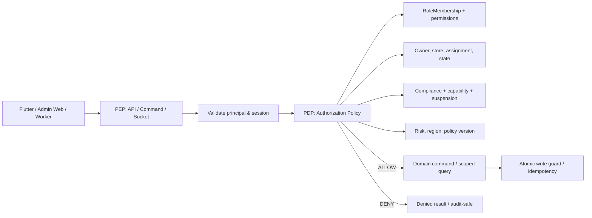
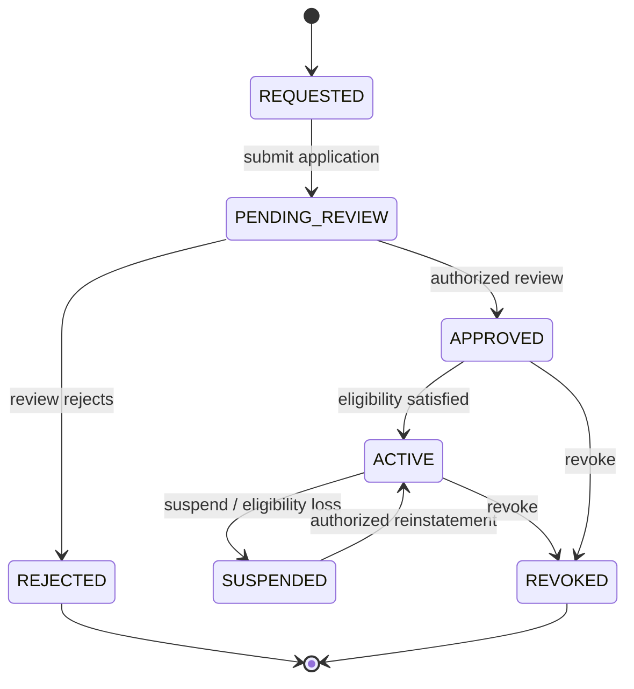
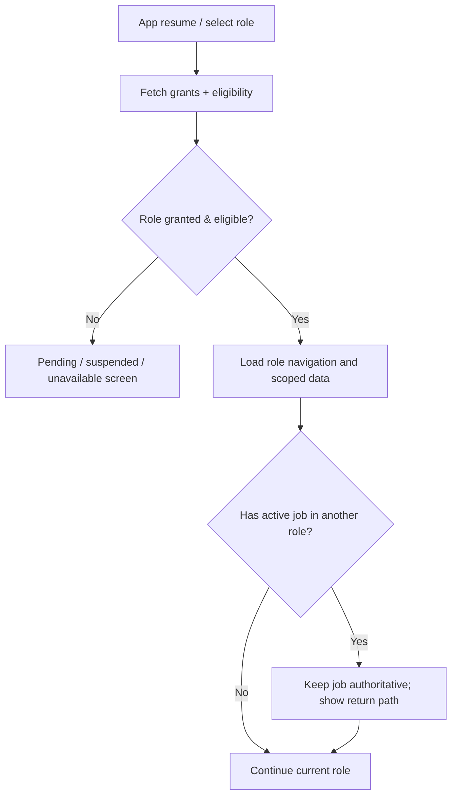

# DealGo — Roles & Permissions / Vai trò, quyền hạn và kiểm soát truy cập

> **DRAFT — hợp đồng authorization đề xuất, không phải policy đã được phê duyệt.** Định hướng được xác nhận: **một ứng dụng Flutter có ba vai trò Customer / Merchant / Driver**, hỗ trợ **Ride hai bánh + Food** và Admin Web. Phân quyền phải bảo đảm `least privilege`, `deny by default`, `server-side authorization`, kiểm soát sở hữu từng đối tượng, thu hồi quyền và truy vết. **Không được suy ra** rằng một tài khoản được kiêm nhiệm mọi vai trò, một tài xế được nhận đồng thời Ride+Food, cửa hàng đã có nhân viên/đa chi nhánh, hoặc admin có thể tự thay đổi mọi thông tin.
>
> **Nguồn thẩm quyền:** `DEC-PROD-001..007` được xác nhận; `FR-*`, ma trận quyền và chính sách chi tiết ở đây là **PROPOSED_P0** hoặc **DESIGN_PROPOSAL**. `OPEN-005`, `OPEN-006`, `OPEN-008`, `OPEN-013` và các vấn đề có liên quan phải được chốt trước khi kích hoạt tác vụ production phụ thuộc chúng. Các hành động có tác động tiền thật, KYC thật hoặc thông tin cực nhạy cảm phải **fail closed** khi thiếu policy.

## 1. Mục đích và phạm vi

1. Xác định **actor, principal, role, membership, permission, capability, eligibility, scope, ownership, relationship** và ranh giới của chúng.
2. Chuẩn hóa **authorization decision** cho HTTP, background jobs, realtime, file/download, push/deep link, Admin Web và thao tác trên dữ liệu.
3. Cung cấp ma trận chức năng `actor × action × resource × điều kiện`, tránh kiểm tra mỗi enum role rồi cho qua.
4. Ngăn các lỗi **BOLA/IDOR, BFLA, BOPLA/mass assignment, confused deputy, privilege escalation, cross-tenant data leak**.
5. Quy định vòng đời cấp/thu hồi quyền, merchant staff, partner onboarding, suspend, role switching, active jobs và audit.
6. Đưa ra **negative test matrix** và traceability để Backend, Flutter, Admin, QA, AI Agent cùng dùng.

**Không thuộc file này:** chọn hãng xác thực, OTP/KYC provider, chứng từ KYC bắt buộc, số nhân viên/cửa hàng, giá/phí/thu hộ, thời hạn lưu GPS hoặc thuật toán điều phối. Chúng thuộc `OPEN-*` và docs chuyên trách. Ví dụ enum, API, TypeScript bên dưới chỉ mang tính **contract minh họa**; không tự khóa tên DB hay stack.

## 2. Nguồn chuẩn và trạng thái quyết định

| Nội dung | Hiện trạng | Tác động đến thiết kế |
|---|---|---|
| Một Flutter app / Customer, Merchant, Driver | `DEC-PROD-002: CONFIRMED` | Một danh tính có thể nhận nhiều grant nhưng quyền không được tự hợp nhất. |
| Ride hai bánh và Food cùng MVP | `DEC-PROD-001: CONFIRMED` | Rights theo service; driver được quyền service nào phải được xác minh riêng. |
| Kiêm nhiệm role, giới hạn job đồng thời | `OPEN-005` | Thiết kế policy hook/config; không bật concurrency chưa được phê duyệt. |
| Mô hình pháp lý, điều kiện đối tác | `OPEN-006` | Không tự kích hoạt role Driver/Merchant cho hoạt động thương mại thật. |
| OTP/KYC/KYB và nhà cung cấp | `OPEN-008` | Identity adapter, compliance status dùng mock/test đến khi được duyệt. |
| Nhân viên cửa hàng, đa cửa hàng | `OPEN-013` | Store-scoped grant sẵn sàng mở rộng; không coi staff/multi-store là P0 đã chốt. |
| Proof giao/nhận | `OPEN-011` | Không cho driver/merchant tự giả trạng thái hoàn thành thiếu evidence. |
| Vị trí nền, lưu/hiển thị location | `OPEN-012` | Location permission gắn active relationship và privacy policy. |
| Kênh liên lạc | `DEC-PROD-007`; chi tiết `OPEN-014/021` | Chat/voice trong app theo transaction, không lộ số; no-recording baseline. |
| Hỗ trợ khẩn cấp và escalation | `OPEN-015` | Chỉ thiết kế role+case permissions; chưa chốt on-call SLA. |
| Bồi hoàn sau khi món đã làm | `OPEN-016` | Không grant quyền tự refund/bồi thường khi policy chưa chốt. |
| Driver COD, đối soát | `OPEN-018` | Tách quyền đọc earnings khỏi quyền điều chỉnh tiền. |

**Quy tắc quan trọng:** `role switch` là UI navigation context, **không tạo RoleMembership mới**; `eligible` là điều kiện động, không phải `role` vĩnh viễn. Một quyết định có trạng thái `OPEN` không được code thành production flag = true.

## 3. Ubiquitous Language và phân biệt khái niệm

| Khái niệm | Định nghĩa | Không được dùng thay cho |
|---|---|---|
| `Account` | Danh tính người dùng được xác thực. | Quyền kinh doanh/lái xe. |
| `Principal` | Actor ở một request/event sau xác thực: user, service hoặc webhook. | Trường `userId` gửi từ client. |
| `Role` | Nhóm trách nhiệm (Customer, Merchant, Driver, admin roles). | Quyền đọc mọi dữ liệu của loại vai trò đó. |
| `RoleMembership` / `RoleGrant` | Quyền thuộc một role trong một phạm vi, có trạng thái và nguồn cấp. | `activeRole` của Flutter. |
| `Permission` | Khả năng thực hiện action trên resource. | Menu/button visible. |
| `Resource` | Đối tượng được đọc/sửa: order, trip, store, case, payout, file. | Một endpoint toàn cục. |
| `Scope` | Giới hạn quyền: `SELF`, `STORE`, `ASSIGNMENT`, `REGION`, `ORG`, ... | Tenant sở hữu bởi tên hiển thị. |
| `Relationship` | Quan hệ được backend kiểm chứng giữa principal và resource. | ID client khai báo. |
| `Eligibility` | Điều kiện có hiệu lực để thực hiện hành vi theo role và service. | Role được cấp trước đây nhưng đã suspended. |
| `ActiveRole` | Ngữ cảnh hiển thị/chuyển tab UI trong phiên. | Server authorization source. |
| `Capability` | Dịch vụ đủ điều kiện cung cấp: `RIDE_2W`, `FOOD_DELIVERY`. | Tự động được làm mọi loại công việc. |
| `Policy` | Quy tắc evaluate quyền theo role, scope, object, state, context. | Kiểm tra `role === 'ADMIN'` tại controller. |
| `PEP` | Điểm cưỡng chế bảo vệ action/resource. | Chỉ middleware xác thực. |
| `PDP` | Hàm/thành phần quyết định ALLOW hoặc DENY có lý do. | Cấu hình UI. |
| `PIP` | Thành phần cung cấp facts dùng để quyết định: memberships, resource state. | Payload tùy ý của client. |
| `PAP` | Điểm quản trị policy có quyền, phiên bản, review. | Cập nhật thẳng production DB không audit. |
| `Delegation` | Cấp quyền giới hạn có thời hạn và phạm vi cho chủ thể khác. | Chia sẻ mật khẩu/token. |
| `Break-glass` | Truy cập khẩn cấp được giám sát, cấp có điều kiện. | Admin bypass tự do (chưa được duyệt). |

### 3.1. Phân biệt Role – Permission – Data Scope – Object State

```
ALLOW = authenticated
    AND principal not blocked
    AND requested permission granted in scope
    AND applicable eligibility satisfied
    AND object relationship / ownership satisfied
    AND object state allows this action
    AND environmental constraints satisfied
    AND any required step-up/approval satisfied
```

Công thức trên là mô tả logic; triển khai phải **quy định thứ tự kiểm tra, nguồn dữ liệu và TOCTOU** để tránh quyền được kiểm tra lúc đọc rồi bị thu hồi trước khi ghi.

## 4. Nguyên tắc authorization bắt buộc cho giải pháp đề xuất

| ID | Nguyên tắc | Yêu cầu kiểm chứng |
|---|---|---|
| `AUTH-POL-001` | **Deny by default**; thiếu policy hoặc thông tin quyết định -> deny. | Action mới chưa được khai báo không được ALLOW ngầm. |
| `AUTH-POL-002` | Backend là **Policy Enforcement Point** chính. | Sửa Flutter, header, route, deep link không vượt được authz. |
| `AUTH-POL-003` | Xác thực không đồng nghĩa cấp quyền. | Token hợp lệ của user A không đọc được order B. |
| `AUTH-POL-004` | Authorization có đủ **action + object + scope + state + eligibility**. | Thử thay `orderId`, `storeId`, `driverId`, `regionId`. |
| `AUTH-POL-005` | **Least privilege**, không dùng root/admin mặc định cho tác vụ thông thường. | Role ít quyền không dùng được admin API. |
| `AUTH-POL-006` | Tối thiểu hóa dữ liệu trả về theo **field-level/relationship/time window**. | Response không chứa KYC, phone, GPS ngoài nhu cầu. |
| `AUTH-POL-007` | Danh sách, thống kê, export, realtime cũng phải lọc quyền. | Không truy xuất cross-store qua list/search/CSV/socket. |
| `AUTH-POL-008` | Cấp/thu hồi quyền có actor, reason, scope, timestamp, version và audit. | Chặn self-grant, replay và quyền cũ sau thu hồi. |
| `AUTH-POL-009` | Quyền phải được kiểm lại khi **side effect commit** với nhánh nhạy cảm. | Token cũ hoặc membership vừa bị revoke không commit. |
| `AUTH-POL-010` | Service/workers/webhook không mượn privilege của admin. | Service token có audience/operation riêng. |
| `AUTH-POL-011` | Client cache chỉ là UX; server là nguồn quyền cuối. | Logout/role revoked -> UI đồng bộ, server deny ngay theo policy. |
| `AUTH-POL-012` | Không đổi ownership bằng cách PATCH `ownerId`, `storeId`, `assignedDriverId`. | Mass assignment từ payload bị từ chối hoặc bỏ qua có audit. |
| `AUTH-POL-013` | Định danh và mối quan hệ **không tin từ client** nếu chưa xác minh. | `X-Role`, `X-Store-Id` không tự tạo quyền. |
| `AUTH-POL-014` | Không dựa vào tính khó đoán của UUID như cơ chế authorization. | Random UUID khác chủ vẫn DENY. |
| `AUTH-POL-015` | Nhánh quyền khẩn cấp, financial override, grant escalation phải có approval/guard độc lập. | Không dùng cờ `isSuperAdmin` để bỏ hết policy. |

**Áp dụng mọi layer:** HTTP request, WebSocket subscription, job consumer, cron, event replay, file object download, analytics projection, admin action, support lookup, background location, push payload, deep link resolution.

## 5. Đề xuất mô hình RBAC + ABAC + Relationship-Based Checks

- **RBAC:** principal có role grant nào với scope gì? Phù hợp menu và tập quyền ban đầu.
- **ABAC:** trạng thái hồ sơ, loại dịch vụ, object status, working hours, geographic scope, suspended status, verified context, time-limited access.
- **Relationship checks (ReBAC-style):** khách sở hữu trip/order; driver đang được assignment; merchant staff thuộc đúng store; support staff được phân case theo policy.
- **Transaction guard:** cùng lúc check resource version / authority, atomic update khi quyền gắn với trạng thái biến động.

Không bắt buộc xây general-purpose policy engine, OPA, Casbin, Zanzibar, microservices hay quyền động do end-user thiết kế ngay MVP. Với ít role và policy chưa quá phức tạp, có thể bắt đầu từ **Policy Service tập trung trong modular monolith**; ADR đánh giá nếu quy mô sau này cần engine riêng.



### 5.1. Policy precedence

1. Authentication invalid/expired/revoked → `UNAUTHENTICATED`.
2. Global account ban, lock or session revoked → `DENY` (trừ safe account recovery support theo policy).
3. Role membership không tồn tại/suspended/expired → `DENY`.
4. Scope mismatch / object mismatch / state invalid → `DENY`.
5. Eligibility, capability, risk, step-up, approval thiếu → `DENY`.
6. Nếu tất cả guard đều đạt, cho phép **đúng action và field projection**; không cho quyền phát sinh ngoài action.

Nếu cần thực hiện hành động hỗ trợ đang có active job sau suspend, phải có quy tắc safety-in-flight trong `OPEN-005/006/015`; **không tự biến suspend thành hủy chuyến/giao hàng tự động**.

> **Đã triển khai trong code (2026-10-18):** grant `SUSPENDED` không thể tự mở lại qua `POST /v1/me/role-grants` (403 `ROLE_GRANT_SUSPENDED`); chỉ ops đổi trạng thái grant. Đăng ký/verify phone lần đầu cấp `CUSTOMER` `ACTIVE`; `requestRole` CUSTOMER ở production vẫn `PENDING`.

## 6. Actor và vai trò nghiệp vụ

| Principal/role | Kênh | Quyền cốt lõi | Giới hạn |
|---|---|---|---|
| `CUSTOMER` | Flutter | Quản lý hồ sơ, đặt Ride/Food, theo dõi giao dịch của chính mình, mở case | Không quản lý dữ liệu khách khác hoặc tự sửa giá/state server. |
| `MERCHANT_OWNER` (đề xuất) | Flutter Merchant | Tạo/cấu hình store thuộc quyền, menu, xử lý order, phân quyền staff theo policy | Không thao tác store khác, không quyết định driver assignment/payment. |
| `MERCHANT_MANAGER` (ứng viên) | Flutter Merchant | Vận hành store được gán và nhân viên khi có grant | Không sở hữu store ngoài membership; `OPEN-013`. |
| `MERCHANT_STAFF` (ứng viên) | Flutter Merchant | Xem/xử lý đơn, menu giới hạn theo nhiệm vụ và store | Không tự điều chỉnh tiền/cấp owner. `OPEN-013`. |
| `DRIVER` | Flutter Driver | Quản lý availability, xem/accept offer, thực thi assignment hợp lệ, xem earnings của mình | Chỉ service đủ eligibility; không tự chuyển trip người khác. |
| `OPS_SUPPORT` (ứng viên) | Admin Web | Xem case và dữ liệu tối thiểu để giải quyết vấn đề | Không tự refund/payout/approve KYC khi thiếu grant. |
| `OPS_DISPATCHER` (ứng viên) | Admin Web | Xem jobs vùng được gán, can thiệp theo runbook | Không tùy ý đổi kết quả tài chính. |
| `PARTNER_REVIEWER` (ứng viên) | Admin Web | Duyệt hồ sơ partner đúng vùng/scope | Không tự duyệt hồ sơ do mình tạo khi có SoD policy. |
| `FINANCE_ANALYST` (ứng viên) | Admin Web | Đọc ledger, report và đối soát được gán | Không phê duyệt hoàn tiền hoặc payout mặc định. |
| `FINANCE_APPROVER` (ứng viên) | Admin Web | Phê duyệt giao dịch nhạy cảm đúng ngưỡng/quy trình | Có step-up, hạn mức và dual control `TBD`. |
| `OPS_CONFIG_MANAGER` (ứng viên) | Admin Web | Cấu hình service/region theo scope | Không thay đổi chính sách pricing chưa duyệt. |
| `SECURITY_ADMIN` (ứng viên) | Admin Web | Thu hồi phiên/quyền, tra audit, quản trị security controls | Không tự đọc nội dung case/CCCD vô hạn. |
| `PLATFORM_ADMIN` (ứng viên) | Admin Web | Quản lý gán quyền/thiết lập được ủy quyền | **Không** có bypass mặc định; không auto-access mọi PII/payment. |
| `SYSTEM_WORKER` | Backend | Thực thi một loại job định danh, có operation scope | Không mang token end-user không thời hạn. |
| `PROVIDER_WEBHOOK` | Backend | Nhận event đã kiểm chứng chữ ký và scope integration | Không cấp quyền user/admin hoặc coi webhook là payment success khi chưa verify. |

Các `OPS_*`/merchant staff là **role taxonomy đề xuất**, không chứng minh nhân sự thật đã tồn tại. Có thể hợp nhất role theo staffing thực tế khi ADR/decision approved, nhưng vẫn giữ ma trận hành động tối thiểu.

### 6.1. Ba role trong một Flutter app ≠ ba identity stores

Một `Account` được phép có zero/multiple `RoleMembership` theo chính sách, mỗi membership có `scope`, `status`, `effectiveFrom/Until`, `issuedBy` và `revokedBy`. `activeRole` là role người dùng đang chọn để hiển thị UI; backend **không hợp nhất mọi quyền** của account thành một siêu quyền trên một request.

### 6.2. Admin Web là trust boundary riêng

- Không tự cấp admin vì account đã có Customer/Merchant/Driver role.
- Tách `admin permission sets`, bảo vệ endpoints/cookies/sessions và privileged actions.
- Nếu cùng một Account vừa là merchant vừa là nhân viên nội bộ: công cụ quản trị phải kiểm soát conflict-of-interest, case assignment và audit; chính sách cuối cùng cần phê duyệt.
- Không dựa chỉ vào route `/admin` hoặc FE feature flag để chặn truy cập.

## 7. Permission naming convention và resource catalog

Tên quyền dùng cú pháp minh họa: `<domain>.<resource>.<action>.<scope>`; scope có thể được mang ở grant riêng thay vì một chuỗi permission cố định. **Ví dụ không phải enum database cuối cùng.**

| Resource | Owner / relation authoritative | Scope thông dụng | Nhạy cảm |
|---|---|---|---|
| `Account`, `RoleMembership`, `Session` | Identity | `SELF`, `ACCOUNT`, `ORG` | High |
| `PartnerApplication`, `KycDocument` | Compliance | applicant, reviewer-assigned, role scope | Critical |
| `MerchantStore`, `MenuCatalog` | Merchant | store membership | Medium–High |
| `FoodOrder`, `FoodCart` | Food | buyer, merchant store | High |
| `DeliveryTask`, `FareCounterOffer`, `DispatchOffer`, `AcceptedFareAgreement`, `DriverAssignment` | Dispatch/Food | assigned driver + job | High |
| `RideRequest`, `RideTrip` | Ride | requester, assigned driver | High |
| `PriceQuote` | Pricing | user intent, merchant/service | Medium |
| `PaymentIntent`, `RefundRequest` | Payment | payer, responsible finance scope | Critical |
| `LedgerJournal`, `SettlementBatch`, `Payout` | Finance | payable beneficiary, finance role | Critical |
| `DriverProfile`, `DriverWorkSlot`, `GeoLocation` | Driver/Geo | self, assigned active task | High–Critical |
| `SupportCase`, `AuditEvent` | Trust/Ops | reporter, case assignee, investigation grant | High–Critical |
| `ServiceRegion`, `FeatureConfiguration` | Ops | region/service/operation | High |

**Store scoping:** `storeId` phải gắn với membership đã được server kiểm chứng; `merchantId` và `storeId` không được coi là cùng cấp quyền khi có multi-store. **Region scoping:** vùng dùng cho Ops không thay thế Store/Order ownership.

## 8. Permission matrix — Customer, Ride và Food

**Ký hiệu:** `A` = cho phép nếu thỏa guard; `C` = có điều kiện bổ sung; `D` = mặc định từ chối; `—` = không applicable. `A/C` **không** vượt các điều kiện authentication, relationship, object state và policy đã chốt. Toàn bộ bảng là **PROPOSED**, không phải grant đã được bật production.

| Action / resource | Customer | Merchant | Driver | Ops | Guard và giới hạn dữ liệu |
|---|---|---|---|---|---|
| `account.profile.read` | A | A | A | C | Account chỉ đọc profile của mình; Ops chỉ theo case được phép. |
| `account.profile.update` | A | A | A | C | Profile SELF; trường định danh cần workflow riêng. |
| `role.switch_ui` | A | A | A | — | Chỉ role đã có grant; `activeRole` không cấp quyền. |
| `partner.application.submit` | C | C | C | D | Applicant là SELF, loại role hợp lệ; chưa cho hoạt động thật. |
| `ride.reference_fare.request` | A | C | C | D | Actor ở Customer context; serviceability/route valid. |
| `ride.request.create` | A | C | C | D | Principal đặt cho bản thân/đại diện được ủy quyền; `OPEN-005`. |
| `ride.request.read` | A | D | C | C | Customer là requester; Driver chỉ offer/assignment được phép; Ops case/scope. |
| `ride.request.cancel` | C | D | D | C | Requester + state + cancel policy; Ops intervention theo quyền và reason. |
| `ride.fare_negotiation.read/respond` | C | D | C | C | Customer owns request; Driver may respond only to its valid offer; Ops scoped. |
| `ride.fare_offer.select` | A | D | D | C | Only owning Customer selects valid offer; atomic single winner. |
| `ride.trip.read` | A | D | C | C | Requester/assigned driver; lọc location, contact và trạng thái. |
| `ride.trip.start_finish` | D | D | C | C | Driver **được assignment** + eligibility + transition + proof `OPEN-017`. |
| `food.store.list_public` | A | A | A | A | Chỉ store public/eligible; không trả dữ liệu nội bộ. |
| `food.menu.read_public` | A | A | A | A | Chỉ món được publish, trong phạm vi phục vụ. |
| `food.cart.write` | A | C | C | D | Buyer = principal customer context; store/cart policy `OPEN-009`. |
| `food.order.create` | A | C | C | D | Self + checkout quote valid + server computed prices. |
| `food.order.read` | A | C | C | C | Buyer/self; đúng merchant store; assigned driver chỉ logistics fields; Ops scoped. |
| `food.order.cancel` | C | C | D | C | Policy by stage; merchant reject/cancel khác customer cancel. |
| `food.order.merchant_accept` | D | C | D | C | Merchant thuộc đúng store; store eligible; state valid; Ops exception only. |
| `food.order.mark_ready` | D | C | D | C | Merchant đúng store, order accepted/preparing và state transition hợp lệ. |
| `delivery.task.read` | C | C | C | C | Chỉ related order, store, assignment hoặc Ops investigation. |
| `delivery.task.pickup_complete` | D | D | C | C | Assigned driver, đúng order/merchant, proof policy `OPEN-011`. |
| `delivery.task.deliver_complete` | D | D | C | C | Assigned driver, completion proof, state/order consistency. |
| `support.case.create` | A | A | A | A | Reporter liên quan object; không arbitrary report mọi user. |
| `support.case.read` | C | C | C | C | Reporter chỉ xem case của mình; Ops theo case assignment/scope. |
| `communication.conversation.read` | C | C | C | C | Chỉ transaction participant; nội dung theo field/retention policy. |
| `communication.message.send` | C | C | C | D | Chỉ participant còn trong contact window; chống spam/block state. |
| `communication.call.start_join` | C | C | C | D | Participant đủ điều kiện; call token ngắn hạn; app không nhận phone number thô. |

**Lưu ý role kiêm nhiệm:** hàng `C` ở Merchant/Driver cho action Customer chỉ có nghĩa một người **có thể** dùng ngữ cảnh Customer khi có grant thích hợp; không có nghĩa Merchant role tự sở hữu quyền Customer. Policy cụ thể nằm ở `OPEN-005`.

### 8.1. Object relationship rules — Ride

- `RideRequest.requesterAccountId` thuộc principal Customer hoặc quan hệ đại diện **được hệ thống chấp thuận** (chưa thuộc P0).
- `RideTrip` chỉ driver được assignment active/allowed historical view mới có quyền truy cập phù hợp.
- Driver được gửi offer **chỉ thấy dữ liệu cần quyết định**; nhận offer chưa đồng nghĩa có quyền xem dữ liệu đầy đủ của chuyến đi.
- Khi reassignment/revoke, driver cũ bị mất live location/subscription, chỉ giữ dữ liệu lịch sử tối thiểu nếu có retention/policy đã duyệt.
- Kết thúc chuyến không tự mở quyền tra cứu vị trí lịch sử vô hạn.

### 8.2. Object relationship rules — Food

- Customer sở hữu `FoodOrder.customerAccountId`, không sở hữu `MerchantStore` hoặc `DeliveryTask` ở mức ghi.
- Merchant được phép đọc order nếu `FoodOrder.storeId` thuộc `RoleMembership.scope` đang valid, **không phải chỉ cùng merchant chain name**.
- Driver chỉ biết pickup/dropoff và thông tin liên hệ cần thiết **sau** assignment chính thức; trước assignment chỉ được thấy offer projection tối thiểu.
- `FoodOrder.merchantAccepted` không cấp quyền cho Merchant thay Driver đánh dấu `DeliveryTask.delivered`.
- Tình huống đổi store/order do data corruption phải fail closed, ghi anomaly; không dùng các ID gửi từ client để tự vá quan hệ.

## 9. Permission matrix — Merchant và Driver

| Action | Merchant owner | Manager* | Staff* | Driver | Ops | Điều kiện authorization |
|---|---|---|---|---|---|---|
| `store.dashboard.read` | C | C | C | D | C | Store grant và field projection phù hợp. |
| `store.profile.write` | C | C | D | D | C | Store thuộc grant, trường nhạy cảm và review riêng. |
| `store.open_close` | C | C | C | D | C | Không override eligibility/region restrictions. |
| `store.menu.create_update` | C | C | C | D | D | Store scope, permission thực tế; versioning menu. |
| `store.menu.publish` | C | C | D | D | C | Tách publish khỏi draft nếu workflow phê duyệt. |
| `store.order.accept_reject` | C | C | C | D | C | Đúng store, đúng state, reason khi reject. |
| `store.order.prepare_ready` | C | C | C | D | C | Không tự delivery complete, không mutate history. |
| `store.staff.invite` | C | C | D | D | C | `OPEN-013`; giới hạn grant mà inviter sở hữu. |
| `store.staff.grant_revoke` | C | C | D | D | C | Không grant vượt quyền hoặc tự tạo Owner; audit. |
| `store.finance.read` | C | C | D | D | C | Chỉ khoản của đúng store, tách PII/finance fields. |
| `driver.availability.set` | D | D | D | C | C | Driver đủ service capability, status, capacity. |
| `driver.offer.list` | D | D | D | C | C | Offer phải được phát hành cho đúng Driver. |
| `driver.offer.accept` | D | D | D | C | C | Not expired/revoked; concurrency atomic; `OPEN-005`. |
| `driver.assignment.read` | D | D | D | C | C | Assignment của Driver; không quyền job của đồng nghiệp. |
| `driver.assignment.progress` | D | D | D | C | C | Assigned, transition valid, required proof, in-flight policy. |
| `driver.earnings.read_self` | D | D | D | C | C | Driver SELF; estimate khác payout. |
| `driver.profile.manage_self` | D | D | D | C | C | Những thay đổi tác động eligibility phải review. |

`*`: Manager/Staff là thiết kế ứng viên, chưa quyết định ra mắt. Mức `C` không phải quyền được cấp sẵn; triển khai phải dựa vào **tập permissions đã phê duyệt** tại `OPEN-013`.

### 9.1. Role matrix cho onboarding và trạng thái eligibility

| Role service | Có role grant | Hồ sơ partner | Capability | Cho hoạt động thương mại? |
|---|---|---|---|---|
| Customer | Có/được đăng ký theo auth policy | Không áp dụng với thao tác tiêu dùng cơ bản | Không áp dụng | Theo account/session và vùng/chính sách. |
| Merchant | Có | Pending / rejected | Store không eligible | **Không** cho nhận order thật. |
| Merchant | Có | Approved | Store eligible và active | Có, chỉ trong scope được duyệt. |
| Driver | Có | Pending / expired / suspended | Ride hoặc Food không eligible | **Không** online/accept job mới. |
| Driver | Có | Approved | `RIDE_2W` eligible | Chỉ Ride nếu policy release cho phép. |
| Driver | Có | Approved | `FOOD_DELIVERY` eligible | Chỉ Food nếu policy release cho phép. |
| Driver | Có | Approved | Cả hai eligible | Quyền **được xem offer** phụ thuộc active job/capacity `OPEN-005`. |

Trạng thái và tài liệu xét duyệt chính xác thuộc `identity-kyc-kyb.md` + `OPEN-006/008`; ví dụ ở đây không xác nhận loại giấy tờ pháp lý nào là đủ.

## 10. Permission matrix — Admin Web / Operations / Finance

| Permission / hành vi | Support | Dispatcher | Partner Reviewer | Finance Analyst | Finance Approver | Config Manager | Security Admin |
|---|---|---|---|---|---|---|---|
| `ops.case.read_assigned` | C | C | D | D | D | D | C |
| `ops.case.comment_update` | C | C | D | D | D | D | C |
| `ops.trip_order.read_scoped` | C | C | C | C | C | C | C |
| `ops.dispatch.observe` | C | C | D | D | D | D | C |
| `ops.dispatch.intervene` | D | C | D | D | D | D | C |
| `ops.partner_application.review` | D | D | C | D | D | D | C |
| `ops.partner_application.approve` | D | D | C | D | D | D | C |
| `finance.ledger.read_scoped` | D | D | D | C | C | D | C |
| `finance.reconcile.prepare` | D | D | D | C | C | D | D |
| `finance.refund.propose` | C | D | D | C | C | D | D |
| `finance.refund.approve` | D | D | D | D | C | D | D |
| `finance.payout.approve` | D | D | D | D | C | D | D |
| `ops.region.service_config.update` | D | D | D | D | D | C | C |
| `security.session.revoke` | D | D | D | D | D | D | C |
| `security.auth_method.policy.manage` | D | D | D | D | D | C | C | Global/environment policy; step-up, reason, blast-radius preview; dual control when configured. |
| `security.auth_method.account.manage` | D | D | D | D | D | D | C | Per-account method revoke/disable with case, reason, recovery guard, notification, audit. |
| `security.communication.content.read_case` | D | D | D | D | D | D | C | Exceptional case-scoped content access only; no standing inbox/audio access. |
| `security.role_grant.manage` | D | D | D | D | D | D | C |
| `security.audit.read_scoped` | D | D | D | C | C | D | C |
| `security.kyc_document.read_restricted` | D | D | C | D | D | D | C |
| `ops.emergency.stop_new_admission` | D | C | D | D | D | C | C |

**Không nên suy ra** các ô `C` cho Security Admin/Config Manager là quyền thực tế. Mọi action `C` yêu cầu role grant, region, case/store linkage, approval workflow, reason, step-up và chính sách SoD khi rủi ro cao. Không có một `superAdmin = true` được phép đi tắt tất cả guard.

### 10.1. Phân quyền tài chính và Separation of Duties (SoD)

- `refund.propose`, `refund.approve`, `refund.execute`, `refund.reconcile` là bốn chức năng khác nhau. Không gộp thành `finance:write`.
- `payout.prepare`, `payout.approve`, `payout.execute`, `payout.reconcile` phải có control chống thanh toán lặp và phân biệt người tạo/người phê duyệt khi policy yêu cầu.
- `KYC.review` và `KYC.approve` nên tách cấp quyền nếu có nguy cơ tự duyệt; cách phê duyệt thực tế còn tùy quy mô và đánh giá rủi ro.
- Hạn mức, two-person approval, re-auth, điều kiện giả mạo, emergency exception là `TBD`; **không tự đặt một ngưỡng VNĐ**.
- Nếu một người thực tế kiêm hai chức năng ở tổ chức một người, hệ thống vẫn lưu được **ai đề xuất, ai phê duyệt, vì sao và bằng chứng bù trừ**; không giả vờ có người phê duyệt thứ hai.

### 10.2. Quản trị theo vùng / cửa hàng / case

- Support access là **case-scoped + field-scoped**, không phải truy vấn được cả cơ sở dữ liệu.
- Dispatcher access là **region/service/job-scoped**; quyền xem booking không mặc nhiên quyền thay driver hay thực thi payment.
- Partner reviewer truy cập hồ sơ theo phân công/phạm vi; giấy tờ tùy thân cần audit riêng và chỉ cấp URL đọc thời gian ngắn khi được phép.
- Export/CSV/dashboard aggregation cũng phải tôn trọng region/store/case scope và masking.

## 11. Luồng cấp, sửa, thu hồi quyền (RoleGrant Lifecycle)



Sơ đồ là **logical lifecycle** của quyền/eligibility, không phải một enum DB duy nhất. `RoleMembership.status`, `PartnerApplication.status`, `ServiceCapability.status`, `Account.status` là những nguồn trạng thái khác nhau. Chúng có thể không biến đổi đồng thời; PDP phải đọc hoặc nhận projection đủ mới theo mức rủi ro.

### 11.1. Grant contract tối thiểu

| Field | Ý nghĩa | Cách bảo vệ |
|---|---|---|
| `subjectAccountId` | Tài khoản nhận grant | Lấy từ account registry, không tin payload không xác minh. |
| `roleKey` | Role trong catalog approved | Chỉ gán role thực sự tồn tại. |
| `scopeType / scopeId` | Store/region/org/service | Validate quan hệ và quyền của người cấp. |
| `permissions / roleTemplateVersion` | Permission set có version | Không trộn version cũ vào policy mới âm thầm. |
| `status`, `effectiveAt`, `expiresAt` | Thời hạn hiệu lực | Kiểm chứng từ thời gian tin cậy của server. |
| `createdBy`, `approvedBy`, `revokedBy`, `reason` | Bằng chứng hành động | Append-only audit / SoD. |
| `authorizationVersion` | Phiên bản áp dụng cache/revocation | Tham gia invalidation. |

### 11.2. Grant và revoke phải là domain commands

- `RequestRoleGrant`, `ApproveRoleGrant`, `RejectRoleGrant`, `SuspendRoleGrant`, `ReinstateRoleGrant`, `RevokeRoleGrant`, `AssignStoreStaff`, `RemoveStoreStaff`.
- Ghi command idempotency key, actor, reason, target, before/after, policy version.
- Thất bại phải rollback transaction; không phát event `RoleGranted` nếu database chưa commit.
- Sau commit, thông báo invalidation/session sync đến consumer; retry event an toàn, không double-grant.
- Không cho actor `grant` quyền mạnh hơn quyền mình đang có, trừ quy trình delegation từ authority thực sự đã được phê duyệt.

### 11.3. Role switch / logout / session concurrent

- Flutter chọn role không làm thay đổi memberships và không xóa state của tác vụ đang chạy.
- Khi đổi role, router chỉ hiển thị feature hợp lệ; tác vụ cùng role khác vẫn được backend theo dõi. Khả năng thao tác tiếp job qua màn hình nào cần UX quyết định.
- Nếu yêu cầu đi vào endpoint role khác, **không chỉ dùng activeRole để quyết định**: xác minh granted role + explicit context + target resource và capacity policy.
- Role bị suspended giữa lúc mở app: backend deny action mới, client refresh quyền và hiển thị lý do/hỗ trợ phù hợp; in-flight assignment theo runbook chưa chốt.
- Log out một thiết bị / tất cả thiết bị, token lifetime, offline session policy thuộc `authentication-and-authorization.md` và `OPEN-008`.

## 12. Authorization data projection và field-level policy

| Resource / stage | Customer | Merchant | Driver | Ops |
|---|---|---|---|---|
| Driver offer trước accept | — | — | Job type, pickup area, estimated task data theo policy | Dispatch status |
| Ride đã assignment | Pickup/destination + driver identity cần thiết | — | Customer contact/route tối thiểu theo policy | Case-scoped |
| Food đã checkout, chưa gán driver | Order/món/giá/tracking | Đơn đúng store và thông tin cần chế biến | — | Case-scoped |
| Food đã gán driver | Order status, ETA, masked contact | Trạng thái đến lấy món | Địa chỉ nhận/giao, items/handoff tối thiểu | Case-scoped |
| Hoàn thành/đã hủy | Lịch sử own, masked evidence | Lịch sử own-store, limited fields | Lịch sử own assignment, limited fields | Theo case/retention |
| KYC images | Hồ sơ tự quản lý qua quyền được phép | Không xem giấy tờ driver | Hồ sơ của mình qua flow riêng | Reviewer đặc thù, audited access |
| GPS live | Chỉ active relevant trip/delivery | Chỉ location ETA/approach nếu policy cần | Vị trí mình & hướng dẫn active task | Incident/dispatch scoped |
| Ledger/refund detail | Khoản của mình, không lộ ledger nội bộ | Payable của store | Earnings/payout của mình | Finance scoped + approval |

**Dữ liệu cá nhân nhạy cảm:** mặc định không trả số CCCD, toàn bộ ảnh KYC, tọa độ lịch sử, địa chỉ khác, số điện thoại thật, token provider hoặc payment secrets trong JSON model chung. Tạo DTO/response projection theo actor và stage; không `SELECT *` rồi gửi tất cả field.

### 12.1. ABAC theo thời điểm

Quyền xem live location, số liên hệ, mã OTP giao nhận, file evidence, tài liệu KYC phải ràng buộc **quan hệ đang hiệu lực + thời điểm/chính sách**. Không dùng một quyền `order.read` để mở mọi trường nhạy cảm vô hạn. Thời gian giữ quyền, TTL signed URL và retention là **TBD** cần quyết định hợp lệ.

## 13. Kiểm soát các entry points và attack surfaces

| Entry point | Chỗ cần enforce | Anti-pattern bị cấm |
|---|---|---|
| HTTP REST/GraphQL | Route guard + service/object policy + repository query scope | Chỉ `@Roles('DRIVER')` rồi query bằng bất kỳ `id`. |
| Admin Web API | Permission/action & field scope + privileged step-up | `isAdmin` cấp toàn quyền trên tất cả tenant. |
| WebSocket/SSE | Authenticate handshake và authorize room/subscription, event và state changes | Join room `order:{id}` chỉ nhờ biết id. |
| Push + deep links | Không chứa PII; khi mở re-fetch and authorize | Push URL chứa số điện thoại / token / chi tiết đơn. |
| Storage/file/CDN | Backend-issued access scoped to actor + object + expiry | Public bucket ảnh CCCD/giấy phép, client tự dựng URL. |
| Background jobs/cron | Service principal, job type permission, trace | Job thực thi dưới quyền admin chung vô hạn. |
| Webhook | Signature/origin/timestamp + integration resource scope + idempotency | Trust `status=PAID` từ request client. |
| Search/export/aggregation | Tenant, owner, region filters tại data query | Chỉ phân quyền trang export, không phân quyền dữ liệu. |
| Internal service/event | Signed or trusted producer identity, event version, trust boundary | Nhận event chưa xác minh làm mutation tài chính. |
| Flutter local cache | Clear/mask on role switch/logout; auth guard re-fetch | Cache đơn Merchant hiển thị ở Customer role. |

### 13.1. Chống BOLA / IDOR trên mọi resource ID

Với endpoint dạng `GET /orders/{id}`, phân quyền cần xác minh **resource thực**, ví dụ: principal sở hữu `order.customerAccountId` **hoặc** là merchant có membership đúng `order.storeId` **hoặc** có assignment hợp lệ đúng order **hoặc** ops grant scoped. Không được chấp nhận vì `X-Store-Id` hoặc `userId` từ body trùng request.

Đối với list/query, phải thêm các điều kiện `WHERE` tương ứng khi truy vấn hoặc đảm bảo filtering trước khi trả dữ liệu, không paginate toàn bảng rồi lọc phía client. Đối với mutation, check **đúng object và version trong transaction** để tránh time-of-check/time-of-use.

### 13.2. Định dạng từ chối và chống enumeration

- `401` cho chưa xác thực hoặc phiên không còn hợp lệ.
- `403` cho actor đã xác thực nhưng không có permission đối với action **khi không làm lộ sự tồn tại của object**.
- `404` có thể dùng cho object không tồn tại hoặc không được phép biết rằng object tồn tại, theo policy endpoint nhất quán; không được để response time/message reveal object existence.
- `409` cho xung đột state/version; `422` khi dữ liệu đầu vào hợp lệ về cú pháp nhưng trái quy tắc nghiệp vụ.
- Dùng mã lỗi machine-readable như `AUTHZ_DENIED`, `ROLE_NOT_ELIGIBLE`, `RESOURCE_SCOPE_MISMATCH`, `ACTION_NOT_ALLOWED_IN_STATE`, `REAUTH_REQUIRED`, nhưng tránh tiết lộ chi tiết nhạy cảm cho client.
- Thực tế mã và JSON schema cần thống nhất theo `rest-api.openapi.yaml`/RFC 9457; ví dụ trên là đề xuất, không áp đặt backend behavior đã chốt.

## 14. Transactional authorization và concurrency

**Tình huống 1: hai tài xế nhận cùng offer/job.** PDP kiểm tra `DRIVER` grant, capability, offer còn hiệu lực, đúng người nhận; Dispatch thực hiện **một atomic transition thắng** trên DispatchJob/DriverWorkSlot theo invariant `BR-DISPATCH-001/002`. Quyền hợp lệ không thay thế được transaction lock.

**Tình huống 2: tài xế bị suspend ngay lúc accept.** Eligibility được kiểm tại commit hoặc qua concurrency-safe version/guard; chặn assignment mới nếu suspension đã có hiệu lực. Event đến trễ không được mở lại quyền.

**Tình huống 3: merchant staff bị thu hồi quyền khi đang sửa menu.** Request ghi phải được bảo vệ khi mutation commit; không cho overwrite menu sau revoke. Draft local có thể giữ không đồng bộ an toàn, không tự publish.

**Tình huống 4: admin phê duyệt refund trong khi policy/amount/order state thay đổi.** Approve phải xác minh target, amount, grant, role scope, approval/SoD, current state và idempotency trong transactional workflow; 200 OK không đồng nghĩa PSP đã hoàn tiền.

**Tình huống 5: hai thiết bị cùng activeRole nhưng một phiên bị thu hồi.** Authorization dựa phiên và role grants phía server; một thiết bị không được tiếp tục commit nhờ cache JWT/quyền cũ vượt chính sách revocation.

### 14.1. Realtime entitlement invalidation

- Room/subscription theo `tripId`, `orderId`, `driverId` phải gắn với principal + quan hệ; server không chấp nhận join chỉ bằng cách biết ID.
- Sau revoke/reassignment/terminal transition, thu hồi hoặc thay đổi quyền subscribe; server ngừng gửi nhạy cảm cho listener cũ.
- Trên reconnect, đánh giá lại membership + object relation; không replay sự kiện nhạy cảm qua room cũ sau khi quyền thay đổi.
- Quy định tối đa stale entitlement, token/cookie lifetime, disconnect behavior và phương án fallback cần security review/NFR phê duyệt trước production.

## 15. Policy Evaluation Contract (minh họa để backend triển khai)

> **Pseudo-code / design example.** Không được copy trực tiếp production khi chưa xác nhận transaction boundaries, grants schema, session invalidation, policy/exception handling và behavior của `OPEN-*`.

```typescript
// Contract minh họa, không phải NestJS implementation đã được duyệt.
type Principal =
  | { kind: 'USER'; accountId: string; sessionId: string }
  | { kind: 'SERVICE'; serviceId: string; audience: string };

type AuthorizationQuery = {
  principal: Principal;
  action: string; // vd: 'food.order.read'
  resource: { type: string; id: string };
  context: { roleContext?: string; requestId: string };
};

type AuthzDecision =
  | { effect: 'ALLOW'; projection: string; policyVersion: string }
  | { effect: 'DENY'; reasonCode: string; policyVersion: string };

async function authorize(q: AuthorizationQuery): Promise<AuthzDecision> {
  const session = await resolveTrustedSession(q.principal);
  if (!session?.active) return deny('SESSION_NOT_ACTIVE');

  const grants = await loadCurrentGrantsFromAuthority(session);
  const resource = await loadAuthoritativeResource(q.resource);
  if (!resource) return deny('RESOURCE_NOT_VISIBLE');

  const policy = getRegisteredPolicy(q.action, q.resource.type);
  if (!policy) return deny('POLICY_NOT_FOUND');

  const facts = await loadTrustedFacts(session, grants, resource);
  if (!policy.permits(facts, q.context)) return deny('AUTHZ_DENIED');

  return allow(policy.fieldProjection(facts), policy.version);
}
```

Không để `roleContext` hay `X-Store-Id` tự nâng thành RoleGrant. Nếu event consumer không có user session (worker), xác minh **service principal + job authorization** riêng.

### 15.1. Ví dụ authorization theo truy vấn và commit

```typescript
// PSEUDOCODE: DB transaction có điều kiện ownership + version.
async function merchantMarkReady(principal, orderId, expectedVersion) {
  return unitOfWork.transaction(async (tx) => {
    const order = await tx.orders.lockById(orderId);
    const currentGrant = await tx.grants.loadForAccount(principal.accountId);
    assertMerchantCanMarkReady(currentGrant, order); // đúng store + state
    assertVersion(order.version, expectedVersion);
    const updated = order.markReady();
    await tx.orders.saveWithVersion(updated, expectedVersion);
    await tx.outbox.append('FoodOrderMarkedReady', updated.id);
    return updated.publicProjectionForMerchant();
  });
}
```

Nếu DB engine không có row lock như ví dụ, triển khai phải chứng minh correctness bằng compare-and-swap, predicate update, constraints hoặc serialization. Không dùng read-check-then-write rời rạc trên đường ghi nhạy cảm.

### 15.2. Field projection và policy response

```json
{
  "decision": "ALLOW",
  "permission": "food.order.read",
  "resource": { "type": "FOOD_ORDER", "id": "order_x" },
  "projection": "DRIVER_ASSIGNED_VIEW",
  "policyVersion": "example-only",
  "correlationId": "request_x"
}
```

JSON trên chỉ minh họa **sự tách biệt quyết định và dữ liệu trả cho actor**, không có tính chất API response contract đã phê duyệt; không gửi nội bộ PDP details/raw policy tới public client.

## 16. Flutter multi-role security & experience contract

### 16.1. Flutter routing và state boundaries

| Trường hợp | UI hành vi đề xuất | Backend phải thực thi |
|---|---|---|
| Login vào account có nhiều role | Chọn role đã cấp hoặc role mặc định được xác nhận | Trả eligible roles/scopes, không tin local role enumeration. |
| Vào Merchant role pending review | Hiển thị tiến độ onboarding | Từ chối create/update commercial actions chưa đủ quyền. |
| Chuyển Driver → Customer khi có active Ride/Delivery | Hiển thị cảnh báo trạng thái job và cách quay lại | Không ngắt job, không xóa assignment và không cấp thêm concurrency. |
| Account suspended/revoked khi app foreground | Refresh grants; hiện màn bị hạn chế | Deny tất cả action mới không được phép. |
| App background rồi resume | Re-fetch current role grants và active tasks | Bảo vệ data/update bằng authoritative state. |
| Deep link mở order không thuộc actor | Hiển thị thông báo không có quyền/không tìm thấy | Object-level authz + response redacted. |
| Push được tap sau reassignment | Đi tới screen rồi refresh entitlement | Không dùng notification payload thay authz. |
| Logout rồi login account khác cùng điện thoại | Xóa/mask cache, reset role navigation | Session of account cũ không còn được dùng theo policy. |

### 16.2. Client storage + cache isolation

- Namespace cache bằng account/session và **role/store context**, không dùng một cache key global `orders` cho ba role.
- Purge/mask PII tạm khi logout, revoke và chuyển sang account khác; không gắn store thông tin cũ vào request sau role switch.
- Flutter local biometrics/pin chỉ là bảo vệ thiết bị/step-up UX, **không** là bằng chứng cấp quyền đối với backend.
- Background location chỉ bật trong ngữ cảnh service & quyền OS thích hợp được duyệt; quyền OS không đồng nghĩa có driver eligibility.
- Không thể dựa vào nút ẩn, disabled widget hoặc guard trong `go_router`/Bloc để thay thế guard backend.
- Hỗ trợ state `loading / permitted / pending / suspended / denied / offline / error`; không trộn `pending` và `approved`.

### 16.3. Ví dụ presentation of role switching (không khóa UI)



**Không quyết định thay `OPEN-005`:** có cho kiêm nhiệm hoạt động hay không; có auto-block role switching hay không; một tài xế được đồng thời Ride/Food hay không. Thiết kế trên cố định duy nhất nguyên tắc **không mất/chỉnh sửa sai active job và không nâng quyền**.

## 17. Authorization cho Merchant staff, multi-store và delegation

Mặc dù `OPEN-013` chưa giải quyết, data model nên **không đặt quyền vào `MerchantOwnerId` duy nhất trong mọi bảng** nếu việc đó buộc thay toàn bộ API khi có nhiều cửa hàng. Candidate model:

```text
Account
  └─ RoleMembership(role=MERCHANT, scope=STORE, scopeId=S1)
       ├─ permission set: menu.manage, orders.accept
       ├─ validity + grant status
       └─ grantor + audit
MerchantStore(S1) ── FoodOrder(storeId=S1)
MerchantStore(S2) ── FoodOrder(storeId=S2)
```

Những thao tác cần đặc biệt bảo vệ: invite nhân viên, thu hồi nhân viên, đổi chủ cửa hàng, đổi ngân hàng nhận payout, truy cập doanh thu theo store, export customer contacts, điều chuyển order và bàn giao cửa hàng.

**Guard delegation đề xuất:** grantor không thể cấp permission ngoài scope của chính mình; không thể tự cấp `OWNER`, `FINANCE_APPROVER`, `SECURITY_ADMIN`; owner transfer qua workflow riêng có step-up, chứng cứ và phê duyệt nếu được đưa vào scope. Cho phép multi-store/staff ở release đầu vẫn là TBD.

## 18. Service-to-service, webhook và automation identity

- **System worker principal** có `serviceId`, credential audience, allowed commands, environment, expiry; **không** là user với `role=ADMIN`.
- Cron reconcile chỉ được thao tác những journal/batch thuộc trách nhiệm; không được tùy tiện approve refund hoặc mutate KYC.
- Webhook PSP phải xác thực signature, provider message identity, source mapping, idempotency và status transition; không phải mọi webhook hợp lệ đều có quyền gọi mọi transaction command.
- Event bus consumers cần policy về **producer trust + schema version + actor provenance**, tránh “internal event” tự động được coi là dữ liệu tuyệt đối đúng.
- AI coding agents, bot vận hành và integration tokens chỉ được sử dụng quyền được cấp rõ và không được tạo grants cho chính mình.
- Secrets không lưu trong source, docs, audit hoặc mobile app bundle; dùng secret management phù hợp ADR.

## 19. Authorization caching, revocation và failure strategy

| Cơ chế | Khuyến nghị | Điều không được chấp nhận |
|---|---|---|
| Short-lived access token | Token hợp lệ về chữ ký chưa đủ, cần quyết định authorization hiện hành | Role bị revoke vẫn tiếp tục tạo giao dịch nhờ token cache. |
| PDP cache | Có thể cache identity/grant với invalidation và bounded staleness | Cache indefinite hoặc không phân biệt account/role/scope/policy version. |
| Database unavailable | Đường đọc public có fallback nếu được duyệt; privileged writes fail closed | Allow-all do không đọc được membership. |
| Reconnect/WebSocket | Reauthenticate/resubscribe; cập nhật quan hệ | Tiếp tục nhận live GPS sau reassignment. |
| Revocation | Ghi sự kiện, tăng authz version, invalidate cache/session theo policy | Thu hồi chỉ ẩn menu, backend tiếp tục accept. |
| Emergency access | Break-glass riêng, narrow scope, reason, approval, post-review | Secret master token không audit hoặc không hết hạn. |

TTL, token rotation, revocation propagation SLO và mức availability là **TBD** phối hợp với `non-functional-requirements.md`, `OPEN-007/008/012`. Không tự gán số phút/giây để rồi nhận là mức bảo mật production đã được duyệt.

## 20. Audit, privacy và incident evidence

Audit record tối thiểu: `correlationId`, actor type, actor ID pseudonymized, session/service identity, action, resource type + ID scoped, decision outcome, reason code, policy version, authenticatedAt, change version, event time, source channel và approver reference nếu có.

- Không ghi raw token, OTP, CCCD đầy đủ, thông tin thẻ, ảnh nhạy cảm hoặc tọa độ lịch sử chi tiết không cần thiết vào log.
- Audit phải **tamper-evident** theo thiết kế khả thi; nếu append-only chưa đủ phải có controls vận hành/retention đã được review.
- Chính sách retention, encryption key ownership, evidence access, quyền xóa/xuất dữ liệu cá nhân phải theo tài liệu privacy/pháp lý đang được xây dựng; không tự chốt.
- Vi phạm quyền quan trọng có thể kích hoạt alert: probing nhiều object ID, access cross-store, revoked-role action, service credential misuse, admin export bất thường; alert threshold thuộc NFR/ops.
- Có procedure điều tra, case assignment và giữ evidence, nhưng không tự bật khả năng xem toàn bộ dữ liệu cho support.

## 21. Negative tests / security acceptance matrix

> `AUTH-TC-*` là **test seeds trong file này**, không giả vờ đã có file test automation. Khi `08-quality/critical-e2e-test-matrix.md` được tạo, dùng mã này để nối fixture và CI job. Mỗi test yêu cầu xác minh **không có side effect trái phép** và (khi phù hợp) audit event.

| Test ID | Attack / case | Kết quả bắt buộc | Trace |
|---|---|---|---|
| `AUTH-TC-001` | Anonymous POST tạo RideRequest | Reject; không tạo request | `FR-CORE-001` |
| `AUTH-TC-002` | Customer A GET FoodOrder B bằng UUID hợp lệ | Deny, không rò object | `FR-CORE-010`, `BR-CORE-003` |
| `AUTH-TC-003` | Customer A sửa `customerAccountId` trong body | Ownership không đổi; reject unexpected field | `FR-CORE-010` |
| `AUTH-TC-004` | Merchant store A GET order store B | Deny; list/export không lộ row | `FR-MER-005`, `FR-CORE-010` |
| `AUTH-TC-005` | Merchant staff tự grant OWNER | Reject; audit attempt | `OPEN-013`, `FR-CORE-015` |
| `AUTH-TC-006` | Merchant chưa approved nhận FoodOrder thật | Deny; không đổi order status | `FR-CORE-003`, `BR-CORE-002` |
| `AUTH-TC-007` | Driver chưa đủ Ride capability bật online Ride | Deny; availability không đổi | `FR-DRV-001/002` |
| `AUTH-TC-008` | Driver X nhận offer của Driver Y | Deny; no assignment | `FR-DRV-004`, `BR-DISPATCH-002` |
| `AUTH-TC-009` | Driver accept offer expired/revoked | Deny; no assignment | `FR-CORE-005` |
| `AUTH-TC-010` | Driver X và Y accept đồng thời cùng job | Tối đa một winner atomically | `BR-DISPATCH-001` |
| `AUTH-TC-011` | Driver bị suspended ngay trước commit accept | No new assignment sau hiệu lực suspend | `OPEN-006`, `FR-DRV-001` |
| `AUTH-TC-012` | Driver của trip khác gọi `finishTrip` | Deny; trip không đổi | `FR-DRV-005` |
| `AUTH-TC-013` | Driver Food đã unassigned subscribe room GPS cũ | Không nhận location/PII mới | `OPEN-012`, `BR-PRIV-001` |
| `AUTH-TC-014` | Merchant đánh dấu FoodOrder delivered | Deny; chỉ DeliveryTask/flow cho driver | `BR-FOOD-001` |
| `AUTH-TC-015` | Customer gọi Admin API KYC review | Deny; no status change | `FR-OPS-002` |
| `AUTH-TC-016` | Support thử approve refund | Deny; không có payment side effect | `FR-OPS-004`, `BR-OPS-001` |
| `AUTH-TC-017` | Finance Analyst chỉnh payout destination | Deny nếu không có permission riêng | `FR-OPS-006` |
| `AUTH-TC-018` | Reviewer KYC truy cập hồ sơ ngoài assignment/scope | Deny; signed URL không tạo | `FR-OPS-002`, `BR-PRIV-001` |
| `AUTH-TC-019` | Token cũ sau role revoke tạo merchant order action | Deny tại server dù UI cache role | `FR-CORE-002` |
| `AUTH-TC-020` | Role switch Customer → Driver qua deep link khi chưa eligible | Deny Driver commands | `FR-CORE-002`, `BR-CORE-002` |
| `AUTH-TC-021` | Tài khoản có Customer+Driver, nhận thêm job xung đột | Theo approved capacity; chưa approved thì fail closed | `OPEN-005`, `FR-DRV-008` |
| `AUTH-TC-022` | Order list pagination search cố bypass store filter | Không trả bất kỳ row cross-scope | `FR-CORE-010` |
| `AUTH-TC-023` | Data export có hidden columns PII | Mask/deny đúng field-level policy | `BR-PRIV-001`, `FR-CORE-014` |
| `AUTH-TC-024` | WebSocket dùng order ID bất kỳ để join room | Deny subscription | `FR-CORE-010` |
| `AUTH-TC-025` | Push notification của Merchant gửi sang Customer account khác | Không tiết lộ order/customer PII | `FR-CORE-014` |
| `AUTH-TC-026` | Role revoked giữa lúc merchant cập nhật menu | Write không commit trái quyền | `AUTH-POL-009` |
| `AUTH-TC-027` | Worker dùng credential gọi admin grant-role | Deny by audience/permission | `AUTH-POL-010` |
| `AUTH-TC-028` | Webhook giả mạo hoặc replay để mark paid/refund | Không tạo ledger/payment outcome trùng | `BR-FIN-001` |
| `AUTH-TC-029` | Admin cross-region xem KYC/export ngoài phạm vi | Deny/field-redact, audit | `BR-PRIV-001` |
| `AUTH-TC-030` | Request thiếu policy hoặc PIP timeout trên privileged action | Deny safe, không ghi dữ liệu | `AUTH-POL-001` |
| `AUTH-TC-031` | App logout A rồi login B vẫn còn data A từ cache | B không thấy thông tin A; server chặn | `FR-CORE-002/014` |
| `AUTH-TC-032` | Request thay `storeId` trong URL và body lệch nhau | Deny; không mutate store nào | `AUTH-POL-013` |
| `AUTH-TC-033` | Customer đọc `PaymentIntent` của người khác | Deny, không rò amount/provider refs | `FR-CORE-010`, `BR-PRIV-001` |
| `AUTH-TC-034` | Finance approve action hai lần cùng idempotency key | Một outcome duy nhất, audit retry | `BR-FIN-001`, `BR-OPS-001` |
| `AUTH-TC-035` | KYC file signed URL dùng lại sau expiry/revoke | Bị từ chối theo policy, không cache public | `BR-PRIV-001` |
| `AUTH-TC-036` | Support role vô tình có quyền super-admin qua wildcard | Role review từ chối quyền không liệt kê rõ | `FR-OPS-001` |

### 21.1. Bộ test fixtures tối thiểu

| Fixture | Accounts/resources | Mục tiêu |
|---|---|---|
| `AUTH-FX-01` | Customer A/B, RideRequest A/B | BOLA user-to-user. |
| `AUTH-FX-02` | Store S1/S2, owners A/B, staff C chỉ S1 | Cross-store, list/export, staff grant. |
| `AUTH-FX-03` | Driver D1 Ride eligible, D2 Food eligible, D3 suspended | Capability and suspension. |
| `AUTH-FX-04` | Job J, offers O1/O2, expiry/reassign sequence | Race, lost accept, room revoke. |
| `AUTH-FX-05` | FoodOrder of S1, DeliveryTask assigned D1 | Owner/merchant/driver field projections. |
| `AUTH-FX-06` | Ops Support / Reviewer / Finance roles in regions R1/R2 | Admin BFLA, SoD, region leakage. |
| `AUTH-FX-07` | KYC docs private, signed URL expired/revoked | Private file access. |
| `AUTH-FX-08` | Payment intent/refund, out-of-order webhook | Financial permission and replay. |
| `AUTH-FX-09` | One Account with 3 pending/approved/suspended role grants | Multi-role app, role switch, cache and eligibility. |

Fixture dùng fake PII/synthetic location; không đưa dữ liệu CCCD thật vào CI.

### 21.2. Ví dụ Gherkin có thể tự động hóa

```gherkin
Feature: Object-level authorization for FoodOrder
  Scenario: Customer cannot read another customer's order
    Given customer A is authenticated
    And food order B belongs to customer B
    When customer A requests food order B by ID
    Then the server does not disclose food order B
    And no unauthorized side effect occurs

  Scenario: Merchant staff from S1 cannot update order in S2
    Given staff C has an active store-scoped grant only for S1
    And food order O2 belongs to S2
    When staff C attempts to mark O2 as ready
    Then the server denies the action
    And O2 retains its previous state and version

  Scenario: Revoked driver cannot receive location updates
    Given driver D was assigned to trip T
    And the assignment for D is revoked
    When D reconnects to the realtime channel for T
    Then D cannot subscribe to live location for T
```

## 22. Threat model và abuse-case checklist

- **BOLA:** IDs trong path/body/query, file download, exports, admin cross-region, GraphQL nested resources.
- **BFLA:** Customer gọi Ops KYC/refund, Support gọi Finance approve, Worker gọi RoleGrant.
- **BOPLA:** Cố set `isVerified`, `role`, `ownerId`, `settlementStatus`, `acceptedBy`, `approvalStatus` qua PATCH.
- **Confused deputy:** Merchant/Driver lấy token hợp lệ nhờ system service làm thay action không được phép.
- **Cross-context leaks:** Payment/ledger projection dùng trong Driver UI; Store A và Store B lẫn resource ID.
- **Time-of-check/time-of-use:** revoke grant/suspend/driver assignment trong lúc commit.
- **Reassignment leak:** driver cũ vẫn nhận GPS/phone/OTP trong WebSocket room cũ.
- **Cache poisoning/staleness:** role metadata trong Flutter/Redis không refresh sau revoke.
- **Insider misuse:** Ops export danh sách khách không thuộc case; finance tự approve lệnh mình tạo.
- **Broken escalation:** Break-glass tồn tại mã bí mật trong code, không log, không expiry.

Khi audit, mỗi capability phải có **positive** case + **negative** case + cross-tenant/owner case + state race (nếu có) + audit assertion.

## 23. Decision impact & blocker matrix

| Decision | Có thể triển khai trước khi chốt | Không được bật production nếu chưa chốt | Gate |
|---|---|---|---|
| `OPEN-005` | Role membership, guard framework, mock capacity test | Cho nhiều active job/role overlap mà không có policy | G2/G4/G5 |
| `OPEN-006` | PartnerApplication UI, reviewer queue, synthetic KYC | Kích hoạt partner thương mại không đủ điều kiện pháp lý | G5 |
| `OPEN-008` | Auth provider adapter, mock identity, secure secrets setup | Dùng vendor/KYC/OTP thật thiếu review/hợp đồng | G5 |
| `OPEN-011` | Interface proof service, tests no-proof rejection | Xác nhận giao xong thiếu chứng cứ được duyệt | G3/G5 |
| `OPEN-012` | Location projection/consent model | Bật background tracking/retention ngoài policy | G4/G5 |
| `OPEN-013` | Store-scoped policy data model, tests multi-store | Staff delegation/multi-store role tự cấp quyền | G3/G4 |
| `OPEN-014/021` | Participant pairs/contact window/provider/retention | Admin/support content scope và privacy review | G2/G3/G4/G5 |
| `OPEN-015` | Support role, case audit, escalation route | Hứa hỗ trợ khẩn cấp mà không có quy trình vận hành | G5 |
| `OPEN-016` | Financial authz hooks + maker/checker tests | Cho Ops tự quyết khoản bồi hoàn Food | G3/G5 |
| `OPEN-018` | COD ledger permission boundaries và test data | Nhận/đối soát COD thật thiếu trách nhiệm đã duyệt | G5 |

Nếu một quyết định được chốt, cập nhật Governance registry **trước** khi nâng behavior ở tài liệu này thành `APPROVED`; sau đó cập nhật FR/UC/workflows/API/test và ghi changelog.

## 24. Traceability — Requirement → Policy → Test → Gate

| Business need | FR/BR source | Policy sections | Test seeds | Gate |
|---|---|---|---|---|
| Đăng nhập và quản lý vai trò | `FR-CORE-001/002/003`, `BR-CORE-002` | §5–7, §11, §16 | `AUTH-TC-001`, `019–021`, `031` | G1/G4 |
| Chặn BOLA cho mọi đối tượng | `FR-CORE-010`, `BR-CORE-003` | §4, §7–8, §13 | `AUTH-TC-002–004`, `022`, `024`, `032–033` | G2/G3/G4 |
| Điều phối Ride và Driver | `FR-CORE-005`, `FR-DRV-002/004/008`, `BR-DISPATCH-001/002` | §8–9, §14 | `AUTH-TC-007–013`, `021` | G2/G4 |
| Merchant xử lý Food theo store | `FR-MER-001..009`, `BR-FOOD-001/002` | §8–9, §17 | `AUTH-TC-004–006`, `014`, `026`, `032` | G3/G4 |
| Admin ops/support | `FR-OPS-001..005/007..009`, `BR-OPS-001` | §10–11, §13, §20 | `AUTH-TC-015–016`, `018`, `029`, `036` | G4/G5 |
| Tiền và đối soát | `FR-CORE-008`, `FR-OPS-004/006`, `BR-FIN-001/002` | §10, §14, §18 | `AUTH-TC-016–017`, `028`, `034` | G3/G5 |
| Privacy và nhạy cảm | `FR-CORE-014/015`, `BR-PRIV-001` | §12–13, §19–20 | `AUTH-TC-013`, `018`, `023`, `025`, `029`, `035` | G4/G5 |

**Trạng thái test:** tất cả `AUTH-TC-*` hiện là **PLANNED**, không có khẳng định code hoặc CI đã tồn tại. Tránh hiểu traceability table thành kết quả đã pass.

## 25. Review checklist và Definition of Done

### 25.1. Design review trước khi phê duyệt tài liệu

- [ ] `DEC-PROD-001..007` được giữ nguyên; role taxonomy không thay cam kết ba role.
- [ ] `OPEN-005/006/008/013` chưa bị tự đổi thành `RESOLVED`.
- [ ] Mỗi action P0 có principal, permission, resource, scope, object state và eligibility.
- [ ] Không có quyền override có thể tự cấp/quét sạch audit hoặc xem toàn bộ PII.
- [ ] Customer, Merchant, Driver, Ops có bảng quyền cụ thể và deny paths.
- [ ] Multi-store/staff được hỗ trợ ở design level, không giả định đã enabled.
- [ ] Every read, list, export, socket room, file URL đều có object-scoped authorization.
- [ ] Flutter role navigation không thay server grant; logout/revoke/cache được xử lý.
- [ ] Side effects nhạy cảm có transaction/concurrency plan.
- [ ] Các policy về tài chính/KYC/PII được review bởi owner tương ứng.
- [ ] Các test risk cao có fixture, expected outcome, side-effect assertion.
- [ ] Mọi tên enum/stack/schema ví dụ được phân biệt với contract final.

### 25.2. Implementation DoD cho mỗi protected feature

1. Có permission key và policy evaluator/guard được dùng tại entrypoint thật.
2. Có scoped query/projection; kiểm tra BOLA với tài nguyên tương tự thuộc actor khác.
3. Có test role grant invalid/suspended/revoked/expired; object state và eligibility.
4. Có concurrency test khi quyền thay đổi lúc commit hoặc assignment thay đổi.
5. Có log/audit ở mức bảo vệ PII cho hành động nhạy cảm.
6. API error semantics, realtime/events, deep link và Flutter screens tương ứng nhất quán.
7. Peer review xem được **bằng chứng** test pass, không chỉ screenshot nút bị ẩn.
8. Chưa giải quyết `OPEN-*` liên quan thì chỉ mock/stub phần policy đó, chặn activation production.

### 25.3. Release gates

- **G1 — Foundation:** Identity/session, deny-by-default, role grant representation và negative authz smoke tests.
- **G2 — Ride:** RideRequest/Trip owner+driver relation; Offer/Assignment atomic, stale driver entitlement tests.
- **G3 — Food:** Store-scoped permissions; FoodOrder/DeliveryTask relationship; merchant staff boundary; financial privileged approval boundaries.
- **G4 — Integrated MVP:** Role switching + app lifecycle, admin scoping, WebSocket/file/privacy, concurrency, audit/access tests.
- **G5 — Commercial go-live:** KYC/KYB, finance controls, privacy, retention, support staffing, legal/compliance, production incident response và quyết định mở liên quan đã được phê duyệt.

Các gate kế thừa `scope-release-plan.md`; chỉ khi có evidence và người phê duyệt mới được đánh dấu PASS.

## 26. Những vấn đề cần owner ra quyết định

| Câu hỏi | Chủ sở hữu đề xuất | Cần chốt trước |
|---|---|---|
| Một Account được active đồng thời các role đến mức nào? Khi tài xế đang chạy job có thể làm thao tác gì? | PO + Tech/Ops (`OPEN-005`) | Live dispatch và integrated MVP |
| Merchant có đa store, manager/staff hay chỉ owner? Ai có thể cấp quyền? | PO + Tech (`OPEN-013`) | Merchant portal workflows và ACL production |
| Driver Ride/Food cần loại chứng từ và điều kiện nào? | Legal + Ops (`OPEN-006/008`) | Partner activation |
| Các scope Admin là toàn vùng, cửa hàng hay assigned case? | Ops + Security | Admin access control |
| Approval financial: ngưỡng, maker/checker, step-up và emergency exception? | Finance + PO + Security (`OPEN-002/003/016/018`) | Tiền thật |
| Khi đang Ride/Delivery, suspension/revoke dẫn đến continuation/cancellation thế nào? | Ops + Safety + Product (`OPEN-005/015`) | Pilot người thật |
| Liên hệ, GPS, KYC, proof: ai thấy bao lâu, ở stage nào? | Privacy + Ops + Security (`OPEN-011/012/014`) | Realtime/location production |
| Logout tất cả thiết bị, session TTL, revoke latency là bao nhiêu? | Tech + Security (`OPEN-007/008`) | Auth implementation approval |
| Có cơ chế break-glass khẩn cấp không, ai audit và khi nào hết hạn? | Security + Ops/Legal | Go-live runbook |

**Khuyến nghị:** gom câu trả lời thành Decision Records/ADRs có evidence, **không** sửa trực tiếp hàng `C` thành `A` mà bỏ qua phê duyệt.

## 27. Nguồn tham khảo và giới hạn áp dụng

> Các nguồn ngoài chỉ chứng minh **nguyên tắc bảo mật phổ biến**, không chứng minh DealGo đã triển khai hoặc đã phê duyệt những chính sách trên. Đã đối chiếu ngày 2026-10-12.

| Nguồn | Nội dung dùng để tham chiếu | Link |
|---|---|---|
| OWASP API Security Top 10 2023 | API1 BOLA, API3 Object Property Authorization, API5 Function Level Authorization | https://api-security.owasp.org/editions/2023/en/0x11-t10/ |
| OWASP API1:2023 | Authorization riêng cho từng object ID | https://api-security.owasp.org/editions/2023/en/0xa1-broken-object-level-authorization/ |
| OWASP Authorization Patterns Cheat Sheet | PEP/PDP/PIP/PAP, deny-by-default, every request | https://cheatsheetseries.owasp.org/cheatsheets/Authorization_Patterns_Cheat_Sheet.html |
| OWASP ASVS v5.0.0 | Application Security Verification Standard; cần pin version khi chuyển thành test ID | https://owasp.org/projects/asvs |
| OWASP MASVS-AUTH | Authorization enforce ở remote endpoint, mobile secure authentication | https://mas.owasp.org/MASVS/07-MASVS-AUTH/ |
| OWASP MASVS-PLATFORM | Platform interaction, deep link/IPC, sensitive data handling | https://mas.owasp.org/MASVS/09-MASVS-PLATFORM/ |
| NIST SP 800-162 (2019 update) | ABAC đánh giá subject/object/action/environment attributes | https://csrc.nist.gov/pubs/sp/800/162/upd2/final |

### 27.1. Nguồn nội bộ đang tồn tại

- [Governance README](../00-governance/README.md)
- [Decisions & Assumptions](../00-governance/decisions-and-assumptions.md)
- [Glossary](../00-governance/glossary.md)
- [Scope & Release Plan](../00-governance/scope-release-plan.md)
- [Product Requirements](../01-product/product-requirements.md)
- [Functional Requirements](../01-product/functional-requirements.md)
- [Use Case Catalog](../01-product/use-case-catalog.md)
- [Non-Functional Requirements](../01-product/non-functional-requirements.md)
- [Domain Model](./domain-model.md)

### 27.2. Các tài liệu tiếp theo (chưa được tạo)

- `docs/02-domain/identity-kyc-kyb.md` — Role eligibility, xác thực giấy tờ, partner approval, privacy.
- `docs/02-domain/merchant-and-catalog-rules.md` — Store memberships, order/menu permissions.
- `docs/03-workflows/ride-lifecycle.md` / `food-fulfillment.md` — State-dependent guards.
- `docs/06-data-api/rest-api.openapi.yaml` — Machine-readable API operation authorization.
- `docs/07-security-legal/authentication-and-authorization.md` — Session/token/credential/step-up detail.
- `docs/08-quality/critical-e2e-test-matrix.md` — CI-linked IDOR/authorization regression tests.

## 28. Changelog & approval record

| Version | Date | Status | Change |
|---|---|---|---|
| `0.2.0` | `2026-10-12` | `DRAFT` | Thêm communication permissions, case-scoped content access và quyền Admin quản lý auth methods. |
| `0.1.0` | 2026-10-12 | `DRAFT` | Lập ma trận vai trò/quyền, RBAC+ABAC+relation model, admin scope, Flutter multi-role, revocation, negative tests, decisions traceability. |

| Owner role | Approval | Evidence |
|---|---|---|
| Product Owner | `PENDING` | TBD |
| Technical Lead / Backend | `PENDING` | TBD |
| Security / Privacy | `PENDING` | TBD |
| Operations / Finance (scope liên quan) | `PENDING` | TBD |
| Legal/Compliance (KYC, data privacy, production) | `PENDING` | TBD |

**Next doc:** `docs/02-domain/identity-kyc-kyb.md` — tài liệu số **14/69**.


### Communication authorization invariants

- Conversation/call participants are derived from authoritative Ride/Food transaction relationships, not client-supplied IDs. For example Customer↔assigned Driver for Ride/delivery; Customer↔Merchant for the corresponding Food order; additional pairs require explicit policy.
- `communication.conversation.read/message.send/call.start_join` are distinct permissions. A support role does not automatically inherit message/call access. Admin content access is case-scoped, reasoned, time-limited and audited; no ability to listen to live calls.
- Method-policy management and per-account method revocation are reserved for Security Admin/explicit Config Manager grants. Toggle rollout cannot grant authentication or object permissions. Disabling the last sign-in method routes through an explicit emergency recovery/lock workflow.
- User block/report, contact window, after-completion support period and retention are governed by `OPEN-021`; until approved, use transaction scope, text/audio-only, no recording, no arbitrary contacts.
