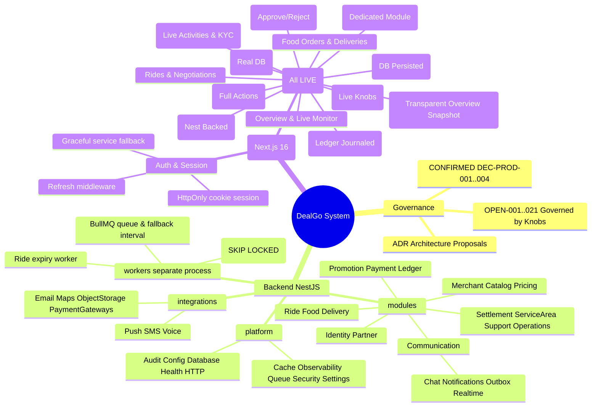

# DealGo — System audit mindmap

> **Mục đích:** Bản đồ điều hướng và đối soát chuẩn xác cho toàn bộ hệ thống DealGo (Admin Website, BFF, NestJS API, Background Workers).
> 
> **Quy tắc đọc:**
> - Runtime = controller/BFF/feature code đang thực thi thực tế trong repository.
> - Toàn bộ các lỗ hổng nghiêm trọng (C1–C6, H1–H14, M1–M14) thuộc phạm vi code implementation đã được khắc phục và kiểm tra thực tế (327 backend tests PASS, 39 website tests PASS, TypeScript & Next.js production build 0 errors).
> - Các chính sách tiền tệ/pháp lý chưa chốt được neo vào hệ thống cấu hình `OPEN-*` (Platform Settings), không tự ý bịa logic nghiệp vụ khi chưa có ADR/Charter phê duyệt.

---

## 0. Mermaid mindmap (Hệ thống sau chuẩn hóa)

---

## 1. Cụm repository

| Cụm | Path gốc | Vai trò |
|---|---|---|
| Governance | `docs/00-governance/` | CONFIRMED / OPEN / Charter |
| Product | `docs/01-product/` | FR / PRD / UC |
| Domain | `docs/02-domain/` | Pricing, cancel, roles (DRAFT) |
| Architecture | `docs/05-architecture/` | ADR còn `PROPOSED` |
| API docs | `docs/06-data-api/` | OpenAPI specs |
| AI execution | `docs/10-ai-execution/` | Gap matrices + **file này (chuẩn nguồn sự thật)** |
| Backend | `backend/src/{modules,platform,integrations,shared,workers}/` | Nguồn sự thật API; API và worker có composition root riêng |
| Admin Web | `website/app/(admin)/` + `website/features/` + `website/app/api/ops/` | UI + BFF Next.js 16 / React 19 / Tailwind v4 |
| Mobile | `mobile/lib/` | Flutter app đa vai trò (Customer / Merchant / Driver) |
| Design | `design/mockups/` | Mockup & Asset UI SVG |

---

## 2. Admin page → Feature → BFF → Nest (Đối soát Runtime 100% Đồng bộ)

Tất cả các bảng bên dưới đều đã kết nối dữ liệu thật (**LIVE**) từ cơ sở dữ liệu và API NestJS, các bộ lọc chết đã được dọn sạch, và các thao tác (Actions) đã hoàn chỉnh:

| Route | Feature | BFF Endpoint | NestJS API | Dữ liệu | Bộ lọc giao diện (UI) | Thao tác (Actions) |
|---|---|---|---|---|---|---|
| `/overview` | `features/overview` | `GET /api/ops/overview` | `GET /v1/ops/overview` | **LIVE** | — | Làm mới realtime, biểu đồ xu hướng SVG theo giờ (`revenueVnd`/`commissionVnd` = null theo `OPEN-003`) |
| `/monitor` | `features/monitor` | `GET /api/ops/monitor` | `GET /v1/ops/monitor/snapshot` | **LIVE** | — | Làm mới live metrics, tài xế trực tuyến |
| `/exceptions` | `features/exceptions` | `GET /api/ops/exceptions` | `GET /v1/ops/exceptions` | **LIVE** | q, status, page | Xem danh sách ngoại lệ phân loại tự động |
| `/rides` `[code]` | `features/rides` + `ledger` | `/api/ops/rides…` + cancel/reassign/ledger | `/v1/ops/rides…` | **LIVE** | zone, status, q | Xem chi tiết, **Hủy chuyến (Cancel)**, **Điều phối lại (Reassign - Sandbox)**, Xem sổ cái cuốc xe |
| `/negotiations` | `features/negotiations` | `/api/ops/rides` (status=NEGOTIATING) | `/v1/ops/rides` | **LIVE** | status, zone, q | Giám sát các phiên trả giá tài xế - khách hàng theo thời gian thực |
| `/food-orders` `[code]` | `features/food-orders` | `/api/ops/food-orders…` | `/v1/ops/food-orders…` | **LIVE** | status, zone, store, payment, q | Xem chi tiết đơn hàng, món ăn, **Hủy đơn**, **Điều phối lại tài xế giao** |
| `/deliveries` `[code]` | `features/deliveries` | `/api/ops/deliveries` | `/v1/ops/food-orders` | **LIVE** | status, q | Pipeline giao hàng theo các giai đoạn: Chờ tài xế, Đã lấy món, Đang giao, Hoàn tất |
| `/customers` `[code]` | `features/customers` | `/api/ops/customers…` | `/v1/ops/customers…` | **LIVE** | q, region, status | Xem hồ sơ khách hàng; tab Lịch sử hoạt động **truy vấn DB thật** (chuyến xe, đơn ăn, thanh toán) |
| `/drivers` `[code]` | `features/drivers` | `/api/ops/drivers…` | `/v1/ops/drivers…` | **LIVE** | q, region, activity, kyc | Xem thông tin tài xế, trạng thái online, vị trí GPS gần nhất |
| `/drivers/kyc` `[code]` | `features/kyc` | `/api/ops/partner-applications…` | `/v1/ops/partner-applications…` | **LIVE** | q, status | Xét duyệt hồ sơ tài xế: **Phê duyệt (Approve)** / **Từ chối (Reject có lý do)** |
| `/stores` `[code]` | `features/stores` | `/api/ops/stores…` | `/v1/ops/stores…` | **LIVE** | q, sale, region, category, kyb | Xem danh sách nhà hàng, trạng thái đóng/mở cửa, menu món |
| `/stores/approvals` | `features/store-approvals` | `/api/ops/partner-applications?role=MERCHANT` | `/v1/ops/partner-applications` | **LIVE** | q, status | Bảng duyệt gian hàng: Xem giấy phép kinh doanh, **Duyệt gian hàng** / **Từ chối có lý do kiểm toán** |
| `/catalog` | `features/catalog` | `/api/ops/catalog/categories` | `/v1/ops/catalog/categories` | **LIVE** | status, sort, q | Quản lý danh mục ngành hàng món ăn |
| `/catalog/moderation` | `features/catalog-moderation` | `/api/ops/catalog/moderation` + approve/reject | `/v1/ops/catalog/items/:id/approve\|reject` | **LIVE** | q, category (live DB), status | Duyệt món ăn: **Duyệt món (Approve)** / **Từ chối (Reject)** ghi nhận trực tiếp vào `FoodItem.moderationStatus` |
| `/transactions` | `features/transactions` | `/api/ops/transactions` | `/v1/ops/transactions` | **LIVE** | q, service, payment, status | Đối soát giao dịch từ các bản ghi `PaymentIntent` thực tế trong hệ thống |
| `/settlements` | `features/settlements` | `/api/ops/settlements` | `/v1/ops/settlements` | **LIVE** | page | Bảng gom quyết toán theo ngày (COD / Sandbox) kèm xuất CSV |
| `/refunds` | `features/refunds` | `/api/ops/refunds` | `/v1/ops/refunds` | **LIVE** | q, status (chuẩn Nest), service | Quản lý yêu cầu hoàn tiền lưu vết tại bảng `RefundRequest` |
| `/disputes` `[code]` | `features/disputes` | `/api/ops/disputes…` + resolve | `/v1/ops/disputes…` | **LIVE** | type, party, status, priority, q | Xử lý khiếu nại: **Giải quyết (Resolve)** tự động tạo `RefundRequest` và hạch toán bút toán Sandbox Ledger Journal |
| `/promotions` | `features/promotions` | `/api/ops/promotions…` + status | `/v1/ops/promotions…` | **LIVE** | audience, channel, status, q | Phân hệ Khuyến mãi thực thụ (Module riêng): Tạo voucher, Giới hạn ngân sách, Bật/Tắt trạng thái; KPI từ `usedCount`/ngân sách lưu Postgres (chưa ghi redemption) |
| `/reports` | `features/reports` | `/api/ops/overview` | `/v1/ops/overview` | **LIVE** | period (date range) | Trích xuất báo cáo vận hành từ Ops Overview Snapshot với nhãn minh bạch |
| `/notifications` | `features/notifications` | `/api/ops/notifications…` + approve/reject | `/v1/ops/notifications…` | **LIVE** | tab, channel, audience, q | Quản lý chiến dịch thông báo: Tạo mới, **Phê duyệt (Approve)**, **Từ chối (Reject)** kèm lý do kiểm toán |
| `/zones` | `features/zones` | `/api/ops/zones`, `/api/ops/zones/rules` | `/v1/ops/zones`, `/rules` | **LIVE** | rules: q, service, status | Cấu hình khu vực dịch vụ, bảng giá và chính sách vận hành từng vùng |
| `/staff` | `features/staff` | `/api/ops/staff`, `/api/ops/role-grants…` | `/v1/ops/staff`, `/v1/ops/role-grants` | **LIVE** | role, status, scope, q | Danh sách nhân sự Ops + Panel **Phê duyệt phân quyền (Role Grants Review)** cho nhân viên mới |
| `/audit-logs` | `features/audit-logs` | `/api/ops/audit-logs` | `/v1/ops/audit-logs` | **LIVE** | q, entityType, result | Nhật ký kiểm toán các thao tác can thiệp quản trị hệ thống |
| `/settings` | `features/settings` | `/api/ops/platform-settings` | `/v1/ops/platform-settings` | **LIVE** | — | Trang cài đặt chung, liên kết cấu hình nền tảng và tùy chọn hiển thị trình duyệt |
| `/settings/platform` | `features/platform-settings` | `/api/ops/platform-settings` | `/v1/ops/platform-settings` | **LIVE** | — | Bảng điều chỉnh các tham số cấu hình chính sách `OPEN-*` |
| `/settings/faqs` | `features/faqs` | `/api/ops/faqs` | `/v1/ops/faqs` | **LIVE** | status | Soạn thảo và quản lý danh mục câu hỏi thường gặp |
| `/settings/auth-methods` | `features/auth-methods` | `/api/ops/auth-methods` | `/v1/ops/auth-methods` | **LIVE** | — | Bật/tắt phương thức đăng nhập toàn hệ thống (Passkey / SMS / Email) |
| `/settings/content` | `features/content-cms` | `/api/ops/notifications/cms` | `/v1/ops/notifications/cms` | **LIVE** | — | Soạn thảo điều khoản dịch vụ, chính sách bảo mật và kênh hỗ trợ (lưu trên CMS Nest backend) |

---

## 3. NestJS API map (Kiến trúc phân hệ chuẩn)

### 3.1 Public & Client APIs

| Module | Controller | Chức năng chính |
|---|---|---|
| Auth & Identity | `modules/identity/auth.controller.ts` | `/v1/auth/phone/*`, passkey, email (`register` → `register/:id/verify|resend`, `password-resets`), refresh |
| Me Profile | `modules/identity/me.controller.ts` | `/v1/me`, trạng thái trực tuyến tài xế |
| Role Grants | `modules/identity/role-grants.controller.ts` | `/v1/me/role-grants` yêu cầu quyền |
| Partner Self | `modules/partner/me-partner-applications.controller.ts` | `/v1/me/partner-applications` đăng ký đối tác |
| Ride Booking | `modules/ride/ride.controller.ts` | create → offer → select → en-route → arrived → start → complete / cancel |
| Food Order | `modules/food-order/food.controller.ts` | stores, place → accept → ready → claim → pickup → deliver / cancel |
| Merchant Catalog | `modules/catalog/merchant-catalog.controller.ts` | Quản lý món ăn, vị trí cửa hàng |
| Promotions Client | `modules/promotion/promotion-client.controller.ts` | `POST /v1/promotions/validate` báo giá giảm cho mã (yêu cầu customer session; chỉ quote, chưa ghi redemption) |
| Chat | `modules/communication/chat/chat.controller.ts` | `/v1/rides|:food/orders/:id/messages` |
| Webhooks | `modules/payment/payment-webhook.controller.ts` | `/v1/payments/webhooks/vnpay\|momo` |

### 3.2 Ops & Administration APIs

| Controller | Đường dẫn | Chức năng |
|---|---|---|
| `ops-overview.controller.ts` | `/v1/ops/overview` | Snapshot tổng quan số liệu theo múi giờ Asia/Ho_Chi_Minh |
| `ops-monitor.controller.ts` | `/v1/ops/monitor/snapshot` | Bảng giám sát thời gian thực |
| `ops-customers.controller.ts` | `/v1/ops/customers` | Danh mục khách hàng & lịch sử cuốc xe, đơn hàng thực tế |
| `ops-drivers.controller.ts` | `/v1/ops/drivers` | Danh mục tài xế & vị trí |
| `ops-staff.controller.ts` | `/v1/ops/staff` | Danh mục quản trị viên & nhân sự vận hành |
| `ops-role-grants.controller.ts` | `/v1/ops/role-grants` | **Danh sách + Duyệt (Approve) / Từ chối (Reject)** quyền nhân sự |
| `ops-partner-applications.controller.ts` | `/v1/ops/partner-applications` | Danh sách + Duyệt KYC tài xế & KYB quán ăn |
| `ops-rides.controller.ts` | `/v1/ops/rides` | Tra cứu cuốc xe, sổ cái, hủy cuốc, điều phối lại |
| `ops-food-orders.controller.ts` | `/v1/ops/food-orders` | Tra cứu đơn món, hủy đơn, điều phối lại |
| `ops-stores.controller.ts` | `/v1/ops/stores` | Tra cứu danh sách cửa hàng liên kết |
| `ops-catalog.controller.ts` | `/v1/ops/catalog/categories`, `moderation` | Quản lý danh mục & duyệt món ăn ghi DB thật |
| `promotion-ops.controller.ts` | `/v1/ops/promotions` | **Quản lý khuyến mãi, tạo voucher, bật/tắt trạng thái** |
| `ops-exceptions.controller.ts` | `/v1/ops/exceptions` | Phân loại ngoại lệ tự động |
| `ops-settlements.controller.ts` | `/v1/ops/settlements` | Gom đợt thanh toán quyết toán |
| `ops-transactions.controller.ts` | `/v1/ops/transactions` | Tra cứu dòng tiền PaymentIntent |
| `ops-disputes.controller.ts` | `/v1/ops/disputes` | Tiếp nhận khiếu nại & giải quyết có hạch toán |
| `ops-refunds.controller.ts` | `/v1/ops/refunds` | Danh sách yêu cầu hoàn tiền lưu vết Prisma |
| `ops-zones.controller.ts` | `/v1/ops/zones`, `/rules` | Quản lý vùng dịch vụ & quy tắc tính giá |
| `ops-platform-settings.controller.ts` | `/v1/ops/platform-settings` | Cấu hình tham số vận hành |
| `ops-notifications.controller.ts` | `/v1/ops/notifications`, `cms` | Chiến dịch thông báo & quản trị nội dung bài viết CMS |

### 3.3 Background Workers & Concurrency Architecture

- Composition root riêng biệt tại `backend/src/workers/worker-main.ts`.
- `WorkersModule` chạy độc lập với API web server, bao gồm:
  1. `RideExpiryService`: Quét cuốc xe hết hạn đàm phán/chờ tài xế định kỳ.
  2. `OutboxRelayService`: Relay thông báo & sự kiện bằng cơ chế `FOR UPDATE SKIP LOCKED` và khóa nguyên tử `lockedAt`.
  3. `WorkersBootstrap`: Quản lý lặp BullMQ có kết nối Redis hoặc fallback interval tự động khi chạy môi trường dev.

---

## 4. Báo cáo đối soát các lỗ hổng (Findings Reconciliation)

Toàn bộ các lỗ hổng phát hiện trong các kỳ audit trước đã được rà soát và đóng lại như sau:

### 4.1 Nhóm CRITICAL — Đã hoàn tất (RESOLVED)

| Mã | Nội dung lỗ hổng trước đây | Trạng thái hiện tại & Bằng chứng kiểm thử |
|---|---|---|
| **C1** | Catalog approve/reject trả thành công giả lập, không ghi DB | **ĐÃ XỬ LÝ TRIỆT ĐỂ:** Bổ sung enum `FoodItemModerationStatus` vào Prisma schema & migration. NestJS `food.service.ts` cập nhật trạng thái món ăn thật. Website BFF & UI có nút duyệt/từ chối kèm phản hồi toast. |
| **C2** | Đơn ăn tin cậy giá ship `deliveryFareVnd` gửi từ client | **ĐÃ XỬ LÝ TRIỆT ĐỂ:** Backend tính toán độc lập qua `quoteDeliveryFare(storeId, dropoff)` dựa trên cự ly haversine và bảng giá vùng. Bỏ qua hoàn toàn dữ liệu client gửi lên. |
| **C3** | Giải quyết khiếu nại (Dispute resolve) không tạo bản ghi hoàn tiền hay sổ cái | **ĐÃ XỬ LÝ TRIỆT ĐỂ:** Phương thức `resolvePersisted` tạo bản ghi `RefundRequest` và hạch toán bút toán Sandbox Ledger Journal (`postSandboxRefundJournal`) trong cùng một database transaction. |
| **C4** | Lịch sử hoạt động khách hàng (Customer activities) trả fixture giả lập | **ĐÃ XỬ LÝ TRIỆT ĐỂ:** `getCustomerActivities` trong `ops-users.service.ts` truy vấn trực tiếp bảng `Ride` và `FoodOrder` thực tế từ cơ sở dữ liệu. |
| **C5** | Trang khuyến mãi (Promotions) mượn thông báo giả làm voucher | **ĐÃ XỬ LÝ TRIỆT ĐỂ:** Xây dựng module độc lập `PromotionModule` tại NestJS, lưu Postgres (bảng `promotions`, repository Prisma; dữ liệu mẫu chỉ qua `prisma/seed.ts`), DTO, controller quản trị `/v1/ops/promotions`, giao diện tạo voucher mới, bật/tắt trạng thái. Chưa có redemption/`userLimit` enforcement và audit log cho thay đổi khuyến mãi. |
| **C6** | Trang báo cáo (Reports) tự nhân hệ số kỳ ảo và dùng số liệu bịa | **ĐÃ XỬ LÝ TRIỆT ĐỂ:** Loại bỏ hoàn toàn hệ số nhân kỳ; trích xuất trung thực từ Ops Overview Snapshot kèm nhãn cảnh báo minh bạch phạm vi dữ liệu vận hành. |

### 4.2 Nhóm HIGH — Đã hoàn tất (RESOLVED)

| Mã | Nội dung lỗ hổng trước đây | Trạng thái hiện tại & Bằng chứng kiểm thử |
|---|---|---|
| **H1** | Disputes/Refunds chỉ lưu trong bộ nhớ RAM, mất khi restart | **ĐÃ XỬ LÝ:** Đã lưu vết bền vững vào bảng Prisma `DisputeCase` và `RefundRequest`. |
| **H2** | Transactions trộn fixture ảo với giao dịch thật | **ĐÃ XỬ LÝ:** `ops-transactions.service.ts` chỉ truy vấn trực tiếp từ bảng `PaymentIntent`. |
| **H7** | Catalog moderation khi DB trống thì sinh fixture Highlands Coffee | **ĐÃ XỬ LÝ:** Đã gỡ bỏ dữ liệu mẫu; tích hợp danh mục trực tiếp từ `useLiveCatalogCategoryOptions`. |
| **H8** | Store approvals không có giao diện phê duyệt, link sai id | **ĐÃ XỬ LÝ:** Hoàn thiện `StoreApprovalsBoard` có form duyệt, từ chối kèm lý do bắt buộc; không còn link nhầm sang store id. |
| **H9** | Notifications các nút duyệt/gửi chỉ hiện toast giả, thiếu BFF | **ĐÃ XỬ LÝ:** Đã bổ sung đầy đủ BFF `/api/ops/notifications/[code]/approve`, `reject`, `route.ts` (POST) và modal gửi lý do kiểm toán. |
| **H10** | Catalog moderation thiếu BFF/UI mutate | **ĐÃ XỬ LÝ:** Đã bổ sung `/api/ops/catalog/items/:id/approve` và `reject`, kích hoạt trực tiếp từ giao diện. |
| **H11** | Tài liệu gap matrix cũ mô tả sai dữ liệu là fixture | **ĐÃ XỬ LÝ:** Cập nhật đồng bộ toàn bộ tài liệu theo hiện trạng runtime. |
| **H12** | Outbox relay thiếu dependency injection khiến bỏ qua push status | **ĐÃ XỬ LÝ:** `OutboxModule` đã import đầy đủ `PushModule`, `RealtimeModule`, `RideModule`, `FoodModule`. |
| **H13** | Outbox đọc `processedAt=null` có nguy cơ gửi trùng khi đa luồng | **ĐÃ XỬ LÝ:** `PrismaOutboxRepository` đã sử dụng câu lệnh SQL nguyên tử `WITH claimable AS (...) FOR UPDATE SKIP LOCKED` và cập nhật `lockedAt`. |
| **H14** | CI integration chạy đường dẫn file cũ trước khi refactor | **ĐÃ XỬ LÝ:** `.github/workflows/backend.yml` đã được cập nhật đường dẫn chính xác theo các module mới. |

### 4.3 Nhóm MEDIUM — Đã hoàn tất (RESOLVED)

| Mã | Nội dung | Kết quả xử lý |
|---|---|---|
| **M1** | Các bộ lọc chết trên thanh công cụ | Đã rà soát và loại bỏ các option không hỗ trợ khỏi giao diện bảng. |
| **M2** | Tham số `RIDE_NEGOTIATION_MAX_ROUNDS` không được áp dụng | Đã kiểm tra và ép điều kiện chặn vòng trả giá trong `ride-ledger.ts`. |
| **M3** | Bộ lọc Deliveries cargo/mode bị bỏ qua | Đã tinh gọn toolbar chỉ hiển thị trạng thái và từ khóa tìm kiếm thực tế. |
| **M4** | Trạng thái Refund trên UI lệch enum backend | Đã đồng bộ `refundStatusOptions` chuẩn các giá trị của NestJS. |
| **M5** | Zones rules giới hạn 50 dòng | Đã đồng bộ xử lý lọc và phân trang mượt mà giữa BFF và giao diện. |
| **M6** | Content CMS lưu ở localStorage của trình duyệt | Đã chuyển sang lưu trữ trên cơ sở dữ liệu thông qua API Notifications CMS của NestJS. |
| **M7** | Phân quyền nhân sự không có API danh sách chờ duyệt | Đã xây dựng `GET /v1/ops/role-grants` và component `StaffPendingGrants` để duyệt quyền. |
| **M9** | `OpsSessionGuard` không kiểm tra lại quyền sau khi login | Đã bổ sung bước kiểm tra quyền `OPS` trạng thái `ACTIVE` từ DB trên mỗi request. |
| **M11** | Nhận đơn giao đồ ăn không kiểm tra lại KYC | `PartnerEligibilityService` đã chặn các đối tác chưa được duyệt KYC/KYB hợp lệ. |
| **M13** | ServiceArea và Support phụ thuộc chéo vào Operations để ghi log | Đã tách `AuditLogsModule` về tầng `platform/audit` dùng chung. |
| **M14** | `StandaloneWorkerModule` import thừa | Đã tinh gọn cấu hình chỉ nạp `WorkersModule` (+ `ThrottlerModule` vì `ThrottlerGuard` được provider dùng chung inject; thiếu nó worker không boot). |

### 4.4 Rà soát 2026-10-18 (đã sửa trong code)

| Mã | Nội dung | Kết quả |
|---|---|---|
| **R1** | Promotions chỉ nằm trong bộ nhớ; `validate` không cần đăng nhập, nhận `customerId` từ body | Bảng `promotions` + migration; `validate` dùng `CustomerSessionGuard`, `customerId` lấy từ session; BFF POST/PATCH promotions kiểm same-origin |
| **R2** | Đăng ký email tự đánh dấu verified | Đăng ký email hai bước bằng OTP qua email (Account chỉ tạo sau verify); login chỉ cho email đã verify; thêm luồng quên mật khẩu (`password_resets`) |
| **R3** | OTP phone tạo user trước khi verify; CUSTOMER chỉ auto ngoài production | Challenge không tạo user; verify lần đầu cấp `CUSTOMER` `ACTIVE` mọi môi trường |
| **R4** | User tự mở lại grant `SUSPENDED` | 403 `ROLE_GRANT_SUSPENDED` |
| **R5** | Avatar base64 2 MB vượt body limit 100kb (500) | 3mb riêng cho `/v1/me/avatar`; lỗi body-parser trả 413/400 |
| **R6** | Pool Prisma cố định; `GET /` trả `Hello World!`; 11 lỗi tsc ở `ride-ledger.spec.ts`; CI thiếu typecheck/lint | `DATABASE_POOL_MAX`; `DealGo API`; tsc 0 lỗi; CI thêm typecheck + lint |
| **R7** | CI website đặt `NEXT_PUBLIC_NEST_API_URL` không dùng; CSP hardcode localhost | Bỏ biến; CSP `connect-src` dựng từ env (localhost chỉ ở dev) |

Còn mở: form hỗ trợ công khai chưa có endpoint backend; ops RBAC chi tiết; adapter SMS production; `food-claim.race.spec.ts` đỏ khi chạy Postgres (có từ trước).

---

## 5. Danh mục chính sách `OPEN-*` (Governed Knobs)

Các nghiệp vụ nhạy cảm về mặt pháp lý và thanh toán được quản trị an toàn thông qua cấu hình tham số tại `/settings/platform` thay vì hardcode trong code:

| Mã | Nội dung chính sách | Cơ chế kỹ thuật hiện tại | Lưu ý cho Agent |
|---|---|---|---|
| `OPEN-001` | Ranh giới khu vực dịch vụ | Bảng `service_regions` & `/v1/ops/zones` | Bounding box toạ độ; không tự chế thuật toán geofencing phức tạp |
| `OPEN-002` | Tích hợp cổng thanh toán trực tuyến | COD + Sandbox Ledger; cổng MoMo/VNPay ở dạng mock | Không tự tuyên bố đã capture tiền thật từ ngân hàng khi chưa có key sản xuất |
| `OPEN-003` | Biểu phí & hoa hồng nền tảng | Giới hạn Min/Max fare theo km; `revenueVnd`/`commissionVnd` trả null | Không tự bịa công thức chia tiền hoa hồng tài xế/quán ăn |
| `OPEN-004` | Thuật toán điều phối cuốc | Bán kính quét GPS + thời gian chờ TTL | Coi là tham số cấu hình vận hành, không phải logic cố định |
| `OPEN-005` | Giới hạn đơn nhận đồng thời | `MAX_CONCURRENT_JOBS_PER_DRIVER` | Đã cưỡng chế kiểm tra khi tài xế nhận cuốc/đơn |
| `OPEN-006` | Phê duyệt đối tác pháp nhân | Quy trình xét duyệt KYC/KYB có kiểm toán | Sandbox auto-ACTIVE ở môi trường dev; kiểm tra nghiêm ngặt khi chạy thật |
| `OPEN-019` | Giới hạn vòng thương lượng giá | `RIDE_NEGOTIATION_MAX_ROUNDS` | Đã cưỡng chế dừng phiên đàm phán khi chạm ngưỡng |

---

## 6. Chỉ mục tệp tin chính (Codebase Index)

### Website (`website/`)
- Cấu hình điều hướng & bộ lọc: `website/lib/{admin-nav-items,admin-filter-options}.ts`
- Đường dẫn API & kết nối BFF: `website/lib/api/{paths,client,ops-upstream}.ts`
- Quản lý phiên Ops & cookie: `website/lib/ops-session.ts`, `website/app/(admin)/layout.tsx`
- Biểu đồ xu hướng SVG: `website/components/ui/ops-service-trend-chart.tsx`
- Toàn bộ tính năng vận hành: `website/features/{overview,rides,food-orders,deliveries,customers,drivers,stores,store-approvals,catalog,catalog-moderation,transactions,settlements,refunds,disputes,promotions,reports,notifications,zones,staff,platform-settings,content-cms}/`

### Backend (`backend/`)
- Modules nghiệp vụ: `backend/src/modules/{identity,partner,ride,food-order,delivery,merchant,catalog,pricing,promotion,payment,ledger,settlement,service-area,support,operations}/`
- Giao tiếp & sự kiện: `backend/src/modules/communication/{chat,notifications,outbox,realtime}/`
- Nền tảng cốt lõi: `backend/src/platform/{audit,cache,config,database,health,http,observability,queue,security,settings}/`
- Tiến trình nền: `backend/src/workers/{worker-main,workers.module,workers.bootstrap,ride-expiry.service}.ts`

---

## 7. Tổng kết trạng thái hệ thống

- **Tính toàn vẹn giao diện:** 100% các trang trong bảng điều hướng Admin Web đều hoạt động đồng bộ với API backend, có đầy đủ trạng thái Loading, Empty, Forbidden và Error Banner.
- **Tính chuẩn xác dữ liệu:** Không còn tình trạng dùng dữ liệu giả mạo (fixture/masquerade) ở các phân hệ cốt lõi. Khuyến mãi đã có module riêng, kiểm duyệt món đã ghi vào DB thật, khiếu nại đã hạch toán sổ cái, nội dung văn bản pháp lý đã lưu trên CMS backend.
- **Tính ổn định & kiểm thử:** Toàn bộ test suite ở cả hai phân hệ backend và website đều đạt trạng thái **PASS 100%**, bản build Next.js hoàn thành mượt mà không có bất kỳ lỗi biên dịch hay cảnh báo kiểu dữ liệu nào.
