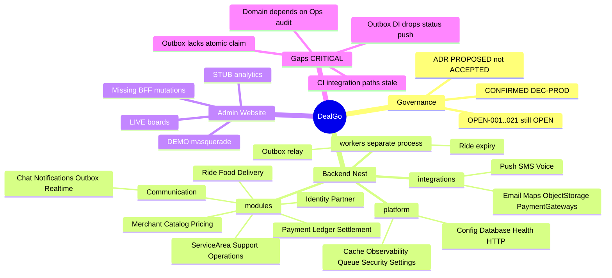

# DealGo — System audit mindmap

> **Mục đích:** Bản đồ điều hướng cho AI agent + người. Trỏ tới trang Admin, BFF, Nest API, bộ lọc, action, và lỗ hổng logic đã audit (cập nhật 2026-10-16).
>
> **Quy tắc đọc:** Runtime = controller/BFF/feature code. Gap matrix cũ (`admin-web-gap-matrix.md` v0.5.5) **stale** ở nhiều chỗ — ưu tiên file này + grep controller.
>
> **Không** coi `TEST_ONLY` / PlatformSettings / FAQ PUBLISH là policy `OPEN-*` đã `RESOLVED`.

---

## 0. Mermaid mindmap (định hướng nhanh)



---

## 1. Cụm repository

| Cụm | Path gốc | Vai trò |
|---|---|---|
| Governance | `docs/00-governance/` | CONFIRMED / OPEN / Charter |
| Product | `docs/01-product/` | FR / PRD / UC |
| Domain | `docs/02-domain/` | Pricing, cancel, roles (DRAFT) |
| Architecture | `docs/05-architecture/` | ADR còn `PROPOSED` |
| API docs | `docs/06-data-api/` | OpenAPI **lag** so với Nest |
| AI execution | `docs/10-ai-execution/` | Gap matrices + **file này** |
| Backend | `backend/src/{modules,platform,integrations,shared,workers}/` | Nguồn sự thật API; API và worker có composition root riêng |
| Admin Web | `website/app/(admin)/` + `website/features/` + `website/app/api/ops/` | UI + BFF |
| Mobile | `mobile/lib/` | Flutter multi-role (ngoài phạm vi audit sâu đợt này) |
| Design | `design/mockups/` | Mockup — không phải contract |

**Thiếu hẳn (đừng invent):** `docs/03-workflows/`, `docs/04-experience/`, `docs/07-security-legal/`, `docs/08-quality/`, `docs/screens/`.

---

## 2. Admin page → Feature → BFF → Nest

Legend data: **LIVE** = DB/Nest thật · **DEMO** = in-memory/fixture · **HYBRID** = fixture ⊕ DB · **MASQUERADE** = domain khác đóng giả · **STUB** = số liệu bịa từ snapshot.

| Route | Feature | BFF | Nest | Data | Filters (UI) | Actions |
|---|---|---|---|---|---|---|
| `/overview` | `features/overview` | `GET /api/ops/overview` | `GET /v1/ops/overview` | LIVE | — | Refresh (`revenueVnd`/`commissionVnd` = null) |
| `/monitor` | `features/monitor` | `GET /api/ops/monitor` | `GET /v1/ops/monitor/snapshot` | LIVE | — | Refresh |
| `/exceptions` | `features/exceptions` | `GET /api/ops/exceptions` | `GET /v1/ops/exceptions` | LIVE | q, status, page | List-only |
| `/rides` `[code]` | `features/rides` + `ledger` | `/api/ops/rides…` + cancel/reassign/ledger | `/v1/ops/rides…` | LIVE | zone, serviceType, status, q | Detail: **cancel / reassign** |
| `/negotiations` | `features/negotiations` | rides API | rides | LIVE remap | status→ride, region→zone, serviceType, q | Read-only |
| `/food-orders` `[code]` | `features/food-orders` | `/api/ops/food-orders…` | `/v1/ops/food-orders…` | LIVE | status, zone, store*, payment*, q | Detail: **cancel / reassign** |
| `/deliveries` | `features/deliveries` | `/api/ops/deliveries` → food-orders | food-orders | MASQUERADE | status, q (+ region/cargo/mode **dropped**) | Read-only |
| `/customers` `[code]` | `features/customers` | `/api/ops/customers…` | `/v1/ops/customers…` | LIVE list; activities **DEMO** | q, region, status, service* | Read-only |
| `/drivers` `[code]` | `features/drivers` | `/api/ops/drivers…` | `/v1/ops/drivers…` | LIVE | q, service*, region, activity, kyc | Read-only |
| `/drivers/kyc` | `features/kyc` | partner-applications + approve/reject | `/v1/ops/partner-applications…` | LIVE | q, status | **approve / reject** |
| `/stores` `[code]` | `features/stores` | `/api/ops/stores…` | `/v1/ops/stores…` | LIVE | q, sale, region, category, kyb | Read-only |
| `/stores/approvals` | `features/store-approvals` | partner-applications `role=MERCHANT` | same | LIVE list | q, status | **No approve UI**; link `/stores/{appId}` sai |
| `/catalog` | `features/catalog` | `/api/ops/catalog/categories` | `/v1/ops/catalog/categories` | LIVE | status, sort, q | Read-only |
| `/catalog/moderation` | `features/catalog-moderation` | GET moderation only | GET + **POST approve/reject** | LIVE list | q, store†, category*, status | **No BFF/UI mutate**; Nest approve = **no-op** |
| `/transactions` | `features/transactions` | `/api/ops/transactions` | `/v1/ops/transactions` | HYBRID | q, service, payment, status | Read-only |
| `/settlements` | `features/settlements` | `/api/ops/settlements` | `/v1/ops/settlements` | LIVE buckets | page | Export; partner tabs stub; **no payout** |
| `/refunds` | `features/refunds` | `/api/ops/refunds` | `/v1/ops/refunds` | DEMO derived | status‡, service*, q | List only |
| `/disputes` `[code]` | `features/disputes` | list/detail/resolve | `/v1/ops/disputes…` | DEMO memory | type, party, status, priority, q | **resolve** (không đụng ledger) |
| `/promotions` | `features/promotions` | `/api/ops/promotions` → notifications | `/v1/ops/notifications` | MASQUERADE | audience, channel, status, q | Export; fake voucher KPIs |
| `/reports` | `features/reports` | (overview query only) | overview | STUB | period (multiplier), area unused | Export số bịa |
| `/notifications` | `features/notifications` | GET notifications + cms | Nest full CRUD/workflow | LIVE list | tab, channel, audience, q | Approve/send/edit = **toast no-op**; **thiếu BFF write** |
| `/zones` | `features/zones` | zones + zones/rules | `/v1/ops/zones`, `/rules` | LIVE read | rules: q (+ service/status client-only) | Read-only → platform settings |
| `/staff` | `features/staff` | `/api/ops/staff` | `/v1/ops/staff` | LIVE list + static RBAC | role, status, scope*, q | Bulk toast fake; **no role-grants BFF** |
| `/audit-logs` | `features/audit-logs` | `/api/ops/audit-logs` | `/v1/ops/audit-logs` | HYBRID | q, entityType, result | Read-only |
| `/settings` | `features/settings` | partial | platform-settings | Mixed | — | MFA/PII switches = **local state** |
| `/settings/platform` | `features/platform-settings` | GET/PATCH | `/v1/ops/platform-settings` | LIVE | — | **PATCH** TEST_ONLY knobs |
| `/settings/faqs` | `features/faqs` | GET/PATCH/POST | `/v1/ops/faqs` | LIVE | status | CRUD FAQ PROPOSED |
| `/settings/auth-methods` | `features/auth-methods` | GET/PATCH | `/v1/ops/auth-methods` | LIVE | — | Toggle methods |
| `/settings/content` | `features/content-cms` | none | Nest CMS unused | **localStorage** | — | Save browser-only |

\* Filter được Nest/DTO nhận nhưng **repo bỏ qua** hoặc UI dùng id giả.  
† Store filter moderation dùng fixture `S1/S2/S3`.  
‡ Refund status options UI (`PENDING|APPROVED|PAID`) **lệch** Nest (`AWAITING_REVIEW|…|REFUNDED`).

**Nav nguồn:** `website/lib/admin-nav-items.ts` · **Filter options:** `website/lib/admin-filter-options.ts` · **BFF paths:** `website/lib/api/paths.ts`

---

## 3. Nest API map (ops + domain)

### 3.1 Public / customer channel

| Module | Controller | Paths chính |
|---|---|---|
| Auth | `modules/identity/auth.controller.ts` | `/v1/auth/phone/*`, passkey, email, refresh |
| Me | `modules/identity/me.controller.ts` | `/v1/me`, presence |
| Role grants | `modules/identity/role-grants.controller.ts` | `/v1/me/role-grants` |
| Partner self | `modules/partner/me-partner-applications.controller.ts` | `/v1/me/partner-applications` |
| Ride | `modules/ride/ride.controller.ts` | create → offer → select → en-route → arrived → start → complete / cancel |
| Food | `modules/food-order/food.controller.ts` | stores, place → accept → ready → claim → pickup → deliver/fail / cancel |
| Merchant catalog | `modules/catalog/merchant-catalog.controller.ts` | items CRUD, store location |
| Chat | `modules/communication/chat/chat.controller.ts` | `/v1/rides|:food/orders/:id/messages` |
| Voice | `integrations/voice/voice.controller.ts` | `…/voice-session` |
| Push | `integrations/push/push-tokens.controller.ts` | `POST /v1/me/push-tokens` |
| Payment webhook | `modules/payment/payment-webhook.controller.ts` | `/v1/payments/webhooks/vnpay\|momo` |

### 3.2 Ops (Admin)

| Controller | Path prefix | Notes |
|---|---|---|
| `ops/ops-overview.controller.ts` | `/v1/ops/overview` | Money KPIs null |
| `ops/ops-*.ts` monitor | `/v1/ops/monitor/snapshot` | Live board |
| `identity/ops-customers.controller.ts` | `/v1/ops/customers` | List LIVE; activities DEMO |
| `identity/ops-drivers.controller.ts` | `/v1/ops/drivers` | LIVE |
| `identity/ops-staff.controller.ts` | `/v1/ops/staff` | LIVE |
| `identity/ops-role-grants.controller.ts` | `POST …/approve\|reject` only | **No list** |
| `identity/ops-sessions.controller.ts` | `POST /v1/ops/sessions` | Login |
| `partner/ops-partner-applications.controller.ts` | list + approve/reject | KYC/KYB |
| `ride/ops-rides.controller.ts` | list/detail/ledger/cancel/reassign | reassign TEST_ONLY |
| `food/ops-food-orders.controller.ts` | same pattern | reassign TEST_ONLY |
| `food/ops-stores.controller.ts` | `/v1/ops/stores` | LIVE |
| `food/ops-catalog.controller.ts` | categories + moderation | approve/reject **stub** |
| `ops/ops-exceptions.controller.ts` | exceptions heuristic | |
| `ops/ops-settlements.controller.ts` | day buckets COD | no payout |
| `ops/ops-transactions.controller.ts` | HYBRID fixtures | |
| `ops/ops-disputes.controller.ts` | in-memory | resolve ≠ money |
| `ops/ops-refunds.controller.ts` | derived from disputes | |
| `ops/ops-zones.controller.ts` | zones + rules read | |
| `ops/ops-platform-settings.controller.ts` | OPEN tunables | |
| `ops/ops-faqs.controller.ts` | FAQ drafts | |
| `ops/ops-auth-methods.controller.ts` | Passkey/SMS/Email flags | |
| `ops/ops-audit-logs.controller.ts` | HYBRID | |
| `ops/ops-notifications.controller.ts` | campaigns + CMS | **no delivery worker** |

**Workers:** composition root riêng tại `workers/worker-main.ts`; jobs ở `workers/ride-expiry.service.ts` và `modules/communication/outbox/outbox-relay.service.ts` — **không** có food ready-timeout worker.

### 3.3 Module boundary sau refactor (audit 2026-10-16)

- `AppModule` không còn import `WorkersModule`; HTTP API và background worker đã tách process.
- Ride/Food không còn import `OpsModule`; Catalog, Merchant, Pricing, Delivery, Settlement, Support và Service Area đã là module độc lập.
- Còn dependency ngược: `ServiceAreaModule` và `SupportModule` import `OpsModule` chỉ để ghi audit log. Nên tách audit thành module/port dùng chung thuộc platform.
- `OutboxModule` chỉ import Prisma + Push nhưng relay inject optional Ride/Food/Realtime. Theo module visibility của Nest, các dependency sibling trong composition root không được cung cấp cho Outbox; status push/fanout có thể bị bỏ qua im lặng.

---

## 4. Findings severity (audit 2026-10-15)

### CRITICAL

| # | Lỗ | Evidence |
|---|---|---|
| C1 | Catalog approve/reject Nest trả `{success:true}` **không ghi DB**; schema không có moderation enum | `food.service.ts` approve stubs; `ops-catalog.controller.ts` |
| C2 | Food `deliveryFareVnd` **tin client** (chỉ clamp min/max) | `food.dto.ts`, `food.service.ts` `assertDeliveryFare` |
| C3 | Dispute resolve `FULL_REFUND` / `PARTIAL_REFUND` **không** đụng PaymentIntent/ledger | `ops-disputes.service.ts` |
| C4 | Customer activities API **fixture** mọi `customerId` | `ops-users.service.ts` `getCustomerActivities` |
| C5 | Admin **Promotions** = notifications đóng giả voucher + KPI bịa | `website/app/api/ops/promotions/route.ts`, `features/promotions` |
| C6 | Admin **Reports** nhân hệ số period / area unused — không có reports API | `features/reports/components/reports-board.tsx` |

### HIGH

| # | Lỗ | Evidence |
|---|---|---|
| H1 | Disputes/refunds toàn in-memory; GET `:code` synthesize placeholder | `ops-disputes.service.ts`, `ops-refunds.service.ts` |
| H2 | Transactions = `BASE_TRANSACTIONS` ⊕ PaymentIntent | `ops-transactions.service.ts` |
| H3 | PSP webhook **bỏ verify** khi secret unset → có thể `CAPTURED_STUB` | `payment-webhook.controller.ts` |
| H4 | VNPAY/MoMo `createRedirectIntent` **không** có HTTP create endpoint | `payment/*-payment.port.ts` unused by controllers |
| H5 | Ops reassign TEST_ONLY; cancel ride `IN_TRIP` = CANCELLED (domain muốn interrupted) | `ride-ledger.ts` OPS_CANCELLABLE |
| H6 | Food cancel khách chỉ `PLACED`; thiếu merchant reject / driver cancel ride | food/ride controllers |
| H7 | Catalog moderation empty DB → fixture Highlands/… | `prisma-food.repository.ts` |
| H8 | Store approvals: không UI approve; link `/stores/{applicationId}` | `features/store-approvals` |
| H9 | Notifications write Nest có, Admin toast no-op + thiếu BFF | `features/notifications`, Nest `ops-notifications` |
| H10 | Catalog moderation: Nest mutate có (stub) nhưng **không BFF/UI** | BFF chỉ GET |
| H11 | Docs `admin-web-gap-matrix` / roadmap vẫn nói customers/drivers/stores fixture — **sai** | docs vs `ops-customers|drivers` + BFF |
| H12 | Outbox relay inject Ride/Food/Realtime dạng optional nhưng `OutboxModule` không import các module đó; worker có thể đánh dấu processed dù không gửi status push/fanout | `modules/communication/outbox/{outbox.module,outbox-relay.service}.ts` |
| H13 | Outbox đọc `processedAt=null` rồi gửi trước khi `markProcessed`; nhiều worker hoặc crash sau send có thể gửi trùng | `modules/communication/outbox/outbox-prisma.repository.ts` |
| H14 | CI integration vẫn gọi các test path trước refactor (`src/ride`, `src/outbox`, `src/push`, `src/ops`) | `.github/workflows/backend.yml` |

### MEDIUM

| # | Lỗ |
|---|---|
| M1 | Filters chết: ride `serviceType`, food `payment`, moderation `category`, customer/driver `service` |
| M2 | `RIDE_NEGOTIATION_MAX_ROUNDS` trong settings nhưng **không enforce** |
| M3 | Deliveries filters region/cargo/mode dropped; food store filter hardcoded `CH-*` |
| M4 | Refund status options UI lệch Nest |
| M5 | Zones rules: Nest `limit=50` rồi BFF filter client |
| M6 | Settings MFA/PII local state; content CMS localStorage |
| M7 | Role-grants không list + không BFF; staff bulk toast |
| M8 | Notification campaign không fan-out worker |
| M9 | OpsSessionGuard không re-check ACTIVE OPS grant sau login |
| M10 | Không food expiry worker (OPEN-016) |
| M11 | Post-claim food authz không re-check KYC |
| M12 | OpenAPI checked-in thiếu hầu hết ops directory routes |
| M13 | Service Area và Support phụ thuộc Operations để dùng audit service; boundary domain → admin composition chưa sạch |
| M14 | `StandaloneWorkerModule` import Ride/Outbox trực tiếp rồi import lại qua `WorkersModule` (redundant wiring) |

---

## 5. OPEN-* vẫn chặn production money/legal

| OPEN | Code hôm nay | Agent rule |
|---|---|---|
| 001 vùng | Bảng `service_regions` + `/v1/ops/zones` (CRUD, audit) | Không geofence thật (bbox thô) |
| 002 thanh toán | COD + sandbox; PSP stub | Không claim capture thật |
| 003 phí/hoa hồng | Fare/delivery **bounds** only | Không invent settlement math |
| 004 dispatch | radius + TTL + TEST_ONLY reassign | Không coi là policy |
| 005 concurrent jobs | **Đã enforce** claim/select | Vẫn TEST_ONLY |
| 006 pháp nhân | KYC mock + approve | Sandbox auto-ACTIVE ngoài prod |
| 010/016/018 money edge | COD journal; cancel/fail thiếu công thức | STOP nếu cần số chính sách |
| 014/021 contact | `CONTACT_WINDOW_MINUTES` heuristic | Không retention policy |
| 019 negotiation | min/max fare; max rounds **unused** | |

Chi tiết knob: `docs/10-ai-execution/open-admin-settings-map.md` · catalog code: `backend/src/ops/platform-settings.catalog.ts`

---

## 6. File index nhanh cho agent

### Backend

```
backend/src/modules/{identity,partner,ride,food-order,payment,ledger}/
backend/src/modules/{catalog,merchant,pricing,delivery,service-area,settlement,support,operations}/
backend/src/modules/communication/{chat,notifications,outbox,realtime}/
backend/src/platform/{cache,config,database,health,http,observability,queue,security,settings}/
backend/src/integrations/{email,maps,object-storage,payment-gateways,push,sms,voice}/
backend/src/shared/{errors,geo,kernel,money,pagination}/
backend/src/workers/{worker-main,workers.module,ride-expiry.service}.ts
backend/prisma/schema.prisma
```

### Website

```
website/lib/{admin-nav-items,admin-filter-options,api/paths}.ts
website/app/(admin)/**/page.tsx
website/app/api/ops/**/route.ts
website/features/{rides,food-orders,customers,drivers,stores,disputes,refunds,promotions,reports,notifications,catalog-moderation,store-approvals}/**
```

### Docs (ưu tiên đọc)

```
AGENTS.md
docs/00-governance/{README,decisions-and-assumptions}.md
docs/10-ai-execution/system-audit-mindmap.md          ← file này
docs/10-ai-execution/backend-gap-matrix.md            ← hữu ích hơn admin gap
docs/10-ai-execution/open-admin-settings-map.md
docs/10-ai-execution/admin-web-gap-matrix.md          ← STALE — đối chiếu mindmap
```

---

## 7. Fix wave landed (2026-10-15) — còn lại

### Đã sửa trong wave này

| Hạng mục | Ghi chú |
|---|---|
| Ops auth refresh | Access TTL 1h; RSC không rotate token; `/api/ops/session/refresh` + middleware; BFF chỉ refresh khi set được cookie |
| Staff list / status / role | Prisma `roleGrants.status`; ADMIN vs OPS(+SUPPORT/FINANCE alias); scope CITY/ZONE không còn empty giả |
| Staff KPI + Chờ duyệt | `total`/`counts`; panel PENDING role-grants approve/reject |
| Dead Admin filters | Bỏ serviceType / cargo-mode / refund status lệch / store CH-* / S1 fixture |
| Row-click + icon Xem | Thống nhất list boards có detail |
| Summary KPI theo filter | `lib/admin-kpi.ts` + staff counts; overview `foodInFlight` |
| Catalog moderation | `FoodItem.moderationStatus` + persist approve/reject + BFF/UI |
| Food delivery fare | Server quote (Maps/haversine) trong bounds — không tin client |
| Disputes/refunds | Prisma `DisputeCase`/`RefundRequest`; 404 unknown; sandbox ledger stub |
| Customer activities | Query rides/food/payments thật |
| Transactions | Chỉ PaymentIntent thật |
| Notifications | BFF approve + outbox PUSH fan-out |
| Store approvals | Approve/reject + không link appId → `/stores/:id` |
| Promotions / Reports | Honesty labels (campaigns / overview snapshot) |

### Còn lại (đợt sau)

1. OpenAPI sync với full Nest ops surface.
2. Cập nhật `admin-web-gap-matrix.md` / roadmap / screen-inventory (vẫn stale ở một số chỗ).
3. Cancel policy đầy đủ (merchant reject, driver ride cancel, food cancel sau PLACED).
4. Real PSP capture / payout (vẫn sandbox stubs).
5. Staff SUPPORT/FINANCE RBAC thật (hiện alias OPS without credential).
6. Browser smoke: login → chờ hết access → refresh giữ phiên; staff filter status.

---

## 8. Checklist agent trước khi sửa

- [ ] Đọc CONFIRMED / OPEN liên quan trong `decisions-and-assumptions.md`
- [ ] Grep controller thật — không tin gap matrix cũ
- [ ] Phân biệt LIVE / DEMO / MASQUERADE / STUB từ bảng §2
- [ ] Không hardcode phí/hoa hồng/refund từ mockup
- [ ] Production fail-closed: không bật mock push/voice; không claim PSP capture
- [ ] Sau sửa Admin: kiểm tra BFF ↔ Nest path + filter forward + mutation thật
