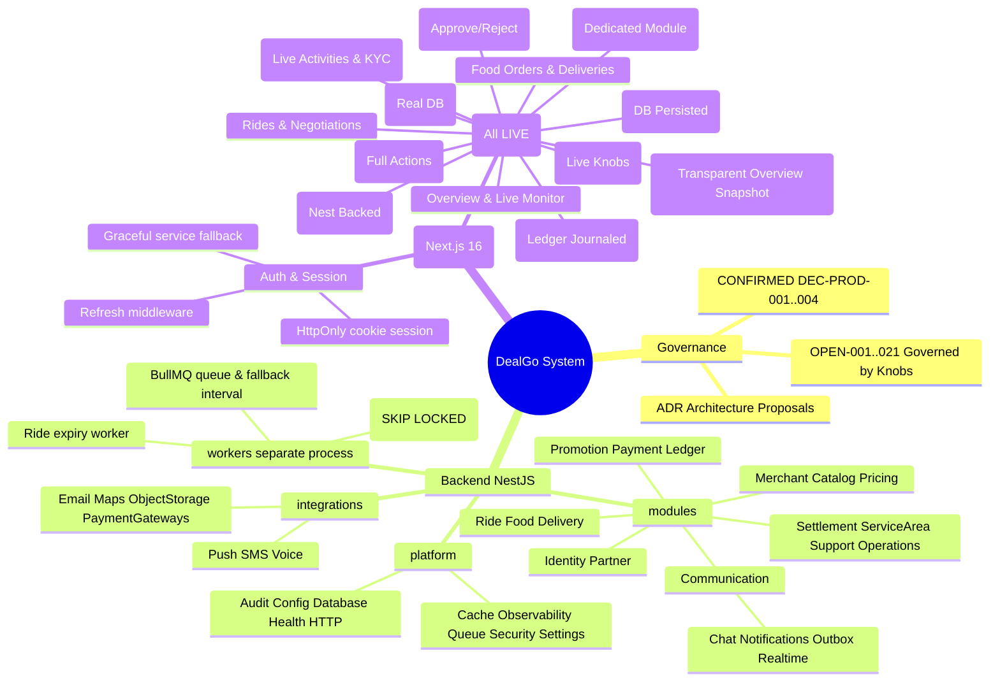

# DealGo — System audit mindmap

> **Mục đích:** Bản đồ điều hướng và đối soát chuẩn xác cho toàn bộ hệ thống DealGo (Admin Website, BFF, NestJS API, Background Workers).
> 
> **Quy tắc đọc:**
> - Runtime = controller/BFF/feature code đang thực thi thực tế trong repository.
> - Mục 4 liệt kê bất biến runtime phải giữ; trạng thái test lấy từ CI, không ghi số liệu cứng ở đây.
> - Các chính sách tiền tệ/pháp lý chưa chốt được neo vào hệ thống cấu hình `OPEN-*` (Platform Settings), không tự ý bịa logic nghiệp vụ khi chưa có ADR/Charter phê duyệt.

---

## 0. Mermaid mindmap

---

## 1. Cụm repository

| Cụm | Path gốc | Vai trò |
|---|---|---|
| Governance | `docs/00-governance/` | CONFIRMED / OPEN / Charter |
| Product | `docs/01-product/` | FR / PRD / UC |
| Domain | `docs/02-domain/` | Pricing, cancel, roles (DRAFT) |
| Architecture | `docs/05-architecture/` | ADR còn `PROPOSED` |
| API docs | `docs/06-data-api/` | OpenAPI specs |
| AI execution | `docs/10-ai-execution/` | Gap matrices + **file này (chuẩn nguồn sự thật)** |
| Backend | `backend/src/{modules,platform,integrations,shared,workers}/` | Nguồn sự thật API; API và worker có composition root riêng |
| Admin Web | `website/app/(admin)/` + `website/features/` + `website/app/api/ops/` | UI + BFF Next.js 16 / React 19 / Tailwind v4 |
| Mobile | `mobile/lib/` | Flutter app đa vai trò (Customer / Merchant / Driver) |
| Design | `design/mockups/` | Mockup & Asset UI SVG |

---

## 2. Admin page → Feature → BFF → Nest (Đối soát Runtime 100% Đồng bộ)

Tất cả các bảng bên dưới đều đã kết nối dữ liệu thật (**LIVE**) từ cơ sở dữ liệu và API NestJS, các bộ lọc chết đã được dọn sạch, và các thao tác (Actions) đã hoàn chỉnh:

| Route | Feature | BFF Endpoint | NestJS API | Dữ liệu | Bộ lọc giao diện (UI) | Thao tác (Actions) |
|---|---|---|---|---|---|---|
| `/overview` | `features/overview` | `GET /api/ops/overview` | `GET /v1/ops/overview` | **LIVE** | — | Làm mới realtime, biểu đồ xu hướng SVG theo giờ (`revenueVnd`/`commissionVnd` = null theo `OPEN-003`) |
| `/monitor` | `features/monitor` | `GET /api/ops/monitor` | `GET /v1/ops/monitor/snapshot` | **LIVE** | — | Làm mới live metrics, tài xế trực tuyến |
| `/exceptions` | `features/exceptions` | `GET /api/ops/exceptions` | `GET /v1/ops/exceptions` | **LIVE** | q, status, page | Xem danh sách ngoại lệ phân loại tự động |
| `/rides` `[code]` | `features/rides` + `ledger` | `/api/ops/rides…` + cancel/reassign/ledger | `/v1/ops/rides…` | **LIVE** | zone, status, q | Xem chi tiết, **Hủy chuyến (Cancel)**, **Điều phối lại (Reassign - Sandbox)**, Xem sổ cái cuốc xe |
| `/negotiations` | `features/negotiations` | `/api/ops/rides` (status=NEGOTIATING) | `/v1/ops/rides` | **LIVE** | status, zone, q | Giám sát các phiên trả giá tài xế - khách hàng theo thời gian thực |
| `/food-orders` `[code]` | `features/food-orders` | `/api/ops/food-orders…` | `/v1/ops/food-orders…` | **LIVE** | status, zone, store, payment, q | Xem chi tiết đơn hàng, món ăn, **Hủy đơn**, **Điều phối lại tài xế giao** |
| `/deliveries` `[code]` | `features/deliveries` | `/api/ops/deliveries` | `/v1/ops/food-orders` | **LIVE** | status, q | Pipeline giao hàng theo các giai đoạn: Chờ tài xế, Đã lấy món, Đang giao, Hoàn tất |
| `/customers` `[code]` | `features/customers` | `/api/ops/customers…` | `/v1/ops/customers…` | **LIVE** | q, region, status | Xem hồ sơ khách hàng; tab Lịch sử hoạt động **truy vấn DB thật** (chuyến xe, đơn ăn, thanh toán) |
| `/drivers` `[code]` | `features/drivers` | `/api/ops/drivers…` | `/v1/ops/drivers…` | **LIVE** | q, region, activity, kyc | Xem thông tin tài xế, trạng thái online, vị trí GPS gần nhất |
| `/drivers/kyc` `[code]` | `features/kyc` | `/api/ops/partner-applications…` | `/v1/ops/partner-applications…` | **LIVE** | q, status | Xét duyệt hồ sơ tài xế: **Phê duyệt (Approve)** / **Từ chối (Reject có lý do)** |
| `/stores` `[code]` | `features/stores` | `/api/ops/stores…` | `/v1/ops/stores…` | **LIVE** | q, sale, region, category, kyb | Xem danh sách nhà hàng, trạng thái đóng/mở cửa, menu món |
| `/stores/approvals` | `features/store-approvals` | `/api/ops/partner-applications?role=MERCHANT` | `/v1/ops/partner-applications` | **LIVE** | q, status | Bảng duyệt gian hàng: Xem giấy phép kinh doanh, **Duyệt gian hàng** / **Từ chối có lý do kiểm toán** |
| `/catalog` | `features/catalog` | `/api/ops/catalog/categories` | `/v1/ops/catalog/categories` | **LIVE** | status, sort, q | Quản lý danh mục ngành hàng món ăn |
| `/catalog/moderation` | `features/catalog-moderation` | `/api/ops/catalog/moderation` + approve/reject | `/v1/ops/catalog/items/:id/approve\|reject` | **LIVE** | q, category (live DB), status | Duyệt món ăn: **Duyệt món (Approve)** / **Từ chối (Reject)** ghi nhận trực tiếp vào `FoodItem.moderationStatus` |
| `/transactions` | `features/transactions` | `/api/ops/transactions` | `/v1/ops/transactions` | **LIVE** | q, service, payment, status | Đối soát giao dịch từ các bản ghi `PaymentIntent` thực tế trong hệ thống |
| `/settlements` | `features/settlements` | `/api/ops/settlements` | `/v1/ops/settlements` | **LIVE** | page | Bảng gom quyết toán theo ngày (COD / Sandbox) kèm xuất CSV |
| `/refunds` | `features/refunds` | `/api/ops/refunds` | `/v1/ops/refunds` | **LIVE** | q, status (chuẩn Nest), service | Quản lý yêu cầu hoàn tiền lưu vết tại bảng `RefundRequest` |
| `/disputes` `[code]` | `features/disputes` | `/api/ops/disputes…` + resolve | `/v1/ops/disputes…` | **LIVE** | type, party, status, priority, q | Xử lý khiếu nại: **Giải quyết (Resolve)** tự động tạo `RefundRequest` và hạch toán bút toán Sandbox Ledger Journal |
| `/promotions` | `features/promotions` | `/api/ops/promotions…` + status | `/v1/ops/promotions…` | **LIVE** | audience, channel, status, q | Phân hệ Khuyến mãi thực thụ (Module riêng): Tạo voucher, Giới hạn ngân sách, Bật/Tắt trạng thái; KPI từ `usedCount`/ngân sách lưu Postgres (chưa ghi redemption) |
| `/reports` | `features/reports` | `/api/ops/overview` | `/v1/ops/overview` | **LIVE** | period (date range) | Trích xuất báo cáo vận hành từ Ops Overview Snapshot với nhãn minh bạch |
| `/notifications` | `features/notifications` | `/api/ops/notifications…` + approve/reject | `/v1/ops/notifications…` | **LIVE** | tab, channel, audience, q | Quản lý chiến dịch thông báo: Tạo mới, **Phê duyệt (Approve)**, **Từ chối (Reject)** kèm lý do kiểm toán |
| `/zones` | `features/zones` | `/api/ops/zones`, `/api/ops/zones/rules` | `/v1/ops/zones`, `/rules` | **LIVE** | rules: q, service, status | Cấu hình khu vực dịch vụ, bảng giá và chính sách vận hành từng vùng |
| `/staff` | `features/staff` | `/api/ops/staff`, `/api/ops/role-grants…` | `/v1/ops/staff`, `/v1/ops/role-grants` | **LIVE** | role, status, scope, q | Danh sách nhân sự Ops + Panel **Phê duyệt phân quyền (Role Grants Review)** cho nhân viên mới |
| `/audit-logs` | `features/audit-logs` | `/api/ops/audit-logs` | `/v1/ops/audit-logs` | **LIVE** | q, entityType, result | Nhật ký kiểm toán các thao tác can thiệp quản trị hệ thống |
| `/settings` | `features/settings` | `/api/ops/platform-settings` | `/v1/ops/platform-settings` | **LIVE** | — | Trang cài đặt chung, liên kết cấu hình nền tảng và tùy chọn hiển thị trình duyệt |
| `/settings/platform` | `features/platform-settings` | `/api/ops/platform-settings` | `/v1/ops/platform-settings` | **LIVE** | — | Bảng điều chỉnh các tham số cấu hình chính sách `OPEN-*` |
| `/settings/faqs` | `features/faqs` | `/api/ops/faqs` | `/v1/ops/faqs` | **LIVE** | status | Soạn thảo và quản lý danh mục câu hỏi thường gặp |
| `/settings/auth-methods` | `features/auth-methods` | `/api/ops/auth-methods` | `/v1/ops/auth-methods` | **LIVE** | — | Bật/tắt phương thức đăng nhập toàn hệ thống (Passkey / SMS / Email) |
| `/settings/content` | `features/content-cms` | `/api/ops/notifications/cms` | `/v1/ops/notifications/cms` | **LIVE** | — | Soạn thảo điều khoản dịch vụ, chính sách bảo mật và kênh hỗ trợ (lưu trên CMS Nest backend) |

---

## 3. NestJS API map (Kiến trúc phân hệ chuẩn)

### 3.1 Public & Client APIs

| Module | Controller | Chức năng chính |
|---|---|---|
| Auth & Identity | `modules/identity/auth.controller.ts` | `/v1/auth/phone/*`, passkey, email (`register` → `register/:id/verify|resend`, `password-resets`), refresh |
| Me Profile | `modules/identity/me.controller.ts` | `/v1/me`, trạng thái trực tuyến tài xế |
| Role Grants | `modules/identity/role-grants.controller.ts` | `/v1/me/role-grants` yêu cầu quyền |
| Partner Self | `modules/partner/me-partner-applications.controller.ts` | `/v1/me/partner-applications` đăng ký đối tác |
| Ride Booking | `modules/ride/ride.controller.ts` | create → offer → select → en-route → arrived → start → complete / cancel |
| Food Order | `modules/food-order/food.controller.ts` | stores, place → accept → ready → claim → pickup → deliver / cancel |
| Merchant Catalog | `modules/catalog/merchant-catalog.controller.ts` | Quản lý món ăn, vị trí cửa hàng |
| Promotions Client | `modules/promotion/promotion-client.controller.ts` | `POST /v1/promotions/validate` báo giá giảm cho mã (yêu cầu customer session; chỉ quote, chưa ghi redemption) |
| Chat | `modules/communication/chat/chat.controller.ts` | `/v1/rides|:food/orders/:id/messages` (trang 1 = 50 tin mới nhất); tin mới phát socket `chatMessage` tới `user:` của khách + tài xế |
| Phase route | `modules/communication/realtime/phase-route.service.ts`, `routing/phase-route-cache.ts` | Một tuyến mỗi pha (cache), re-route khi lệch theo `ROUTE_OFF_ROUTE_THRESHOLD_M` / `ROUTE_REROUTE_MIN_INTERVAL_SECONDS`; socket `routeUpdated` |
| Voice calls | `integrations/voice/voice.controller.ts` | `POST /v1/rides/:id/calls`, `POST /v1/food/orders/:id/calls`, `GET /v1/calls/config`, `GET /v1/calls/:id`, `POST /v1/calls/:id/accept|decline|end` (LiveKit, `DEC-PROD-064`) |
| Webhooks | `modules/payment/payment-webhook.controller.ts` | `/v1/payments/webhooks/vnpay\|momo` |

### 3.2 Ops & Administration APIs

| Controller | Đường dẫn | Chức năng |
|---|---|---|
| `ops-overview.controller.ts` | `/v1/ops/overview` | Snapshot tổng quan số liệu theo múi giờ Asia/Ho_Chi_Minh |
| `ops-monitor.controller.ts` | `/v1/ops/monitor/snapshot` | Bảng giám sát thời gian thực |
| `ops-customers.controller.ts` | `/v1/ops/customers` | Danh mục khách hàng & lịch sử cuốc xe, đơn hàng thực tế |
| `ops-drivers.controller.ts` | `/v1/ops/drivers` | Danh mục tài xế & vị trí |
| `ops-staff.controller.ts` | `/v1/ops/staff` | Danh mục quản trị viên & nhân sự vận hành |
| `ops-role-grants.controller.ts` | `/v1/ops/role-grants` | **Danh sách + Duyệt (Approve) / Từ chối (Reject)** quyền nhân sự |
| `ops-partner-applications.controller.ts` | `/v1/ops/partner-applications` | Danh sách + Duyệt KYC tài xế & KYB quán ăn |
| `ops-rides.controller.ts` | `/v1/ops/rides` | Tra cứu cuốc xe, sổ cái, hủy cuốc, điều phối lại |
| `ops-food-orders.controller.ts` | `/v1/ops/food-orders` | Tra cứu đơn món, hủy đơn, điều phối lại |
| `ops-stores.controller.ts` | `/v1/ops/stores` | Tra cứu danh sách cửa hàng liên kết |
| `ops-catalog.controller.ts` | `/v1/ops/catalog/categories`, `moderation` | Quản lý danh mục & duyệt món ăn ghi DB thật |
| `promotion-ops.controller.ts` | `/v1/ops/promotions` | **Quản lý khuyến mãi, tạo voucher, bật/tắt trạng thái** |
| `ops-exceptions.controller.ts` | `/v1/ops/exceptions` | Phân loại ngoại lệ tự động |
| `ops-settlements.controller.ts` | `/v1/ops/settlements` | Gom đợt thanh toán quyết toán |
| `ops-transactions.controller.ts` | `/v1/ops/transactions` | Tra cứu dòng tiền PaymentIntent |
| `ops-disputes.controller.ts` | `/v1/ops/disputes` | Tiếp nhận khiếu nại & giải quyết có hạch toán |
| `ops-refunds.controller.ts` | `/v1/ops/refunds` | Danh sách yêu cầu hoàn tiền lưu vết Prisma |
| `ops-zones.controller.ts` | `/v1/ops/zones`, `/rules` | Quản lý vùng dịch vụ & quy tắc tính giá |
| `ops-platform-settings.controller.ts` | `/v1/ops/platform-settings` | Cấu hình tham số vận hành |
| `ops-notifications.controller.ts` | `/v1/ops/notifications`, `cms` | Chiến dịch thông báo & quản trị nội dung bài viết CMS |

### 3.3 Background Workers & Concurrency Architecture

- Composition root riêng biệt tại `backend/src/workers/worker-main.ts`.
- `WorkersModule` chạy độc lập với API web server, bao gồm:
  1. `RideExpiryService`: Quét cuốc xe hết hạn đàm phán/chờ tài xế định kỳ.
  2. `OutboxRelayService`: Relay thông báo & sự kiện bằng cơ chế `FOR UPDATE SKIP LOCKED` và khóa nguyên tử `lockedAt`.
  3. `WorkersBootstrap`: Quản lý lặp BullMQ có kết nối Redis hoặc fallback interval tự động khi chạy môi trường dev.

---

## 4. Bất biến hệ thống phải giữ (Runtime invariants)

Các điểm dưới đây là hành vi hiện tại của code. Khi sửa code, không được làm hỏng chúng; mỗi dòng có test hoặc cơ chế kiểm soát tương ứng.

### 4.1 Dữ liệu thật, không fixture

| Phân hệ | Hành vi hiện tại |
|---|---|
| Kiểm duyệt món | Duyệt/từ chối ghi trạng thái `FoodItemModerationStatus` vào DB; BFF `/api/ops/catalog/items/:id/approve|reject`. Không sinh dữ liệu mẫu khi DB trống. |
| Khiếu nại & hoàn tiền | `DisputeCase` và `RefundRequest` lưu Postgres; resolve tạo `RefundRequest` và bút toán ledger. Hoàn tiền chỉ là bản ghi, chưa chuyển tiền thật. |
| Giao dịch | `ops-transactions.service.ts` chỉ đọc bảng `PaymentIntent`. |
| Hoạt động khách hàng | `getCustomerActivities` đọc trực tiếp `Ride` và `FoodOrder`. |
| Khuyến mãi | `PromotionModule` lưu bảng `promotions`; `validate` yêu cầu phiên khách (`CustomerSessionGuard`), `customerId` lấy từ phiên. |
| Báo cáo / Tổng quan | Số liệu lấy từ snapshot vận hành thật; `revenueVnd`/`commissionVnd` ở Tổng quan trả `null`. Số liệu hoa hồng xem ở Dòng tiền › Đối soát. |
| Nội dung CMS | Lưu DB qua API Nest, không lưu `localStorage`. |

### 4.2 Tiền và giá

| Quy tắc | Hành vi hiện tại |
|---|---|
| Phí giao Food | Server tự tính bằng `quoteDeliveryFare(storeId, dropoff)`; không nhận phí từ client. |
| Tham số tiền | Hoa hồng, phí huỷ, voucher, chu kỳ đối soát là cài đặt Admin ([bản đồ cài đặt](open-admin-settings-map.md)). |
| Ledger | Bút toán ghi cùng transaction DB với thay đổi trạng thái; idempotent. |

### 4.3 Xác thực và phân quyền

| Quy tắc | Hành vi hiện tại |
|---|---|
| Đăng ký email | Hai bước bằng OTP email; Account chỉ tạo sau khi xác minh; đăng nhập chỉ cho email đã xác minh; có luồng quên mật khẩu (`password_resets`). |
| OTP SĐT | Challenge không tạo user; xác minh lần đầu cấp `CUSTOMER` `ACTIVE` ở mọi môi trường. |
| Role bị tạm ngưng | User không tự mở lại grant `SUSPENDED` (403 `ROLE_GRANT_SUSPENDED`). |
| Phiên ops | `OpsSessionGuard` kiểm tra grant `OPS` `ACTIVE` từ DB mỗi request; quyền chi tiết theo ma trận RBAC (`GET /v1/ops/staff/rbac-matrix`). Duyệt quyền chờ qua `GET /v1/ops/role-grants`. |
| KYC/KYB | `PartnerEligibilityService` chặn tài xế/quán chưa được duyệt khi xem và nhận đơn (trừ khi `PARTNER_ELIGIBILITY_BYPASS` ở môi trường local). |

### 4.4 Hạ tầng

| Quy tắc | Hành vi hiện tại |
|---|---|
| Outbox | `PrismaOutboxRepository` claim bằng `FOR UPDATE SKIP LOCKED`, không gửi trùng khi nhiều worker. `OutboxModule` nạp `PushModule`, `RealtimeModule`, `RideModule`, `FoodModule`. |
| Worker | `StandaloneWorkerModule` chỉ nạp `WorkersModule` và `ThrottlerModule`. |
| Audit | `AuditLogsModule` ở `platform/audit`, dùng chung cho mọi module. |
| Body limit | `/v1/me/avatar` nhận tới 3 MB; lỗi body-parser trả 413/400. |
| CSP website | `connect-src` dựng từ env; `localhost` chỉ có ở dev. |
| Pool DB | `DATABASE_POOL_MAX` mỗi process. |

### 4.5 Việc còn mở

- Ma trận RBAC ops chi tiết theo vai trò nhân sự vẫn đang hoàn thiện.
- Hoàn tiền thật qua cổng thanh toán chưa có (`OPEN-002`).
- Danh sách khoảng trống theo từng phần: [backend](backend-gap-matrix.md), [Admin web](admin-web-gap-matrix.md), [Flutter](mobile-flutter-gap-matrix.md).

---

## 5. Danh mục chính sách `OPEN-*` (Governed Knobs)

Tham số nghiệp vụ nhạy cảm được quản lý bằng cài đặt Admin tại `/settings/platform` (Cài đặt › Tham số) thay vì hằng số trong code. Danh sách đầy đủ: [bản đồ cài đặt Admin](open-admin-settings-map.md).

| Mã | Nội dung chính sách | Cơ chế kỹ thuật hiện tại | Lưu ý cho Agent |
|---|---|---|---|
| `OPEN-001` | Ranh giới khu vực dịch vụ | Bảng `service_regions`, Admin › Khu vực & Giá (`/v1/ops/zones`) | Không tự chế thuật toán geofencing |
| `OPEN-002` | Cổng thanh toán trực tuyến | Ra mắt chỉ tiền mặt (`PAYMENT_PROVIDER=cash-only`); VNPAY/MoMo mới tạo intent chuyển hướng | Không tuyên bố đã thu tiền thật |
| `OPEN-003` | Biểu phí và hoa hồng | Khoảng giá theo hạng xe; hoa hồng xe máy / ô tô / tài xế giao đồ ăn / quán là cài đặt Admin | Giá trị mặc định là DRAFT, chờ chủ dự án duyệt |
| `OPEN-004` | Điều phối | Tài xế tự xem yêu cầu trong bán kính `DRIVER_SEARCH_RADIUS_KM` và trả giá; không tự ghép | Giữ mô hình trả giá kiểu inDrive |
| `OPEN-005` | Số việc đồng thời | `MAX_CONCURRENT_JOBS_PER_DRIVER` (tính cả chuyến và đơn) | Đã kiểm tra khi chọn tài xế và khi nhận đơn |
| `OPEN-006` | Duyệt đối tác | KYC/KYB có audit; tài xế ô tô cần thêm bảo hiểm (`PARTNER_CAR_KYC_EXTRA_DOCS`) | Môi trường local có thể bỏ qua duyệt |
| `OPEN-019` | Giới hạn trả giá | `RIDE_OFFER_TTL_SECONDS`, `RIDE_MAX_OFFER_EDITS_PER_DRIVER`, `RIDE_COUNTER_MAX_PERCENT_OF_OFFER`, `RIDE_MAX_LIVE_OFFERS_PER_RIDE` | Số liệu chờ PO duyệt |

---

## 6. Chỉ mục tệp tin chính (Codebase Index)

### Website (`website/`)
- Cấu hình điều hướng & bộ lọc: `website/lib/{admin-nav-items,admin-filter-options}.ts`
- Đường dẫn API & kết nối BFF: `website/lib/api/{paths,client,ops-upstream}.ts`
- Quản lý phiên Ops & cookie: `website/lib/ops-session.ts`, `website/app/(admin)/layout.tsx`
- Biểu đồ xu hướng SVG: `website/components/ui/ops-service-trend-chart.tsx`
- Toàn bộ tính năng vận hành: `website/features/{overview,rides,food-orders,deliveries,customers,drivers,stores,store-approvals,catalog,catalog-moderation,transactions,settlements,refunds,disputes,promotions,reports,notifications,zones,staff,platform-settings,content-cms}/`

### Backend (`backend/`)
- Modules nghiệp vụ: `backend/src/modules/{identity,partner,ride,food-order,delivery,merchant,catalog,pricing,promotion,payment,ledger,settlement,service-area,support,operations}/`
- Giao tiếp & sự kiện: `backend/src/modules/communication/{chat,notifications,outbox,realtime}/`
- Tích hợp ngoài: `backend/src/integrations/{email,maps,object-storage,payment-gateways,push,sms,voice}/` (gọi thoại LiveKit ở `voice/`)
- Nền tảng cốt lõi: `backend/src/platform/{audit,cache,config,database,health,http,observability,queue,security,settings}/`
- Tiến trình nền: `backend/src/workers/{worker-main,workers.module,workers.bootstrap,ride-expiry.service}.ts`

---

## 7. Cách giữ tài liệu này đúng

- Khi thêm trang Admin, route BFF hoặc module Nest: cập nhật bảng mục 2–3 trong cùng thay đổi.
- Khi thay đổi một bất biến ở mục 4: sửa dòng tương ứng để nó mô tả hành vi mới, không ghi chú lịch sử; lịch sử nằm ở git và changelog của sổ quyết định.
