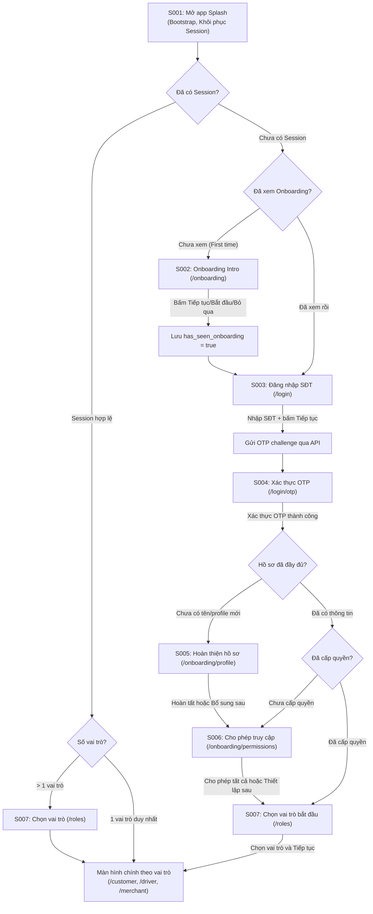

# DealGo Mobile App Entry & Onboarding Flow Specification (S001–S007)

> **Trạng thái trong code:** đã có Splash `/splash` là màn khởi đầu và màn hồ sơ `profile_setup_page.dart`; màn cho phép truy cập S006 (`/onboarding/permissions`) mới có hằng route, chưa có trang. Mục "Hiện trạng" bên dưới mô tả bối cảnh lúc viết (2026-10-17).

> **Mục tiêu:** Căn chỉnh và hoàn thiện toàn bộ luồng khởi động, xác thực và nhập môn của ứng dụng Flutter DealGo theo bộ thiết kế mockup mới nhất (`design/mockups/new/S001.png` đến `S007.png`).

---

## 1. Bối cảnh & Hiện trạng

- **Hiện trạng:**
  - Ứng dụng khởi động trực tiếp vào `/onboarding` (`CustomerOnboardingPage`), bỏ qua màn hình Splash `S001`.
  - Màn hình Splash (`DealGoSplashScreen`) mới chỉ được hiển thị tạm bợ trong trạng thái khôi phục phiên (`AuthRestoring`) tại `phone_login_page.dart`.
  - Giao diện `CustomerOnboardingPage` (S002) và `PhoneLoginPage` (S003) đang sử dụng hình ảnh minh họa vector cũ phẳng (`banner_danang_hero.png`), chưa đạt chất lượng trực quan cao cấp của bộ mockup mới.
  - Các màn hình `S005` (Hoàn thiện hồ sơ) và `S006` (Cấp quyền truy cập) đang thiếu trong cây định tuyến (`screen-inventory.md` đánh dấu `MISSING`).
  - Màn hình `S007` (`RolePickerPage`) dùng các card văn bản cơ bản, chưa có minh họa 3D cho 3 vai trò (Khách hàng, Cửa hàng, Tài xế).

- **Mục tiêu sau triển khai:**
  - Luồng khởi động mượt mà, chuẩn xác từ `S001` -> `S002` -> `S003` -> `S004` -> `S005` -> `S006` -> `S007` -> Trang chủ theo vai trò.
  - Lưu cờ `has_seen_onboarding` để người dùng quay lại không bị buộc xem lại onboarding.
  - Hình ảnh đồ họa sắc nét, trích xuất chuẩn xác từ bộ mockup mới Đà Nẵng (Cầu Rồng, xe hơi, ẩm thực, khiên bảo mật OTP, nhân vật 3D các vai trò).
  - Tương thích 100% với kiến trúc hiện có (`GoRouter`, `AuthCubit`, `PhoneAuthCubit`, Design Tokens).

---

## 2. Chi tiết luồng người dùng (User Journey Flow)

---

## 3. Đặc tả từng màn hình

### 3.1. S001 — Splash Screen (`/splash`)
- **Tuyến đường:** `AuthRoutes.splash` (`/splash`), đặt làm `initialLocation` mặc định của ứng dụng.
- **Visual:**
  - Header: Logo `DealGoLogo.stacked` (Wordmark + slogan "Đi muôn nơi · Ăn vạn món").
  - Hero Center: Tranh vẽ Đà Nẵng (`hero_dealgo_danang.png`) với 2 badge nổi:
    - Badge 1 (Đặt xe): Icon xe tím, "Đặt xe", "Đi muôn nơi an toàn, tiện lợi ->".
    - Badge 2 (Đồ ăn): Icon túi xanh, "Đồ ăn", "Hàng ngàn món ngon mỗi ngày ->".
  - Bottom: Thanh tiến trình hoạt họa gradient tím-xanh (`AnimatedBuilder` / `AnimationController`) và thông báo "Đang chuẩn bị trải nghiệm của bạn...".
- **Hành vi:**
  - Chờ khôi phục phiên (`AuthCubit.restore()`) và thời gian animation tối thiểu (1.5s - 2.0s).
  - Tự động điều hướng dựa vào kết quả phiên: nếu đã đăng nhập chuyển hướng về role home hoặc `/roles`; nếu chưa đăng nhập kiểm tra `has_seen_onboarding` để chuyển `/onboarding` hoặc `/login`.

### 3.2. S002 — Onboarding Walkthrough (`/onboarding`)
- **Tuyến đường:** `AuthRoutes.onboarding` (`/onboarding`).
- **Visual:**
  - Top Bar: Logo DealGo và nút "Bỏ qua".
  - Hero Visual: Tranh Đà Nẵng 3D với 2 badge nổi "Đặt xe" và "Đồ ăn".
  - Carousel 3 bước:
    - Bước 1: "Một ứng dụng, vạn trải nghiệm" — "Đặt xe, khám phá món ngon và mua sắm hằng ngày — tất cả trong DealGo."
    - Bước 2: "Di chuyển nhanh, an toàn & tiết kiệm" — "Tài xế bản địa đón tận nơi, theo dõi lộ trình thời gian thực, cước phí minh bạch."
    - Bước 3: "Món ngon nóng hổi, giao siêu tốc" — "Hàng ngàn quán ăn, nhà hàng đặc sản chuẩn vị Đà Nẵng sẵn sàng phục vụ bạn."
  - Indicator: 3 dots indicator chuyển động mượt mà.
  - CTA Button: Nút `DealGoPrimaryButton` ("Tiếp tục ->" hoặc "Bắt đầu ngay"), kèm nhãn "Bước X trong 3".
- **Hành vi:** Khi người dùng bấm "Bỏ qua" hoặc hoàn tất bước 3, lưu cờ `has_seen_onboarding = true` và điều hướng sang `/login`.

### 3.3. S003 — Phone Login (`/login`)
- **Tuyến đường:** `AuthRoutes.login` (`/login`).
- **Visual:**
  - Top Bar: Logo DealGo bên trái, nút "Trợ giúp" bên phải.
  - Hero Visual: Minh họa Đà Nẵng cầu Rồng, xe ô tô và bát phở/trà sữa.
  - Tiêu đề: "Chào mừng đến với DealGo" — "Nhập số điện thoại để tiếp tục đặt xe, gọi đồ ăn và mua sắm."
  - Ô nhập số điện thoại: Badge cờ Việt Nam `[VN +84]` kết hợp TextField bo góc mềm.
  - Gợi ý bảo mật: Biểu tượng ổ khóa "Chúng tôi sẽ gửi mã OTP để xác minh số điện thoại của bạn."
  - Nút chính: `DealGoPrimaryButton` nhãn "Tiếp tục ->".
  - Tùy chọn khác: 2 nút viền mỏng "Đăng nhập bằng Email" và "Dùng Passkey".
  - Footer: "Bằng việc tiếp tục, bạn đồng ý với Điều khoản và Chính sách quyền riêng tư."
- **Hành vi:** Kiểm tra độ hợp lệ của số điện thoại, gọi `PhoneAuthCubit.submitPhone(...)` và chuyển sang `/login/otp`.

### 3.4. S004 — OTP Verification (`/login/otp`)
- **Tuyến đường:** `AuthRoutes.otp` (`/login/otp`).
- **Visual:**
  - Top Bar: Logo DealGo bên trái, nút "Đổi số" bên phải (bấm vào quay lại `/login`).
  - Hero Visual: Minh họa điện thoại nhận tin nhắn OTP + khiên bảo mật 3D tím (`hero_otp_shield.png`).
  - Tiêu đề: "Xác minh số điện thoại" — "Nhập mã 6 số đã gửi đến +84...".
  - Nhập OTP: 6 ô vuông bo góc riêng biệt, tự động nhảy ô và có con trỏ nhấp nháy.
  - Bộ đếm thời gian: "Gửi lại mã sau 30 giây", khi hết giờ hiển thị link "Gửi lại mã".
  - Banner bảo mật: Card khiên tím "Mã OTP giúp bảo vệ tài khoản của bạn."
  - Nút chính: "Xác nhận ->", nút phụ: "Gửi lại mã".
- **Hành vi:** Xác thực mã 6 số qua `PhoneAuthCubit.submitOtp(...)`. Khi thành công, chuyển tiếp sang `S005` (nếu tài khoản mới) hoặc `S006` / `S007`.

### 3.5. S005 — Hoàn thiện hồ sơ (`/onboarding/profile`)
- **Tuyến đường:** `AuthRoutes.profileSetup` (`/onboarding/profile`).
- **Visual:**
  - Header: Nút back + tiêu đề "Hoàn thiện hồ sơ".
  - Hero Banner: "Chỉ còn một bước nữa thôi! Hoàn thiện thông tin để trải nghiệm trọn vẹn cùng DealGo."
  - Avatar: Vòng tròn đại diện màu tím với icon máy ảnh "Ảnh đại diện (tuỳ chọn)".
  - Form:
    - Họ và tên (TextField)
    - Email (TextField)
    - Ngày sinh (tuỳ chọn) (DatePicker field)
    - Giới tính (3 pill buttons: Nam / Nữ / Khác)
  - Thông báo: Icon info "Thông tin này giúp cá nhân hoá trải nghiệm DealGo."
  - Nút chính: "Hoàn tất ->", Nút phụ: "Bổ sung sau".
- **Hành vi:** Cập nhật thông tin profile của người dùng và chuyển sang bước cấp quyền `S006`.

### 3.6. S006 — Cho phép truy cập / Permissions (`/onboarding/permissions`)
- **Tuyến đường:** `AuthRoutes.permissions` (`/onboarding/permissions`).
- **Visual:**
  - Header: Logo DealGo.
  - Tiêu đề: "Cho phép truy cập" — "Bật các quyền cần thiết để sử dụng DealGo thuận tiện hơn."
  - 3 thẻ quyền:
    - **Vị trí**: "Tìm xe, quán ăn và cửa hàng gần bạn" -> Nút "Cho phép ->".
    - **Thông báo**: "Nhận cập nhật chuyến đi, đơn hàng và ưu đãi" -> Nút "Cho phép ->".
    - **Micro / Cuộc gọi**: "Liên hệ tài xế hoặc cửa hàng khi cần" -> Nút "Cho phép ->".
  - Nút chính: "Cho phép tất cả ->", Nút phụ: "Thiết lập sau".
  - Footer: "Bạn có thể thay đổi các quyền này bất cứ lúc nào trong phần Cài đặt của ứng dụng."
- **Hành vi:** Xin quyền thông qua các handler có sẵn (hoặc mock an toàn nếu trên môi trường không hỗ trợ native OS dialog), sau đó chuyển tiếp sang `S007`.

### 3.7. S007 — Chọn vai trò / Role Picker (`/roles`)
- **Tuyến đường:** `AuthRoutes.roles` (`/roles`).
- **Visual:**
  - Top Bar: Logo DealGo và nút "Trợ giúp".
  - Tiêu đề: "Bạn muốn dùng DealGo theo vai trò nào?" — "Bạn có thể chuyển đổi vai trò bất cứ lúc nào."
  - 3 thẻ vai trò 3D trực quan:
    - **Khách hàng**: Tranh 3D cô gái cầm điện thoại (`role_customer_3d.png`), "Đặt xe, gọi đồ ăn, mua sắm hằng ngày".
    - **Cửa hàng**: Tranh 3D chủ quán cầm tablet (`role_merchant_3d.png`), "Quản lý thực đơn, nhận đơn, theo dõi doanh thu".
    - **Tài xế**: Tranh 3D bác tài DealGo trên xe máy tím (`role_driver_3d.png`), "Nhận chuyến, giao đồ ăn, tăng thu nhập".
  - Nút chọn vai trò: Đánh dấu viền gradient tím-xanh và tích tròn checkmark khi được chọn.
  - Nút chính: "Tiếp tục ->", nút phụ: "Tìm hiểu thêm".
- **Hành vi:** Chuyển người dùng vào vai trò đã chọn (`/customer`, `/merchant`, hoặc `/driver`).

---

## 4. Cấu trúc mã nguồn & Trách nhiệm tệp

1. **Routing & Guards:**
   - `mobile/lib/features/identity/domain/auth_redirect.dart`:
     - Bổ sung các hằng số: `AuthRoutes.splash = '/splash'`, `AuthRoutes.profileSetup = '/onboarding/profile'`, `AuthRoutes.permissions = '/onboarding/permissions'`.
     - Cập nhật logic điều hướng `authRedirect` để xử lý trạng thái khởi động, khôi phục session, kiểm tra profile chưa hoàn thiện và chuyển hướng phù hợp.
   - `mobile/lib/app/router/app_router.dart`:
     - Khai báo các GoRoute cho `/splash`, `/onboarding`, `/onboarding/profile`, `/onboarding/permissions`, `/login`, `/login/otp`, `/roles`.
     - Đặt `initialLocation = AuthRoutes.splash`.

2. **Presentation Pages & Widgets:**
   - `mobile/lib/features/identity/presentation/pages/splash_page.dart`: Nâng cấp giao diện S001 theo thiết kế mới, tự động điều hướng sau thời gian nạp tối thiểu.
   - `mobile/lib/features/onboarding/presentation/pages/customer_onboarding_page.dart`: Nâng cấp giao diện S002 với hình ảnh hero 3D mới và card badge nổi.
   - `mobile/lib/features/identity/presentation/pages/phone_login_page.dart`: Nâng cấp S003 với hero layout, cờ +84 và nút đăng nhập email/passkey.
   - `mobile/lib/features/identity/presentation/pages/otp_page.dart`: Nâng cấp S004 với 6 ô PIN rời, đếm ngược và hình ảnh khiên bảo mật.
   - `mobile/lib/features/onboarding/presentation/pages/profile_setup_page.dart` (mới): Triển khai màn hình S005.
   - `mobile/lib/features/onboarding/presentation/pages/permissions_page.dart` (mới): Triển khai màn hình S006.
   - `mobile/lib/features/shell/presentation/role_picker_page.dart`: Nâng cấp S007 với 3 thẻ vai trò 3D cao cấp.

3. **Storage & State:**
   - `mobile/lib/core/storage/onboarding_storage.dart`: Helper đơn giản lưu/đọc `has_seen_onboarding`.

4. **Assets:**
   - Đã chuẩn bị các asset chất lượng cao trong `mobile/assets/images/`:
     - `hero_dealgo_danang.png` (767x560 - Cầu Rồng, xe trắng, ẩm thực, lá basil)
     - `hero_otp_shield.png` (767x550 - Điện thoại OTP + khiên tím)
     - `role_customer_3d.png`, `role_merchant_3d.png`, `role_driver_3d.png` (3D nhân vật)

---

## 5. Kế hoạch kiểm thử & Tiêu chí nghiệm thu (Quality Gates)

- **AC1:** App khởi động tại S001 (`/splash`), hiển thị logo DealGo, hero Đà Nẵng với 2 badge nổi "Đặt xe" và "Đồ ăn", cùng thanh progress bar động.
- **AC2:** Lần đầu mở app, từ S001 tự động chuyển sang S002 Onboarding. Người dùng có thể lướt 3 slide hoặc bấm "Bỏ qua" để tới S003 Login.
- **AC3:** Khi đã xem hoặc bỏ qua Onboarding, các lần mở app sau (chưa đăng nhập) sẽ chuyển trực tiếp từ S001 sang S003 Login.
- **AC4:** Tại S003 Login, nhập SĐT hợp lệ và bấm "Tiếp tục" chuyển sang S004 OTP với đúng số điện thoại và đếm ngược 30 giây.
- **AC5:** Tại S004 OTP, nhập mã OTP hợp lệ sẽ đăng nhập thành công và chuyển sang S005 Profile (nếu cần hoàn thiện) hoặc S006 / S007.
- **AC6:** Tại S007 Role Picker, 3 vai trò hiển thị đẹp mắt với hình ảnh 3D, khi chọn vai trò sẽ chuyển hướng chuẩn xác vào role shell tương ứng.
- **AC7:** Tất cả các bài kiểm thử widget/unit tests trong `mobile/test/` đều vượt qua (`flutter test`).
